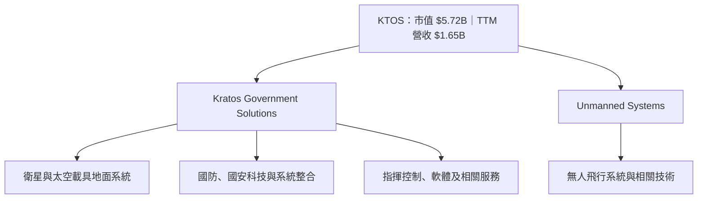
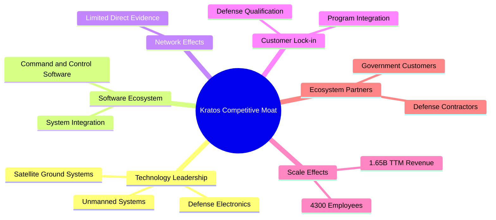
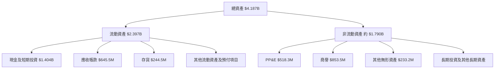
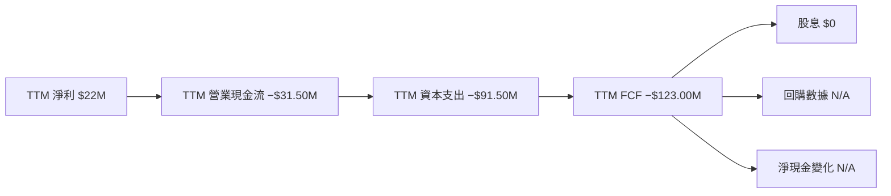
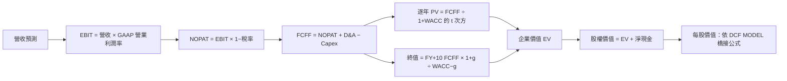
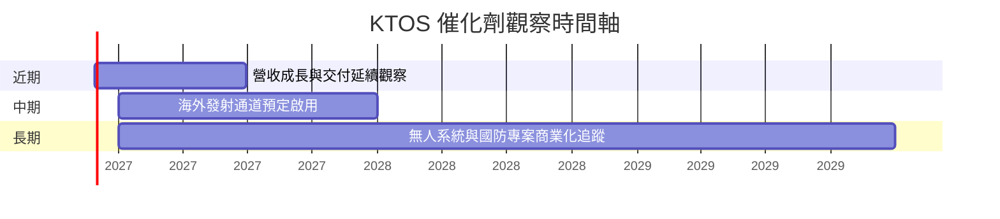
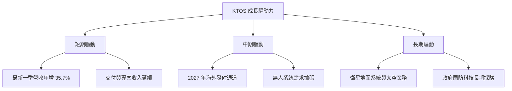
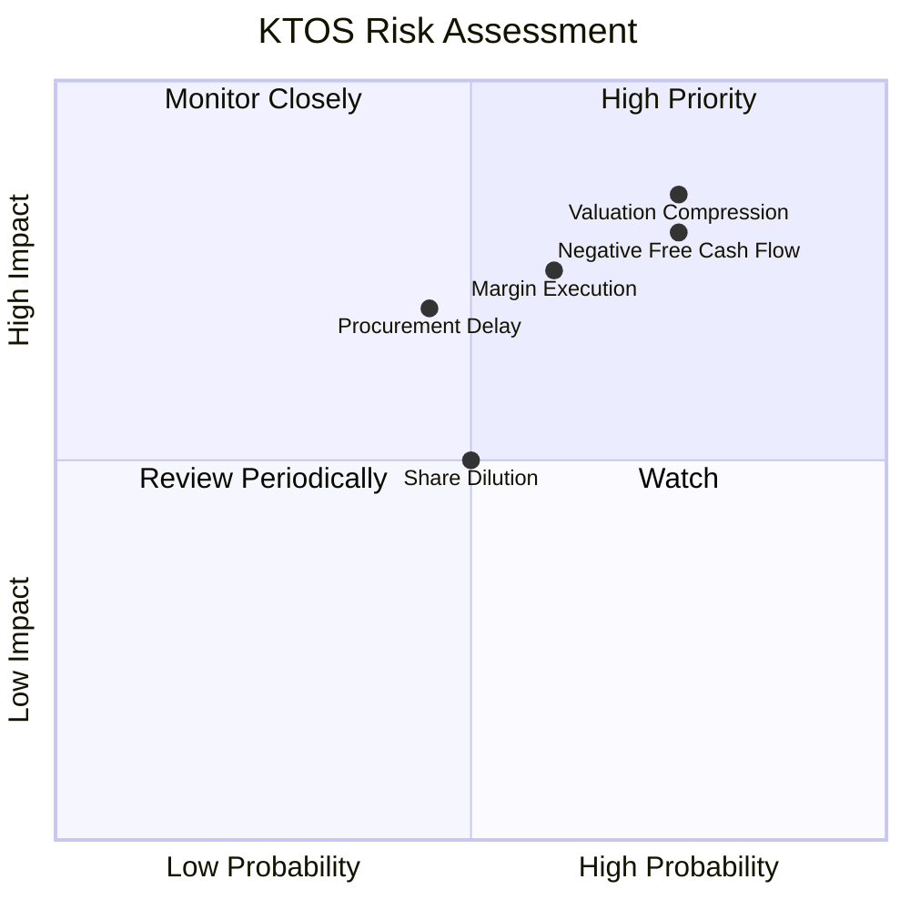
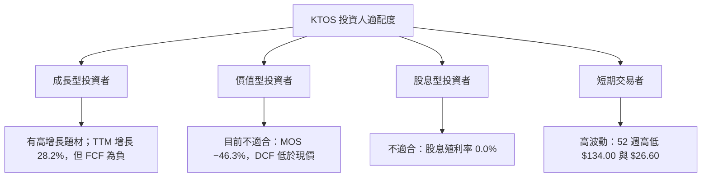

# KTOS 基本面深度分析報告
> **報告日期**：2026-11-28 ｜ **語言**：繁體中文 ｜ **數據來源**：SEC 申報資料 (XBRL)、Yahoo Finance、Finviz、StockAnalysis、Roic.ai ｜ **分析師**：CFA 級機構研究

---

## 目錄

| # | 章節 | 核心結論 |
|---|------|----------|
| 1 | 執行摘要 | 賣出；加權合理價值 $19.79；MOS −46.3% |
| 2 | 公司概覽與商業模式 | 國防科技、無人系統及政府解決方案具技術與客戶關係門檻；分部營收占比未提供 |
| 3 | 損益表深度分析 | TTM 營收 $1.65B、成長 28.2%；TTM 營業利益率僅 0.4% |
| 4 | 資產負債表分析 | VERIFIED figures 顯示淨現金 $1.40B；流動性充足，債務明細缺漏 |
| 5 | 現金流量深度分析 | TTM FCF −$123.00M，資本支出高於營業現金流 |
| 6 | 獲利能力與資本效率 | ROIC 0.2% 低於 WACC 10.18%，目前未創造經濟價值 |
| 7 | 相對估值分析 | 同業倍數顯示估值偏高；DCF 情境值均低於現價 |
| 8 | DCF 內在價值評估 | DCF 基準值 $9.41；加權合理價值 $19.79，MOS −46.3% |
| 9 | 成長催化劑 | 最新一季營收年增 35.7%；新市場機會可期，但 TAM 數據未提供 |
| 10 | 風險矩陣 | 估值、現金流轉負與獲利率低是主要風險 |
| 11 | 投資建議 | 賣出；等待基本面與估值改善，並監控營收、利潤率及 FCF |

---

## 1. 執行摘要

KTOS 的增長數據具吸引力：TTM 營收 $1.65B、年增 28.2%，最新一季營收年增 35.7%。但獲利與現金流尚未跟上：TTM 營業利益率 0.4%、ROIC 0.2% 對比 WACC 10.18%，TTM FCF 為 −$123.00M。DCF 基準價值 $9.41、相對 2026-11-25 收盤價 $28.95 溢價 207.7%；三角驗證後加權合理價值 $19.79，MOS 為 −46.3%。依 MOS 門檻為**賣出**，與 ROIC 低於 WACC、FCF 為負及估值偏高的基本面證據一致，沒有做質化調整。

### 1.0 一頁式投資儀表板

| 項目 | 內容 |
|------|------|
| **投資論點（3 句）** | ① TTM 營收年增 28.2%，最新一季年增 35.7%，顯示需求與交付擴張。② TTM 營業利益率僅 0.4%、ROIC 0.2%，遠低於 WACC 10.18%，成長尚未轉化為股東回報。③ TTM FCF −$123.00M、FCF Yield −2.15%，且加權合理價值 $19.79 低於現價。 |
| **綜合評分** | **5.3/10**（引用 1.1 評分卡） |
| **財務健康** | 🟡 VERIFIED figures 顯示淨現金 $1.40B；但 TTM FCF −$123.00M，現金流品質弱 |
| **ROIC vs WACC** | 0.2% vs 10.18%；🟥 資本報酬低於資金成本 |
| **FCF 趨勢** | TTM FCF −$123.00M；FCF Yield −2.15% |
| **估值** | Forward P/E 27.24x ｜ EV/EBITDA 50.84x（市場數據）｜ FCF Yield −2.15% |
| **DCF 內在價值（基準）** | $9.41 ｜ 現價相對 DCF 溢價 207.7% |
| **安全邊際（MOS）** | **−46.3%**＝($19.79 − $28.95) ÷ $19.79；🔴 為負 |
| **預期報酬（基準情境 12M）** | DCF 基準情境相對現價 −67.5%；此為模型情境值，非經紀商目標價 |
| **關鍵風險（前二）** | 利潤率無法隨營收放大；高資本支出下 FCF 持續為負 |
| **評級 + 信心度** | 🔴 **賣出** ｜ 信心：中（DCF 模型輸入與展示數值存在四捨五入差異） |

### 1.1 綜合評分卡（全報告唯一）

| 維度 | 評分（1–10） | 主要依據（引用數字與其來源章節） |
|------|--------------|----------------------------------|
| 成長性 | 8.0 | TTM 營收成長 28.2%、最新一季年增 35.7%（第 3 章） |
| 獲利能力 | 3.0 | TTM 營業利益率 0.4%、ROIC 0.2% 對比 WACC 10.18%、F-Score 3/8（第 3、6 章） |
| 財務健康 | 7.0 | 淨現金 $1.40B、流動比率 5.418；但 TTM FCF −$123.00M（第 4、5 章） |
| 估值 | 2.0 | MOS −46.3%；EV/EBITDA 48.8x，高於同業中位數 15.7x（第 7、8 章） |
| 護城河 | 6.0 | 國防客戶關係、系統整合與無人系統能力有進入門檻，但缺少分部收入、續約率與市場份額資料（第 2 章） |
| 管理層與資本配置 | 6.0 | FY2025 SBC $35.5M、TTM 股數稀釋測試未通過；現金流投資高，尚未證明資本回報（第 3、5 章） |
| **綜合評分** | **5.3** | 六項算術平均：(8.0 + 3.0 + 7.0 + 2.0 + 6.0 + 6.0) ÷ 6 = 5.3 |

### 1.2 五大投資論點 + 三大核心風險

| 類型 | 項目 | 具體依據 | 信心度 |
|------|------|----------|--------|
| 🟢 **投資論點①** | 營收增速提升 | TTM 營收年增 28.2%；最新一季年增 35.7%，高於前三季的 22.6%–30.5% 區間 | 🟢 高 |
| 🟢 **投資論點②** | 無人系統與國防需求具結構性支撐 | 公司經營 Government Solutions 與 Unmanned Systems；近期新聞提及 2027 年海外發射通道，但合約金額未提供 | 🟡 中 |
| 🟢 **投資論點③** | 現金緩衝充足 | 現金及短期投資 $1.40B，VERIFIED figures 淨現金 $1.40B，足以支持高投資期 | 🟢 高 |
| 🟢 **投資論點④** | 毛利額隨規模上升 | 毛利額 FY2022 $226.0M 增至 FY2025 $307.9M；但 FY2025 毛利率約 22.8%，低於 FY2022 約 25.2% | 🟡 中 |
| 🟢 **投資論點⑤** | 分析師共識仍偏正向 | 26 位分析師平均目標價 $73.69；此數值高於本報告 DCF 與加權合理價值，隱含樂觀預期 | 🟡 中 |
| 🟡 **風險①** | 成長未轉化為現金 | TTM OCF −$31.50M、Capex $91.50M，FCF −$123.00M | 🔴 高 |
| 🔴 **風險②** | 估值對執行要求過高 | Forward P/E 27.24x；同業 Forward P/E 中位數 18.8x；DCF 基準價值 $9.41 | 🔴 高 |
| 🔴 **風險③** | 營業獲利率低且近期轉弱 | TTM 營業利益率 0.4%，最新一季 −1.0%；最新季營業損失 $4.0M | 🔴 高 |

### 1.3 快速統計卡片

| 指標 | 公司實際值（期間） | 同業中位數 | 狀態 |
|------|--------------------|------------|------|
| 營收成長（TTM） | **28.2%** | — | 🟢 |
| 營收成長（最新一季年增） | **35.7%** | 6.7% | 🟢 |
| 毛利率（TTM） | **23.0%** | 20.0% | 🟢 |
| 營業利益率（TTM） | **0.4%** | — | 🔴 |
| ROIC（TTM） | **0.2%** | — | 🔴 |
| Forward P/E | **27.24x** | 18.8x | 🔴 |
| FCF Yield（TTM） | **−2.15%** | — | 🔴 |
| Piotroski F-Score | **3 / 8** | — | 🔴 |

> 同業中位數依 AVAV、LMT、NOC 三家公司 Peer multiples 計算。Forward P/E 中位數為 18.8x；最新一季營收成長中位數為 6.7%；毛利率中位數為 20.0%。

### 1.4 投資結論

╔══════════════════════════════════════════════════════════════════╗  
║　　　　　　　　　　　📊 投資結論摘要　　　　　　　　　　　　　║  
╠══════════════════════════════════════════════════════════════════╣  
║　評級：🔴 賣出（MOS −46.3%，依規則 20）　　　　　　　　　　　║  
║　價格（2026-11-25 收盤）：$28.95　　　　　　　　　　　　　　　║  
║　DCF 內在價值（基準）：$9.41（現價溢價 207.7%）　　　　　　　║  
║　安全邊際 MOS：−46.3%＝($19.79−$28.95)÷$19.79　　　　　　　║  
║　加權合理價值（8.8）：$19.79　　　　　　　　　　　　　　　　║  
║　DCF 情境價值：悲觀 $7.81（−73.0%）｜基準 $9.41（−67.5%）　║  
║　　　　　　　　樂觀 $13.06（−54.9%）　　　　　　　　　　　　║  
║　綜合評分：5.3/10（引用 1.1）　　　　　　　　　　　　　　　　║  
║　適合投資人：能承受高波動、以長期國防科技成長為主題者；　　　║  
║　　　　　　　不適合重視現金回報、低估值或穩定 FCF 者　　　　║  
╚══════════════════════════════════════════════════════════════════╝

---

## 2. 公司概覽與商業模式

Kratos Defense & Security Solutions, Inc.（KTOS）是美國國防與安全科技公司，業務涵蓋政府解決方案與無人系統，產品及服務包括衛星地面系統、國防電子、無人飛行器及相關系統整合。公司員工約 4,300 人，TTM 營收 $1.65B，市值 $5.72B。

### 2.1 業務結構與收入來源

分部營收、分部利潤與各產品收入占比未提供，故不能以營收比例拆分。以下僅呈現已知業務範圍，不代表營收權重。

### 2.2 市場份額

市場份額數據未提供，亦無可引用的 TAM 市場規模數字。KTOS TTM 營收 $1.65B、TTM 成長 28.2%，最新一季年增 35.7%；最新一季增速高於 AVAV、LMT、NOC 的同業中位數 6.7%，但單季增長不等於長期市場份額提升。

### 2.3 競爭護城河分析

### 2.4 護城河強度

| 護城河項目 | 強度（強／中／弱） | 證據（引用數字或事實） | 會削弱它的情況 |
|------------|--------------------|------------------------|----------------|
| 技術與系統整合 | 中 | 無人系統、衛星地面系統及國防科技產品須通過客戶需求與系統整合流程；研發費 FY2025 $40.0M | 技術替代、計畫延遲、競爭者提供更低成本方案 |
| 軟體生態系統 | 中 | 公司業務包含衛星地面系統軟體與指揮控制相關能力；但軟體營收占比未提供 | 軟體未形成高續約收入或產品標準化不足 |
| 網路效應 | 弱 | 未提供使用者、平台數或資料網路效應指標 | 若產品採專案交付而非平台化，網路效應難以累積 |
| 客戶鎖定 | 中 | 國防專案資格、整合、測試與採購流程可提高轉換成本；客戶集中度與續約率未提供 | 客戶轉向競標、專案終止或採購延後 |
| 規模效應 | 中 | 約 4,300 名員工、TTM 營收 $1.65B；規模擴大仍未帶來高營業利潤率，TTM 僅 0.4% | 固定成本與資本支出增長快於收入 |
| 生態夥伴 | 中 | 公司參與國防與政府市場供應鏈，新聞提及 2027 年海外發射通道；合約金額未提供 | 夥伴合作未轉化為具經濟效益的訂單 |

護城河評分 **6.0/10**：技術、系統整合與國防客戶關係提供一定進入障礙，但缺乏產品分部成長、續約、客戶集中度及高毛利軟體占比等可驗證數據。

---

## 3. 損益表深度分析

### 3.1 年度收入成長趨勢（近 4 年）

年度收入來自年度損益表；FY2022 至 FY2025 的營收複合年增率約 14.5%。下列收入柱狀條僅為視覺比例，金額標示為財務數據原值。

╔══════════════════════════════════════════════════════════════════╗  
║　　　　　　KTOS 年度收入趨勢（FY2022–FY2025）　　　　　　　　║  
╠══════════════════════════════════════════════════════════════════╣  
║ FY2022　$0.898B　██████████████░░░░░░░░░　YoY：—　　　　　　║  
║ FY2023　$1.037B　████████████████░░░░░░░　YoY：+15.4% 🟢　　║  
║ FY2024　$1.136B　██████████████████░░░░░　YoY：+9.6% 🟡　　 ║  
║ FY2025　$1.347B　█████████████████████░░　YoY：+18.5% 🟢　　║  
╠══════════════════════════════════════════════════════════════════╣  
║ FY2022–FY2025 營收 CAGR：約 +14.5%　　　　　　　　　　　　　║  
╚══════════════════════════════════════════════════════════════════╝

FY2025 營收增加約 $211M，增速回升至 18.5%；TTM 營收成長再升至 28.2%，顯示最近幾季收入擴張加快。能否延續，取決於專案轉換、產能交付及政府採購節奏；目前資料不足以區分有機成長與併購貢獻。

### 3.2 季度收入趨勢分析

QoQ 為本季營收除以前一季減一；YoY 採 StockAnalysis 季度營收成長資料，最新一季亦符合 VERIFIED figures 單季年增率 35.7%。

| 季度 | 營收 | QoQ | YoY | 備註 |
|------|------|-----|-----|------|
| 2025 Q4 | $345.1M | 14.0% | 21.9% | 相較 2025 Q3 $347.6M 的 QoQ 算式為 345.1÷347.6−1；惟季度標示與來源財年口徑可能有差異 |
| 2026 Q1 | $371.0M | 7.5% | 22.6% | 季度收入持續增長 |
| 2026 Q2 | $458.8M | 23.7% | 30.5% | QoQ 加速 |
| 2026 Q3 | $471.8M | 2.8% | 35.7% | YoY 高增但 QoQ 放緩；最新季度營業利益率為 −1.0% |

> FY2025 Q4 與 2026 財年季度資料的來源標示並不完全一致；YoY 優先引用 StockAnalysis 季度序列及 VERIFIED figures 的最新季年增率。季度 EPS 預估與實際值缺漏，不能判定是否超預期或不及預期。

### 3.3 利潤率演變分析

| 利潤率指標 | FY2022 | FY2023 | FY2024 | FY2025 | 趨勢 | 評估 |
|------------|--------|--------|--------|--------|------|------|
| **毛利率** | 25.2% | 25.9% | 25.3% | 22.8% | FY2025 下滑約 2.4 個百分點 | 🟡 |
| **營業利益率** | 0.5% | 3.0% | 2.6% | 2.1% | FY2023 改善後連續回落 | 🔴 |
| **淨利率** | −4.1% | −0.9% | 1.4% | 1.6% | 從虧損轉正，但獲利基數仍低 | 🟡 |

毛利率以年度毛利除營收計算；營業利益率以年度營業利益除營收計算。FY2025 毛利率回落，顯示成本組合、專案交付或收入組合未能維持前期水平；營業利益率亦從 FY2023 的約 3.0% 降至 FY2025 約 2.1%。TTM VERIFIED 營業利益率進一步降至 0.4%，最新一季為 −1.0%，說明最近期營收增長尚未帶動營業槓桿。

### 3.4 費用結構分析

完整銷售、一般及行政費用、研發費用與其他營業費用明細未提供，不能可靠繪製完整費用結構圓餅圖。已知 FY2025 研發費用 $40.0M，約占 FY2025 營收 $1.347B 的 3.0%；另有 FY2025 SBC $35.5M。兩者可能存在費用分類交疊，不應相加視為完整費用結構。

### 3.5 季度 EPS 趨勢與盈餘品質（Quality of Earnings）

| 季度 | EPS 實際 | 超預期／不及預期 | 可確認原因 |
|------|----------|-------------------|------------|
| 2025 Q4 | $0.03 | N/A | EPS Est 缺漏 |
| 2026 Q1 | $0.07 | N/A | EPS Est 缺漏 |
| 2026 Q2 | $0.02 | N/A | EPS Est 缺漏 |
| 2026 Q3 | 約 $0.00 | N/A | EPS Est 缺漏；淨利 −$0.2M |

| 盈餘品質項目 | 數值/佔比 | 評估 |
|--------------|-----------|------|
| 股權薪酬 SBC / 營收 | 約 3.6%；依近四季 SBC $58.5M ÷ TTM 營收 $1.647B | 🟡 對股東具稀釋成本；近四季 SBC 金額高於 TTM 淨利 $22M |
| SBC / 營業現金流 | 約 −185.7%；$58.5M ÷ −$31.50M | 🔴 OCF 為負，比例不宜解讀為正常覆蓋率，反映非現金薪酬與營運現金流差距大 |
| FCF / 淨利（現金轉換率） | 約 −559.1%；−$123M ÷ $22M | 🔴 會計淨利未轉化為現金 |
| 一次性/非經常性損益 | N/A（缺少足夠拆分） | 無法確認是否有一次性項目美化或壓低盈餘 |
| 有效稅率異常 | N/A（未提供 TTM 稅前所得及稅費明細） | DCF 的 21% 是模型稅率假設，不是實際有效稅率 |
| 資本化支出 vs 費用化 | TTM Capex $91.50M；資本化政策細節 N/A | 資本支出占營收約 5.6%；需監控是否持續高於折舊及對 FCF 的壓力 |

**盈餘品質結論：**T T M 淨利為正，但 OCF 與 FCF 均為負，且 SBC 約為近四季淨利的 2.7 倍。當前 GAAP 盈餘的現金含量偏低，估值不宜只依據 EPS 或分析師目標價；若投資支出形成產能並帶來後續回報，負 FCF 可屬成長期現象，但目前尚未有數據證明資本回報已改善。

---

## 4. 資產負債表分析

### 4.1 資產結構分解

最新 TTM 資產負債表列示總資產 $4.187B、流動資產 $2.397B；非流動資產按差額約 $1.790B。主要已披露項目包括應收帳款 $645.5M、存貨 $244.5M、PP&E $518.3M、商譽 $853.5M、其他無形資產 $233.2M。

### 4.2 流動性與營運資金分析

| 指標 | 最新 TTM | 一年前 TTM | 變化 | 解讀 |
|------|----------|------------|------|------|
| DSO 應收帳款天數 | 42 天 | 39 天 | +3 天 | 收款週期稍延長，或反映專案交付、開票及政府付款時點 |
| DIO 存貨天數 | 70 天 | 66 天 | +4 天 | 存貨持有時間增加，需檢視是否為交付備貨或存貨堆積 |
| DPO 應付帳款天數 | 32 天 | 24 天 | +8 天 | 延長供應商付款天數，部分抵銷 DSO、DIO 上升 |
| CCC 現金轉換週期 | 80 天 | 81 天 | −1 天 | 整體僅小幅改善，仍有約 80 天營運資金占用 |

流動比率 5.418、速動比率 4.632，顯示短期流動性充足；但應收帳款與存貨金額均上升，需與收入及交付增長同步追蹤。CCC 改善 1 天主要由 DPO 拉長抵銷 DSO、DIO 上升，不宜直接解讀為營運資金效率大幅提升。

### 4.3 債務結構分析

SEC 計算的 VERIFIED figures 將總債務列為 N/A，並列示淨現金 $1.40B。市場資料另列總債務 $246.0M、淨現金 $1.16B，兩來源口徑不一致；以下以 VERIFIED figures 為主要引用，並不以缺漏債務反推其他比率。

╔══════════════════════════════════════════════════════════════════╗  
║　　　　　　　　　KTOS 債務健康診斷　　　　　　　　　　　　　║  
╠══════════════════════════════════════════════════════════════════╣  
║　總債務：　　 N/A（VERIFIED figures 未提供可用數值）　　　　　║  
║　現金及短期投資：$1.40B　████████████████████　🟢　　　　　　║  
║　淨現金：　　 $1.40B（VERIFIED figures 原值）　　　　　　　　║  
║　Debt/EBITDA：N/A（總債務值缺漏）　　　　　　　　　　　　　║  
║　利息保障倍數：N/A（利息費用及債務明細不足）　　　　　　　　║  
║　流動比率：　 5.418　🟢　　　　　　　　　　　　　　　　　　║  
╚══════════════════════════════════════════════════════════════════╝

### 4.4 股東權益趨勢

╔══════════════════════════════════════════════════════════════════╗  
║　　　　　　　　KTOS 歷年股東權益變化　　　　　　　　　　　　║  
╠══════════════════════════════════════════════════════════════════╣  
║ FY2022　$0.936B　██████████░░░░░░░░░░　　　　　　　　　　　　║  
║ FY2023　$0.976B　██████████░░░░░░░░░░　　　　　　　　　　　　║  
║ FY2024　$1.350B　██████████████░░░░░░　　　　　　　　　　　　║  
║ FY2025　$2.000B　████████████████████　　　　　　　　　　　　║  
╚══════════════════════════════════════════════════════════════════╝

股東權益 FY2024 至 FY2025 增加 $650M，但期內現金、債務及股數亦變動；沒有股權發行、併購及其他綜合收益完整拆分，不能將權益增長全歸因於留存盈餘。

---

## 5. 現金流量深度分析

### 5.1 現金流量瀑布圖

### 5.2 FCF 轉換率趨勢

| 期間 | FCF | 淨利 | FCF / 淨利 | 評估 |
|------|-----|------|------------|------|
| FY2022 | −$71.1M | −$36.9M | 不能用常規正值轉換率解讀 | 🔴 |
| FY2023 | $12.8M | −$8.9M | 比率失真（分母為負） | 🟡 |
| FY2024 | −$8.5M | $16.3M | 約 −52.1% | 🔴 |
| FY2025 | −$137.4M | $22.0M | 約 −624.5% | 🔴 |
| TTM | −$123.00M | $22.0M | 約 −559.1% | 🔴 |

年度與 TTM 淨利口徑可能存在來源差異；TTM FCF、營業現金流與 Capex 以 VERIFIED figures 為準。2025 年 FCF 轉負幅度擴大，符合資本支出高企與營運現金流轉負的壓力，後續應觀察投資是否產生相應產能和訂單回報。

### 5.3 自由現金流趨勢

╔══════════════════════════════════════════════════════════════════╗  
║　　　　　　　　自由現金流：歷史實際　　　　　　　　　　　　　║  
╠══════════════════════════════════════════════════════════════════╣  
║ FY2022　−$71.1M　◀██████████████░░░░░░░░░░░　　　　　　　　　║  
║ FY2023　 $12.8M　　███░░░░░░░░░░░░░░░░░░░　　　　　　　　　　║  
║ FY2024　 −$8.5M　◀██░░░░░░░░░░░░░░░░░░░　　　　　　　　　　　║  
║ FY2025　−$137.4M ◀███████████████████████░　　　　　　　　　║  
║ TTM　　 −$123.0M ◀█████████████████████░░　　　　　　　　　　║  
╠══════════════════════════════════════════════════════════════════╣  
║ TTM FCF Yield：−2.15%；TTM FCF 為 OCF − Capex　　　　　　　　║  
╚══════════════════════════════════════════════════════════════════╝

### 5.4 資本配置評估

公司未提供可完整拆分的股息、回購、併購及有機投資資本配置比例，不繪製比例圓餅圖。已知股息殖利率 0.0%、TTM Capex $91.50M、FY2025 Capex $95.30M、FY2025 SBC $35.50M；FY2025 FCF −$137.4M。現階段資本配置核心是維持投資與交付能力，但投資回報仍需以未來 FCF、ROIC 提升驗證。

---

## 6. 獲利能力與資本效率

### 6.1 ROE / ROA / ROIC 趨勢

| 指標 | FY2022 | FY2023 | FY2024 | FY2025 | TTM | 評估 |
|------|--------|--------|--------|--------|-----|------|
| ROE | N/A | N/A | N/A | N/A | 0.6% | 低；TTM 資料以 VERIFIED figures 為準 |
| ROA | N/A | N/A | N/A | N/A | 0.2% | 低，反映資產基礎尚未產生足夠利潤 |
| ROIC | N/A | N/A | N/A | N/A | 0.2% | 顯著低於 WACC 10.18% |

歷年 ROIC 的一致口徑數列未提供；不以單一網站的不同定義補算。公司 ROIC 與 ROE 均接近零，現階段的高營收增長還沒有轉化成有意義的資本回報。

### 6.2 ROIC vs WACC 分析（核心價值創造判斷）

╔══════════════════════════════════════════════════════════════════╗  
║　　　　　　　　ROIC vs WACC 深度分析　　　　　　　　　　　　║  
╠══════════════════════════════════════════════════════════════════╣  
║ WACC（程式計算、全報告統一）：10.18%　　　　　　　　　　　　║  
║ ├─ 無風險利率：4.94%（10Y 美債；資料未提供觀察日期）　　　　 ║  
║ ├─ ERP：5.00%（假設值）　　　　　　　　　　　　　　　　　　║  
║ ├─ 原始 Beta：1.17；調整後 Beta：1.11　　　　　　　　　　　　║  
║ ├─ Ke = 4.94% + 1.11 × 5.00% = 10.49%　　　　　　　　　　　║  
║ ├─ 稅前 Kd：3.90%；稅率：21.0%　　　　　　　　　　　　　　║  
║ ├─ 股權／債務權重：95.9%／4.1%　　　　　　　　　　　　　　║  
║ └─ 採用 WACC：10.18%（直接引用資本成本資料）　　　　　　　　║  
║　　　　　　　　　　　　　　　　　　　　　　　　　　　　　　║  
║ TTM ROIC：0.2%　　　　　　　　　　　　　　　　　　　　　　║  
║ EVA spread = ROIC − WACC = 0.2% − 10.18% = −9.98 個百分點　║  
║　　　　　　　　　　　　　　　　　　　　　　　　　　　　　　║  
║ ROIC　0.2%　░　　　　　　　　　　　　　　　　　　　　　　　║  
║ WACC 10.18%　▓▓▓▓▓▓▓▓▓▓▓▓▓▓▓▓▓▓▓▓▓▓▓　　　　　　　　　║  
║ 結論：目前 ROIC 低於資金成本，股東價值創造尚未成立　　　　　║  
╚══════════════════════════════════════════════════════════════════╝

WACC 權重與成本構成均採資本成本資料所列數值。其提供的組件為四捨五入數，按顯示值重新相乘可能與 10.18% 有小幅尾差；本報告依規則直接採用 10.18%，不另建替代 WACC。債務成本的計息負債明細不足，故不以市場資料中的總債務自行重算 WACC。

### 6.3 杜邦三因素分解

| 因素 | 數值（TTM） | 解讀 |
|------|-------------|------|
| 淨利率 | 1.3% | 利潤率偏低 |
| 資產週轉率 | 0.39 | 每單位資產帶來的營收有限 |
| 權益乘數 | 1.21 | 財務槓桿不高 |
| **ROE** | **0.6%** | 1.3% × 0.39 × 1.21 ≈ 0.6% |

ROE 低主要是淨利率與資產週轉率共同限制，並非依賴高槓桿撐出回報。

### 6.4 財務體質：Piotroski F-Score

**Piotroski F-Score：3 / 8**。缺少長期負債對總資產比較所需資料，故該項不計入可判定分母。

| 測試 | 結果 | 解讀 |
|------|------|------|
| ROA > 0 | ✅ 通過 | TTM 資產報酬率為正，但只有 0.2% |
| 營業現金流 > 0 | ❌ 未通過 | TTM OCF −$31.50M |
| ROA 高於一年前 | ❌ 未通過 | 資產獲利改善測試未通過 |
| 營業現金流 > 淨利 | ❌ 未通過 | 現金流低於會計淨利，應計品質偏弱 |
| 長期負債 ÷ 總資產低於一年前 | — 無法判定 | 缺少可比長期債務資料 |
| 流動比率高於一年前 | ✅ 通過 | 流動性測試通過 |
| 稀釋股數未增加 | ❌ 未通過 | 股數稀釋測試未通過 |
| 毛利率高於一年前 | ✅ 通過 | 毛利率比較測試通過 |
| 資產週轉率高於一年前 | ❌ 未通過 | 資產使用效率未改善 |

3/8 顯示短期流動性與毛利率有亮點，但現金流、資產效率及股數稀釋是主要弱項。

---

## 7. 相對估值分析

### 7.1 同業估值比較表格

KTOS 的 P/E、Forward P/E、P/S 與 EV/EBITDA 可能因資料源與估值時點不同而異。下表同業倍數一律引用 Yahoo Peer multiples；KTOS 倍數使用估值資料區域列示值。

| 估值指標 | **KTOS** | **AVAV** | **LMT** | **NOC** | KTOS 評估 |
|----------|----------:|---------:|--------:|--------:|-----------|
| **Trailing P/E** | 253.25x | N/A | 21.5x | 17.7x | 🔴 KTOS 盈利基數低，倍數極高 |
| **Forward P/E** | 27.24x | 21.7x | 18.2x | 18.8x | 🔴 高於同業中位數 18.8x |
| **P/S Ratio** | 3.47x | 2.4x | 1.8x | 1.8x | 🔴 高於同業中位數 1.8x |
| **EV/EBITDA** | 50.84x | 23.4x | 15.7x | 12.8x | 🔴 高於同業中位數 15.7x |
| **最新一季營收 YoY** | 35.7% | 5.7% | 11.3% | 6.7% | 🟢 增長明顯較快 |
| **毛利率 TTM** | 23.0% | 26.5% | 11.7% | 20.0% | 🟡 接近同業區間中段 |

### 7.2 歷史估值區間分析

╔══════════════════════════════════════════════════════════════════╗  
║　　　　　　　KTOS 自身歷史估值位置（近 5 年）　　　　　　　　║  
╠══════════════════════════════════════════════════════════════════╣  
║ P/E：當前 241.3x｜中位數 380.2x｜百分位 27%　　　　　　　　　║  
║ 區間：232.9x 至 10,595,348,627,336,923,136.0x　　　　　　　　║  
║ 註：歷史區間極端高值反映低／接近零盈利造成的倍數失真　　　　║  
║ P/S：當前 3.3x｜中位數 3.2x｜百分位 60%　　　　　　　　　　　║  
║ EV/EBITDA：當前 48.8x｜中位數 55.5x｜百分位 35%　　　　　　　║  
╚══════════════════════════════════════════════════════════════════╝

P/E 的歷史區間不適合作為單一估值錨點，因為盈利接近零會使倍數失真。P/S 略高於五年中位數，EV/EBITDA 低於歷史中位數但仍高於同業中位數；「低於自身歷史」不等於相對便宜。

### 7.3 情境價值（Bear / Base / Bull，照抄 DCF MODEL 的 Scenarios）

| 情境 | 第 1 年營收成長 | 期末營業利潤率 | WACC | 每股價值 | 相對現價 | 機率 | 會發生的條件 |
|------|----------------|----------------|------|----------|----------|------|--------------|
| 🔴 悲觀 | 14.1% | 1.6% | 11.18% | $7.81 | −73.0% | 25% | 訂單交付延後、營收增速回落且成本吸收不足 |
| 🟡 基準 | 28.2% | 1.9% | 10.18% | $9.41 | −67.5% | 50% | 營收維持當前增速起點，利潤率漸進改善 |
| 🟢 樂觀 | 42.3% | 2.1% | 9.18% | $13.06 | −54.9% | 25% | 需求與交付大幅超預期，且風險折現率下降 |

情境值由 DCF MODEL 提供，不能視為市場目標價；即使樂觀情境仍低於 $28.95 現價。

### 7.4 相對估值隱含價格區間

╔══════════════════════════════════════════════════════════════════╗  
║　　　　　　估值方法隱含每股價值｜現價 $28.95　　　　　　　　║  
╠══════════════════════════════════════════════════════════════════╣  
║ 同業 Forward P/E　$20.93　←──────── 現價 $28.95　　　　　　 ║  
║ 同業 EV/EBITDA　　$13.71　←──────── 現價 $28.95　　　　　　 ║  
║ DCF 基準　　　　　$9.41　 ←──────── 現價 $28.95　　　　　　 ║  
║ 分析師共識　　　　$73.69　　　　　　　　　　 現價 $28.95　║  
╚══════════════════════════════════════════════════════════════════╝

- 同業 Forward P/E：AVAV、LMT、NOC 的中位數 18.8x × KTOS Forward EPS $1.12，得到 $20.93。
- 同業 EV/EBITDA：同業中位數 15.7x × KTOS TTM EBITDA，再加淨現金，得到 $13.71。
- 分析師共識：26 位分析師平均目標價 $73.69；與 DCF 差距很大，反映不同成長與獲利假設。

---

## 8. DCF 內在價值評估（Discounted Cash Flow）

### 8.0 估值推理鏈（Thinking Logic）

**Step 1 — 價值由哪些變數決定？**  
KTOS 的價值主要由現有政府與國防業務現金流、無人系統收入擴張及其未來營業利潤率共同決定。現有營收基礎為 TTM $1.65B，但分部占比未提供，不能將價值拆成具體業務百分比。主導估值的變數是營業利潤率與終值現金流：基準情況下終值現值占 EV 84.3%，顯示短期收入增長本身不足以支撐估值。

**Step 2 — 模型選擇**

| 決策點 | 本報告採用 | 理由 | 曾考慮但否決 | 否決理由 |
|--------|-----------|------|--------------|----------|
| 現金流定義 | FCFF | 與 WACC 折現及 EV 估值一致 | FCFE | 股權現金流預測資料不足 |
| 預測期 N | 10 年 | DCF MODEL 固定為 10 年，足以呈現成長淡出 | 5 年 | 無法沿用程式既定模型 |
| 終值方法 | Gordon Growth | 程式模型以永續成長率 3.0% 計終值 | 退出倍數 | 模型未提供可直接照抄的退出倍數終值 |
| EBIT 基礎 | GAAP EBIT | DCF MODEL 明確採 GAAP EBIT | 非 GAAP EBIT | 另加回 SBC 會違反指定模型 |

**Step 3 — 關鍵假設推導鏈**

- **營收成長路徑**：錨點＝TTM 營收成長 28.2%；調整＝模型將增長由 FY+1 的 28.2% 線性淡化至 FY+10 的 3.0%；**採用值＝FY+1 28.2%、FY+10 3.0%**；否決持續 28.2% 十年的替代方案，因缺乏支持長期維持高增長的訂單與市場份額數據。
- **期末營業利潤率**：錨點＝TTM GAAP 營業利益率 0.4%；調整＝模型逐年改善至近五個財政年度中位數；**採用 FY+1 0.4% 至 FY+10 1.9%**；否決更高利潤率，因歷史與 TTM 利潤率證據不足以支持大幅擴張。
- **永續成長率 g**：錨點＝長期名目經濟成長通常不宜長期高於 3%–4% 的假設區間；**採用 3.0%**，且低於 WACC 10.18%；否決 4.0%，因長期永續成長取高會加大終值占比與估值依賴。
- **預測期 N**：錨點＝模型設為 10 年；**採用 10 年**；否決自行改成其他年數，因 VERIFIED DCF MODEL 不允許更改模型輸入。
- **Capex／營收**：錨點＝TTM Capex $91.50M ÷ TTM 營收 $1.65B 約 5.6%；**採用 FY+1 5.6% 漸降至 FY+10 5.1%**；否決快速下降至低於折舊的假設，因模型採 1.1 倍 D&A 的下限條件。
- **GAAP EBIT、SBC 與股數**：錨點＝GAAP EBIT 已包含 SBC 費用；**採用組合 (A)：GAAP EBIT、不另扣 SBC、固定股數不作額外稀釋**；否決 GAAP EBIT 再扣 SBC，會重複計算成本。模型沒有另列年稀釋率，並明確採用股數不再稀釋。
- **WACC**：錨點＝資本成本資料列示 10.18%；**採用 10.18%**；否決自行重估 WACC，因指定以該資本成本作為唯一折現率。

**Step 4 — 最脆弱假設**  
最脆弱處是 EBIT 利潤率能否從 0.4% 穩步升至 1.9%，且終值占 EV 84.3%；若現金流改善未實現，估值主要受終值下修，且基準 DCF 已只有 $9.41。

**Step 5 — 計算路徑圖**

### 8.1 模型假設總表（Model Inputs）

| 假設項目 | 採用值 | 依據 / 來源 | 敏感度 |
|----------|--------|-------------|--------|
| 預測期長度 N | 10 年 | DCF MODEL 固定設定 | 🟡 中 |
| 營收成長 | FY+1 28.2% 至 FY+10 3.0% | TTM 成長率 28.2%，逐年線性淡化 | 🔴 高 |
| 營業利潤率 | FY+1 0.4% 至 FY+10 1.9% | TTM 營業利益率及近五年中位數假設 | 🔴 高 |
| 有效稅率 | 21.0% | 模型預設稅率，非實際 TTM 稅率 | 🟢 低 |
| Capex / 營收 | FY+1 5.6% 至 FY+10 5.1% | TTM Capex／營收約 5.6%，依模型淡化 | 🟡 中 |
| D&A / 營收 | 4.7% | DCF MODEL 的 TTM 比率 | 🟢 低 |
| 營運資金變動 | 未建模 | DCF MODEL 明確未納入 ΔWC | 🟢 低，但可能低估營運資金需求 |
| EBIT 基礎 | GAAP | DCF MODEL 明確設定 | 🟡 中 |
| SBC 處理 | GAAP 已列費用，不再扣 SBC | 模型採組合 (A) | 🟡 中 |
| 年稀釋率 | 不額外稀釋 | 模型不再擴大股數 | 🟡 中 |
| 永續成長率 g | 3.0% | DCF MODEL 固定值；低於 WACC 10.18% | 🔴 高 |
| 終值方法 | Gordon Growth | 程式模型提供終值；退出倍數值未提供 | 🔴 高 |
| WACC | 10.18% | 資本成本資料，見 8.2 | 🔴 高 |

> 模型 FCFF 公式為 `NOPAT + D&A − Capex`，未扣 ΔWC，與一般完整 FCFF 定義不同；此處遵循程式模型原式。

### 8.2 折現率推導（WACC）

╔══════════════════════════════════════════════════════════════════╗  
║　　　　　　　　　WACC 推導（折現率）　　　　　　　　　　　　║  
╠══════════════════════════════════════════════════════════════════╣  
║ 股權成本 Ke：　　　　　　　　　　　　　　　　　　　　　　　　║  
║ ├─ Rf：4.94%　　　　　　　　　　　　　　　　　　　　　　　　║  
║ ├─ ERP：5.00%（假設值）　　　　　　　　　　　　　　　　　　║  
║ ├─ 原始 Beta：1.17　　　　　　　　　　　　　　　　　　　　　║  
║ ├─ 調整 Beta：⅔×1.17 + ⅓×1.00 = 1.11　　　　　　　　　　　║  
║ └─ Ke = 4.94% + 1.11×5.00% = 10.49%　　　　　　　　　　　║  
║　　　　　　　　　　　　　　　　　　　　　　　　　　　　　　║  
║ 債務成本：稅前 3.90%；模型稅率 21.0%　　　　　　　　　　　║  
║ 稅後 Kd = 3.90%×(1−21.0%) = 3.081%　　　　　　　　　　　　║  
║ 股權／債務權重：95.9%／4.1%　　　　　　　　　　　　　　　　║  
║ 採用 WACC：10.18%（資本成本資料原值）　　　　　　　　　　　║  
╚══════════════════════════════════════════════════════════════════╝

資本成本資料未提供 10Y 殖利率觀察日期、債務利息金額與計息負債明細，因此無法按要求獨立還原稅前 Kd 的利息／平均計息負債分母。按顯示值計算的稅後 Kd 為 3.081%；權重計算為：

- **Ke** = 4.94% + 1.11 × 5.00% = **10.49%**
- **稅後 Kd** = 3.90% × (1 − 21.0%) = **3.081%**
- **權重合計** = 95.9% + 4.1% = **100.0%**
- 顯示值加權結果 = 95.9% × 10.49% + 4.1% × 3.081% = 約 **10.19%**；與資本成本資料給定 **10.18%** 相差 0.01 個百分點，應為輸入精度四捨五入所致。本報告採用 10.18%，與第 6.2 節一致。

### 8.3 逐年自由現金流預測（基準情境）

單位：美元十億。逐年數字依 DCF MODEL 原值列示；表內數字四捨五入至小數點後兩位，折現因子三位。

| 年度 | FY+1 | FY+2 | FY+3 | FY+4 | FY+5 | FY+6 | FY+7 | FY+8 | FY+9 | FY+10 |
|------|------:|------:|------:|------:|------:|------:|------:|------:|------:|-------:|
| 營收 | 2.11 | 2.65 | 3.24 | 3.88 | 4.54 | 5.19 | 5.78 | 6.28 | 6.64 | 6.84 |
| 營收 YoY | 28.2% | 25.4% | 22.6% | 19.8% | 17.0% | 14.2% | 11.4% | 8.6% | 5.8% | 3.0% |
| 營業利潤率 | 0.4% | 0.6% | 0.7% | 0.9% | 1.1% | 1.2% | 1.4% | 1.6% | 1.7% | 1.9% |
| EBIT（GAAP） | 0.01 | 0.01 | 0.02 | 0.03 | 0.05 | 0.06 | 0.08 | 0.10 | 0.12 | 0.13 |
| − 稅 | 0.00 | 0.00 | 0.00 | 0.01 | 0.01 | 0.01 | 0.02 | 0.02 | 0.02 | 0.03 |
| = NOPAT | 0.01 | 0.01 | 0.02 | 0.03 | 0.04 | 0.05 | 0.06 | 0.08 | 0.09 | 0.10 |
| + D&A | 0.10 | 0.12 | 0.15 | 0.18 | 0.21 | 0.24 | 0.27 | 0.29 | 0.31 | 0.32 |
| − Capex | (0.12) | (0.15) | (0.18) | (0.21) | (0.24) | (0.28) | (0.31) | (0.33) | (0.34) | (0.35) |
| **= FCFF** | **−0.01** | **−0.01** | **−0.01** | **−0.00** | **0.01** | **0.02** | **0.03** | **0.04** | **0.06** | **0.07** |
| 折現因子 @10.18% | 0.908 | 0.824 | 0.748 | 0.679 | 0.616 | 0.559 | 0.507 | 0.460 | 0.418 | 0.379 |
| **FCFF 現值 PV** | **−0.01** | **−0.01** | **−0.01** | **−0.00** | **0.00** | **0.01** | **0.01** | **0.02** | **0.02** | **0.03** |

**逐步演算（FY+1，按模型顯示精度）**

1. 營收 = $1.65B × (1 + 28.2%) = $2.1153B，模型表列 $2.11B  
2. EBIT = $2.11B × 0.4% = $0.00844B，模型表列 $0.01B  
3. 稅 = EBIT × 21.0%；以未四捨五入 EBIT 約 $0.00844B × 21.0% = $0.00177B，模型表列 $0.00B  
4. NOPAT = EBIT − 稅；依未四捨五入數約 $0.00667B，模型表列 $0.01B  
5. D&A = 營收 × 4.7%；$2.11B × 4.7% ≈ $0.10B  
6. Capex = 營收 × 5.6%；$2.11B × 5.6% ≈ $0.12B  
7. ΔWC = 模型未建模  
8. FCFF = NOPAT + D&A − Capex；模型表列 −$0.01B  
9. 折現因子 = 1 ÷ (1 + 10.18%)¹ = 0.908；PV 按模型表列 −$0.01B  

上述模型表格以兩位小數呈現，個別行相加可能與模型內未四捨五入計算略有差異；不得以四捨五入後的行項反推並替換程式模型輸出。

**預測期 PV 合計（照抄模型輸出）**：模型列示 **$0.07B**。以表中逐年 PV 的兩位小數直接相加，會受四捨五入影響，不能視為精確未四捨五入總額。

╔══════════════════════════════════════════════════════════════════╗  
║　　　　自由現金流：歷史實際 vs 模型預測（美元十億）　　　　　║  
╠══════════════════════════════════════════════════════════════════╣  
║ FY2023（實）　$0.013　██░░░░░░░░░░░░░░░░░░　　　　　　　　　║  
║ FY2024（實）　−$0.009　◀██░░░░░░░░░░░░░░░　　　　　　　　║  
║ FY2025（實）　−$0.137　◀████████████████████　　　　　　　║  
║ FY+1（預）　　−$0.01　◀██░░░░░░░░░░░░░░░　　　　　　　　║  
║ FY+10（預）　 $0.07　 ██████████░░░░░░░░░　　　　　　　　║  
╠══════════════════════════════════════════════════════════════════╣  
║ 模型預測 FY+1 至 FY+4 FCFF 為負；終值貢獻主導估值。　　　　║  
╚══════════════════════════════════════════════════════════════════╝

**合理性自檢**

- 預測 FCF CAGR：FY+1 至 FY+10 起始 FCFF 為負，CAGR 不具穩定經濟意義；歷史 FCF 亦正負交替，不能提供可靠 CAGR 錨點。
- FY+10 FCF 利潤率 = $0.07B ÷ $6.84B ≈ 1.0%；目前 TTM FCF 利潤率 = −$0.123B ÷ $1.65B ≈ −7.5%。同業最佳 FCF 利潤率未提供，不作比較。
- FY+1 至 FY+4 FCFF 為負；模型中仍可由後期正 FCFF 與終值支撐估值，但會提高終值假設的重要性。

### 8.4 終值計算（Terminal Value）

**適用性檢查：**`WACC 10.18% vs g 3.0% → WACC > g ✅`

| 方法 | 計算式 | 終值 TV | TV 現值 | 佔總 EV 比重 |
|------|--------|---------|---------|--------------|
| Gordon Growth | 依模型輸出：0.07 × (1+3.0%) ÷ (10.18%−3.0%) | $1.02B | $0.38B | 84.3% |
| 退出倍數法 | N/A（DCF MODEL 未提供退出倍數估值） | N/A | N/A | N/A |

**模型數字一致性提示：**以表中四捨五入值代入，$0.07 × 1.03 ÷ 0.0718 約為 $1.00B，與模型列示 $1.02B 有差異；推測模型採用未四捨五入的 FY+10 FCFF。另 $1.02B × 0.379 約為 $0.39B，模型列示 $0.38B。依規則原值保留，但這些顯示數值不能逐項精確複算，降低 DCF 可稽核度。終值占 EV 84.3%，代表估值高度依賴終值假設，短期現金流貢獻有限。

### 8.5 企業價值 → 每股內在價值（Bridge）

╔══════════════════════════════════════════════════════════════════╗  
║　　　　　　企業價值 → 每股內在價值橋接表　　　　　　　　　　║  
╠══════════════════════════════════════════════════════════════════╣  
║ 預測期 FCF 現值合計　　　　+$0.07B　　　　　　　　　　　　　║  
║ 終值現值 PV(TV)　　　　　　+$0.38B　　　　　　　　　　　　　║  
║ 模型列示企業價值 EV　　　　 $0.46B　　　　　　　　　　　　　║  
║ + 淨現金　　　　　　　　　+$1.40B　　　　　　　　　　　　　║  
║ = 股權價值　　　　　　　　 $1.86B　　　　　　　　　　　　　║  
║ 每股價值（模型公式）　　　 $9.41　　　　　　　　　　　　　　║  
║ 現價（2026-11-25 收盤）　　 $28.95　　　　　　　　　　　　　║  
║ 折溢價　　　　　　　　　　 +207.7%（溢價）　　　　　　　　║  
╚══════════════════════════════════════════════════════════════════╝

1. 模型列示 EV = **$0.46B**；但 PV 合計 $0.07B + PV(TV) $0.38B = **$0.45B**，差額 $0.01B，超過以顯示數字精確加總的尾差範圍。依 VERIFIED DCF MODEL 原值保留 $0.46B，不能靜默改為 $0.45B。
2. 股權價值 = EV $0.46B + 淨現金 $1.40B = **$1.86B**。
3. 每股 DCF 值 = 股權價值 × 價格 ÷ 市值；模型列示 **$9.41**。採用模型提供的 2026-11-25 股價 $28.95 與市值 $5.72B。
4. 折溢價 = $28.95 ÷ $9.41 − 1 = **+207.7%**，即現價相對 DCF 基準值溢價。
5. 本節不計算 MOS；MOS 只在 8.8 以加權合理價值作分母。

模型以股權價值 × 價格 ÷ 市值換算每股價值；市場資料列示流通股數 188.27M，而市值除以價格所隱含的股數與其不完全一致。由於模型指定公式，這裡不以另一組股數取代原模型。

### 8.6 敏感性分析（WACC × 永續成長率）

下表直接照抄 DCF MODEL。括號為相對現價 $28.95 的上行空間；百分比依「每股價值 ÷ 現價 − 1」計算後取一位小數。基準格 $9.41。

| g／WACC | 8.18% | 9.18% | **10.18% 基準** | 11.18% | 12.18% |
|---------|------:|------:|----------------:|-------:|-------:|
| 2.0% | $10.24（−64.6%） | $9.62（−66.8%） | $9.16（−68.4%） | $8.81（−69.6%） | $8.54（−70.5%） |
| 2.5% | $10.49（−63.8%） | $9.79（−66.2%） | $9.28（−67.9%） | $8.90（−69.3%） | $8.60（−70.3%） |
| 3.0% | $10.79（−62.7%） | $9.98（−65.5%） | **$9.41（−67.5%）** | $9.00（−68.9%） | $8.68（−70.0%） |
| 3.5% | $11.15（−61.5%） | $10.21（−64.7%） | $9.57（−66.9%） | $9.11（−68.5%） | $8.76（−69.7%） |
| 4.0% | $11.60（−59.9%） | $10.49（−63.8%） | $9.75（−66.3%） | $9.23（−68.1%） | $8.84（−69.5%） |

**逐步演算（模型敏感度矩陣有效格）**  
選格：WACC = 9.18% > g = 3.0% ✅。依程式矩陣該格每股價值為 **$9.98**。模型已將 WACC 變動後的預測期折現值與終值一併重算；未提供未四捨五入的逐年折現 PV 與終值中間值，因此無法獨立從顯示資料完整重算該格，不能另造中間數字。

**三情境 DCF：**依指定 DCF MODEL 照抄每股價值、假設與機率；模型未提供各情境逐年未四捨五入營收及 FCFF 中間列，因此不虛構情境逐步推導數字。

| 情境 | 第 1 年營收成長 | 期末營業利潤率 | 永續成長 g | WACC | 每股內在價值 | 相對現價 | 機率 |
|------|----------------:|----------------:|-----------:|-----:|--------------:|---------:|------:|
| 🔴 悲觀 | 14.1% | 1.6% | 3.0% | 11.18% | $7.81 | −73.0% | 25% |
| 🟡 基準 | 28.2% | 1.9% | 3.0% | 10.18% | $9.41 | −67.5% | 50% |
| 🟢 樂觀 | 42.3% | 2.1% | 3.0% | 9.18% | $13.06 | −54.9% | 25% |
| **機率加權** | — | — | — | — | **$9.93** | **−65.7%** | **100%** |

機率加權算式：$7.81 × 25% + $9.41 × 50% + $13.06 × 25% = **$9.9225，約 $9.93**。8.8 仍按規定使用基準 DCF $9.41，而非機率加權值。

### 8.7 反推 DCF（Reverse DCF）

DCF MODEL 只提供兩項單變數反推結果；其他變數未提供時依規則列為未計算。反推結果為程式模型原值，不另行求解。

| 求解的變數（一次一個） | 其餘變數設定 | 市場隱含值（令 DCF = 現價） | 公司歷史實際 | 判斷 |
|------------------------|--------------|------------------------------|--------------|------|
| 第 1 年營收成長率 | 其他基準輸入固定 | 90.4% | TTM 營收成長 28.2% | 🔴 高於目前增速約 3.2 倍，要求偏樂觀 |
| 固定營業利潤率 | 其他基準輸入固定 | 9.3% | TTM 0.4%；模型期末 1.9% | 🔴 遠高於目前與基準模型 |
| 永續成長率 g | 未計算 | 未計算 | — | DCF MODEL 未提供 |
| 高成長持續年數 N | 未計算 | 未計算 | — | DCF MODEL 未提供 |

**逐步試算軌跡：**模型未提供各試算級距、對應 FY+10 營收與 FCFF，故不能聲稱已獨立逐步收斂。可引用的反推結果只有：年 1 營收成長率 90.4%，或固定營業利潤率 9.3%，單獨變動時可使模型價值等於現價。這代表現價要求遠高於基準模型的營收成長／利潤率假設，尤其 9.3% 固定營業利潤率與 TTM 0.4% 差距甚大。

### 8.8 估值三角驗證與安全邊際

| 估值方法 | 隱含每股價值 | 上行空間（÷現價） | 權重 | 說明 |
|----------|--------------:|------------------:|------:|------|
| DCF（基準） | $9.41 | −67.5% | 40% | 10 年 FCFF、WACC 10.18%、g 3.0% |
| 同業 Forward P/E | $20.93 | −27.7% | 25% | AVAV、LMT、NOC 中位數 18.8x × Forward EPS $1.12 |
| 同業 EV/EBITDA | $13.71 | −52.6% | 25% | 同業中位數 15.7x × TTM EBITDA，加淨現金 |
| 分析師共識目標價 | $73.69 | +154.5% | 10% | 26 位分析師平均目標價 |
| **加權合理價值** | **$19.79** | **−31.6%** | **100%** | 依規定權重計算 |

加權合理價值完整算式：

`$9.41 × 40% + $20.93 × 25% + $13.71 × 25% + $73.69 × 10%`
`= $3.764 + $5.2325 + $3.4275 + $7.369`
`= $19.793 ≈ $19.79`

公司類型為 profitable，採固定估值方法與權重。分析師共識雖高於現價，但權重僅 10%；各相對估值使用同業中位數倍數，沒有增加或剔除方法。

╔══════════════════════════════════════════════════════════════════╗  
║　　　　　　　　估值區間與安全邊際　　　　　　　　　　　　　║  
╠══════════════════════════════════════════════════════════════════╣  
║ $7.81 ── $19.79 ── $28.95 ── $73.69　　　　　　　　　　　　║  
║ 悲觀DCF　加權合理值　現價　　 分析師共識　　　　　　　　　　║  
║　　　　　　　　　　　　　　　　　　　　　　　　　　　　　　║  
║ MOS = ($19.79−$28.95) ÷ $19.79 = −46.3%　　　　　　　　　║  
║ 上行空間 = ($19.79−$28.95) ÷ $28.95 = −31.6%　　　　　　　 ║  
║ 建議買入區間：不提供（評級為賣出；需待估值與基本面改善）　　║  
║ 合理持有區間：不提供可稽核的區間模型　　　　　　　　　　　║  
║ 減碼考慮：現價 $28.95 已高於加權合理價值 $19.79　　　　　　║  
╚══════════════════════════════════════════════════════════════════╝

> 🔎 **程式複算（Python，依本節各項自動重算）**
>
> 加權合理價值 = $9.41 × 40% + $20.93 × 25% + $13.71 × 25% + $73.69 × 10% = **$19.79**（權重合計 100%）
>
> 以價格 $28.95 計：MOS = **-46.3%**，上行空間 = **-31.6%**
>
> ✅ 與本節所寫數值一致。

### 8.9 DCF 模型的局限與失效條件

- **終值依賴度：**終值現值占 EV 84.3%，估值主要由 FY+10 之後現金流決定。
- **最脆弱假設：**營業利潤率由 0.4% 提升至 1.9%，以及營收從 28.2% 緩降至 3.0%。任一項未達標，基準 DCF $9.41 仍可能高估。
- **FCF 為負的限制：**TTM FCF −$123.00M，預測前四年 FCFF 為負，DCF 穩定性低；相對估值、營收倍數及專案現金流品質應作輔助，但本報告估值方法仍遵照程式提供權重。
- **模型口徑限制：**未建模營運資金變動；GAAP EBIT 已含 SBC，但股數假設不再稀釋；總債務 VERIFIED figures 為 N/A，橋接使用模型列示淨現金 $1.40B。
- **顯示值算術差異：**PV 合計與 PV 終值顯示數相加為 $0.45B，模型 EV 列示 $0.46B；以四捨五入數重算終值亦有差距。保留程式原值，但 DCF 的可複算性與信心度因此下降。
- **與第 10 章風險連結：**採購延後會壓低營收成長；成本超支會壓低 EBIT 利潤率；高資本支出或存貨增加會擴大 FCF 缺口。

### 8.10 複算檢核表（Audit Trail）

| # | 檢核項目 | 檢查方式 | 結果 |
|---|----------|----------|------|
| 1 | 所有高／中敏感度輸入均有推導 | 對照 8.0 Step 3 與 8.1 | ✅ 已說明模型錨點與局限 |
| 2 | 每個假設都有來歷 | 對照 8.1 依據欄 | ✅ |
| 3 | WACC 五步算式與顯示值 | 以提供的四捨五入組成核對 | ⚠️ 顯示組件算得約 10.19%，採用資料原值 10.18% |
| 4 | Kd 分母與債務權重口徑一致 | 檢查計息負債明細 | ⚠️ 債務明細缺漏，無法獨立核驗 |
| 5 | WACC 與第 6.2 節一致 | 兩處比對 | ✅ 10.18% |
| 6 | 年度欄位數等於 N | 逐欄核對 | ✅ 10 年 |
| 7 | FY+1 FCFF 與 PV | 依已四捨五入模型數核對 | ⚠️ 模型中間值未完整披露，表列值存在精度差異 |
| 8 | 預測期 PV 合計 | 逐年 PV 顯示值與模型合計比較 | ⚠️ 四捨五入項目不能精確還原 $0.07B |
| 9 | WACC > g | 10.18% > 3.0% | ✅ |
| 10 | 終值基於 FY+10、折現 10 期 | 按模型設定核對 | ✅ 模型指定；顯示值不足以精確重算 |
| 11 | EV 至每股橋接 | 0.07 + 0.38 與模型 EV 比較 | ⚠️ 顯示加總 $0.45B，模型列示 $0.46B |
| 12 | SBC 組合相容 | GAAP EBIT、無 −SBC、無額外稀釋 | ✅ 採組合 (A) |
| 13 | 敏感性基準格等於 DCF 基準 | 矩陣 g=3.0%、WACC=10.18% | ✅ $9.41 |
| 14 | 敏感性矩陣有效性 | 全部 WACC 均大於 g | ✅ |
| 15 | 三情境機率加總 | 25% + 50% + 25% | ✅ 100% |
| 16 | 反推每列僅一變數 | 僅引用模型提供兩項解 | ⚠️ 沒有迭代軌跡供獨立重現 |
| 17 | MOS 與折溢價分母正確 | MOS 用 $19.79；折溢價用 $9.41 | ✅ |
| 18 | 報告完整至第 11 章 | 章節檢查 | ✅ |
| 19 | 加權價值等於各方法加權總和 | 逐項乘權重後加總 | ✅ $19.793，顯示 $19.79 |
| 20 | 評級符合 MOS 門檻 | −46.3% 低於 −25% | ✅ 賣出 |

---

## 9. 成長催化劑

### 9.1 催化劑時間軸

新聞資料提及 2027 年開始的海外發射通道；其餘催化劑以公司產品與已披露營收增長為觀察方向，沒有明確公告日期者不虛構時間表。

### 9.2 TAM 市場規模分析

**N/A（TAM 數據未提供）**。KTOS TTM 營收 $1.65B、TTM 成長 28.2%，最新一季年增 35.7%，反映收入擴張；但缺少可引用的無人系統、衛星地面系統與國防電子 TAM 金額及年份，無法計算滲透率。

### 9.3 成長驅動力結構圖

以上為業務催化劑觀察方向，不代表所有項目已有已簽約收入或具體金額；應以 SEC 申報、公司財測及合約公告驗證。

---

## 10. 風險矩陣

### 10.1 風險評分矩陣

以下機率／衝擊座標為分析師定性判斷，不是公司披露的統計發生率；用於風險排序，不構成損失預測。

### 10.2 風險清單詳細分析

| # | 風險項目 | 發生機率 | 財務衝擊 | 風險評分 | 緩解措施 |
|---|----------|----------|----------|----------|----------|
| 1 | 🔴 **估值收縮** | 中高；定性估計 | EV/EBITDA 50.84x 對比同業中位數 15.7x；若倍數收斂可能造成重大股價壓力，非精確損失預測 | 🔴 高 | 分批配置、以加權合理價值與現金流改善設定估值紀律 |
| 2 | 🔴 **FCF 長期為負** | 高；當前已發生 | TTM FCF −$123.00M；若 Capex 高企且 OCF 未轉正，現金餘額會逐步承壓 | 🔴 高 | 追蹤 OCF、Capex、專案交付與現金餘額，要求投資回報證據 |
| 3 | 🔴 **利潤率改善未達模型假設** | 中高；定性估計 | TTM 營業利益率 0.4%、最新一季 −1.0%；模型假設期末 1.9% | 🔴 高 | 季度追蹤毛利率、費用率、營業利益與指引 |
| 4 | 🟡 **政府採購／專案延遲** | 中；定性估計 | 最新一季營收年增 35.7%，但單季增長可能受交付時點影響 | 🟡 中高 | 追蹤訂單、合約 backlog、交付節奏；目前數值未提供 |
| 5 | 🟡 **股數稀釋與 SBC** | 中；定性估計 | 近四季 SBC 約 $58.5M、Piotroski 股數測試未通過 | 🟡 中 | 監控稀釋股數、SBC/營收及回購是否抵銷稀釋 |

---

## 11. 投資建議

### 11.1 最終評級與評分

依加權合理價值 $19.79 與 2026-11-25 收盤價 $28.95 計算，MOS 為 −46.3%，依規則 20 為**賣出**，沒有做一級質化調整。1.1 綜合評分為 **5.3/10**；六項分數依序為成長性 8.0、獲利能力 3.0、財務健康 7.0、估值 2.0、護城河 6.0、管理層與資本配置 6.0。

### 11.2 合理價值與隱含報酬率

| 估值 | 每股價值 | 相對現價 $28.95 | 機率 |
|------|---------:|----------------:|-----:|
| 加權合理價值 | $19.79 | −31.6% 上行空間 | — |
| 🔴 悲觀 DCF | $7.81 | −73.0% | 25% |
| 🟡 基準 DCF | $9.41 | −67.5% | 50% |
| 🟢 樂觀 DCF | $13.06 | −54.9% | 25% |
| DCF 機率加權值 | $9.93 | −65.7% | 100% |

加權合理價值包含 10% 分析師共識目標價權重；DCF 基準與三情境則明顯低於現價，兩者差距主要反映市場共識對未來成長與獲利的較高期待。

### 11.3 買入時機與觸發因素

╔══════════════════════════════════════════════════════════════════╗  
║　　　　　　　　✅ 買入觸發因素 Checklist　　　　　　　　　　║  
╠══════════════════════════════════════════════════════════════════╣  
║ 重新評估建倉條件（宜多數符合）：　　　　　　　　　　　　　　║  
║ ☐ 股價回落至加權合理價值 $19.79 附近或以下　　　　　　　　　║  
║ ☐ TTM FCF 由 −$123.00M 顯著收窄並轉正　　　　　　　　　　　║  
║ ☐ TTM 營業利益率由 0.4% 持續改善，且單季不再為負　　　　　　║  
║ ☐ 營收增長延續，同時應收帳款與存貨增長不持續快於收入　　　　║  
║　　　　　　　　　　　　　　　　　　　　　　　　　　　　　　║  
║ 加碼觸發條件：　　　　　　　　　　　　　　　　　　　　　　║  
║ ☐ 連續兩季 OCF 為正，且 Capex 後 FCF 改善　　　　　　　　　║  
║ ☐ 單季營業利益率回正並呈連續改善　　　　　　　　　　　　　║  
║　　　　　　　　　　　　　　　　　　　　　　　　　　　　　　║  
║ 減碼／退出觸發條件：　　　　　　　　　　　　　　　　　　　║  
║ ☐ 連續兩季營收年增低於 15%　　　　　　　　　　　　　　　　║  
║ ☐ TTM FCF 持續低於 −$123M 且現金餘額明顯下降　　　　　　　 ║  
║ ☐ 營業利益率連續惡化，或合約／交付延遲導致收入下修　　　　　║  
╚══════════════════════════════════════════════════════════════════╝

上述為投資監控門檻，不代表公司財測；營收低於 15% 是本報告的風險管理觸發線，而非管理層指引。

### 11.4 投資人適配度分析

### 11.5 每季財報監控清單（Quarterly Watch List）

| 監控項目 | 目前基準 | 加碼觀察條件 | 減碼／風險條件 |
|----------|----------|--------------|----------------|
| 單季營收年增 | 最新一季 35.7% | 維持高於 25%，並由多季收入確認 | 連續兩季低於 15% |
| 單季營業利益率 | −1.0% | 回正且連續改善 | 持續為負或惡化 |
| TTM 營業利益率 | 0.4% | 向 DCF 期末 1.9% 假設逐步靠近 | 長期停滯或下降 |
| OCF | TTM −$31.50M | 轉正並連續改善 | 虧損擴大 |
| Capex | TTM $91.50M | 投資支出帶動交付與毛利提升 | Capex 上升但收入／利潤不增 |
| FCF | TTM −$123.00M | 轉正或明顯收窄 | 連續惡化、現金下降 |
| 應收／存貨天數 | DSO 42 天；DIO 70 天 | DSO、DIO 下降或穩定 | DSO、DIO 持續上升且收入放緩 |
| SBC 與稀釋 | 近四季 SBC 約 $58.5M；股數測試未通過 | SBC/營收下降、稀釋放緩 | 股數增加加速且 FCF 未改善 |
| 現金及短期投資 | $1.40B | 維持充足並支應投資 | 現金快速下降且融資需求上升 |
| 公司財測／訂單 | 本資料未提供 backlog | 新合約與交付轉化為可驗證收入 | 訂單延期、取消或財測下修 |

### 11.6 反面論證：什麼會證明論點錯誤（What Would Change My Mind）

╔══════════════════════════════════════════════════════════════════╗  
║　　　　　　⚠️ 論點失效條件（Disconfirming Evidence）　　　　　║  
╠══════════════════════════════════════════════════════════════════╣  
║ 若以下任一狀況成立，應重新檢視估值與投資論點：　　　　　　　║  
║ ☐ 營收年增連續兩季低於 15%，顯示目前高增長不可持續　　　　　║  
║ ☐ TTM 營業利益率未向 1.9% 模型期末假設改善，或再次惡化　　　║  
║ ☐ TTM FCF 長期低於 −$123.00M，且現金餘額持續下滑　　　　　 ║  
║ ☐ ROIC 持續低於 WACC 10.18%，未見資本效率改善　　　　　　　║  
║ ☐ 存貨與應收帳款增長持續快於營收，CCC 明顯高於 80 天　　　　║  
║ ☐ SBC 持續高於淨利、稀釋股數增加，且缺乏回購抵銷　　　　　　║  
║ ☐ 關鍵無人系統或政府專案延期、取消，無法轉為交付收入　　　　║  
╚══════════════════════════════════════════════════════════════════╝

> **免責聲明**：本報告為 AI 自動生成，僅供研究參考，不構成投資建議。投資有風險，入市需謹慎。

---

## 資料與來源

| 項目 | 內容 |
|------|------|
| 價格 | 28.95 USD，2026-11-25 收盤（Yahoo Finance 日線） |
| 財務報表 | SEC 10-Q filed 2026-11-05，最新季度 2026-09-27（FY2026 Q3） |
| 有回應的資料來源 | SEC 申報資料 (XBRL)、Yahoo Finance、Finviz、StockAnalysis、Roic.ai |
| 由程式計算 | TTM 數字、WACC、DCF 模型、估值方法與權重、加權合理價值、MOS、評級門檻、F-Score、杜邦分解、營運資金天數、綜合評分 |
| 撰寫模型 | openai / gpt-6-luna |

> 本區塊由產生報告的程式依實際取得的資料填寫，非模型撰寫。「由程式計算」的數字不是模型的估計；其餘判斷（評分、情境、策略）是模型的分析。
