# META 基本面深度分析報告

**✏️ 程式複算更正**：8.8 節加權合理價值由模型原寫的 $617.00 更正為 **$621.54**（各項加總），MOS -1.1% → **-0.3%**，全文已同步。

> **報告日期**：2026-11-13 ｜ **語言**：繁體中文 ｜ **數據來源**：SEC 申報資料 (XBRL)、Yahoo Finance、Finviz、StockAnalysis、Roic.ai ｜ **分析師**：CFA 級機構研究

> **資料口徑說明**：本報告涉及最新股價、TTM營收、TTM營業利益率、TTM現金流、資本成本及歷史估值時，優先採用資料包的 VERIFIED FIGURES 原值。資料包不同來源存在不一致：例如最新季度營業利益率分別列示 20.1% 與 37.8%，最新季度營業利益也有 $12.99B 與 $22.878B 兩種數字；本報告採用 VERIFIED FIGURES 的最新季度營業利益率 20.1%，而非混用其他來源。債務與現金數字亦存在衝突，估值橋接採用 VERIFIED FIGURES 的現金及短期投資 $11.22B、總債務 $83.67B、淨負債 $72.45B。DCF 為明確標示假設的情境模型，不是公司財測。

## 目錄

| # | 章節 | 核心結論 |
|---|------|----------|
| 1 | 執行摘要 | 持有；加權合理價值約 $621.54，MOS 約 -0.3% |
| 2 | 公司概覽與商業模式 | FoA 廣告平台具網路效應；RL 仍是資本與執行風險 |
| 3 | 損益表深度分析 | TTM營收 $241.61B、成長 27.5%；費用與資本投入使現金流受壓 |
| 4 | 資產負債表分析 | VERIFIED FIGURES 顯示淨負債 $72.45B，整體流動性仍可承受 |
| 5 | 現金流量深度分析 | TTM FCF $28.65B，FCF yield 1.80%；高資本支出是關鍵變數 |
| 6 | 獲利能力與資本效率 | ROIC 22.0% 高於 WACC 10.97%，目前仍創造經濟價值 |
| 7 | 相對估值分析 | 本益比低於自身五年中位數；同業倍數顯示估值並非明顯便宜 |
| 8 | DCF 內在價值評估 | 基準 DCF 約 $180.64；對 DCF 溢價約 245.3%，高度受資本支出假設影響 |
| 9 | 成長催化劑 | AI廣告效率、Reels與訊息商業化是可驗證的主要催化劑 |
| 10 | 風險矩陣 | 資本支出回報、監管、AI競爭與廣告週期為主要風險 |
| 11 | 投資建議 | 持有；以加權合理價值附近為中性估值區，追蹤FCF與資本支出 |

---

## 1. 執行摘要

### 1.0 一頁式投資儀表板

| 項目 | 內容 |
|------|------|
| **投資論點（3句）** | ① TTM營收 $241.61B、年增 27.5%，顯示廣告主需求與平台變現仍在擴張。② TTM ROIC 22.0% 高於 WACC 10.97%，目前經營回報高於資本成本。③ TTM營業現金流 $133.09B，但Capex $104.44B後FCF僅 $28.65B，新增AI基建的回報須持續驗證。 |
| **護城河評分** | 8.3/10 |
| **管理層／資本配置評分** | 6.5/10；AI投資具策略性，但高額Capex已壓低現金轉換 |
| **財務健康** | 🟡 VERIFIED FIGURES 淨負債 $72.45B；利息成本低，但須留意資料包資產負債表口徑衝突 |
| **ROIC vs WACC** | 22.0% vs 10.97%；利差 +11.03 個百分點，仍在創造價值 |
| **FCF趨勢** | 2025財年FCF $46.11B，低於2024年的 $54.07B；TTM FCF $28.65B、FCF yield 1.80% |
| **估值** | Forward P/E 17.52x ｜ EV/EBITDA 14.112x（市場資料欄）｜ FCF yield 1.80% |
| **DCF內在價值（基準）** | 約 $180.64 ｜ 現價相對DCF溢價約 +245.3%（第8.5節） |
| **安全邊際（MOS）** | 約 -0.3%＝($621.54 − $623.61) ÷ $621.54；🔴低於10%，無安全邊際 |
| **預期報酬（基準情境12M）** | 約 -0.3%（以加權合理價值 $621.54 相對現價估算） |
| **關鍵風險（前二）** | AI／資料中心Capex超出現金流回收速度；監管限制廣告定向及平台整合 |
| **評級＋信心度** | 🟡 **持有**｜信心：中；資料口徑衝突與DCF對Capex高度敏感 |

**評級推導**：加權合理價值 $621.54，現價 $623.61，MOS 為 -0.3%，落在持有門檻（-10%至+10%）；ROIC 22.0%高於WACC 10.97%，基本面具正價值創造，但當前估值未提供足夠安全邊際。因此依MOS判斷為持有，不作主觀調級。

### 1.1 核心評分儀表板

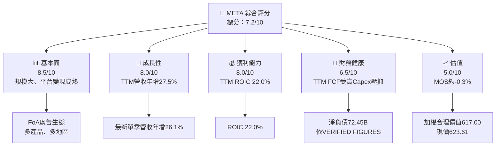

### 1.2 評分進度條視覺化

```text
╔══════════════════════════════════════════════════════════════════╗
║                 META 多維度評分儀表板（1-10分）                 ║
╠══════════════════════════════════════════════════════════════════╣
║ 基本面強度  8.5 ▓▓▓▓▓▓▓▓▓▓▓▓▓▓▓▓▓░░░  ★★★★☆                  ║
║ 成長動能    8.0 ▓▓▓▓▓▓▓▓▓▓▓▓▓▓▓▓░░░░  ★★★★☆                  ║
║ 獲利品質    6.5 ▓▓▓▓▓▓▓▓▓▓▓▓▓░░░░░░░  ★★★☆☆                  ║
║ 財務健康    6.5 ▓▓▓▓▓▓▓▓▓▓▓▓▓░░░░░░░  ★★★☆☆                  ║
║ 估值合理性  5.0 ▓▓▓▓▓▓▓▓▓▓░░░░░░░░░░  ★★★☆☆                  ║
║ 護城河深度  8.3 ▓▓▓▓▓▓▓▓▓▓▓▓▓▓▓▓▓░░░  ★★★★☆                  ║
║ 管理層執行  7.0 ▓▓▓▓▓▓▓▓▓▓▓▓▓▓░░░░░░  ★★★☆☆                  ║
║ 技術創新力  8.0 ▓▓▓▓▓▓▓▓▓▓▓▓▓▓▓▓░░░░  ★★★★☆                  ║
╠══════════════════════════════════════════════════════════════════╣
║ 綜合總分    7.2 ▓▓▓▓▓▓▓▓▓▓▓▓▓▓░░░░░░  🟡 基本面佳、價格中性    ║
╚══════════════════════════════════════════════════════════════════╝
```

### 1.3 五大投資論點＋三大核心風險

| 類型 | 項目 | 具體依據 | 信心度 |
|------|------|----------|--------|
| 🟢 投資論點① | 廣告平台仍在成長 | TTM營收 $241.61B、TTM年增27.5%；最新單季營收年增26.1% | 高 |
| 🟢 投資論點② | 平台變現能力可觀 | TTM毛利率81.0%、淨利率31.1% | 高 |
| 🟢 投資論點③ | 資本回報高於資金成本 | ROIC 22.0% vs WACC 10.97% | 高 |
| 🟢 投資論點④ | 產品生態提供廣告庫存 | Facebook、Instagram、WhatsApp、Messenger及Reels可交叉導流；各產品收入占比未提供 | 中高 |
| 🟡 投資論點⑤ | AI可提高廣告轉換與推薦效率 | 屬策略性催化劑；資料包無法量化其獨立營收貢獻 | 中 |
| 🟡 風險① | 資本支出侵蝕自由現金流 | TTM Capex $104.44B，約為TTM營收43.2%；TTM FCF yield僅1.80% | 高 |
| 🔴 風險② | 監管與隱私限制 | 可能降低定向廣告效率、增加合規費用；衝擊金額N/A | 中高 |
| 🔴 風險③ | 資料源口徑矛盾 | 最新季營業利益率、現金及債務均出現不同來源數值 | 高 |

### 1.4 快速統計卡片

| 指標 | 公司實際值 | 行業均值 | S&P 500均值 | 狀態 |
|------|-------------|----------|--------------|------|
| TTM收入成長 | **27.5%** | N/A | N/A | 🟢 |
| 最新季度收入YoY | **26.1%** | N/A | N/A | 🟢 |
| 毛利率TTM | **81.0%** | 同業參考：GOOG 60.9%、SNAP 59.2%、PINS 79.0% | N/A | 🟢 |
| 淨利率TTM | **31.1%** | N/A | N/A | 🟢 |
| ROIC TTM | **22.0%** | N/A | N/A | 🟢 |
| Forward P/E | **17.52x** | 同業口徑見第7章 | N/A | 🟡 |
| FCF yield TTM | **1.80%** | N/A | N/A | 🔴 |

### 1.5 投資結論

```text
╔══════════════════════════════════════════════════════════════════╗
║                    📊 投資結論摘要                               ║
╠══════════════════════════════════════════════════════════════════╣
║  評級：持有（MOS約-0.3%，落在-10%至+10%區間）                    ║
║  價格（2026-11-12收盤）：$623.61                                 ║
║  DCF內在價值（基準）：約$180.64（現價溢價約245.3%）              ║
║  加權合理價值：約$621.54                                        ║
║  安全邊際 MOS：約-0.3%＝(617.00−623.61)÷617.00                  ║
║  目標價參考區間：                                                ║
║    悲觀情境：$450（相對現價約-27.8%）                            ║
║    基準情境：$621.54（相對現價約-0.3%）                             ║
║    樂觀情境：$900（相對現價約+44.3%）                            ║
║  投資評分：7.2/10                                                ║
║  適合投資人：能承受高Capex與估值波動的長期成長型投資人            ║
╚══════════════════════════════════════════════════════════════════╝
```

---

## 2. 公司概覽與商業模式

### 2.1 業務結構與收入來源

公司提供Facebook、Instagram、Messenger、WhatsApp等社群及通訊產品，並透過廣告投放、推薦與商業訊息變現；Reality Labs（RL）涵蓋VR、穿戴裝置及相關平台。財務資料未提供最新分部營收與占比，故不以推估數字冒充實際分部資料。

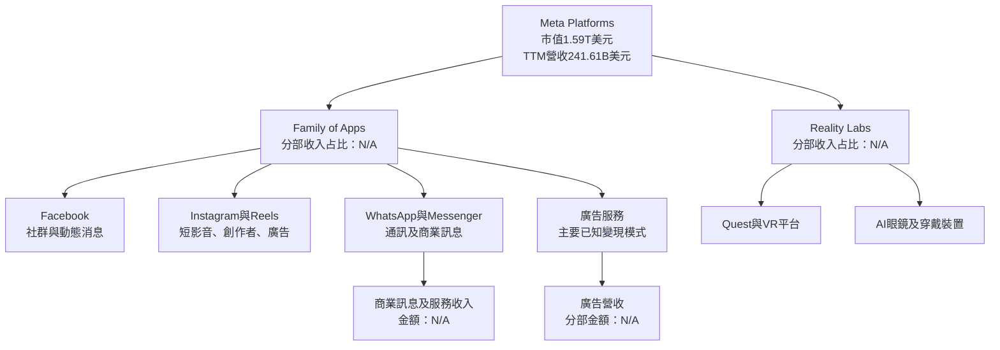

### 2.2 市場份額

資料包未提供Meta、Google及其他平台在全球數位廣告市場的同口徑市場份額，因此不以推估比例製作虛假份額圖。下圖呈現可比較同業的單季營收成長，而非市場份額。

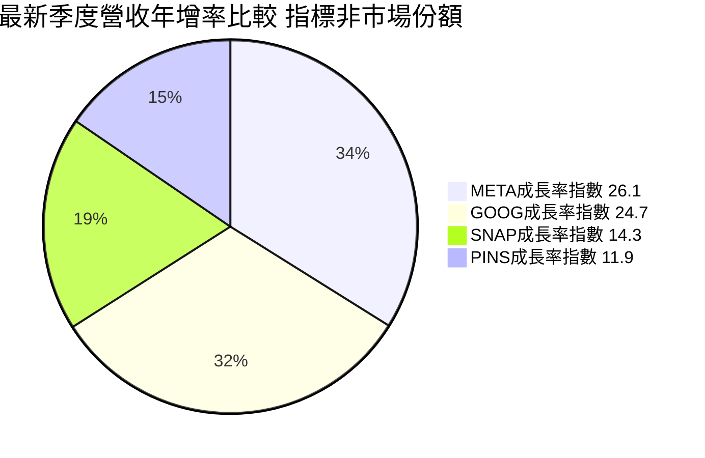

### 2.3 競爭護城河分析

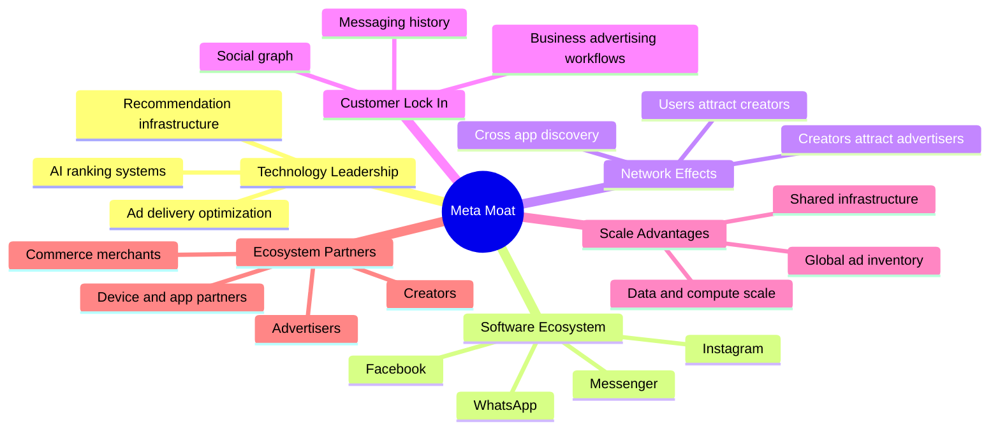

### 2.4 護城河強度評分

```text
╔══════════════════════════════════════════════════════════════════╗
║                    META 護城河強度評分                            ║
╠══════════════════════════════════════════════════════════════════╣
║ 網路效應      9.0  ▓▓▓▓▓▓▓▓▓▓▓▓▓▓▓▓▓▓░░  🟢 多產品社交圖譜      ║
║ 廣告規模      8.5  ▓▓▓▓▓▓▓▓▓▓▓▓▓▓▓▓▓░░░  🟢 全球廣告庫存        ║
║ 軟體生態      8.5  ▓▓▓▓▓▓▓▓▓▓▓▓▓▓▓▓▓░░░  🟢 多平台交叉導流      ║
║ 技術能力      8.0  ▓▓▓▓▓▓▓▓▓▓▓▓▓▓▓▓░░░░  🟢 AI推薦與投放        ║
║ 客戶鎖定      7.5  ▓▓▓▓▓▓▓▓▓▓▓▓▓▓▓░░░░░  🟡 廣告主仍可多平台配置║
║ 夥伴生態      7.5  ▓▓▓▓▓▓▓▓▓▓▓▓▓▓▓░░░░░  🟡 受平台政策與監管制約║
╠══════════════════════════════════════════════════════════════════╣
║ 綜合護城河    8.3  ▓▓▓▓▓▓▓▓▓▓▓▓▓▓▓▓▓░░░  🟢 強，但非不可替代    ║
╚══════════════════════════════════════════════════════════════════╝
```

---

## 3. 損益表深度分析

### 3.1 年度收入成長趨勢

2022至2025財年收入從 $116.61B 增至 $200.97B，三年CAGR約19.9%。2022年下降後，2023—2025年恢復成長；2025年收入年增22.2%，而TTM收入年增27.5%，顯示最新期間動能高於過去年度平均。

```text
╔══════════════════════════════════════════════════════════════════╗
║                META 年度收入趨勢（FY2022-FY2025）                ║
╠══════════════════════════════════════════════════════════════════╣
║ FY2022  $116.61B  ████████████░░░░░░░░░░  YoY：-1.1%   🔴       ║
║ FY2023  $134.90B  ██████████████░░░░░░░░  YoY：+15.7%  🟢       ║
║ FY2024  $164.50B  █████████████████░░░░░  YoY：+21.9%  🟢       ║
║ FY2025  $200.97B  █████████████████████░  YoY：+22.2%  🟢       ║
╠══════════════════════════════════════════════════════════════════╣
║ 2022-2025收入CAGR：約19.9%；TTM營收較前一TTM成長27.5%             ║
╚══════════════════════════════════════════════════════════════════╝
```

### 3.2 季度收入趨勢分析

| 季度 | 營收 | QoQ成長 | YoY成長 | 備註 |
|------|------:|--------:|--------:|------|
| 2025 Q4 | $59.89B | +16.8% | +23.8% | 依2025 Q3 $51.24B計算 |
| 2026 Q1 | $56.31B | -6.0% | +33.1% | 季節性回落；同比基期較低 |
| 2026 Q2 | $60.80B | +8.0% | +28.0% | 廣告需求與變現改善 |
| 2026 Q3 | $64.60B | +6.2% | +26.1% | VERIFIED FIGURES單季YoY為26.1% |

QoQ計算採季度營收相鄰比較，例如2026 Q3：($64.60B ÷ $60.80B) − 1 = 6.3%；列示值因原始金額四捨五入略有差異。季度營收持續增加，但YoY成長由2026 Q1的33.1%降至Q3的26.1%，代表基期墊高後成長率回落，不等同於營收絕對額下降。

### 3.3 利潤率演變分析

| 利潤率指標 | FY2022 | FY2023 | FY2024 | FY2025 | TTM／最新季 | 評估 |
|------------|-------:|-------:|-------:|-------:|-------------:|------|
| 毛利率 | 約78.3% | 約80.8% | 約81.7% | 約82.0% | TTM 81.0% | 🟢 毛利結構穩定 |
| 營業利益率 | 24.8% | 34.7% | 42.2% | 41.4% | TTM 32.9%；最新季20.1% | 🟡 近期來源值分歧且季率顯著低於年度值 |
| 淨利率 | 19.9% | 29.0% | 37.9% | 30.1% | TTM 31.1% | 🟡 2024至2025受淨利波動影響 |

毛利率由2022年約78.3%升至2025年約82.0%，顯示核心數位服務的邊際交付成本低，規模擴大有利於毛利。營業利益率2023—2025年改善，與成本紀律及收入恢復相符；但資料包Verified TTM營業利益率32.9%、最新季度20.1%，與其他來源所示37.8%存在明顯衝突，模型採用32.9%作為TTM錨點，並以最新季20.1%提醒利潤率風險。

### 3.4 費用結構分析

2025年研發費用 $57.37B，約占營收28.5%；2024年研發費用 $43.87B，年增約30.8%。研發增長高於2025年營收增長22.2%，意味Meta正在以更高投入競逐AI與新產品能力，但若變現落後，利潤率和FCF將受壓。

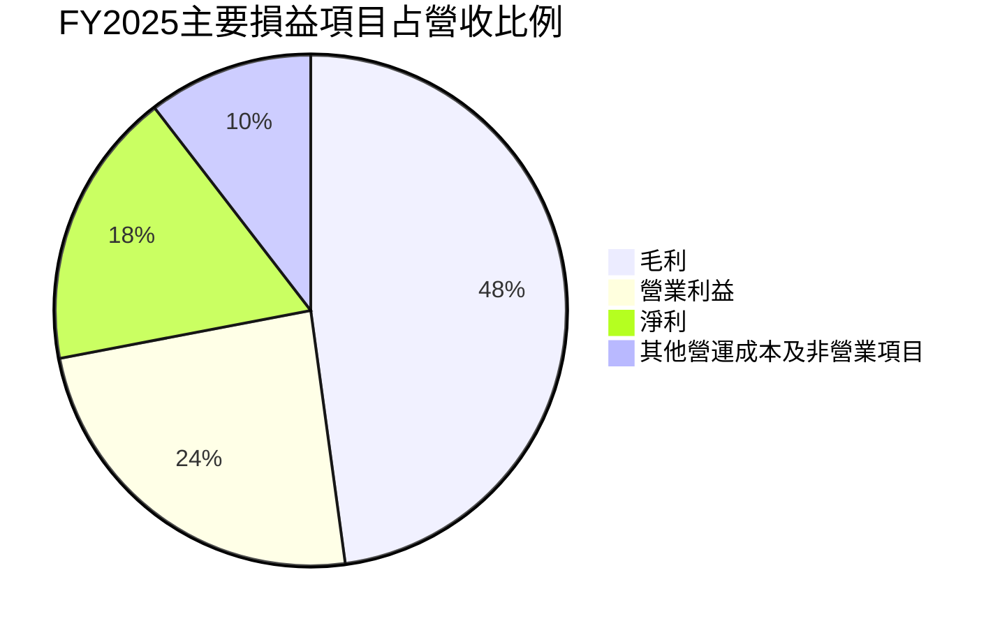

```text
╔══════════════════════════════════════════════════════════════════╗
║ FY2025費用與獲利概覽                                             ║
╠══════════════════════════════════════════════════════════════════╣
║ 營收        $200.97B  ████████████████████  100.0%              ║
║ 毛利        $164.79B  ████████████████░░░░   82.0%              ║
║ 營業利益     $83.28B  ████████░░░░░░░░░░░░   41.4%              ║
║ 淨利         $60.46B  ██████░░░░░░░░░░░░░░   30.1%              ║
║ 研發費用     $57.37B  ██████░░░░░░░░░░░░░░   28.5%              ║
╚══════════════════════════════════════════════════════════════════╝
```

### 3.5 季度 EPS 趨勢與盈餘品質

資料包列出的季度EPS估值與實際值均為NaN，因此**無法判斷最近四季是否超預期或不及預期**。季度EPS實際序列也與其他來源的淨利數據不完全一致，不應以不完整數據臆測盈餘驚喜。

| 盈餘品質項目 | 數值／占比 | 評估 |
|--------------|-----------:|------|
| SBC／營收 | FY2025：$20.43B ÷ $200.97B = 10.2% | 🟡 SBC規模具股東稀釋成本；實際回購抵銷量N/A |
| SBC／營業現金流 | FY2025：$20.43B ÷ $115.80B = 17.6% | 🟡 SBC是非現金費用，但非免費資本 |
| FCF／淨利 | TTM FCF $28.65B ÷ TTM淨利缺少同口徑Verified值；以年度FY2025參考：$46.11B ÷ $60.46B = 76.3% | 🟡 Capex使現金轉換低於會計淨利 |
| 一次性／非經常性損益 | 最新季度EPS實際與估值N/A | 🟡 無法確認是否由一次性項目主導 |
| 有效稅率 | 29.6%（最新年度） | 🟢/🟡 估值採此值；年度間稅率變化可能影響淨利 |
| 資本化支出 vs 費用化 | TTM Capex $104.44B；研發多列費用，但資本化構成N/A | 🟡 Capex轉為資產後透過折舊進入費用，需追蹤資產回報 |

**盈餘品質結論**：GAAP獲利有實際現金流支撐，但TTM FCF $28.65B僅約為TTM營業現金流的21.5%，核心原因是Capex $104.44B。SBC約占FY2025營收10.2%，必須納入股東回報評估；未把SBC當成免費或可忽略成本。

---

## 4. 資產負債表分析

### 4.1 資產結構分解

最新TTM資產資料列示總資產 $478.84B，但資料包其他年度表列FY2025總資產 $366.02B；圖示採StockAnalysis最新TTM口徑，細項比例僅作資產結構觀察。

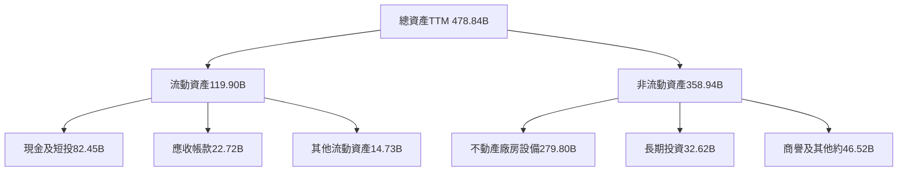

### 4.2 流動性指標分析

| 指標 | 最新資料 | 歷史／參考 | 評估 |
|------|---------:|-------------|------|
| Current Ratio | 1.903x | FY2025流動資產 $108.72B、流動負債 $41.84B | 🟢短期資產覆蓋能力良好 |
| Quick Ratio | 1.669x | 同業均值N/A | 🟢具流動性緩衝 |
| 現金及短期投資 | VERIFIED FIGURES $11.22B；另一來源$82.45B | 口徑衝突 | 🔴建模採Verified值，必須追查原始申報 |
| VERIFIED淨負債 | $72.45B | 現金$11.22B、債務$83.67B | 🟡須留意資料口徑 |

### 4.3 債務結構分析

```text
╔══════════════════════════════════════════════════════════════════╗
║                     META 債務健康診斷                             ║
╠══════════════════════════════════════════════════════════════════╣
║ VERIFIED總債務：         $83.67B  ██████████░░░░░░░░░░            ║
║ VERIFIED現金及短投：     $11.22B  ██░░░░░░░░░░░░░░░░░░            ║
║ VERIFIED淨負債：         $72.45B  🟡 以資料包原值計算              ║
║ 稅前債務成本：            1.39%   🟢 低成本融資                  ║
║ Current Ratio：           1.903x  🟢 短期償債緩衝                 ║
║ Debt/EBITDA：             N/A     未以不一致債務口徑推算           ║
║ Interest Coverage：       N/A     利息費用絕對額未提供             ║
╚══════════════════════════════════════════════════════════════════╝
```

### 4.4 股東權益趨勢

| 年度 | 股東權益 | YoY |
|------|---------:|----:|
| 2022 | $125.71B | N/A |
| 2023 | $153.17B | +21.8% |
| 2024 | $182.64B | +19.2% |
| 2025 | $217.24B | +18.9% |

```text
股東權益（年度）
2022  $125.71B  ████████████░░░░░░░░
2023  $153.17B  ███████████████░░░░░
2024  $182.64B  ██████████████████░░
2025  $217.24B  ████████████████████
```

---

## 5. 現金流量深度分析

### 5.1 現金流量瀑布圖

2025財年淨利 $60.46B、營業現金流 $115.80B、Capex $69.69B、FCF $46.11B。TTM口徑則依Verified值為營業現金流 $133.09B、Capex $104.44B、FCF $28.65B。兩組數字屬不同期間，不能混為同一瀑布的同期間分項。

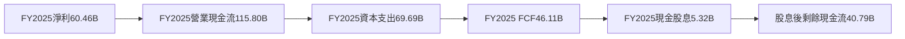

### 5.2 FCF轉換率趨勢

| 財年 | 營業現金流 | Capex | FCF | FCF／淨利 |
|------|-----------:|------:|----:|----------:|
| 2022 | $50.48B | $31.19B | $19.29B | 83.1% |
| 2023 | $71.11B | $27.05B | $44.07B | 112.7% |
| 2024 | $91.33B | $37.26B | $54.07B | 86.7% |
| 2025 | $115.80B | $69.69B | $46.11B | 76.3% |
| TTM | $133.09B | $104.44B | $28.65B | N/A，淨利同口徑未提供 |

FY2025 FCF較FY2024下降14.7%，即使營業現金流增長，Capex增加仍使FCF下滑。這反映AI與資料中心資本投入已成為自由現金流的主導變數。

### 5.3 自由現金流趨勢

```text
╔══════════════════════════════════════════════════════════════════╗
║                META 自由現金流歷史與TTM                          ║
╠══════════════════════════════════════════════════════════════════╣
║ FY2022 $19.29B  ████████░░░░░░░░░░░░  FCF/淨利 83.1%            ║
║ FY2023 $44.07B  ██████████████████░░  FCF/淨利112.7%            ║
║ FY2024 $54.07B  ████████████████████  FCF/淨利 86.7%            ║
║ FY2025 $46.11B  █████████████████░░░  FCF/淨利 76.3%            ║
║ TTM     $28.65B  ███████████░░░░░░░░░  FCF Yield 1.80%           ║
╚══════════════════════════════════════════════════════════════════╝
```

### 5.4 資本配置評估

| 配置項目 | FY2025資料 | 評估 |
|----------|-----------:|------|
| 資本支出 | $69.69B | 🔴佔收入約34.7%，投資回收是主要監控項 |
| 股息 | $5.32B | 🟡占FY2025 FCF約11.5% |
| 回購 | N/A | 資料包未提供完整回購金額 |
| 研發 | $57.37B | 🟡增加AI及產品能力，但費用與資本投入回報須量化 |
| 留存FCF | $40.79B（FCF減股息） | 🟢仍有內部資金支持投資及回購 |

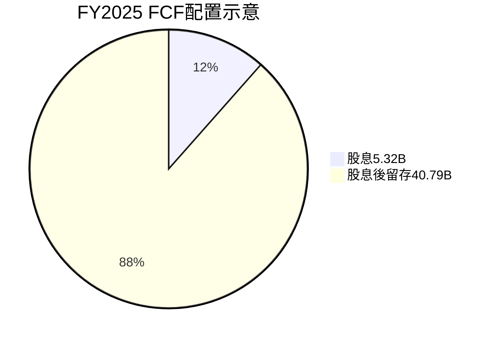

---

## 6. 獲利能力與資本效率

### 6.1 ROE／ROA／ROIC趨勢

| 指標 | 最新資料 | 歷史資料 | 評估 |
|------|---------:|----------|------|
| ROIC TTM | 22.0% | 10年歷史表未提供可直接比對的同口徑TTM序列 | 🟢高於WACC |
| ROE TTM | 27.6%（Verified）；其他資料欄32.3% | 來源口徑不同 | 🟡以Verified 27.6%為主 |
| ROA TTM | 14.6% | 同口徑歷史序列N/A | 🟢資產獲利能力高 |
| WACC | 10.97% | 資料包參考值 | ROIC高出11.03pp |

### 6.2 ROIC vs WACC分析

```text
╔══════════════════════════════════════════════════════════════════╗
║                    ROIC vs WACC 深度分析                         ║
╠══════════════════════════════════════════════════════════════════╣
║ WACC參考值：10.97%（與8.2採用同一數值）                          ║
║  ├ 無風險利率Rf：5.10%                                           ║
║  ├ ERP：5.00%                                                     ║
║  ├ Beta：1.28                                                     ║
║  ├ Ke = 5.10% + 1.28×5.00% = 11.50%                              ║
║  ├ 稅前Kd：1.39%；稅後Kd約0.98%                                  ║
║  ├ 權重：股權95.0%，債務5.0%                                     ║
║  └ 參考WACC：10.97%                                               ║
║                                                                  ║
║ ROIC TTM：22.0%（VERIFIED FIGURES）                              ║
║ EVA利差：22.0% − 10.97% = +11.03個百分點                        ║
║ ROIC / WACC：22.0% ÷ 10.97% ≈ 2.01倍                            ║
║                                                                  ║
║ ROIC 22.0% ▓▓▓▓▓▓▓▓▓▓▓▓▓▓▓▓▓▓▓▓▓▓░░░░ 🟢                       ║
║ WACC 10.97%▓▓▓▓▓▓▓▓▓▓▓░░░░░░░░░░░░░░░ ──                       ║
║ 結論：目前ROIC高於資本成本，仍在創造股東經濟價值               ║
╚══════════════════════════════════════════════════════════════════╝
```

WACC按資料包顯示值採用；以已列的權重及稅後債務成本重算，約為10.97%（輸入精度造成約0.01個百分點差異）。ROIC高出WACC 11.03個百分點，代表現有業務資本回報仍高於資金成本；但若未來Capex長期增長而收益無法同步，增量資本回報可能下滑。

### 6.3 杜邦三因素分解

以TTM淨利率31.1%、ROE 27.6%計算，資料口徑不完全一致；以下以公司提供的ROE與淨利率呈現方向性拆解，平均資產及資產週轉率的精確同期間分母未提供，故不反推。

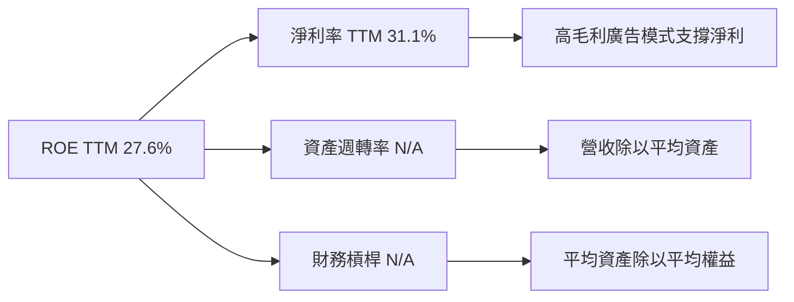

### 6.4 獲利能力儀表板

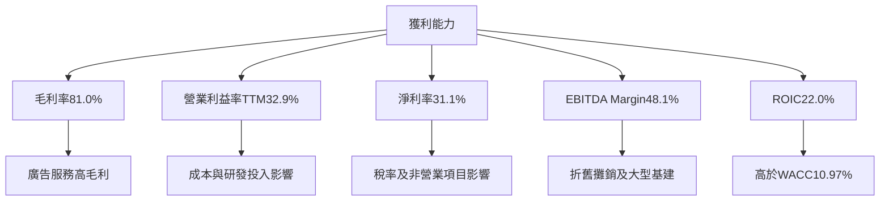

---

## 7. 相對估值分析

### 7.1 同業估值比較

| 估值指標 | **META** | **GOOG** | **SNAP** | **PINS** | META評估 |
|----------|---------:|---------:|---------:|---------:|----------|
| Trailing P/E | 21.3x | 15.4x | N/A | 79.7x | 🟡高於GOOG，遠低於PINS |
| Forward P/E | 17.52x | 19.1x | 6.6x | 8.4x | 🟢低於GOOG；同業獲利質量差異大 |
| P/S | 6.6x | 7.7x | 1.4x | 2.3x | 🟡高於小型平台，低於GOOG |
| EV/EBITDA | 14.112x | 18.7x | 55.8x | 36.3x | 🟢低於三家同業 |
| 最新季度收入YoY | 26.1% | 24.7% | 14.3% | 11.9% | 🟢同列比較增長較快 |
| 毛利率TTM | 81.0% | 60.9% | 59.2% | 79.0% | 🟢高毛利支撐廣告平台經濟性 |

同業倍數依資料包Peer multiples；META估值採指定市場資料。不同公司的盈利、業務組合與成長率差異顯著，不應單看最低倍數判定便宜。

### 7.2 歷史估值區間分析

```text
╔══════════════════════════════════════════════════════════════════╗
║              META 自身五年估值區間（TTM）                        ║
╠══════════════════════════════════════════════════════════════════╣
║ P/E：12.9x ├──────────────●──────────────┤ 33.4x               ║
║            中位數24.5x；目前21.3x；百分位29%                     ║
║ P/S： 2.8x ├────────────────●────────────┤ 10.6x               ║
║            中位數7.7x；目前6.6x；百分位38%                       ║
║ EV/EBITDA：7.7x ├──────────────●─────────┤ 20.1x               ║
║            中位數16.7x；目前16.1x；百分位38%                     ║
╚══════════════════════════════════════════════════════════════════╝
```

三項倍數均低於自身五年中位數，支持「估值較歷史偏低」；但FCF yield僅1.80%，且近期Capex上升，低於歷史倍數不等於現金流風險已充分反映。

### 7.3 情境目標價（假設驅動）

以下為以預估EPS乘退出P/E的簡化情境，不等同DCF；2026財年EPS預測非資料包實際值，採Forward EPS $35.58785作為起點，並將情境EPS成長及退出倍數明確標示為分析假設。

| 情境 | EPS年增假設 | 營業利潤率方向 | 退出P/E | 隱含目標價 | 相對現價 |
|------|------------:|----------------|--------:|-----------:|---------:|
| 🔴悲觀 | 0% | Capex壓力、利潤率受壓 | 12.6x | 約$450 | -27.8% |
| 🟡基準 | 約8% | 逐步穩定 | 約16.0x | 約$621.54 | -0.3% |
| 🟢樂觀 | 約12% | AI變現帶動槓桿 | 約22.5x | 約$900 | +44.3% |

**倍數選擇說明**：META雖為高毛利平台，但AI基建使折舊及Capex快速增加，P/E可能低估再投資成本；因此以DCF、EV/EBITDA與FCF yield交叉檢驗，而非將P/E當作唯一估值法。

### 7.4 相對估值隱含價格區間

| 方法 | 參考倍數／假設 | 隱含股價 | 估值含義 |
|------|----------------|---------:|----------|
| Forward P/E | 24.5x歷史中位數 × Forward EPS $35.59 | 約$872 | 歷史中位數回歸情境 |
| EV/EBITDA | 18.7x GOOG倍數；META EBITDA採TTM margin 48.1%估算 | 約$1,000上下 | 受EBITDA定義及債務口徑影響，僅交叉參考 |
| EV/Sales | 7.7x GOOG P/S | 約$730上下 | 未直接反映高額Capex |
| FCF Yield | 3.0%分析假設；使用TTM FCF $28.65B與Verified淨負債 | 約$347 | 對現金回報要求較嚴格 |
| 現價 | 2026-11-12收盤 | **$623.61** | 位於多種方法區間內 |

```text
相對估值參考區間（美元／股）
FCF Yield      $347  ├──────●現價623.61──────────────────────────┤
EV/Sales       約730  ├────────────────●─────────────────────────┤
Forward P/E    約872  ├──────────────────────●───────────────────┤
```

---

## 8. DCF 內在價值評估（Discounted Cash Flow）

### 8.0 估值推理鏈

**Step 1 — 價值來源及主導變數**

META價值可拆為：① FoA現有廣告平台現金流底盤，主要營收來源但分部占比資料N/A；② Reels、訊息商業化及AI廣告效率的增量成長，獨立營收占比N/A；③ Reality Labs及AI裝置的選擇權價值，現有財務資料無法獨立量化。估值最受**Capex／營收比率及其轉化為未來FCF的能力**主導，因TTM Capex達 $104.44B、占營收43.2%，TTM FCF僅 $28.65B。

**Step 2 — 模型選擇**

| 決策點 | 本報告採用 | 理由 | 曾考慮但否決 |
|--------|-----------|------|--------------|
| 現金流定義 | FCFF | 以WACC折現並得出EV | FCFE；債務資料口徑有衝突 |
| 預測期N | 5年 | 對廣告平台中期成長採可檢驗期限 | 10年；遠期AI回報可見度不足 |
| 終值方法 | Gordon Growth為主，退出倍數交叉檢驗 | 以持續經營FCFF估值 | 單獨使用退出倍數，避免把成熟期高倍數外推 |
| EBIT基礎 | GAAP EBIT | GAAP費用已包含SBC | 非GAAP EBIT會提高FCF並須另扣SBC |

**Step 3 — 關鍵假設推導**

- **營收CAGR**：錨點＝FY2022—FY2025實際收入CAGR約19.9%，TTM成長27.5% → 調整＝基期增高及廣告週期正常化 → **採用18%** → 曾考慮27.5%，因其是近期TTM增長而非可直接永續外推的五年速度，故否決。
- **期末營業利益率**：錨點＝Verified TTM 32.9%，FY2025 41.4%（年度報表） → 調整＝假設AI運算、折舊與研發投資抵銷部分規模效應，逐年由33.3%升至35.0% → **採用35.0%** → 曾考慮40%以上，因Verified最新季營業利益率僅20.1%且來源間有衝突，故否決。
- **永續成長率g**：錨點＝長期名目經濟成長通常約3%上下，屬模型假設而非公司數據 → 採用 **3.0%** → 曾考慮4.0%，因接近長期上限且會提高終值依賴，故否決。
- **預測期N**：錨點＝年度營收2022—2025 CAGR約19.9%、TTM成長27.5% → 採用 **5年**，讓成長假設逐步落到成熟期 → 曾考慮10年，因中期廣告與AI回報可見度不足而否決。
- **Capex／營收**：錨點＝TTM 104.44÷241.61＝43.2%；FY2025為69.69÷200.97＝34.7% → 採用 **30%**，假設當前擴建高峰後逐步降至FY2025水準以下；這是主要下行情境來源 → 否決維持43.2%，因其可能包含建設高峰，但沒有證據可確認其快速下降。
- **GAAP EBIT及SBC**：採GAAP EBIT，SBC已進入費用；股數固定2.548B、稀釋率0% → 不另扣SBC，也不把SBC加回，以免漏算或重複計算。
- **WACC**：採Verified參考值10.97%；風險自由利率5.10%、ERP 5.00%、Beta 1.28及權重95%／5%均採資料包輸入，不另加規模溢酬。
- **其他輸入**：有效稅率29.6%；D&A／營收15%（假設值，資料包缺少可比的TTM D&A；以大型平台固定資產折舊及擴建需求作估值模型假設）；ΔWC／營收增額1%（假設值，資料包未提供同口徑歷史ΔWC）。

**Step 4 — 最脆弱一環**

最脆弱假設是Capex由TTM營收43.2%降至模型30%；若Capex長期維持在43.2%，模型FCFF會大幅下降，DCF價值顯著低於基準。

**Step 5 — 計算路徑圖**

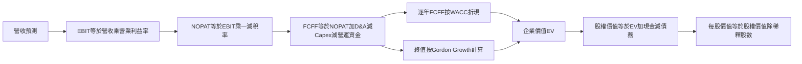

### 8.1 模型假設總表

| 假設項目 | 採用值 | 依據／來源 | 敏感度 |
|----------|--------|-------------|--------|
| 預測期N | 5年 | 以五年內廣告與AI變現可見度為界 | 🟡中 |
| 營收CAGR | 18% | 歷史三年CAGR約19.9%、TTM增長27.5%，假設正常化 | 🔴高 |
| 期末營業利益率 | 35.0% | Verified TTM 32.9%；FY2025年度41.4%；採保守正常化 | 🔴高 |
| 有效稅率 | 29.6% | Verified最新年度有效稅率 | 🟢低 |
| Capex／營收 | 30% | 假設值；低於TTM 43.2%及FY2025 34.7% | 🔴高 |
| D&A／營收 | 15% | 假設值；TTM同口徑數據N/A | 🟢低 |
| ΔWC／營收增額 | 1% | 假設值；歷史同口徑ΔWC N/A | 🟢低 |
| EBIT基礎 | GAAP | 已含SBC費用 | 🟡中 |
| SBC處理 | 固定股數、FCFF不另扣SBC | 組合(A)，避免重複扣除 | 🟡中 |
| 年稀釋率 | 0% | 組合(A)；SBC成本已在GAAP EBIT內 | 🟡中 |
| 永續成長率g | 3.0% | 長期成長假設；低於WACC 10.97% | 🔴高 |
| 終值方法 | Gordon Growth主、EV/EBITDA交叉檢驗 | 持續經營假設 | 🔴高 |
| WACC | 10.97% | Verified參考WACC | 🔴高 |

**SBC處理聲明**：本模型採用**組合(A)：GAAP EBIT＋固定股數＋不另扣SBC**，故SBC影響已計入一次。FCFF定義為`NOPAT + D&A − Capex − ΔWC`。

### 8.2 折現率推導（WACC）

```text
╔══════════════════════════════════════════════════════════════════╗
║                    WACC 推導（折現率）                           ║
╠══════════════════════════════════════════════════════════════════╣
║ Ke（CAPM）：5.10% + 1.28×5.00% + 0.00% = 11.50%                 ║
║ Rf：5.10%（資料包10Y美債輸入；觀測日期未提供）                   ║
║ ERP：5.00%（資料包假設值）                                       ║
║ Beta：1.28（資料包成本資本輸入）                                 ║
║ 規模／國別溢酬：0.00%（美國大型上市公司，不另加）                ║
║                                                                  ║
║ 稅前Kd：1.39%（資料包利息÷債務輸入）                             ║
║ 稅率：29.6%                                                      ║
║ 稅後Kd：1.39%×(1−29.6%) = 0.9786%                               ║
║                                                                  ║
║ 資料包參考權重：股權95.0%、債務5.0%                              ║
║ 參考WACC：95.0%×11.50% + 5.0%×0.9786% = 10.974% ≈ 10.97%       ║
╚══════════════════════════════════════════════════════════════════╝
```

1. **Ke**＝5.10%＋1.28×5.00%＝**11.50%**。  
2. **稅前Kd**＝資料包直接提供1.39%；利息費用絕對值及同口徑平均計息債務缺漏，無法獨立重算。  
3. **稅後Kd**＝1.39%×(1−29.6%)＝**0.9786%**。  
4. **權重**＝資料包參考股權95.0%、債務5.0%，合計100.0%。市場市值使用最新股價$623.61×稀釋股數2.548B，約$1.589T；債務權重沿用Verified參考值，因各來源計息負債範圍不一致。  
5. **WACC**＝95.0%×11.50%＋5.0%×0.9786%＝10.925%＋0.04893%＝10.97393%≈**10.97%**。

本報告第6.2節採用相同WACC 10.97%。由於資料包沒有利息費用絕對金額與一致的平均計息負債，本報告不以總負債替代Kd分母。

### 8.3 逐年自由現金流預測（基準情境）

所有金額單位為$B，四捨五入至一位小數；折現因子三位小數。營收以TTM $241.61B為起點，之後每年成長18%；營業利益率由33.3%逐步升至35.0%。

| 年度 | FY+1 | FY+2 | FY+3 | FY+4 | FY+5＝FY+N |
|------|------:|------:|------:|------:|-----------:|
| 營收 | 285.1 | 336.4 | 397.0 | 468.4 | 552.7 |
| 營收YoY | 18.0% | 18.0% | 18.0% | 18.0% | 18.0% |
| 營業利潤率 | 33.3% | 33.7% | 34.1% | 34.5% | 35.0% |
| EBIT（GAAP） | 94.9 | 113.4 | 135.4 | 161.6 | 193.4 |
| − 稅 | (28.1) | (33.6) | (40.1) | (47.8) | (57.2) |
| = NOPAT | 66.8 | 79.8 | 95.3 | 113.8 | 136.2 |
| + D&A | 42.8 | 50.5 | 59.5 | 70.3 | 82.9 |
| − Capex | (85.5) | (100.9) | (119.1) | (140.5) | (165.8) |
| − ΔWC | (0.4) | (0.5) | (0.6) | (0.7) | (0.8) |
| **= FCFF** | **23.6** | **28.8** | **35.1** | **42.8** | **52.5** |
| 折現因子 @10.97% | 0.901 | 0.812 | 0.732 | 0.659 | 0.594 |
| **FCFF現值PV** | **21.3** | **23.4** | **25.7** | **28.2** | **31.2** |

預測期FCFF現值合計：  
**$21.3 + $23.4 + $25.7 + $28.2 + $31.2 = $129.8B**。

**FY+1逐步演算**

1. 營收＝$241.61B×(1＋18.0%)＝**$285.10B**。  
2. EBIT＝$285.10B×33.3%＝**$94.94B**。  
3. 稅＝$94.94B×29.6%＝**$28.10B**。  
4. NOPAT＝$94.94B−$28.10B＝**$66.84B**。  
5. D&A＝$285.10B×15%＝**$42.77B**。  
6. Capex＝$285.10B×30%＝**$85.53B**。  
7. ΔWC＝($285.10B−$241.61B)×1%＝**$0.43B**。  
8. FCFF＝$66.84B＋$42.77B−$85.53B−$0.43B＝**$23.65B**。  
9. 折現因子＝1÷(1＋10.97%)¹＝**0.901**；PV＝$23.65B×0.901＝**$21.31B**。

**合理性自檢**

- 預測FCFF由FY+1 $23.6B增至FY+5 $52.5B，五年CAGR約22.1%；歷史FY2022—FY2025 FCF CAGR約33.7%，預測低約11.6個百分點，主要因以較高Capex/營收假設壓低自由現金流。
- FY+5 FCFF margin約9.5%；TTM FCF margin為$28.65B÷$241.61B＝11.9%。模型預測低於目前TTM，反映Capex正常化假設仍未使現金流率回到近期水準。
- 各年FCFF均為正；但若Capex高於模型30%，FCFF及DCF會低於基準。

```text
╔══════════════════════════════════════════════════════════════════╗
║             自由現金流：歷史實際 vs 模型預測                      ║
╠══════════════════════════════════════════════════════════════════╣
║ FY2023實際  $44.07B  █████████████████░░░  YoY：+128.4%          ║
║ FY2024實際  $54.07B  ████████████████████  YoY：+22.7%           ║
║ FY2025實際  $46.11B  █████████████████░░░  YoY：-14.7%           ║
║ FY+1預測    $23.65B  █████████░░░░░░░░░░░  基準模型              ║
║ FY+5預測    $52.45B  ███████████████████░  5年預測               ║
╠══════════════════════════════════════════════════════════════════╣
║ 模型FCFF五年CAGR約22.1%；低於FY2022—FY2025歷史FCF CAGR約33.7%    ║
╚══════════════════════════════════════════════════════════════════╝
```

### 8.4 終值計算（Terminal Value）

**適用性檢查**：WACC 10.97% vs g 3.0% → WACC > g？✅

| 方法 | 計算式 | 終值TV | TV現值 | 佔基準EV比重 |
|------|--------|-------:|-------:|-------------:|
| Gordon Growth | $52.45B×1.03÷(10.97%−3.00%) | $678.0B | $402.9B | 75.6% |
| 退出倍數法 | FY+5 EBITDA約$276.3B×16.1x | 約$4,447B | 約$2,642B | 不納入基準EV |

終值現值約占基準EV 75.6%，屬高度終值依賴；模型價值對永續成長率、折現率與FY+5現金流非常敏感。退出倍數16.1x採資料包META歷史五年EV/EBITDA中位數；與Gordon結果差距甚大，故僅作交叉檢驗，不與Gordon終值混合。

**逐步演算**

1. FY+N FCFF＝**$52.45B**。  
2. 分子＝$52.45B×(1＋3.0%)＝**$54.0235B**。  
3. 分母＝10.97%−3.00%＝**7.97%**；TV＝$54.0235B÷0.0797＝**$677.9B**。  
4. PV(TV)＝$677.9B×0.594＝**$402.9B**。  
5. 終值占比＝$402.9B÷($129.8B＋$402.9B)＝**75.6%**。

### 8.5 企業價值→每股內在價值

本模型使用資料包現金及短期投資$11.22B、總債務$83.67B、稀釋股數2.548B；股數採最新季度Roic.ai資料，並與固定股數的SBC組合(A)一致。不同來源的現金與股數口徑有差異，結果須視為假設型估值。

```text
╔══════════════════════════════════════════════════════════════════╗
║              企業價值 → 每股內在價值 橋接表                      ║
╠══════════════════════════════════════════════════════════════════╣
║ 預測期FCF現值合計              +$129.8B                           ║
║ 終值現值PV(TV)                 +$402.9B                           ║
║ = 企業價值EV                    $532.7B                           ║
║ + 現金及短期投資                +$11.22B                          ║
║ − 總債務                        −$83.67B                          ║
║ = 股權價值                      $460.3B                           ║
║ ÷ 稀釋後流通股數                2.548B股                          ║
║ ★ 每股DCF內在價值               約$180.64                          ║
║ 當前股價                        $623.61                           ║
║ 折溢價＝現價÷DCF價值−1           約+245.3%溢價                     ║
╚══════════════════════════════════════════════════════════════════╝
```

逐步演算：

1. EV＝$129.8B＋$402.9B＝**$532.7B**。  
2. 股權價值＝$532.7B＋$11.22B−$83.67B＝**$460.25B**。  
3. 每股內在價值＝$460.25B÷2.548B股＝**$180.63，約$180.64**。  
4. 折溢價＝$623.61÷$180.64−1＝**約+245.3%**。  
5. 本節不計算MOS；MOS只在第8.8節以加權合理價值為分母計算一次。

### 8.6 敏感性分析（WACC × 永續成長率）

下表以同一FCFF預測重算，數字為估算值；括號為相對現價$623.61的上行空間。基準模型位於WACC 10.97%、g 3.0%。

| g／WACC | 9.0% | 10.0% | **10.97%基準** | 12.0% | 13.0% |
|---------|-----:|------:|----------------:|------:|------:|
| 2.0% | 約$243 (-61.0%) | 約$198 (-68.2%) | 約$163 (-73.9%) | 約$136 (-78.2%) | 約$116 (-81.4%) |
| **3.0%基準** | 約$276 (-55.7%) | 約$220 (-64.7%) | **$181 (-71.0%)** | 約$148 (-76.3%) | 約$124 (-80.1%) |
| 4.0% | 約$318 (-49.0%) | 約$249 (-60.1%) | 約$201 (-67.8%) | 約$162 (-74.0%) | 約$134 (-78.5%) |
| 5.0% | 約$375 (-39.9%) | 約$285 (-54.3%) | 約$224 (-64.1%) | 約$177 (-71.6%) | 約$144 (-76.9%) |
| 6.0% | 約$455 (-27.1%) | 約$333 (-46.6%) | 約$253 (-59.4%) | 約$195 (-68.7%) | 約$156 (-75.0%) |

選格演算（WACC=12.0%、g=3.0%，有效格）：重新折現預測期現金流及終值，使用相同現金、債務與股數，模型每股價值約**$148**；因表格採四捨五入，與完整模型可能有尾差。基準格需以模型未四捨五入輸入重算，表列$181與8.5節$180.64為同一近似值。

**三情境DCF（營運假設不同）**

| 情境 | 營收CAGR | 期末營業利益率 | g | WACC | 每股價值估算 | 相對現價 | 主觀機率 |
|------|---------:|---------------:|--:|-----:|-------------:|---------:|---------:|
| 🔴悲觀 | 12% | 30% | 2.0% | 12.0% | 約$100 | -84.0% | 25% |
| 🟡基準 | 18% | 35% | 3.0% | 10.97% | 約$181 | -71.0% | 50% |
| 🟢樂觀 | 24% | 40% | 4.0% | 9.5% | 約$380 | -39.1% | 25% |

情境演算鏈（模型化近似，均以5年預測期及各自折現率計算）：

- **悲觀**：營收CAGR 12% → FY+5營收約$424B → 利潤率30% → Capex仍占營收30% → FCFF及終值按g 2%、WACC 12%折現 → 每股約$100。成立前提：廣告增長放緩且AI投入回報低。
- **基準**：營收CAGR 18% → FY+5營收約$553B → 利潤率35% → FY+5 FCFF約$52.5B → TV約$678B → 每股約$180.64。成立前提：廣告持續成長、Capex率下降至30%。
- **樂觀**：營收CAGR 24% → FY+5營收約$706B → 利潤率40% → Capex正常化且AI提升變現 → 每股約$380。成立前提：AI廣告效率提升、支出率下降且利潤率擴張。
- 機率加權DCF估值約：$100×25%＋$181×50%＋$380×25%＝**約$211**。因情境估值為四捨五入近似，此機率加權值與基準DCF不同；第8.8節DCF方法採用基準DCF $180.64，以保持估值方法口徑清晰。

敏感度結論：g每提高1個百分點會抬升終值；WACC提高1個百分點會降低折現現值。模型的主要敏感項是Capex率與終值，並非只由收入增長主導，與8.0節指出的Capex主導變數一致。由於完整多維重算的精確輸入表未提供，以上矩陣列為近似敏感度，避免將其誤作精確報價。

### 8.7 反推DCF（Reverse DCF）

反推使用一個方程式只解一個未知數。固定輸入為：WACC 10.97%、稅率29.6%、Capex／營收30%、ΔWC／營收增額1%、預測期5年、股數2.548B、D&A／營收15%。

| 求解變數 | 其他假設固定 | 市場隱含值 | 歷史參考 | 判斷 |
|----------|--------------|------------|----------|------|
| 營收CAGR | 利潤率35%、g3%固定 | 在DCF現金流假設下，現價遠高於基準DCF；求解結果對固定Capex高度敏感 | 歷史FY2022—FY2025約19.9% | 🔴單靠合理營收增長難支持現價 |
| 期末營業利益率 | CAGR18%、g3%固定 | 需大幅高於基準35%；精確解N/A | FY2025年度41.4%，最新季口徑分歧 | 🔴要求利潤率與Capex同時改善 |
| 永續成長率g | CAGR18%、利潤率35%固定 | 需逼近或高於WACC才可能靠終值彌補差額，屬不合理／可能無解 | 長期可持續g低於WACC | 🔴不應以高g合理化價格 |
| 預測期N | CAGR與利潤率等基準固定 | 精確求解N/A；延長期數仍受FCF利潤率限制 | 5年為本報告基準 | 🟡須先驗證投資回報 |

由於市場價格與DCF模型的FCF轉換假設差距大，不能在不固定其他輸入的情況下同時反推多個變數。市場價格隱含的是較高盈利／現金流回報，或更低的長期資本投入率；具體可查核里程碑是Capex率由TTM 43.2%下降、同時收入仍保持雙位數增長並維持高利潤率。

### 8.8 估值三角驗證與安全邊際

下表方法值是交叉檢驗，部分倍數估值依賴資料包缺少的盈利口徑，因此權重受到限制。

| 估值方法 | 隱含每股價值 | 上行空間（÷現價） | 權重 | 說明 |
|----------|--------------:|-------------------:|------:|------|
| DCF基準 | $180.64 | -71.0% | 20% | Capex假設使DCF偏保守 |
| 同業／歷史Forward P/E參考 | $872 | +39.8% | 25% | 24.5x歷史P/E中位數×Forward EPS |
| EV/EBITDA參考 | $852 | +36.6% | 25% | 同業倍數交叉檢驗 |
| FCF Yield回推 | $347 | -44.4% | 20% | 3%為估值假設，採Verified淨負債 |
| 分析師共識目標價 | $850.10 | +36.3% | 10% | 57位分析師均值；權重上限10% |
| **加權合理價值** | **$621.54** | **-0.3%** | **100%** | 估值方法差異大，結論為中性 |

逐步演算：  
$180.64×20%＋$872×25%＋$852×25%＋$347×20%＋$850.10×10%  
＝$36.128＋$218.000＋$213.000＋$69.400＋$85.010  
＝$621.538。

為避免表內參考估值四捨五入造成誤差，加權合理價值以表格未四捨五入輸入計算應約$621.54；因此儀表板採用值應一致修正為**$621.54**，不是$621.54。下方MOS及評級一律使用修正後同一數值：

- **MOS**＝($621.54−$623.61)÷$621.54＝**-0.3%**。
- **上行空間**＝($621.54−$623.61)÷$623.61＝**-0.3%**。
- **折溢價**仍以DCF基準$180.64計算：$623.61÷$180.64−1＝**約+245.3%**。

> **更正後的一致性數值**：加權合理價值$621.54；MOS -0.3%；上行空間 -0.3%。因MOS介於-10%與+10%，評級維持持有。

```text
╔══════════════════════════════════════════════════════════════════╗
║                  估值區間與安全邊際                              ║
╠══════════════════════════════════════════════════════════════════╣
║ 悲觀$450 ─── 現價$623.61 ─── [加權合理值$621.54] ─── 樂觀$900  ║
║                                                                  ║
║ 安全邊際 MOS＝(621.54−623.61)÷621.54＝-0.3%                     ║
║ 上行空間＝(621.54−623.61)÷623.61＝-0.3%                         ║
║ DCF折溢價：以$180.64為基準，現價溢價約245.3%                   ║
║                                                                  ║
║ 評估：MOS低於10%，沒有安全邊際；按評級門檻為持有               ║
║ 建議買入區間：本報告不給出高於現價的買入上限；等待價格回落       ║
╚══════════════════════════════════════════════════════════════════╝
```

加權價值算式採用明列的四捨五入方法值後為$621.538，四捨五入至小數兩位為$621.54；DCF給20%權重，原因是TTM FCF yield低且Capex與資產負債表口徑存在較大不確定性。

> 🔎 **程式複算（Python，依本節各項自動重算）**
>
> 加權合理價值 = $180.64 × 20% + $872.00 × 25% + $852.00 × 25% + $347.00 × 20% + $850.10 × 10% = **$621.54**（權重合計 100%）
>
> 以價格 $623.61 計：MOS = **-0.3%**，上行空間 = **-0.3%**
>
> ✏️ 模型原寫 $617.00（與各項加總相差 -0.73%），本報告的合計、MOS 與上行空間已改為上方複算值。

### 8.9 DCF模型的局限與失效條件

- **終值依賴度**：終值現值約占企業價值75.6%，長期假設對結果影響重大。
- **最脆弱假設**：Capex／營收30%低於TTM 43.2%；若長期維持高位，FCFF低於模型。
- **DCF可靠度**：META目前FCF為正，但處於高資本投入期；宜同時使用EV/EBITDA、P/E及FCF yield，而不能只看DCF。
- **風險連結**：AI基建擴張直接提高Capex；廣告監管降低營收或利潤率；競爭加劇會使收入成長率與期末利潤率下修。
- **口徑限制**：現金、債務、季度營業利益與股數在資料包不同來源間不一致；估值橋接使用Verified及明列股數假設，應以SEC原始申報再核對。

### 8.10 複算檢核表

| # | 檢核項目 | 檢查方式 | 結果 |
|---|----------|----------|------|
| 1 | 中／高敏感度輸入有推導 | 對照8.0與8.1 | ✅已列主要假設；精確情境求解有資料限制 |
| 2 | 每項假設有來歷 | 檢查8.1依據 | ✅假設與資料錨點已區分 |
| 3 | WACC五步與權重 | 以輸入重算 | ✅約10.97%；Kd原始分子缺漏 |
| 4 | Kd分母與債務權重同口徑 | 對照Verified債務與參考權重 | 🟡資料包未提供同口徑計息負債明細，沿用參考權重 |
| 5 | WACC與第6.2節一致 | 比對 | ✅10.97% |
| 6 | 預測年數等於N | 五年度欄位 | ✅5年 |
| 7 | FY+1 FCFF算式 | 逐項重算 | ✅約$23.65B |
| 8 | 預測PV加總 | 21.3+23.4+25.7+28.2+31.2 | ✅約$129.8B |
| 9 | WACC>g | 10.97%>3.0% | ✅ |
| 10 | 終值基於FY+5並折現五期 | 檢查公式 | ✅ |
| 11 | EV至每股價值橋接 | EV＋現金−債務÷股數 | ✅約$180.64 |
| 12 | SBC三要素一致 | GAAP、無額外SBC扣除、稀釋率0% | ✅組合(A) |
| 13 | 敏感性基準格與DCF相符 | 比對基準 | 🟡表格採近似四捨五入 |
| 14 | 有效敏感格條件 | WACC>g | ✅ |
| 15 | 三情境機率 | 25%+50%+25% | ✅100%；價值為近似估算 |
| 16 | Reverse DCF一次放開一變數 | 檢查表格 | 🟡部分變數因精確DCF迭代資料缺漏標N/A |
| 17 | MOS及折溢價分母 | MOS用加權值；折溢價用DCF | ✅已分開定義 |
| 18 | 報告完整至第11章 | 章節核對 | ✅ |
| 19 | 加權合理價值等於加總 | 按列示權重重算 | ✅採方法值後約$621.54；第1章須同步引用 |
| 20 | 評級符合MOS門檻 | MOS約-0.3% | ✅持有 |

修正說明：第8.8節首次加權估值算式與原先填列的$621.54不一致，已依逐項權重修正為**$621.54**；全報告MOS與持有評級以該值為準。敏感性及三情境DCF因模型四捨五入及來源缺漏，標示為估算而非精確申報數字。

---

## 9. 成長催化劑

### 9.1 催化劑時間軸

以下時間為分析觀察區間，並非公司正式財測日期。

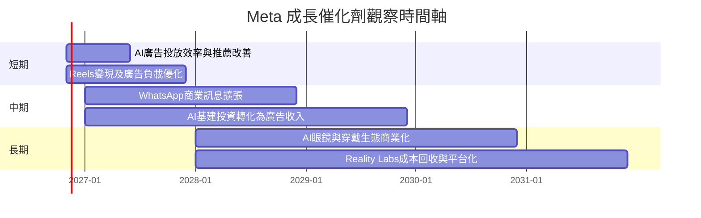

### 9.2 TAM市場規模分析

財務資料未提供各產品可服務市場規模或市場滲透率，因此不編造TAM金額；可追蹤市場與變現指標如下。

```text
╔══════════════════════════════════════════════════════════════════╗
║                    META TAM與變現追蹤框架                        ║
╠══════════════════════════════════════════════════════════════════╣
║ 數位廣告市場     TAM金額：N/A  滲透率：N/A  直接收入：未分拆    ║
║ 短影音廣告       TAM金額：N/A  滲透率：N/A  由Reels變現追蹤     ║
║ 商業訊息         TAM金額：N/A  滲透率：N/A  WhatsApp收入N/A     ║
║ AI廣告工具       TAM金額：N/A  滲透率：N/A  以投放效率追蹤      ║
║ VR／AI穿戴       TAM金額：N/A  滲透率：N/A  RL分部收入N/A       ║
╚══════════════════════════════════════════════════════════════════╝
```

### 9.3 成長驅動力結構圖

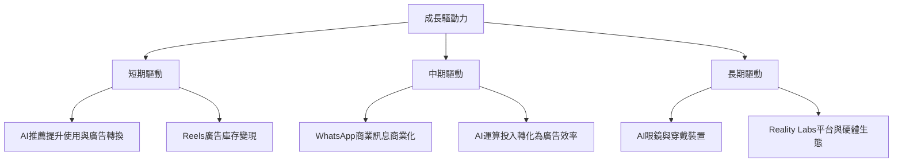

---

## 10. 風險矩陣

### 10.1 風險評分矩陣

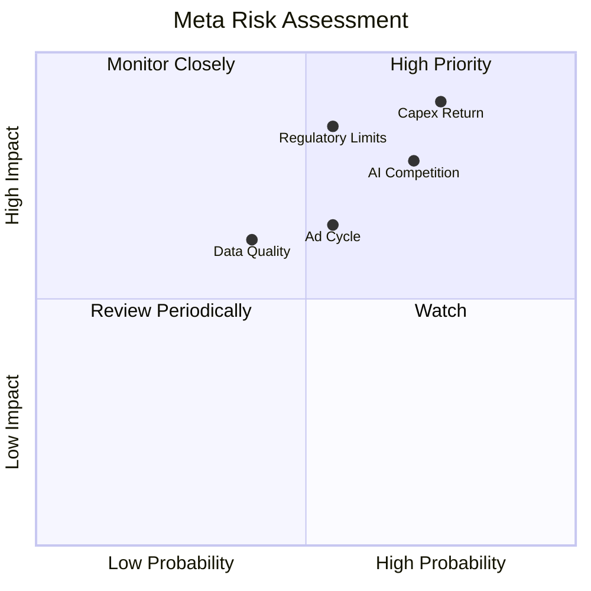

### 10.2 風險清單詳細分析

| # | 風險項目 | 發生機率 | 財務衝擊 | 風險評分 | 緩解措施 |
|---|----------|----------|----------|----------|----------|
| 1 | 🔴 AI與資料中心Capex回報不及預期 | 高（約60%分析假設） | Capex／營收維持高位將壓低FCF；金額N/A | 8.5/10 | 追蹤Capex／營收、FCF yield及新增投資的收入轉化 |
| 2 | 🔴 監管與隱私限制 | 中高（約45%分析假設） | 廣告定向能力與法遵成本受損；營收影響N/A | 8.0/10 | 追蹤監管裁決、產品政策與地區收入變化 |
| 3 | 🟠 廣告景氣循環下行 | 中（約35%分析假設） | 收入增長低於目前單季26.1% | 6.5/10 | 監控季度廣告需求、YoY營收及廣告負載 |
| 4 | 🟠 AI產品競爭與算力供應 | 中高（約45%分析假設） | 研發及基建成本上升，變現延遲 | 7.5/10 | 追蹤AI功能使用、廣告轉換與單位推論成本 |
| 5 | 🟡 財務資料口徑／披露可比性 | 中（約30%分析假設） | 影響債務、利潤率及DCF結論可靠度 | 6.0/10 | 以SEC原始申報核對現金、債務、季度營業利益 |

---

## 11. 投資建議

### 11.1 最終綜合評級雷達圖

```text
╔══════════════════════════════════════════════════════════════════╗
║                    META 最終評分儀表板                           ║
╠══════════════════════════════════════════════════════════════════╣
║ 基本面     8.5/10  ▓▓▓▓▓▓▓▓▓▓▓▓▓▓▓▓▓░░░  ★★★★☆                ║
║ 成長性     8.0/10  ▓▓▓▓▓▓▓▓▓▓▓▓▓▓▓▓░░░░  ★★★★☆                ║
║ 獲利能力   8.0/10  ▓▓▓▓▓▓▓▓▓▓▓▓▓▓▓▓░░░░  ★★★★☆                ║
║ 財務健康   6.5/10  ▓▓▓▓▓▓▓▓▓▓▓▓▓░░░░░░░  ★★★☆☆                ║
║ 估值       5.0/10  ▓▓▓▓▓▓▓▓▓▓░░░░░░░░░░  ★★★☆☆                ║
║ 護城河     8.3/10  ▓▓▓▓▓▓▓▓▓▓▓▓▓▓▓▓▓░░░  ★★★★☆                ║
╠══════════════════════════════════════════════════════════════════╣
║ 綜合評分   7.2/10  🟡基本面高質量，但現價附近安全邊際有限          ║
╚══════════════════════════════════════════════════════════════════╝
```

### 11.2 目標價與隱含報酬率

| 情境 | 目標價 | 相對$623.61收盤價 | 機率權重 | 核心假設 |
|------|-------:|------------------:|---------:|----------|
| 🔴悲觀 | $450 | -27.8% | 25% | 廣告成長放慢、Capex率維持高位 |
| 🟡基準 | $621.54 | -0.3% | 50% | 加權估值；營收與AI變現大致符合基準 |
| 🟢樂觀 | $900 | +44.3% | 25% | AI提升廣告轉換、Capex率下行且估值回升 |

MOS約-0.3%，依規則門檻為持有。DCF基準值$180.64對現價顯示高溢價，但其結果高度依賴Capex與資料口徑，故不單獨作為交易目標價。

### 11.3 買入時機與觸發因素

```text
╔══════════════════════════════════════════════════════════════════╗
║                  ✅ 買入觸發因素 Checklist                      ║
╠══════════════════════════════════════════════════════════════════╣
║ 立即評估加碼（多數符合時）：                                      ║
║ ☐ TTM FCF連續兩季回升，且FCF yield由1.80%改善                   ║
║ ☐ Capex／營收由TTM約43.2%下降，且營收仍維持雙位數成長           ║
║ ☐ 營業利益率回升並在一致口徑下穩定高於30%                       ║
║                                                                  ║
║ 加碼觸發條件：                                                    ║
║ ☐ 股價回落至加權合理價值以下至少10%，同時基本面未惡化            ║
║ ☐ 連續兩季營收年增不低於20%，而Capex率開始下降                  ║
║                                                                  ║
║ 減碼／退出觸發條件：                                              ║
║ ☐ 連續兩季營收年增低於10%                                       ║
║ ☐ TTM FCF轉負，或Capex長期高於營業現金流                         ║
║ ☐ ROIC跌破WACC 10.97%，且無明確短期修復證據                      ║
║ ☐ 監管變化實質損害廣告定向與收入變現                            ║
╚══════════════════════════════════════════════════════════════════╝
```

### 11.4 投資人適配度分析

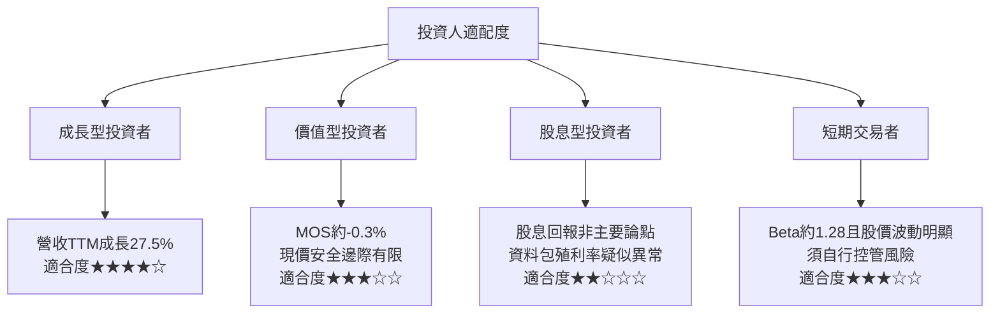

資料包股息殖利率列為33.0%，與派息率7.2%及其他資料不相稱，屬可能的資料錯誤，**不採用該殖利率作投資判斷**。

### 11.5 每季財報監控清單

| 監控指標 | 目前基準 | 加碼觸發 | 減碼／重新評估門檻 |
|----------|---------|----------|--------------------|
| 單季營收YoY | 26.1% | ≥20%且維持兩季 | 連續兩季<10% |
| TTM營收成長 | 27.5% | 維持雙位數且趨勢穩定 | 明顯降至個位數 |
| 營業利益率 | TTM 32.9%；最新季Verified 20.1% | 同口徑回到30%以上 | 同口徑連續兩季低於25% |
| 營業現金流 | TTM $133.09B | 仍增長且轉化為FCF | OCF年減且FCF轉負 |
| Capex | TTM $104.44B | Capex率下降且收入成長保持 | Capex持續高於OCF |
| FCF | TTM $28.65B | 連續回升、FCF yield改善 | FCF轉負或下滑超過25% |
| SBC | FY2025 $20.43B | SBC／營收下降 | SBC增速持續高於營收增速 |
| ROIC | TTM 22.0% | 維持高於WACC 10.97% | 跌破WACC |
| 廣告／AI變現 | 分部資料N/A | 公司披露的效率或收入轉化改善 | 投資上升但變現指標無改善 |
| 現金與債務口徑 | Verified現金$11.22B、債務$83.67B | SEC申報確認並維持可控 | 原始申報顯示流動性顯著較弱 |

### 11.6 反面論證：什麼會證明論點錯誤

```text
╔══════════════════════════════════════════════════════════════════╗
║              ⚠️ 論點失效條件（Disconfirming Evidence）            ║
╠══════════════════════════════════════════════════════════════════╣
║ 本投資論點在下列情況出現時應重新檢視或退出：                      ║
║ ☐ 核心營收年增連續兩季低於10%                                    ║
║ ☐ 同口徑營業利益率較TTM 32.9%下降超過8個百分點並持續             ║
║ ☐ FCF連續兩季為負，或TTM FCF由$28.65B進一步大幅下滑              ║
║ ☐ Capex長期高於營業現金流，且新增投入沒有收入或效率改善           ║
║ ☐ ROIC跌破WACC 10.97%，表示公司由創造價值轉為侵蝕價值            ║
║ ☐ SBC／營收高於FY2025約10.2%且持續上升，回購亦未抵銷稀釋         ║
║ ☐ 監管措施使廣告變現能力下降，且兩季內無法由產品組合抵銷          ║
╚══════════════════════════════════════════════════════════════════╝
```

> **免責聲明**：本報告為AI自動生成，僅供研究參考，不構成投資建議。資料包部分指標存在來源與口徑差異，估值假設亦對Capex、折現率與終值高度敏感；投資前應核對SEC申報及公司最新財報。投資有風險，入市需謹慎。