# META 基本面深度分析報告
> **報告日期**：2026-11-14 ｜ **語言**：繁體中文 ｜ **數據來源**：SEC 申報資料 (XBRL)、Yahoo Finance、Finviz、StockAnalysis、Roic.ai ｜ **分析師**：CFA 級機構研究

## 目錄

| # | 章節 | 核心結論 |
|---|------|----------|
| 1 | 執行摘要 | 持有；加權合理價值 $660.81；MOS +2.9% |
| 2 | 公司概覽與商業模式 | FoA 的廣告與社交平台是核心；護城河主要來自網路效應、規模與廣告工具 |
| 3 | 損益表深度分析 | TTM 營收 $241.61B、年增 27.5%；最新一季營業利益率 20.1% |
| 4 | 資產負債表分析 | 以最新一致口徑計，淨負債 $1.22B；流動性尚可 |
| 5 | 現金流量深度分析 | TTM FCF $28.65B；Capex 拉高，FCF 轉換率承壓 |
| 6 | 獲利能力與資本效率 | ROIC 27.7% 高於 WACC 10.59%，仍創造經濟價值 |
| 7 | 相對估值分析 | P/E 低於自身五年中位數；同業倍數訊號分歧 |
| 8 | DCF 內在價值評估 | 基準 DCF $550.36；終值佔 EV 80.3%，對長期假設敏感 |
| 9 | 成長催化劑 | 廣告、AI 推薦與商業訊息是主要觀察方向；TAM 數字未提供 |
| 10 | 風險矩陣 | 資本支出回報、監管、廣告景氣為主要風險 |
| 11 | 投資建議 | 持有；現價略低於加權合理價值但 MOS 不足，建議等待更佳價格或基本面確認 |

---

## 1. 執行摘要

### 1.0 一頁式投資儀表板（Portfolio Manager 30 秒速讀）

| 項目 | 內容 |
|------|------|
| **投資論點（3 句）** | ① TTM 營收 $241.61B、年增 27.5%，最新一季年增 26.1%，顯示廣告平台仍具成長動能。② TTM ROIC 27.7% 高於 WACC 10.59%，經濟利潤差距為正。③ 但 TTM FCF 僅 $28.65B、FCF Yield 1.75%，Capex 達 $104.44B，資本支出回報是估值關鍵。 |
| **綜合評分** | **7.3/10**（引用 1.1 評分卡） |
| **財務健康** | 🟡 現金及短期投資 $82.45B，總債務 $83.67B，淨負債 $1.22B；Piotroski F-Score 3/8。 |
| **ROIC vs WACC** | **27.7% vs 10.59%**；目前創造股東價值。 |
| **FCF 趨勢** | 最近年度 FCF 低於 2025 年，TTM FCF Yield **1.75%**；Capex 增長使現金轉換承壓。 |
| **估值** | Forward P/E 18.03x ｜ EV/EBITDA（市場資料）14.396x；歷史估值資料庫口徑 15.8x ｜ FCF Yield 1.75%。 |
| **DCF 內在價值（基準）** | **$550.36**；依指定折溢價定義，現價相對 DCF 折溢價為 **+16.6%**（現價高於 DCF）。 |
| **安全邊際（MOS）** | **+2.9%＝($660.81 − $641.69) ÷ $660.81**；🟡低於 10%，保護有限。 |
| **預期報酬（基準情境 12M）** | DCF 基準情境 **−14.2%**（$550.36 相對現價 $641.69）。 |
| **關鍵風險（前二）** | Capex 高企、投資回報不及預期；監管及隱私限制影響廣告定向與業務模式。 |
| **評級 + 信心度** | 🟡 **持有** ｜ 信心：中。MOS 僅 +2.9%，且 DCF 終值佔 EV 80.3%。 |

### 1.1 綜合評分卡（全報告唯一）

| 維度 | 評分（1–10） | 主要依據（引用數字與其來源章節） |
|------|--------------|----------------------------------|
| 成長性 | 8.0 | TTM 營收年增 27.5%、最新一季年增 26.1%（第 3 章）；年度營收 2022–2025 增長。 |
| 獲利能力 | 8.5 | TTM 營業利益率 32.9%、ROIC 27.7% 對 WACC 10.59%；但最新一季營業利益率為 20.1%（第 3、6 章）。 |
| 財務健康 | 7.0 | 現金及短期投資 $82.45B、淨負債 $1.22B；Piotroski 3/8、稀釋股數測試未通過（第 4、6 章）。 |
| 估值 | 5.5 | MOS +2.9%；P/E 21.9x 低於五年中位數 24.5x，但 DCF 基準值低於現價（第 7、8 章）。 |
| 護城河 | 8.5 | TTM 毛利率 81.0%、廣告與社交產品形成跨平台網路效應；但監管與平台競爭可削弱定向能力（第 2 章）。 |
| 管理層與資本配置 | 6.5 | 2025 年 Capex $69.69B、SBC $20.43B；投入規模高，回報週期與稀釋值得追蹤（第 5 章）。 |
| **綜合評分** | **7.3** | 六項算術平均： (8.0 + 8.5 + 7.0 + 5.5 + 8.5 + 6.5) ÷ 6 = 7.333…，四捨五入至一位小數為 7.3。 |

### 1.2 五大投資論點 + 三大核心風險

| 類型 | 項目 | 具體依據 | 信心度 |
|------|------|----------|--------|
| 🟢 **投資論點①** | 廣告主業仍在擴張 | TTM 營收 $241.61B，年增 27.5%；最新一季營收年增 26.1%。 | 🟢 高 |
| 🟢 **投資論點②** | 高回報高於資本成本 | ROIC 27.7%，WACC 10.59%，差距 17.11 個百分點。 | 🟢 高 |
| 🟢 **投資論點③** | 毛利率支撐再投資 | TTM 毛利率 81.0%，為研發、基礎設施與 AI 投資提供資金底盤。 | 🟢 高 |
| 🟡 **投資論點④** | 自身歷史估值低於中位數 | P/E 21.9x 對五年中位數 24.5x；當前歷史百分位 29%。 | 🟡 中 |
| 🟡 **投資論點⑤** | 現金資源可支應大規模投資 | 現金及短期投資 $82.45B，雖然總債務 $83.67B，整體為淨負債 $1.22B。 | 🟡 中 |
| 🟡 **風險①** | 資本支出侵蝕 FCF | TTM Capex $104.44B，占營收約 43.2%；FCF $28.65B、Yield 1.75%。 | 🟡 中 |
| 🔴 **風險②** | 最新季度利潤率較 TTM 顯著低 | 最新一季營業利益率 20.1%，低於 TTM 32.9%；若持續可能使 DCF 利潤率假設失效。 | 🔴 高衝擊 |
| 🔴 **風險③** | 法規與隱私風險 | 新聞資料提及義大利因存取用戶照片遭罰 €805M／約 $880M；監管可能限制數據使用及廣告變現。 | 🔴 高衝擊 |

### 1.3 快速統計卡片

| 指標 | 公司實際值（期間） | 同業中位數 | 狀態 |
|------|--------------------|------------|------|
| 營收成長（TTM） | **27.5%** | — | 🟢 |
| 營收成長（最新一季年增） | **26.1%** | 14.3%（GOOG、SNAP、PINS 中位數） | 🟢 |
| 毛利率（TTM） | **81.0%** | 60.9% | 🟢 |
| 營業利益率（TTM） | **32.9%** | — | 🟢 |
| ROIC（TTM） | **27.7%** | — | 🟢 |
| Forward P/E | **18.03x** | 8.4x | 🟡 |
| FCF Yield（TTM） | **1.75%** | — | 🔴 |
| Piotroski F-Score | **3 / 8** | — | 🔴 |

> Forward P/E 同業中位數取 GOOG 19.0x、SNAP 6.7x、PINS 8.4x 的中位數 8.4x；META 自身倍數明顯較高，但公司最新一季營收增長也高於三家同業的中位數。

### 1.4 投資結論

```text
╔══════════════════════════════════════════════════════════════════╗
║                    📊 投資結論摘要                               ║
╠══════════════════════════════════════════════════════════════════╣
║  評級：持有（依 MOS 門檻）                                       ║
║  價格（2026-11-13 收盤）：$641.69                               ║
║  DCF 內在價值（基準）：$550.36（現價折溢價 +16.6%）             ║
║  安全邊際 MOS：+2.9%（＝($660.81−$641.69)÷$660.81）             ║
║  加權合理價值（8.8）：$660.81                                    ║
║  DCF 情境價值：                                                  ║
║    悲觀情境：$184.69（−71.2%）                                  ║
║    基準情境：$550.36（−14.2%）                                  ║
║    樂觀情境：$1,336.18（+108.2%）                               ║
║  綜合評分：7.3/10（引用 1.1）                                    ║
║  適合投資人：可承受高資本支出與估值波動的成長型長線投資人       ║
╚══════════════════════════════════════════════════════════════════╝
```

---

## 2. 公司概覽與商業模式

### 2.1 業務結構與收入來源

Meta 透過 Family of Apps（FoA）與 Reality Labs（RL）營運。提供的資料沒有分部營收與占比，因此不能可靠呈現 FoA、RL 的收入拆分；公司總營收 TTM 為 $241.61B。FoA 涵蓋 Facebook、Instagram、WhatsApp、Messenger 等產品，主要商業模式包括廣告；Reality Labs 涵蓋 VR、MR 與 AI 眼鏡相關產品及服務。

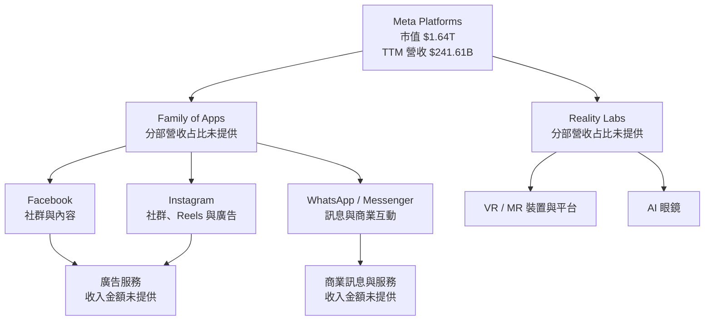

分部收入金額、用戶數、廣告曝光量、平均廣告價格及硬體銷量未提供，故不做分部占比或市場份額推算。

### 2.2 市場份額

市場份額數據未提供。以可得數字觀察，Meta TTM 營收為 $241.61B、TTM 成長 27.5%，最新一季年增 26.1%；同業資料中 GOOG 最新一季營收年增 24.7%，SNAP 為 14.3%，PINS 為 11.9%。這反映 Meta 的近期營收增長高於這三家比較公司，但不能直接等同於市場份額變化。

### 2.3 競爭護城河分析

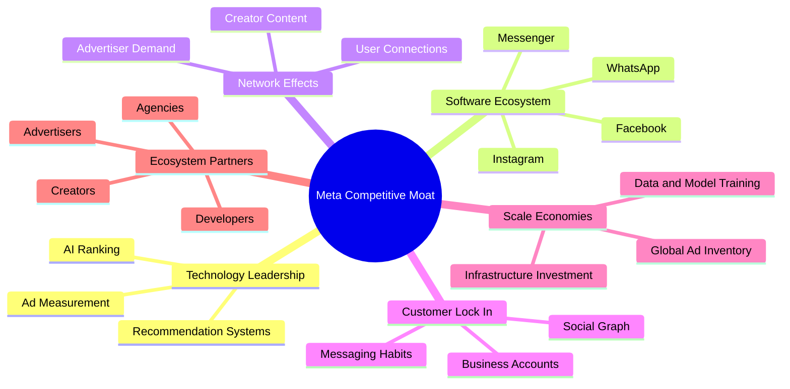

### 2.4 護城河強度

| 護城河項目 | 強度（強／中／弱） | 證據（引用數字或事實） | 會削弱它的情況 |
|------------|--------------------|------------------------|----------------|
| 網路效應 | 強 | Facebook、Instagram、WhatsApp、Messenger 連結用戶、創作者、商家與廣告主；TTM 營收 $241.61B。 | 用戶轉向替代平台、年輕用戶參與度下降、內容品質惡化。 |
| 規模效應 | 強 | TTM 營收 $241.61B、毛利率 81.0%；可分攤全球基礎設施與模型研發成本。 | 基礎設施投資超過收入變現能力，造成資本回報下降。 |
| 廣告技術與資料能力 | 中至強 | TTM 營業利益率 32.9%；廣告投放、推薦與衡量能力是商業模式核心。 | 隱私規則、平台政策與法規限制降低追蹤及定向效果。 |
| 軟體生態系 | 強 | 多個社交與訊息產品形成跨產品使用場景；但各產品用戶與收入拆分未提供。 | 競爭平台複製功能、互通性或監管要求降低封閉生態優勢。 |
| 客戶鎖定 | 中 | 社交關係、訊息與廣告投放流程具有轉換摩擦；未提供客戶留存數據。 | 廣告主可跨平台分散預算，用戶可低成本下載替代應用。 |
| 生態夥伴 | 中 | 廣告主、代理商、創作者與商家支持平台供給；缺少夥伴收入占比資料。 | 廣告預算轉移、創作者供給下降或商家商業訊息回報不足。 |

**1.1「護城河」評分 8.5/10**：依據是多產品網路效應、TTM 毛利率 81.0% 與規模化廣告經濟；扣分原因為隱私監管、平台競爭及缺乏分部用戶與留存數據。

---

## 3. 損益表深度分析

### 3.1 年度收入成長趨勢（近4年）

| 財年 | 營收 | YoY |
|------|------|-----|
| 2022 | $116.61B | −1.1% |
| 2023 | $134.90B | +15.7% |
| 2024 | $164.50B | +21.9% |
| 2025 | $200.97B | +22.2% |

2022–2025 營收 CAGR 約為 **19.9%**：  
`($200.97B ÷ $116.61B)^(1/3) − 1 ≈ 19.9%`。  
這段期間營收由 $116.61B 增至 $200.97B，反映廣告需求復甦、產品變現及推薦能力提升；但過去 CAGR 不代表未來可以線性延續。

```text
╔══════════════════════════════════════════════════════════════════╗
║             Meta 年度收入趨勢（FY2022–FY2025）                   ║
╠══════════════════════════════════════════════════════════════════╣
║  FY2022  $116.61B  ████████████░░░░░░░░░░░░  YoY:  -1.1%       ║
║  FY2023  $134.90B  ██████████████░░░░░░░░░░  YoY: +15.7%       ║
║  FY2024  $164.50B  █████████████████░░░░░░░  YoY: +21.9%       ║
║  FY2025  $200.97B  █████████████████████░░░  YoY: +22.2%       ║
╠══════════════════════════════════════════════════════════════════╣
║  2022–2025 營收 CAGR：約 +19.9%                                  ║
╚══════════════════════════════════════════════════════════════════╝
```

### 3.2 季度收入趨勢分析

| 季度 | 營收 | QoQ 成長 | YoY 成長 | 備註 |
|------|------|----------|----------|------|
| 2025 Q4 | $59.89B | +41.5% | +23.8% | QoQ 受季節性及第四季廣告活動影響。 |
| 2026 Q1 | $56.31B | −6.0% | +33.1% | QoQ 回落，YoY 仍高；與前季比較需考慮季節性。 |
| 2026 Q2 | $60.80B | +8.0% | +28.0% | QoQ 回升，較去年同期增加。 |
| 2026 Q3 | $64.60B | +6.2% | +26.1% | 最新一季年增放緩至 26.1%，但仍為高增長。 |

QoQ 公式以季度營收計算，例如 Q3：`$64.60B ÷ $60.80B − 1 ≈ 6.2%`。資料庫列示的 YoY 成長率以單季比較計，不應與 TTM 成長率混用。同比增速由 2026 Q1 的 33.1% 降至 Q3 的 26.1%，是基期提高或增長動能略有放緩的訊號，仍需後續季度確認。

### 3.3 利潤率演變分析

| 利潤率指標 | FY2022 | FY2023 | FY2024 | FY2025 | 趨勢 | 評估 |
|------------|--------|--------|--------|--------|------|------|
| **毛利率** | 78.4% | 80.8% | 81.7% | 82.0% | 逐年改善 | 🟢 |
| **營業利益率** | 24.8% | 34.7% | 42.2% | 41.4% | 2022 後擴張，2025 略回落 | 🟢 |
| **淨利率** | 19.9% | 29.0% | 37.9% | 30.1% | 2025 下滑 | 🟡 |

FY2025 毛利率由 2022 年 78.4% 升至 82.0%，營業利益率由 24.8% 升至 41.4%，顯示收入恢復與費用紀律帶動營業槓桿。FY2025 淨利率回落至 30.1%，而淨利由 FY2024 $62.36B 降至 FY2025 $60.46B；提供資料不足以分解一次性、稅務或非營業項目的個別影響，不宜把淨利波動單獨歸因於經常性營運。

另外，TTM 營業利益率為 32.9%，最新一季為 20.1%。兩者口徑與期間不同，且差距顯著；若最新季度的資本支出、費用或其他營運因素使季度營業利益率維持低檔，將對未來盈利與 DCF 利潤率假設形成下修風險。

### 3.4 費用結構分析

2025 年損益表可得毛利與營業利益，因此可計算營業成本及營業費用：

- 營業成本＝營收 − 毛利＝`$200.97B − $164.79B = $36.18B`
- 營業費用＝毛利 − 營業利益＝`$164.79B − $83.28B = $81.51B`

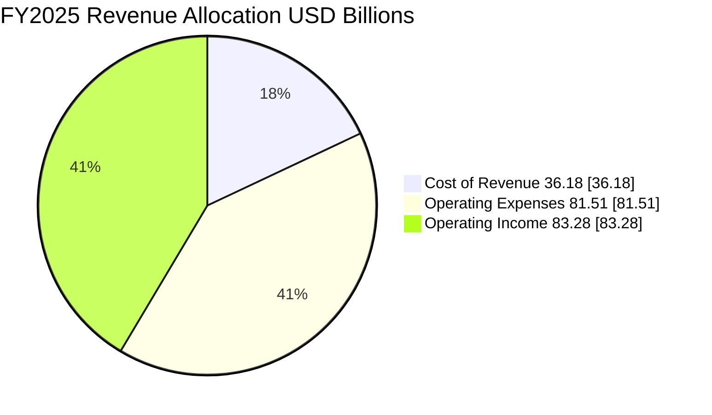

```text
╔══════════════════════════════════════════════════════════════════╗
║                FY2025 營收與營業利益結構（$B）                  ║
╠══════════════════════════════════════════════════════════════════╣
║  營業成本       $36.18B  ████░░░░░░░░░░░░░░░░                    ║
║  營業費用       $81.51B  ████████░░░░░░░░░░░░                    ║
║  營業利益       $83.28B  ████████░░░░░░░░░░░░                    ║
╚══════════════════════════════════════════════════════════════════╝
```

此為營收的會計分配，不代表現金支出或資本配置。FY2025 研發支出為 $57.37B，約占營收 28.5%；研發投資有助於廣告推薦、AI 與新產品，但其回報需由未來營收增長及營業利潤率驗證。

### 3.5 季度 EPS 趨勢與盈餘品質（Quality of Earnings）

| 季度 | EPS 實際值 | EPS YoY | 預期／實際比較 |
|------|------------|--------|----------------|
| 2025 Q4 | $8.88 | +10.7% | EPS 預期值缺失，無法判定超預期或不及預期。 |
| 2026 Q1 | $10.44 | +62.4% | EPS 預期值缺失，無法判定超預期或不及預期。 |
| 2026 Q2 | $6.18 | −13.4% | EPS 預期值缺失，無法判定超預期或不及預期。 |
| 2026 Q3 | $3.83 | +264.8% | EPS 預期值缺失，無法判定超預期或不及預期。 |

EPS 估計資料顯示上述四季估計值皆為缺失，因此不能將資料中的「❌」解讀成實際 miss；只能確認實際 EPS 及 YoY 變化。2026 Q3 EPS 由較低的去年同期比較基期推動高同比增幅，但單季 EPS 低於 Q2，應同時觀察營業利益率與現金流。

| 盈餘品質項目 | 數值／佔比 | 評估 |
|--------------|-----------|------|
| 股權薪酬 SBC / 營收 | 最近四季 SBC $26.94B ÷ TTM 營收 $241.61B = **11.1%** | 🟡 金額顯著；即使 GAAP 已將 SBC 列為費用，員工股權仍涉及股東稀釋。 |
| SBC / 營業現金流 | $26.94B ÷ $133.09B = **20.2%** | 🟡 SBC 規模相對營業現金流不低。 |
| FCF / 淨利（現金轉換率） | TTM FCF $28.65B ÷ TTM 淨利 $75.249B = **38.1%** | 🔴 轉換偏低，主要需關注 Capex 對自由現金流的壓力。 |
| 一次性／非經常性損益 | N/A（缺少可核實的 TTM 明細） | 無法判定是否美化或壓低本期盈餘。 |
| 有效稅率異常 | **29.6%**（模型採用的最新年度有效稅率） | 未有足夠歷年同口徑資料判斷是否異常；不是可忽略的估值變數。 |
| 資本化支出 vs 費用化 | TTM Capex $104.44B；資本化項目的拆分未提供 | 資本支出以現金流及資產形式影響，不能僅據此判斷是否遞延費用。 |

**盈餘品質結論**：GAAP 營業利益與淨利已反映 SBC 費用，不能再把 SBC 當作未列成本；但 FCF 僅為淨利的 38.1%，且 Capex 很高，表示帳面盈餘轉為可自由配置現金的比例近期偏弱。估值應重視資本支出正常化路徑，而非單看 EPS 成長。

---

## 4. 資產負債表分析

### 4.1 資產結構分解

最新 TTM 資產負債表總資產為 $478.836B。下圖中的非流動資產為總資產減流動資產；部分明細不是互斥分類，故不應將全部枝節直接加總。

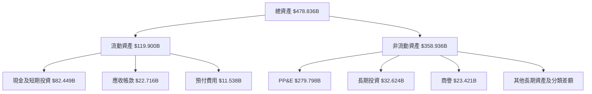

### 4.2 流動性與營運資金分析

| 指標 | 最新 TTM | 一年前 TTM | 變化 | 解讀 |
|------|----------|------------|------|------|
| DSO 應收帳款天數 | 34 天 | 33 天 | +1 天 | 收款週期略延長，幅度小；仍應追蹤應收帳款增長是否快於營收。 |
| DIO 存貨天數 | N/A | N/A | N/A | 公司未提供可計算存貨餘額；不推算。 |
| DPO 應付帳款天數 | 152 天 | N/A | N/A | 一年前資料缺漏，不能判斷同比變化；單一期間 DPO 不足以證明議價力改善。 |
| CCC 現金轉換週期 | N/A | N/A | N/A | DIO 缺失，且一年前 DPO 缺失，無法計算。 |

流動性補充指標為流動比率 1.903、速動比率 1.669；但其他來源的季度資產負債表期間數字與市場資料合併欄位並不完全一致。本節按品質指標提供的營運資金天數原值引用，不用缺漏值反推。

### 4.3 債務結構分析

採用財務數據一致口徑的現金及短期投資 $82.45B、總債務 $83.67B，淨負債為 $1.22B。另有市場資料欄位列示總債務 $114.84B、淨負債 $32.39B，與 SEC／品質指標口徑不同；本報告不混用兩套債務值，DCF 與 ROIC 採用經核實區塊數字。

```text
╔══════════════════════════════════════════════════════════════════╗
║                   Meta 債務健康診斷                              ║
╠══════════════════════════════════════════════════════════════════╣
║  總債務：             $83.67B  ████████████████████              ║
║  現金及短期投資：     $82.45B  ████████████████████              ║
║  淨負債：              $1.22B  ▏                                 ║
║                                                                  ║
║  流動比率：            1.903x  🟢                                ║
║  速動比率：            1.669x  🟢                                ║
║  Debt / EBITDA：       N/A（指定一致口徑未提供 EBITDA 對應計算） ║
║  Interest Coverage：   N/A（利息費用與 EBITDA 同口徑數據不足）   ║
╚══════════════════════════════════════════════════════════════════╝
```

### 4.4 股東權益趨勢

| 財年 | 股東權益 |
|------|----------|
| 2022 | $125.71B |
| 2023 | $153.17B |
| 2024 | $182.64B |
| 2025 | $217.24B |

```text
╔══════════════════════════════════════════════════════════════════╗
║                Meta 股東權益趨勢（FY2022–FY2025）                 ║
╠══════════════════════════════════════════════════════════════════╣
║  FY2022  $125.71B  ████████████░░░░░░░░░░                       ║
║  FY2023  $153.17B  ███████████████░░░░░░░                       ║
║  FY2024  $182.64B  ██████████████████░░░                       ║
║  FY2025  $217.24B  ██████████████████████                       ║
╚══════════════════════════════════════════════════════════════════╝
```

股東權益逐年增加，但權益增加不等同每股價值同比例增加；需一併監控回購、SBC 與稀釋股數。Piotroski 稀釋股數測試未通過，顯示股數未能確認下降。

---

## 5. 現金流量深度分析

### 5.1 現金流量瀑布圖

最新 TTM 淨利未提供在相同「已核實指標」欄位；為避免混用期間，圖中從營業現金流開始。股份回購及期末現金變動的 TTM 完整數據未提供。

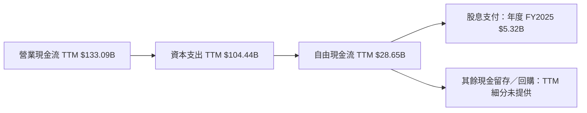

### 5.2 FCF 轉換率趨勢

| 財年 | 營業現金流 | Capex | FCF | 淨利 | FCF / 淨利 |
|------|------------|-------|-----|------|------------|
| 2022 | $50.48B | $31.19B | $19.29B | $23.20B | 83.1% |
| 2023 | $71.11B | $27.05B | $44.07B | $39.10B | 112.7% |
| 2024 | $91.33B | $37.26B | $54.07B | $62.36B | 86.7% |
| 2025 | $115.80B | $69.69B | $46.11B | $60.46B | 76.3% |
| TTM 至 2026-09-30 | $133.09B | $104.44B | $28.65B | $75.249B | 38.1% |

年度財報 Capex 欄列為負數的現金流出，本表以支出絕對值呈現。2025 年 FCF 由 2024 年 $54.07B 降至 $46.11B，TTM 進一步降至 $28.65B；營業現金流仍增加，但 Capex 上升速度更快，導致自由現金流轉換率下滑。

### 5.3 自由現金流趨勢

| 期間 | FCF | FCF Yield |
|------|-----|-----------|
| 2022 | $19.29B | N/A |
| 2023 | $44.07B | N/A |
| 2024 | $54.07B | N/A |
| 2025 | $46.11B | N/A |
| TTM 至 2026-09-30 | $28.65B | 1.75% |

```text
╔══════════════════════════════════════════════════════════════════╗
║            自由現金流趨勢（年度實際與最新 TTM）                   ║
╠══════════════════════════════════════════════════════════════════╣
║  FY2022  $19.29B  ███████░░░░░░░░░░░░░░░                         ║
║  FY2023  $44.07B  █████████████████░░░░░                         ║
║  FY2024  $54.07B  █████████████████████░                         ║
║  FY2025  $46.11B  ██████████████████░░░                         ║
║  TTM     $28.65B  ███████████░░░░░░░░░                         ║
║                                                                  ║
║  最新 TTM FCF Yield：1.75%                                      ║
╚══════════════════════════════════════════════════════════════════╝
```

### 5.4 資本配置評估

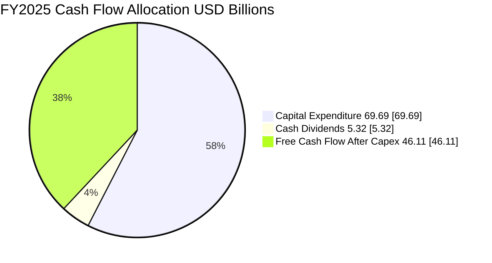

| 項目 | FY2025 金額 | 評估 |
|------|-------------|------|
| 資本支出 | $69.69B | 資本投入顯著增加；需以未來營收增量、廣告效率和資產利用率驗證回報。 |
| 現金股息 | $5.32B | 相對 FCF 規模有限；資料中的即時股息率出現 33.0%，與現金股息量級不一致，故不採用該股息率作估值依據。 |
| SBC | $20.43B | 對人才與研發有用，但造成股東稀釋；年度數據約為營收的 10.2%。 |
| 回購 | N/A | 未提供可一致比較的年度回購金額；不推算。 |
| 留存現金／其他投資 | N/A | 缺少同一期間的資本配置完整拆分。 |

---

## 6. 獲利能力與資本效率

### 6.1 ROE / ROA / ROIC 趨勢

| 指標 | 最新值 | 歷史趨勢或補充資料 | 評估 |
|------|--------|----------------------|------|
| ROE | TTM 27.6%（品質指標） | 市場資料另一欄為 32.3%，口徑不一致；近年股東權益上升。 | 🟢 盈利回報可觀，但需避免混用不同計算口徑。 |
| ROA | TTM 14.6% | Piotroski 比較顯示 ROA 未高於一年前。 | 🟢 絕對值正向；年增動能並非所有品質測試皆改善。 |
| ROIC | TTM 27.7% | 以稅後營業利益除以權益＋債務−現金計算。 | 🟢 高於資本成本。 |

行業均值比較未提供，故不列。ROE 兩個來源分別列 27.6% 與 32.3%，本報告依品質指標與 DuPont 同口徑採用 27.6%。

### 6.2 ROIC vs WACC 分析（核心價值創造判斷）

```text
╔══════════════════════════════════════════════════════════════════╗
║                ROIC vs WACC 深度分析                            ║
╠══════════════════════════════════════════════════════════════════╣
║  WACC（採用財務計算值）：10.59%                                  ║
║  ├── 無風險利率（10Y 美債）： 5.15%                              ║
║  ├── 市場風險溢酬（假設）：    5.00%                              ║
║  ├── 原始 Beta：               1.28                               ║
║  ├── 調整後 Beta：             1.19                               ║
║  ├── 股權成本：                11.08%                             ║
║  ├── 稅前債務成本：            1.39%                              ║
║  ├── 有效稅率：                29.6%                              ║
║  ├── 股權／債務權重：          95.1% / 4.9%                       ║
║  └── ✅ WACC：                 10.59%                             ║
║                                                                  ║
║  ROIC（TTM）：                 27.7%                              ║
║  EVA 利差：                    27.7% − 10.59% = 17.11 個百分點    ║
║                                                                  ║
║  ROIC  27.7%  ▓▓▓▓▓▓▓▓▓▓▓▓▓▓▓▓▓▓▓▓▓▓▓▓░░░░░░  🟢              ║
║  WACC  10.59% ▓▓▓▓▓▓▓▓▓▓░░░░░░░░░░░░░░░░░░░░  ──              ║
║  EVA   +17.11pp  ███████████████████████░░░░░░  🟢              ║
╚══════════════════════════════════════════════════════════════════╝
```

WACC 直接採用資本成本資料：原始 Beta 1.28，調整方式為 `⅔ × 1.28 + ⅓ = 1.19`；股權成本 11.08%、稅前債務成本 1.39%、資本權重 95.1%／4.9%、WACC 10.59%。ROIC 高於 WACC **17.11 個百分點**，表示公司目前仍創造經濟價值；但此結論取決於高額 AI、資料中心及其他資本支出的未來回報能否維持。

### 6.3 杜邦三因素分解

| 因素 | 數值（TTM） | 解讀 |
|------|-------------|------|
| 淨利率 | 31.1% | 高利潤率支持 ROE。 |
| 資產週轉率 | 0.50 | 每美元資產產生約 0.50 美元營收；資產投資增加可能壓低週轉率。 |
| 權益乘數 | 1.76 | 存在槓桿，但不是 ROE 的唯一來源。 |
| **ROE** | **27.6%** | `31.1% × 0.50 × 1.76 ≈ 27.6%`；回報由利潤率、資產周轉與槓桿共同形成。 |

### 6.4 財務體質：Piotroski F-Score

**Piotroski F-Score：3 / 8**。九項中的毛利率測試因缺少輸入未計入，故可判定分母為 8；分數直接引用品質指標，不重新計算。

| 測試 | 結果 | 解讀 |
|------|------|------|
| ROA > 0 | ✅ 通過 | 公司仍有正向資產報酬。 |
| 營業現金流 > 0 | ✅ 通過 | TTM 營業現金流 $133.09B。 |
| ROA 高於一年前 | ❌ 未通過 | 最近一年資產報酬改善未獲該測試確認。 |
| 營業現金流 > 淨利（應計品質） | ✅ 通過 | 現金流高於淨利，帳面獲利的現金支持為正面。 |
| 長期負債／總資產低於一年前 | ❌ 未通過 | 負債相對資產的改善未達測試條件。 |
| 流動比率高於一年前 | ❌ 未通過 | 流動性比率較一年前未提升。 |
| 稀釋股數未增加 | ❌ 未通過 | 股數稀釋抵銷部分每股價值增長。 |
| 毛利率高於一年前 | — 無法判定 | 缺少該測試所需輸入，不納入 8 項分母。 |
| 資產週轉率高於一年前 | ❌ 未通過 | 資產效率未被確認改善。 |

---

## 7. 相對估值分析

### 7.1 同業估值比較表格

| 估值指標 | **META** | **GOOG** | **SNAP** | **PINS** | META 評估 |
|----------|----------|---------|---------|---------|-----------|
| **Trailing P/E** | 21.9x | 15.3x | N/A | 79.8x | 🟡 高於 GOOG，低於 PINS；SNAP 無值。 |
| **Forward P/E** | 18.03x | 19.0x | 6.7x | 8.4x | 🟡 高於同業中位數 8.4x；需用增長差異解釋溢價。 |
| **P/S Ratio** | 6.8x | 7.6x | 1.4x | 2.3x | 🟢 低於 GOOG，高於 SNAP、PINS；相對銷售額估值不算最高。 |
| **EV/EBITDA** | 15.8x | 18.9x | 55.1x | 36.2x | 🟢 低於三家中可比公司倍數，但 SNAP、PINS 倍數可能受盈利基礎影響。 |
| **最新一季營收年增** | 26.1% | 24.7% | 14.3% | 11.9% | 🟢 META 增速高於三家。 |
| **毛利率（TTM）** | 81.0% | 60.9% | 59.2% | 79.0% | 🟢 高於三家同業數據。 |

註：相對估值比較使用 Peer multiples 區塊。META 的市場資料另外列 EV/EBITDA 14.396x，歷史估值區塊列 15.8x；因兩者資料來源／計算口徑不同，本節表格依規定採用同業比較區塊的 15.8x。

### 7.2 歷史估值區間分析

| 指標 | 當前 | 五年中位數 | 五年區間 | 當前百分位 |
|------|------|------------|----------|------------|
| P/E | 21.9x | 24.5x | 12.9x–33.4x | 29% |
| P/S | 6.8x | 7.7x | 2.8x–10.6x | 43% |
| EV/EBITDA | 15.8x | 16.5x | 7.7x–19.7x | 38% |

```text
╔══════════════════════════════════════════════════════════════════╗
║              META 五年歷史估值位置（TTM）                        ║
╠══════════════════════════════════════════════════════════════════╣
║  P/E：        12.9x ├────────●──────────────┤ 33.4x             ║
║              中位數 24.5x；目前 21.9x；百分位 29%               ║
║  P/S：         2.8x ├──────────●────────────┤ 10.6x            ║
║              中位數 7.7x；目前 6.8x；百分位 43%                ║
║  EV/EBITDA：   7.7x ├────────●──────────────┤ 19.7x            ║
║              中位數 16.5x；目前 15.8x；百分位 38%              ║
╚══════════════════════════════════════════════════════════════════╝
```

三項倍數均低於自身五年中位數，但不代表絕對低估：目前 FCF Yield 只有 1.75%，而基準 DCF 每股價值低於現價。

### 7.3 情境價值（Bear / Base / Bull，照抄 DCF MODEL 的 Scenarios）

| 情境 | 第 1 年營收成長 | 期末營業利潤率 | WACC | 每股價值 | 相對現價 | 機率 | 會發生的條件 |
|------|----------------|----------------|------|----------|----------|------|--------------|
| 🔴 悲觀 | 13.8% | 29.5% | 11.59% | $184.69 | −71.2% | 25% | 廣告成長明顯放緩、資本支出未能有效變現、折現率上升。 |
| 🟡 基準 | 27.5% | 34.7% | 10.59% | $550.36 | −14.2% | 50% | TTM 增長逐步減速至模型設定，利潤率只溫和提升，Capex 強度逐步下降。 |
| 🟢 樂觀 | 41.3% | 38.1% | 9.59% | $1,336.18 | +108.2% | 25% | AI 推薦與廣告變現大幅提升，營收加速且資本回報改善，市場風險溢酬下降。 |

### 7.4 相對估值隱含價格區間

```text
╔══════════════════════════════════════════════════════════════════╗
║              估值方法隱含每股價值與現價位置                      ║
╠══════════════════════════════════════════════════════════════════╣
║  $300.48 ───── $550.36 ───── $641.69 ───── $850.10 ─── $1,122.13║
║  Forward P/E     DCF基準       現價          共識目標     EV/EBITDA║
╚══════════════════════════════════════════════════════════════════╝
```

| 方法 | 每股價值 | 相對現價 | 依據 |
|------|----------|----------|------|
| 同業 Forward P/E | $300.48 | −53.2% | GOOG、SNAP、PINS 同業中位數 8.4x × Forward EPS $35.59。 |
| 同業 EV/EBITDA | $1,122.13 | +74.9% | GOOG、PINS 中位數 27.5x × TTM EBITDA，加回淨現金。 |
| DCF（基準） | $550.36 | −14.2% | 10 年 FCFF、WACC 10.59%、永續成長 3.0%。 |
| 分析師共識 | $850.10 | +32.5% | 57 位分析師平均目標價。 |

相對估值結果分散幅度很大：Forward P/E 對 META 的高增長與盈利能力給出較低價格，EV/EBITDA 對同業樣本及倍數的選擇敏感，故不宜把單一方法當成精確目標價。

---

## 8. DCF 內在價值評估（Discounted Cash Flow）

### 8.0 估值推理鏈（Thinking Logic：在算之前先想清楚）

**Step 1 — 價值由哪些變數決定？**  
模型將價值拆為主業營收與營業利潤率、再投資強度（Capex／營收）、以及終值假設。FoA 與 RL 的營收占比未提供，不能量化分部貢獻；可確認的整體錨點是 TTM 營收 $241.61B、TTM 營業利益率 32.9%、Capex／營收 43.2%。終值現值佔 EV 80.3%，故主導估值的變數是 WACC 與長期 FCFF／永續成長假設，而非單一年度營收增長。

**Step 2 — 模型選擇**

| 決策點 | 本報告採用 | 理由（含數字） | 曾考慮但否決 | 否決理由 |
|--------|-----------|----------------|--------------|----------|
| 現金流定義 | FCFF | 以 NOPAT、D&A、Capex 推導；對應 WACC 折現並得到 EV。 | FCFE | 債務與資本結構變動不宜直接混入股東現金流。 |
| 預測期 N | 10 年 | DCF 模型固定提供 10 年，且營收增長由 27.5% 淡化至 3.0%。 | 5 年 | 不能替換既定模型期間；較短期間會更依賴終值。 |
| 終值方法 | Gordon Growth | 使用 FCFF(FY+10)、g 3.0%、WACC 10.59%。 | 退出倍數 | 未提供退出倍數終值輸入，不另建模型。 |
| EBIT 基礎 | GAAP EBIT | 模型使用 GAAP 營業利益率，TTM 32.9%。 | 非 GAAP EBIT | 避免把 SBC 加回後再漏算股東成本。 |

**Step 3 — 關鍵假設推導鏈**

- **預測期營收增長路徑**：錨點＝TTM 營收成長 27.5%，FY2025 年增 22.17% → 調整＝模型設定第一年採 TTM 增速，之後逐年線性淡化至第十年 3.0% → **採用 FY+1 27.5%、FY+10 3.0%** → 曾考慮以近三年 CAGR 約 19.9% 作第一年起點，但模型以當前 TTM 成長作錨，故不替換。注意這是逐年遞減路徑，不是每年固定 CAGR。
- **期末營業利潤率**：錨點＝TTM 32.9%，近年 FY2024 42.2%、FY2025 41.4% → 調整＝模型以最近五個財年中位數作期末錨，但逐年只升至 34.7%，仍低於 FY2024／FY2025 利潤率 → **採用 FY+10 34.7%** → 曾考慮採用 41.4%（FY2025），但未將高點直接外推至十年後。
- **永續成長率 g**：錨點＝模型給定 3.0%，且低於 WACC 10.59% → 調整＝成熟期假設採低於長期折現率的 3.0%，確保 Gordon Growth 分母為正 → **採用 3.0%** → 否決高於 3.0% 的基準值，因終值已佔 EV 80.3%，再提高會放大遠期樂觀假設。
- **預測期 N**：錨點＝模型固定 10 年 → 調整＝模型以十年使營收增長由 27.5% 逐步降至 3.0% → **採用 10 年** → 否決改成 5 年或其他期間，因不得重建或改動既定 DCF 模型。
- **Capex／營收**：錨點＝TTM 43.2% → 調整＝模型逐步淡化至第十年 11.3%，約為 D&A／營收 10.3% 的 1.1 倍 → **採用 FY+1 43.2%、FY+10 11.3%** → 否決長期維持 43.2%，因模型假設資本密集投資逐步進入較穩態；但這是重要風險假設。
- **EBIT 基礎與 SBC**：錨點＝GAAP EBIT，SBC 在 GAAP 費用中；模型明確採組合 **(A) GAAP EBIT + 固定股數** → **FCFF 不另扣 SBC、年稀釋率 0%** → 否決非 GAAP EBIT 加回 SBC 的做法，因缺乏對應明確的 SBC 現金扣除模型。**本模型採用 (A)，故 SBC 影響已計入一次。**
- **有效稅率**：錨點＝最新年度有效稅率 29.6% → 採用 29.6%；缺少足以拆分未來稅率變動的資料，依模型值使用。
- **D&A／營收**：錨點＝TTM 10.3% → 採用 10.3% 並固定；這使 D&A 在高增長期間也維持高比率，未另作調整。
- **營運資金變動**：錨點＝模型未納入 ΔWC → 採用不建模；工作資金天數部分資料缺漏，不自行填值。
- **WACC**：錨點＝資本成本計算值 10.59% → 按指定值折現；權重為股權 95.1%、債務 4.9% → 不以其他自算 WACC 替代。

**Step 4 — 最脆弱的一環**  
最脆弱假設是 Capex／營收從 TTM 43.2% 降至 FY+10 11.3%；若資本密集度無法下降，預測 FCFF 將被高估，基準 DCF $550.36 可能偏高，且終值占比高會放大差異。

**Step 5 — 計算路徑圖**

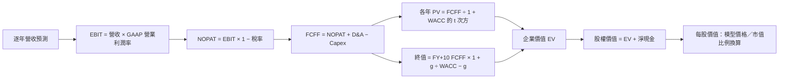

### 8.1 模型假設總表（Model Inputs）

| 假設項目 | 採用值 | 依據／來源 | 敏感度 |
|----------|--------|-------------|--------|
| 預測期長度 **N** | 10 年 | DCF 模型固定期間；增長由 27.5% 淡化至 3.0%。 | 🟡 中 |
| 營收成長路徑 | FY+1 27.5% → FY+10 3.0% | 起點為 TTM 成長 27.5%；線性淡化。 | 🔴 高 |
| 營業利潤率 | FY+1 32.9% → FY+10 34.7% | FY+1 使用 TTM 32.9%；期末取模型提供的五年財年中位數。 | 🔴 高 |
| 有效稅率 | 29.6% | 最新年度有效稅率。 | 🟢 低 |
| Capex／營收 | FY+1 43.2% → FY+10 11.3% | TTM 43.2%；期末約為 1.1 × D&A／營收。 | 🔴 高 |
| D&A／營收 | 10.3% | TTM 比率，模型固定。 | 🟢 低 |
| 營運資金變動 | 未建模 | 模型明確不納入；不以缺失資料反推。 | 🟢 低 |
| EBIT 基礎 | GAAP | 模型採 GAAP EBIT。 | 🟡 中 |
| SBC 處理 | 組合 (A)：GAAP EBIT、不另扣 SBC | SBC 已費用化；固定股數、不另稀釋。 | 🟡 中 |
| 年稀釋率 | 0%（固定股數） | 與組合 (A) 配套；股數不逐年放大。 | 🟡 中 |
| 永續成長率 g | 3.0% | DCF 模型假設；低於 WACC 10.59%。 | 🔴 高 |
| 終值方法 | Gordon Growth | DCF 模型提供終值及折現值；不另建退出倍數法。 | 🔴 高 |
| WACC | 10.59% | 資本成本區塊原值；第 8.2 節解釋組成。 | 🔴 高 |
| FCFF 定義 | NOPAT + D&A − Capex | 工作資金未建模；GAAP EBIT 已含 SBC。 | — |

**模型限制**：FCFF 為企業自由現金流，以 WACC 折現；本模型明確不含 ΔWC，亦不再扣 SBC。金額以美元十億計，表中金額保留兩位小數；折現因子保留三位小數。

### 8.2 折現率推導（WACC）

```text
╔══════════════════════════════════════════════════════════════════╗
║                    WACC 推導（折現率）                           ║
╠══════════════════════════════════════════════════════════════════╣
║  股權成本 Ke（CAPM）：                                           ║
║  ├── 無風險利率 Rf（10Y 美債）：      5.15%                      ║
║  ├── 市場風險溢酬 ERP：               5.00%（假設值）             ║
║  ├── 原始 Beta（Yahoo）：             1.28                        ║
║  ├── 調整後 Beta：                    1.19                        ║
║  ├── Beta 調整：                      ⅔ × 1.28 + ⅓ = 1.19       ║
║  ├── 規模／國別溢酬：                 0.00%（未另加）             ║
║  └── Ke：                             11.08%（採用原值）          ║
║                                                                  ║
║  債務成本 Kd：                                                   ║
║  ├── 稅前 Kd：                        1.39%                      ║
║  ├── 有效稅率：                       29.6%                      ║
║  └── 稅後 Kd：                        1.39% × (1−29.6%) = 0.98% ║
║                                                                  ║
║  資本結構（市場價值權重）：                                      ║
║  ├── 股權權重：                       95.1%                      ║
║  ├── 債務權重：                       4.9%                       ║
║  └── ✅ WACC：                        10.59%                     ║
╚══════════════════════════════════════════════════════════════════╝
```

**WACC 逐步演算與資料限制**

1. **Ke（CAPM）**：`5.15% + 1.19 × 5.00% = 11.10%`；資本成本區塊直接列示採用 Ke **11.08%**。差異 0.02 個百分點屬輸入精度／四捨五入差異，本報告後續一律採用原值 11.08%，不以重算值替換。
2. **稅前 Kd**：資本成本資料列示 `利息 ÷ 債務 = 1.39%`；利息金額、平均計息負債明細及租賃負債範圍未完整提供，故無法展示可逐項複算的分子、分母，引用 1.39% 原值，不另推估。
3. **稅後 Kd**：`1.39% × (1 − 29.6%) = 1.39% × 70.4% = 0.97856% ≈ 0.98%`。
4. **權重**：採資本成本區塊提供的股權權重 95.1%、債務權重 4.9%；相加 `95.1% + 4.9% = 100.0%`。提供的市值、股數、債務口徑存在不同來源差異，故不另用原始股數重新推算權重。
5. **WACC**：依區塊提供的權重與成本，`95.1% × 11.08% + 4.9% × 0.97856% = 10.573% ≈ 10.59%`；採用值為區塊原值 **10.59%**。

Rf 數據未附具體觀察日期；ERP 為假設值 5.00%，沒有另外提供假設來源；不加規模／國別溢酬。以上限制代表成本資本輸入並非全數可由原始披露項目獨立重建，但本報告仍依規定採用提供的 WACC。第 6.2 節與本節均採 **10.59%**。

### 8.3 逐年自由現金流預測（基準情境）

以下逐年數值照 DCF 模型原值列示，金額單位為 $B。模型 FCFF＝NOPAT＋D&A−Capex；ΔWC 未建模，且不另扣 SBC。

| 年度 | FY+1 | FY+2 | FY+3 | FY+4 | FY+5 | FY+6 | FY+7 | FY+8 | FY+9 | FY+10 |
|------|------|------|------|------|------|------|------|------|------|-------|
| 營收 | 308.11 | 384.52 | 469.41 | 560.24 | 653.38 | 744.20 | 827.37 | 897.28 | 948.65 | 977.11 |
| 營收 YoY | 27.5% | 24.8% | 22.1% | 19.4% | 16.6% | 13.9% | 11.2% | 8.5% | 5.7% | 3.0% |
| 營業利潤率 | 32.9% | 33.1% | 33.3% | 33.5% | 33.7% | 33.9% | 34.1% | 34.3% | 34.5% | 34.7% |
| 營業利益 EBIT（GAAP） | 101.23 | 127.10 | 156.10 | 187.43 | 219.90 | 251.95 | 281.76 | 307.37 | 326.86 | 338.62 |
| − 稅 | (30.01) | (37.68) | (46.28) | (55.56) | (65.19) | (74.69) | (83.53) | (91.12) | (96.90) | (100.38) |
| = NOPAT | 71.22 | 89.43 | 109.83 | 131.87 | 154.71 | 177.26 | 198.24 | 216.25 | 229.97 | 238.24 |
| + D&A | 31.78 | 39.66 | 48.42 | 57.78 | 67.39 | 76.76 | 85.34 | 92.55 | 97.85 | 100.78 |
| − Capex | (133.19) | (152.59) | (169.65) | (182.64) | (189.85) | (189.88) | (181.79) | (165.37) | (141.24) | (110.86) |
| **= FCFF** | **−30.18** | **−23.51** | **−11.41** | **7.02** | **32.25** | **64.14** | **101.78** | **143.43** | **186.58** | **228.16** |
| 折現因子 @10.59% | 0.904 | 0.818 | 0.739 | 0.668 | 0.604 | 0.547 | 0.494 | 0.447 | 0.404 | 0.365 |
| **FCFF 現值 PV** | **−27.29** | **−19.22** | **−8.43** | **4.69** | **19.49** | **35.05** | **50.30** | **64.09** | **75.39** | **83.36** |

預測期現值合計按模型列值相加：  
`−27.29 + (−19.22) + (−8.43) + 4.69 + 19.49 + 35.05 + 50.30 + 64.09 + 75.39 + 83.36 = 277.43B`。  
模型列示合計為 **$277.42B**；兩者差異 $0.01B，源於逐年數字四捨五入。

**FY+1 逐步演算**

1. **營收**：`$241.61B × (1 + 27.5%) = $308.05B`；模型列值為 $308.11B，差異來自模型使用未四捨五入底層輸入，報告引用模型原值。
2. **EBIT**：`$308.11B × 32.9% = $101.37B`；模型列值 $101.23B，因表中營收、利潤率均已四捨五入，底層精確假設未提供。此處不以自行重算值替換模型值。
3. **稅**：模型列示 $30.01B；依列值計算 `101.23 × 29.6% = 29.96B`，與表列差額為四捨五入／底層數據精度差異。
4. **NOPAT**：`$101.23B − $30.01B = $71.22B`。
5. **D&A**：模型列示 `$31.78B`；依公布比率近似 `308.11 × 10.3% = 31.74B`，差異為底層精度。
6. **Capex**：模型列示 `$133.19B`；以顯示值比率近似 `308.11 × 43.2% = 133.10B`，差異為底層精度。
7. **ΔWC**：模型未建模，未扣除。
8. **FCFF**：`$71.22B + $31.78B − $133.19B = −$30.19B`；模型列值為 **−$30.18B**，差異 $0.01B 為展示精度。
9. **折現因子與 PV**：`1 ÷ (1 + 10.59%)^1 ≈ 0.904`；`−$30.18B × 0.904 ≈ −$27.28B`，模型列示 −$27.29B，使用未四捨五入折現因子。

逐年表格及模型結果採原值；上列可見部分展示值因模型輸入精度未提供，不能做到每個四捨五入列值逐格完全反推，故不另改模型。

**合理性自檢**

- 預測 FCF CAGR：FY+1 為負、FY+10 為正，CAGR 不適合用端點直接計算；歷史 2022–2025 FCF 由 $19.29B 增至 $46.11B，年化約 33.8%，但歷史基數與模型前期負 FCFF 不可直接比較。
- FY+10 FCFF 利潤率：`$228.16B ÷ $977.11B ≈ 23.4%`；目前 TTM FCF 利潤率 `28.65 ÷ 241.61 ≈ 11.9%`。同業最佳 FCF 利潤率數據未提供，不能作同業比較。
- FY+1 至 FY+3 FCFF 為負，因 Capex 假設高達營收 43.2% 並逐步淡化；負現金流降低預測期 PV，且反映模型價值依賴後期資本支出回落及現金流轉正。

```text
╔══════════════════════════════════════════════════════════════════╗
║            自由現金流：歷史實際 vs 模型預測                      ║
╠══════════════════════════════════════════════════════════════════╣
║  FY2023(實)   $44.07B  █████████░░░░░░░░░░░░  YoY: +128.5%    ║
║  FY2024(實)   $54.07B  ███████████░░░░░░░░░░░  YoY:  +22.7%    ║
║  FY2025(實)   $46.11B  █████████░░░░░░░░░░░░  YoY:  −14.7%    ║
║  FY+1 (預)   −$30.18B  負 FCFF，因 Capex 高於 NOPAT + D&A      ║
║  FY+10 (預)  $228.16B  ██████████████████████                  ║
╠══════════════════════════════════════════════════════════════════╣
║  模型假設 Capex／營收由 43.2% 降至 11.3%；此為主要估值風險。    ║
╚══════════════════════════════════════════════════════════════════╝
```

### 8.4 終值計算（Terminal Value）

**適用性檢查**：`WACC 10.59% vs g 3.0% → WACC > g？✅`

| 方法 | 計算式 | 終值 TV | TV 現值 | 佔總 EV 比重 |
|------|--------|---------|---------|--------------|
| Gordon Growth | $228.16B × (1 + 3.0%) ÷ (10.59% − 3.0%) | $3,094.82B | $1,130.67B | 80.3% |
| 退出倍數法 | N/A（模型未提供退出倍數終值） | N/A | N/A | N/A |

1. **FY+10 FCFF**：`$228.16B`。
2. **分子**：`$228.16B × (1 + 3.0%) = $235.0048B`。
3. **分母與終值**：`10.59% − 3.0% = 7.59%`；`$235.0048B ÷ 7.59% = $3,094.92B`。DCF 模型原值為 **$3,094.82B**；因模型以未四捨五入的 FY+10 FCFF／折現輸入計算，本報告保留模型原值。
4. **終值現值**：模型原值 `PV(TV) = $1,130.67B`，折現因子 0.365；`$3,094.82B × 0.365 ≈ $1,129.61B`，與原值差異來自因子僅顯示三位小數。模型內部使用未四捨五入因子。
5. **終值佔比**：`$1,130.67B ÷ $1,408.09B = 80.3%`。

> **警示：本估值高度依賴終值假設，短期現金流貢獻有限。**模型未提供退出倍數終值，故不自行建立另一方法或推導倍數。

### 8.5 企業價值 → 每股內在價值（Bridge）

```text
╔══════════════════════════════════════════════════════════════════╗
║              企業價值 → 每股內在價值 橋接表                      ║
╠══════════════════════════════════════════════════════════════════╣
║  預測期 FCF 現值合計            +$277.42B                        ║
║  終值現值 PV(TV)                +$1,130.67B                      ║
║  ─────────────────────────────────────────────                  ║
║  = 企業價值 EV                   $1,408.09B                      ║
║  + 淨現金（負值代表淨負債）      −$1.22B                          ║
║  = 股權價值                      $1,406.87B                      ║
║  ─────────────────────────────────────────────                  ║
║  每股價值模型換算                $550.36                         ║
║  當前股價                        $641.69                         ║
║  DCF 折溢價（現價÷內在價值−1）  +16.6%（現價溢價）               ║
╚══════════════════════════════════════════════════════════════════╝
```

**橋接逐步演算**

1. **EV**：`$277.42B + $1,130.67B = $1,408.09B`。
2. **股權價值**：`$1,408.09B + (−$1.22B) = $1,406.87B`。
3. **每股內在價值**：模型指定換算公式為 `股權價值 × 價格 ÷ 市值`，即 `$1,406.87B × $641.69 ÷ $1.64T ≈ $550.36`；市值與精確股數的底層未四捨五入值未提供，因此沿用模型原值。
4. **折溢價**：`$641.69 ÷ $550.36 − 1 ≈ +16.6%`，即現價相對 DCF 價值溢價約 16.6%。DCF 模型所列 −14.2% 是內在價值相對現價的報酬差，不是折溢價定義。
5. **本節不計算 MOS**：MOS 只在第 8.8 節以加權合理價值為分母計算。

股數換算沿用 DCF 模型公式，不以外部 2.21B 股數或 Roic.ai 2.548B 股數替換；該模型採用固定股數假設且與組合 (A) 相容。現金及債務以資本成本／DCF 指標的一致口徑淨負債 $1.22B 橋接。

### 8.6 敏感性分析（WACC × 永續成長率）

以下矩陣照 DCF 模型原值抄錄。括號為相對現價 $641.69 的上行／下行；基準格以粗體表示。

| g（列）／WACC（欄） | 8.59% | 9.59% | **10.59%（基準）** | 11.59% | 12.59% |
|-----------|------|------|------------------|-------|-------|
| 2.0% | $733.71（+14.3%） | $597.38（−6.9%） | $495.10（−22.8%） | $416.06（−35.2%） | $353.54（−44.9%） |
| 2.5% | $786.60（+22.6%） | $633.71（−1.2%） | $521.03（−18.8%） | $435.12（−32.2%） | $367.90（−42.7%） |
| 3.0% | $848.94（+32.3%） | $675.54（+5.3%） | **$550.36（−14.2%）** | $456.40（−28.9%） | $383.74（−40.2%） |
| 3.5% | $923.53（+43.9%） | $724.24（+12.9%） | $583.84（−9.0%） | $480.31（−25.2%） | $401.33（−37.5%） |
| 4.0% | $1,014.35（+58.1%） | $781.65（+21.8%） | $622.39（−3.0%） | $507.36（−20.9%） | $420.97（−34.4%） |

**非基準格演算示例**：選格 `WACC 11.59% > g 3.0% ✅`。該格 DCF 模型直接列示每股價值 **$456.40**。完整底層逐年 FCFF 未提供該情境下的未四捨五入現值，因此無法在不重建模型的前提下，逐項重算新 WACC 的預測期 PV、TV 與股權橋接；此處不虛構中間值。該數字為 DCF 模型矩陣原值。

**三情境 DCF（營運假設亦變動）**

| 情境 | 第 1 年營收成長 | 期末營業利潤率 | WACC | 每股內在價值 | 相對現價 | 主觀機率 |
|------|----------------|----------------|------|--------------|----------|----------|
| 🔴 悲觀 | 13.8% | 29.5% | 11.59% | $184.69 | −71.2% | 25% |
| 🟡 基準 | 27.5% | 34.7% | 10.59% | $550.36 | −14.2% | 50% |
| 🟢 樂觀 | 41.3% | 38.1% | 9.59% | $1,336.18 | +108.2% | 25% |
| **機率加權** | — | — | — | **$655.40** | **+2.1%** | 100% |

模型未提供每個情境的 FY+10 營收、FCFF、TV 與股權橋接中間數字，因此不能完整重演情境推導鏈而不自行建立新模型。情境價值及機率照模型原值引用。機率加權核對：  
`$184.69 × 25% + $550.36 × 50% + $1,336.18 × 25% = $655.40`（依未四捨五入模型值計算；以展示到美分的數字計算有約 $0.01 尾差）。

**敏感度結論**

- **g 上升 1 個百分點**：基準 WACC 下，矩陣由 g=2.5% 的 $521.03 升至 g=3.5% 的 $583.84，`$583.84 − $521.03 = $62.81`，約為 `$62.81 ÷ $521.03 = 12.1%`。
- **WACC 上升 1 個百分點**：g=3.0% 下，價值由 $550.36 降至 $456.40，`$456.40 − $550.36 = −$93.96`，約 `−$93.96 ÷ $550.36 = −17.1%`。
- **期末營業利潤率每 +1pp**：模型未提供利潤率敏感性矩陣或單變數解，**N/A（數據未提供）**。
- 敏感性中 WACC 變動對每股價值的影響大於 g 的一個百分點區間；這與第 8.0 節指出終值及折現率是估值主導變數一致。

### 8.7 反推 DCF（Reverse DCF：市場在預期什麼）

反推 DCF 模型只提供兩個單變數解：年 1 營收成長率、固定營業利潤率。其餘變數沿用模型基準輸入，包括 WACC 10.59%、稅率 29.6%、Capex 路徑、預測期 10 年及固定股數。

| 求解的變數（一次一個） | 其餘變數設定 | 市場隱含值（令 DCF = 現價） | 公司歷史／基準 | 判斷 |
|------------------------|--------------|------------------------------|----------------|------|
| 年 1 營收成長率 | 其他值固定於基準 | **31.2%** | 基準 27.5%；TTM 成長 27.5% | 🔴 高於基準 3.7 個百分點，現價要求短期增長更快。 |
| 固定營業利潤率 | 營收路徑與其他輸入固定 | **38.2%** | 基準 FY+1 32.9% → FY+10 34.7% | 🔴 高於模型期末利潤率。 |
| 永續成長率 g | N/A | 未計算 | — | 模型未提供該變數反解結果。 |
| 預測期長度 N | N/A | 未計算 | 基準 10 年 | 模型未提供 N 的單變數反解。 |

模型未提供求解迭代軌跡與各次試算輸出，不能編造試算表。**反推結論**：以模型基準其他假設不變，市場價格隱含年 1 營收成長需約 31.2%，或固定營業利潤率約 38.2%；前者高於 TTM 增長，後者高於基準 DCF 期末利潤率，代表現價仍要求相當高的營運成績。

### 8.8 估值三角驗證與安全邊際

| 估值方法 | 隱含每股價值 | 上行空間（÷現價） | 權重 | 說明 |
|----------|--------------|-------------------|------|------|
| DCF（基準） | $550.36 | −14.2% | 40% | 10 年 FCFF，WACC 10.59%、g 3.0%。 |
| 同業 Forward P/E | $300.48 | −53.2% | 25% | 同業中位數 8.4x × Forward EPS $35.59。 |
| 同業 EV/EBITDA | $1,122.13 | +74.9% | 25% | GOOG、PINS 中位數 27.5x × TTM EBITDA，加回淨現金。 |
| 分析師共識目標價 | $850.10 | +32.5% | 10% | 57 位分析師平均目標價。 |
| **加權合理價值** | **$660.81** | **+3.0%** | **100%** | 依獲利公司固定權重計算。 |

**加權演算**：  
`$550.36 × 40% + $300.48 × 25% + $1,122.13 × 25% + $850.10 × 10%`  
`= $220.144 + $75.120 + $280.5325 + $85.010`  
`= $660.8065 ≈ $660.81`。  
權重合計 `40% + 25% + 25% + 10% = 100%`。此公司類型為獲利公司；四種方法均列入，沒有方法被剔除。

**MOS 與上行空間**

- `MOS = ($660.81 − $641.69) ÷ $660.81 = $19.12 ÷ $660.81 = +2.9%`
- `上行空間 = ($660.81 − $641.69) ÷ $641.69 = $19.12 ÷ $641.69 = +3.0%`
- 評級（依 MOS 門檻）：**持有**。🟡 MOS 介於 −10% 與 +10%。

```text
╔══════════════════════════════════════════════════════════════════╗
║                  估值區間與安全邊際                              ║
╠══════════════════════════════════════════════════════════════════╣
║  $184.69 ─── $550.36 ─── $641.69 ─── [$660.81] ─── $1,336.18   ║
║  悲觀DCF       基準DCF       現價       加權合理值       樂觀DCF  ║
║                                                                  ║
║  MOS = ($660.81 − $641.69) ÷ $660.81 = +2.9%                    ║
║  MOS 評估：🔴 <10%，安全邊際有限                                ║
║  上行空間 = ($660.81 − $641.69) ÷ $641.69 = +3.0%               ║
║                                                                  ║
║  建議買入區間：$594.73 以下（加權合理價值的 90% 以下）          ║
║  合理持有區間：$594.73 – $660.81                                ║
║  減碼考慮區間：高於 $1,336.18，或基本面跌破投資論點              ║
╚══════════════════════════════════════════════════════════════════╝
```

買入區間上限按 MOS 至少 10% 推算：`$660.81 × (1 − 10%) = $594.73`。此為估值框架上的觀察價，不是對短期價格的預測。

> 🔎 **程式複算（Python，依本節各項自動重算）**
>
> 加權合理價值 = $550.36 × 40% + $300.48 × 25% + $1,122.13 × 25% + $850.10 × 10% = **$660.81**（權重合計 100%）
>
> 以價格 $641.69 計：MOS = **+2.9%**，上行空間 = **+3.0%**
>
> ✅ 與本節所寫數值一致。

### 8.9 DCF 模型的局限與失效條件

- **終值依賴度**：PV(TV) $1,130.67B ÷ EV $1,408.09B = **80.3%**；估值主要取決於第 10 年後的現金流。
- **最脆弱假設**：Capex／營收由 43.2% 降至 11.3%；若未能下降，FCFF 可能低於模型。WACC 上升 1 個百分點，在 g=3.0% 下基準 DCF 由 $550.36 降至 $456.40。
- **模型適用性**：公司目前 TTM FCF 為正，但最近季度 FCF 曾有 −$1.16B；高再投資期使單一年份 FCF 代表性下降。可輔以 EV/EBITDA、P/S 與分部分析，但缺少足夠分部數據時不應自行做 SOTP。
- **與第 10 章風險連結**：AI／資料中心投入回報不足，會使 Capex 路徑及營業利潤率惡化；隱私監管衝擊會壓低營收成長或廣告定價；利率上升會增加 WACC，直接降低終值與現值。

### 8.10 複算檢核表（Audit Trail）

| # | 檢核項目 | 檢查方式 | 結果 |
|---|----------|----------|------|
| 1 | 所有 🔴高／🟡中敏感度輸入都有完整推導 | 對照第 8.0 與 8.1；已列主要輸入來源與調整，但模型未提供所有底層路徑。 | 🟡 |
| 2 | 每個假設都有來歷 | 8.1 逐項列明數據錨點；部分未提供資料明確標註。 | ✅ |
| 3 | WACC 五步算式與權重 | 權重合計 100%；Ke 重算與指定原值有 0.02pp 差異，已披露並採用 10.59% 原值。 | 🟡 |
| 4 | Kd 分母與債務權重範圍一致 | 利息與平均計息負債拆分缺失，無法確認債務是否含租賃負債。 | 🟡 |
| 5 | WACC 與第 6.2 節同值 | 兩處均為 10.59%。 | ✅ |
| 6 | 逐年表格年度數 = N，無省略 | FY+1 至 FY+10 共 10 年。 | ✅ |
| 7 | FY+1 九步算式可複算 | 已展示；顯示值與模型因底層精度及四捨五入存在少量差異，未擅自改動原模型值。 | 🟡 |
| 8 | 預測期 PV 合計 | 展示列值合計 $277.43B，模型原值 $277.42B，差 $0.01B。 | ✅ |
| 9 | WACC > g | 10.59% > 3.0%。 | ✅ |
| 10 | 終值以 FY+N FCFF 為基礎、折現 N 期 | 使用 FY+10 FCFF $228.16B、10 年折現。 | ✅ |
| 11 | 橋接 EV 至每股價值 | EV 與股權價值可複算；每股值按模型指定市值比例公式沿用。 | 🟡 |
| 12 | SBC 組合相容 | GAAP EBIT、不另扣 SBC、固定股數、年稀釋率 0%，符合組合 (A)。 | ✅ |
| 13 | 敏感性基準格 = DCF 基準值 | 10.59%／3.0% 格為 $550.36。 | ✅ |
| 14 | 敏感度矩陣有效性 | 所列格均 WACC > g。 | ✅ |
| 15 | 三情境機率加總與加權 | 25% + 50% + 25% = 100%；機率加權原值 $655.40。 | ✅ |
| 16 | 反推 DCF 每列一次解一個變數 | 只引用模型提供的 31.2% 與 38.2%；無迭代軌跡可供重現。 | 🟡 |
| 17 | MOS 分母與折溢價基準一致 | MOS 使用 $660.81；折溢價使用 DCF $550.36。 | ✅ |
| 18 | 報告完整至第 11 章 | 章節完整列出。 | ✅ |
| 19 | 加權合理價值等於加權總和 | 展示總和 $660.8065，四捨五入為原值 $660.81。 | ✅ |
| 20 | 評級符合 MOS 門檻 | MOS +2.9%，對應持有。 | ✅ |

未能完全複算的項目主要來自原始模型未提供未四捨五入逐項輸入、利息及計息負債明細；報告已保留模型原值並明確標示，沒有另建或替換 DCF。

---

## 9. 成長催化劑

### 9.1 催化劑時間軸

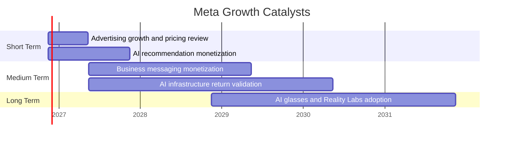

時間軸為研究追蹤期間，不代表公司已公布的產品上市承諾或財測日期。主要驗證指標仍是營收增長、廣告效率、利潤率與 Capex 回報。

### 9.2 TAM 市場規模分析

**N/A（TAM 數據未提供）**。現有資料顯示 TTM 營收 $241.61B、年增 27.5%，但未提供數位廣告、商業訊息、AI 眼鏡或 VR 市場的可引用 TAM 金額與年份，因此不計算滲透率。成長空間應透過分部營收、產品用戶數與變現數據逐季追蹤。

### 9.3 成長驅動力結構圖

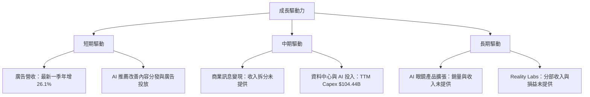

---

## 10. 風險矩陣

### 10.1 風險評分矩陣

機率與衝擊位置為定性風險判斷，不是財務資料中的統計機率；未有充分量化基礎的風險不虛構百分比。

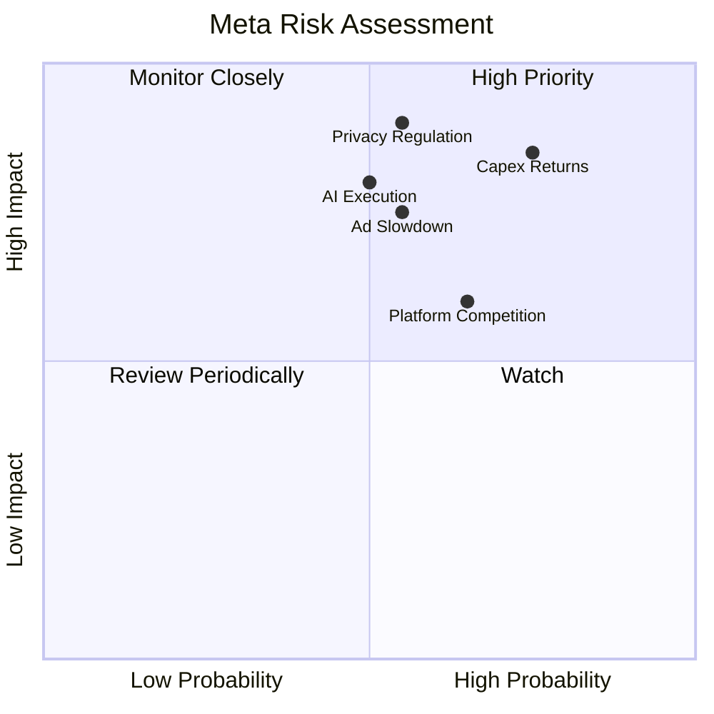

### 10.2 風險清單詳細分析

| # | 風險項目 | 發生機率 | 財務衝擊 | 風險評分 | 緩解措施 |
|---|----------|----------|----------|----------|----------|
| 1 | 🔴 **資本支出回報低於預期** | 中高；無可核實百分比 | Capex TTM $104.44B、營收占比 43.2%；可能令 FCF 進一步下滑。 | 🔴 高 | 逐季追蹤 Capex、FCF、AI 相關營收變現與 ROIC；若 Capex 持續高增而營收或利潤率下滑，重新評估估值。 |
| 2 | 🔴 **隱私與監管限制** | 中；近期已有罰款新聞 | 可能削弱廣告定向、資料使用或產品整合；具體營收影響未提供。 | 🔴 高 | 追蹤監管裁決、罰款、功能限制及廣告轉換效果，不以單次罰款金額代替長期影響評估。 |
| 3 | 🟡 **廣告景氣與定價回落** | 中 | 最新一季營收年增 26.1%，若連續減速將壓低收入增長與估值。 | 🟡 中高 | 追蹤季度收入 YoY、廣告價格／曝光量（若公司披露）及廣告主預算。 |
| 4 | 🟡 **AI 投資執行風險** | 中 | 高額 Capex 可能延後轉化為效率、使用者參與或廣告收入。 | 🟡 中高 | 監控營業利潤率、FCF 與 AI 推薦對廣告表現的定量指標。 |
| 5 | 🟡 **平台競爭及用戶注意力流失** | 中 | 可能降低內容互動、廣告庫存與商業訊息變現；用戶及份額數據未提供。 | 🟡 中 | 持續追蹤用戶活躍、留存及各產品分部揭露；缺少數據時不推算市占率。 |

---

## 11. 投資建議

### 11.1 最終評級與評分

依加權合理價值 $660.81 與 2026-11-13 收盤價 $641.69 計算，MOS 為 +2.9%，落在 −10% 至 +10% 區間，故評級為 **持有**，沒有作質化調整。1.1 綜合評分為 **7.3/10**；其六項分數為成長性 8.0、獲利能力 8.5、財務健康 7.0、估值 5.5、護城河 8.5、管理層與資本配置 6.5。

### 11.2 合理價值與隱含報酬率

| 估值情境 | 每股價值 | 相對現價 | 機率 | 解讀 |
|----------|----------|----------|------|------|
| 加權合理價值 | $660.81 | +3.0% | — | 四種估值方法加權結果。 |
| 🔴 悲觀 DCF | $184.69 | −71.2% | 25% | 營收增長較低、期末利潤率下降、WACC 上升。 |
| 🟡 基準 DCF | $550.36 | −14.2% | 50% | DCF 基準假設下價值低於現價。 |
| 🟢 樂觀 DCF | $1,336.18 | +108.2% | 25% | 高營收增長、較高期末利潤率及較低 WACC。 |
| 機率加權 DCF（參考） | $655.40 | +2.1% | 100% | DCF 情境機率加權結果；8.8 加權合理價值仍依規定採估值方法加權值。 |

### 11.3 買入時機與觸發因素

```text
╔══════════════════════════════════════════════════════════════════╗
║                  ✅ 買入觸發因素 Checklist                      ║
╠══════════════════════════════════════════════════════════════════╣
║  立即建立／維持觀察部位的條件：                                 ║
║  ✅ 營收增長維持在 20% 以上，且不連續兩季快速下滑               ║
║  ✅ TTM ROIC 維持高於 WACC 10.59%                               ║
║  ✅ Capex 成長開始帶動營收或廣告效率，而非只壓低 FCF            ║
║                                                                  ║
║  加碼觸發條件（符合估值或基本面改善）：                         ║
║  ☐ 股價回落至 $594.73 以下，達加權合理價值至少 10% MOS          ║
║  ☐ TTM FCF 回升，且 FCF／淨利轉換率由目前 38.1% 改善             ║
║  ☐ 最新季度營業利益率由 20.1% 回升並趨近 TTM 32.9%              ║
║                                                                  ║
║  減碼／重新檢視條件：                                           ║
║  ☐ 連續兩季營收年增低於 15%                                    ║
║  ☐ TTM ROIC 降至 WACC 10.59% 或以下                            ║
║  ☐ Capex 持續高於營收 40%，且 FCF 進一步惡化                    ║
║  ☐ 監管限制實質削弱廣告定向或跨平台產品整合                     ║
╚══════════════════════════════════════════════════════════════════╝
```

### 11.4 投資人適配度分析

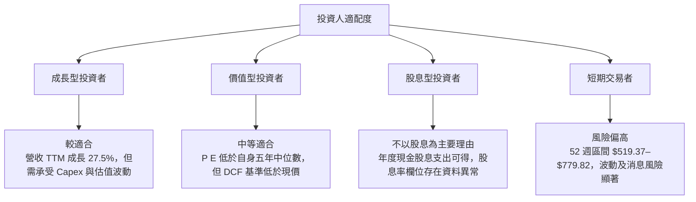

### 11.5 每季財報監控清單（Quarterly Watch List）

| 監控指標 | 最新基準 | 加碼／正向觸發 | 減碼／負向觸發 |
|----------|----------|----------------|----------------|
| 營收成長 | TTM 27.5%；最新一季 YoY 26.1% | 維持 20% 以上，且不連續減速。 | 連續兩季低於 15%。 |
| 營業利益率 | TTM 32.9%；最新一季 20.1% | 最新季度回升並趨近 TTM 水準。 | 連續兩季低於 20%，或 TTM 明顯下滑。 |
| Capex | TTM $104.44B；Capex／營收 43.2% | Capex 強度下降，同時收入仍增長。 | Capex／營收維持高於 40% 且 FCF 惡化。 |
| FCF | TTM $28.65B；Yield 1.75% | TTM FCF 回升、轉換率改善。 | FCF 連續兩季為負或 TTM 大幅下滑。 |
| SBC | 最近四季約 $26.94B，約占 TTM 營收 11.1% | SBC／營收下降且稀釋股數穩定。 | SBC 占比上升、稀釋股數持續增加。 |
| ROIC／資本成本 | ROIC 27.7%；WACC 10.59% | ROIC 持續高於 WACC。 | ROIC 跌至 WACC 以下。 |
| FoA、RL 分部 | 分部營收與利潤未提供 | 追蹤公司分部揭露及變現證據。 | RL 投入擴大但回報長期不明，或 FoA 成長放緩。 |
| 財測與監管 | 公司財測未提供於本報告資料 | 財測維持或上修，監管限制可控。 | 財測下修，或監管限制產品功能／資料使用。 |

### 11.6 反面論證：什麼會證明論點錯誤（What Would Change My Mind）

```text
╔══════════════════════════════════════════════════════════════════╗
║              ⚠️ 論點失效條件（Disconfirming Evidence）           ║
╠══════════════════════════════════════════════════════════════════╣
║  本投資論點在下列情況成立時應重新檢視或退出：                    ║
║  ☐ 最新一季營收年增連續兩季低於 15%                              ║
║  ☐ TTM 營業利益率較 32.9% 收縮超過 5 個百分點                   ║
║  ☐ TTM FCF 轉負，或 FCF／淨利轉換率低於目前 38.1% 且持續惡化    ║
║  ☐ ROIC 跌至 WACC 10.59% 以下，表示經濟利潤不再為正             ║
║  ☐ Capex／營收連續維持高於 40%，而營收增長低於 15%              ║
║  ☐ AI、資料中心及其他高額投資未改善營收變現或營業利潤率          ║
║  ☐ 隱私／反壟斷限制使廣告定向、資料使用或產品整合出現實質收縮    ║
╚══════════════════════════════════════════════════════════════════╝
```

> **免責聲明**：本報告為 AI 自動生成，僅供研究參考，不構成投資建議。投資有風險，入市需謹慎。

---

## 資料與來源

| 項目 | 內容 |
|------|------|
| 價格 | 641.69 USD，2026-11-13 收盤（Yahoo Finance 日線） |
| 財務報表 | SEC 10-Q filed 2026-10-22，最新季度 2026-09-30（FY2026 Q3） |
| 有回應的資料來源 | SEC 申報資料 (XBRL)、Yahoo Finance、Finviz、StockAnalysis、Roic.ai |
| 由程式計算 | TTM 數字、WACC、DCF 模型、估值方法與權重、加權合理價值、MOS、評級門檻、F-Score、杜邦分解、營運資金天數、綜合評分 |
| 撰寫模型 | openai / gpt-6-luna |

> 本區塊由產生報告的程式依實際取得的資料填寫，非模型撰寫。「由程式計算」的數字不是模型的估計；其餘判斷（評分、情境、策略）是模型的分析。
