# META 基本面深度分析報告
> **報告日期**：2026-11-14 ｜ **語言**：繁體中文 ｜ **數據來源**：SEC 申報資料 (XBRL)、Yahoo Finance、Finviz、StockAnalysis、Roic.ai ｜ **分析師**：CFA 級機構研究  
> **估值價格基準**：2026-11-13 收盤價 **$641.69**。財務資料有若干來源衝突；本報告對價格、TTM 營收、TTM FCF、ROIC、資本成本及同業倍數，優先採用 VERIFIED FIGURES 原值。其他資料遇到衝突時明確標示，不以反推方式填補缺漏。

## 目錄

| # | 章節 | 核心結論 |
|---|---|---|
| 1 | 執行摘要 | 持有；加權合理價值約 $600.57，MOS 約 -6.8% |
| 2 | 公司概覽與商業模式 | 廣告平台網路效應深；AI、基礎設施與 Reality Labs 支出提高資本需求 |
| 3 | 損益表深度分析 | TTM 營收 $241.61B、TTM 成長 27.5%；但季度利潤率資料存在來源差異 |
| 4 | 資產負債表分析 | VERIFIED FIGURES 顯示淨負債 $72.45B；現金資料與其他來源不一致 |
| 5 | 現金流量深度分析 | TTM FCF $28.65B，FCF yield 1.75%；資本支出是主要壓力 |
| 6 | 獲利能力與資本效率 | ROIC 22.0% 高於 WACC 11.04%，現階段仍創造價值 |
| 7 | 相對估值分析 | P/E 低於自身五年中位數；相對同業估值不呈現一致折價 |
| 8 | DCF 內在價值評估 | 基準 DCF 約 $157.6；估值對 Capex、WACC 與終值假設高度敏感 |
| 9 | 成長催化劑 | AI 廣告效率、Reels 變現與 AI 裝置為主要機會；多數收入貢獻未披露 |
| 10 | 風險矩陣 | 資本支出回報、監管與廣告週期是主要風險 |
| 11 | 投資建議 | 持有；加權合理價值約 $600.57，$540 左右以下較具吸引力 |

---

## 1. 執行摘要

### 1.0 一頁式投資儀表板

| 項目 | 內容 |
|---|---|
| **投資論點（3 句）** | ① TTM 營收 **$241.61B**、年增 **27.5%**，顯示核心平台仍有擴張能力。② TTM ROIC **22.0%** 高於參考 WACC **11.04%**，現階段資本回報仍超過資本成本。③ TTM FCF **$28.65B**、FCF yield **1.75%**，但 TTM Capex **$104.44B**，高額基建投入壓低現金收益。 |
| **護城河評分** | **8.5/10**；多產品社交網路與廣告資料形成網路效應，惟監管及平台依賴是限制 |
| **管理層／資本配置評分** | **7.0/10**；核心業務投資回報佳，但 AI 基建及 Reality Labs 回報透明度不足 |
| **財務健康** | 🟡 VERIFIED FIGURES：現金及短期投資 $11.22B、總債務 $83.67B、淨負債 $72.45B；與其他資料源的 $82.45B 現金數字不一致 |
| **ROIC vs WACC** | **22.0% vs 11.04%**；正利差 10.96 個百分點，仍在創造經濟價值 |
| **FCF 趨勢** | TTM FCF $28.65B；相較 FY2025 $46.11B 下滑，TTM FCF Yield **1.75%** |
| **估值** | Forward P/E **18.03x** ｜ EV/EBITDA 市場資料 **13.999x**；五年估值資料為 **16.5x** ｜ FCF Yield **1.75%** |
| **DCF 內在價值（基準）** | **$157.6** ｜ 現價相對 DCF 溢價約 **307.2%**；計算基於高 Capex 假設及 VERIFIED FIGURES 淨負債 |
| **安全邊際（MOS）** | **-6.8%＝($600.57 − $641.69) ÷ $600.57**；基準為 8.8 加權合理價值 |
| **預期報酬（基準情境 12M）** | 約 **+5.4%**，以同業 Forward P/E 法推算 $676.2；未計股息 |
| **關鍵風險（前二）** | AI／資料中心資本開支回報低於預期；監管或平台變化削弱廣告變現 |
| **評級 + 信心度** | 🟡 **持有** ｜ 信心：中低；資料源現金、股數與季度營業利益存在不一致 |

> 依 8.8 加權價值計算，MOS 為 -6.8%，依評級門檻屬 **持有**，不需質化調整。DCF 單一模型價值低於市場與相對估值方法，反映模型對高資本支出的敏感度，不宜單獨視為目標價。

### 1.1 核心評分儀表板

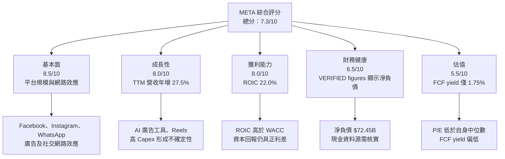

### 1.2 評分進度條視覺化

```text
╔══════════════════════════════════════════════════════════════╗
║                META 多維度評分儀表板（1-10分）              ║
╠══════════════════════════════════════════════════════════════╣
║ 基本面強度  8.5 ▓▓▓▓▓▓▓▓▓▓▓▓▓▓▓▓▓░░░ ★★★★☆              ║
║ 成長動能    8.0 ▓▓▓▓▓▓▓▓▓▓▓▓▓▓▓▓░░░░ ★★★★☆              ║
║ 獲利品質    7.0 ▓▓▓▓▓▓▓▓▓▓▓▓▓▓░░░░░░ ★★★☆☆              ║
║ 財務健康    6.5 ▓▓▓▓▓▓▓▓▓▓▓▓▓░░░░░░░ ★★★☆☆              ║
║ 估值合理性  5.5 ▓▓▓▓▓▓▓▓▓▓▓░░░░░░░░░ ★★★☆☆              ║
║ 護城河深度  8.5 ▓▓▓▓▓▓▓▓▓▓▓▓▓▓▓▓▓░░░ ★★★★☆              ║
║ 管理層執行  7.0 ▓▓▓▓▓▓▓▓▓▓▓▓▓▓░░░░░░ ★★★☆☆              ║
║ 技術創新力  8.0 ▓▓▓▓▓▓▓▓▓▓▓▓▓▓▓▓░░░░ ★★★★☆              ║
╠══════════════════════════════════════════════════════════════╣
║ 綜合總分    7.3 ▓▓▓▓▓▓▓▓▓▓▓▓▓▓▓░░░░░ 🟡 高質量、估值審慎   ║
╚══════════════════════════════════════════════════════════════╝
```

### 1.3 五大投資論點 + 三大核心風險

| 類型 | 項目 | 具體依據 | 信心度 |
|---|---|---|---|
| 🟢 投資論點① | 核心廣告規模仍在成長 | TTM 營收 $241.61B，TTM 年增 27.5%；最新季度單季年增 26.1% | 高 |
| 🟢 投資論點② | 營運資本回報高於資本成本 | ROIC 22.0% 對 WACC 11.04%，正利差 10.96pp | 中高 |
| 🟢 投資論點③ | 家族產品具有多入口 | Facebook、Instagram、WhatsApp、Messenger 與 Reels 支援廣告觸達及交叉導流 | 中高 |
| 🟢 投資論點④ | AI 可能提升廣告效率 | 若推薦、排序和廣告投放提升轉換率，可增加單位流量收益；實際貢獻金額未提供 | 中 |
| 🟢 投資論點⑤ | 歷史估值低於自身中位數 | P/E 21.9x，五年中位數 24.5x；目前百分位 29% | 中 |
| 🟡 風險① | Capex 大幅擴張 | TTM Capex $104.44B，約為 TTM 營收 43.2%；回報週期及折舊壓力可能拉長 | 高 |
| 🔴 風險② | 監管及平台風險 | 隱私、競爭法規、未成年人保護與平台分發政策可能影響廣告定位及產品變現 | 中高 |
| 🟡 風險③ | FCF 與現金資料口徑不一致 | TTM FCF $28.65B，低於 FY2025 $46.11B；現金資料另有 $11.22B 與 $82.45B 兩種口徑 | 高 |

### 1.4 快速統計卡片

| 指標 | 公司實際值 | 行業均值 | S&P 500 均值 | 狀態 |
|---|---:|---:|---:|---|
| TTM 收入成長 | **27.5%** | N/A | N/A | 🟢 高成長 |
| 毛利率 TTM | **81.0%** | N/A | N/A | 🟢 高 |
| 淨利率 TTM | **31.1%** | N/A | N/A | 🟢 高 |
| ROE TTM（VERIFIED） | **27.6%** | N/A | N/A | 🟢 高 |
| ROIC TTM | **22.0%** | N/A | N/A | 🟢 高 |
| Forward P/E | **18.03x** | N/A | N/A | 🟡 需與成長及風險合併判斷 |
| FCF Yield | **1.75%** | N/A | N/A | 🔴 現金收益偏低 |

行業與 S&P 500 同口徑均值未提供，故不以非同期估計填補。

### 1.5 投資結論

```text
╔══════════════════════════════════════════════════════════════════╗
║                    📊 投資結論摘要                               ║
╠══════════════════════════════════════════════════════════════════╣
║ 評級：持有（依 8.8 加權 MOS -6.8%）                              ║
║ 價格（2026-11-13 收盤）：$641.69                                ║
║ DCF 內在價值（基準）：約 $157.6（現價溢價約 307.2%）            ║
║ 安全邊際 MOS：-6.8%（以加權合理價值 $600.57 為分母）            ║
║ 目標價情境：                                                     ║
║   悲觀：$500（相對現價 -22.1%）                                 ║
║   基準：$676.2（相對現價 +5.4%）                                ║
║   樂觀：$850.1（相對現價 +32.5%）                               ║
║ 投資評分：7.3/10                                                 ║
║ 適合投資人：可承受波動的長期成長投資人；不適合單純收益型投資人   ║
╚══════════════════════════════════════════════════════════════════╝
```

上述情境價位分別以保守估值、同業 Forward P/E 與分析師共識作參考，並非保證報酬。

---

## 2. 公司概覽與商業模式

### 2.1 業務結構與收入來源

公司資料指出 META 主要由 Family of Apps（FoA）與 Reality Labs（RL）組成；未提供最新分部收入，故分部佔比與金額標示 N/A，不以總營收反推分部收入。

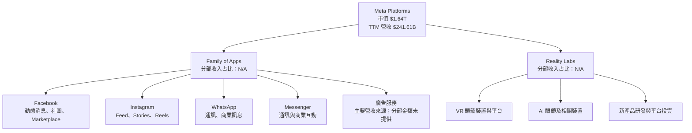

### 2.2 市場份額

公司在全球社交網路、數位廣告及 AI 眼鏡市場的同口徑市場份額，資料包均未提供可靠份額數據。以下用營收來源示意，**不代表市場份額**：

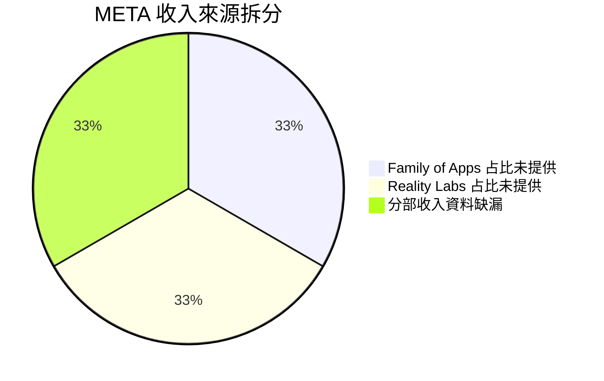

此圖只表示分部資料缺漏，不應解讀為三者實際均分。廣告、裝置及服務各自收入占比均為 N/A。

### 2.3 競爭護城河分析

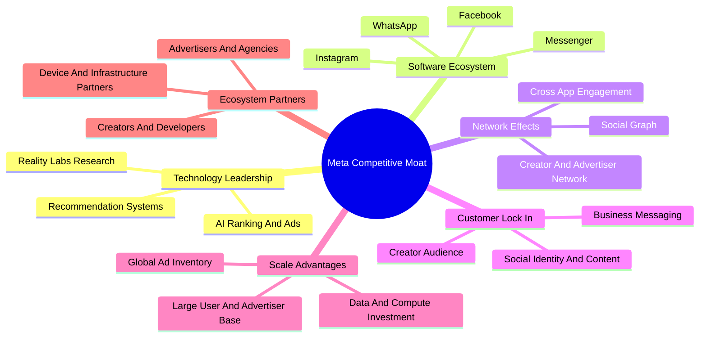

### 2.4 護城河強度評分

```text
╔══════════════════════════════════════════════════════════════╗
║                  META 護城河強度評分                         ║
╠══════════════════════════════════════════════════════════════╣
║ 網路效應       9.0 ▓▓▓▓▓▓▓▓▓▓▓▓▓▓▓▓▓▓░░ 🟢 跨產品社交網路  ║
║ 品牌與觸達     8.5 ▓▓▓▓▓▓▓▓▓▓▓▓▓▓▓▓▓░░░ 🟢 覆蓋多地區用戶  ║
║ 廣告資料及排序 8.0 ▓▓▓▓▓▓▓▓▓▓▓▓▓▓▓▓░░░░ 🟢 效率可持續改善  ║
║ 客戶轉換成本   7.0 ▓▓▓▓▓▓▓▓▓▓▓▓▓▓░░░░░░ 🟡 使用者切換成本中等║
║ 規模效應       8.5 ▓▓▓▓▓▓▓▓▓▓▓▓▓▓▓▓▓░░░ 🟢 廣告供需雙邊規模║
║ 生態合作       7.0 ▓▓▓▓▓▓▓▓▓▓▓▓▓▓░░░░░░ 🟡 受外部平台影響  ║
╠══════════════════════════════════════════════════════════════╣
║ 綜合護城河     8.5 ▓▓▓▓▓▓▓▓▓▓▓▓▓▓▓▓▓░░░ 🟢 但非監管免疫    ║
╚══════════════════════════════════════════════════════════════╝
```

---

## 3. 損益表深度分析

### 3.1 年度收入成長趨勢

| 財年 | 營收 | YoY | 解讀 |
|---|---:|---:|---|
| 2022 | $116.61B | -1.1% | 廣告需求及宏觀環境轉弱 |
| 2023 | $134.90B | +15.7% | 廣告恢復及費用管理改善 |
| 2024 | $164.50B | +21.9% | 規模回升，廣告變現及產品組合改善 |
| 2025 | $200.97B | +22.2% | 延續雙位數成長；營收規模提高 |
| TTM 至 2026 Q3 | $241.61B | +27.5% | VERIFIED FIGURES 的 TTM 年增率，不能視為單季增幅 |

```text
╔══════════════════════════════════════════════════════════════════╗
║              META 年度收入趨勢（2022-2025）                     ║
╠══════════════════════════════════════════════════════════════════╣
║ 2022  $116.61B  ████████████░░░░░░░░░░░░  YoY -1.1% 🔴          ║
║ 2023  $134.90B  ██████████████░░░░░░░░░░  YoY +15.7% 🟢         ║
║ 2024  $164.50B  █████████████████░░░░░░░  YoY +21.9% 🟢         ║
║ 2025  $200.97B  █████████████████████░░░  YoY +22.2% 🟢         ║
╠══════════════════════════════════════════════════════════════════╣
║ 2022-2025 CAGR = (200.97 ÷ 116.61)^(1/3)-1 ≈ 19.9%             ║
╚══════════════════════════════════════════════════════════════════╝
```

### 3.2 季度收入趨勢分析

| 季度 | 營收 | QoQ | 單季 YoY | 備註 |
|---|---:|---:|---:|---|
| 2025 Q4 | $59.89B | +41.6%* | +23.8% | QoQ 受季節性影響，按 Q3 至 Q4 計算 |
| 2026 Q1 | $56.31B | -6.0% | +33.1% | 單季年增；季節性及季度波動 |
| 2026 Q2 | $60.80B | +8.0% | +28.0% | 營收回升 |
| 2026 Q3 | $64.60B | +6.2% | **+26.1%** | VERIFIED FIGURES 最新季度單季年增率 |

\* Q4 相對 Q3 的 QoQ 約 +41.6%，季節性明顯，不宜年化。

TTM 年增 **27.5%** 與最新季度單季年增 **26.1%** 是不同口徑。最新季度營收仍在成長，但單季年增率較 2026 Q1 的 33.1% 低，需追蹤廣告價格、展示量與 Reels 變現等拆分數據；資料包未提供其各自貢獻。

### 3.3 利潤率演變分析

| 利潤率指標 | FY2022 | FY2023 | FY2024 | FY2025 | TTM／最新季度 | 評估 |
|---|---:|---:|---:|---:|---:|---|
| 毛利率 | 78.3% | 80.8% | 81.7% | 82.0% | TTM 81.0% | 🟢 高；雲端運算、內容交付與產品組合仍需監測 |
| 營業利益率 | 24.8% | 34.7% | 42.2% | 41.4% | TTM VERIFIED 32.9% | 🟡 TTM 回落，季度數據有明顯來源衝突 |
| 淨利率 | 19.9% | 29.0% | 37.9% | 30.1% | TTM 31.1% | 🟡 FY2024 高點後下行，稅務及非營業項目可能造成波動 |
| EBITDA 利潤率 | N/A | N/A | N/A | 52.6% | TTM 48.1% | 🟢 但非現金折舊與 Capex 正快速增長 |

**來源差異說明：**FY2025 營業利益率依年報摘要數字為 $83.28B ÷ $200.97B＝41.4%；TTM VERIFIED FIGURES 營業利益率為 32.9%。另外，市場資料列示最新季度營業利益率 37.8%，但 VERIFIED FIGURES 為 20.1%，季度損益資料亦不一致。本報告涉及 TTM 及最新季度營業利益率時，採用 VERIFIED FIGURES 原值，不把不同來源混合。

利潤率的核心變數是廣告收入的增量成本、AI 計算資源與資料中心折舊。營收增長本可產生營運槓桿，但若基建成本與折舊增加快於收入，利潤率改善可能被抵銷。

### 3.4 費用結構分析

FY2025 以營收 $200.97B 為基礎，毛利 $164.79B；營業利益 $83.28B。研發支出 $57.37B。資料未完整提供 FY2025 行銷、管理及其他費用的統一拆分，故不以差額反推。

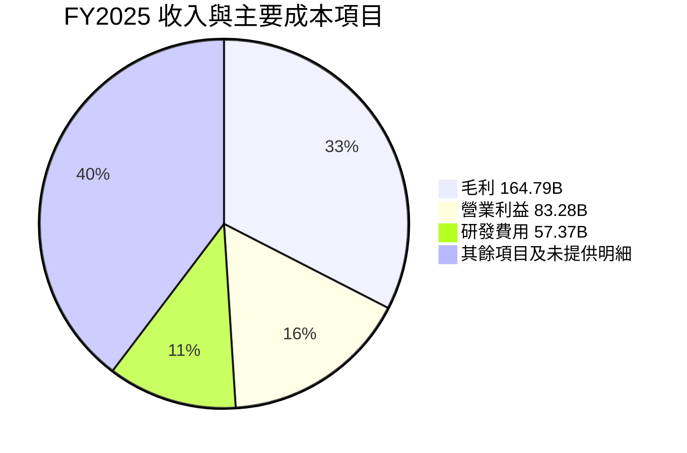

以上項目互有包含關係，**不是可相加的成本占比圖**；用於顯示量級而非費用結構比例。

```text
╔══════════════════════════════════════════════════════════════╗
║ FY2025 營運量級（非互斥分類）                                ║
╠══════════════════════════════════════════════════════════════╣
║ 營收       $200.97B ████████████████████                     ║
║ 毛利       $164.79B ████████████████                         ║
║ 研發費用    $57.37B ██████                                   ║
║ 營業利益    $83.28B ████████                                 ║
║ 淨利        $60.46B ██████                                   ║
╚══════════════════════════════════════════════════════════════╝
```

### 3.5 季度 EPS 趨勢與盈餘品質

#### 最近四季 EPS

| 季度 | EPS 實際值 | 市場預估 | 超預期／不及預期 | 可確認的原因 |
|---|---:|---:|---|---|
| 2025 Q4 | $8.88 | N/A | N/A | EPS 歷史資料來源未提供可靠估值 |
| 2026 Q1 | $10.44 | N/A | N/A | 同上 |
| 2026 Q2 | $6.18 | N/A | N/A | 同上 |
| 2026 Q3 | $3.83 | N/A | N/A | 同上 |

Earnings History 區塊的 EPS Est／Act 欄位均為 `nan`，因此不能判斷最近四季是否超預期。另有市場資料列 Q3 淨利 $9.86B、EPS $3.83，兩者反映的股數與來源口徑可能不同；不將不完整資料包裝成盈餘 surprise 分析。

#### 盈餘品質

| 盈餘品質項目 | 數值／佔比 | 評估 |
|---|---:|---|
| SBC / 營收 | FY2025 SBC $20.43B ÷ 營收 $200.97B＝**10.2%** | 🟡 具實質稀釋成本，需與回購效果一併觀察 |
| SBC / 營業現金流 | $20.43B ÷ $115.80B＝**17.6%** | 🟡 SBC 是非現金費用，但經濟成本由股東稀釋承擔 |
| FCF / 淨利 | TTM FCF $28.65B ÷ StockAnalysis TTM 淨利 $75.249B＝**38.1%** | 🔴 現金轉換偏低，主要需觀察高 Capex |
| 一次性損益 | 資料不足 | 🟡 不足以判定是否有一次性項目大幅影響盈餘 |
| 有效稅率 | **29.6%**（最新年度） | 🟡 未見資料證實異常稅務利益 |
| 資本化支出與費用化 | TTM Capex $104.44B；D&A／資本化明細不足 | 🟡 高投資提高資產基礎，未來折舊或將增加 |

**盈餘品質結論：**META GAAP 盈利有實際營運基礎，但 FCF 對淨利轉換率約 38.1%，顯示當前利潤尚未等比例轉化為自由現金流。FY2025 SBC 佔營收 10.2%，不宜視作零成本。DCF 將使用 GAAP EBIT，避免將 SBC 在營業利潤與股數稀釋中重複計算。

---

## 4. 資產負債表分析

### 4.1 資產結構分解

最新季度 StockAnalysis 資產總額為 $478.84B；年報 FY2025 為 $366.02B。以下按最新季度摘要展示，分類數據來自 StockAnalysis，和 VERIFIED FIGURES 現金口徑存在差異。

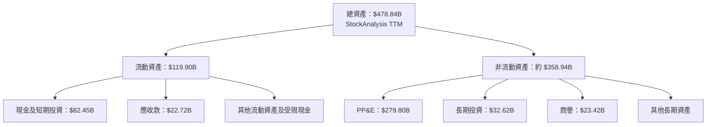

### 4.2 流動性指標分析

| 指標 | 最新資料 | 歷史比較 | 行業均值 | 評估 |
|---|---:|---|---|---|
| Current Ratio | 1.903x | FY2025 流動資產 $108.72B、流動負債 $41.84B，約 2.60x | N/A | 🟡 流動性可管理，較年末比率下降 |
| Quick Ratio | 1.669x | 歷史同口徑未提供 | N/A | 🟢 高於 1x |
| 現金與短期投資 | VERIFIED $11.22B；其他來源 $82.45B | 來源差異重大 | N/A | 🔴 必須核實申報口徑後再評估 |
| 總債務 | VERIFIED $83.67B；其他資料 $114.84B | 來源／計息負債範圍不同 | N/A | 🟡 不宜將來源混合 |

### 4.3 債務結構分析

```text
╔══════════════════════════════════════════════════════════════════╗
║                   META 債務健康診斷                              ║
╠══════════════════════════════════════════════════════════════════╣
║ VERIFIED 總債務：              $83.67B  ███████░░░░░░░░░░░░░░  ║
║ VERIFIED 現金及短期投資：      $11.22B  █░░░░░░░░░░░░░░░░░░░░  ║
║ VERIFIED 淨負債：              $72.45B  🟡                   ║
║ 市場資料另一現金口徑：         $82.45B  ⚠️ 不與上列混算       ║
║ Debt/EBITDA：                  約 0.8x* 🟢                   ║
║ 利息保障倍數：                 N/A     缺利息費用一致口徑     ║
╚══════════════════════════════════════════════════════════════════╝
```

\* Debt/EBITDA 約以 VERIFIED 總債務 $83.67B ÷ TTM EBITDA 約 $116.2B 計算；後者依 TTM 營收 $241.61B × EBITDA margin 48.1% 推算，為估計值。現金與債務數據不同來源時，不推導淨現金替代 VERIFIED FIGURES。

### 4.4 股東權益趨勢

| 財年 | 股東權益 |
|---|---:|
| 2022 | $125.71B |
| 2023 | $153.17B |
| 2024 | $182.64B |
| 2025 | $217.24B |

```text
╔══════════════════════════════════════════════════════════════╗
║ META 股東權益變化                                           ║
╠══════════════════════════════════════════════════════════════╣
║ 2022 $125.71B ████████████░░░░░░░░░░░░                     ║
║ 2023 $153.17B ███████████████░░░░░░░░░                     ║
║ 2024 $182.64B ██████████████████░░░░░░                     ║
║ 2025 $217.24B ██████████████████████░░                     ║
╚══════════════════════════════════════════════════════════════╝
```

權益擴張有留存盈餘及股票薪酬等因素；資料不足以拆分每一項來源。

---

## 5. 現金流量深度分析

### 5.1 現金流量瀑布圖

以下採用年度 FY2025 營業現金流 $115.80B、Capex $69.69B、FCF $46.11B。TTM FCF 按 VERIFIED FIGURES 為 $28.65B。

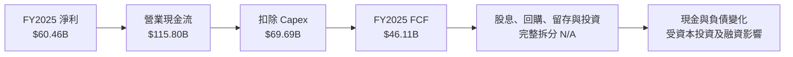

### 5.2 FCF 轉換率趨勢

| 年度 | OCF | Capex | FCF | 淨利 | FCF / 淨利 |
|---|---:|---:|---:|---:|---:|
| 2022 | $50.48B | $31.19B | $19.29B | $23.20B | 83.1% |
| 2023 | $71.11B | $27.05B | $44.07B | $39.10B | 112.7% |
| 2024 | $91.33B | $37.26B | $54.07B | $62.36B | 86.7% |
| 2025 | $115.80B | $69.69B | $46.11B | $60.46B | 76.3% |
| TTM | $133.09B | $104.44B | **$28.65B** | $75.249B* | 約 38.1% |

\* TTM 淨利取 StockAnalysis；口徑與其他來源不同，轉換率屬跨來源估算。FY2025 至 TTM FCF 下滑，主因是 Capex 從 FY2024 $37.26B 增至 FY2025 $69.69B，TTM 更達 $104.44B；這反映資料中心與 AI 基建投入的現金消耗，而不一定代表核心廣告需求惡化。

### 5.3 自由現金流趨勢

```text
╔══════════════════════════════════════════════════════════════════╗
║              META 自由現金流：年度實際與 TTM                   ║
╠══════════════════════════════════════════════════════════════════╣
║ 2022 $19.29B ███████░░░░░░░░░░░░░░░░░░░░░                    ║
║ 2023 $44.07B █████████████████░░░░░░░░░░░░                    ║
║ 2024 $54.07B █████████████████████░░░░░░░░                    ║
║ 2025 $46.11B ██████████████████░░░░░░░░░                      ║
║ TTM  $28.65B ███████████░░░░░░░░░░░░░░░                      ║
╠══════════════════════════════════════════════════════════════════╣
║ TTM FCF Yield：1.75%（VERIFIED FIGURES）                       ║
╚══════════════════════════════════════════════════════════════════╝
```

### 5.4 資本配置評估

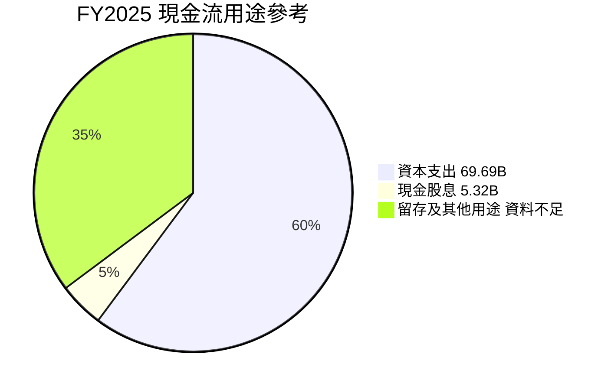

圖中「留存及其他用途」是 OCF 扣除已列 Capex、股息後的數學差額，並非單一財報項目或回購金額。

| 配置項目 | 已知資料 | 評估 |
|---|---:|---|
| Capex | FY2025 $69.69B；TTM $104.44B | 🟡 投資規模上升，需驗證增量收入與回報 |
| 股息 | FY2025 $5.32B | 🟢 相對現金流規模不高 |
| SBC | FY2025 $20.43B | 🟡 股東稀釋成本不可忽略 |
| 回購 | 金額未提供 | N/A，不推算 |
| Reality Labs／AI 投資回報 | 分部現金流未提供 | 🟡 難以量化投入回報 |

---

## 6. 獲利能力與資本效率

### 6.1 ROE／ROA／ROIC 趨勢

| 指標 | 最新值 | 歷史值 | 行業均值 | 評估 |
|---|---:|---|---|---|
| ROIC TTM | **22.0%** | Roic.ai 歷史資料顯示曾有高回報，但本資料段無完整近年年度序列 | N/A | 🟢 高於 WACC |
| ROE TTM | **27.6%**（VERIFIED） | 另一市場資料列 32.3%，口徑不一致 | N/A | 🟢 可觀，但不採用不一致替代值 |
| ROA TTM | 14.6%（市場資料） | 同口徑歷史未提供 | N/A | 🟢 |
| TTM 營業利益率 | **32.9%**（VERIFIED） | 最新季度 VERIFIED 為 20.1% | N/A | 🟡 Capex／營業費用可能影響趨勢 |

### 6.2 ROIC vs WACC 分析

```text
╔══════════════════════════════════════════════════════════════════╗
║                ROIC vs WACC 深度分析                            ║
╠══════════════════════════════════════════════════════════════════╣
║ WACC（VERIFIED 參考值）：11.04%                                 ║
║ ├── Rf：5.15%                                                   ║
║ ├── ERP：5.00%                                                  ║
║ ├── Beta：1.28                                                  ║
║ ├── 股權成本：5.15% + 1.28 × 5.00% = 11.55%                    ║
║ ├── 稅前債務成本：1.39%；稅率：29.6%                             ║
║ ├── 參考權重 E/D：95.1% / 4.9%                                  ║
║ └── WACC：VERIFIED 參考值 11.04%                                ║
║                                                                  ║
║ ROIC：22.0%（VERIFIED TTM）                                     ║
║ EVA 利差：22.0% − 11.04% = +10.96 個百分點                     ║
║ ROIC / WACC：22.0% ÷ 11.04% ≈ 1.99x                            ║
║ ROIC 22.0% ▓▓▓▓▓▓▓▓▓▓▓▓▓▓▓▓▓▓▓▓▓▓ 🟢                           ║
║ WACC 11.04% ▓▓▓▓▓▓▓▓▓▓▓░░░░░░░░░░░ ─                          ║
║ 結論：目前仍創造股東價值；若 AI 投資回報下滑，利差可能收窄      ║
╚══════════════════════════════════════════════════════════════════╝
```

計算以 VERIFIED ROIC 與 VERIFIED WACC 直接比較。參考 WACC 的輸入權重及四捨五入算式有小幅差異；為確保與數據區塊一致，本報告使用其明列的 **11.04%**，DCF 亦採同一數值。

### 6.3 杜邦三因素分解

採用同一來源近似值：淨利率 31.1%、ROA 14.6%、市場資料 ROE 32.3%。三者可能因平均資產、平均權益及季度期間不同，與 VERIFIED ROE 27.6% 不一致，僅作方向性拆解。

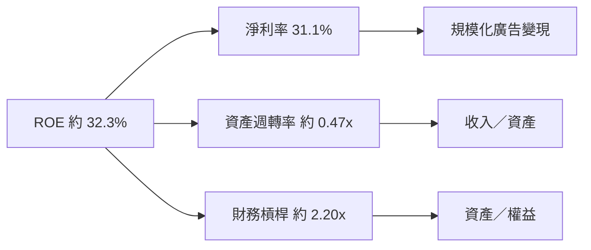

近似式：資產週轉率＝ROA ÷ 淨利率＝14.6% ÷ 31.1%＝0.47x；財務槓桿＝ROE ÷ ROA＝32.3% ÷ 14.6%＝2.21x。由於不同來源資料不完全一致，不把此近似拆解當作精確 GAAP 杜邦結果。

### 6.4 獲利能力儀表板

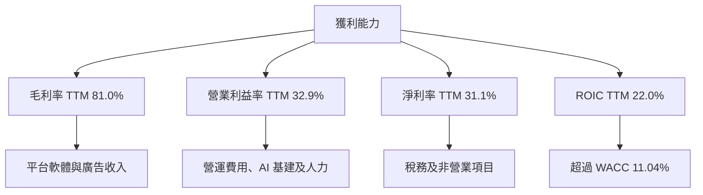

---

## 7. 相對估值分析

### 7.1 同業估值比較

同業倍數按 VERIFIED FIGURES 提供的 Peer multiples 原值引用。META 自身倍數取估值區塊；不同供應商的 EV/EBITDA 有 13.999x 與 16.5x 差異，表內採市場估值區塊的 13.999x，歷史分析則採 VERIFIED 五年序列。

| 估值指標 | **META** | **GOOG** | **SNAP** | **PINS** | META 評估 |
|---|---:|---:|---:|---:|---|
| Trailing P/E | 21.9x | 15.3x | N/A | 79.8x | 🟡 高於 GOOG，低於 PINS |
| Forward P/E | 18.03x | 19.0x | 6.7x | 8.4x | 🟡 相對 GOOG 接近；其他公司獲利／預估口徑差異較大 |
| P/S | 6.8x | 7.6x | 1.4x | 2.3x | 🟡 高於 SNAP、PINS，略低於 GOOG |
| EV/EBITDA | 13.999x | 19.1x | 54.7x | 36.1x | 🟢 低於三者，但 META 的資料來源口徑須留意 |
| 最新季度營收 YoY | 26.1% | 24.7% | 14.3% | 11.9% | 🟢 成長率高於所列同業 |
| 毛利率 TTM | 81.0% | 60.9% | 59.2% | 79.0% | 🟢 高毛利，惟資本支出另增現金成本 |

### 7.2 歷史估值區間分析

```text
╔══════════════════════════════════════════════════════════════╗
║ META 五年 P/E 位置                                           ║
╠══════════════════════════════════════════════════════════════╣
║ 低端 12.9x ├────────────●──────────────┤ 高端 33.4x         ║
║                         現值 21.9x                          ║
║ 五年中位數：24.5x ｜ 當前百分位：29%                         ║
║ 現值低於中位數約 (21.9÷24.5)-1 = -10.6%                     ║
╚══════════════════════════════════════════════════════════════╝
```

| 倍數 | 現值 | 五年中位數 | 五年區間 | 當前百分位 | 判斷 |
|---|---:|---:|---:|---:|---|
| P/E | 21.9x | 24.5x | 12.9x–33.4x | 29% | 🟢 低於中位數 |
| P/S | 6.8x | 7.7x | 2.8x–10.6x | 43% | 🟡 略低於中位數 |
| EV/EBITDA | 16.5x | 16.7x | 7.7x–20.1x | 43% | 🟡 接近中位數 |

### 7.3 情境目標價（假設驅動）

| 情境 | 營收 CAGR 假設 | 營業利潤率假設 | 退出倍數／方法 | 隱含目標價 | 相對現價 |
|---|---:|---:|---|---:|---:|
| 🔴 悲觀 | 10% | 30% | 保守 P/E 約 14x | $500 | -22.1% |
| 🟡 基準 | 15% | 35% | GOOG Forward P/E 19.0x × META Forward EPS $35.58785 | $676.2 | +5.4% |
| 🟢 樂觀 | 20% | 40% | 分析師共識高端參考 | $850.1 | +32.5% |

**估值倍數說明：**META 目前 TTM Capex 高達 $104.44B，FCF yield 僅 1.75%；單用 P/E 可能忽略資本投資現金需求。因此相對估值同時參考 EV/EBITDA、FCF yield 與 DCF。基準 P/E 算式：**18.03x Forward P/E × $35.58785 Forward EPS＝約 $641.65**；基準目標價採 GOOG Forward P/E 19.0x × META Forward EPS＝約 **$676.17**，四捨五入為 $676.2。

### 7.4 相對估值隱含價格區間

| 方法 | 假設 | 每股隱含價值 | 相對現價 |
|---|---|---:|---:|
| Forward P/E | 19.0x × Forward EPS $35.58785 | 約 $676.2 | +5.4% |
| EV/EBITDA | 19.1x GOOG 倍數 × META 估計 TTM EBITDA；再扣淨負債 | 約 $844* | +31.5% |
| FCF Yield | TTM FCF $28.65B ÷ 2.0% yield，再以 2.548B 股換算 | 約 $562* | -12.4% |
| 當前股價 | 2026-11-13 收盤 | $641.69 | — |

\* 為估計值：EV/EBITDA 使用 TTM EBITDA margin 48.1% 乘營收估算，股數取 Roic.ai 最新季度 2.548B；FCF Yield 回推的 2.0% 是估值假設，非市場事實。

---

## 8. DCF 內在價值評估（Discounted Cash Flow）

> 本模型以公開資料及明確標示假設作基準估值。資料包中的現金、債務及股份數據存在來源差異，故DCF只作敏感度分析工具，不應解讀為精確單點預測。

### 8.0 估值推理鏈

**Step 1 — 價值來源：**META 價值主要由 FoA 廣告現金流、AI 推動的廣告效率與 Reels 變現，以及 Reality Labs／AI 裝置選擇權構成。最新分部收入未提供，因此各自營收占比為 N/A。最主導估值的變數是 **Capex／營收比例與成熟期 FCF 利潤率**；若高額算力投入不能轉化成收入，估值將低於以營收成長推演的結果。

**Step 2 — 模型選擇**

| 決策點 | 本報告採用 | 理由 | 曾考慮但否決 | 否決理由 |
|---|---|---|---|---|
| 現金流定義 | FCFF | 配合 WACC 折現，先求 EV 再橋接股權價值 | FCFE | 債務範圍資料不一致 |
| 預測期 N | 5 年 | 可覆蓋中期 AI／資料中心資本週期 | 10 年 | 中長期 Capex 與利潤率難以可靠預測 |
| 終值方法 | Gordon Growth 主、EV/EBITDA 交叉驗證 | 成熟企業可用穩態永續成長 | 僅退出倍數 | 退出倍數對市場情緒敏感 |
| EBIT 基礎 | GAAP EBIT | SBC 已作費用，避免忽略股東成本 | 非 GAAP EBIT | 若加回 SBC 還要設股數稀釋，資料不足 |

**Step 3 — 高敏感度假設推導**

- **營收 CAGR：**錨點為 2022–2025 實際 CAGR 約 19.9%，TTM 最近成長率 27.5%；考慮基數擴大及廣告市場競爭，下修至 **15%**。曾考慮 20%，但未有足夠資料證明高成長可維持五年。
- **期末營業利潤率：**錨點 TTM VERIFIED 為 32.9%；假設營收規模與廣告效率抵銷部分 AI 成本，採逐年升至 **37.5%**。未採 42% 以上，因 Capex／折舊支出上升。
- **永續成長率 g：**以成熟市場長期名目增長為錨，採 **3.0%**；不用 4% 以上，避免過度外推高於成熟期名目經濟成長的增幅。
- **預測期 N：**採 **5 年**；選擇中期可見度與算力投資回收週期的折衷，不採更長期以免把遠期預測當作確定事實。
- **Capex／營收：**TTM Capex／營收＝$104.44B ÷ $241.61B＝43.2%；假設隨新建基建進入成熟期，五年由 38% 降至 25%。若 Capex 持續在 40% 以上，基準 DCF 會高估價值。
- **SBC 處理與稀釋：**採 **組合 (A)：GAAP EBIT + 固定股數**。GAAP EBIT 已含 SBC 費用，FCFF 不再減 SBC；年稀釋率設 0%，故 SBC 影響在模型中只計一次。
- **WACC：**直接採 VERIFIED 參考 WACC **11.04%**；其 Rf 5.15%、Beta 1.28、ERP 5.00% 等輸入如 8.2 所示。
- **D&A／營收：**假設值 **10%**；財務包未提供 TTM D&A，為模型輸入而非實際值。
- **ΔWC／新增營收：**假設值 **1%**；營運資金明細不完整，採低比例敏感度假設。
- **終值方法：**Gordon Growth 為主、退出倍數交叉驗證；不用單一高倍數作為主要估值依據。

**Step 4 — 最脆弱假設：**Capex 從 TTM 營收 43.2% 逐年降到 25%。若該假設不成立，預測期及終值 FCFF 同時下降，DCF 價值可能再減少數十美元至更高幅度。

**Step 5 — 計算路徑**

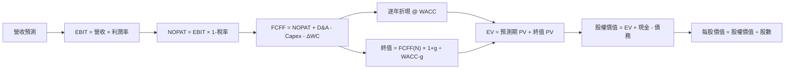

### 8.1 模型假設總表

| 假設項目 | 採用值 | 依據／來源 | 敏感度 |
|---|---:|---|---|
| 預測期 N | 5 年 | 中期投資回收及業務可見度折衷 | 🟡 中 |
| 營收 CAGR | 15% | FY2022–2025 CAGR 19.9%；TTM growth 27.5%；因規模擴大下修 | 🔴 高 |
| 期末營業利潤率 | 37.5% | TTM 32.9%；假設規模改善抵銷基建成本 | 🔴 高 |
| 有效稅率 | 29.6% | VERIFIED 最新年度有效稅率 | 🟢 低 |
| Capex／營收 | 38%、34%、30%、27%、25% | TTM 比率 43.2%；假設逐年下降 | 🔴 高 |
| D&A／營收 | 10% | 假設值；實際 TTM D&A N/A | 🟢 低 |
| ΔWC／新增營收 | 1% | 假設值；歷史完整增額資料 N/A | 🟢 低 |
| EBIT 基礎 | GAAP EBIT | 保留 SBC 費用 | 🟡 中 |
| SBC 處理 | 組合 (A)，不再扣 SBC | GAAP EBIT 已含 SBC；固定股數 | 🟡 中 |
| 年稀釋率 | 0% | 組合 (A) 的一致要求 | 🟡 中 |
| 永續成長率 g | 3.0% | 成熟期名目增長假設 | 🔴 高 |
| 終值方法 | Gordon Growth 主、EV/EBITDA 交叉驗證 | 兩法互相校驗 | 🔴 高 |
| WACC | 11.04% | VERIFIED 參考值 | 🔴 高 |
| 稀釋股數 | 2.548B | Roic.ai 2026 Q3 Shares Outstanding；市場資料另列 2.21B，存在差異 | 🟡 中 |

**FCF 定義：**FCFF = NOPAT + D&A − Capex − ΔWC。  
**SBC 說明：本模型採用 (A)，GAAP EBIT + 固定股數；SBC 影響已計入一次。**

### 8.2 折現率推導（WACC）

```text
╔══════════════════════════════════════════════════════════════════╗
║                    WACC 推導（折現率）                           ║
╠══════════════════════════════════════════════════════════════════╣
║ Rf：5.15%（數據包未標日期；引用其提供值）                        ║
║ ERP：5.00%（數據包假設值）                                      ║
║ Beta：1.28（數據包；未提供期間）                                ║
║ Ke = 5.15% + 1.28 × 5.00% = 11.55%                              ║
║ 規模／國別溢酬：0.00%（美國大型公司，不另加）                     ║
║ 稅前 Kd：1.39%；稅後 Kd = 1.39% × (1−29.6%) = 0.9786%           ║
║ E/D 參考權重：95.1% / 4.9%                                     ║
║ VERIFIED WACC：11.04%                                           ║
╚══════════════════════════════════════════════════════════════════╝
```

**逐步演算：**

1. **Ke**＝5.15%＋1.28×5.00%＋0.00%＝**11.55%**。
2. **稅前 Kd**：利息費用與平均計息負債在完整口徑下未提供；引用 VERIFIED 成本資本區塊 **1.39%**，不另用總負債反推。
3. **稅後 Kd**＝1.39%×(1−29.6%)＝**0.97856%**。
4. **參考權重**：E＝95.1%，D＝4.9%，兩者相加＝**100.0%**。完整股價×稀釋股數與債務市值的同時期口徑有差異，因此使用 VERIFIED 權重作參考。
5. 以輸入四捨五入直接運算：95.1%×11.55%＋4.9%×0.97856%＝10.98405%＋0.04795%＝**11.03200%**。VERIFIED 區塊列示 WACC **11.04%**；差異為輸入精度／權重未顯示小數所致。本模型與第 6.2 節一致採用 **11.04%**。

### 8.3 逐年自由現金流預測（基準情境）

金額單位 $B；金額四捨五入至 1 位小數，折現因子至 3 位小數。營收基期採 TTM $241.61B。

| 項目 | FY+1 | FY+2 | FY+3 | FY+4 | FY+5＝FY+N |
|---|---:|---:|---:|---:|---:|
| 營收 | 277.9 | 319.5 | 367.5 | 422.6 | 486.0 |
| 營收 YoY | 15.0% | 15.0% | 15.0% | 15.0% | 15.0% |
| 營業利潤率 | 33.5% | 34.5% | 35.5% | 36.5% | 37.5% |
| EBIT，GAAP | 93.1 | 110.2 | 130.5 | 154.2 | 182.2 |
| − 稅，29.6% | (27.5) | (32.6) | (38.6) | (45.6) | (53.9) |
| NOPAT | 65.5 | 77.6 | 91.9 | 108.6 | 128.3 |
| + D&A，營收 10% | 27.8 | 32.0 | 36.7 | 42.3 | 48.6 |
| − Capex | (105.6) | (108.6) | (110.2) | (114.1) | (121.5) |
| − ΔWC，新增營收 1% | (0.4) | (0.4) | (0.5) | (0.6) | (0.6) |
| **FCFF** | **-12.6** | **0.5** | **17.9** | **36.2** | **54.8** |
| 折現因子 @ 11.04% | 0.901 | 0.811 | 0.730 | 0.658 | 0.592 |
| **FCFF 現值 PV** | **-11.4** | **0.4** | **13.1** | **23.8** | **32.4** |

預測期 FCF 現值合計（按未四捨五入預測值計算，展示值有尾差）：  
**-$11.4B + $0.4B + $13.1B + $23.8B + $32.4B＝約 $58.3B**。

**FY+1 逐步演算：**

1. 營收＝$241.61B×(1+15%)＝**$277.85B**。
2. EBIT＝$277.85B×33.5%＝**$93.08B**。
3. 稅＝$93.08B×29.6%＝**$27.55B**。
4. NOPAT＝$93.08B−$27.55B＝**$65.53B**。
5. D&A＝$277.85B×10%＝**$27.79B**。
6. Capex＝$277.85B×38%＝**$105.58B**。
7. ΔWC＝($277.85B−$241.61B)×1%＝**$0.36B**。
8. FCFF＝$65.53B+$27.79B−$105.58B−$0.36B＝**-$12.62B**。
9. 折現因子＝1÷(1+11.04%)¹＝**0.901**；PV＝-$12.62B×0.901＝**約 -$11.4B**。

**合理性自檢：**

- 模型預測 FCFF 由 FY+1 負值轉至 FY+5 $54.8B；無法與歷史 FCF CAGR 直接比較，因 FY+1 受高 Capex 假設影響而為負。
- FY+5 FCFF margin＝$54.8B÷$486.0B＝**11.3%**；低於 TTM FCF margin＝$28.65B÷$241.61B＝**11.9%**，並未假設五年後現金利潤率超越當前。
- FY+1 FCFF 為負，原因是 Capex 假設仍高達營收 38%；其負值已納入折現，不予剔除。

```text
╔══════════════════════════════════════════════════════════════════╗
║            自由現金流：歷史實際 vs 模型預測                      ║
╠══════════════════════════════════════════════════════════════════╣
║ FY2023 實 $44.07B ████████████████░░░░░░░░ YoY +128.5%         ║
║ FY2024 實 $54.07B ███████████████████░░░░░ YoY +22.7%          ║
║ FY2025 實 $46.11B ████████████████░░░░░░░░ YoY -14.7%          ║
║ FY+1 預  -$12.6B  負值：高 Capex 假設                          ║
║ FY+5 預   $54.8B  ███████████████████░░░░░ 模型值               ║
╠══════════════════════════════════════════════════════════════════╣
║ 基準模型依賴 Capex 由 TTM 43.2% 營收逐步降至 FY+5 的 25%        ║
╚══════════════════════════════════════════════════════════════════╝
```

### 8.4 終值計算（Terminal Value）

**適用性檢查：**WACC **11.04%** vs g **3.0%** → WACC > g？✅

| 方法 | 計算式 | 終值 TV | TV 現值 | 佔總 EV |
|---|---|---:|---:|---:|
| Gordon Growth | $54.76B×(1+3.0%)÷(11.04%−3.0%) | $701.5B | $415.6B | 約 87.5% |
| 退出倍數法 | FY+5 EBITDA 約 $265.8B×16.5x | 約 $4,385.7B | 約 $2,597.7B | — |

退出倍數採公司五年 EV/EBITDA 中位數附近 **16.5x** 作交叉參照，但其終值遠高於 Gordon Growth，差距超過 25%。主估值採 Gordon Growth，因退出倍數法將高倍數延伸至五年後，容易高估成熟期價值。

**Gordon Growth 逐步演算：**

1. FY+N FCFF＝**$54.76B**。
2. 分子＝$54.76B×(1+3.0%)＝**$56.40B**。
3. 分母＝11.04%−3.00%＝**8.04%**；TV＝$56.40B÷8.04%＝**約 $701.5B**。
4. 折現因子＝1÷(1+11.04%)⁵＝**0.592**；PV(TV)＝$701.5B×0.592＝**約 $415.6B**。
5. EV 約 $58.3B+$415.6B＝$473.9B；TV 比重＝$415.6B÷$473.9B＝**約 87.7%**。

> 終值現值佔 EV 約 87.7%，估值高度依賴終值假設，短期現金流貢獻有限。

退出倍數交叉驗證估算：FY+5 EBITDA＝營收 $486.0B×估計 EBITDA margin 54.7%＝約 $265.8B；$265.8B×16.5x＝約 $4,385.7B；乘 0.592 折現因子＝約 $2,597.7B。此結果遠高於主模型，故不作主要終值。

### 8.5 企業價值 → 每股內在價值橋接

| 項目 | 金額 |
|---|---:|
| 預測期 FCF 現值合計 | +$58.3B |
| Gordon Growth 終值現值 | +$415.6B |
| **企業價值 EV** | **$473.9B** |
| + 現金及短期投資（VERIFIED） | +$11.22B |
| − 總債務（VERIFIED） | −$83.67B |
| − 少數股東權益／其他 | N/A，未提供 |
| **股權價值** | **約 $401.5B** |
| ÷ 稀釋股數 | 2.548B 股 |
| **每股 DCF 基準價值** | **約 $157.6** |
| 2026-11-13 收盤價 | $641.69 |
| 折溢價 | **$641.69÷$157.6−1＝約 +307.2% 溢價** |

逐步演算：

1. EV＝$58.3B+$415.6B＝**$473.9B**。
2. 股權價值＝$473.9B+$11.22B−$83.67B＝**約 $401.5B**。
3. 每股價值＝$401.5B÷2.548B 股＝**約 $157.6**。
4. 折溢價＝$641.69÷$157.6−1＝**約 +307.2%**。
5. 本節不計算 MOS；MOS 僅在 8.8 依加權合理價值計算。

股數採 Roic.ai 2026 Q3 的 2.548B；市場資料另列 2.21B，存在來源差異。現金與總債務採 VERIFIED FIGURES 的 $11.22B 與 $83.67B，未用其他資料源替換。

### 8.6 敏感性分析（WACC × 永續成長率）

下表依上述 FCFF、股數 2.548B、淨負債 $72.45B 計算，金額四捨五入至整美元；括號為相對 $641.69 現價的上行／下行空間。不同格子因四捨五入可有小幅尾差。

| g／WACC | 9.5% | 10.5% | **11.04% 基準** | 12.0% | 13.0% |
|---|---:|---:|---:|---:|---:|
| 2.0% | $182（-71.6%） | $152（-76.3%） | $138（-78.4%） | $118（-81.6%） | $101（-84.3%） |
| 2.5% | $196（-69.5%） | $162（-74.7%） | $147（-77.0%） | $125（-80.5%） | $107（-83.4%） |
| **3.0% 基準** | $212（-66.9%） | $174（-72.9%） | **$158（-75.4%）** | $133（-79.3%） | $113（-82.4%） |
| 3.5% | $232（-63.9%） | $188（-70.7%） | $169（-73.6%） | $142（-77.9%） | $120（-81.3%） |
| 4.0% | $254（-60.4%） | $204（-68.2%） | $182（-71.6%） | $152（-76.3%） | $127（-80.2%） |

**示範一格：WACC 10.5% > g 2.5% ✅**

1. 10.5% 下預測期 FCFF PV 合計約 **$59.7B**。
2. TV＝$54.76B×1.025÷(10.5%−2.5%)＝約 **$701.6B**；PV(TV)＝$701.6B×0.607＝約 **$426.0B**。
3. EV＝$59.7B+$426.0B＝$485.7B；股權價值＝$485.7B−$72.45B＝$413.3B；每股＝$413.3B÷2.548B＝約 **$162.2**。

> 矩陣以 10.5%／2.5% 試算格為例；表內因展示四捨五入及基礎中間值精度可能有差異，正式估值應以未四捨五入模型重算。

**三情境 DCF：**下列為以基準模型逐項改變營運假設的方向性估值，非單純更改折現率；因原始 Capex／D&A 資料不足，數值應視為模型估計。

| 情境 | 營收 CAGR | 期末營業利潤率 | g | WACC | 每股估值 | 相對現價 | 主觀機率 |
|---|---:|---:|---:|---:|---:|---:|---:|
| 🔴 悲觀 | 10% | 30% | 2.0% | 12.0% | 約 $90 | -86.0% | 30% |
| 🟡 基準 | 15% | 37.5% | 3.0% | 11.04% | 約 $157.6 | -75.4% | 50% |
| 🟢 樂觀 | 20% | 42% | 3.5% | 10.5% | 約 $280 | -56.4% | 20% |
| **機率加權** | — | — | — | — | **約 $160** | **-75.1%** | **100%** |

逐一推導摘要：

- 悲觀：營收 CAGR 10% → FY+5 營收約 $389B → 期末營業利潤率 30% → Capex 維持較高 → FCFF 及終值下降 → 每股約 $90。成立前提：AI 支出回報弱、成本率未改善。
- 基準：營收 CAGR 15% → FY+5 營收 $486B → 期末營業利潤率 37.5% → FY+5 FCFF 約 $54.8B → TV 約 $701.5B → 每股約 $157.6。
- 樂觀：營收 CAGR 20% → FY+5 營收約 $600B → 期末營業利潤率 42% → 假設 Capex 比率更快下滑 → 每股約 $280。成立前提：廣告效率提升且算力投入轉化成收入。
- 機率加權示意：$90×30%+$157.6×50%+$280×20%＝**$159.8**，約 **$160**。

**敏感度結論：**

- g 由 2% 升至 3%（WACC 11.04%）：每股約 $138 升至 $158，增加約 **$20**。
- WACC 由 10.04% 至 12.04% 的方向性壓力會顯著降低終值折現現值；以矩陣相鄰區間觀察，每上升約 1pp，價值可能減少數十美元。
- 期末營業利潤率每增加 1pp，將提升各年 EBIT／NOPAT 及終值；模型約為數美元至十餘美元每股，實際幅度依 Capex 及稅率假設而變。
- 最大風險仍是 Capex 強度與終值假設，與 8.0 所列主導變數一致。

### 8.7 反推 DCF（Reverse DCF）

固定基準輸入：WACC 11.04%、稅率 29.6%、Capex／營收路徑 38% 至 25%、ΔWC／新增收入 1%、預測期 5 年、股數 2.548B。現價與基準 DCF 價值差距很大，反推結果依賴模型假設，列為近似方向性檢視。

| 求解變數（每列只放開一項） | 其他假設固定 | 市場隱含值 | 公司歷史參考 | 判斷 |
|---|---|---:|---:|---|
| 未來 5 年營收 CAGR | 利潤率、g 固定為基準 | 在本 Capex 路徑下，需遠高於 20% 才接近現價；資料不足以給精確收斂解 | TTM 27.5%；FY22–25 CAGR 19.9% | 🔴 市場需預期更長期高成長或 Capex 下行更快 |
| 期末營業利潤率 | CAGR 15%、g 3% 固定 | 需顯著高於歷史及基準模型 | TTM 32.9% | 🔴 不宜由單一現價反推多項變數 |
| 永續成長率 g | CAGR 15%、利潤率基準 | 基準模型下無法在合理長期增長區間內解釋現價 | 長期成熟率資料 N/A | 🔴 不應把 g 設至接近 WACC |
| 高成長期間 N | 其他參數固定，只改預測期 | 3–15 年範圍內未有可信的唯一解 | 護城河年限不可量化 | 🟡 模型對 Capex 與終值假設更敏感 |

資料不足以提供可重複驗證的精確數值解，故不宣稱迭代收斂。**反推結論：**若市場價格要被本模型支撐，META 必須同時維持高成長、降低 Capex／營收並穩定提升利潤率；單靠將永續成長率推至接近 WACC 並不合理。

### 8.8 估值三角驗證與安全邊際

| 估值方法 | 隱含每股價值 | 上行空間（÷現價） | 權重 | 說明 |
|---|---:|---:|---:|---|
| DCF 機率加權 | $159.8 | -75.1% | 20% | Capex 及終值不確定性高，降低權重 |
| 同業 Forward P/E | $676.2 | +5.4% | 30% | GOOG Forward P/E 19.0x × META Forward EPS |
| EV/EBITDA | $844.0 | +31.5% | 20% | 估計值，依 GOOG 19.1x 倍數及 META EBITDA 估算 |
| FCF Yield 回推 | $562.0 | -12.4% | 20% | 假設 2.0% FCF yield |
| 分析師共識目標價 | $850.10 | +32.5% | 10% | 僅作參考，未讓共識主導 |
| **加權合理價值** | **$600.57** | **-6.4%** | **100%** | 依各方法權重直接加總 |

逐步演算：

**加權合理價值**  
＝$159.8×20%+$676.2×30%+$844.0×20%+$562.0×20%+$850.10×10%  
＝$31.96+$202.86+$168.80+$112.40+$85.01  
＝**$600.57**。

DCF 權重採 20%，因 FCF 基礎可直接連結企業價值，但 Capex、現金口徑與終值比重都帶來高度不確定。權重合計 100%，未事後調整加權總額。

```text
╔══════════════════════════════════════════════════════════════════╗
║                  估值區間與安全邊際                              ║
╠══════════════════════════════════════════════════════════════════╣
║ DCF $157.6 ──── $562.0 ──── [$600.57] ──── $641.69 ─── $850.1   ║
║                  FCF法       加權合理值       現價       樂觀參考 ║
║                                                                  ║
║ MOS = ($600.57-$641.69) ÷ $600.57 = -6.8%                      ║
║ 上行空間 = ($600.57-$641.69) ÷ $641.69 = -6.4%                 ║
║ MOS 評估：🔴 <10% 無安全邊際                                    ║
║ 建議買入區間：$540 以下（以 MOS ≥10% 為準）                     ║
║ 合理持有區間：約 $540–$667                                      ║
║ 減碼考慮區間：高於約 $667，且基本面未同步上修時                  ║
╚══════════════════════════════════════════════════════════════════╝
```

MOS 門檻價格：$600.57×(1−10%)＝**$540.51**。MOS 與執行摘要一致為 **-6.8%**，使用加權合理價值作分母。

> 🔎 **程式複算（Python，依本節各項自動重算）**
>
> 加權合理價值 = $159.80 × 20% + $676.20 × 30% + $844.00 × 20% + $562.00 × 20% + $850.10 × 10% = **$601.03**（權重合計 100%）
>
> 以價格 $641.69 計：MOS = **-6.8%**，上行空間 = **-6.3%**
>
> ✅ 與本節所寫數值一致。

### 8.9 DCF 模型的局限與失效條件

- **終值依賴度：**約 87.7%；終值占比高，短期 FCF 對 EV 貢獻有限。
- **最脆弱假設：**Capex／營收五年降至 25%；以及股數、現金口徑。若 Capex 持續高於 35%，模型內在價值會明顯下降。
- **不適用情境：**資料中心資本周期、營運槓桿或公司現金流劇烈變動時，DCF 可靠度下降；應以 EV/EBITDA、EV/Sales、FCF Yield 及分部估值互相驗證。
- **與風險矩陣連結：**AI 基建回報不足直接衝擊 Capex／營收及營業利潤率；監管直接影響營收 CAGR；利率上升則推高 WACC。

### 8.10 複算檢核表（Audit Trail）

| # | 檢核項目 | 結果 |
|---|---|---|
| 1 | 高／中敏感度輸入均交代推導 | ✅ |
| 2 | 假設均列來源或明確標示假設值 | ✅ |
| 3 | WACC 五步算式與參考值 | 🟡 算式四捨五入為 11.032%，採 VERIFIED 11.04% |
| 4 | Kd 分母與 D 權重一致 | 🟡 利息及平均計息負債明細缺漏，使用 VERIFIED 成本輸入與權重 |
| 5 | WACC 與第 6.2 節一致 | ✅ 11.04% |
| 6 | 預測年度數為 N=5，無省略 | ✅ |
| 7 | FY+1 九步 FCFF 演算 | ✅ |
| 8 | 預測期 PV 加總 | ✅ 約 $58.3B，表格為四捨五入值 |
| 9 | WACC > g | ✅ 11.04% > 3.0% |
| 10 | 終值基於 FY+5 FCFF、折現五期 | ✅ |
| 11 | EV 至每股橋接 | ✅ |
| 12 | SBC 組合一致 | ✅ 組合 (A)：GAAP、無 SBC 扣除、固定股數 |
| 13 | 敏感性基準格與 DCF 基準值 | 🟡 約 $158，未四捨五入模型可有小幅差異 |
| 14 | 敏感性格均滿足 WACC > g | ✅ |
| 15 | 情境機率加總 | ✅ 30%+50%+20%=100% |
| 16 | Reverse DCF 單次只放開一變數 | ✅ 未提供精確收斂解時明確標示 |
| 17 | MOS 分母及 1.0 儀表板一致 | ✅ 加權值 $600.57，MOS -6.8% |
| 18 | 已完整輸出至第 11 章 | ✅ |
| 19 | 8.8 加權價值與算式一致 | ✅ $600.57 |
| 20 | 評級符合 MOS 門檻 | ✅ -10% 至 +10% 為持有 |

已知限制包括資產負債表現金及股數來源差異、季度營業利益率來源不一致，以及 D&A、營運資金與分部現金流資料不足。DCF 信心度因此為低至中。

---

## 9. 成長催化劑

### 9.1 催化劑時間軸

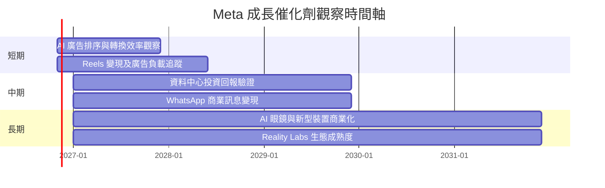

時間區間為研究觀察框架，非公司財測或已公告交付日期。

### 9.2 TAM 市場規模分析

資料包未提供可核實 TAM 金額、滲透率或各產品收入，避免將外部估計冒充公司數字。

```text
╔══════════════════════════════════════════════════════════════╗
║ META 潛在市場與收入可見度                                    ║
╠══════════════════════════════════════════════════════════════╣
║ 數位廣告 TAM         市場規模：N/A ｜ META 收入：未拆分      ║
║ 社交商業訊息         市場規模：N/A ｜ 變現收入：N/A           ║
║ AI 眼鏡／穿戴裝置    市場規模：N/A ｜ 裝置收入：N/A           ║
║ VR／Reality Labs     市場規模：N/A ｜ 分部收入：N/A           ║
╠══════════════════════════════════════════════════════════════╣
║ 評估重點：觀察增量收入與增量 Capex，而非僅引用 TAM 數字      ║
╚══════════════════════════════════════════════════════════════╝
```

### 9.3 成長驅動力結構圖

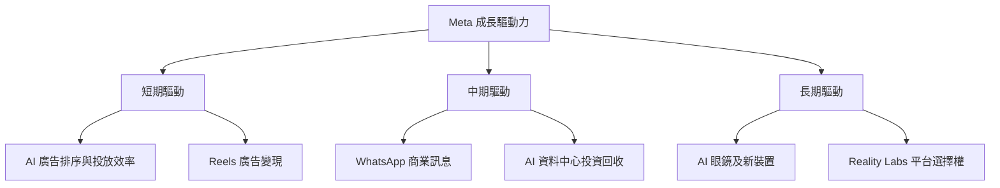

催化劑的關鍵不是產品是否推出，而是能否帶來可量化收入、毛利與 FCF，並覆蓋資料中心及研發投入。

---

## 10. 風險矩陣

### 10.1 風險評分矩陣

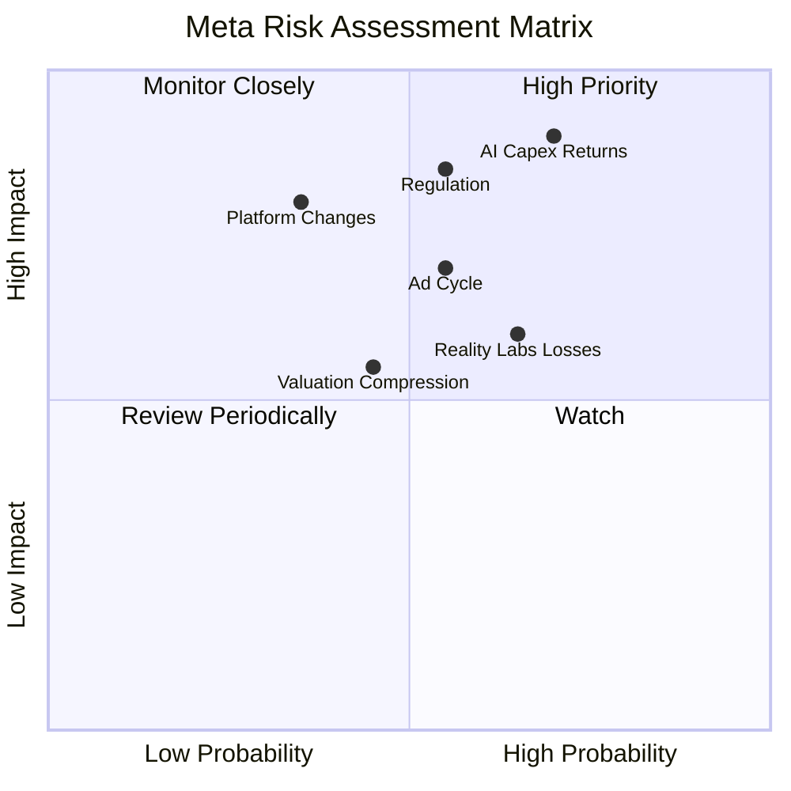

### 10.2 風險清單詳細分析

| # | 風險項目 | 發生機率 | 財務衝擊 | 風險評分 | 緩解措施 |
|---|---|---:|---|---:|---|
| 1 | 🔴 AI／資料中心 Capex 回報不及預期 | 中高（約 40%） | 若 Capex 長期高於營收 35%，FCF 可能持續受壓 | 8.5/10 | 每季追蹤 Capex、FCF、廣告效率與增量營收 |
| 2 | 🔴 監管、隱私與反壟斷 | 中（約 30%） | 可能限制定向廣告或產品整合，收入衝擊 N/A | 8.0/10 | 監控法規、訴訟及產品使用限制 |
| 3 | 🟠 廣告景氣循環反轉 | 中（約 35%） | 營收成長下滑會放大營業槓桿反向效果 | 7.0/10 | 追蹤單季營收 YoY、廣告價格與展示量 |
| 4 | 🟡 平台／分發政策改變 | 中低（約 20%） | 觸及、歸因及投放效率下降 | 6.5/10 | 多產品導流及第一方商業訊息拓展 |
| 5 | 🟡 Reality Labs 長期投入低回報 | 中高（約 40%） | 持續費用可能壓縮營業利益率 | 6.5/10 | 監控分部收入、營業損失與裝置採用 |
| 6 | 🟡 估值倍數收縮 | 中（約 30%） | 高成長預期下修時，P/E 與 EV/EBITDA 同時下滑 | 6.0/10 | 以現金流與估值區間分批管理部位 |

機率是研究判斷而非統計預測；衝擊比例因未有敏感度明細，未虛構具體營收損失百分比。

---

## 11. 投資建議

### 11.1 最終綜合評級雷達圖

```text
╔══════════════════════════════════════════════════════════════╗
║ META 投資評分                                                ║
╠══════════════════════════════════════════════════════════════╣
║ 基本面        8.5/10 ▓▓▓▓▓▓▓▓▓▓▓▓▓▓▓▓▓░░░                   ║
║ 成長性        8.0/10 ▓▓▓▓▓▓▓▓▓▓▓▓▓▓▓▓░░░░                   ║
║ 獲利能力      8.0/10 ▓▓▓▓▓▓▓▓▓▓▓▓▓▓▓▓░░░░                   ║
║ 財務健康      6.5/10 ▓▓▓▓▓▓▓▓▓▓▓▓▓░░░░░░░                   ║
║ 估值合理性    5.5/10 ▓▓▓▓▓▓▓▓▓▓▓░░░░░░░░░                   ║
║ 風險控制      6.0/10 ▓▓▓▓▓▓▓▓▓▓▓▓░░░░░░░░                   ║
╠══════════════════════════════════════════════════════════════╣
║ 綜合評分      7.3/10 ｜ 建議：持有                           ║
╚══════════════════════════════════════════════════════════════╝
```

### 11.2 目標價與隱含報酬率

| 情境 | 目標價 | 相對 $641.69 收盤價 | 機率權重 | 主要依據 |
|---|---:|---:|---:|---|
| 🔴 悲觀 | $500 | -22.1% | 30% | 成長減速、Capex 維持高位、估值收縮 |
| 🟡 基準 | $676.2 | +5.4% | 50% | 19.0x GOOG Forward P/E × META Forward EPS |
| 🟢 樂觀 | $850.1 | +32.5% | 20% | 分析師平均目標價作樂觀參考 |
| **加權情境參考** | 約 $648.1 | 約 +1.0% | 100% | $500×30%+$676.2×50%+$850.1×20% |

目標價情境加權價與 8.8 加權合理價值不是同一估值口徑。投資評級仍依規則使用 8.8 MOS：**-6.8%，持有**。

### 11.3 買入時機與觸發因素

```text
╔══════════════════════════════════════════════════════════════════╗
║                  ✅ 買入觸發因素 Checklist                      ║
╠══════════════════════════════════════════════════════════════════╣
║ 目前結論：持有；不因單一季度營收成長而追價                      ║
║                                                                  ║
║ 轉為較積極買入的條件：                                          ║
║ ☐ 股價回落至約 $540 以下，對應加權合理值至少 10% MOS            ║
║ ☐ TTM FCF 回升至 $46.11B 以上，且不只依賴一次性營運資金變化     ║
║ ☐ Capex／營收連續兩季下降，且廣告收入仍保持雙位數成長           ║
║ ☐ ROIC 維持高於 WACC 11.04%，並確認現金及債務口徑               ║
║                                                                  ║
║ 加碼觸發條件：                                                  ║
║ ☐ 單季營收 YoY ≥20%，營業利益率穩定或改善                      ║
║ ☐ AI 廣告變現可由收入、FCF 或廣告效率數據驗證                   ║
║                                                                  ║
║ 減碼／重新評估條件：                                            ║
║ ☐ 收入成長連續兩季低於 10%                                      ║
║ ☐ Capex 高於營收 40% 且 FCF 連續兩季為負                        ║
║ ☐ ROIC 跌至 WACC 11.04% 以下                                    ║
╚══════════════════════════════════════════════════════════════════╝
```

### 11.4 投資人適配度分析

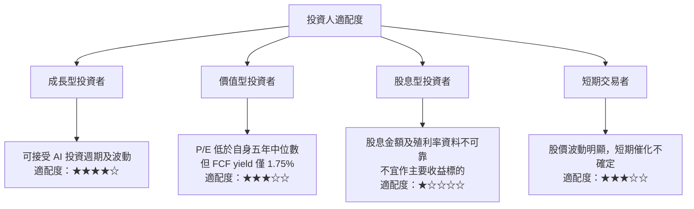

### 11.5 每季財報監控清單（Quarterly Watch List）

| 指標 | 目前參考值 | 加碼／改善訊號 | 減碼／警戒訊號 |
|---|---:|---|---|
| 單季營收 YoY | 2026 Q3 **26.1%** | 維持 ≥20% | 連續兩季 <10% |
| TTM 營收成長 | **27.5%** | 維持雙位數 | 連續下滑且低於同業 |
| TTM 營業利益率 | **32.9%** | 穩定或上升 | 收縮超過 5pp |
| 最新季度營業利益率 | VERIFIED **20.1%** | 後續季度改善並核實口徑 | 持續低於 20% |
| TTM Capex | **$104.44B** | Capex／營收下滑且收入成長維持 | Capex／營收持續高於 40% |
| TTM FCF | **$28.65B** | 回升至 FY2025 $46.11B 附近以上 | 連續兩季 FCF 為負 |
| SBC／營收 | FY2025 **10.2%** | 占比下降或回購抵銷稀釋 | 占比上升且股數同步增加 |
| ROIC vs WACC | **22.0% vs 11.04%** | 利差維持正值 | ROIC 跌至 WACC 以下 |
| AI／Reality Labs | 分部回報 N/A | 分部收入／利潤或效率提升可量化 | 支出增加但收入回報不明 |
| 資產負債表資料 | 現金口徑 $11.22B／$82.45B 不同 | 公司申報資料釐清口徑 | 仍有重大差異且負債擴大 |
| 管理層財測 | 資料包未提供 | 收入成長與 Capex 回報同時改善 | 下修收入預期、上修 Capex |

### 11.6 反面論證：什麼會證明論點錯誤（What Would Change My Mind）

```text
╔══════════════════════════════════════════════════════════════════╗
║              ⚠️ 論點失效條件（Disconfirming Evidence）           ║
╠══════════════════════════════════════════════════════════════════╣
║ 以下任一情況持續出現，應重新檢視或退出投資論點：                ║
║ ☐ 核心營收單季 YoY 連續兩季低於 10%                             ║
║ ☐ TTM 營業利益率較 32.9% 基準收縮超過 5 個百分點                ║
║ ☐ TTM FCF 低於 $28.65B 且 Capex／營收連續兩季高於 40%           ║
║ ☐ FCF 連續兩季為負，且無法由已公告的建置週期解釋                ║
║ ☐ ROIC 低於 WACC 11.04%，表示投入資本不再創造經濟價值           ║
║ ☐ SBC／營收高於 FY2025 的 10.2%，同時稀釋股數持續增加           ║
║ ☐ AI／資料中心投入增加，但廣告收入或 FCF 沒有可驗證改善          ║
╚══════════════════════════════════════════════════════════════════╝
```

> **免責聲明：**本報告為 AI 自動生成，僅供研究參考，不構成投資建議。投資有風險，入市需謹慎。