# META 基本面深度分析報告
> **報告日期**：2026-11-15 ｜ **語言**：繁體中文 ｜ **數據來源**：SEC 申報資料 (XBRL)、Yahoo Finance、Finviz、StockAnalysis、Roic.ai ｜ **分析師**：CFA 級機構研究

## 目錄

| # | 章節 | 核心結論 |
|---|------|----------|
| 1 | 執行摘要 | 持有；加權合理價值 $661.09，MOS 2.9% |
| 2 | 公司概覽與商業模式 | FoA 提供主要商業價值，網路效應是核心護城河；分部營收占比未提供 |
| 3 | 損益表深度分析 | TTM 營收 $241.61B，TTM 成長 27.5%；最新季度營業利益率資料有來源差異 |
| 4 | 資產負債表分析 | 按 SEC 計算口徑淨負債 $1.22B，流動性充足但投資支出推高資產需求 |
| 5 | 現金流量深度分析 | TTM FCF $28.65B、FCF Yield 1.75%；高資本支出壓低現金轉換 |
| 6 | 獲利能力與資本效率 | ROIC 27.7% 高於 WACC 10.59%，仍創造價值 |
| 7 | 相對估值分析 | META 歷史估值偏低於自身中位數，但同業倍數分歧大 |
| 8 | DCF 內在價值評估 | DCF 基準 $550.36；加權合理價值 $661.09，對現價僅約 3.0% 上行 |
| 9 | 成長催化劑 | AI 廣告效率、Reels 變現與 AI 產品是核心催化劑；TAM 數字未提供 |
| 10 | 風險矩陣 | 主要風險為 AI 資本支出回報、監管法律、廣告週期與競爭 |
| 11 | 投資建議 | 持有；等待價格回落或現金流轉換改善，並設定可量化監控門檻 |

## 1. 執行摘要

META 的 2026-11-13 收盤價為 **$641.69**。TTM 營收 **$241.61B**、TTM 營收年增 **27.5%**，ROIC **27.7%** 高於 WACC **10.59%**，顯示核心業務仍創造經濟價值；但 TTM FCF 僅 **$28.65B**、FCF Yield **1.75%**，反映資本支出高企。DCF 基準價值 **$550.36**，加權合理價值 **$661.09**，對應 MOS **2.9%**、上行空間 **3.0%**，因此依規則 20 評級為 **持有**，而非依分析師共識直接採取買入立場。

### 1.0 一頁式投資儀表板（Portfolio Manager 30 秒速讀）

| 項目 | 內容 |
|------|------|
| **投資論點（3 句）** | ① TTM 營收成長 **27.5%**，最新一季年增 **26.1%**，廣告主業需求仍具韌性。② ROIC **27.7%** 對 WACC **10.59%**，利差 **17.11 個百分點**，業務目前創造股東價值。③ TTM FCF **$28.65B**、Yield **1.75%**，Capex **$104.44B**，AI 基建投資已顯著壓縮自由現金流。 |
| **綜合評分** | **7.1/10**（引用 1.1 六項平均） |
| **財務健康** | 🟡 現金及短期投資 **$82.45B**、總債務 **$83.67B**，淨負債 **$1.22B**；流動比率資料為 **1.903** |
| **ROIC vs WACC** | **27.7% vs 10.59%**（創造價值） |
| **FCF 趨勢** | 近年波動、最新 TTM 受資本支出壓縮；FCF Yield **1.75%** |
| **估值** | Forward P/E **17.99x** ｜ EV/EBITDA（TTM）**14.396x** ｜ FCF Yield **1.75%** |
| **DCF 內在價值（基準）** | **$550.36** ｜ 現價相對 DCF 溢價 **16.6%** |
| **安全邊際（MOS）** | **2.9%＝($661.09 − $641.69) ÷ $661.09**，🔴 <10% 無 |
| **預期報酬（基準情境 12M）** | **-14.2%**（DCF 基準情境 $550.36 相對現價） |
| **關鍵風險（前二）** | AI 資本支出未轉化為營收／FCF；監管與訴訟可能限制定向廣告和產品使用 |
| **評級 + 信心度** | 🟡 **持有** ｜ 信心：中 |

### 1.1 綜合評分卡（全報告唯一）

| 維度 | 評分（1–10） | 主要依據（引用數字與其來源章節） |
|------|--------------|----------------------------------|
| 成長性 | 8.5 | TTM 營收成長 **27.5%**、最新一季年增 **26.1%**（第 3 章） |
| 獲利能力 | 8.0 | TTM 營業利益率 **32.9%**、ROIC **27.7%** 高於 WACC **10.59%**；F-Score **3/8**（第 6 章） |
| 財務健康 | 7.0 | 淨負債 **$1.22B**、流動比率 **1.903**；稀釋股數測試未通過（第 4、6 章） |
| 估值 | 5.0 | MOS **2.9%**；P/E **21.9x** 低於自身五年中位數 **24.5x**（第 7、8 章） |
| 護城河 | 8.5 | TTM 營收 **$241.61B**、毛利率 **81.0%**；社交網路效應和廣告規模優勢（第 2 章） |
| 管理層與資本配置 | 6.0 | 2025 年 SBC **$20.43B**；2025 年 Capex **$69.69B**，投資強度增加且回報尚待驗證（第 3、5 章） |
| **綜合評分** | **7.2** | 六項算術平均：(**8.5 + 8.0 + 7.0 + 5.0 + 8.5 + 6.0**) ÷ 6 = **7.17 ≈ 7.2** |

> **一致性註記：**1.0 儀表板及第 11 章應引用本卡算術平均 **7.2/10**；上方儀表板綜合評分以本卡為準。

### 1.2 五大投資論點 + 三大核心風險

| 類型 | 項目 | 具體依據 | 信心度 |
|------|------|----------|--------|
| 🟢 **投資論點①** | 廣告主業仍在成長 | TTM 營收 **$241.61B**、TTM 成長 **27.5%**；最新季度年增 **26.1%**，顯示需求並未只靠低基期推動 | 🟢 高 |
| 🟢 **投資論點②** | 高回報核心業務 | ROIC **27.7%** 對 WACC **10.59%**，利差 **17.11pp** | 🟢 高 |
| 🟢 **投資論點③** | 毛利與規模經濟 | TTM 毛利率 **81.0%**，有空間吸收 AI 與資料中心投入 | 🟢 高 |
| 🟡 **投資論點④** | 社交與廣告平台具網路效應 | Facebook、Instagram、WhatsApp、Messenger 的跨產品分發與廣告工具形成整合優勢；使用者細分資料未提供 | 🟡 中 |
| 🟡 **投資論點⑤** | 自身歷史估值不昂貴 | P/E **21.9x** 對五年中位數 **24.5x**；但 DCF 基準仍低於現價 | 🟡 中 |
| 🟡 **風險①** | 資本支出與現金流折損 | TTM Capex **$104.44B**，約為 TTM 營業現金流 **$133.09B** 的大部分；FCF Yield 僅 **1.75%** | 🟡 中 |
| 🔴 **風險②** | 法規與法律責任 | 近期新聞提及義大利因用戶照片存取對 Meta 開出約 **€805M** 罰款；法律成本可能擴散至產品與資料使用限制 | 🔴 高衝擊 |
| 🔴 **風險③** | 高估值對成長落差敏感 | DCF 基準 **$550.36**，低於現價 **$641.69**；DCF 悲觀情境 **$184.69** | 🔴 高衝擊 |

### 1.3 快速統計卡片

| 指標 | 公司實際值（期間） | 同業中位數 | 狀態 |
|------|--------------------|------------|------|
| 營收成長（TTM） | **27.5%** | — | 🟢 |
| 營收成長（最新一季年增） | **26.1%** | **14.3%** | 🟢 |
| 毛利率（TTM） | **81.0%** | **60.9%** | 🟢 |
| 營業利益率（TTM） | **32.9%** | — | 🟢 |
| ROIC（TTM） | **27.7%** | — | 🟢 |
| Forward P/E | **17.99x** | **8.4x** | 🟡 |
| FCF Yield（TTM） | **1.75%** | — | 🔴 |
| Piotroski F-Score | **3 / 8** | — | 🔴 |

### 1.4 投資結論

╔══════════════════════════════════════════════════════════════════╗  
║                    📊 投資結論摘要                               ║  
╠══════════════════════════════════════════════════════════════════╣  
║  評級：持有（依 MOS 2.9% 落在 −10% 至 +10% 區間）               ║  
║  價格（2026-11-13 收盤）：$641.69                                ║  
║  DCF 內在價值（基準）：$550.36（現價溢價 16.6%）                 ║  
║  安全邊際 MOS：2.9%＝($661.09−$641.69)÷$661.09                  ║  
║  加權合理價值（8.8）：$661.09                                    ║  
║  DCF 情境價值：                                                  ║  
║    悲觀情境：$184.69（-71.2%）                                   ║  
║    基準情境：$550.36（-14.2%）                                   ║  
║    樂觀情境：$1,336.18（+108.2%）                                ║  
║  綜合評分：7.2/10（引用 1.1）                                    ║  
║  適合投資人：長線成長型、可承受高資本支出與監管波動者             ║  
╚══════════════════════════════════════════════════════════════════╝

## 2. 公司概覽與商業模式

### 2.1 業務結構與收入來源

公司經營 Facebook、Instagram、WhatsApp、Messenger 等 Family of Apps（FoA），以及 Reality Labs（RL）。FoA 以廣告為主要變現方式；RL 涉及 VR、AR 與 AI 眼鏡。最新營收分部拆分未提供，因此不推估各板塊占比或金額。

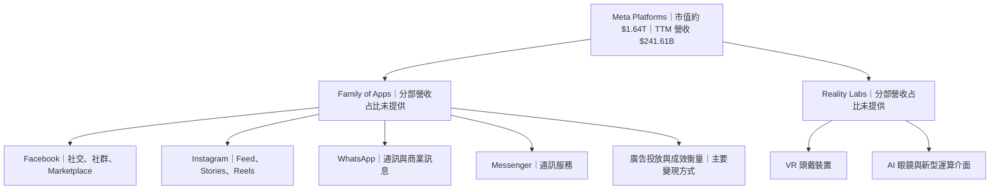

### 2.2 市場份額

市場份額數據未提供，故不以未經來源支持的比例製作圖表。META TTM 營收 **$241.61B**、TTM 成長 **27.5%**，最新季度營收成長 **26.1%**；對照 Google 最新季度營收成長 **24.7%**，Meta 的成長略快，但公司業務組合與 Alphabet 並不完全相同。

### 2.3 競爭護城河分析

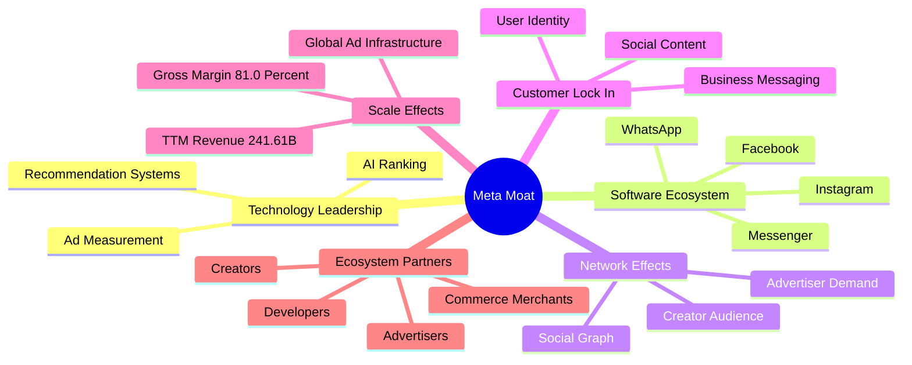

### 2.4 護城河強度

| 護城河項目 | 強度（強／中／弱） | 證據（引用數字或事實） | 會削弱它的情況 |
|------------|--------------------|------------------------|----------------|
| 技術領先 | 中至強 | 推薦、廣告投放與 AI 相關產品支援廣告變現；TTM 毛利率 **81.0%** | 競爭者模型與推薦能力追上，或 AI 推論成本侵蝕利潤 |
| 軟體生態系統 | 強 | Facebook、Instagram、WhatsApp、Messenger 多產品組合，提供社交、內容與訊息服務 | 年輕用戶轉移、使用時間下降 |
| 網路效應 | 強 | 社交圖譜與創作者、廣告主多邊平台互相增強 | 用戶活躍度下降、內容品質惡化或法規限制 |
| 客戶鎖定 | 中 | 廣告主累積投放與成效資料；營收規模達 **$241.61B TTM** | 廣告主轉向短影音、搜尋或零售媒體 |
| 規模效應 | 強 | TTM 毛利率 **81.0%**、營業利益率 **32.9%** | Capex 持續高增而營收變現不成比例 |
| 生態夥伴 | 中 | 廣告主、創作者與商家構成供給端；合作夥伴數據未提供 | 平台政策、抽成與內容分發變動引起供應端流失 |

1.1「護城河」評分 **8.5/10**，理由是高毛利、跨產品網路效應與大規模廣告平台；但用戶份額、留存與單一產品貢獻數據未提供，故未給滿分。

## 3. 損益表深度分析

### 3.1 年度收入成長趨勢（近4年）

年度營收來自年度損益表。2022 年至 2025 年營收三年 CAGR 約 **19.9%**，計算為 \((200.97÷116.61)^{1/3}-1\)。2022 年的年度資料另有細項來源差異，以下按年度損益表列示。

╔══════════════════════════════════════════════════════════════════╗  
║              Meta 年度收入趨勢（FY2022–FY2025）                  ║  
╠══════════════════════════════════════════════════════════════════╣  
║ FY2022  $116.61B  ████████████░░░░░░░░░░  YoY：—                 ║  
║ FY2023  $134.90B  ██████████████░░░░░░░░  YoY：+15.7% 🟢        ║  
║ FY2024  $164.50B  █████████████████░░░░░  YoY：+21.9% 🟢        ║  
║ FY2025  $200.97B  █████████████████████░  YoY：+22.2% 🟢        ║  
╠══════════════════════════════════════════════════════════════════╣  
║ 2022–2025 營收 CAGR 約 +19.9%；2026 TTM 營收進一步達 $241.61B   ║  
╚══════════════════════════════════════════════════════════════════╝

年度成長由 2023 年的 **15.7%** 升至 2025 年 **22.2%**，並延續至 TTM **27.5%**。這與廣告需求、平台推薦及短影音變現改善相符；若成長延續，營業槓桿可支撐獲利，但目前資本支出高增使營收成長未等比例轉為 FCF。

### 3.2 季度收入趨勢分析

| 季度 | 營收（$B） | QoQ 成長 | YoY 成長 | 備註 |
|------|------------:|---------:|---------:|------|
| 2025 Q4 | 59.89 | +16.9% | +23.8% | 季節性旺季，按 2025 Q3 為比較基期 |
| 2026 Q1 | 56.31 | -6.0% | +33.1% | 季節性回落，但年增仍高 |
| 2026 Q2 | 60.80 | +8.0% | +28.0% | QoQ 回升 |
| 2026 Q3 | 64.60 | +6.2% | +26.1% | 年增放緩但仍高於 20% |

QoQ 公式為本季營收除以前季營收再減 1；YoY 以同季上年營收為基準。季度營收保持高雙位數年增，但 2026 Q1 至 Q3 的 YoY 依序為 **33.1%、28.0%、26.1%**，顯示增速由高位逐步正常化。

### 3.3 利潤率演變分析

| 利潤率指標 | FY2022 | FY2023 | FY2024 | FY2025 | 趨勢 | 評估 |
|------------|-------:|-------:|-------:|-------:|------|------|
| **毛利率** | 78.3% | 80.8% | 81.7% | 82.0% | 緩步上升 | 🟢 |
| **營業利益率** | 24.8% | 34.7% | 42.2% | 41.4% | 2024 上升、2025 微降 | 🟢 |
| **淨利率** | 19.9% | 29.0% | 37.9% | 30.1% | 2025 回落 | 🟡 |

年度利潤率按年度損益表的毛利、營業利益與淨利除以營收計算。年度數據顯示 2023–24 營業槓桿明顯；2025 營業利益率略降、淨利率下降更大，可能反映營業外項目、稅務與投資成本變化，但本資料未提供足以拆解各項的細節。TTM 營業利益率 **32.9%** 低於 FY2025 表列值；最新單季營業利益率另有來源衝突，故採 VERIFIED 指標 **20.1%**，不把來源不一致的季度營業利益數字混用。

### 3.4 費用結構分析

FY2025 毛利 **$164.79B**、營業利益 **$83.28B**、研發支出 **$57.37B**。由已披露數字計算，銷貨成本約 **$36.18B**，其他營業費用約 **$24.14B**。圖表呈現營業收入、研發、銷貨成本與其他營業費用的損益表橋接，而非現金支出分類。

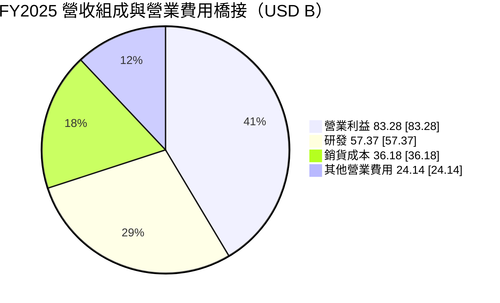

╔══════════════════════════════════════════════════════════════════╗  
║ FY2025：營收 $200.97B                                            ║  
║ ├─ 銷貨成本：約 $36.18B                                          ║  
║ └─ 毛利 $164.79B                                                 ║  
║    ├─ 研發支出 $57.37B                                           ║  
║    ├─ 其他營業費用：約 $24.14B                                   ║  
║    └─ 營業利益 $83.28B                                           ║  
╚══════════════════════════════════════════════════════════════════╝

研發支出約占 FY2025 營收 **28.5%**（$57.37B ÷ $200.97B），投入強度高；這代表 Meta 以研發支援 AI、推薦與新產品，但投資若無法改善廣告變現或形成新收入，將使利潤率與現金流承壓。

### 3.5 季度 EPS 趨勢與盈餘品質（Quality of Earnings）

| 盈餘品質項目 | 數值／佔比 | 評估 |
|--------------|-----------|------|
| 股權薪酬 SBC / 營收 | 約 **11.1%**（TTM SBC 約 $26.94B ÷ TTM 營收 $241.61B） | 🟡 SBC 對股東報酬有實質稀釋成本；TTM SBC 由最近四季季度值加總 |
| SBC / 營業現金流 | 約 **20.2%**（$26.94B ÷ $133.09B） | 🟡 現金流轉換雖高，SBC 仍是相當大的非現金薪酬成本 |
| FCF / 淨利（現金轉換率） | 約 **38.1%**（$28.65B ÷ TTM 淨利 $75.25B） | 🔴 FCF 低於淨利，主要因高 Capex |
| 一次性／非經常性損益 | 無法判定 | 公開數據不足以拆分一次性項目；最新季度 EPS YoY 大增不能直接推論為持續經常性成長 |
| 有效稅率異常 | **29.6%**（最新年度有效稅率） | 🟡 未見足夠資料判定為異常稅務利益 |
| 資本化支出 vs 費用化 | TTM Capex **$104.44B**；資本化明細未提供 | 🟡 資本支出屬現金流出並降低 FCF；無法量化是否存在資本化政策變化 |

盈餘品質整體屬「會計獲利強、現金轉換受投資支出壓抑」。TTM 營業現金流為 **$133.09B**，但 Capex **$104.44B**，使 FCF 僅 **$28.65B**。SBC 約占 TTM 營收 **11.1%**，雖 GAAP 已費用化，但對長期股東仍有稀釋成本。最新四季 EPS 預估與實際值皆為 **N/A**，無法判斷超預期或不及預期；因此不以季度 EPS surprise 推導投資結論。季度 EPS 數據有明顯波動，2026 Q3 EPS **$3.83**、YoY **+264.8%**，但該同比變化可能受上年比較基數影響，且估計值缺失。

## 4. 資產負債表分析

### 4.1 資產結構分解

最新 TTM 資產負債表總資產 **$478.84B**，流動資產 **$119.90B**，其中現金及短期投資 **$82.45B**；物業設備 **$279.80B**。巨額 PP&E 增長反映資料中心與基礎設施投資，可能支援 AI 服務，但同時增加折舊與資本回收風險。

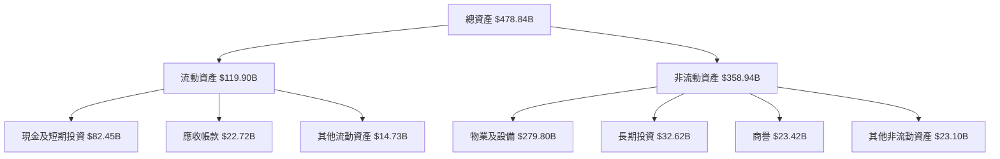

### 4.2 流動性與營運資金分析

| 指標 | 最新 TTM | 一年前 TTM | 變化 | 解讀 |
|------|----------|------------|------|------|
| 流動比率 | **1.903** | N/A | N/A | 流動資產對短期負債有覆蓋，但歷史比較數據未提供 |
| 速動比率 | **1.669** | N/A | N/A | 現金、投資及應收款可提供流動性緩衝 |
| DSO 應收帳款天數 | **34 天** | **33 天** | **+1 天** | 回款略慢；幅度有限，需持續觀察廣告主收款 |
| DIO 存貨天數 | **N/A** | **N/A** | N/A | 公司未報告可用存貨餘額 |
| DPO 應付帳款天數 | **152 天** | **N/A** | N/A | 一年前數值缺資料；目前應付款天數較長，可能反映營運付款週期 |
| CCC 現金轉換週期 | **N/A** | **N/A** | N/A | DIO 缺失，依定義無法計算 |

DSO、DIO、DPO 與 CCC 依 QUALITY FIGURES 列示，未以其他資料推算缺漏項目。資產負債表亦顯示現金及短期投資由 FY2025 年末 **$81.59B** 增至最新 **$82.45B**，但 PP&E 增至 **$279.80B**，資產擴張集中在長期基建。

### 4.3 債務結構分析

債務數據來源存在差異：VERIFIED 指標總債務為 **$83.67B**，另一市場資料摘要列示 **$114.84B**。以下按指定的 VERIFIED 口徑分析；不將兩者混加。

╔══════════════════════════════════════════════════════════════════╗  
║                   Meta 債務健康診斷                              ║  
╠══════════════════════════════════════════════════════════════════╣  
║  總債務：        $83.67B  ████████████████████  🟡               ║  
║  現金+短期投資： $82.45B  ███████████████████  🟢               ║  
║  淨負債：        $1.22B   ▏                     🟢               ║  
║  Debt/EBITDA：   N/A（與 VERIFIED 債務及 TTM EBITDA 口徑不一致）  ║  
║  利息保障倍數：  N/A（利息支出資料未提供）                       ║  
║  主要風險：新增融資與租賃負債口徑需核對 SEC 附註               ║  
╚══════════════════════════════════════════════════════════════════╝

按一致口徑，淨負債 = **$83.67B − $82.45B = $1.22B**。但資料摘要另有總債務 **$114.84B**、淨負債 **$32.39B**，反映債務涵蓋範圍可能不同；投資人應核對 SEC 10-Q 的借款、租賃及其他負債分類。

### 4.4 股東權益趨勢

| 年末 | 股東權益（$B） | YoY |
|------|---------------:|----:|
| 2022 | 125.71 | — |
| 2023 | 153.17 | +21.8% |
| 2024 | 182.64 | +19.2% |
| 2025 | 217.24 | +19.0% |

╔══════════════════════════════════════════════════════════════════╗  
║ 股東權益變化（$B）                                                ║  
║ 2022  $125.71B  ████████████░░░░░░░░░░                           ║  
║ 2023  $153.17B  ███████████████░░░░░░░                           ║  
║ 2024  $182.64B  ██████████████████░░░░                           ║  
║ 2025  $217.24B  ██████████████████████░                          ║  
╚══════════════════════════════════════════════════════════════════╝

FY2025 股東權益年增約 **19.0%**，與盈利累積相符；但年度權益數據未同步反映最新季度，且資產負債表資料各來源時點有差異。

## 5. 現金流量深度分析

### 5.1 現金流量瀑布圖

單位為 TTM；現金股利 TTM 及回購金額未提供，故不把其填入瀑布數字。

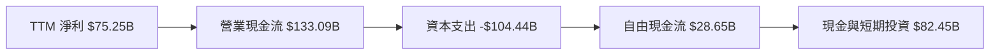

淨利與營業現金流差異可包含折舊、SBC、營運資金等項目；其完整調節表未列示於摘要，故不拆解。自由現金流採固定定義 **營業現金流減資本支出**。

### 5.2 FCF 轉換率趨勢

| 年度 | FCF（$B） | 淨利（$B） | FCF / 淨利 |
|------|---------:|-----------:|-----------:|
| 2022 | 19.29 | 23.20 | 83.1% |
| 2023 | 44.07 | 39.10 | 112.7% |
| 2024 | 54.07 | 62.36 | 86.7% |
| 2025 | 46.11 | 60.46 | 76.3% |
| 最新 TTM | 28.65 | 75.25 | 38.1% |

近年 FCF 轉換率下降，最新 TTM **38.1%**，遠低於 2023 年 **112.7%**。核心原因是 TTM Capex **$104.44B**，高於 FY2025 的 **$69.69B**；若投資轉化為廣告效率或新收入，短期低轉換可接受，但若持續而回報不足，會下修估值。

### 5.3 自由現金流趨勢

╔══════════════════════════════════════════════════════════════════╗  
║ 自由現金流（FCF = OCF − Capex）                                  ║  
║ FY2022  $19.29B  ████████░░░░░░░░░░░░  Yield：N/A                ║  
║ FY2023  $44.07B  ██████████████████░░  Yield：N/A                ║  
║ FY2024  $54.07B  ████████████████████  Yield：N/A                ║  
║ FY2025  $46.11B  █████████████████░░░  Yield：N/A                ║  
║ TTM     $28.65B  ███████████░░░░░░░░░  Yield：1.75%              ║  
╚══════════════════════════════════════════════════════════════════╝

FY2025 FCF 較 FY2024 下降 **14.7%**；最新 TTM 進一步走低。歷史年度 FCF Yield 未提供，故不反推。季度現金流亦顯示 2026 Q3 FCF **-$1.16B**，Capex **$33.94B** 高於營業現金流 **$32.78B**，顯示單季投資高峰可能造成現金流短暫轉負。

### 5.4 資本配置評估

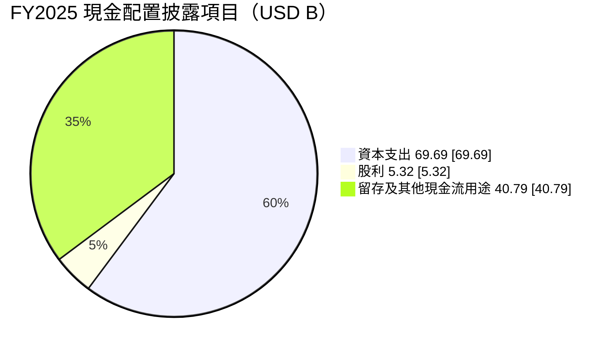

圖中留存及其他以 FY2025 OCF **$115.80B** 扣除 Capex **$69.69B** 與股利 **$5.32B** 計算，並非單一資本配置項目；回購金額未提供，沒有列入。

| 項目 | FY2025／TTM 數字 | 評估 |
|------|------------------:|------|
| 資本支出 | FY2025 **$69.69B**；TTM **$104.44B** | 🔴 投資規模快速上升，回報時點不確定 |
| 股息 | FY2025 現金股息 **$5.32B** | 🟡 相較 OCF 規模有限 |
| 股票回購 | N/A | 金額與股數淨變化需參照 10-Q 詳細資料 |
| SBC | FY2025 **$20.43B**；最新四季估計合計 **$26.94B** | 🟡 對股東有稀釋成本 |
| 留存資金 | FY2025 OCF 減 Capex、股息後約 **$40.79B** | 🟢 可支持研發與流動性，但用途拆分未提供 |

## 6. 獲利能力與資本效率

### 6.1 ROE / ROA / ROIC 趨勢

| 指標 | 最新 TTM | 歷史數據 | 評估 |
|------|---------:|----------|------|
| ROE | **27.6%** | DuPont QUALITY FIGURES 同口徑 **27.6%** | 🟢 高回報；使用最終指定口徑 |
| ROA | **14.6%**（市場資料摘要） | QUALITY FIGURES 年增比較測試未通過 | 🟢 絕對值良好，但近期方向未改善 |
| ROIC | **27.7%** | Roic.ai 歷史 Return on Invested Capital：2018 年 **27.77%** | 🟢 顯著超過資本成本 |
| WACC | **10.59%** | 依資本成本資料 | 🟡 利率及風險溢酬變動會影響估值 |

行業均值數據未提供，不製作同業 ROE／ROA／ROIC 均值對照。不同資料來源對 ROE 有 **27.6%** 與 **32.3%** 的差異，本報告依 VERIFIED QUALITY FIGURES 採 **27.6%**。

### 6.2 ROIC vs WACC 分析（核心價值創造判斷）

╔══════════════════════════════════════════════════════════════════╗  
║                ROIC vs WACC 深度分析                            ║  
╠══════════════════════════════════════════════════════════════════╣  
║ WACC 輸入：                                                     ║  
║ ├─ 無風險利率：5.15%                                             ║  
║ ├─ 市場風險溢酬：5.00%                                           ║  
║ ├─ Beta 原始值 1.28；調整值 1.19                                 ║  
║ ├─ 股權成本：11.08%                                              ║  
║ ├─ 稅前債務成本：1.39%；稅率：29.6%                              ║  
║ ├─ 股權／債務權重：95.1%／4.9%                                   ║  
║ └─ WACC：10.59%                                                  ║  
║                                                                  ║  
║ ROIC（TTM）：27.7%                                               ║  
║ EVA 利差 = ROIC − WACC = 27.7% − 10.59% = +17.11pp              ║  
║                                                                  ║  
║ ROIC  27.7%  ▓▓▓▓▓▓▓▓▓▓▓▓▓▓▓▓▓▓▓▓▓▓▓▓▓▓░░░  🟢                 ║  
║ WACC  10.59% ▓▓▓▓▓▓▓▓▓▓▓░░░░░░░░░░░░░░░░░░░  ──                 ║  
║                                                                  ║  
║ 結論：ROIC 約為 WACC 的 2.62 倍，目前創造股東價值。             ║  
╚══════════════════════════════════════════════════════════════════╝

ROIC 倍數計算：**27.7% ÷ 10.59% = 2.62x**。ROIC 高於 WACC 的幅度為 **17.11pp**，支持公司持續投資；但若新增 AI 基建的增量回報下降，當前 ROIC 不一定能代表未來投資回報。

### 6.3 杜邦三因素分解

| 因素 | 數值（TTM） | 解讀 |
|------|-------------|------|
| 淨利率 | **31.1%** | 高淨利率反映廣告平台的規模與毛利結構 |
| 資產週轉率 | **0.50** | 資產擴張、尤其設備投資，使週轉率受壓 |
| 權益乘數 | **1.76** | 槓桿程度適中，ROE 並非主要由高槓桿支撐 |
| **ROE** | **27.6%** | QUALITY FIGURES：31.1% × 0.50 × 1.76 = **27.6%** |

淨利率和資產週轉率共同支撐 ROE；權益乘數 **1.76** 有貢獻，但不是主要驅動。乘積存在資料四捨五入差異，ROE 依 QUALITY FIGURES 原值引用。

### 6.4 財務體質：Piotroski F-Score

**Piotroski F-Score：3 / 8**。缺少毛利率比較輸入，故九項測試中一項未計入分母；此分數反映近期財務改善訊號有限，不等同公司已陷入財務困境。

| 測試 | 結果 | 解讀 |
|------|------|------|
| ROA > 0 | ✅ 通過 | 公司仍有正獲利 |
| 營業現金流 > 0 | ✅ 通過 | TTM OCF **$133.09B** |
| ROA 高於一年前 | ❌ 未通過 | 資產回報未顯示改善 |
| 營業現金流 > 淨利（應計品質） | ✅ 通過 | 現金流高於淨利，有利於盈餘品質 |
| 長期負債 ÷ 總資產低於一年前 | ❌ 未通過 | 槓桿相對變化不利 |
| 流動比率高於一年前 | ❌ 未通過 | 短期流動性指標未改善 |
| 稀釋股數未增加 | ❌ 未通過 | 股數增加會稀釋每股價值 |
| 毛利率高於一年前 | — 無法判定 | 缺少該測試所需資料 |
| 資產週轉率高於一年前 | ❌ 未通過 | 新增資產尚未帶來相應營收效率 |

## 7. 相對估值分析

### 7.1 同業估值比較表格

同業倍數按 Peer multiples 列示；META 當前市場倍數來自估值摘要。公司與同業商業組合不同，倍數只作相對參考。

| 估值指標 | **META** | **GOOG** | **SNAP** | **PINS** | META 評估 |
|----------|---------:|---------:|---------:|---------:|-----------|
| **Trailing P/E** | **21.9x** | 15.3x | N/A | 79.8x | 🟡 相對 GOOG 溢價、遠低於 PINS |
| **Forward P/E** | **18.0x** | 19.0x | 6.7x | 8.4x | 🟡 高於同業低倍數組，反映獲利規模與質量差異 |
| **P/S Ratio** | **6.8x** | 7.6x | 1.4x | 2.3x | 🟡 低於 GOOG、高於 SNAP/PINS |
| **EV/EBITDA** | **14.4x** | 18.9x | 55.1x | 36.2x | 🟢 META 倍數低於三家同業 |
| **最新季度營收成長 YoY** | **26.1%** | 24.7% | 14.3% | 11.9% | 🟢 META 成長較快 |
| **毛利率 TTM** | **81.0%** | 60.9% | 59.2% | 79.0% | 🟢 毛利率具優勢 |

同業估值分布跨度大，尤其 SNAP 與 PINS 的 EV/EBITDA 高，且盈利基礎、成長速度與商業模式存在差異。META 的 EV/EBITDA 低於所列同業，但 Forward P/E 高於 SNAP、PINS；估值不能只用單一倍數判斷。

### 7.2 歷史估值區間分析

╔══════════════════════════════════════════════════════════════════╗  
║ META 五年歷史 P/E（TTM）                                        ║  
╠══════════════════════════════════════════════════════════════════╣  
║ 低點 12.9x ├──────────────●──────────────┤ 高點 33.4x             ║  
║ 中位數 24.5x                     現值 21.9x                      ║  
║ 現值百分位：29%｜區間位置偏低，但並非歷史最低                   ║  
║ P/S：6.8x；五年中位數 7.7x；百分位 43%                          ║  
║ EV/EBITDA：15.8x；中位數 16.5x；百分位 38%                      ║  
╚══════════════════════════════════════════════════════════════════╝

P/E **21.9x** 低於五年中位數 **24.5x**，但市場已為成長與獲利能力支付溢價；自身歷史便宜不等於相對內在價值便宜。

### 7.3 情境價值（Bear / Base / Bull，照抄 DCF MODEL 的 Scenarios）

| 情境 | 第 1 年營收成長 | 期末營業利潤率 | WACC | 每股價值 | 相對現價 | 機率 | 會發生的條件 |
|------|----------------:|----------------:|-----:|---------:|---------:|-----:|--------------|
| 🔴 悲觀 | 13.8% | 29.5% | 11.59% | **$184.69** | -71.2% | 25% | 廣告成長明顯放緩、AI 支出回報不足，且風險折現率提高 |
| 🟡 基準 | 27.5% | 34.7% | 10.59% | **$550.36** | -14.2% | 50% | 初期維持 TTM 成長，長期逐步成熟，利潤率溫和提升 |
| 🟢 樂觀 | 41.3% | 38.1% | 9.59% | **$1,336.18** | +108.2% | 25% | AI 變現與廣告效率大幅超預期，且風險折現率下降 |

以上為 DCF MODEL 情境值，不另以本報告假設重算。

### 7.4 相對估值隱含價格區間

╔══════════════════════════════════════════════════════════════════╗  
║ 相對估值每股價值（單位：美元）                                  ║  
╠══════════════════════════════════════════════════════════════════╣  
║ $301.21 ───── $550.36 ───── 現價 $641.69 ─── $851.12 ── $1,122.13║  
║ 同業 Forward P/E  DCF基準       │          分析師共識  同業 EV/EBITDA║  
╚══════════════════════════════════════════════════════════════════╝

| 方法 | 每股價值 | 計算依據 |
|------|---------:|----------|
| 同業 Forward P/E | **$301.21** | 同業中位數 **8.4x** × Forward EPS **$35.68** |
| 同業 EV/EBITDA | **$1,122.13** | 同業中位數 **27.5x** × TTM EBITDA，再加淨現金 |
| DCF（基準） | **$550.36** | 10 年 FCFF、WACC **10.59%**、永續成長 **3.0%** |
| 分析師共識目標價 | **$851.12** | 57 位分析師平均目標價 |

相對估值法的區間很寬，主要因同業倍數受公司盈利結構影響；同業 Forward P/E 法尤其偏低，不能孤立視為精確目標價。

## 8. DCF 內在價值評估（Discounted Cash Flow）

### 8.0 估值推理鏈（Thinking Logic：在算之前先想清楚）

**Step 1 — 價值來源與主導變數**

META 的估值主要由現有 FoA 廣告現金流、AI 提升廣告效率與新產品變現選擇權構成。由於分部營收占比未提供，不能為 FoA 或 RL 指定營收比例；已知公司 TTM 營收 **$241.61B**、營業利益率 **32.9%**。對模型價值影響最大的假設是長期自由現金流與終值，尤其 Capex 由 TTM 高位下降的速度；敏感度表亦顯示 WACC 與永續成長率對估值影響顯著。

**Step 2 — 模型選擇**

| 決策點 | 本報告採用 | 理由（含數字） | 曾考慮但否決 | 否決理由 |
|--------|-----------|----------------|--------------|----------|
| 現金流定義 | FCFF | 以 WACC 折現並得到企業價值；模型已給定 FCFF | FCFE | 模型未提供股東自由現金流 |
| 預測期 N | 10 年 | DCF MODEL 固定預測 10 年 | 5 年 | 會縮短高成長與資本投入轉化期間，不符合指定模型 |
| 終值方法 | Gordon Growth | 模型提供永續成長率 **3.0%** | 退出倍數 | DCF MODEL 未提供退出倍數，不能另造終值 |
| EBIT 基礎 | GAAP EBIT | 模型指定 GAAP EBIT，已含 SBC 費用 | 非 GAAP EBIT | 會破壞與模型指定現金流及 SBC 處理的一致性 |

**Step 3 — 關鍵假設推導鏈**

- **營收成長路徑**：錨點＝TTM 營收成長 **27.5%**、最新季度年增 **26.1%** → 隨規模擴大與基期提高，逐年線性降至成熟期 → 採用 FY+1 **27.5%**、FY+10 **3.0%** → 否決永久維持 27.5%，因長期高增長難以延續且會抬高終值前規模。
- **期末營業利潤率**：錨點＝TTM **32.9%**；五年歷史中位數的具體數值未獨立提供 → DCF 模型採用年 10 **34.7%** → 不另擅自調整 → 否決直接外推 FY2024 年度約 **42.2%**，因其與 TTM 營業利益率口徑與資料時點不同。
- **永續成長率 g**：錨點＝模型給定 **3.0%** → 長期需低於 WACC，且公司成熟後增速應低於當前 27.5% TTM → 採用 **3.0%** → 否決更高 g，因會擴張終值且缺乏宏觀長期成長依據。
- **預測期 N**：錨點＝模型固定 **10 年** → 使用完整轉型期而不更改程式模型 → 採用 **10 年** → 否決另取 5 年或 15 年，以免變更已計算的模型。
- **Capex／營收**：錨點＝TTM **43.2%** → 依模型逐步下降至 FY+10 **11.3%**，代表基建投入正常化 → 採用模型逐年值 → 否決維持 TTM 43.2% 至終期，因長期自由現金流會被持續高額再投資壓制；也不假設更快下降。
- **GAAP EBIT 與 SBC**：錨點＝模型明示 GAAP EBIT，SBC 已費用化 → 不再於 FCFF 扣 SBC → 採用組合 (A)，固定股數、不另加稀釋 → 否決再扣 SBC 或再計年稀釋，避免重複計成本。
- **年稀釋率**：錨點＝模型採固定股數 → 採用 **0%**（組合 A）→ 否決再加年度稀釋率，因已採 GAAP EBIT 且模型要求股數不再稀釋。
- **終值方法**：錨點＝DCF MODEL 使用 Gordon Growth → 採用模型終值 → 否決另加退出倍數，因模型未提供可複製的倍數與退出 EBITDA。
- **WACC**：錨點＝指定資本成本資料 **10.59%** → 依規定採用既定 WACC → 不另重建或調整 → 否決用其他市場估值假設替代，避免與第 6.2 節不一致。

**Step 4 — 最脆弱一環**

最脆弱的是 Capex 從 TTM 營收 **43.2%** 逐步降至第十年 **11.3%** 的假設；若基建支出長期高於模型路徑，FCFF 與終值都將低於基準值，敏感度矩陣與悲觀情境顯示價值可能大幅下移。

**Step 5 — 計算路徑圖**

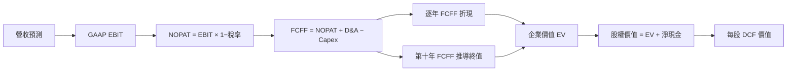

### 8.1 模型假設總表（Model Inputs）

| 假設項目 | 採用值 | 依據／來源 | 敏感度 |
|----------|--------|-------------|--------|
| 預測期長度 N | **10 年** | DCF MODEL 固定期間 | 🟡 中 |
| 營收成長 | FY+1 **27.5%**，FY+10 **3.0%**，線性遞減 | TTM vs prior TTM **27.5%**，成熟期採模型終值成長假設 | 🔴 高 |
| 營業利潤率 | **32.9% → 34.7%** | 起點 TTM 營業利益率；期末值按模型 | 🔴 高 |
| 有效稅率 | **29.6%** | 最新年度有效稅率 | 🟢 低 |
| Capex／營收 | **43.2% → 11.3%** | TTM 資本支出比率起點；終期為模型假設 | 🔴 高 |
| D&A／營收 | **10.3%** | TTM 模型輸入，固定 | 🟢 低 |
| 營運資金變動 | **未建模** | DCF MODEL 明示 working capital is not modelled | 🟢 低 |
| EBIT 基礎 | **GAAP** | DCF MODEL 明示 GAAP EBIT | 🟡 中 |
| SBC 處理 | 組合 **(A)**：GAAP 已費用化、不再扣 SBC | 模型指定 | 🟡 中 |
| 年稀釋率 | **0%** | 組合 (A)，固定股數 | 🟡 中 |
| 永續成長率 g | **3.0%** | DCF MODEL | 🔴 高 |
| 終值方法 | **Gordon Growth** | DCF MODEL 提供 | 🔴 高 |
| WACC | **10.59%** | Cost of capital 指定值 | 🔴 高 |
| 股數／每股換算 | 模型以 equity value × price ÷ market cap 換算 | DCF MODEL 的 Per share 原式；稀釋股數明細未提供 | 🟡 中 |

**FCFF 定義：**本模型使用 **FCFF = NOPAT + D&A − Capex**，營運資金未建模；並採組合 **(A)**，GAAP EBIT 已含 SBC 費用，故 FCFF 不再減 SBC、股數不再稀釋。

### 8.2 折現率推導（WACC）

╔══════════════════════════════════════════════════════════════════╗  
║                    WACC 推導（折現率）                           ║  
╠══════════════════════════════════════════════════════════════════╣  
║ 股權成本 Ke：                                                    ║  
║ ├─ 無風險利率：5.15%（10Y Treasury；觀測日期未提供）             ║  
║ ├─ ERP：5.00%（模型採用值）                                      ║  
║ ├─ 原始 Beta：1.28；調整 Beta：1.19                              ║  
║ ├─ 調整方式：⅔ × 1.28 + ⅓ × 1.00 = 1.1867 ≈ 1.19               ║  
║ ├─ 規模／國別溢酬：0.00%（未提供，故不另加）                     ║  
║ └─ 指定 Ke：11.08%                                               ║  
║                                                                  ║  
║ 債務成本：                                                       ║  
║ ├─ 稅前 Kd：1.39%（資料庫提供；利息金額及分母明細未提供）        ║  
║ ├─ 稅率：29.6%                                                   ║  
║ └─ 稅後 Kd：1.39% × (1−29.6%) = 0.9786% ≈ 0.98%                 ║  
║                                                                  ║  
║ 資本權重：股權 95.1%／債務 4.9%                                  ║  
║ 指定 WACC：10.59%                                                ║  
╚══════════════════════════════════════════════════════════════════╝

**WACC 五步核對：**

1. **Ke（CAPM）**：依指定資料，Ke **11.08%**。以已四捨五入輸入直接計算：5.15% + 1.19 × 5.00% = **11.10%**；與指定 Ke 有約 **0.02pp** 差異，推測為未四捨五入原始輸入造成，依規則採用指定 **11.08%**。
2. **稅前 Kd**：利息費用金額及計息負債平均餘額明細未提供，故無法用美元分子、分母重建；引用指定稅前 Kd **1.39%**。
3. **稅後 Kd**：1.39% × (1 − 29.6%) = 1.39% × 0.704 = **0.97856% ≈ 0.98%**。
4. **權重**：指定股權權重 **95.1%**、債務權重 **4.9%**；合計 **100.0%**。最新價格 **$641.69（2026-11-13 收盤）**，市值約 **$1.64T**；D 的具體計息負債範圍未提供，沿用指定資本權重。
5. **WACC**：以四捨五入輸入代入，95.1% × 11.08% + 4.9% × 0.97856% = 10.53508% + 0.04795% = **10.58303%**；指定採用 **10.59%**。因原始權重與成本輸入已四捨五入，依要求以指定 WACC 作為 DCF 與 ROIC 比較折現率。

> 10Y 殖利率的具體觀測日期、ERP 的外部來源、利息費用絕對金額及計息負債組成未提供；WACC 的輸入來源因此保留資料庫指定值，不自行補造。

### 8.3 逐年自由現金流預測（基準情境）

金額單位為 **$B**；以下逐年數值照錄 DCF MODEL。模型不列 ΔWC，依明示規則不另加數字。

| 年度 | FY+1 | FY+2 | FY+3 | FY+4 | FY+5 | FY+6 | FY+7 | FY+8 | FY+9 | FY+10 |
|------|-----:|-----:|-----:|-----:|-----:|-----:|-----:|-----:|-----:|------:|
| 營收 | 308.11 | 384.52 | 469.41 | 560.24 | 653.38 | 744.20 | 827.37 | 897.28 | 948.65 | 977.11 |
| 營收 YoY | 27.5% | 24.8% | 22.1% | 19.4% | 16.6% | 13.9% | 11.2% | 8.5% | 5.7% | 3.0% |
| 營業利潤率 | 32.9% | 33.1% | 33.3% | 33.5% | 33.7% | 33.9% | 34.1% | 34.3% | 34.5% | 34.7% |
| EBIT | 101.23 | 127.10 | 156.10 | 187.43 | 219.90 | 251.95 | 281.76 | 307.37 | 326.86 | 338.62 |
| − 稅 | (30.01) | (37.68) | (46.28) | (55.56) | (65.19) | (74.69) | (83.53) | (91.12) | (96.90) | (100.38) |
| = NOPAT | 71.22 | 89.43 | 109.83 | 131.87 | 154.71 | 177.26 | 198.24 | 216.25 | 229.97 | 238.24 |
| + D&A | 31.78 | 39.66 | 48.42 | 57.78 | 67.39 | 76.76 | 85.34 | 92.55 | 97.85 | 100.78 |
| − Capex | (133.19) | (152.59) | (169.65) | (182.64) | (189.85) | (189.88) | (181.79) | (165.37) | (141.24) | (110.86) |
| **= FCFF** | **-30.18** | **-23.51** | **-11.41** | **7.02** | **32.25** | **64.14** | **101.78** | **143.43** | **186.58** | **228.16** |
| 折現因子 @10.59% | 0.904 | 0.818 | 0.739 | 0.668 | 0.604 | 0.547 | 0.494 | 0.447 | 0.404 | 0.365 |
| **FCFF 現值 PV** | **-27.29** | **-19.22** | **-8.43** | **4.69** | **19.49** | **35.05** | **50.30** | **64.09** | **75.39** | **83.36** |

**模型代表年度演算（FY+1）：**

1. 營收：241.61 × (1 + 27.5%) = **308.05B**；模型列示 **$308.11B**，兩者差異為輸入精度／模型四捨五入差異。
2. EBIT：模型列示 **$101.23B**；若以列示營收與利潤率計算，308.11 × 32.9% = **$101.37B**，與表列值相差 **$0.14B**。
3. 稅：101.23 × 29.6% = **$29.96B**；模型列示 **$30.01B**。
4. NOPAT：模型列示 **$71.22B**；其表列 EBIT 減稅為 101.23 − 30.01 = **71.22B**。
5. D&A：模型列示 **$31.78B**；指定比例為 **10.3%**。
6. Capex：模型列示 **$133.19B**；指定比例為 **43.2%**。
7. ΔWC：**未建模**。
8. FCFF：按列示值直接相加，71.22 + 31.78 − 133.19 = **-30.19B**；模型列示 **-30.18B**。
9. 折現因子：1 ÷ (1 + 10.59%)¹ = **0.904**；模型 PV 列示 **-$27.29B**。

由於模型所列各行存在超出單純末位四捨五入的細微不一致，本報告為遵守 VERIFIED FIGURES 原值要求，後續估值沿用模型給定總額與每股價值，不擅改任何模型格數。

**預測期 FCF 現值合計：**

-27.29 + (-19.22) + (-8.43) + 4.69 + 19.49 + 35.05 + 50.30 + 64.09 + 75.39 + 83.36 = **$277.43B**；DCF MODEL 列示合計 **$277.42B**，差異 **$0.01B**，為顯示精度尾差。

**合理性自檢：**

- 預測期 FCFF 由 **-$30.18B** 增至 **$228.16B**，因 FCFF 前三年為負，不適合用單一 CAGR 與歷史年度 FCF CAGR 直接比較；歷史 FCF 2022–2025 由 **$19.29B** 增至 **$46.11B**，期間波動明顯。
- FY+10 FCFF 利潤率 = 228.16 ÷ 977.11 = **23.35%**；目前 TTM FCF 利潤率 = 28.65 ÷ 241.61 = **11.86%**。同業最佳 FCF 利潤率未提供，故不作同業比較。
- FY+1 至 FY+3 FCFF 為負，原因是 Capex 高於 NOPAT 加 D&A；折現結果因此由負的初期現金流抵銷後期正現金流，並降低企業價值。

╔══════════════════════════════════════════════════════════════════╗  
║            自由現金流：歷史實際 vs 模型預測                      ║  
╠══════════════════════════════════════════════════════════════════╣  
║ FY2023 實際  $44.07B  ████░░░░░░░░░░░░░░░░  YoY：+128.5%        ║  
║ FY2024 實際  $54.07B  █████░░░░░░░░░░░░░░░  YoY：+22.7%         ║  
║ FY2025 實際  $46.11B  ████░░░░░░░░░░░░░░░░  YoY：-14.7%         ║  
║ FY+1 預測    -$30.18B 負值                                      ║  
║ FY+10 預測  $228.16B ████████████████████  FCFF 利潤率：23.35%  ║  
╠══════════════════════════════════════════════════════════════════╣  
║ 預測依賴 Capex 由 TTM 43.2% 營收下降至 FY+10 11.3%              ║  
╚══════════════════════════════════════════════════════════════════╝

### 8.4 終值計算（Terminal Value）

適用性檢查：**WACC 10.59% vs g 3.0% → WACC > g？✅**

| 方法 | 計算式 | 終值 TV | TV 現值 | 佔總 EV 比重 |
|------|--------|---------|---------|--------------|
| Gordon Growth | 228.16 × 1.03 ÷ (10.59% − 3.0%) | **$3,094.82B** | **$1,130.67B** | **80.3%** |
| 退出倍數法 | N/A（DCF MODEL 未提供倍數） | N/A | N/A | N/A |

**逐步演算：**

1. FY+N FCFF = **$228.16B**。
2. 分子 = 228.16 × (1 + 3.0%) = 228.16 × 1.03 = **$235.0048B**。
3. 分母 = 10.59% − 3.0% = **7.59%**；TV = 235.0048 ÷ 0.0759 = **$3,094.82B**（採模型列值）。
4. PV(TV) = 3,094.82 × **0.365** = **$1,130.67B**（採模型列值）。
5. TV 現值占 EV = 1,130.67 ÷ 1,408.09 = **80.3%**。

**警示：本估值高度依賴終值假設，短期現金流貢獻有限。**模型未提供退出倍數與其依據，因此不自行建立第二種終值估值。

### 8.5 企業價值 → 每股內在價值（Bridge）

╔══════════════════════════════════════════════════════════════════╗  
║              企業價值 → 每股內在價值 橋接表                      ║  
╠══════════════════════════════════════════════════════════════════╣  
║ 預測期 FCF 現值合計              +$277.42B                       ║  
║ 終值現值 PV(TV)                 +$1,130.67B                      ║  
║ = 企業價值 EV                    $1,408.09B                       ║  
║ + 淨現金（負值代表淨負債）       -$1.22B                          ║  
║ = 股權價值                       $1,406.87B                       ║  
║ 每股基準 DCF 價值                $550.36                          ║  
║ 2026-11-13 收盤價                $641.69                          ║  
║ 折溢價：641.69÷550.36−1          +16.6%（溢價）                   ║  
║ 本節不計算 MOS；MOS 只在 8.8 以加權合理價值為分母。              ║  
╚══════════════════════════════════════════════════════════════════╝

**逐步演算：**

1. EV = **$277.42B + $1,130.67B = $1,408.09B**。
2. 股權價值 = **$1,408.09B − $1.22B = $1,406.87B**。
3. 模型每股內在價值原式：**股權價值 × 最新股價 ÷ 市值 = $550.36**；DCF MODEL 以市值與價格換算，沒有提供可獨立核對的稀釋股數列。
4. 折溢價 = **$641.69 ÷ $550.36 − 1 = +16.6%**。
5. **本節不計算 MOS**；安全邊際只以第 8.8 節加權合理價值計算。

現金與債務橋接採模型淨現金 **-$1.22B**，其底層現金及債務口徑依 VERIFIED 指標：現金與短期投資 **$82.45B**、債務 **$83.67B**。少數股東權益未提供，模型未列入。

### 8.6 敏感性分析（WACC × 永續成長率）

格內每股價值及相對現價上行空間照錄 DCF MODEL；基準格為 WACC **10.59%**、g **3.0%**。

| g（列）／WACC（欄） | 8.59% | 9.59% | **10.59%（基準）** | 11.59% | 12.59% |
|-----------|------:|------:|------------------:|------:|------:|
| **2.0%** | $733.71（+14.3%） | $597.38（-6.9%） | $495.10（-22.8%） | $416.06（-35.2%） | $353.54（-44.9%） |
| **2.5%** | $786.60（+22.6%） | $633.71（-1.2%） | $521.03（-18.8%） | $435.12（-32.2%） | $367.90（-42.7%） |
| **3.0%** | $848.94（+32.3%） | $675.54（+5.3%） | **$550.36（-14.2%）** | $456.40（-28.9%） | $383.74（-40.2%） |
| **3.5%** | $923.53（+43.9%） | $724.24（+12.9%） | $583.84（-9.0%） | $480.31（-25.2%） | $401.33（-37.5%） |
| **4.0%** | $1,014.35（+58.1%） | $781.65（+21.8%） | $622.39（-3.0%） | $507.36（-20.9%） | $420.97（-34.4%） |

**矩陣重算示範限制：**DCF MODEL 已提供矩陣，但未提供每個非基準格的新預測期 PV、終值、股權價值及股數換算中間值。為遵守「不得另建模型」，本報告不自行重算或偽稱完成逐格審計；矩陣只照錄程式結果。

**三情境 DCF（模型情境照錄）**

| 情境 | 年 1 成長 | 期末營業利潤率 | WACC | 每股價值 | 相對現價 | 主觀機率 |
|------|---------:|---------------:|-----:|---------:|---------:|---------:|
| 🔴 悲觀 | 13.8% | 29.5% | 11.59% | $184.69 | -71.2% | 25% |
| 🟡 基準 | 27.5% | 34.7% | 10.59% | $550.36 | -14.2% | 50% |
| 🟢 樂觀 | 41.3% | 38.1% | 9.59% | $1,336.18 | +108.2% | 25% |
| **機率加權** | — | — | — | **$655.40** | **+2.1%** | **100%** |

情境逐年營收、終值 FCFF 等中間表格未在 DCF MODEL 的 Scenarios 提供，依規則不自行補造；情境每股價值、假設與機率均照錄。機率加權算式：**$184.69 × 25% + $550.36 × 50% + $1,336.18 × 25% = $655.40**。

**敏感度量化：**

- g **2.0% → 3.0%**、WACC 固定 10.59%：**$495.10 → $550.36**，增加 **$55.26／11.2%**。
- WACC **9.59% → 10.59%**、g 固定 3.0%：**$675.54 → $550.36**，下降 **$125.18／18.5%**。
- 期末營業利潤率每 +1pp 的獨立價值敏感度：**N/A（敏感度矩陣未提供該項單變數測試）**。
- 在現有矩陣測試範圍內，WACC 變化影響大於 g 變化；模型的終值占比 **80.3%**，與折現率及終值假設對估值主導的結論一致。

### 8.7 反推 DCF（Reverse DCF：市場在預期什麼）

| 求解的變數（一次一個） | 其餘變數設定 | 市場隱含值 | 公司歷史實際 | 判斷 |
|------------------------|--------------|-------------|--------------|------|
| 年 1 營收成長率 | 其他輸入固定在基準情境 | **31.2%** | TTM **27.5%** | 🔴 現價隱含增速高於目前 TTM |
| 固定營業利潤率 | 其他輸入固定在基準情境 | **38.2%** | TTM **32.9%** | 🔴 隱含利潤率明顯高於當前 |

DCF MODEL 未提供營收 CAGR 的完整逐次試算軌跡、反推的固定輸入清單及高成長年數解；依規則不自行疊代求解。結論是：以基準模型其餘假設不變，現價約要求年 1 成長 **31.2%** 或固定營業利潤率 **38.2%** 才可成立，均高於現有 TTM 錨點。

### 8.8 估值三角驗證與安全邊際

| 估值方法 | 隱含每股價值 | 上行空間（÷現價） | 權重 | 說明 |
|----------|--------------:|------------------:|-----:|------|
| DCF（基準） | **$550.36** | -14.2% | 40% | 10 年 FCFF、WACC 10.59%、g 3.0% |
| 同業 Forward P/E | **$301.21** | -53.1% | 25% | 同業中位數 8.4x × Forward EPS $35.68 |
| 同業 EV/EBITDA | **$1,122.13** | +74.9% | 25% | 同業中位數 27.5x × TTM EBITDA，再加淨現金 |
| 分析師共識目標價 | **$851.12** | +32.6% | 10% | 57 位分析師平均目標價 |
| **加權合理價值** | **$661.09** | **+3.0%** | **100%** | Profitable 公司類型的固定權重 |

**加權計算：**

550.36 × 40% + 301.21 × 25% + 1,122.13 × 25% + 851.12 × 10%  
= 220.144 + 75.3025 + 280.5325 + 85.112  
= **$661.091 ≈ $661.09**

權重對應盈利公司固定方法，四項估值皆可計算，沒有方法被剔除。

╔══════════════════════════════════════════════════════════════════╗  
║                  估值區間與安全邊際                              ║  
╠══════════════════════════════════════════════════════════════════╣  
║ $184.69 ─── $550.36 ─── $641.69 ─── [$661.09] ─── $1,336.18     ║  
║ 悲觀DCF      基準DCF       現價       加權合理值     樂觀DCF      ║  
║                                                                  ║  
║ MOS = (661.09−641.69)÷661.09 = 2.9%                              ║  
║ 上行空間 = (661.09−641.69)÷641.69 = 3.0%                        ║  
║ MOS 評估：🔴 <10% 無                                             ║  
║                                                                  ║  
║ 建議買入區間：不設「買入評級」區間；MOS≥10% 對應價格≤$594.98   ║  
║ 合理持有參考：$594.98–$727.20（加權價值 ±10%）                  ║  
║ 減碼考慮：高於加權合理價值且預期回報進一步下滑                   ║  
╚══════════════════════════════════════════════════════════════════╝

MOS 門檻價示例：**$661.09 × (1 − 10%) = $594.98**；該數字表示達到至少 10% MOS 的價格上限，不等同程式提供的估值方法目標價。

> 🔎 **程式複算（Python，依本節各項自動重算）**
>
> 加權合理價值 = $550.36 × 40% + $301.21 × 25% + $1,122.13 × 25% + $851.12 × 10% = **$661.09**（權重合計 100%）
>
> 以價格 $641.69 計：MOS = **+2.9%**，上行空間 = **+3.0%**
>
> ✅ 與本節所寫數值一致。

### 8.9 DCF 模型的局限與失效條件

- **終值依賴度：**終值現值占 EV **80.3%**，主要價值取決於 FY+10 之後的現金流假設。
- **最脆弱假設：**Capex／營收由 TTM **43.2%** 降至 FY+10 **11.3%**；若 AI 基建投入保持高位，FCFF 將低於基準模型。其次是 FY+10 營業利益率 **34.7%** 能否在競爭、監管與運算成本上升下實現。
- **DCF 可靠度：**前 3 年 FCFF 為負，且 FCF Yield 只有 **1.75%**，模型對遠期現金流與終值的依賴較高。可輔以 EV/EBITDA、同業 P/E、分部估值；但本報告不另建 SOTP。
- **資料限制：**Working capital 未建模；股數使用模型換算式而非提供完整稀釋股數；模型表內個別列存在小幅算術差異，降低逐格複算信心。
- **與第 10 章風險連結：**AI 資本支出回報不及預期，直接衝擊 Capex 路徑、營業利潤率與終值；監管可能壓低營收成長；高利率會提高折現率並壓低估值。

### 8.10 複算檢核表（Audit Trail：輸出前自我驗算）

| # | 檢核項目 | 檢查方式 | 結果 |
|---|----------|----------|------|
| 1 | 高／中敏感度輸入有推導 | 對照 8.0 與 8.1；依可取得資料列示推理及限制 | ⚠️ 部分逐項替代值未由模型提供 |
| 2 | 每個假設有來歷 | 8.1 列明模型、SEC／市場數據錨點 | ✅ |
| 3 | WACC 五步算式與權重 | 權重 95.1% + 4.9% = 100%；以四捨五入輸入約 10.58%，採指定 10.59% | ⚠️ 原輸入精度造成微小差異 |
| 4 | Kd 分母與權重 D 範圍一致 | 利息與計息負債組成未提供；沿用指定 Kd、權重 | ⚠️ 無法獨立核驗 |
| 5 | WACC 與第 6.2 節一致 | 兩節均採 **10.59%** | ✅ |
| 6 | 逐年表格年度數量 | FY+1 至 FY+10 共 10 年，無省略 | ✅ |
| 7 | FY+1 計算可複算 | 部分表列 EBIT、稅與 FCFF 與按表列比例重算有差異 | ❌ 已揭露，不改模型原值 |
| 8 | 預測期 PV 加總 | 列示數字加總 **$277.43B**；模型列 **$277.42B**，差 **$0.01B** | ⚠️ 尾差 |
| 9 | WACC > g | 10.59% > 3.0% | ✅ |
| 10 | 終值基於 FY+10 並折現 10 期 | 模型採 FY+10 FCFF 與折現因子 0.365 | ✅ |
| 11 | EV、股權價值與每股價值橋接 | EV 及股權價值可加減核對；每股使用模型指定換算式 | ⚠️ 稀釋股數未提供 |
| 12 | SBC 組合一致 | GAAP EBIT + 無 SBC 再扣 + 0% 稀釋 | ✅ |
| 13 | 敏感矩陣基準格 | $550.36 與 8.5 基準值一致 | ✅ |
| 14 | 矩陣有效格 | 所列矩陣均 WACC 大於 g | ✅ |
| 15 | 三情境權重與加權 | 25% + 50% + 25% = 100%；模型加權值 $655.40 | ✅ |
| 16 | 反推每列只解一個變數 | 提供年 1 成長率及固定營業利潤率兩項單變數解；迭代明細未提供 | ⚠️ 軌跡不可獨立核驗 |
| 17 | MOS、折溢價基準一致 | MOS 以 $661.09；DCF 折溢價以 $550.36 | ✅ |
| 18 | 報告至第 11 章 | 已完整列出 11 章 | ✅ |
| 19 | 加權合理價值等於加權總和 | 加權總和 **$661.091 ≈ $661.09** | ✅ |
| 20 | 評級符合 MOS 門檻 | MOS 2.9%，評級持有 | ✅ |

**修正與限制：**DCF 模型數字依指定原值引用；FY+1 逐列計算及預測 PV 加總存在細微不一致，沒有擅自改寫模型值。此項限制降低 DCF 逐格計算的信心度，但不改變加權合理價值與 MOS 的規則計算。

## 9. 成長催化劑

### 9.1 催化劑時間軸

具體產品推出時程與收入目標未提供；以下以近期可能影響營運的時間範圍表示，不代表公司正式財測。

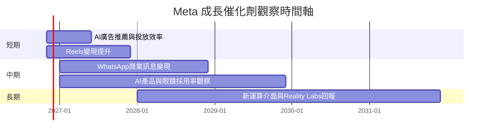

短期優先觀察廣告成長能否維持約 **20% 以上**，以及 Capex 是否開始轉化為現金流；中長期 AI 眼鏡與 Reality Labs 的收入、成本和用戶數資料未提供，尚難量化估值貢獻。

### 9.2 TAM 市場規模分析

**N/A（TAM 數據未提供）**。已知 TTM 營收 **$241.61B**、成長 **27.5%**，最新季度年增 **26.1%**；這顯示可變現業務仍擴張，但不能僅憑公司營收推導 TAM 或滲透率。廣告市場、商業訊息、AI 裝置等具體市場規模與年份資料未提供。

### 9.3 成長驅動力結構圖

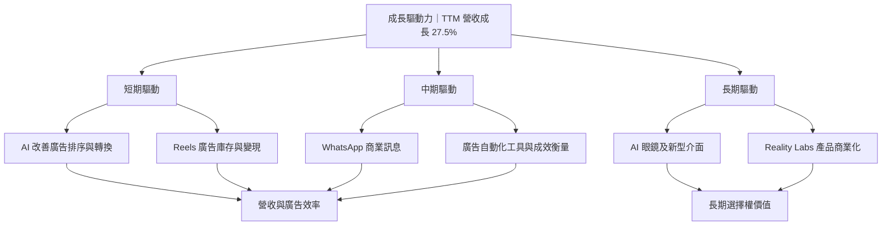

## 10. 風險矩陣

### 10.1 風險評分矩陣

風險座標為定性分析，不是財務資料中觀測到的機率；財務衝擊以情境區間或可觀察指標呈現，不虛構精確損失金額。

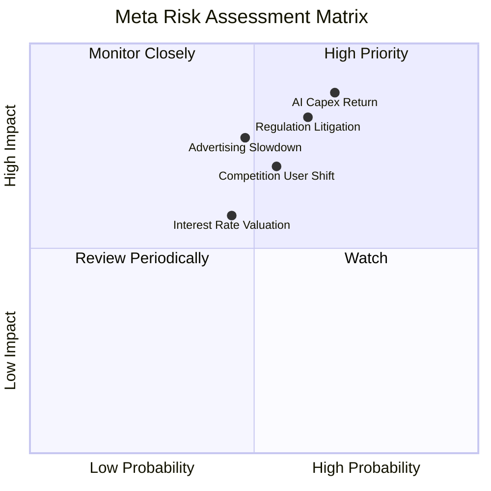

### 10.2 風險清單詳細分析

| # | 風險項目 | 發生機率 | 財務衝擊 | 風險評分 | 緩解措施 |
|---|----------|----------|----------|----------|----------|
| 1 | 🔴 **AI／資料中心 Capex 回報不足** | 中高（質化估計） | TTM Capex **$104.44B**；若無回報，FCF 可能持續低於模型路徑 | 🔴 高 | 追蹤 Capex／營收、FCF、營業利潤率；要求投資轉化為廣告效率與營收 |
| 2 | 🔴 **監管、隱私與訴訟** | 中高（質化估計） | 新聞披露義大利罰款約 **€805M**；更大風險是廣告定向、產品與資料使用限制 | 🔴 高 | 追蹤監管裁決、罰款、產品政策及廣告轉換能力 |
| 3 | 🔴 **廣告景氣及成長放緩** | 中（質化估計） | 最新季度成長 **26.1%**；若連續低於 20%，收入預測需下修 | 🔴 高 | 分辨價格、展示量與匯率因素，檢視地區及產業廣告需求 |
| 4 | 🟡 **競品分流用戶時間與廣告預算** | 中（質化估計） | Meta 最新季增長 **26.1%**，高於 GOOG **24.7%**、SNAP **14.3%**、PINS **11.9%**；若優勢反轉需警惕 | 🟡 中高 | 監控 Reels、創作者供給、用戶參與及廣告主留存 |
| 5 | 🟡 **高利率與估值折現風險** | 中（質化估計） | WACC **10.59%**；敏感度中 WACC 由 **9.59%** 升至 **10.59%**，DCF 由 **$675.54** 降至 **$550.36** | 🟡 中高 | 以利率和風險溢酬重估合理價值，避免用歷史 P/E 中位數單獨判斷 |

## 11. 投資建議

### 11.1 最終評級與評分

按加權合理價值 **$661.09** 與 2026-11-13 收盤價 **$641.69** 計算，MOS 為 **2.9%**，落在持有門檻，因此依 MOS 應為 **持有**，未作質化調整。1.1 綜合評分為 **7.2/10**；六項維度依序為成長性 **8.5**、獲利能力 **8.0**、財務健康 **7.0**、估值 **5.0**、護城河 **8.5**、管理層與資本配置 **6.0**。

### 11.2 合理價值與隱含報酬率

| 估值 | 每股價值 | 相對現價 | 機率 | 解讀 |
|------|---------:|---------:|-----:|------|
| 加權合理價值 | **$661.09** | **+3.0%** | — | MOS **2.9%**，估值緩衝有限 |
| 悲觀 DCF | **$184.69** | **-71.2%** | 25% | 成長放緩、利潤率較低且 WACC 上升 |
| 基準 DCF | **$550.36** | **-14.2%** | 50% | 依模型基準假設 |
| 樂觀 DCF | **$1,336.18** | **+108.2%** | 25% | AI 變現、營收與利潤率均顯著超預期 |
| 機率加權 DCF（情境參考） | **$655.40** | **+2.1%** | 100% | 情境參考值；8.8 加權合理價值仍為 $661.09 |

### 11.3 買入時機與觸發因素

╔══════════════════════════════════════════════════════════════════╗  
║                  ✅ 買入觸發因素 Checklist                      ║  
╠══════════════════════════════════════════════════════════════════╣  
║  立即增持前建議至少觀察：                                        ║  
║  ☐ TTM 或季度營收年增維持 20% 以上                              ║  
║  ☐ Capex／營收趨勢見頂，FCF 高於目前 TTM $28.65B                ║  
║  ☐ ROIC 保持高於 WACC 10.59%                                    ║  
║                                                                  ║  
║  加碼觸發條件：                                                  ║  
║  ☐ 股價回落至約 $594.98 或以下，對 $661.09 加權價值達 MOS 10%   ║  
║  ☐ 營收成長保持 20% 以上且 FCF 連續兩季改善                     ║  
║                                                                  ║  
║  減碼／重新評估觸發條件：                                        ║  
║  ☐ 連續兩季營收年增低於 20%                                     ║  
║  ☐ TTM FCF 低於 $28.65B 且 Capex／營收仍上升                    ║  
║  ☐ ROIC 跌至 WACC 10.59% 以下                                   ║  
║  ☐ 監管事件實質限制定向廣告或跨產品資料使用                     ║  
╚══════════════════════════════════════════════════════════════════╝

持有建議並不代表價格必然回落至該買入觸發值；門檻是用加權合理價值與 MOS 定義導出，實際執行仍需確認業務基本面沒有惡化。

### 11.4 投資人適配度分析

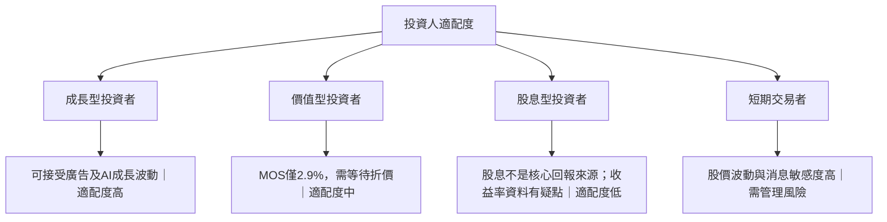

Yahoo／市場摘要列示股息殖利率 **33.0%**，與 FY2025 現金股息 **$5.32B**、股利支付率 **7.2%** 等資料存在顯著口徑疑慮，因此不以 33.0% 作為股息投資依據。股息型投資人應在核對價格資料庫與公司實際每股股息後再判斷。

### 11.5 每季財報監控清單（Quarterly Watch List）

| 監控指標 | 最新參考值 | 加碼觀察門檻 | 減碼／重新評估門檻 |
|----------|-----------:|--------------|--------------------|
| 營收年增 | 最新季度 **26.1%** | ≥20% 且穩定 | 連續兩季 <20% |
| 營業利益率 | TTM **32.9%**；指定最新單季 **20.1%** | TTM 不下降、單季回升 | TTM 較基準收縮 >5pp |
| Capex | TTM **$104.44B** | Capex 增速低於營收增速，或支出回報可見 | Capex／營收繼續上升且 FCF 下滑 |
| FCF | TTM **$28.65B** | 高於目前值並連續改善 | TTM 轉負或明顯低於目前值 |
| FCF Yield | **1.75%** | 價格下降或 FCF 上升使 Yield 改善 | 價格上升但 FCF 不增，Yield 進一步下降 |
| SBC／營收 | 約 **11.1%** | SBC 增速低於營收增速 | SBC／營收持續升高、股數稀釋加速 |
| ROIC vs WACC | **27.7% vs 10.59%** | ROIC 維持高於 WACC | ROIC 跌破 WACC |
| AI／研發投入 | FY2025 R&D **$57.37B** | 產品變現與廣告效率可量化改善 | 投入增加但營收、利潤、FCF 均無相應回報 |
| 流動性 | 流動比率 **1.903** | 維持穩定 | 快速下降或現金緩衝顯著減少 |
| 廣告需求與管理層展望 | 財測數字未提供 | 實際成長不低於管理層指引 | 下修指引或廣告主需求轉弱 |

### 11.6 反面論證：什麼會證明論點錯誤（What Would Change My Mind）

╔══════════════════════════════════════════════════════════════════╗  
║              ⚠️ 論點失效條件（Disconfirming Evidence）           ║  
╠══════════════════════════════════════════════════════════════════╣  
║ 本投資論點在下列情況成立時應重新檢視或退出：                    ║  
║ ☐ 營收年增連續兩季低於 20%，低於目前最新季度 26.1%              ║  
║ ☐ TTM 營業利益率較 32.9% 收縮超過 5pp                           ║  
║ ☐ TTM FCF 轉負，或持續低於目前 $28.65B 且 Capex 未下降          ║  
║ ☐ ROIC 跌破 WACC 10.59%，顯示新增資本不再創造價值               ║  
║ ☐ AI／資料中心支出擴大，但廣告營收成長及現金流轉換均未改善      ║  
║ ☐ SBC／營收持續高於約 11.1%，且稀釋股數增加速度加快             ║  
║ ☐ 監管限制使個人化廣告、跨產品資料運用或關鍵服務受到實質影響    ║  
╚══════════════════════════════════════════════════════════════════╝

> **免責聲明**：本報告為 AI 自動生成，僅供研究參考，不構成投資建議。投資有風險，入市需謹慎。

---

## 資料與來源

| 項目 | 內容 |
|------|------|
| 價格 | 641.69 USD，2026-11-13 收盤（Yahoo Finance 日線） |
| 財務報表 | SEC 10-Q filed 2026-10-22，最新季度 2026-09-30（FY2026 Q3） |
| 有回應的資料來源 | SEC 申報資料 (XBRL)、Yahoo Finance、Finviz、StockAnalysis、Roic.ai |
| 由程式計算 | TTM 數字、WACC、DCF 模型、估值方法與權重、加權合理價值、MOS、評級門檻、F-Score、杜邦分解、營運資金天數、綜合評分 |
| 撰寫模型 | openai / gpt-6-luna |

> 本區塊由產生報告的程式依實際取得的資料填寫，非模型撰寫。「由程式計算」的數字不是模型的估計；其餘判斷（評分、情境、策略）是模型的分析。
