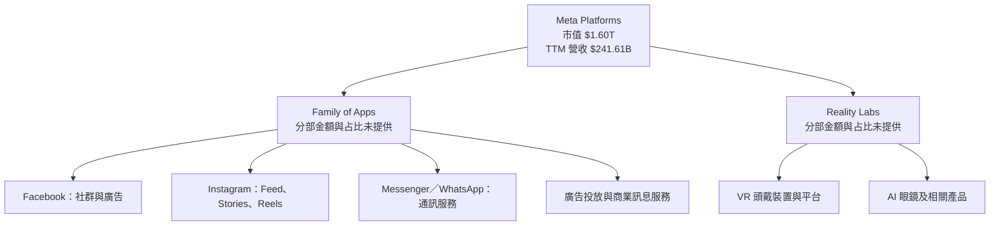
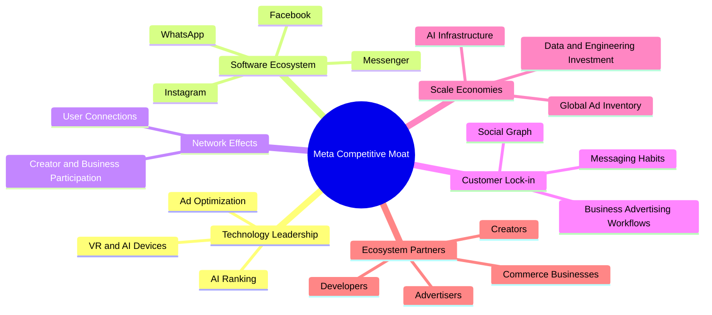
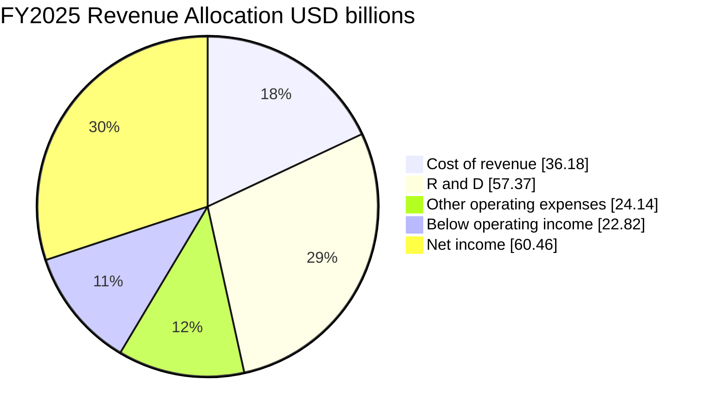
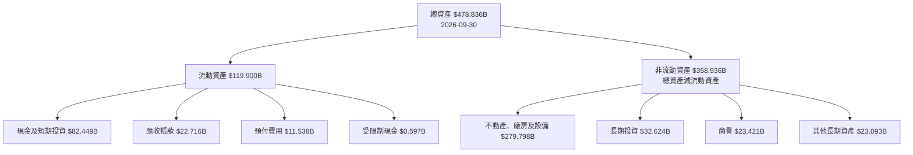
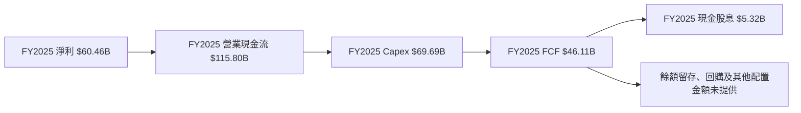
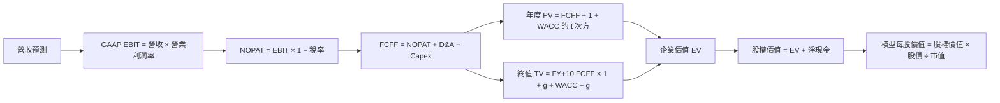
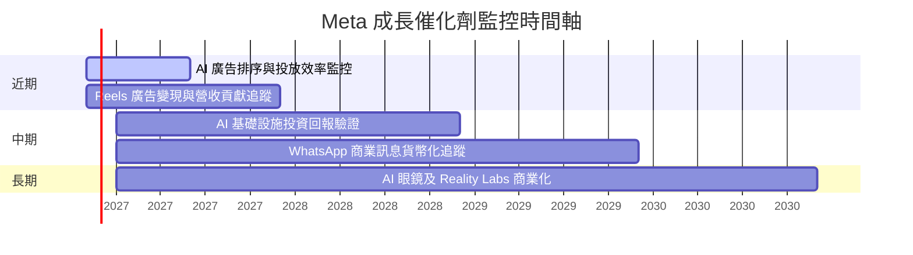
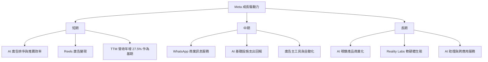
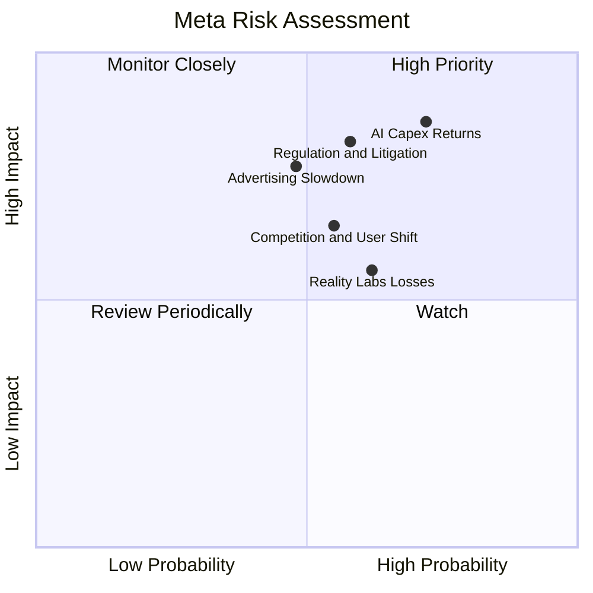
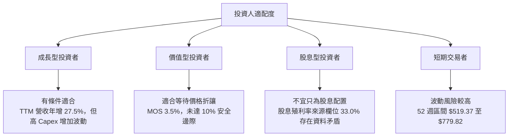

# META 基本面深度分析報告
> **報告日期**：2026-11-17 ｜ **語言**：繁體中文 ｜ **數據來源**：SEC 申報資料 (XBRL)、Yahoo Finance、Finviz、StockAnalysis、Roic.ai ｜ **分析師**：CFA 級機構研究

## 目錄

| # | 章節 | 核心結論 |
|---|------|----------|
| 1 | 執行摘要 | 持有；加權合理價值 $649.00，MOS 3.5% |
| 2 | 公司概覽與商業模式 | 廣告平台與應用生態具網路效應；分部收入金額未提供 |
| 3 | 損益表深度分析 | TTM 營收 $241.61B、年增 27.5%；最新季度營業利益率與 TTM 差距明顯 |
| 4 | 資產負債表分析 | 依 SEC 衍生數據為淨負債 $1.22B；流動資產充足，另有來源債務數字不一致 |
| 5 | 現金流量深度分析 | TTM FCF $28.65B；Capex 高達 $104.44B，現金轉換受再投資拖累 |
| 6 | 獲利能力與資本效率 | ROIC 27.7% 高於 WACC 10.55%，仍創造經濟價值 |
| 7 | 相對估值分析 | 相對自身五年估值區間偏低；同業倍數分化大 |
| 8 | DCF 內在價值評估 | DCF 基準價值 $554.99；模型高度依賴終值，且與加權價值不同 |
| 9 | 成長催化劑 | AI 廣告工具、Reels 變現及 AI 產品可提供成長，但 TAM 數據未提供 |
| 10 | 風險矩陣 | 資本支出回報、監管訴訟與廣告景氣為主要風險 |
| 11 | 投資建議 | 持有；現價略低於加權合理價值，買入需等待 MOS 擴大或現金流改善 |

## 1. 執行摘要

META 的 TTM 營收為 **$241.61B，年增 27.5%**，最新一季營收年增 **26.1%**；TTM ROIC **27.7%** 明顯高於 **10.55% WACC**，顯示核心業務仍在創造股東價值。但 TTM 資本支出達 **$104.44B**，令 TTM FCF 降至 **$28.65B**、FCF Yield 僅 **1.79%**。按固定估值方法加權後合理價值為 **$649.00**，相對 2026-11-16 收盤價 **$626.41** 的 MOS 為 **3.5%**，低於買入門檻；因此依規則 20 評級為 **持有**，不是買入。

### 1.0 一頁式投資儀表板（Portfolio Manager 30 秒速讀）

| 項目 | 內容 |
|------|------|
| **投資論點（3 句）** | ① TTM 營收年增 27.5%，最新季度年增 26.1%，廣告平台仍有規模化變現能力。② ROIC 27.7% 高於 WACC 10.55%，核心業務仍創造經濟價值。③ TTM Capex $104.44B、FCF $28.65B，表明 AI 基礎設施投資正壓低自由現金流。 |
| **綜合評分** | **7.2/10**（引用 1.1 評分卡） |
| **財務健康** | 🟡 現金及短期投資 $82.45B，總債務 $83.67B，淨負債僅 $1.22B；但另一市場資料來源列出較高債務，需核對 |
| **ROIC vs WACC** | **27.7% vs 10.55%**，創造價值，差距 **17.15 個百分點** |
| **FCF 趨勢** | 近一年受 Capex 上升壓抑；TTM FCF Yield **1.79%** |
| **估值** | Forward P/E **17.6x** ｜ EV/EBITDA **14.06x** ｜ FCF Yield **1.79%** |
| **DCF 內在價值（基準）** | **$554.99** ｜ 現價相對 DCF 溢價 **12.9%**（折溢價基準為 DCF） |
| **安全邊際（MOS）** | **+3.5%**＝($649.00 − $626.41) ÷ $649.00；🔴 <10%，無足夠安全邊際 |
| **預期報酬（基準情境 12M）** | DCF 基準情境相對現價 **−11.4%**；分析師共識目標價對應 **+35.8%**，差異反映估值假設分歧 |
| **關鍵風險（前二）** | AI／資料中心 Capex 投資回報低於預期；監管與訴訟限制廣告及資料使用 |
| **評級 + 信心度** | 🟡 **持有** ｜ 信心：中 |

### 1.1 綜合評分卡（全報告唯一）

| 維度 | 評分（1–10） | 主要依據（引用數字與其來源章節） |
|------|--------------|----------------------------------|
| 成長性 | 8.0 | TTM 營收年增 27.5%、最新季度年增 26.1%（第 3 章） |
| 獲利能力 | 8.0 | TTM 營業利益率 32.9%、ROIC 27.7% 高於 WACC 10.55%；Piotroski F-Score 3/8（第 3、6 章） |
| 財務健康 | 7.0 | 淨負債 $1.22B、流動比率 1.903；DSO 34 天、DPO 152 天（第 4 章） |
| 估值 | 5.0 | MOS 3.5%；P/E 21.4x 低於自身五年中位數 24.5x，但估值方法分歧大（第 7、8 章） |
| 護城河 | 9.0 | TTM 營收 $241.61B、毛利率 81.0%，平台規模與網路效應具支持（第 2 章） |
| 管理層與資本配置 | 6.0 | FY2025 Capex $69.69B、SBC $20.43B；TTM Capex 增至 $104.44B，投資回報尚待驗證（第 5 章） |
| **綜合評分** | **7.2** | 六項算術平均：**(8.0 + 8.0 + 7.0 + 5.0 + 9.0 + 6.0) ÷ 6 = 7.2** |

### 1.2 五大投資論點 + 三大核心風險

| 類型 | 項目 | 具體依據 | 信心度 |
|------|------|----------|--------|
| 🟢 **投資論點①** | 大規模廣告平台仍在成長 | TTM 營收 $241.61B、年增 27.5%；最新季度營收年增 26.1% | 🟢 高 |
| 🟢 **投資論點②** | 投入資本回報高於資本成本 | ROIC 27.7% 對比 WACC 10.55%，差距 17.15 個百分點 | 🟢 高 |
| 🟢 **投資論點③** | 毛利率反映平台經濟性 | TTM 毛利率 81.0%，高毛利支持廣告與軟體服務的規模化 | 🟢 高 |
| 🟢 **投資論點④** | 資產負債表流動性尚可 | 現金及短期投資 $82.45B，Verified Figures 淨負債 $1.22B | 🟢 中 |
| 🟢 **投資論點⑤** | 自身估值低於五年中位數 | P/E 21.4x 對比五年中位數 24.5x；EV/EBITDA 15.5x 對比 16.5x | 🟡 中 |
| 🟡 **風險①** | AI 基礎設施投入侵蝕 FCF | TTM Capex $104.44B，FCF $28.65B；若支出增長快於貨幣化，估值將承壓 | 🟡 中 |
| 🔴 **風險②** | 最新季度利潤率不及 TTM 水準 | 最新季度營業利益率 20.1%，低於 TTM 32.9%；須釐清費用、稅務或非經常性因素 | 🔴 高衝擊 |
| 🔴 **風險③** | 監管、隱私及平台競爭 | 可能影響廣告定位、青少年使用、資料授權及平台變現；財務衝擊未能由現有資料量化 | 🔴 高衝擊 |

### 1.3 快速統計卡片

| 指標 | 公司實際值（期間） | 同業中位數 | 狀態 |
|------|--------------------|------------|------|
| 營收成長（TTM） | **27.5%** | — | 🟢 |
| 營收成長（最新一季年增） | **26.1%** | **14.3%** | 🟢 |
| 毛利率（TTM） | **81.0%** | **60.9%** | 🟢 |
| 營業利益率（TTM） | **32.9%** | — | 🟢 |
| ROIC（TTM） | **27.7%** | — | 🟢 |
| Forward P/E | **17.6x** | **8.1x** | 🟡 |
| FCF Yield（TTM） | **1.79%** | — | 🟡 |
| Piotroski F-Score | **3 / 8** | — | 🔴 |

> 同業中位數依提供的 Peer multiples 計算：最新季度營收成長率中位數為 14.3%；毛利率中位數為 60.9%；Forward P/E 中位數為 8.1x。三家同業的倍數差異很大，該中位數不代表同質化可比估值。

### 1.4 投資結論

```text
╔══════════════════════════════════════════════════════════════════╗
║                    📊 投資結論摘要                               ║
╠══════════════════════════════════════════════════════════════════╣
║  評級：持有（依規則 20；MOS 為 +3.5%）                           ║
║  價格（2026-11-16 收盤）：$626.41                               ║
║  DCF 內在價值（基準）：$554.99（現價溢價 12.9%）                 ║
║  安全邊際 MOS：+3.5%（以加權合理價值為分母）                     ║
║  加權合理價值（8.8）：$649.00                                    ║
║  DCF 情境價值：                                                   ║
║    悲觀情境：$186.29（相對現價 -70.3%）                          ║
║    基準情境：$554.99（相對現價 -11.4%）                          ║
║    樂觀情境：$1,348.25（相對現價 +115.2%）                       ║
║  綜合評分：7.2/10（引用 1.1）                                    ║
║  適合投資人：能承受高 Capex、監管及估值波動的長線成長型投資人    ║
╚══════════════════════════════════════════════════════════════════╝
```

## 2. 公司概覽與商業模式

### 2.1 業務結構與收入來源

Meta Platforms, Inc. 主要透過 Family of Apps（FoA）與 Reality Labs（RL）營運。FoA 包含 Facebook、Instagram、Messenger、WhatsApp 等應用；RL 涵蓋 VR／AR 硬體與相關軟體。財務資料未提供最新分部收入及占比，因此不推算分部金額。



### 2.2 市場份額

市場份額數據未提供，故不繪製市場份額圖，也不推估比例。Meta 的 TTM 營收為 $241.61B、年增 27.5%；以收入規模與最新季度 26.1% 的年增率看，公司在數位廣告及社群平台具大型業者特徵，但各細分市場份額仍需外部市場資料驗證。

### 2.3 競爭護城河分析



### 2.4 護城河強度

| 護城河項目 | 強度（強／中／弱） | 證據（引用數字或事實） | 會削弱它的情況 |
|------------|--------------------|------------------------|----------------|
| 網路效應 | 強 | Facebook、Instagram、Messenger、WhatsApp 多產品組合；TTM 營收 $241.61B | 使用者轉移、年輕族群偏好改變、社交圖譜被競爭平台分流 |
| 廣告技術與資料規模 | 強 | TTM 毛利率 81.0%、營業利益率 32.9% | 隱私限制、追蹤規則變更、廣告效果下降 |
| 軟體生態 | 中至強 | 多個大型應用彼此導流；單一應用活躍用戶及分部數據未提供 | 產品體驗退化、創作者供給轉移、訊息服務貨幣化引發使用者反感 |
| 規模效應 | 強 | 大型平台帶來廣告庫存與基礎設施規模；ROIC 27.7% 高於 WACC 10.55% | AI Capex 快速增加但轉化為營收與現金流不足 |
| 客戶鎖定 | 中 | 廣告主可使用平台投放及衡量工具，具工作流程黏著性；量化留存數據未提供 | 廣告主預算轉向其他媒體、廣告投資報酬率降低 |
| 生態夥伴 | 中 | 創作者、商家、開發者與廣告主構成供給端；合作夥伴收入資料未提供 | 平台分潤政策改變、監管要求或合作夥伴分流 |

1.1「護城河」評分為 **9.0/10**，依據是多產品網路效應、81.0% TTM 毛利率與 $241.61B TTM 營收規模；但用戶、留存與分部資料缺漏，因此評分不代表每個產品都具有同等優勢。

## 3. 損益表深度分析

### 3.1 年度收入成長趨勢（近 4 年）

```text
╔══════════════════════════════════════════════════════════════════╗
║           Meta Platforms 年度收入趨勢（FY2022-FY2025）           ║
╠══════════════════════════════════════════════════════════════════╣
║ FY2022  $116.61B  ████████████░░░░░░░░░░░░  YoY: -1.1%  🟡     ║
║ FY2023  $134.90B  ██████████████░░░░░░░░░░  YoY: +15.7% 🟢     ║
║ FY2024  $164.50B  █████████████████░░░░░░░  YoY: +21.9% 🟢     ║
║ FY2025  $200.97B  █████████████████████░░░  YoY: +22.2% 🟢     ║
╠══════════════════════════════════════════════════════════════════╣
║ FY2022-FY2025 CAGR = (200.97 ÷ 116.61)^(1/3) − 1 ≈ 19.9%       ║
╚══════════════════════════════════════════════════════════════════╝
```

收入由 FY2022 的 $116.61B 增至 FY2025 的 $200.97B，三年 CAGR 約 19.9%。FY2022 年減 1.1% 後，FY2023–FY2025 恢復至 15.7%–22.2% 成長；TTM 營收 $241.61B、TTM 年增 27.5%，高於 FY2025 年增，顯示近期成長動能仍高，但不宜直接假設長期維持同一速度。

### 3.2 季度收入趨勢分析

QoQ 以每季營收除以上一季營收計算；Q1 2026 對比 Q4 2025，Q4 2025 對比 Q3 2025。

| 季度 | 營收 | QoQ | YoY | 備註 |
|------|------:|----:|----:|------|
| 2025 Q4 | $59.89B | +16.9% | +23.8% | 以 2025 Q3 $51.24B 為 QoQ 基期 |
| 2026 Q1 | $56.31B | −6.0% | +33.1% | 季節性回落，但年增加速 |
| 2026 Q2 | $60.80B | +8.0% | +28.0% | QoQ 回升，年增仍高 |
| 2026 Q3 | $64.60B | +6.2% | +26.1% | 最新季度延續雙位數成長 |

最新季度營收 $64.60B，QoQ 增長 6.2%、YoY 增長 26.1%。季度 YoY 由 Q1 的 33.1% 放緩至 Q3 的 26.1%，仍高於同業中位數 14.3%，但後續應觀察成長是否隨比較基期升高而進一步降速。

### 3.3 利潤率演變分析

年度比率依年度損益表金額計算；TTM 指標則引用已計算數據。FY2022 年度毛利數據與另一歷史表中數字有差異，本表依年度收入與毛利表計算。

| 利潤率指標 | FY2022 | FY2023 | FY2024 | FY2025 | 趨勢 | 評估 |
|------------|-------:|-------:|-------:|-------:|------|------|
| **毛利率** | 78.3% | 80.8% | 81.7% | 82.0% | 連續改善 | 🟢 |
| **營業利益率** | 24.8% | 34.7% | 42.2% | 41.4% | FY2024 上升、FY2025 微降 | 🟢 |
| **淨利率** | 19.9% | 29.0% | 37.9% | 30.1% | FY2025 回落 | 🟡 |

毛利率改善至 FY2025 的 82.0%，與收入規模、廣告軟體服務的高毛利特性相符。營業利益率從 FY2022 的 24.8% 升至 FY2024 的 42.2%，顯示收入復甦及費用控制帶來營業槓桿；FY2025 回落至 41.4%，研發費用由 FY2024 的 $43.87B 增至 FY2025 的 $57.37B，可能是擴大 AI／平台投資的背景之一。最新季度營業利益率為 **20.1%**，低於 TTM **32.9%**，顯示單季利潤率明顯較弱；由於季度數據與 TTM 結果口徑並不完全相同，需以後續 SEC 申報釐清費用與一次性因素，不能直接把單季外推全年。

### 3.4 費用結構分析

以下以 FY2025 損益表金額拆分營收用途。分項為收入減去毛利、營業利益及淨利的算術分類，稅費、利息及其他項目未另行拆細。



```text
╔══════════════════════════════════════════════════════════════════╗
║              FY2025 收入分配（占營收約 $200.97B）                ║
╠══════════════════════════════════════════════════════════════════╣
║ 營收成本              $36.18B  ████░░░░░░░░░░░░░░░░             ║
║ 研發費用              $57.37B  ██████░░░░░░░░░░░░░░             ║
║ 其他營業費用          $24.14B  ██░░░░░░░░░░░░░░░░░░             ║
║ 營業利益以下項目      $22.82B  ██░░░░░░░░░░░░░░░░░░             ║
║ 淨利                  $60.46B  ██████░░░░░░░░░░░░░░             ║
╚══════════════════════════════════════════════════════════════════╝
```

### 3.5 季度 EPS 趨勢與盈餘品質（Quality of Earnings）

最近四季 EPS 實際值可由 StockAnalysis 季度資料取得，但 EPS 預估值與驚喜幅度為 nan，故無法判定超預期或不及預期。

| 季度 | EPS 實際值 | YoY | 超預期／不及預期 |
|------|-----------:|----:|----------------|
| 2025 Q4 | $8.88 | +10.7% | N/A，分析師預估未提供 |
| 2026 Q1 | $10.44 | +62.4% | N/A，分析師預估未提供 |
| 2026 Q2 | $6.18 | −13.4% | N/A，分析師預估未提供 |
| 2026 Q3 | $3.83 | +264.8% | N/A，分析師預估未提供 |

EPS 與淨利年增的劇烈變化可能受比較基期、稅項或非經常性因素影響；EPS 預估值缺漏，不能將資料庫標示的空值當成實際 miss。

| 盈餘品質項目 | 數值／佔比 | 評估 |
|--------------|-----------|------|
| 股權薪酬 SBC / 營收 | 估算 $26.94B ÷ $241.61B = **11.1%**；SBC 來自最近四季季度數字加總 | 🟡 SBC 是顯著經濟成本，會稀釋股東回報 |
| SBC / 營業現金流 | $26.94B ÷ $133.09B = **20.2%** | 🟡 現金流仍高，但 SBC 佔比不低 |
| FCF / 淨利（現金轉換率） | 估算 $28.65B ÷ TTM 淨利 $75.249B = **38.1%** | 🔴 Capex 投資使 FCF 顯著低於會計淨利 |
| 一次性／非經常性損益 | N/A；現有資料未拆解最新季度一次性項目 | 🟡 需追蹤季報附註 |
| 有效稅率異常 | 最近年度有效稅率 **29.6%** | 🟡 最新季度 EPS 大幅波動，稅務影響未拆分 |
| 資本化支出 vs 費用化 | TTM Capex $104.44B；資本化明細未提供 | 🟡 高資本支出使折舊與未來營運成本上升 |

**盈餘品質結論：**會計獲利並非沒有現金支持，TTM 營業現金流達 $133.09B，且 Piotroski 測試中「營業現金流高於淨利」通過；然而 FCF／淨利僅約 38.1%，主要壓力是高額 Capex。SBC 約占 TTM 營收 11.1%，即使 GAAP 已將其列為費用，仍代表股東承擔實質稀釋成本。估值應更重視 FCF 回升，而非只看 EPS。

## 4. 資產負債表分析

### 4.1 資產結構分解

最新可用資產負債表日期為 2026-09-30，總資產 $478.836B。下圖非流動資產為總資產減流動資產；該計算僅作資產分類，細項依來源列示。



### 4.2 流動性與營運資金分析

| 指標 | 最新值 | 歷史／比較 | 評估 |
|------|------:|-------------|------|
| 流動比率 | 1.903 | FY2025：$108.72B ÷ $41.84B = 2.60；季度口徑與年度口徑有差異 | 🟡 |
| 速動比率 | 1.669 | 歷史同期未提供 | 🟢 |
| 現金及短期投資 | $82.45B | 2025-12-31 為 $81.592B | 🟢 |
| DSO 應收帳款天數 | 34 天 | 一年前 33 天 | 🟡 增加 1 天，收款週期略長 |
| DIO 存貨天數 | N/A | 一年前 N/A | 公司未報告可用存貨餘額 |
| DPO 應付帳款天數 | 152 天 | 一年前 N/A | 無法判斷年變化；長週期可能有利營運資金 |
| CCC 現金轉換週期 | N/A | 一年前 N/A | 因 DIO 缺值不可計算 |

DSO 從 33 天升至 34 天，變化很小，顯示應收款天數略增，尚不足以單獨判斷收款品質惡化。DPO 為 152 天，但前一年及 DIO 缺值，無法判斷付款條件是否改變或現金轉換週期方向。

### 4.3 債務結構分析

以 VERIFIED FIGURES 為優先，現金及短期投資 $82.45B、總債務 $83.67B、淨負債 $1.22B。其他市場資料另列總債務 $114.84B、淨負債 $32.39B；兩者口徑有重大差異，以下不以較高數據替換已驗證指標，投資人應核對 10-Q 中租賃負債及計息債務的納入範圍。

```text
╔══════════════════════════════════════════════════════════════════╗
║                 META 債務健康診斷（Verified figures）             ║
╠══════════════════════════════════════════════════════════════════╣
║  總債務：              $83.67B  ████████████████████             ║
║  現金及短期投資：      $82.45B  ████████████████████             ║
║  淨負債：               $1.22B  ▏                                ║
║  Debt / EBITDA：N/A（此處 EBITDA 與債務口徑不一致，未另行計算）   ║
║  Interest Coverage：N/A（利息費用及計息債務完整明細未提供）      ║
║  淨負債判讀：🟡 接近現金與債務平衡；另有來源列示較高債務需核實   ║
╚══════════════════════════════════════════════════════════════════╝
```

### 4.4 股東權益趨勢

```text
╔══════════════════════════════════════════════════════════════════╗
║                  股東權益年度趨勢（USD billions）                ║
╠══════════════════════════════════════════════════════════════════╣
║ 2022  $125.71B  ████████████░░░░░░░░░░░░                         ║
║ 2023  $153.17B  ███████████████░░░░░░░░░                         ║
║ 2024  $182.64B  ██████████████████░░░░░░                         ║
║ 2025  $217.24B  ██████████████████████░░                         ║
╚══════════════════════════════════════════════════════════════════╝
```

FY2022 至 FY2025 股東權益由 $125.71B 增至 $217.24B，反映累積獲利與資產擴張；但帳面權益增加不等於資本效率持續改善，仍需觀察 AI 投資形成的資產能否帶來足夠現金回報。

## 5. 現金流量深度分析

### 5.1 現金流量瀑布圖

FY2025 淨利及營業現金流可引用；回購金額未提供。Mermaid 流程只呈現有數字的現金流節點。



### 5.2 FCF 轉換率趨勢

| 財年 | 淨利 | FCF | FCF / 淨利 |
|------|-----:|----:|-----------:|
| 2022 | $23.20B | $19.29B | 83.1% |
| 2023 | $39.10B | $44.07B | 112.7% |
| 2024 | $62.36B | $54.07B | 86.7% |
| 2025 | $60.46B | $46.11B | 76.3% |

FY2023 FCF 高於淨利，FY2024–FY2025 轉換率回落；FY2025 Capex 增至 $69.69B。TTM Capex 進一步升至 $104.44B，TTM FCF 僅 $28.65B，表示當期現金流被擴建基礎設施吸收，未必代表核心營運獲利同步惡化，但提高投資回報風險。

### 5.3 自由現金流趨勢

```text
╔══════════════════════════════════════════════════════════════════╗
║          自由現金流趨勢（年度資料與 TTM 口徑分列）               ║
╠══════════════════════════════════════════════════════════════════╣
║ FY2022  $19.29B  ████████░░░░░░░░░░░░░░  FCF Yield：N/A         ║
║ FY2023  $44.07B  ██████████████████░░░░  FCF Yield：N/A         ║
║ FY2024  $54.07B  ██████████████████████░  FCF Yield：N/A         ║
║ FY2025  $46.11B  ███████████████████░░░░  FCF Yield：N/A         ║
║ TTM     $28.65B  ████████████░░░░░░░░░░  FCF Yield：1.79%       ║
╚══════════════════════════════════════════════════════════════════╝
```

FY2025 FCF 下滑至 $46.11B，最新 TTM 再降至 $28.65B。TTM FCF 的定義為營業現金流減資本支出，不能與其他調整後 FCF 口徑混用。

### 5.4 資本配置評估

資本配置比例圖所需的完整股東回購及留存金額未提供，因此不繪製比例圓餅圖。

| 項目 | 數值 | 評估 |
|------|------:|------|
| Capex | FY2025 $69.69B；TTM $104.44B | 🟡／🔴 投資規模上升，重點在 AI 基建的收入與現金流回報 |
| 現金股息 | FY2025 $5.32B | 🟢 金額相對 FCF 可承受；公司提供的殖利率欄位 33.0% 與股息金額、支付率資料不一致，不採信 |
| SBC | FY2025 $20.43B | 🟡 對股東具稀釋成本 |
| 股票回購 | N/A | 回購金額與股數變化可用資料不足，不作推算 |
| 留存現金／其他投資 | N/A | 未提供完整資金用途拆分 |

## 6. 獲利能力與資本效率

### 6.1 ROE / ROA / ROIC 趨勢

| 指標 | 最新值 | 歷史趨勢資料 | 評估 |
|------|------:|-------------|------|
| ROE（TTM，品質指標） | 27.6% | 歷年一致口徑未提供 | 🟢 |
| ROA | 14.6% | 僅提供另一資料來源的近期值，無完整同口徑序列 | 🟢 |
| ROIC（TTM，稅後） | 27.7% | Roic.ai 歷史資料有較早年度數字，缺少完整近期同口徑年序列 | 🟢 |
| WACC | 10.55% | 本報告估值採用值 | — |

沒有可引用的行業均值資料，故不列行業對照欄。當前 ROIC 與 WACC 差距明確，但資本支出大幅增加，若新投資資產回報下降，未來 ROIC 可能收斂。

### 6.2 ROIC vs WACC 分析（核心價值創造判斷）

```text
╔══════════════════════════════════════════════════════════════════╗
║                    ROIC vs WACC 深度分析                        ║
╠══════════════════════════════════════════════════════════════════╣
║  WACC（直接採用資本成本資料）：                                  ║
║  ├── 無風險利率（10Y 美債）：       5.12%                       ║
║  ├── 市場風險溢酬（假設）：         5.00%                       ║
║  ├── Beta 原始值：                  1.28                        ║
║  ├── 調整後 Beta：                  1.19                        ║
║  ├── 股權成本（來源值）：          11.05%                      ║
║  ├── 稅前債務成本：                 1.39%                       ║
║  ├── 股權／債務權重：              95.0% / 5.0%                ║
║  └── ✅ 採用 WACC：                10.55%                      ║
║                                                                  ║
║  ROIC（TTM，來源計算值）：        27.7%                         ║
║  EVA 利差 = ROIC − WACC：         27.7% − 10.55% = 17.15pp     ║
║                                                                  ║
║  ROIC  27.7%  ▓▓▓▓▓▓▓▓▓▓▓▓▓▓▓▓▓▓▓▓▓▓▓▓░░░░░░                 ║
║  WACC  10.55% ▓▓▓▓▓▓▓▓▓▓░░░░░░░░░░░░░░░░░░░                 ║
║                                                                  ║
║  結論：ROIC 約為 WACC 的 2.63 倍，現階段創造股東價值。          ║
╚══════════════════════════════════════════════════════════════════╝
```

**計算說明：**EVA 利差 = 27.7% − 10.55% = **17.15 個百分點**；ROIC/WACC = 27.7% ÷ 10.55% = **2.63 倍**。股權成本的來源已提供為 11.05%；以四捨五入後的 Rf、Beta、ERP 重算會有微小差異，故本報告遵循資本成本來源值，不另行替換 WACC。

### 6.3 杜邦三因素分解

| 因素 | 數值（TTM） | 解讀 |
|------|-------------|------|
| 淨利率 | 31.1% | 每 $1 營收約產生 $0.311 淨利 |
| 資產週轉率 | 0.50 | 每 $1 資產產生約 $0.50 營收 |
| 權益乘數 | 1.76 | 財務槓桿存在，但不是極高槓桿型態 |
| **ROE** | **27.6%** | 31.1% × 0.50 × 1.76 = 約 27.4%；來源杜邦列示 ROE 27.6%，差異來自未四捨五入數字 |

ROE 主要由高淨利率與一定資產週轉共同支撐，並非單靠財務槓桿。表列小數值相乘與來源結果的輕微差異，來自各輸入只保留兩位小數；依規則引用品質指標 ROE 27.6%。

### 6.4 財務體質：Piotroski F-Score

**Piotroski F-Score：3 / 8**。測試有缺值時分母可能低於九項；毛利率測試因缺資料不列入計分。

| 測試 | 結果 | 解讀 |
|------|------|------|
| ROA > 0 | ✅ 通過 | TTM 盈利為正 |
| 營業現金流 > 0 | ✅ 通過 | TTM 營業現金流 $133.09B |
| ROA 高於一年前 | ❌ 未通過 | 資產報酬未改善 |
| 營業現金流 > 淨利（應計品質） | ✅ 通過 | 現金流高於淨利，帳面盈餘有現金支持 |
| 長期負債 ÷ 總資產低於一年前 | ❌ 未通過 | 負債比率未改善 |
| 流動比率高於一年前 | ❌ 未通過 | 短期流動性指標未改善 |
| 稀釋股數未增加 | ❌ 未通過 | 股數稀釋測試未通過 |
| 毛利率高於一年前 | — 無法判定 | 缺少可判定輸入 |
| 資產週轉率高於一年前 | ❌ 未通過 | 資產運用效率未改善 |

3/8 反映公司仍有正向盈利和營業現金流，但流動性、負債趨勢、稀釋股數及資產週轉測試未通過。它不否定高 ROIC，但提醒投資人不要只依賴成長率及淨利判斷財務品質。

## 7. 相對估值分析

### 7.1 同業估值比較表格

Meta 同業倍數依 Peer multiples 區塊；本公司估值為市場資料中的當前值。Meta Forward P/E 取提供的市場估值 17.558716x，四捨五入至 17.6x。

| 估值指標 | **META** | **GOOG** | **SNAP** | **PINS** | 本公司評估 |
|----------|---------:|---------:|---------:|---------:|-----------|
| **Trailing P/E** | 21.4x | 14.7x | N/A | 76.8x | 🟡 高於 GOOG，遠低於 PINS |
| **Forward P/E** | 17.6x | 18.5x | 6.5x | 8.1x | 🟡 高於同業中位數 8.1x；盈利與業務品質不同 |
| **P/S Ratio** | 6.6x | 7.3x | 1.3x | 2.3x | 🟡 高於 SNAP、PINS，略低於 GOOG |
| **EV/EBITDA** | 14.06x | 18.1x | 53.6x | 34.7x | 🟢 低於三家可用同業倍數 |
| **最新季度營收年增** | 26.1% | 24.7% | 14.3% | 11.9% | 🟢 高於所列同業 |
| **毛利率（TTM）** | 81.0% | 60.9% | 59.2% | 79.0% | 🟢 高於同業中位數 |

同業利潤結構差異明顯，Forward P/E 中位數 8.1x 受 SNAP、PINS 倍數與成長差異影響，不宜機械套用。相對來看，Meta 的 EV/EBITDA 14.06x 低於同業列示值，但其大額 AI Capex 可能令 EBITDA 未能充分反映未來資本需求。

### 7.2 歷史估值區間分析

```text
╔══════════════════════════════════════════════════════════════════╗
║             META 五年歷史估值位置（TTM 倍數）                    ║
╠══════════════════════════════════════════════════════════════════╣
║ P/E        12.9x ───────── 中位數 24.5x ─●21.4x──── 33.4x       ║
║                                      當前百分位：29%             ║
║ P/S         2.8x ───────── 中位數  7.7x ─● 6.7x──── 10.6x       ║
║                                      當前百分位：38%             ║
║ EV/EBITDA   7.7x ───────── 中位數 16.5x ─●15.5x──── 19.7x       ║
║                                      當前百分位：38%             ║
╚══════════════════════════════════════════════════════════════════╝
```

三個倍數的當前百分位均低於五年中位數位置，說明 META 相對自身歷史估值偏低；但估值分位較低不等於股價必然低估，因為 TTM FCF Yield 只有 1.79%，且 Capex 投資強度正處高位。

### 7.3 情境價值（Bear / Base / Bull，照抄 DCF Scenarios）

| 情境 | 第 1 年營收成長 | 期末營業利潤率 | WACC | 每股價值 | 相對現價 | 機率 | 會發生的條件 |
|------|----------------:|----------------:|-----:|---------:|---------:|-----:|--------------|
| 🔴 悲觀 | 13.8% | 29.5% | 11.55% | $186.29 | −70.3% | 25% | 廣告成長放慢，AI／資料中心成本上升，利潤率收縮且折現率較高 |
| 🟡 基準 | 27.5% | 34.7% | 10.55% | $554.99 | −11.4% | 50% | 延續近期營收動能，長期利潤率逐步提升至模型設定值 |
| 🟢 樂觀 | 41.3% | 38.1% | 9.55% | $1,348.25 | +115.2% | 25% | AI 廣告變現與新產品放量快於基準，利潤率提高且資本成本下降 |

上述情境採用程式提供的 DCF 結果，不是分析師自行設定的目標價。情境間價差極大，代表估值對增長、利潤率及 WACC 的聯合變動高度敏感。

### 7.4 相對估值隱含價格區間

```text
╔══════════════════════════════════════════════════════════════════╗
║                相對估值隱含每股價值（美元）                     ║
╠══════════════════════════════════════════════════════════════════╣
║ 同業 Forward P/E    $289.73  ──────● 現價 $626.41               ║
║ 同業 EV/EBITDA    $1,078.04  ────────────────────────────────   ║
║ DCF 基準              $554.99  ────● 現價 $626.41                ║
║ 分析師共識目標價       $850.59  ────────────────                 ║
╚══════════════════════════════════════════════════════════════════╝
```

| 方法 | 每股價值 | 依據 |
|------|---------:|------|
| 同業 Forward P/E | $289.73 | 同業中位數 8.1x × META Forward EPS $35.68 |
| 同業 EV/EBITDA | $1,078.04 | 同業中位數 26.4x × TTM EBITDA，再加淨現金 |
| DCF（基準） | $554.99 | 10 年 FCFF、WACC 10.55%、永續成長 3.0% |
| 分析師共識 | $850.59 | 58 位分析師平均目標價 |

同業 Forward P/E 隱含值遠低於現價，而 EV/EBITDA 法遠高於現價；這反映可比公司倍數差異極大，不應把任何單一相對估值結果當成確定的公允價值。

## 8. DCF 內在價值評估（Discounted Cash Flow）

### 8.0 估值推理鏈（Thinking Logic）

**Step 1 — 價值由哪些變數決定？**

模型以 Meta 全公司收入 $241.61B 為起點，但 FoA、RL 的各自營收占比未提供，故不能量化分部貢獻。核心價值主要由廣告與應用業務的收入成長、GAAP 營業利潤率，以及 AI／資料中心 Capex 能否回落並轉化為現金流決定。DCF 敏感度矩陣顯示 WACC 與永續成長率對估值影響顯著；終值現值占 EV 80.4%，最直接的脆弱點是長期折現與終值假設。

**Step 2 — 模型選擇**

| 決策點 | 本報告採用 | 理由（含數字） | 曾考慮但否決 | 否決理由 |
|--------|-----------|----------------|--------------|----------|
| 現金流定義 | FCFF | 與 WACC 折現對應，輸出 EV | FCFE | 公司資本結構與債務餘額口徑存在差異，FCFF 較適合企業價值估算 |
| 預測期 N | 10 年 | 模型指定 10 年，並讓成長率由 27.5% 線性遞減至 3.0% | 5 年 | 模型假設高成長逐步衰退，需要較長期間呈現轉型 |
| 終值方法 | Gordon Growth | 模型指定永續成長率 3.0% | 退出倍數作主估值 | DCF 模型未提供退出倍數終值計算，不能另建估值 |
| EBIT 基礎 | GAAP | 模型明確採 GAAP EBIT | 非 GAAP | 避免加回 SBC 後再另設股數稀釋 |

**Step 3 — 關鍵假設推導鏈**

- **營收成長路徑**：錨點＝TTM 營收成長 27.5% → 調整＝以此為第 1 年起點，之後線性降至第 10 年 3.0% → **採用第 1 年 27.5%、第 10 年 3.0%** → 曾考慮固定 27.5% 十年，但因近期成長不能直接外推一整個十年而不採用。
- **預測期 N**：錨點＝模型涵蓋 10 年；FY2025 營收年增 22.17%，TTM 成長 27.5% → 調整＝讓高成長逐年衰退至成熟期假設 → **採用 10 年** → 曾考慮 5 年，但會讓過渡到終值的速度過快；此判斷是模型設定，不是管理層指引。
- **營業利潤率**：錨點＝TTM 32.9% → 調整＝逐年增加至最近五個財年中位數（含 TTM）34.7% → **採用 FY+1 32.9% 至 FY+10 34.7%** → 曾考慮採用 FY2024 年度計算的 42.2%，但 FY2025 已降至 41.4%，且來源模型採用的歷史中位數較低，故不沿用單一高點。
- **Capex／營收**：錨點＝TTM 104.44 ÷ 241.61 = **43.2%** → 調整＝模型令 Capex 比率逐步回落，當高於 D&A 的 1.1 倍時向該水準收斂 → **FY+1 43.2% 至 FY+10 11.3%** → 曾考慮固定在 43.2%，但會假設目前投資強度永久不變；同時模型回落速度仍需審慎看待。
- **D&A／營收**：錨點＝TTM 10.3% → **採用 10.3% 固定**；依據為模型假設。資產投資擴張可能使折舊比例上升，固定值存在低估折舊的風險。
- **有效稅率**：錨點＝最新年度有效稅率 29.6% → **採用 29.6%**；依據為模型假設，不以單季 EPS 波動推斷長期稅率。
- **永續成長率 g**：錨點＝長期成熟企業通常需低於折現率；模型指定 3.0% → **採用 3.0%**，低於 WACC 10.55% → 曾考慮更高成長率，但成熟期永久高成長會放大終值而缺少數據支持。
- **WACC**：錨點＝資本成本資料指定 10.55% → **採用 10.55%**；不另行重估，細節見 8.2 → 曾考慮用 9.55% 或 11.55%，僅用於模型敏感度或情境，不替代基準。
- **EBIT 與 SBC**：錨點＝TTM 營業利益率 32.9%，GAAP 費用已包含 SBC → **採用 GAAP EBIT** → 不再額外減 SBC，也不再逐年稀釋股數；否決「再扣 SBC」做法，避免重複計成本。
- **年稀釋率**：模型未另行逐年稀釋，採固定股數處理，與組合 (A) 一致；歷史稀釋股數測試未通過，故該假設偏簡化，需視作估值限制。
- **終值方法**：採 Gordon Growth，因 WACC 10.55% 高於 g 3.0%；退出倍數只可作概念性校驗，但模型未提供可複算終值數字，故不另行建模。
- **營運資金**：模型明確不建模 ΔWC；缺乏可直接套用的未來營運資金比率，不自行填值。這會忽略營收增長所需的營運資金變動。

**Step 4 — 最脆弱假設**

最脆弱的一環是 Capex／營收從 FY+1 的 43.2% 降至 FY+10 的 11.3%；若 AI 投資強度未能下降，FCFF 會低於模型預測，且終值占 EV 80.4% 會放大影響。

**Step 5 — 計算路徑圖**



### 8.1 模型假設總表（Model Inputs）

| 假設項目 | 採用值 | 依據／來源 | 敏感度 |
|----------|--------|-------------|--------|
| 預測期長度 N | 10 年 | DCF 模型設定；TTM 營收成長 27.5% 逐步淡出 | 🟡 中 |
| 營收成長 | FY+1 27.5% → FY+10 3.0% | 起點為 TTM 成長 27.5%，線性淡出 | 🔴 高 |
| 營業利潤率 | 32.9% → 34.7% | 起點為 TTM 32.9%，期末採近五個財年中位數 | 🔴 高 |
| 有效稅率 | 29.6% | 最新年度有效稅率 | 🟢 低 |
| Capex／營收 | 43.2% → 11.3% | TTM Capex／營收，逐步降至 1.1 × D&A 比率附近 | 🔴 高 |
| D&A／營收 | 10.3% | TTM D&A／營收 | 🟢 低 |
| ΔWC／營收增額 | 未建模 | DCF 模型明確不納入 working capital | 🟡 中 |
| EBIT 基礎 | GAAP EBIT | DCF 模型採 GAAP；TTM 營業利益率 32.9% | 🟡 中 |
| SBC 處理 | GAAP EBIT 已扣除，不再減 SBC；固定股數 | DCF 模型採組合 (A) | 🟡 中 |
| 年稀釋率 | 0%（模型固定股數） | 與組合 (A) 相容；模型未逐年放大股數 | 🟡 中 |
| 永續成長率 g | 3.0% | DCF 模型假設，低於 WACC 10.55% | 🔴 高 |
| 終值方法 | Gordon Growth | DCF 模型提供終值算法 | 🔴 高 |
| WACC | 10.55% | 資本成本資料指定值，見 8.2 | 🔴 高 |

本模型使用 **FCFF = NOPAT + D&A − Capex**，不含 ΔWC 項，亦不額外扣 SBC。本模型採用 **(A) GAAP EBIT + 固定股數**，故 SBC 影響已計入一次。金額以 $B 表示，保留兩位小數；折現因子保留三位小數。

### 8.2 折現率推導（WACC）

```text
╔══════════════════════════════════════════════════════════════════╗
║                    WACC 推導（折現率）                           ║
╠══════════════════════════════════════════════════════════════════╣
║  股權成本 Ke（CAPM；採資本成本來源值）：                         ║
║  ├── 無風險利率 Rf（10Y 美債）：      5.12%                      ║
║  ├── 市場風險溢酬 ERP（假設）：       5.00%                      ║
║  ├── Beta 原始值（Yahoo）：           1.28                       ║
║  ├── 調整 Beta：                      ⅔×1.28 + ⅓×1 = 1.19       ║
║  ├── 規模／國別溢酬：                 0.00%（未另加）            ║
║  └── Ke 來源值：                     11.05%                     ║
║                                                                  ║
║  債務成本 Kd：                                                   ║
║  ├── 稅前 Kd：                        1.39%                      ║
║  ├── 有效稅率：                       29.6%                      ║
║  └── 稅後 Kd = 1.39%×(1−29.6%)：      0.98%                      ║
║                                                                  ║
║  資本結構權重（資本成本資料指定）：                               ║
║  ├── 股權權重 E：                     95.0%                      ║
║  ├── 債務權重 D：                      5.0%                      ║
║  └── ✅ WACC（指定值）：              10.55%                     ║
╚══════════════════════════════════════════════════════════════════╝
```

**逐步演算及輸入來歷：**

1. **Ke（CAPM）**：Rf 為資本成本資料列示的 10 年期美債 5.12%；該數據未提供觀察日期。ERP 為模型假設 5.00%。Beta 原始值 1.28，採調整後 Beta：  
   `⅔ × 1.28 + ⅓ × 1.00 = 1.1867 ≈ 1.19`。  
   來源股權成本為 **11.05%**；依已四捨五入輸入直接重算會有小幅差異，因此遵循來源提供值。
2. **稅前 Kd**：來源列示 **1.39%**，採用資本成本資料，不另以不同期間的負債或利息數據重算；利息費用與平均計息負債的完整明細未提供。
3. **稅後 Kd**：`1.39% × (1 − 29.6%) = 0.97756% ≈ 0.98%`。
4. **權重**：資本成本來源直接提供股權／債務權重 **95.0%／5.0%**；因權重計算使用的市值與計息負債細項口徑未完整提供，不自行用另一組債務數字替代。
5. **WACC**：以已四捨五入輸入驗算：  
   `95.0% × 11.05% + 5.0% × 0.97756% = 10.4978% + 0.0489% = 10.5467% ≈ 10.55%`。  
   **DCF 與第 6.2 節均採 10.55%。**

> **資料限制：**10Y 美債殖利率日期、利息費用、平均計息負債以及市場權益價值精確輸入未同時提供，故不宣稱已獨立重建完整 WACC；遵循資本成本資料列示的 WACC 與組成。

### 8.3 逐年自由現金流預測（基準情境）

金額單位：$B。**ΔWC 未建模**，符合指定 DCF 模型；FCFF 採 GAAP EBIT，不另扣 SBC。

| 年度 | FY+1 | FY+2 | FY+3 | FY+4 | FY+5 | FY+6 | FY+7 | FY+8 | FY+9 | FY+10 |
|------|------:|------:|------:|------:|------:|------:|------:|------:|------:|------:|
| 營收 | 308.11 | 384.52 | 469.41 | 560.24 | 653.38 | 744.20 | 827.37 | 897.28 | 948.65 | 977.11 |
| 營收 YoY | 27.5% | 24.8% | 22.1% | 19.4% | 16.6% | 13.9% | 11.2% | 8.5% | 5.7% | 3.0% |
| 營業利潤率 | 32.9% | 33.1% | 33.3% | 33.5% | 33.7% | 33.9% | 34.1% | 34.3% | 34.5% | 34.7% |
| GAAP EBIT | 101.23 | 127.10 | 156.10 | 187.43 | 219.90 | 251.95 | 281.76 | 307.37 | 326.86 | 338.62 |
| − 稅（29.6%） | (30.01) | (37.68) | (46.28) | (55.56) | (65.19) | (74.69) | (83.53) | (91.12) | (96.90) | (100.38) |
| = NOPAT | 71.22 | 89.43 | 109.83 | 131.87 | 154.71 | 177.26 | 198.24 | 216.25 | 229.97 | 238.24 |
| + D&A | 31.78 | 39.66 | 48.42 | 57.78 | 67.39 | 76.76 | 85.34 | 92.55 | 97.85 | 100.78 |
| − Capex | (133.19) | (152.59) | (169.65) | (182.64) | (189.85) | (189.88) | (181.79) | (165.37) | (141.24) | (110.86) |
| **= FCFF** | **−30.18** | **−23.51** | **−11.41** | **7.02** | **32.25** | **64.14** | **101.78** | **143.43** | **186.58** | **228.16** |
| 折現因子 @10.55% | 0.905 | 0.818 | 0.740 | 0.670 | 0.606 | 0.548 | 0.496 | 0.448 | 0.405 | 0.367 |
| **FCFF 現值 PV** | **−27.30** | **−19.24** | **−8.44** | **4.70** | **19.53** | **35.14** | **50.43** | **64.29** | **75.65** | **83.68** |

**預測期 FCF 現值合計：**

`−27.30 + (−19.24) + (−8.44) + 4.70 + 19.53 + 35.14 + 50.43 + 64.29 + 75.65 + 83.68 = 278.44B`

DCF 模型列示合計為 **$278.43B**；各年度 PV 逐項顯示至小數點後兩位造成 $0.01B 四捨五入尾差，低於 1%。

**逐步演算（FY+1）：**

1. **營收** = $241.61B × (1 + 27.5%) = **$308.11B**。
2. **EBIT** = $308.11B × 32.9% = **$101.23B**。
3. **稅** = $101.23B × 29.6% = **$30.01B**。
4. **NOPAT** = $101.23B − $30.01B = **$71.22B**。
5. **D&A** = $308.11B × 10.3% = **$31.78B**。
6. **Capex** = $308.11B × 43.2% = **$133.19B**。
7. **ΔWC** = **未建模**；DCF 模型不納入營運資金變動。
8. **FCFF** = $71.22B + $31.78B − $133.19B = **−$30.19B**，模型列示 **−$30.18B**，差異來自未四捨五入底層數字。
9. **折現因子與 PV** = `1 ÷ (1 + 10.55%)^1 = 0.905`；`−$30.18B × 0.905 = −$27.31B`，模型列示 **−$27.30B**，同樣為顯示精度尾差。

**合理性自檢：**

- 預測 FCFF 起始為負，故「FY+1 至 FY+10 FCF CAGR」無法以負數起點作有意義 CAGR；FY+4 起 FCFF 轉正，反映模型假設 Capex 率大幅回落。
- FY+10 FCF 利潤率 = $228.16B ÷ $977.11B = **23.4%**；TTM FCF 利潤率 = $28.65B ÷ $241.61B = **11.9%**。同業最佳 FCF 利潤率未提供，不能作比較。
- FY+1 至 FY+3 FCFF 為負，因高 Capex 超過 NOPAT 與 D&A 合計；負值已列入逐年折現，會降低預測期 PV，不是被忽略的項目。

```text
╔══════════════════════════════════════════════════════════════════╗
║              自由現金流：歷史實際 vs 模型預測（$B）               ║
╠══════════════════════════════════════════════════════════════════╣
║ FY2023（實）  $44.07B  ████░░░░░░░░░░░░░░░░                    ║
║ FY2024（實）  $54.07B  █████░░░░░░░░░░░░░░░                    ║
║ FY2025（實）  $46.11B  ████░░░░░░░░░░░░░░░░                    ║
║ TTM（實）     $28.65B  ██░░░░░░░░░░░░░░░░░░                    ║
║ FY+1（預）   -$30.18B  負值：高 Capex                         ║
║ FY+10（預）  $228.16B  ████████████████████                    ║
╠══════════════════════════════════════════════════════════════════╣
║ 預測現金流改善主要依賴 Capex／營收由 43.2% 降至 11.3%。          ║
╚══════════════════════════════════════════════════════════════════╝
```

### 8.4 終值計算（Terminal Value）

**適用性檢查：**`WACC 10.55% vs g 3.0% → WACC > g？✅`

| 方法 | 計算式 | 終值 TV | TV 現值 | 佔總 EV 比重 |
|------|--------|---------:|---------:|------------:|
| Gordon Growth | $228.16 × (1 + 3.0%) ÷ (10.55% − 3.0%) | $3,112.33B | $1,141.47B | 80.4% |
| 退出倍數法 | N/A；DCF 模型未提供退出倍數終值 | N/A | N/A | N/A |

**逐步演算：**

1. FY+N 的 FCFF = FY+10 FCFF **$228.16B**。
2. 分子 = `$228.16B × (1 + 3.0%) = $235.0048B`。
3. 分母 = `10.55% − 3.0% = 7.55%`；TV = `$235.0048B ÷ 7.55% = $3,112.33B`。
4. PV(TV) = `$3,112.33B × 0.367 = $1,141.47B`（使用未四捨五入折現因子）。
5. 終值占 EV = `$1,141.47B ÷ $1,419.90B = 80.4%`。

終值現值占企業價值超過 75%，表示本估值高度依賴終值假設，短期現金流貢獻有限。模型未提供退出倍數終值輸入，不另行創建替代倍數。

### 8.5 企業價值 → 每股內在價值（Bridge）

```text
╔══════════════════════════════════════════════════════════════════╗
║              企業價值 → 每股內在價值 橋接表                      ║
╠══════════════════════════════════════════════════════════════════╣
║  預測期 FCF 現值合計             +$278.43B                       ║
║  終值現值 PV(TV)                 +$1,141.47B                     ║
║  ─────────────────────────────────────────────                  ║
║  = 企業價值 EV                    $1,419.90B                     ║
║  + 淨現金（負值即淨負債）         −$1.22B                         ║
║  = 股權價值                       $1,418.68B                     ║
║  每股計算：股權價值 × 股價 ÷ 市值                                ║
║  ★ DCF 基準每股內在價值            $554.99                        ║
║  當前股價（2026-11-16 收盤）       $626.41                        ║
║  折溢價（現價÷DCF價值−1）          +12.9%（溢價）                  ║
╚══════════════════════════════════════════════════════════════════╝
```

**逐步演算：**

1. **EV** = `$278.43B + $1,141.47B = $1,419.90B`。
2. **股權價值** = `$1,419.90B + (−$1.22B) = $1,418.68B`。
3. **每股內在價值**：DCF 模型給定公式為「股權價值 × 股價 ÷ 市值」，結果 **$554.99**。來源未提供足以用同一精度直接複算該計算的市值精確值；故照錄模型輸出，不改用另一股數推算。
4. **折溢價** = `$626.41 ÷ $554.99 − 1 = +12.9%`。
5. **本節不計算 MOS**；MOS 僅在 8.8 以加權合理價值為分母計算。

股權價值橋接採 DCF 模型的淨負債 $1.22B，對應 2026-09-30 的 Verified Figures 現金及短期投資 $82.45B、總債務 $83.67B。模型採固定股數處理 SBC，不逐年擴大股數；市場資料所列流通股數約 2.21B，與 DCF 模型的股價／市值橋接公式並不完全等價，故不自行替換模型每股結果。

### 8.6 敏感性分析（WACC × 永續成長率）

格內為模型直接提供的每股價值。為避免混淆價值假設與報酬率，表中先列每股價值；括號上行率依 `(每股價值 ÷ $626.41) − 1` 理解。

| g（列）／WACC（欄） | 8.55% | 9.55% | **10.55%（基準）** | 11.55% | 12.55% |
|-----------|------:|------:|------------------:|------:|------:|
| 2.0% | $740.53 | $602.41 | $498.94 | $419.06 | $355.94 |
| 2.5% | $794.33 | $639.29 | $525.22 | $438.37 | $370.46 |
| 3.0% | $857.83 | $681.81 | **$554.99** | $459.93 | $386.50 |
| 3.5% | $933.89 | $731.35 | $588.97 | $484.16 | $404.32 |
| 4.0% | $1,026.67 | $789.81 | $628.15 | $511.61 | $424.21 |

表列值照錄模型矩陣；雖然矩陣要求在 WACC ≤ g 時填 N/A，但該矩陣的 25 格數值均已由模型提供，且最低 WACC 8.55% 高於最高 g 4.0%，因此所有格子均有效。

**逐步演算限制：**敏感度表是程式模型輸出，未提供各非基準 WACC 下預測期逐年折現現值的完整底層表，故不能在不另建模型的前提下獨立複算非基準格。依模型數值檢驗：所選格 `WACC 9.55% > g 3.0% ✅`，該格內在價值為 **$681.81**；該格完整 PV 預測期及終值拆分未提供，不臆造中間數字。

**三情境 DCF（照錄模型輸出）：**

| 情境 | 第 1 年營收成長 | 期末營業利潤率 | WACC | 每股內在價值 | 相對現價 | 主觀機率 |
|------|----------------:|----------------:|-----:|--------------:|---------:|---------:|
| 🔴 悲觀 | 13.8% | 29.5% | 11.55% | $186.29 | −70.3% | 25% |
| 🟡 基準 | 27.5% | 34.7% | 10.55% | $554.99 | −11.4% | 50% |
| 🟢 樂觀 | 41.3% | 38.1% | 9.55% | $1,348.25 | +115.2% | 25% |
| **機率加權** | — | — | — | **$661.13** | **+5.5%** | **100%** |

情境中的逐年收入、終值與 FCFF 拆分未提供；根據規則 19，不另建三套模型。情境的營收成長、期末利潤率、WACC、每股價值與機率皆按模型原值引用。機率加權算式為：`$186.29 × 25% + $554.99 × 50% + $1,348.25 × 25% = $661.13`。

**敏感度方向與幅度：**

- g 在 WACC 10.55% 下由 2.5% 升至 3.5%：`$588.97 − $525.22 = +$63.75`，約為基準價值的 **+11.5%**。
- WACC 在 g 3.0% 下由 9.55% 升至 11.55%：`$459.93 − $681.81 = −$221.88`，跨 2 個百分點，平均每升 1pp 約 **−$110.94**。
- 期末營業利潤率每 +1pp 的獨立敏感度未提供；無法用指定模型數據獨立計算。
- 從已提供矩陣看，WACC 的兩個百分點變動造成的價值差額大於 g 的一個百分點變動；因此估值主導因素除營運假設外，也高度取決於折現率，與 8.0 對長期估值及終值依賴的判斷一致。

### 8.7 反推 DCF（Reverse DCF：市場在預期什麼）

| 求解的變數（一次一個） | 其餘變數設定 | 市場隱含值（令 DCF = 現價） | 公司歷史實際 | 判斷 |
|------------------------|--------------|------------------------------|--------------|------|
| 第 1 年營收成長 | 其餘基準值不變 | 30.4%（基準 27.5%） | TTM 成長 27.5%；FY2025 年增 22.17% | 🟡 現價要求較近期 TTM 更高起始增長 |
| 固定營業利潤率 | 其餘基準值不變 | 37.3%（基準路徑 32.9%→34.7%） | TTM 32.9% | 🔴 需高於目前利潤率 |
| 永續成長率 g | 未計算 | 未計算 | — | 模型未提供 |
| 高成長持續年數 N | 未計算 | 未計算 | — | 模型未提供 |

模型提供的反推結果顯示，其他假設固定時，要使現價與 DCF 價值相等，第一年營收增長需由基準 27.5% 升至 30.4%，或固定營業利潤率需達 37.3%。該結果未提供逐級試算軌跡及誤差，因此引用結果但不宣稱可由現有輸入獨立重現。其含義是：以 DCF 基準假設看，現價隱含較高增長或利潤率，投資人需持續檢驗廣告變現與 AI 投資的營運成效。

### 8.8 估值三角驗證與安全邊際

| 估值方法 | 隱含每股價值 | 上行空間（÷現價） | 權重 | 說明 |
|----------|--------------:|-------------------:|------:|------|
| DCF（基準） | $554.99 | −11.4% | 40% | 10 年 FCFF、WACC 10.55%、永續成長 3.0% |
| 同業 Forward P/E | $289.73 | −53.7% | 25% | 同業中位數 8.1x × Forward EPS $35.68 |
| 同業 EV/EBITDA | $1,078.04 | +72.1% | 25% | 同業中位數 26.4x × TTM EBITDA，加回淨現金 |
| 分析師共識目標價 | $850.59 | +35.8% | 10% | 58 位分析師平均目標價 |
| **加權合理價值** | **$649.00** | **+3.6%** | **100%** | — |

**加權計算：**  
`$554.99 × 40% + $289.73 × 25% + $1,078.04 × 25% + $850.59 × 10%`  
`= $221.996 + $72.4325 + $269.510 + $85.059`  
`= $648.9975 ≈ $649.00`。

公司類型為獲利公司，權重依固定類型設定，四種估值方法均列入，沒有方法被剔除。四個方法的估值跨度很大，尤其 Forward P/E 對同業低倍數中位數高度敏感。

**MOS 與上行空間：**

- **MOS** = `($649.00 − $626.41) ÷ $649.00 = $22.59 ÷ $649.00 = 3.5%`。
- **上行空間** = `($649.00 − $626.41) ÷ $626.41 = $22.59 ÷ $626.41 = 3.6%`。
- **折溢價（DCF 基準）** = `$626.41 ÷ $554.99 − 1 = +12.9%`。

```text
╔══════════════════════════════════════════════════════════════════╗
║                  估值區間與安全邊際                              ║
╠══════════════════════════════════════════════════════════════════╣
║  $186.29 ── $554.99 ── [$626.41] ── $649.00 ── $1,348.25       ║
║  悲觀DCF      基準DCF      現價       加權合理值      樂觀DCF    ║
║                                                                  ║
║  安全邊際 MOS = (649.00 − 626.41) ÷ 649.00 = 3.5%                ║
║  MOS 評估：🔴 <10%，無足夠安全邊際                              ║
║  上行空間 = (649.00 − 626.41) ÷ 626.41 = 3.6%                   ║
║                                                                  ║
║  建議買入區間上限：$584.10（MOS 至少 10%）                       ║
║  合理持有參考區間：$584.10 – $649.00                             ║
║  減碼考慮：高於加權合理價值後，須重新檢視成長及 Capex 假設       ║
╚══════════════════════════════════════════════════════════════════╝
```

買入區間上限計算：`$649.00 × (1 − 10%) = $584.10`。本報告不為買入區間設定缺乏估值依據的最低價格。

> 🔎 **程式複算（Python，依本節各項自動重算）**
>
> 加權合理價值 = $554.99 × 40% + $289.73 × 25% + $1,078.04 × 25% + $850.59 × 10% = **$649.00**（權重合計 100%）
>
> 以價格 $626.41 計：MOS = **+3.5%**，上行空間 = **+3.6%**
>
> ✅ 與本節所寫數值一致。

### 8.9 DCF 模型的局限與失效條件

- **終值依賴度：**終值 PV 占 EV **80.4%**，公司第 10 年後的現金流假設主導估值。
- **最脆弱假設：**Capex／營收需由 FY+1 的 43.2% 降至 FY+10 的 11.3%；若持續高於該路徑，FCFF 低於基準。WACC 與 g 的矩陣測試亦顯示，WACC 由 9.55% 升至 11.55%、g 維持 3.0% 時，每股價值由 $681.81 降至 $459.93。
- **不適用或可靠度下降的情況：**模型前 3 年 FCFF 為負，且目前 TTM FCF Yield 僅 1.79%；處於高再投資階段時，DCF 對短期資本支出預測敏感。應同步檢查 EV/EBITDA、同業估值及分部現金流，但分部資料缺漏，不能作 SOTP。
- **模型口徑限制：**營運資金未建模；股數固定；模型採用的每股橋接公式與公開股數資料不易用現有精度完全覆核；年度 PV 逐項四捨五入產生尾差。
- **第 10 章風險連結：**AI 資本支出超支會直接推高 Capex／營收；廣告需求走弱會降低收入成長；監管限制則可能影響廣告變現與長期利潤率。

### 8.10 複算檢核表（Audit Trail）

| # | 檢核項目 | 檢查方式 | 結果 |
|---|----------|----------|------|
| 1 | 所有高／中敏感度輸入都有推導 | 逐項核對 8.0 Step 3 與 8.1 | 🟡 已列推導；若干模型以外底層歷史細節未提供 |
| 2 | 每個假設都有來歷 | 8.1 依據欄檢查 | ✅ 已列來源或模型設定 |
| 3 | WACC 五步算式與權重 | 95% + 5% = 100%；以來源四捨五入數值驗算 | 🟡 採用來源 WACC；詳細債務底層輸入未提供 |
| 4 | Kd 分母與債務權重口徑一致 | 核對平均計息負債、期末計息負債細目 | 🟡 來源已給成本與權重，但負債明細未提供，無法獨立檢核 |
| 5 | WACC 與第 6.2 節相同 | 兩處比較 | ✅ 均為 10.55% |
| 6 | 逐年表格年度數等於 N | FY+1 至 FY+10 共十年 | ✅ |
| 7 | FY+1 FCFF 與 PV 算式 | 用顯示值重算 | 🟡 未四捨五入底層值造成小額尾差 |
| 8 | 預測期 PV 合計 | 顯示數值加總 278.44，模型合計 278.43 | 🟡 $0.01B 顯示精度尾差，低於 1% |
| 9 | WACC > g | 10.55% > 3.0% | ✅ |
| 10 | 終值基期與折現期 | 以 FY+10 FCFF，折現 10 期 | ✅ |
| 11 | EV／股權價值橋接 | $278.43B + $1,141.47B；再加淨負債 | ✅ 模型列示 EV $1,419.90B、股權價值 $1,418.68B |
| 12 | SBC 三要素一致 | GAAP EBIT、無 SBC 再扣、固定股數 | ✅ 組合 (A) |
| 13 | 矩陣基準格與 DCF 基準價值 | 10.55%、g 3.0% 對照 | ✅ 均為 $554.99 |
| 14 | 矩陣 WACC > g | 最低 WACC 8.55% 大於最高 g 4.0% | ✅ |
| 15 | 三情境機率 | 25% + 50% + 25% | ✅ |
| 16 | 反推 DCF 每列只放開一變數 | 僅引用模型有提供的兩個變數 | 🟡 模型未提供疊代試算軌跡 |
| 17 | MOS／折溢價分母 | MOS 用加權合理價值；折溢價用 DCF 價值 | ✅ |
| 18 | 報告完整至第 11 章 | 檢查章節 | ✅ |
| 19 | 加權合理價值等於加總 | 逐項乘權重並加總 | ✅ $648.9975 ≈ $649.00 |
| 20 | 評級符合 MOS 門檻 | MOS 3.5%，介於 −10% 與 10% | ✅ 持有 |

需特別留意：DCF 來源未提供逐年未四捨五入現金流、反推 DCF 的迭代軌跡及完整 WACC 負債底層明細；本報告遵循模型輸出，並明確揭示無法獨立複算的部分，沒有另建模型替代。

## 9. 成長催化劑

### 9.1 催化劑時間軸

下列為需持續追蹤的業務方向，不代表公司已提供具體推出日期或收入預測。



### 9.2 TAM 市場規模分析

**N/A（TAM 數據未提供）。**Meta 的 TTM 營收 $241.61B、年增 27.5%，可作為公司既有規模與成長參照，但不能據此推估數位廣告、生成式 AI 或 XR 的市場總值與滲透率。

### 9.3 成長驅動力結構圖



## 10. 風險矩陣

### 10.1 風險評分矩陣

下列座標為分析師定性判斷，不是公司財務數據或市場統計；機率軸與衝擊軸僅用於排序。



### 10.2 風險清單詳細分析

機率與風險評分為分析師定性估計，不是財務數據預測。

| # | 風險項目 | 發生機率 | 財務衝擊 | 風險評分 | 緩解措施 |
|---|----------|----------|----------|----------|----------|
| 1 | 🔴 **AI／資料中心 Capex 回報低於預期** | 中高（估計 60%） | 高；若 Capex 持續高於模型 FY+10 的 11.3%營收假設，FCF 低於基準 | 🔴 8.5/10 | 逐季追蹤 Capex、FCF、伺服器利用率與廣告效率改善 |
| 2 | 🔴 **監管、隱私與平台訴訟** | 中（估計 50%） | 高；可能限制廣告定位、使用者資料或產品設計，幅度 N/A | 🔴 8.0/10 | 追蹤 SEC 風險揭露、監管進度與相關營運限制 |
| 3 | 🟡 **廣告景氣或企業預算放緩** | 中（估計 45%） | 高；收入成長若由最新季度 26.1% 明顯降速，估值與營業槓桿均受影響 | 🟡 7.5/10 | 監控季度收入年增、廣告展示量、價格及財測 |
| 4 | 🟡 **新平台競爭與使用者偏好轉移** | 中（估計 40%） | 中高；可能削弱平台網路效應與廣告庫存吸引力 | 🟡 6.5/10 | 監控使用者、使用時間與創作者供給；相關數字目前未提供 |
| 5 | 🟡 **Reality Labs 商業化不及預期** | 中（估計 50%） | 中；分部虧損與資本投入金額未提供，無法量化 | 🟡 6.5/10 | 追蹤分部營收、營業損益與硬體採用情形 |

## 11. 投資建議

### 11.1 最終評級與評分

評級為 **持有**，依據是加權合理價值 $649.00 相對現價 $626.41 的 MOS 僅 **3.5%**，落在 −10% 至 10% 區間，未達買入門檻；不作質化上調或下調。1.1 綜合評分為 **7.2/10**，六項分數為成長性 8.0、獲利能力 8.0、財務健康 7.0、估值 5.0、護城河 9.0、管理層與資本配置 6.0。

### 11.2 合理價值與隱含報酬率

| 估值項目 | 每股價值 | 相對現價 | 機率 |
|----------|---------:|---------:|-----:|
| 加權合理價值 | $649.00 | +3.6% | — |
| DCF 悲觀情境 | $186.29 | −70.3% | 25% |
| DCF 基準情境 | $554.99 | −11.4% | 50% |
| DCF 樂觀情境 | $1,348.25 | +115.2% | 25% |
| DCF 機率加權（情境參考） | $661.13 | +5.5% | 100% |

加權合理價值依固定權重計算；DCF 機率加權值只作情境參考，不取代 8.8 的加權合理價值，也不改變 MOS 與評級。

### 11.3 買入時機與觸發因素

```text
╔══════════════════════════════════════════════════════════════════╗
║                  ✅ 買入觸發因素 Checklist                       ║
╠══════════════════════════════════════════════════════════════════╣
║  重新評估買入（多數符合）：                                      ║
║  ☐ 股價降至 $584.10 或以下：對 $649.00 合理價值至少有 10% MOS   ║
║  ☐ TTM FCF 由 $28.65B 回升，且不是單靠營運資金短期變化           ║
║  ☐ Capex 增長開始放緩，並能看到 AI 對收入或廣告效率的量化貢獻    ║
║  ☐ TTM ROIC 維持高於 10.55% WACC                                ║
║                                                                  ║
║  加碼觸發條件（出現任一並確認估值）：                            ║
║  ☐ MOS 擴大至 10% 以上，且營收年增未連續兩季跌破 20%             ║
║  ☐ FCF Yield 高於目前 1.79%，同時 Capex／營收見頂                ║
║                                                                  ║
║  減碼／重新檢視觸發條件：                                        ║
║  ☐ 連續兩季營收年增低於 15%                                      ║
║  ☐ TTM 營業利益率持續低於 30%                                    ║
║  ☐ ROIC 跌至 10.55% WACC 以下                                    ║
║  ☐ FCF 連續四季為負，且無可驗證的投資回報改善                    ║
╚══════════════════════════════════════════════════════════════════╝
```

### 11.4 投資人適配度分析



### 11.5 每季財報監控清單（Quarterly Watch List）

| 指標 | 最新參考值 | 加碼觀察門檻 | 減碼／重新評估門檻 | 原因 |
|------|-----------:|--------------|--------------------|------|
| 營收年增 | 最新季度 26.1% | 維持 ≥20%，且增長來源可辨識 | 連續兩季 <15% | 廣告需求與平台變現是主要收入驅動 |
| 營業利益率 | TTM 32.9%；最新季度 20.1% | TTM 維持 ≥32%，季度差距收斂 | TTM <30% 或季度持續低於 20% | 核心盈利能力及費用槓桿 |
| Capex | TTM $104.44B | Capex 增速低於營收增速，FCF 回升 | Capex 長期增速高於營收且 FCF 下降 | AI 投資回報驗證 |
| FCF | TTM $28.65B | 同口徑 TTM FCF 連續回升 | 連續四季 FCF 為負 | 估值與資本回報的現金支撐 |
| FCF Yield | 1.79% | 隨 FCF 增長明顯提高 | FCF Yield 持續下滑且估值倍數上升 | 市場價格相對現金流的回報 |
| SBC | 最近四季約 $26.94B | SBC／營收比率下降 | SBC／營收高於目前約 11.1% 且稀釋加速 | 防止股東回報被稀釋 |
| 淨負債／現金 | Verified 淨負債 $1.22B | 維持近淨現金狀態 | 債務快速上升而現金流惡化 | 財務彈性 |
| 使用者及產品指標 | 可用資料未提供 | 公司披露的活躍用戶／使用時間保持增長 | 使用者或使用時間連續下降 | 網路效應及廣告庫存品質 |
| EPS 與稅項 | 最新季度 EPS $3.83；預估值未提供 | 盈利改善來自營運而非一次性項目 | EPS 波動主要由非經常性稅項造成 | 驗證盈餘品質與可持續性 |

### 11.6 反面論證：什麼會證明論點錯誤（What Would Change My Mind）

```text
╔══════════════════════════════════════════════════════════════════╗
║              ⚠️ 論點失效條件（Disconfirming Evidence）            ║
╠══════════════════════════════════════════════════════════════════╣
║  本投資論點在下列情況成立時，應重新檢視或降低持倉：              ║
║  ☐ 核心營收成長連續兩季低於 15%                                  ║
║  ☐ TTM 營業利益率低於 30%，且無一次性因素可解釋                  ║
║  ☐ TTM FCF 轉負，或 FCF／淨利長期低於目前約 38.1%                ║
║  ☐ ROIC 跌破 WACC 10.55%，代表經濟利潤消失                       ║
║  ☐ Capex／營收長期停留在高位，且廣告與 AI 變現未同步改善          ║
║  ☐ SBC／營收持續高於約 11.1%，稀釋股數仍增加                     ║
║  ☐ 監管措施實質限制廣告定位、資料使用或核心產品服務               ║
╚══════════════════════════════════════════════════════════════════╝
```

> **免責聲明**：本報告為 AI 自動生成，僅供研究參考，不構成投資建議。投資有風險，入市需謹慎。

---

## 資料與來源

| 項目 | 內容 |
|------|------|
| 價格 | 626.41 USD，2026-11-16 收盤（Yahoo Finance 即時報價（該交易日已收盤）） |
| 財務報表 | SEC 10-Q filed 2026-10-22，最新季度 2026-09-30（FY2026 Q3） |
| 有回應的資料來源 | SEC 申報資料 (XBRL)、Yahoo Finance、Finviz、StockAnalysis、Roic.ai |
| 由程式計算 | TTM 數字、WACC、DCF 模型、估值方法與權重、加權合理價值、MOS、評級門檻、F-Score、杜邦分解、營運資金天數、綜合評分 |
| 撰寫模型 | openai / gpt-6-luna |

> 本區塊由產生報告的程式依實際取得的資料填寫，非模型撰寫。「由程式計算」的數字不是模型的估計；其餘判斷（評分、情境、策略）是模型的分析。
