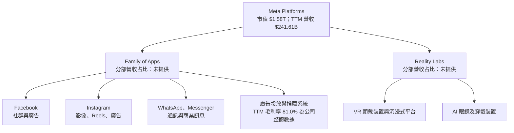
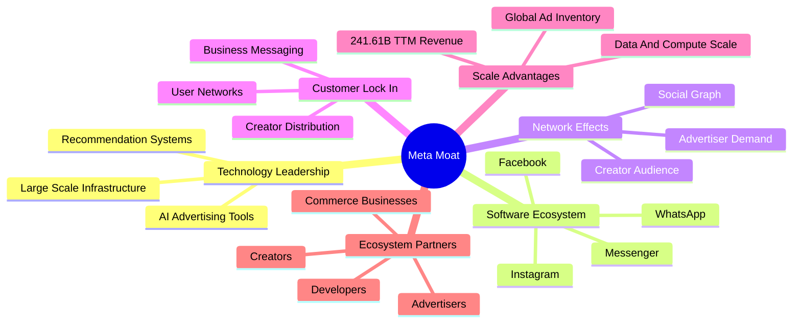
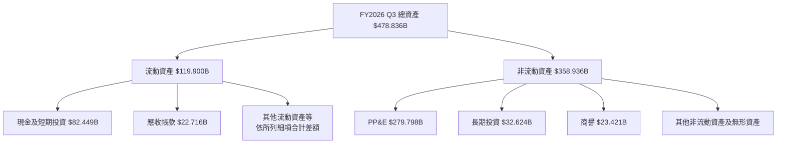
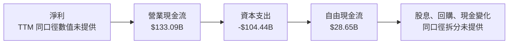
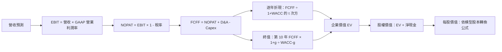
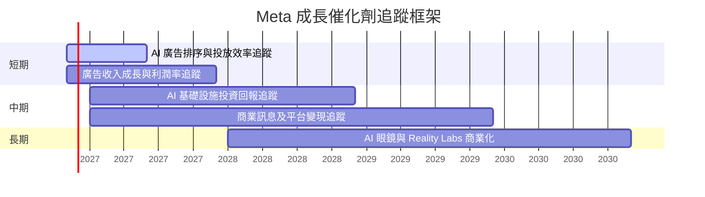
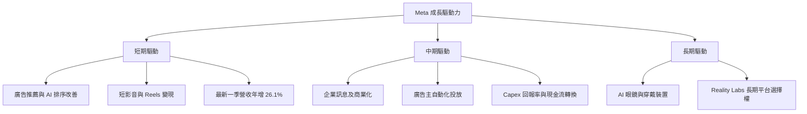
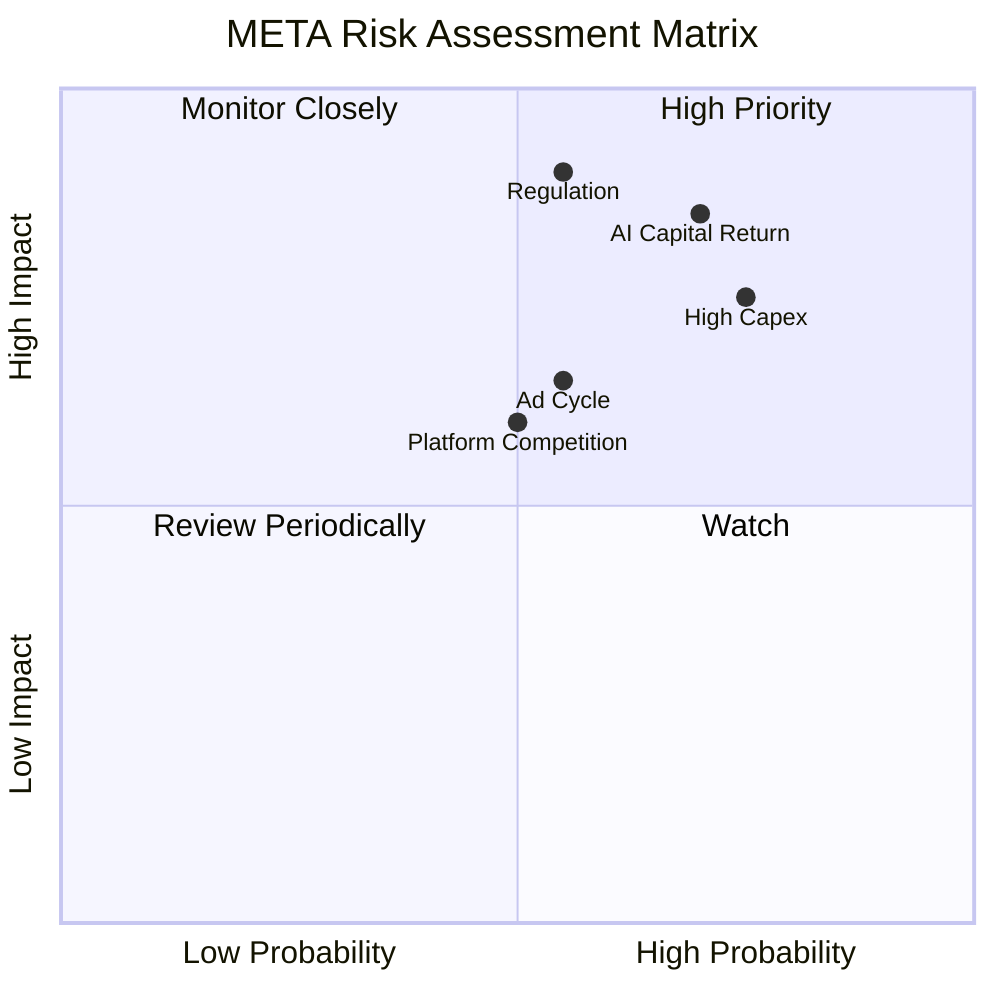
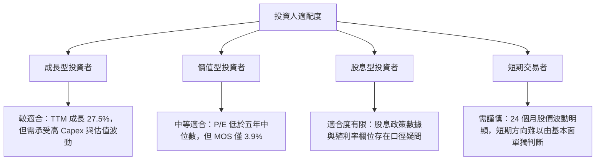

# META 基本面深度分析報告
> **報告日期**：2026-11-18 ｜ **語言**：繁體中文 ｜ **數據來源**：SEC 申報資料 (XBRL)、Yahoo Finance、Finviz、StockAnalysis、Roic.ai ｜ **分析師**：CFA 級機構研究

## 目錄

| # | 章節 | 核心結論 |
|---|------|----------|
| 1 | 執行摘要 | 持有；加權合理價值 $643.69，MOS +3.9% |
| 2 | 公司概覽與商業模式 | Family of Apps 具網路效應；Reality Labs 投資回報仍不確定 |
| 3 | 損益表深度分析 | TTM 營收 $241.61B、成長 27.5%；最新一季營業利益率資料存在來源差異 |
| 4 | 資產負債表分析 | VERIFIED FIGURES 淨負債 $1.22B，流動性尚可；債務數據來源有差異 |
| 5 | 現金流量深度分析 | TTM FCF $28.65B；高資本支出使現金轉換弱於營業現金流所示 |
| 6 | 獲利能力與資本效率 | ROIC 27.7% 高於 WACC 10.53%，仍創造股東價值 |
| 7 | 相對估值分析 | 估值低於自身五年 P/E 中位數，但同業倍數訊號分歧 |
| 8 | DCF 內在價值評估 | 基準 DCF $557.48；終值佔 EV 80.4%，模型對長期假設敏感 |
| 9 | 成長催化劑 | AI 廣告效率與推薦系統是主要可觀察驅動；TAM 數據未提供 |
| 10 | 風險矩陣 | AI 資本支出回報、監管與廣告周期為主要風險 |
| 11 | 投資建議 | 持有；待估值折讓擴大或現金流轉換改善，再考慮提高部位 |

---

## 1. 執行摘要

2026-11-17 收盤價為 **$618.87**。META TTM 營收 **$241.61B**、TTM 年增 **27.5%**，ROIC **27.7%** 高於 WACC **10.53%**，顯示核心業務仍創造高於資本成本的回報；但 TTM FCF 只有 **$28.65B**、FCF Yield **1.81%**，而基準 DCF 為 **$557.48**，低於現價。估值方法加權後合理價值為 **$643.69**，MOS **+3.9%**，依規則 20 評級為**持有**，沒有因質化因素調整。

### 1.0 一頁式投資儀表板（Portfolio Manager 30 秒速讀）

| 項目 | 內容 |
|------|------|
| **投資論點（3 句）** | ① TTM 營收成長 **27.5%**，最新一季年增 **26.1%**，廣告主業仍在擴張。② **ROIC 27.7%** 高於 **WACC 10.53%**，資本回報仍高於資本成本。③ TTM FCF **$28.65B**、FCF Yield **1.81%**，而 Capex 達 **$104.44B**，投資回報兌現仍需追蹤。 |
| **綜合評分** | **7.3/10**（引用 1.1） |
| **財務健康** | 🟡 VERIFIED FIGURES 淨負債 **$1.22B**；現金及短期投資 **$82.45B**，但其他市場資料列示淨負債 **$32.39B**，需核對負債口徑。 |
| **ROIC vs WACC** | **27.7% vs 10.53%**；利差 **17.17 個百分點**，創造價值。 |
| **FCF 趨勢** | TTM FCF **$28.65B**；FCF Yield **1.81%**。近期季度 Capex 高，現金流承壓。 |
| **估值** | Forward P/E **17.35x** ｜ EV/EBITDA **13.89x** ｜ FCF Yield **1.81%** |
| **DCF 內在價值（基準）** | **$557.48** ｜ 現價較 DCF 溢價 **11.0%** |
| **安全邊際（MOS）** | **+3.9%＝($643.69 − $618.87) ÷ $643.69**；🔴 <10%，保護有限 |
| **預期報酬（基準情境 12M）** | DCF 基準情境 **-9.9%**；加權合理價值對現價上行空間 **+4.0%**，兩者為不同口徑 |
| **關鍵風險（前二）** | AI 基礎設施投入高於營收回報；廣告市場與監管風險 |
| **評級 + 信心度** | 🟡 **持有** ｜ 信心：中 |

### 1.1 綜合評分卡（全報告唯一）

| 維度 | 評分（1–10） | 主要依據（引用數字與其來源章節） |
|------|--------------|----------------------------------|
| 成長性 | 8.5 | TTM 營收成長 27.5%、最新一季年增 26.1%（第 3 章） |
| 獲利能力 | 8.0 | TTM 營業利益率 32.9%、ROIC 27.7% > WACC 10.53%；F-Score 3/8（第 3、6 章） |
| 財務健康 | 7.0 | VERIFIED FIGURES 淨負債 $1.22B、現金及短期投資 $82.45B；DSO 34 天（第 4 章） |
| 估值 | 5.0 | MOS +3.9%；P/E 21.1x 低於自身五年中位數 24.5x，但 DCF 基準低於現價（第 7、8 章） |
| 護城河 | 9.0 | 多平台網路效應、TTM 毛利率 81.0%、規模與廣告投放生態（第 2 章） |
| 管理層與資本配置 | 6.5 | FY2025 SBC $20.43B；2026 TTM Capex $104.44B；投入回報與稀釋需監控（第 3、5 章） |
| **綜合評分** | **7.3** | 六項算術平均：44.0 ÷ 6 = 7.33，四捨五入至一位小數 |

### 1.2 五大投資論點 + 三大核心風險

| 類型 | 項目 | 具體依據 | 信心度 |
|------|------|----------|--------|
| 🟢 **投資論點①** | 廣告主業具規模與成長 | TTM 營收 $241.61B、年增 27.5%；最新一季年增 26.1% | 🟢 高 |
| 🟢 **投資論點②** | 資本回報高於資本成本 | ROIC 27.7%，WACC 10.53%，利差 17.17 個百分點 | 🟢 高 |
| 🟢 **投資論點③** | 現金資源提供投資彈性 | 現金及短期投資 $82.45B；即使負債口徑不同，均有可觀流動資源 | 🟢 高 |
| 🟢 **投資論點④** | 自身歷史估值不在高檔 | P/E 21.1x，低於五年中位數 24.5x；目前位於歷史 24 百分位 | 🟡 中 |
| 🟢 **投資論點⑤** | AI 可改善廣告投放效率 | 公司業務與廣告排序、推薦系統高度相關；但財務數據未單獨揭露 AI 貢獻 | 🟡 中 |
| 🟡 **風險①** | 資本支出侵蝕自由現金流 | TTM Capex $104.44B，占營業現金流 $133.09B 的約 78.5%；FCF Yield 僅 1.81% | 🟡 中 |
| 🔴 **風險②** | DCF 高度仰賴終值及再投資假設 | 終值現值占企業價值 80.4%；基準 DCF $557.48，低於現價 | 🔴 高衝擊 |
| 🔴 **風險③** | 監管與平台競爭改變變現能力 | 廣告業務依賴個人化推薦與資料使用；監管限制可能降低定向效率 | 🟡 中 |

### 1.3 快速統計卡片

| 指標 | 公司實際值（期間） | 同業中位數 | 狀態 |
|------|--------------------|------------|------|
| 營收成長（TTM） | **27.5%** | — | 🟢 |
| 營收成長（最新一季年增） | **26.1%** | **14.3%** | 🟢 |
| 毛利率（TTM） | **81.0%** | **60.9%** | 🟢 |
| 營業利益率（TTM） | **32.9%** | — | 🟢 |
| ROIC（TTM） | **27.7%** | — | 🟢 |
| Forward P/E | **17.35x** | **8.0x** | 🟡 |
| FCF Yield（TTM） | **1.81%** | — | 🔴 |
| Piotroski F-Score | **3 / 8** | — | 🔴 |

同業中位數僅按有提供數字的公司計算：最新一季營收成長中位數為 GOOG、SNAP、PINS 三家之中位數；毛利率同理。Forward P/E 中位數採三家可用資料的中位數。

### 1.4 投資結論

```text
╔══════════════════════════════════════════════════════════════════╗
║                    📊 投資結論摘要                               ║
╠══════════════════════════════════════════════════════════════════╣
║  評級：持有（MOS +3.9%，依規則 20）                              ║
║  價格（2026-11-17 收盤）：$618.87                                ║
║  DCF 內在價值（基準）：$557.48（現價溢價 11.0%）                 ║
║  安全邊際 MOS：+3.9%（以加權合理價值 $643.69 為分母）            ║
║  加權合理價值（8.8）：$643.69                                    ║
║  DCF 情境價值：                                                   ║
║    悲觀情境：$187.16（-69.8%）                                   ║
║    基準情境：$557.48（-9.9%）                                    ║
║    樂觀情境：$1,354.78（+118.9%）                                ║
║  綜合評分：7.3/10（引用 1.1）                                    ║
║  適合投資人：能承受高資本支出與估值波動的長線成長型投資人         ║
╚══════════════════════════════════════════════════════════════════╝
```

---

## 2. 公司概覽與商業模式

Meta Platforms, Inc. 經營 Facebook、Instagram、WhatsApp、Messenger 等 Family of Apps（FoA），並透過 Reality Labs（RL）投資 VR、AR 與相關裝置。營收主要來自廣告，但所提供財務數據沒有 FoA、RL 或廣告以外收入的分部營收拆分，因此不臆測各板塊占比。

### 2.1 業務結構與收入來源



圖中總營收與市值來自市場及 SEC 數據；分部營收、板塊占比及軟體服務收入拆分未提供。

### 2.2 市場份額

市場份額數據未提供，故不繪製份額圖、不推算占比。從相對規模看，META TTM 營收 **$241.61B**、成長 **27.5%**；GOOG 最新一季年增 **24.7%**，SNAP 為 **14.3%**、PINS 為 **11.9%**。這些指標反映營收規模與成長速度，不等同市場份額。

### 2.3 競爭護城河分析



### 2.4 護城河強度

| 護城河項目 | 強度（強／中／弱） | 證據（引用數字或事實） | 會削弱它的情況 |
|------------|--------------------|------------------------|----------------|
| 技術與推薦系統 | 強 | 廣告與內容推薦需處理大規模訊號；公司 TTM 營收成長 27.5%，但 AI 的單獨貢獻未揭露 | 推薦效果下降、計算成本增加或競爭對手提升內容分發效率 |
| 軟體生態系 | 強 | Facebook、Instagram、WhatsApp、Messenger 覆蓋社交、內容與通訊場景 | 使用者遷移、年輕用戶使用時間下降 |
| 網路效應 | 強 | 社交圖譜、創作者與廣告主互相增強平台價值 | 網路效應被短影音或新型社交平台分流 |
| 客戶鎖定 | 中至強 | 企業與廣告主可跨多個平台購買觸及；收入來源仍高度依賴廣告 | 廣告主分散投放、定向能力受限、效果型廣告成本上升 |
| 規模效應 | 強 | TTM 營收 $241.61B、TTM 毛利率 81.0% | 基礎設施與 Capex 增速長期高於營收增速 |
| 生態夥伴 | 中 | 廣告主、創作者及商家均有平台參與；量化夥伴數據未提供 | 夥伴轉向其他平台，或平台規則與抽成降低合作意願 |

**1.1 護城河分數 9.0/10** 的依據是多平台社交網路、廣告主與使用者的互補效應，以及 81.0% TTM 毛利率；扣分原因為分部資料與平台留存、使用者活躍等營運指標未提供。

---

## 3. 損益表深度分析

### 3.1 年度收入成長趨勢（近 4 年）

年度營收採所列年度損益表；增長率按相鄰年度收入計算，金額取兩位小數，成長率取一位小數。

```text
╔══════════════════════════════════════════════════════════════════╗
║              Meta 年度收入趨勢（FY2022-FY2025）                  ║
╠══════════════════════════════════════════════════════════════════╣
║  FY2022  $116.61B  ████████████░░░░░░░░░░░░  YoY: -1.1%  🟡    ║
║  FY2023  $134.90B  ██████████████░░░░░░░░░░  YoY:+15.7%  🟢    ║
║  FY2024  $164.50B  █████████████████░░░░░░░  YoY:+21.9%  🟢    ║
║  FY2025  $200.97B  █████████████████████░░░  YoY:+22.2%  🟢    ║
╠══════════════════════════════════════════════════════════════════╣
║  FY2022-FY2025 三年 CAGR：(200.97 ÷ 116.61)^(1/3)-1 = 約 19.9% ║
╚══════════════════════════════════════════════════════════════════╝
```

FY2022–FY2025 的營收複合成長約 **19.9%**。收入增速從 FY2022 的下滑回升，FY2023–FY2025 增速改善，與廣告需求復甦、內容推薦與短影音變現推進相符；單靠財務數據無法分拆每一項因素的貢獻。

### 3.2 季度收入趨勢分析

| 季度 | 營收（$B） | QoQ | YoY | 備註 |
|------|-----------:|----:|----:|------|
| 2025 Q4 | 59.893 | +6.9% | +23.8% | QoQ 對 2025 Q3；YoY 對 2024 Q4 |
| 2026 Q1 | 56.311 | -6.0% | +33.1% | 季節性回落，但同比增速高 |
| 2026 Q2 | 60.801 | +8.0% | +28.0% | 環比恢復成長 |
| 2026 Q3 | 64.601 | +6.3% | +26.1% | 最新一季年增率，不是 TTM 增速 |

成長仍快，但最新兩季同比增速低於 2026 Q1 的 33.1%，顯示比較基期與收入成長動能需持續觀察。TTM 年增 27.5% 是另一期間口徑，不應與單季 YoY 混用。

### 3.3 利潤率演變分析

| 利潤率指標 | FY2022 | FY2023 | FY2024 | FY2025 | 趨勢 | 評估 |
|------------|-------:|-------:|-------:|-------:|------|------|
| **毛利率** | 78.4% | 80.8% | 81.7% | 82.0% | 上升 | 🟢 |
| **營業利益率** | 24.8% | 34.7% | 42.2% | 41.4% | 大幅修復後略回落 | 🟢 |
| **淨利率** | 19.9% | 29.0% | 37.9% | 30.1% | FY2025 回落 | 🟡 |

年度利潤率由年度收入、毛利與營業利益計算；FY2025 淨利率下降，部分由淨利由 **$62.36B** 降至 **$60.46B**、而營收升至 **$200.97B** 所致。TTM 淨利率另報為 **31.1%**，與 FY2025 單年淨利率不可混為一談。

**利潤率演變深度解析：**FY2022 至 FY2024 營業利益率由約 24.8% 升至 42.2%，呈現營收恢復與費用紀律所帶來的營業槓桿；FY2025 回落至約 41.4%，但仍高於 FY2023。TTM 營業利益率為 32.9%，低於 FY2025 年度計算值，代表 TTM 期間中成本或投資支出增加。最新一季營業利益率來源不一致：VERIFIED FIGURES 為 **20.1%**，另一市場彙總欄位為 **37.8%**，StockAnalysis 的營業利益與收入比值又約為 **35.4%**。依資料規則採用 VERIFIED FIGURES 的 20.1%，並將差異視為需核對申報口徑的風險，不用其他欄位替換。

### 3.4 費用結構分析

未提供完整 TTM 費用分項，因此不畫費用比例圓餅圖。可確認的年度項目包括 FY2025 R&D **$57.37B**、營業利益 **$83.28B**；折舊、行銷及行政費用的同口徑拆分未提供，故不推算費用占比。

```text
╔══════════════════════════════════════════════════════════════════╗
║                    可確認的成本資訊                             ║
╠══════════════════════════════════════════════════════════════════╣
║ FY2025 R&D                 $57.37B  已披露                       ║
║ FY2025 營業利益            $83.28B  已披露                       ║
║ TTM 資本支出               $104.44B 已披露，列現金流而非費用     ║
║ TTM 其他營運費用細分       未提供，不推算                       ║
╚══════════════════════════════════════════════════════════════════╝
```

### 3.5 季度 EPS 趨勢與盈餘品質（Quality of Earnings）

最近四季 EPS 實際值來自 StockAnalysis；EPS Est 欄位為 nan，因此無法判定超預期或不及預期。

| 季度 | EPS 實際 | EPS YoY | 超預期／不及預期 | 觀察 |
|------|---------:|--------:|------------------|------|
| 2025 Q4 | $8.88 | +10.7% | N/A（分析師預估未提供） | 盈餘成長正向 |
| 2026 Q1 | $10.44 | +62.4% | N/A（分析師預估未提供） | 同比大幅上升 |
| 2026 Q2 | $6.18 | -13.4% | N/A（分析師預估未提供） | 盈餘回落 |
| 2026 Q3 | $3.83 | +264.8% | N/A（分析師預估未提供） | 前年基期偏低，單季比較須審慎 |

| 盈餘品質項目 | 數值／佔比 | 評估 |
|--------------|-----------|------|
| 股權薪酬 SBC / 營收 | FY2025：$20.43B ÷ $200.97B = **10.2%** | 🔴 對股東有明顯稀釋成本；SBC 並非經濟上免費 |
| SBC / 營業現金流 | FY2025：$20.43B ÷ $115.80B = **17.6%** | 🟡 佔現金流規模顯著；但營業現金流本身含非現金 SBC 加回 |
| FCF / 淨利（現金轉換率） | TTM FCF $28.65B ÷ TTM 淨利（同口徑數據未提供） | N/A（缺少對應 TTM 淨利；不可用不同期間拼接） |
| 一次性／非經常性損益 | N/A（資料未提供完整調節項） | 無法判定是否有一次性項目顯著美化或壓低盈餘 |
| 有效稅率 | **29.6%**（最新年度） | DCF 採用該稅率；缺少同口徑多年明細，無法判定異常 |
| 資本化支出 vs 費用化 | TTM Capex **$104.44B**；資本化與費用化拆分 N/A | 大額資本支出先形成資產、之後以折舊費用認列；若資產回報不足，未來折舊與減值風險上升 |

**盈餘品質結論：**營業現金流 TTM 為 **$133.09B**，但高額 Capex 後 FCF 降至 **$28.65B**，顯示會計獲利轉成可自由配置現金的能力受資本投資壓抑。FY2025 SBC 占營收約 10.2%，估值不能只看 GAAP 淨利，也需監控稀釋股數及投資回報。

---

## 4. 資產負債表分析

### 4.1 資產結構分解



### 4.2 流動性與營運資金分析

| 指標 | 最新 TTM | 一年前 TTM | 變化 | 解讀 |
|------|----------|------------|------|------|
| 流動比率 | 1.903（市場彙總數據） | N/A | N/A | 高於 1，短期流動資產覆蓋流動負債；非 VERIFIED QUALITY 指標，僅作補充參考 |
| DSO 應收帳款天數 | 34 天 | 33 天 | +1 天 | 收款週期略延長；幅度有限，需跟進應收帳款增速 |
| DIO 存貨天數 | N/A | N/A | N/A | 公司未報告相應存貨餘額，不補值 |
| DPO 應付帳款天數 | 152 天 | N/A | N/A | 一年前資料缺漏，不能判斷年度變化 |
| CCC 現金轉換週期 | N/A | N/A | N/A | 因 DIO 缺失，無法計算 |

營運資金天數來自 QUALITY FIGURES，照錄其值。DSO 由 33 天增至 34 天，可能反映應收帳款回收速度略慢，但只有一天變化，不足以單獨判斷信用風險。DPO 一年前資料缺漏，不能把當期 152 天解讀為議價能力改善。

### 4.3 債務結構分析

VERIFIED FIGURES 列示總債務 **$83.67B**、現金及短期投資 **$82.45B**、淨負債 **$1.22B**。另一市場資料則列總債務 **$114.84B**、淨負債 **$32.39B**。兩者差異可能涉及租賃、債務範圍或資料供應商口徑；以下主分析依 VERIFIED FIGURES，並保留口徑風險。

```text
╔══════════════════════════════════════════════════════════════════╗
║                   Meta 債務健康診斷                             ║
╠══════════════════════════════════════════════════════════════════╣
║  總債務（VERIFIED）       $83.67B                                ║
║  現金及短期投資           $82.45B                                ║
║  淨負債                   $1.22B   🟡 接近淨現金                  ║
║  流動比率（市場彙總）     1.903x   🟢 流動資產高於流動負債        ║
║  Debt/EBITDA              N/A（口徑缺少一致的 TTM EBITDA）        ║
║  利息保障倍數             N/A（利息費用資料未提供）              ║
║  主要資料風險             市場彙總總債務 $114.84B，口徑不一致     ║
╚══════════════════════════════════════════════════════════════════╝
```

### 4.4 股東權益趨勢

```text
╔══════════════════════════════════════════════════════════════════╗
║               股東權益趨勢（年度）                               ║
╠══════════════════════════════════════════════════════════════════╣
║ FY2022  $125.71B  ████████████░░░░░░░░░░                         ║
║ FY2023  $153.17B  ███████████████░░░░░░░                         ║
║ FY2024  $182.64B  ██████████████████░░░                         ║
║ FY2025  $217.24B  ██████████████████████                         ║
╚══════════════════════════════════════════════════════════════════╝
```

FY2022–FY2025 股東權益增加，反映累積獲利及資本留存；但帳面權益成長不等同每股價值成長，仍需搭配回購、SBC 稀釋與資本回報檢視。當期季度股東權益未提供。

---

## 5. 現金流量深度分析

### 5.1 現金流量瀑布圖

季度現金流瀑布若包含股息、回購與淨現金變化等完整當期數字，資料不齊，故不以不完整數據繪製金額流程圖。TTM 已知現金流為營業現金流 **$133.09B**、Capex **$104.44B**、FCF **$28.65B**。



### 5.2 FCF 轉換率趨勢

| 年度 | OCF（$B） | Capex（$B） | FCF（$B） | FCF / 淨利 |
|------|----------:|------------:|----------:|-----------:|
| 2022 | 50.48 | 31.19 | 19.29 | 83.1% |
| 2023 | 71.11 | 27.05 | 44.07 | 112.7% |
| 2024 | 91.33 | 37.26 | 54.07 | 86.7% |
| 2025 | 115.80 | 69.69 | 46.11 | 76.3% |
| 最新 TTM | 133.09 | 104.44 | 28.65 | N/A（同口徑 TTM 淨利未提供） |

年度 FCF/淨利依同年度年度報表相除。2025 年 Capex 升至 **$69.69B**，FCF 由 2024 年 **$54.07B** 降至 **$46.11B**；最新 TTM Capex 再升至 **$104.44B**，FCF 降至 **$28.65B**。因此營業現金流成長並未一比一轉成股東可自由支配現金。

### 5.3 自由現金流趨勢

```text
╔══════════════════════════════════════════════════════════════════╗
║               自由現金流趨勢（歷史年度與 TTM）                   ║
╠══════════════════════════════════════════════════════════════════╣
║ FY2022  $19.29B  ████████░░░░░░░░░░░░  FCF Yield：N/A            ║
║ FY2023  $44.07B  ██████████████████░░  FCF Yield：N/A            ║
║ FY2024  $54.07B  ████████████████████  FCF Yield：N/A            ║
║ FY2025  $46.11B  ███████████████████░  FCF Yield：N/A            ║
║ TTM     $28.65B  ███████████░░░░░░░░░  FCF Yield：1.81%          ║
╚══════════════════════════════════════════════════════════════════╝
```

歷史年度 FCF Yield 未提供相同口徑股本市值，故不反推；只列 VERIFIED FIGURES 的 TTM FCF Yield **1.81%**。

### 5.4 資本配置評估

資本配置金額不完整，不畫會造成錯誤比例的圓餅圖。可確認 FY2025 現金股息支付 **$5.32B**、SBC **$20.43B**，以及年度 Capex **$69.69B**；回購金額與完整資本配置比例未提供。

| 項目 | 已知數據 | 評估 |
|------|----------|------|
| Capex | FY2025 $69.69B；TTM $104.44B | 對現金流影響最大，須追蹤 AI 基建回報 |
| 股息 | FY2025 $5.32B | 相對現金流規模不高 |
| SBC | FY2025 $20.43B | 對每股股東回報有稀釋成本 |
| 股票回購 | N/A（同口徑回購金額未提供） | 無法判斷回購是否抵銷稀釋 |
| 留存現金／其他投資 | N/A（資本配置完整拆分未提供） | 不推算 |

---

## 6. 獲利能力與資本效率

### 6.1 ROE / ROA / ROIC 趨勢

| 指標 | 最新 TTM | 歷史或其他來源 | 評估 |
|------|---------:|----------------|------|
| ROE | **27.6%** | 市場彙總欄位另列 32.3% | 🟢 以 QUALITY FIGURES 的 27.6% 為準；來源口徑不一致 |
| ROA | N/A（VERIFIED QUALITY 未列最新值） | 市場彙總欄位 14.6% | 🟢 只作補充，不替代品質區塊缺值 |
| ROIC | **27.7%** | TTM | 🟢 高於 WACC |
| 行業均值 | 未提供 | — | 不作無來源比較 |

### 6.2 ROIC vs WACC 分析（核心價值創造判斷）

ROIC 與 WACC 均採 VERIFIED FIGURES。WACC 各組成也沿用程式計算提供的輸入，不另行建立替代折現率。

```text
╔══════════════════════════════════════════════════════════════════╗
║                ROIC vs WACC 深度分析                            ║
╠══════════════════════════════════════════════════════════════════╣
║  WACC 組成（VERIFIED FIGURES）：                                 ║
║  ├── 無風險利率：          5.10%                                 ║
║  ├── 股權風險溢酬 ERP：    5.00%                                 ║
║  ├── 原始 Beta：           1.28                                  ║
║  ├── 調整後 Beta：         1.19                                  ║
║  ├── 股權成本 Ke：         11.03%                                ║
║  ├── 稅前債務成本：        1.39%                                 ║
║  ├── 稅率：                29.6%                                 ║
║  ├── 股權／債務權重：      95.0% / 5.0%                          ║
║  └── WACC：                10.53%                                ║
║                                                                  ║
║  ROIC（TTM）：              27.7%                                 ║
║  EVA 利差：                 27.7% - 10.53% = 17.17 個百分點       ║
║                                                                  ║
║  ROIC  27.7%  ▓▓▓▓▓▓▓▓▓▓▓▓▓▓▓▓▓▓▓▓▓▓▓▓▓▓░░░░  🟢             ║
║  WACC  10.53% ▓▓▓▓▓▓▓▓▓▓░░░░░░░░░░░░░░░░░░░░  ──              ║
║                                                                  ║
║  結論：ROIC 約為 WACC 的 2.63 倍，仍在創造股東價值             ║
╚══════════════════════════════════════════════════════════════════╝
```

算式：**27.7% ÷ 10.53% = 2.63 倍**；利差 **27.7% − 10.53% = 17.17 個百分點**。依資料規則，資本成本輸入直接採用已計算 WACC，不能用財務數據中其他不同範圍的債務數值重算。

### 6.3 杜邦三因素分解

| 因素 | 數值（TTM） | 解讀 |
|------|-------------|------|
| 淨利率 | **31.1%** | 高毛利平台廣告模式支持高淨利率 |
| 資產週轉率 | **0.50** | 資產規模相對營收大，基建擴張可能壓低周轉率 |
| 權益乘數 | **1.76** | 槓桿提供部分 ROE 放大，但不是主要來源 |
| **ROE** | **27.6%** | 31.1% × 0.50 × 1.76 = 27.3%，與區塊列示 27.6% 存在四捨五入／底層精度差異 |

ROE 主要由高淨利率驅動，權益乘數 1.76 倍提供次要放大。DuPont 區塊的三項數字與列示 ROE 存在約 0.3 個百分點的乘算差異，照錄區塊數字，不以自行重算值取代。

### 6.4 財務體質：Piotroski F-Score

**Piotroski F-Score：3 / 8**。有一項測試因缺少輸入而無法判定；分母沿用品質指標的 8，不補成 9。

| 測試 | 結果 | 解讀 |
|------|------|------|
| ROA > 0 | ✅ 通過 | 公司仍有正向資產報酬 |
| 營業現金流 > 0 | ✅ 通過 | TTM 營業現金流為 $133.09B |
| ROA 高於一年前 | ❌ 未通過 | 資產報酬未較前期改善 |
| 營業現金流 > 淨利（應計品質） | ✅ 通過 | 現金流高於淨利，有利於盈餘品質 |
| 長期負債 ÷ 總資產低於一年前 | ❌ 未通過 | 負債比率未改善 |
| 流動比率高於一年前 | ❌ 未通過 | 流動性比率未較前期改善 |
| 稀釋股數未增加 | ❌ 未通過 | 股數稀釋是每股回報的負面因素 |
| 毛利率高於一年前 | — 無法判定 | 缺資料，不補值 |
| 資產週轉率高於一年前 | ❌ 未通過 | 資產效率未改善 |

3/8 表示雖然現金流與獲利仍為正，但資產效率、負債趨勢和股數稀釋等方向不理想；不能只以營收成長推論財務體質全面改善。

---

## 7. 相對估值分析

### 7.1 同業估值比較表格

META 市場彙總倍數與 Peer multiples 來自不同資料欄位，個別指標以 VERIFIED FIGURES 指定的 Peer multiples 作同業值；公司值按市場資料所列，來源口徑可能不同。

| 估值指標 | **META** | **GOOG** | **SNAP** | **PINS** | 本公司評估 |
|----------|---------:|---------:|---------:|---------:|-----------|
| **Trailing P/E** | 21.1x | 14.5x | N/A | 75.3x | 🟡 低於 PINS、高於 GOOG；SNAP 不可比 |
| **Forward P/E** | 17.35x | 18.3x | 7.0x | 8.0x | 🟡 高於同業三家中位數 8.0x，但公司成長亦較快 |
| **P/S Ratio** | 6.55x | 7.2x | 1.4x | 2.2x | 🟡 高於 SNAP、PINS，略低於 GOOG |
| **EV/EBITDA** | 13.89x | 17.9x | 57.3x | 34.1x | 🟢 低於可用同業倍數，但同業盈利結構差異大 |
| **最新一季營收年增** | 26.1% | 24.7% | 14.3% | 11.9% | 🟢 META 增速居三家同業之上 |
| **毛利率（TTM）** | 81.0% | 60.9% | 59.2% | 79.0% | 🟢 高於三家同業 |

SNAP 的 P/E 為 N/A，不填補。META 前瞻 P/E 高於同業中位數，但同業中位數受 SNAP、PINS 資本化及獲利規模差異影響，不應直接視為公平價值。

### 7.2 歷史估值區間分析

```text
╔══════════════════════════════════════════════════════════════════╗
║             META P/E 五年歷史估值位置                           ║
╠══════════════════════════════════════════════════════════════════╣
║  五年低點     12.9x  ├──────────────────────────────┤ 33.4x     ║
║  五年中位數   24.5x  ────────────────────────●──────            ║
║  現在         21.1x  ─────────────────────●────────  百分位 24%  ║
║  五年區間     12.9x – 33.4x                                      ║
╚══════════════════════════════════════════════════════════════════╝
```

META P/E **21.1x**，低於自身五年中位數 **24.5x**，目前落在歷史 **24 百分位**；P/S 為 **6.6x**、低於五年中位數 **7.7x**，EV/EBITDA 為 **15.3x**、低於五年中位數 **16.5x**。這表示相對自身近五年不是高估值區，但不代表絕對便宜。

### 7.3 情境價值（Bear / Base / Bull）

情境價值照 DCF MODEL 輸出；資料未列各情境終值成長率，故不添加未提供假設。

| 情境 | 第 1 年營收成長 | 期末營業利潤率 | WACC | 每股價值 | 相對現價 | 機率 | 會發生的條件 |
|------|----------------:|----------------:|-----:|----------:|----------:|------:|--------------|
| 🔴 悲觀 | 13.8% | 29.5% | 11.53% | $187.16 | -69.8% | 25% | 廣告成長放緩、AI 投資回報不足，且成本上升壓縮利潤率 |
| 🟡 基準 | 27.5% | 34.7% | 10.53% | $557.48 | -9.9% | 50% | TTM 增速逐年回落至成熟期，利潤率逐步擴張 |
| 🟢 樂觀 | 41.3% | 38.1% | 9.53% | $1,354.78 | +118.9% | 25% | AI 廣告變現帶動收入加速、規模效率提升且資本成本下降 |

### 7.4 相對估值隱含價格區間

```text
╔══════════════════════════════════════════════════════════════════╗
║                   相對估值與每股價值                             ║
╠══════════════════════════════════════════════════════════════════╣
║ 同業 Forward P/E        $284.23  ─────● 現價 $618.87             ║
║ DCF 基準                $557.48  ─────────●                      ║
║ 分析師共識目標價        $848.23  ───────────────────              ║
║ 同業 EV/EBITDA        $1,059.28  ─────────────────────────        ║
╚══════════════════════════════════════════════════════════════════╝
```

| 方法 | 每股價值 | 依據 |
|------|---------:|------|
| 同業 Forward P/E | $284.23 | GOOG、SNAP、PINS 同業中位數 8.0x × META Forward EPS $35.68 |
| 同業 EV/EBITDA | $1,059.28 | GOOG、PINS 中位數 26.0x × META TTM EBITDA，再加淨現金 |
| 分析師共識 | $848.23 | 58 位分析師平均目標價，屬參考項，不是同業倍數估值 |

相對估值區間很寬，主要因同業倍數分布及公司未來 EPS 假設差異大；不宜將最高值視為短期目標。

---

## 8. DCF 內在價值評估（Discounted Cash Flow）

> 金額單位為美元十億，除每股數字外。DCF 數據採程式計算模型原值；假設與結果不另建模。四捨五入規則：金額至小數點後兩位、百分比至一位、折現因子至三位。個別年度表內數值因逐項四捨五入可能有小幅尾差。

### 8.0 估值推理鏈（Thinking Logic）

**Step 1 — 價值來源與主導變數：**模型以公司整體營收為基礎，沒有分部營收拆分，因此不能量化 FoA、RL 或 AI 個別占比。估值主要由廣告主業的營收成長、GAAP 營業利潤率與高資本支出後的 FCFF 決定；在 DCF 數據中，終值現值占 EV **80.4%**，故 WACC 與永續成長率對結果有顯著影響。

**Step 2 — 模型選擇：**

| 決策點 | 本報告採用 | 理由（含數字） | 曾考慮但否決 | 否決理由 |
|--------|-----------|----------------|--------------|----------|
| 現金流定義 | FCFF | 與 WACC 折現、先估企業價值再做股權橋接一致 | FCFE | 模型已提供 FCFF，不另換方法 |
| 預測期 N | 10 年 | DCF MODEL 固定 10 年，對應收入由 $241.61B 增至 $977.11B 的逐步成熟路徑 | 短於 10 年 | 不能改動既定模型輸入 |
| 終值方法 | Gordon Growth | 模型提供永續成長率 3.0% 與 Gordon 終值 | 退出倍數 | DCF 模型未提供退出倍數數值，不能另造 |
| EBIT 基礎 | GAAP | 模型採 GAAP EBIT；FCFF 為 NOPAT + D&A − Capex | 非 GAAP | 避免加回 SBC 後未扣回其成本 |

**Step 3 — 關鍵假設推導鏈：**

- **收入成長路徑**：錨點＝TTM 收入成長 **27.5%** → 模型把第 1 年設為 27.5%，之後線性下降至第 10 年 3.0% → **採用 FY+1 27.5%、FY+10 3.0%** → 不採用十年維持 27.5%，因模型假定成熟期增速回落；未另提供可量化替代路徑。
- **營業利潤率**：錨點＝TTM **32.9%**；五年年度中位數由模型使用 → 逐步由 32.9% 升至 34.7% → **採用 34.7% 作 FY+10 利潤率** → 不採更高情境值，因基準模型不採樂觀情境。
- **終值成長率 g**：採用 **3.0%**，低於 WACC **10.53%**；模型未提供長期名目 GDP 或通膨細拆，故不能聲稱是由特定宏觀預測精確推導。替代 g 僅按敏感度矩陣檢視。
- **預測期 N**：錨點＝模型指定 **10 年** → 用長期衰減反映高成長逐漸成熟 → **採用 10 年** → 不另改為其他期間，以遵守唯一模型規則。
- **Capex／營收**：錨點＝TTM Capex／營收 **43.2%** → 隨投資成熟下降至 FY+10 **11.3%**，模型規則為收斂至 1.1 倍 D&A（若高於該值） → 採用逐年下行路徑 → 不假定立刻回到低 Capex 比率，因當期投資強度高。
- **GAAP EBIT、SBC 與股數**：模型明定 GAAP EBIT 已含 SBC 費用；不在 FCFF 再扣 SBC，且股數不另稀釋 → 採 **組合 (A)** → 不採非 GAAP 加回，避免把 SBC 成本從估值中移除。
- **WACC**：採用提供的 **10.53%**，組成見 8.2 → 不自行重算或改用其他市場資料，以保持與 ROIC 分析及模型一致。
- **有效稅率、D&A／營收**：錨點分別為 **29.6%**、**10.3%**，模型沿用；沒有另行調整。
- **營運資金變動**：模型明示未建模；沒有可供填入的 ΔWC 數據，因此不虛構估計值。

**Step 4 — 最脆弱環節：**最脆弱的是終值與 Capex 收斂假設；終值現值占 EV 80.4%，若長期成長率或投資強度不符，估值可由基準 **$557.48** 大幅偏離，敏感度詳見 8.6。

**Step 5 — 計算路徑圖：**



### 8.1 模型假設總表（Model Inputs）

| 假設項目 | 採用值 | 依據／來源 | 敏感度 |
|----------|--------|-------------|--------|
| 預測期長度 **N** | 10 年 | DCF MODEL 固定預測期 | 🟡 中 |
| 營收成長路徑 | FY+1 27.5% → FY+10 3.0% | TTM vs prior TTM 成長 27.5%，逐年線性淡出 | 🔴 高 |
| 營業利潤率（FY+1 → FY+10） | 32.9% → 34.7% | 起點為 TTM；終點依近五年年度中位數模型設定 | 🔴 高 |
| 有效稅率 | 29.6% | 最新年度有效稅率 | 🟢 低 |
| Capex／營收 | 43.2% → 11.3% | TTM 比率，逐步收斂至 1.1×D&A（模型規則） | 🔴 高 |
| D&A／營收 | 10.3% | TTM 比率，固定 | 🟢 低 |
| 營運資金變動 | 未建模 | DCF MODEL 明示 Working capital is not modelled | 🟢 低 |
| EBIT 基礎 | GAAP | 模型採 GAAP EBIT | 🟡 中 |
| SBC 處理 | 不另扣 SBC | GAAP EBIT 已含 SBC | 🟡 中 |
| 年稀釋率 | 0% | 模型固定股數，不另稀釋 | 🟡 中 |
| 永續成長率 g | 3.0% | DCF MODEL 假設 | 🔴 高 |
| 終值方法 | Gordon Growth | DCF MODEL 提供 | 🔴 高 |
| WACC | 10.53% | Cost of capital 輸入 | 🔴 高 |

**FCFF 定義：**採 FCFF = NOPAT + D&A − Capex；工作資金變動未建模。**本模型採用 (A)：GAAP EBIT + 固定股數，故 SBC 影響已計入一次。**

### 8.2 折現率推導（WACC）

```text
╔══════════════════════════════════════════════════════════════════╗
║                    WACC 推導（折現率）                           ║
╠══════════════════════════════════════════════════════════════════╣
║  股權成本 Ke（CAPM，採用已提供計算值）：                         ║
║  ├── 無風險利率 Rf：             5.10%                            ║
║  ├── 市場風險溢酬 ERP：          5.00%                            ║
║  ├── 原始 Beta：                 1.28                             ║
║  ├── 調整後 Beta：               1.19                             ║
║  ├── 調整方式：                  2/3 × 1.28 + 1/3 × 1.00          ║
║  └── Ke：                        11.03%                           ║
║                                                                  ║
║  債務成本：                                                       ║
║  ├── 稅前 Kd：                   1.39%                            ║
║  ├── 有效稅率：                  29.6%                            ║
║  └── 稅後 Kd：                   1.39% × (1-29.6%) = 0.98%        ║
║                                                                  ║
║  資本權重（Cost of capital 輸入）：                              ║
║  ├── 股權權重 E：                95.0%                            ║
║  ├── 債務權重 D：                5.0%                             ║
║  └── WACC：                      10.53%                           ║
╚══════════════════════════════════════════════════════════════════╝
```

逐步演算：

1. **Ke**：5.10% + 1.19 × 5.00% = 11.05%，而 Cost of capital 區塊列示 **11.03%**；差異來自未顯示的底層精度，報告依規則採用區塊值 **11.03%**。  
2. **稅前 Kd**：採區塊列示 **1.39%**；利息費用及平均計息負債原始金額未提供，不能重新推導分子與分母。  
3. **稅後 Kd**：1.39% × (1 − 29.6%) = **0.97856% ≈ 0.98%**。  
4. **權重**：採區塊列示 E = **95.0%**、D = **5.0%**，合計 **100.0%**。市值及計息負債範圍存在來源差異，無法用提供的各類市值、股數與總債務資料重新驗證權重。  
5. **WACC**：95.0% × 11.03% + 5.0% × 0.97856% = 10.4785% + 0.048928% = **10.527428% ≈ 10.53%**。

Rf 日期未列明；ERP 為模型假設值；調整後 Beta 與稅前 Kd 直接使用提供的資本成本數據。第 6.2 節及本節均採 **WACC 10.53%**。由於缺少利息費用、平均計息負債和同一期債務分項，無法按範本重建完整市場價值權重，以上不以不完整資料另算 WACC。

### 8.3 逐年自由現金流預測（基準情境）

| 年度 | FY+1 | FY+2 | FY+3 | FY+4 | FY+5 | FY+6 | FY+7 | FY+8 | FY+9 | FY+10 |
|------|-----:|-----:|-----:|-----:|-----:|-----:|-----:|-----:|-----:|------:|
| 營收 | 308.11 | 384.52 | 469.41 | 560.24 | 653.38 | 744.20 | 827.37 | 897.28 | 948.65 | 977.11 |
| 營收 YoY | 27.5% | 24.8% | 22.1% | 19.4% | 16.6% | 13.9% | 11.2% | 8.5% | 5.7% | 3.0% |
| 營業利潤率 | 32.9% | 33.1% | 33.3% | 33.5% | 33.7% | 33.9% | 34.1% | 34.3% | 34.5% | 34.7% |
| EBIT（GAAP） | 101.23 | 127.10 | 156.10 | 187.43 | 219.90 | 251.95 | 281.76 | 307.37 | 326.86 | 338.62 |
| − 稅（29.6%） | (30.01) | (37.68) | (46.28) | (55.56) | (65.19) | (74.69) | (83.53) | (91.12) | (96.90) | (100.38) |
| = NOPAT | 71.22 | 89.43 | 109.83 | 131.87 | 154.71 | 177.26 | 198.24 | 216.25 | 229.97 | 238.24 |
| + D&A | 31.78 | 39.66 | 48.42 | 57.78 | 67.39 | 76.76 | 85.34 | 92.55 | 97.85 | 100.78 |
| − Capex | (133.19) | (152.59) | (169.65) | (182.64) | (189.85) | (189.88) | (181.79) | (165.37) | (141.24) | (110.86) |
| **= FCFF** | **-30.18** | **-23.51** | **-11.41** | **7.02** | **32.25** | **64.14** | **101.78** | **143.43** | **186.58** | **228.16** |
| 折現因子 | 0.905 | 0.819 | 0.741 | 0.670 | 0.606 | 0.548 | 0.496 | 0.449 | 0.406 | 0.368 |
| **FCFF 現值 PV** | **-27.31** | **-19.24** | **-8.45** | **4.70** | **19.55** | **35.18** | **50.51** | **64.40** | **75.79** | **83.85** |

預測期 PV 合計按模型未四捨五入數值為 **$278.97B**。表內已四捨五入 PV 逐項相加為：

**-27.31 − 19.24 − 8.45 + 4.70 + 19.55 + 35.18 + 50.51 + 64.40 + 75.79 + 83.85 = $278.98B**

表內四捨五入合計與模型未取整合計相差 **$0.01B**，低於 1%。

**FY+1 逐步演算：**

1. 營收 = $241.61B × (1 + 27.5%) = **$308.11B**（按模型精度）  
2. EBIT = $308.11B × 32.9% = **$101.23B**  
3. 稅 = $101.23B × 29.6% = **$30.01B**  
4. NOPAT = $101.23B − $30.01B = **$71.22B**  
5. D&A = $308.11B × 10.3% = **$31.78B**  
6. Capex = $308.11B × 43.2% = **$133.19B**  
7. ΔWC = **不建模**，因此不列入 FCFF；不得用未提供的營運資金數據補值。  
8. FCFF = 模型未取整 NOPAT + D&A − Capex = **-$30.18B**。以表內兩位數直接計算會有約 $0.01B 四捨五入尾差。  
9. 折現因子 = 1 ÷ (1 + 10.53%)¹ = **0.905**；PV = 模型未取整 FCFF × 未取整折現因子 = **-$27.31B**。

**合理性自檢：**
- 預測 FCF CAGR：因 FY+1 至 FY+3 FCFF 為負，整段 CAGR 無法定義；FY+1 FCFF 為 **-$30.18B**、FY+10 為 **$228.16B**，主要反映 Capex／營收由 43.2% 降至 11.3%。
- FY+10 FCFF 利潤率 = 228.16 ÷ 977.11 = **23.35%**；目前 TTM FCF 利潤率 = 28.65 ÷ 241.61 = **11.86%**。同業最佳 FCF 利潤率未提供，無法比較。
- 前三年 FCFF 為負，因 Capex 高於 NOPAT 加 D&A；負值已直接降低預測期 PV，不會被忽略。

```text
╔══════════════════════════════════════════════════════════════════╗
║            自由現金流：歷史實際 vs 模型預測                      ║
╠══════════════════════════════════════════════════════════════════╣
║ FY2023(實)  $44.07B  █████░░░░░░░░░░░░░░░  YoY: +128.5%         ║
║ FY2024(實)  $54.07B  ██████░░░░░░░░░░░░░░  YoY: +22.7%          ║
║ FY2025(實)  $46.11B  █████░░░░░░░░░░░░░░░  YoY: -14.7%          ║
║ FY+1 (預)   -$30.18B  FCFF 為負：高 Capex                    ║
║ FY+10 (預)  $228.16B  ████████████████████  模型終年 FCFF        ║
╠══════════════════════════════════════════════════════════════════╣
║ 預測由負轉正的核心條件：Capex／營收由 43.2% 下降至 11.3%         ║
╚══════════════════════════════════════════════════════════════════╝
```

### 8.4 終值計算（Terminal Value）

**適用性檢查：**WACC **10.53%** vs g **3.0%** → WACC > g？✅

| 方法 | 計算式 | 終值 TV | TV 現值 | 佔總 EV 比重 |
|------|--------|---------|---------|--------------|
| Gordon Growth | 228.16 × (1 + 3.0%) ÷ (10.53% − 3.0%) | $3,121.79B | $1,147.31B | 80.4% |
| 退出倍數法 | N/A（DCF MODEL 未提供退出倍數） | N/A | N/A | N/A |

逐步演算：

1. FY+N FCFF = **$228.16B**。  
2. 分子 = $228.16B × (1 + 3.0%) = **$235.0048B**。  
3. 分母 = 10.53% − 3.0% = **7.53%**；TV = $235.0048B ÷ 7.53% = **$3,121.79B**（採模型原值）。  
4. PV(TV) = $3,121.79B × 0.368（模型折現因子，底層使用未取整因子）= **$1,147.31B**。  
5. 終值占比 = $1,147.31B ÷ $1,426.28B = **80.4%**。

**本估值高度依賴終值假設，短期現金流貢獻有限。**退出倍數法沒有可用倍數，不能補造交叉驗證結果。

### 8.5 企業價值 → 每股內在價值（Bridge）

```text
╔══════════════════════════════════════════════════════════════════╗
║              企業價值 → 每股內在價值 橋接表                      ║
╠══════════════════════════════════════════════════════════════════╣
║  預測期 FCF 現值合計            +$278.97B                        ║
║  終值現值 PV(TV)                +$1,147.31B                      ║
║  = 企業價值 EV                   $1,426.28B                      ║
║  + 淨現金（負數代表淨負債）      -$1.22B                          ║
║  = 股權價值                      $1,425.06B                      ║
║  每股價值（模型換算）            $557.48                         ║
║  當前股價                        $618.87                         ║
║  折溢價（現價÷DCF內在價值−1）    +11.0%（溢價）                  ║
╚══════════════════════════════════════════════════════════════════╝
```

1. EV = $278.97B + $1,147.31B = **$1,426.28B**。  
2. 股權價值 = $1,426.28B + (-$1.22B) = **$1,425.06B**。  
3. 每股價值依模型原公式 **股權價值 × 價格 ÷ 市值**，模型輸出為 **$557.48**。資料未提供 DCF 計算採用的精確市場資本化分母或稀釋股數換算底層精度，因此不另以不同股數重算替換模型值。  
4. 折溢價 = $618.87 ÷ $557.48 − 1 = **+11.0%**。  
5. **本節不計算 MOS**；MOS 只在 8.8 以加權合理價值為分母計算。

股權橋接的淨現金採模型的 **-$1.22B**。VERIFIED FIGURES 同時列現金及短期投資 $82.45B、總債務 $83.67B；另一市場欄位的總債務不同。每股換算與市值、股數資料之間亦存在口徑未完全可核對的問題，需視為 DCF 審計限制。

### 8.6 敏感性分析（WACC × 永續成長率）

以下每股值照 DCF MODEL 敏感度矩陣原值列示；矩陣基準格 **$557.48** 與 8.5 基準 DCF 一致。括號為按現價 $618.87 計算的上行空間。

| g（列）／WACC（欄） | 8.53% | 9.53% | **10.53%（基準）** | 11.53% | 12.53% |
|-----------|------:|------:|-------------------:|-------:|-------:|
| 2.0% | $744.23 (+20.2%) | $605.13 (-2.2%) | $501.01 (-19.1%) | $420.68 (-32.0%) | $357.24 (-42.3%) |
| 2.5% | $798.52 (+29.0%) | $642.31 (+3.8%) | $527.49 (-14.8%) | $440.12 (-28.9%) | $371.85 (-39.9%) |
| **3.0%（基準）** | $862.64 (+39.4%) | $685.20 (+10.7%) | **$557.48 (-9.9%)** | $461.83 (-25.4%) | $387.99 (-37.3%) |
| 3.5% | $939.52 (+51.8%) | $735.19 (+18.8%) | $591.75 (-4.4%) | $486.25 (-21.4%) | $405.93 (-34.4%) |
| 4.0% | $1,033.37 (+67.0%) | $794.23 (+28.3%) | $631.26 (+2.0%) | $513.91 (-17.0%) | $425.96 (-31.2%) |

**矩陣示範格：WACC 11.53% > g 3.0% ✅**。模型對應每股價值為 **$461.83**。完整重算需要該敏感格未四捨五入的十年逐年折現因子、現金流及每股換算底層輸入；資料只提供矩陣結果，且明確要求不得另建模型，故不杜撰中間值。該格為 DCF MODEL 的既有結果，不以推算值替代。

**三情境 DCF（照錄模型）**

| 情境 | 營收成長（第 1 年） | 期末營業利潤率 | WACC | 每股內在價值 | 相對現價 | 機率 |
|------|-------------------:|----------------:|-----:|--------------:|----------:|------:|
| 🔴 悲觀 | 13.8% | 29.5% | 11.53% | $187.16 | -69.8% | 25% |
| 🟡 基準 | 27.5% | 34.7% | 10.53% | $557.48 | -9.9% | 50% |
| 🟢 樂觀 | 41.3% | 38.1% | 9.53% | $1,354.78 | +118.9% | 25% |
| **機率加權** | — | — | — | **$664.23** | **+7.3%** | **100%** |

模型沒有提供每個情境的逐年 FCFF、終值或完整營收 CAGR 路徑，因此不能在不另建模型的前提下補寫「FY+N 營收 → FCFF → TV」逐項算式。

**敏感度解讀：**

- 在基準 WACC 10.53% 下，g 由 2.0% 提至 3.0%，每股價值由 **$501.01** 升至 **$557.48**，增加 **$56.47**、約 **11.3%**；g 由 3.0% 提至 4.0%，升至 **$631.26**，增加 **$73.78**、約 **13.2%**。
- 在 g = 3.0% 下，WACC 由 9.53% 升至 10.53%，價值由 **$685.20** 降至 **$557.48**，減少 **$127.72**、約 **18.6%**；再升至 11.53%，降至 **$461.83**。
- 期末營業利潤率每 +1 個百分點的獨立敏感度，矩陣未提供，不能計算。
- 由於終值占 EV **80.4%**，折現率與終值假設對估值的影響最大，與 8.0 Step 1 所述一致。

### 8.7 反推 DCF（Reverse DCF）

市場價格為 **$618.87**。Reverse DCF 區塊只提供兩個已解變數，沒有逐步迭代軌跡；其餘變數不補解。

| 求解的變數（一次一個） | 其餘變數設定 | 市場隱含值 | 基準值或比較基準 | 判斷 |
|------------------------|--------------|-------------:|------------------|------|
| 第 1 年營收成長率 | 其他項目固定基準值 | 30.0% | 基準 27.5% | 市場要求略高於基準 |
| 固定營業利潤率 | 其餘固定基準值 | 36.9% | 基準起點 32.9%，終點 34.7% | 市場價格需較高固定利潤率 |
| 永續成長率 g | 未提供求解結果 | 未計算 | 基準 3.0% | N/A |
| 預測期長度 N | 未提供求解結果 | 未計算 | 基準 10 年 | N/A |

固定的基準輸入包括 WACC **10.53%**、稅率 **29.6%**、Capex 比率基準路徑、N **10 年**；ΔWC 不建模。資料未提供完整反推求解軌跡及股數換算細節，故不能虛構收斂步驟。

### 8.8 估值三角驗證與安全邊際

| 估值方法 | 隱含每股價值 | 上行空間（÷現價） | 權重 | 說明 |
|----------|--------------:|-------------------:|------:|------|
| DCF（基準） | $557.48 | -9.9% | 40% | 10 年 FCFF、WACC 10.53%、g 3.0% |
| 同業 Forward P/E | $284.23 | -54.1% | 25% | 同業中位數 8.0x × Forward EPS $35.68 |
| 同業 EV/EBITDA | $1,059.28 | +71.2% | 25% | GOOG、PINS 中位數 26.0x × TTM EBITDA，加淨現金 |
| 分析師共識目標價 | $848.23 | +37.1% | 10% | 58 位分析師平均目標價 |
| **加權合理價值** | **$643.69** | **+4.0%** | **100%** | — |

加權合理價值完整算式：

**$557.48 × 40% + $284.23 × 25% + $1,059.28 × 25% + $848.23 × 10%  
= $222.992 + $71.0575 + $264.82 + $84.823  
= $643.6925 ≈ $643.69**

此權重採模型所列「profitable」公司類型的固定權重；無方法被剔除。

MOS 與上行空間：

- **MOS = ($643.69 − $618.87) ÷ $643.69 = $24.82 ÷ $643.69 = +3.9%**
- **上行空間 = ($643.69 − $618.87) ÷ $618.87 = $24.82 ÷ $618.87 = +4.0%**

```text
╔══════════════════════════════════════════════════════════════════╗
║                  估值區間與安全邊際                              ║
╠══════════════════════════════════════════════════════════════════╣
║ $187.16 ───── $557.48 ───── [$618.87] ───── [$643.69] ─ $1,354.78║
║ 悲觀DCF       基準DCF          現價         加權合理值     樂觀DCF║
║                                                                  ║
║ 安全邊際 MOS：+3.9%（以加權合理價值 $643.69 為分母）             ║
║ MOS 評估：🔴 <10%，估值保護有限                                   ║
║ 上行空間：+4.0%（以現價 $618.87 為分母）                         ║
║                                                                  ║
║ 建議買入區間：不以未提供的價位門檻虛構；持有評級下等待更大折讓     ║
║ 合理持有參考：加權合理價值附近 $643.69                            ║
║ 減碼考慮：高於加權合理價值且基本面未同步上修時重新評估             ║
╚══════════════════════════════════════════════════════════════════╝
```

> 🔎 **程式複算（Python，依本節各項自動重算）**
>
> 加權合理價值 = $557.48 × 40% + $284.23 × 25% + $1,059.28 × 25% + $848.23 × 10% = **$643.69**（權重合計 100%）
>
> 以價格 $618.87 計：MOS = **+3.9%**，上行空間 = **+4.0%**
>
> ✅ 與本節所寫數值一致。

### 8.9 DCF 模型的局限與失效條件

- **終值依賴度：**終值 PV 占 EV **80.4%**，代表價值主要由 FY+10 之後的假設決定。
- **最脆弱的假設：**Capex／營收由 TTM **43.2%** 降至 FY+10 **11.3%**；若資本支出長期高於模型路徑，FCFF 將低於預測。g 從 3.0% 改為 2.0%，基準 WACC 下每股值由 **$557.48** 降至 **$501.01**。
- **再投資期限制：**前三年 FCFF 為負，顯示公司處於高再投資期；傳統 DCF 的短期現金流參考價值有限，應與相對估值及投資回報追蹤並用。
- **口徑限制：**工作資金未建模；DCF 每股換算用模型提供的市場資本化轉換，與市場欄位股數及市值不能完全從已列數據重建；總債務亦存在來源差異。
- **與第 10 章風險連結：**AI 投資未能變現會衝擊營收成長及 Capex 回報；監管限制廣告個人化會壓低營收增速與利潤率；利率上升則直接推高 WACC、壓低終值。

### 8.10 複算檢核表（Audit Trail）

| # | 檢核項目 | 檢查方式 | 結果 |
|---|----------|----------|------|
| 1 | 所有高／中敏感度輸入均有推導說明 | 對照 8.0、8.1 | ✅ 已說明模型錨點與限制 |
| 2 | 每個假設有來歷 | 檢查 8.1 依據欄 | ✅ 缺乏的 WC、退出倍數明確標示未提供 |
| 3 | WACC 五步與算式 | 以提供權重與成本核對 | 🟡 採用模型 WACC；原始利息與平均債務缺漏 |
| 4 | Kd 分母與權重債務範圍一致 | 檢查債務構成 | 🟡 原始債務分項未提供，無法獨立驗證 |
| 5 | WACC 與第 6.2 節相同 | 比對 | ✅ 10.53% |
| 6 | 年度數 = N、無省略 | 檢查 8.3 | ✅ 10 年完整列示 |
| 7 | FY+1 算式 | 以模型精度核對 | 🟡 已示範；表格四捨五入造成小額尾差 |
| 8 | 預測期 PV 合計 | 加總表內四捨五入值 | ✅ 表內 $278.98B；模型未取整值 $278.97B，差 $0.01B |
| 9 | WACC > g | 10.53% > 3.0% | ✅ |
| 10 | 終值基於 FY+N 並折現 10 期 | 核對模型 | ✅ 模型終值採 FY+10 |
| 11 | EV 與股權橋接 | 278.97 + 1,147.31；再加 -1.22 | ✅ 數值一致 |
| 12 | SBC 三要素組合 | GAAP、無 SBC 二次扣除、固定股數 | ✅ 組合 (A) |
| 13 | 敏感度基準格 = DCF | 對照 8.5、8.6 | ✅ $557.48 |
| 14 | 敏感度有效性 | 各格 WACC 均大於 g | ✅ |
| 15 | 情境機率及加權值 | 25% + 50% + 25% | ✅ 加總 100%；模型機率加權 $664.23 |
| 16 | 反推每列只解一個變數 | 檢查 Reverse DCF 輸出 | 🟡 有兩個單變數輸出，但未提供迭代軌跡 |
| 17 | MOS 基準與 1.0 一致 | 對照加權合理價值 | ✅ +3.9%；折溢價以 DCF $557.48 計 |
| 18 | 完整至第 11 章 | 檢查章節 | ✅ |
| 19 | 加權合理價值為加權總和 | 逐項重算 | ✅ $643.69 |
| 20 | 評級符合 MOS 門檻 | MOS +3.9% | ✅ 持有，未調整 |

---

## 9. 成長催化劑

### 9.1 催化劑時間軸

財務資料未提供各催化劑的量化時間表，因此以下為研究追蹤框架，不代表公司財測或已確定上線日期。



### 9.2 TAM 市場規模分析

N/A（TAM 數據未提供）。可觀察到 META TTM 營收為 **$241.61B**、TTM 成長 **27.5%**，最新一季年增 **26.1%**；成長空間應以廣告變現、訊息商業化與新裝置的實際營收貢獻驗證，不能以未提供的 TAM 數字推算滲透率。

### 9.3 成長驅動力結構圖



---

## 10. 風險矩陣

### 10.1 風險評分矩陣

機率與衝擊位置為質化評估，沒有可引用的公司披露概率，故不把座標解讀為統計機率。



### 10.2 風險清單詳細分析

| # | 風險項目 | 發生機率 | 財務衝擊 | 風險評估 | 緩解措施 |
|---|----------|----------|----------|----------|----------|
| 1 | 🔴 **AI／資料與隱私監管** | 中 | 高；可能削弱個人化廣告效果與變現 | 🔴 高衝擊 | 監控監管裁決、廣告定向政策及區域營收變化 |
| 2 | 🔴 **資本支出回報低於預期** | 中高 | 高；TTM Capex $104.44B，TTM FCF 僅 $28.65B | 🔴 高 | 追蹤 Capex／營收、FCF 與營收增速；若 FCF 持續下降，降低估值假設 |
| 3 | 🟡 **廣告周期轉弱** | 中 | 高；TTM 營收成長 27.5%，若廣告需求回落會降低成長 | 🟡 高 | 觀察季度營收、廣告定價及管理層展望 |
| 4 | 🟡 **平台競爭與使用者注意力流失** | 中 | 中高；可能影響推薦流量及廣告庫存 | 🟡 中高 | 追蹤分部使用者與參與度指標；本資料未提供，須以財報更新 |
| 5 | 🟡 **利率與估值折現率上升** | 中 | 中高；基準 WACC 10.53%，敏感度表顯示 WACC 升至 11.53% 時 DCF 降至 $461.83 | 🟡 中高 | 估值採情境範圍而非單點；提高安全邊際要求 |
| 6 | 🟡 **Reality Labs 長期投入不確定** | 中 | 中高；分部損益與回收期未提供，難以量化 | 🟡 中 | 追蹤分部營收、營業損益與裝置銷售披露 |

---

## 11. 投資建議

### 11.1 最終評級與評分

依加權合理價值 **$643.69** 與 2026-11-17 收盤價 **$618.87** 計算，MOS 為 **+3.9%**，符合規則 20 的**持有**區間；沒有作一級質化調整。1.1 綜合評分為 **7.3/10**，六項分數依序為成長性 **8.5**、獲利能力 **8.0**、財務健康 **7.0**、估值 **5.0**、護城河 **9.0**、管理層與資本配置 **6.5**。

### 11.2 合理價值與隱含報酬率

| 估值基準 | 每股價值 | 相對現價 | 機率／權重 | 解讀 |
|----------|---------:|---------:|-----------:|------|
| 加權合理價值 | $643.69 | +4.0% 上行空間 | 方法權重合計 100% | MOS +3.9%，估值保護有限 |
| DCF 悲觀情境 | $187.16 | -69.8% | 25% | 低成長、低利潤率與較高 WACC 同時發生 |
| DCF 基準情境 | $557.48 | -9.9% | 50% | 既定基準模型結果 |
| DCF 樂觀情境 | $1,354.78 | +118.9% | 25% | 高成長、高利潤率與較低 WACC |

情境值與加權合理價值是不同估值方法：前者是 DCF 假設情境，後者為模型指定方法及權重的加權結果。

### 11.3 買入時機與觸發因素

```text
╔══════════════════════════════════════════════════════════════════╗
║                  ✅ 買入觸發因素 Checklist                      ║
╠══════════════════════════════════════════════════════════════════╣
║  立即維持持有並觀察：                                            ║
║  ✅ TTM 營收仍成長 27.5%，最新一季年增 26.1%                     ║
║  ✅ ROIC 27.7% 高於 WACC 10.53%                                  ║
║  ⚠️ FCF Yield 僅 1.81%，尚不足以確認資本支出已高效轉化為現金     ║
║                                                                  ║
║  加碼觸發條件（出現以下任一並經財報驗證）：                      ║
║  ☐ 股價下跌使 MOS 達 10% 以上，且基本面假設未惡化                ║
║  ☐ TTM FCF 回升且 FCF／營收改善，同時 Capex 成長低於營收成長     ║
║  ☐ 最新一季營收年增持續高於 20%，營業利潤率不再明顯收縮          ║
║                                                                  ║
║  減碼／停損檢視條件：                                             ║
║  ☐ 營收連續兩季年增低於 15%                                      ║
║  ☐ TTM FCF 轉負或 Capex 長期高於營業現金流                       ║
║  ☐ ROIC 跌至 WACC 10.53% 以下                                    ║
║  ☐ 高支出持續，但 AI／基建投入沒有相應營收或效率改善             ║
╚══════════════════════════════════════════════════════════════════╝
```

以上監控門檻是投資人風險控制條件，不是公司財測或模型提供的目標價。

### 11.4 投資人適配度分析



股息殖利率資料欄位列為 34.0%，與派息率 7.2% 及年度股息現金支出資料不易互相核對，故不據此判斷股息投資適配度；上圖僅作「適配度有限」的質化提醒。

### 11.5 每季財報監控清單（Quarterly Watch List）

| 指標 | 最新基準 | 加碼觀察條件 | 減碼／重新估值條件 |
|------|---------|--------------|--------------------|
| 營收成長 | TTM +27.5%；最新一季 YoY +26.1% | 最新一季 YoY 維持 >20% | 連續兩季 YoY <15% |
| 營業利益率 | TTM 32.9%；最新季度資料口徑有差異 | 以同一申報口徑確認穩定或改善 | 同口徑連續兩季收縮且超過 5 個百分點 |
| Capex | TTM $104.44B | Capex 成長低於營收成長，FCF 改善 | Capex 持續高於營業現金流 |
| FCF | TTM $28.65B | TTM FCF 持續增加、FCF Yield 改善 | FCF 轉負或 FCF 利潤率持續下降 |
| SBC／稀釋 | FY2025 SBC $20.43B；F-Score 稀釋股數未通過 | 稀釋股數穩定、回購可抵銷稀釋 | 股數持續增加而每股盈餘未同步成長 |
| ROIC 與資本成本 | ROIC 27.7%；WACC 10.53% | ROIC 持續高於 WACC | ROIC 跌至 WACC 以下 |
| AI／研發與基建回報 | FY2025 R&D $57.37B；分項 AI 回報未提供 | 管理層披露投資帶來可量化效率或營收增益 | 支出增加但營收、利潤率或 FCF 無改善 |
| 廣告與監管 | 平台廣告為主要變現模式；細分數據未提供 | 廣告成長與變現效率穩定 | 定向政策受限並造成收入或毛利惡化 |

### 11.6 反面論證：什麼會證明論點錯誤（What Would Change My Mind）

```text
╔══════════════════════════════════════════════════════════════════╗
║              ⚠️ 論點失效條件（Disconfirming Evidence）           ║
╠══════════════════════════════════════════════════════════════════╣
║  本投資論點在下列情況成立時應重新檢視或退出：                    ║
║  ☐ 最新一季營收年增連續兩季低於 15%                              ║
║  ☐ TTM 營業利益率較目前 32.9% 收縮超過 5 個百分點                ║
║  ☐ TTM FCF 轉負，或 Capex 長期高於營業現金流                     ║
║  ☐ ROIC 跌破 WACC 10.53%，代表資本回報不再覆蓋資本成本           ║
║  ☐ 稀釋股數持續上升，SBC 占營收維持或高於 FY2025 約 10.2%         ║
║  ☐ AI／基建投資持續增加，卻無法改善營收成長、利潤率或 FCF        ║
║  ☐ 監管限制使廣告定向與變現能力出現持續性惡化                     ║
╚══════════════════════════════════════════════════════════════════╝
```

> **免責聲明**：本報告為 AI 自動生成，僅供研究參考，不構成投資建議。投資有風險，入市需謹慎。

---

## 資料與來源

| 項目 | 內容 |
|------|------|
| 價格 | 618.87 USD，2026-11-17 收盤（Yahoo Finance 即時報價（該交易日已收盤）） |
| 財務報表 | SEC 10-Q filed 2026-10-22，最新季度 2026-09-30（FY2026 Q3） |
| 有回應的資料來源 | SEC 申報資料 (XBRL)、Yahoo Finance、Finviz、StockAnalysis、Roic.ai |
| 由程式計算 | TTM 數字、WACC、DCF 模型、估值方法與權重、加權合理價值、MOS、評級門檻、F-Score、杜邦分解、營運資金天數、綜合評分 |
| 撰寫模型 | openai / gpt-6-luna |

> 本區塊由產生報告的程式依實際取得的資料填寫，非模型撰寫。「由程式計算」的數字不是模型的估計；其餘判斷（評分、情境、策略）是模型的分析。
