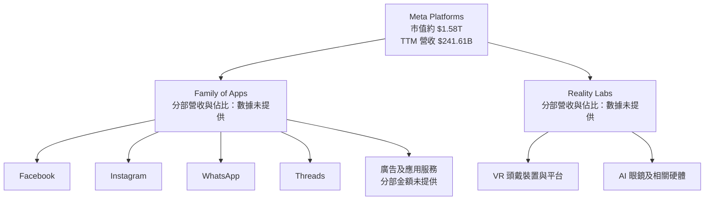
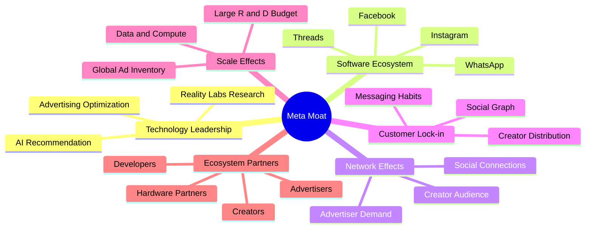
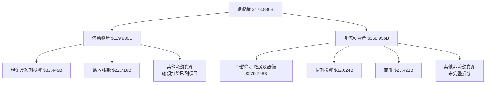
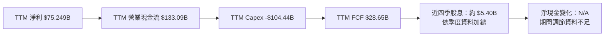
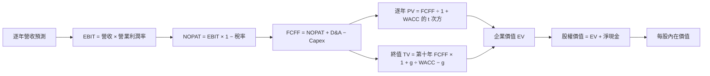
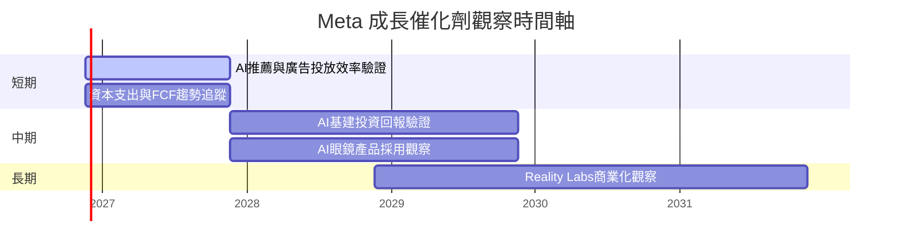
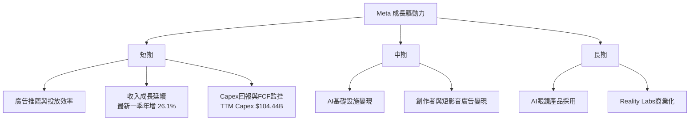
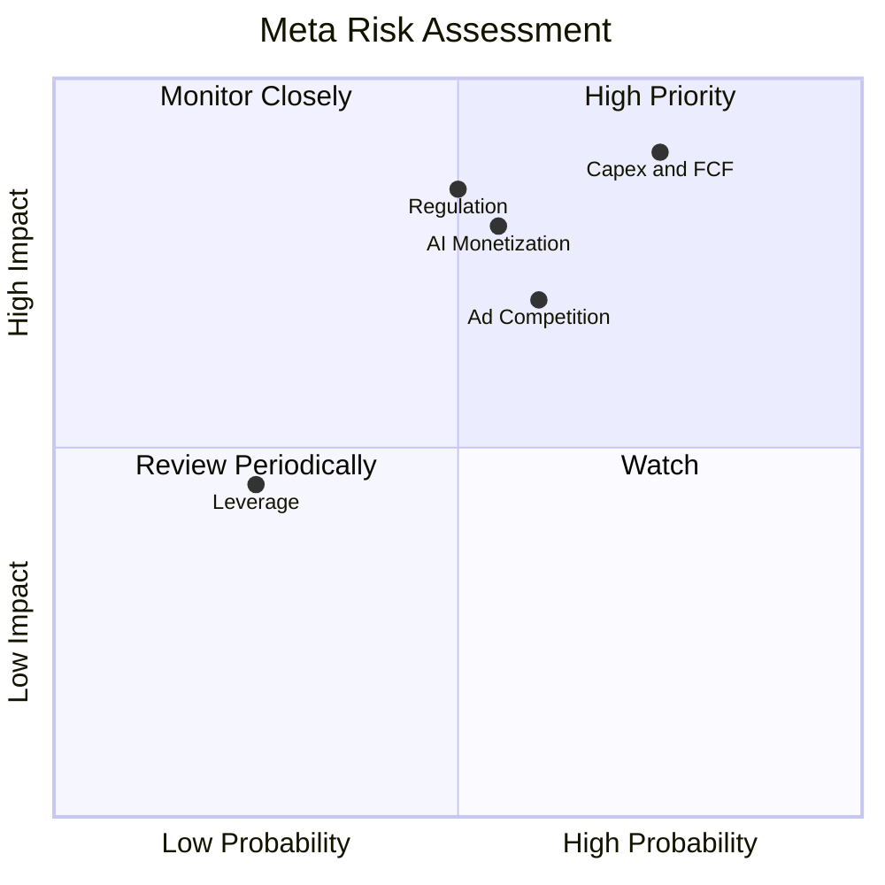
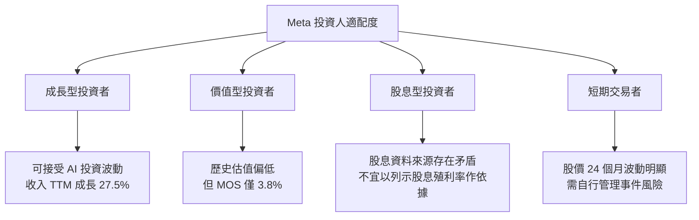

# META 基本面深度分析報告

> **報告日期**：2026-11-19 ｜ **語言**：繁體中文 ｜ **數據來源**：SEC 申報資料 (XBRL)、Yahoo Finance、Finviz、StockAnalysis、Roic.ai ｜ **分析師**：CFA 級機構研究

## 目錄

| # | 章節 | 核心結論 |
|---|------|----------|
| 1 | 執行摘要 | 持有；加權合理價值 $640.62，MOS 3.8% |
| 2 | 公司概覽與商業模式 | FoA 廣告平台具有網路效應；RL 投資回報仍不確定 |
| 3 | 損益表深度分析 | TTM 營收 $241.61B、成長 27.5%；季度營業利益率波動明顯 |
| 4 | 資產負債表分析 | VERIFIED 口徑淨負債 $1.22B，現金及短期投資 $82.45B |
| 5 | 現金流量深度分析 | TTM FCF $28.65B；Capex 升至 $104.44B，現金轉換受壓 |
| 6 | 獲利能力與資本效率 | ROIC 27.7% 高於 WACC 10.49%，仍創造價值 |
| 7 | 相對估值分析 | P/E 低於自身五年中位數；同業相對估值訊號分歧 |
| 8 | DCF 內在價值評估 | 基準 DCF $561.57；加權價值 $640.62，估值安全邊際有限 |
| 9 | 成長催化劑 | AI 廣告效率及推薦系統是近期主軸，TAM 數字未提供 |
| 10 | 風險矩陣 | Capex／FCF、監管、AI 投資回報為主要風險 |
| 11 | 投資建議 | 持有；現價接近加權合理價值，關注 FCF 與投資回報 |

---

## 1. 執行摘要

### 1.0 一頁式投資儀表板

| 項目 | 內容 |
|------|------|
| **投資論點（3 句）** | ① TTM 營收 $241.61B、年增 27.5%，最新一季年增 26.1%，廣告平台仍有成長動能。② TTM ROIC 27.7% 高於 WACC 10.49%，估計資本報酬仍高於資本成本。③ TTM Capex $104.44B，使 FCF 降至 $28.65B、FCF Yield 僅 1.82%，AI 基建支出能否轉成營收與現金流是關鍵。 |
| **綜合評分** | **6.9/10**（引用 1.1 評分卡） |
| **財務健康** | 🟡 VERIFIED 淨負債 $1.22B，但現金及短期投資 $82.45B；流動性尚可，債務口徑存在其他來源差異。 |
| **ROIC vs WACC** | **27.7% vs 10.49%**；高於資本成本 17.21 個百分點，代表目前仍創造股東價值。 |
| **FCF 趨勢** | TTM FCF $28.65B，受高額 Capex 壓縮；FCF Yield **1.82%**。 |
| **估值** | Forward P/E **17.28x** ｜ EV/EBITDA **13.839x** ｜ FCF Yield **1.82%** |
| **DCF 內在價值（基準）** | **$561.57**；依公式現價相對 DCF 折溢價約 **+9.8%**，即現價較 DCF 基準高約 9.8%。DCF 資料另列每股價值較現價低 8.9%，該數字是價值相對現價的跌幅，不是折溢價。 |
| **安全邊際（MOS）** | **+3.8%＝($640.62 − $616.38) ÷ $640.62**；加權合理價值為 $640.62，安全邊際有限。 |
| **預期報酬（基準情境 12M）** | DCF 基準情境相對現價 **-8.9%**；加權合理價值上行空間 **+3.9%**。兩者方法與分母不同。 |
| **關鍵風險（前二）** | 資本支出升高令 FCF 受壓；廣告及 AI 相關投資的成長回報不確定。 |
| **評級 + 信心度** | 🟡 **持有** ｜ 信心：中 |

### 1.1 綜合評分卡（全報告唯一）

| 維度 | 評分（1–10） | 主要依據（引用數字與其來源章節） |
|------|--------------|----------------------------------|
| 成長性 | 8.0 | TTM 營收成長 27.5%，最新一季年增 26.1%（第 3 章）。 |
| 獲利能力 | 7.5 | TTM 營業利益率 32.9%、ROIC 27.7%，但 Piotroski F-Score 僅 3/8（第 3、6 章）。 |
| 財務健康 | 6.0 | VERIFIED 淨負債 $1.22B、現金及短期投資 $82.45B；DSO 34 天，DIO 與 CCC 無資料（第 4 章）。 |
| 估值 | 5.0 | MOS 3.8%；P/E 21.0x 低於自身五年中位數 24.5x，但不同估值方法差異大（第 7、8 章）。 |
| 護城河 | 8.5 | FoA 網路效應與廣告規模有支撐，TTM 毛利率 81.0%；但市場份額與用戶分部數據未提供（第 2 章）。 |
| 管理層與資本配置 | 6.5 | FY2025 Capex $69.69B、SBC $20.43B；TTM Capex 升至 $104.44B，未來投資回報需驗證（第 5 章）。 |
| **綜合評分** | **6.9** | 六項算術平均：(8.0 + 7.5 + 6.0 + 5.0 + 8.5 + 6.5) ÷ 6 = 6.9167，四捨五入至一位小數為 6.9。 |

### 1.2 五大投資論點 + 三大核心風險

| 類型 | 項目 | 具體依據 | 信心度 |
|------|------|----------|--------|
| 🟢 **投資論點①** | 營收維持高成長 | TTM 營收 $241.61B、年增 27.5%；最新一季收入年增 26.1%。 | 🟢 高 |
| 🟢 **投資論點②** | 資本回報高於資本成本 | ROIC 27.7% vs WACC 10.49%，利差 17.21 個百分點。 | 🟢 高 |
| 🟢 **投資論點③** | 高毛利業務具規模經濟 | TTM 毛利率 81.0%、淨利率 31.1%；收入增加可支撐高固定成本攤薄。 | 🟢 中高 |
| 🟢 **投資論點④** | 資產負債表保有流動性 | 現金及短期投資 $82.45B；VERIFIED 淨負債僅 $1.22B。 | 🟢 中高 |
| 🟢 **投資論點⑤** | 自身估值低於歷史中位數 | P/E 21.0x，低於自身五年中位數 24.5x；但仍不代表低於所有同業。 | 🟡 中 |
| 🟡 **風險①** | AI／資料中心投資回收慢 | TTM Capex $104.44B，FCF $28.65B；若收入增量不足，FCF Yield 可能繼續下降。 | 🟡 中高 |
| 🔴 **風險②** | 盈利與資本支出波動 | 最新季資料中的營業利益率口徑互相矛盾，且季度 FCF 出現 -$1.16B。 | 🔴 高衝擊 |
| 🟡 **風險③** | 監管及平台競爭 | 廣告平台受隱私、反壟斷與用戶注意力競爭影響；量化財務衝擊尚無足夠資料。 | 🟡 中 |

### 1.3 快速統計卡片

| 指標 | 公司實際值（期間） | 同業中位數 | 狀態 |
|------|--------------------|------------|------|
| 營收成長（TTM） | **27.5%** | — | 🟢 |
| 營收成長（最新一季年增） | **26.1%** | 14.3% | 🟢 |
| 毛利率（TTM） | **81.0%** | 60.9% | 🟢 |
| 營業利益率（TTM） | **32.9%** | — | 🟢 |
| ROIC（TTM） | **27.7%** | — | 🟢 |
| Forward P/E | **17.28x** | 7.8x | 🟡 |
| FCF Yield（TTM） | **1.82%** | — | 🔴 |
| Piotroski F-Score | **3 / 8** | — | 🟡 |

*同業中位數取 GOOG、SNAP、PINS 的可用數據：最新一季收入成長中位數為 14.3%，毛利率中位數為 60.9%，Forward P/E 中位數為 7.8x。公司 Forward P/E 與同業中位數的差距需結合獲利品質與同業盈利結構判斷，不能單以倍數推論低估或高估。*

### 1.4 投資結論

```text
╔══════════════════════════════════════════════════════════════════╗
║                    📊 投資結論摘要                               ║
╠══════════════════════════════════════════════════════════════════╣
║  評級：持有（依 MOS 門檻）                                       ║
║  價格（2026-11-18 收盤）：$616.38                                ║
║  DCF 內在價值（基準）：$561.57（現價相對 DCF 溢價約 +9.8%）      ║
║  安全邊際 MOS：+3.8%（＝(加權合理價值−現價)÷加權合理價值）      ║
║  加權合理價值（8.8）：$640.62                                    ║
║  DCF 情境價值：                                                   ║
║    悲觀情境：$188.58（-69.4%）                                   ║
║    基準情境：$561.57（-8.9%）                                    ║
║    樂觀情境：$1,365.47（+121.5%）                                ║
║  綜合評分：6.9/10（引用 1.1）                                    ║
║  適合投資人：可承受高投資支出波動的長線成長型投資人               ║
╚══════════════════════════════════════════════════════════════════╝
```

---

## 2. 公司概覽與商業模式

### 2.1 業務結構與收入來源

公司以 Family of Apps（FoA）及 Reality Labs（RL）營運。提供的收入資料未按 FoA、RL 分部拆分，故不能可靠計算各分部收入或佔比。公司整體市值約 $1.58T，TTM 營收 $241.61B。



Meta 的主要收入來源為廣告相關服務，但提供資料未列廣告、硬體或其他收入的分項金額；本報告不推算其收入佔比。

### 2.2 市場份額

**市場份額數據未提供**，因此不以推算比例製作圖表。就提供的公司資料而言，Meta TTM 營收成長 27.5%、最新一季收入年增 26.1%，高於 GOOG、SNAP、PINS 最新一季收入成長中位數 14.3%；但收入成長不能直接等同市場份額變化。

### 2.3 競爭護城河分析



### 2.4 護城河強度

| 護城河項目 | 強度（強／中／弱） | 證據（引用數字或事實） | 會削弱它的情況 |
|------------|--------------------|------------------------|----------------|
| 網路效應 | 強 | Facebook、Instagram、WhatsApp 等產品提供社交連結與傳播網絡；公司 TTM 營收 $241.61B。 | 用戶轉向新平台、年輕用戶參與度下降或社交關係圖被替代。 |
| 廣告規模與數據 | 強 | TTM 毛利率 81.0%、營業利益率 32.9%，顯示高毛利平台及規模特徵。 | 隱私限制、廣告追蹤能力下降、廣告主轉移預算。 |
| 技術與 AI | 中強 | FY2025 R&D $57.37B；AI 投資可能改善推薦與廣告排序，但回報仍需觀察。 | 投資成本增加而廣告效率、營收或利潤率未同步改善。 |
| 軟體生態系 | 中強 | 多款社交與通訊產品可互相引導流量；各產品用戶與收入貢獻未提供。 | 競爭者在短影音、通訊或創作者內容上更能吸引用戶。 |
| 客戶鎖定 | 中 | 社交關係與內容歷史提高轉換摩擦，但使用者可同時使用多個平台。 | 多平台使用增加、內容與社交網絡易於遷移。 |
| 生態夥伴 | 中 | 廣告主、創作者及硬體合作構成商業生態；具體夥伴收入占比未提供。 | 廣告主集中度風險、創作者分流或硬體需求低於預期。 |

**1.1 護城河評分 8.5/10**，依據是 81.0% TTM 毛利率、32.9% TTM 營業利益率及跨產品網路效應；未給更高評分，是因分部收入、用戶留存及市場份額資料不足，且競爭與監管可能削弱平台效應。

---

## 3. 損益表深度分析

### 3.1 年度收入成長趨勢（近4年）

年度收入及毛利採年報摘要所列數字；FY2022 至 FY2025 CAGR 以端點計算。

```text
╔══════════════════════════════════════════════════════════════════╗
║              Meta 年度收入趨勢（FY2022-FY2025）                  ║
╠══════════════════════════════════════════════════════════════════╣
║  FY2022  $116.61B  ████████████░░░░░░░░  YoY: -1.12%  🔴       ║
║  FY2023  $134.90B  ██████████████░░░░░░  YoY: +15.69% 🟢       ║
║  FY2024  $164.50B  █████████████████░░░  YoY: +21.94% 🟢       ║
║  FY2025  $200.97B  ████████████████████  YoY: +22.17% 🟢       ║
╠══════════════════════════════════════════════════════════════════╣
║  FY2022 至 FY2025 CAGR：($200.97B ÷ $116.61B)^(1/3) − 1 ≈ 19.9%║
╚══════════════════════════════════════════════════════════════════╝
```

FY2022 收入下滑 1.12%，其後兩年成長加速，FY2025 收入增至 $200.97B。TTM 成長率 27.5% 高於 FY2025 年增 22.17%，顯示近期收入增速加快；但成長延續性仍要檢視廣告需求、AI 推薦效果與基期。

### 3.2 季度收入趨勢分析

QoQ 以該季收入除以前一季收入減一；YoY 使用同季同比數據。Q4 2025 的 QoQ 依提供的 Q1 2026 收入倒算，反映跨季比較而非季節調整。

| 季度 | 營收（$B） | QoQ | YoY | 備註 |
|------|------------:|----:|----:|------|
| 2025 Q4 | 59.893 | +41.6% | +23.78% | QoQ 以 Q3 2025 $42.314B 為比較基期，季節性明顯。 |
| 2026 Q1 | 56.311 | -6.0% | +33.08% | 季度收入回落，但同比增幅仍高。 |
| 2026 Q2 | 60.801 | +8.0% | +27.96% | QoQ 恢復成長，YoY 低於 Q1。 |
| 2026 Q3 | 64.601 | +6.3% | +26.07% | 收入創表列四季最高，年增率仍在 26% 以上。 |

*營收數字與同比率採 StockAnalysis 季度資料；VERIFIED LATEST QUARTER YoY 為 26.1%，與 26.07% 四捨五入一致。*

### 3.3 利潤率演變分析

| 利潤率指標 | FY2022 | FY2023 | FY2024 | FY2025 | 趨勢 | 評估 |
|------------|--------|--------|--------|--------|------|------|
| **毛利率** | 78.3% | 80.8% | 81.7% | 82.0% | 近年逐步改善 | 🟢 |
| **營業利益率** | 24.8% | 34.7% | 42.2% | 41.4% | 2023–2024 擴張，2025 小幅回落 | 🟡 |
| **淨利率** | 19.9% | 29.0% | 37.9% | 30.1% | FY2024 高點後下降 | 🟡 |

*毛利率與利潤率按提供的年度毛利、營業利益、淨利及營收計算；年度資料與 TTM 口徑並不完全一致。TTM 毛利率、營業利益率及淨利率以 VERIFIED FIGURES 的 81.0%、32.9%、31.1% 為準。*

營業利益率 2024–2025 的下降，反映營業費用增長快於收入的可能性，但單憑已列數字無法拆分人事、研發、基礎設施或其他費用貢獻。最新季度營業利益率的資料存在重大衝突：VERIFIED FIGURES 為 20.1%，其他損益表來源按 $22.878B ÷ $64.601B 得 35.4%，另有摘要列 37.8%。本報告不將其混為同一口徑；季度趨勢分析以分子、分母原值作參考，估值及 TTM 分析採 VERIFIED 的 32.9%。

### 3.4 費用結構分析

費用細項無法完整核對：提供資料只有 FY2025 R&D $57.37B，未列足以構成完整費用分解的銷售及管理費、其他營業費用等項目。為避免以部分費用冒充全部支出，**不製作費用結構圓餅圖**。

已知 FY2025 R&D 為 $57.37B，約占當年營收 $200.97B 的 28.5%。較高研發投入能支援 AI、推薦系統與硬體研發，但若研發與基礎設施未帶動新增廣告價值或新收入，會壓縮利潤率與 FCF。

### 3.5 季度 EPS 趨勢與盈餘品質（Quality of Earnings）

季度 EPS 歷史資料列出實際 EPS，但 EPS Est 欄為 NaN，因此**無法判定最近四季是否超預期或不及預期**。表中 EPS 與公司季度淨利在部分季度口徑並不一致，故不以它們計算盈餘驚喜幅度。

| 季度 | EPS 實際值（來源列示） | EPS 預期值 | 超預期／不及預期 |
|------|----------------------:|-----------:|------------------|
| 2025 Q4 | $8.88 | N/A | 無法判定：預期值缺漏 |
| 2026 Q1 | $10.44 | N/A | 無法判定：預期值缺漏 |
| 2026 Q2 | $6.18 | N/A | 無法判定：預期值缺漏 |
| 2026 Q3 | $3.83 | N/A | 無法判定：預期值缺漏 |

| 盈餘品質項目 | 數值／佔比 | 評估 |
|--------------|-----------|------|
| 股權薪酬 SBC / 營收 | 約 **11.1%**：四季 SBC ($7.36B + $7.66B + $6.03B + $5.89B) ÷ $241.61B | 🟡 SBC 相當於收入的一成以上；GAAP 已將 SBC 作為費用，但仍代表股東經濟成本與潛在稀釋。 |
| SBC / 營業現金流 | 約 **20.2%**：$26.94B ÷ $133.09B | 🟡 SBC 金額約為營業現金流五分之一。 |
| FCF / 淨利（現金轉換率） | 約 **38.1%**：$28.65B ÷ $75.249B | 🔴 現金轉換率偏低，主要觀察點是高 Capex；不代表應將 Capex 加回。 |
| 一次性／非經常性損益 | N/A（無完整損益調節資料） | 無法確認當季淨利是否受一次性收益或費用明顯影響。 |
| 有效稅率異常 | 29.6%（最新年度有效稅率） | 未提供足夠年度稅務明細判斷異常；DCF 使用此稅率。 |
| 資本化支出 vs 費用化 | TTM Capex $104.44B；FY2025 R&D $57.37B | Capex 以資產形式投入並經折舊反映；R&D 費用化情況不能據摘要完整拆分，不能據此認定盈餘被虛增。 |

**盈餘品質結論**：TTM 營業現金流 $133.09B、FCF $28.65B，GAAP 獲利有營運現金流支持，但高額 Capex 使自由現金轉換率僅約 38.1%。估值應重視資本支出的回報效率，不宜單看 EPS 或淨利增幅。

---

## 4. 資產負債表分析

### 4.1 資產結構分解

最新季度資產總額 $478.836B、流動資產 $119.900B；非流動資產由總額扣除流動資產得 $358.936B。下圖只列有資料的項目，其他非流動項目未拆分。



### 4.2 流動性與營運資金分析

| 指標 | 最新 TTM／期末 | 一年前 | 變化 | 解讀 |
|------|----------------:|------:|------:|------|
| 流動比率 | 1.903x（提供資料） | N/A | N/A | 當期流動資產高於流動負債；未提供可比的同口徑歷史比率。 |
| DSO 應收帳款天數 | 34 天 | 33 天 | +1 天 | 收款天數略增，幅度有限；應收帳款由 $16.169B 增至 $22.716B，但收入亦增長。 |
| DIO 存貨天數 | N/A | N/A | N/A | 公司未報告可用存貨餘額，不推估。 |
| DPO 應付帳款天數 | 152 天 | N/A | N/A | 一年前數值缺漏，無法判斷趨勢；較長付款天數可能反映供應商付款條件，不能單憑此數認定議價力。 |
| CCC 現金轉換週期 | N/A | N/A | N/A | DIO 缺漏，按來源標示 N/A，不代入推算。 |

QUALITY FIGURES 的工作資本天數為固定來源值，本文照錄；不以其他資料重新估算。

### 4.3 債務結構分析

```text
╔══════════════════════════════════════════════════════════════════╗
║                  Meta 債務健康診斷                               ║
╠══════════════════════════════════════════════════════════════════╣
║  VERIFIED 總債務：             $83.67B                           ║
║  現金及短期投資：              $82.45B                           ║
║  VERIFIED 淨負債：             $1.22B                            ║
║                                                                  ║
║  另一市場資料口徑總債務：      $114.84B                          ║
║  另一市場資料口徑淨負債：      $32.39B                           ║
║  ⚠️ 債務來源口徑差異：兩組數據不一致，估值採 VERIFIED 口徑。     ║
║                                                                  ║
║  Debt/EBITDA：N/A（債務口徑存在差異，且 EBITDA 基期不一致）      ║
║  利息保障倍數：N/A（未提供利息費用及可核對分子）                 ║
╚══════════════════════════════════════════════════════════════════╝
```

VERIFIED 資料採總債務 $83.67B、淨負債 $1.22B；市場資料另列總債務 $114.84B、淨負債 $32.39B。此差異可能涉及債務與租賃負債口徑，但提供資料不足以對帳，故不混用。現金與短期投資 $82.45B 對流動性提供緩衝，然而不能因此忽略債務口徑差異。

### 4.4 股東權益趨勢

| 年度 | 股東權益（$B） | 年變化 | 解讀 |
|------|---------------:|--------:|------|
| 2022 | 125.71 | — | 起始比較基期。 |
| 2023 | 153.17 | +21.9% | 權益增加，與獲利累積相符。 |
| 2024 | 182.64 | +19.2% | 延續增加。 |
| 2025 | 217.24 | +19.0% | FY2025 淨利 $60.46B，但股東權益變化亦受回購、股息及其他項目影響。 |

---

## 5. 現金流量深度分析

### 5.1 現金流量瀑布圖

完整 TTM 淨利至現金與淨負債變化的調節表未提供；因此圖中只連接有資料的項目，不製造股息、回購或淨現金變化金額。



### 5.2 FCF 轉換率趨勢

| 年度 | FCF（$B） | 淨利（$B） | FCF / 淨利 | 評估 |
|------|----------:|-----------:|-----------:|------|
| 2022 | 19.29 | 23.20 | 83.1% | 🟡 |
| 2023 | 44.07 | 39.10 | 112.7% | 🟢 |
| 2024 | 54.07 | 62.36 | 86.7% | 🟢 |
| 2025 | 46.11 | 60.46 | 76.3% | 🟡 |
| TTM 至 2026-09-30 | 28.65 | 75.249 | 38.1% | 🔴 |

FY2025 FCF 年減約 14.7%，而 TTM FCF 進一步低於 FY2025；主要財務觀察是 TTM Capex 已達 $104.44B。資料未提供完整建設進度或投資回報拆分，不能把支出上升直接判定為低效，但應要求未來廣告營收、營業利潤和 FCF 能證明回報。

### 5.3 自由現金流趨勢

```text
╔══════════════════════════════════════════════════════════════════╗
║                 Meta 自由現金流趨勢                               ║
╠══════════════════════════════════════════════════════════════════╣
║  FY2022  $19.29B  ███████░░░░░░░░░░░░░░░░  FCF Yield：N/A       ║
║  FY2023  $44.07B  ████████████████░░░░░░░░  FCF Yield：N/A       ║
║  FY2024  $54.07B  ████████████████████░░░░  FCF Yield：N/A       ║
║  FY2025  $46.11B  █████████████████░░░░░░░  FCF Yield：N/A       ║
║  TTM     $28.65B  ███████████░░░░░░░░░░░░░  FCF Yield：1.82%    ║
╠══════════════════════════════════════════════════════════════════╣
║  TTM FCF = $133.09B − $104.44B = $28.65B                        ║
╚══════════════════════════════════════════════════════════════════╝
```

歷年年度 FCF Yield 未提供一致市值基準，故不反推。TTM FCF Yield 按 VERIFIED 值為 1.82%，表示以目前市值衡量的現金收益率較低。

### 5.4 資本配置評估

資本支出與股息有數據；回購、投資及留存現金的完整年度分配金額未提供，不製作比例圓餅圖。

| 項目 | 已知金額 | 分析 |
|------|---------:|------|
| Capex | TTM $104.44B；FY2025 $69.69B | TTM 高於 FY2025 全年數字，代表近期支出強度提高；需用未來新增收入和現金流檢驗回報。 |
| 股息 | FY2025 $5.32B；近四季合計約 $5.40B | 相較 TTM OCF 規模有限，股息不是主要現金用途。 |
| SBC | FY2025 $20.43B；近四季約 $26.94B | 影響股東經濟報酬；不能只以非現金項目為由忽略稀釋成本。 |
| 回購 | N/A | 未提供可用的回購現金流數據。 |
| 投資與留存 | N/A | 未提供完整資本配置明細。 |

---

## 6. 獲利能力與資本效率

### 6.1 ROE / ROA / ROIC 趨勢

| 指標 | 最新 TTM | 歷史可用資料 | 評估 |
|------|---------:|--------------|------|
| ROE | 27.6%（QUALITY FIGURES） | Yahoo 摘要另列 32.3%，口徑衝突 | 🟡 採用 VERIFIED 27.6%；不混用不同供應商值。 |
| ROA | 14.6%（市場資料摘要） | 歷史同口徑趨勢未完整提供 | 🟢 盈利資產報酬為正。 |
| ROIC | 27.7%（VERIFIED） | Roic.ai 歷史資料提供部分歷史值，但期間口徑不足以無縫比較 | 🟢 明顯高於 WACC。 |

行業均值未提供，故不列行業均值比較。ROE 的 27.6% 與 32.3% 有來源差異，本報告為保持全篇一致，杜邦分析採 QUALITY FIGURES 的 27.6%。

### 6.2 ROIC vs WACC 分析（核心價值創造判斷）

```text
╔══════════════════════════════════════════════════════════════════╗
║                ROIC vs WACC 深度分析                            ║
╠══════════════════════════════════════════════════════════════════╣
║  WACC（程式計算來源值）：10.49%                                  ║
║  ├── 無風險利率（10Y 美債）：5.07%                               ║
║  ├── ERP：5.00%                                                  ║
║  ├── 原始 Beta：1.28                                             ║
║  ├── 調整 Beta：1.19 = ⅔ × 1.28 + ⅓ × 1.00                     ║
║  ├── 股權成本（來源值）：11.00%                                  ║
║  ├── 稅前債務成本：1.39%；稅後約 0.98%                           ║
║  ├── 股權／債務權重：95.0%／5.0%                                 ║
║  └── 採用 WACC：10.49%                                           ║
║                                                                  ║
║  ROIC（TTM）：27.7%                                               ║
║  EVA spread = ROIC − WACC = 27.7% − 10.49% = +17.21 個百分點     ║
║                                                                  ║
║  ROIC  27.7%  ▓▓▓▓▓▓▓▓▓▓▓▓▓▓▓▓▓▓▓▓▓▓▓▓▓▓░░░░░░  🟢             ║
║  WACC  10.49% ▓▓▓▓▓▓▓▓▓▓▓▓░░░░░░░░░░░░░░░░░░░░  ──             ║
║                                                                  ║
║  結論：ROIC 高於 WACC，現有資本配置仍創造經濟價值。             ║
╚══════════════════════════════════════════════════════════════════╝
```

數據來源提供的 CAPM 權益成本、債務成本、權重及 WACC 為計算輸入。以公布的四捨五入值直接代入 CAPM 得 5.07% + 1.19 × 5.00% = 11.02%，與來源列示 11.00% 有 0.02 個百分點差異；採用程式計算指定 WACC **10.49%**，不另行重算或替換。ROIC 比 WACC 高 17.21 個百分點，若該報酬可持續，增量投資有創造價值的基礎；但高 Capex 對未來 ROIC 的影響尚待驗證。

### 6.3 杜邦三因素分解

| 因素 | 數值（TTM） | 解讀 |
|------|-------------|------|
| 淨利率 | 31.1% | 高淨利率是 ROE 的主要來源之一。 |
| 資產週轉率 | 0.50 | 每單位資產所產生收入的效率；受大量基建資產增加影響。 |
| 權益乘數 | 1.76 | 有槓桿但未顯示 ROE 主要依賴極高槓桿。 |
| **ROE** | **27.6%** | 31.1% × 0.50 × 1.76 約等於 27.4%；來源列示 ROE 27.6%，差異來自輸入四捨五入。 |

### 6.4 財務體質：Piotroski F-Score

| 測試 | 結果 | 解讀 |
|------|------|------|
| ROA > 0 | 通過 | TTM 資產報酬為正。 |
| 營業現金流 > 0 | 通過 | TTM OCF $133.09B。 |
| ROA 高於一年前 | 未通過 | 資產報酬未較比較期間提升。 |
| 營業現金流 > 淨利 | 通過 | OCF 高於 TTM 淨利，顯示應計品質測試通過。 |
| 長期負債 ÷ 總資產低於一年前 | 未通過 | 負債比率測試未改善。 |
| 流動比率高於一年前 | 未通過 | 流動性指標相較比較期未提升。 |
| 稀釋股數未增加 | 未通過 | 稀釋股數增加，顯示 SBC 等因素有股數成本。 |
| 毛利率高於一年前 | 無法判定 | 缺少測試所需輸入。 |
| 資產週轉率高於一年前 | 未通過 | 資產週轉率較比較期未改善。 |

Piotroski F-Score 為 **3/8**；一項測試因缺資料排除。分數偏低不等同公司瀕危，但指出資產效率、負債與稀釋趨勢未全面改善，應與 ROIC、現金流一起判讀。

---

## 7. 相對估值分析

### 7.1 同業估值比較表格

Meta 倍數採市場資料；同業倍數採 Yahoo Finance Peer multiples。

| 估值指標 | **META** | **GOOG** | **SNAP** | **PINS** | 本公司評估 |
|----------|---------:|--------:|--------:|--------:|-----------|
| **Trailing P/E** | 21.0x | 14.6x | N/A | 73.7x | 🟡 高於 GOOG，低於 PINS；公司盈利品質及成長需同時考量。 |
| **Forward P/E** | 17.28x | 18.3x | 6.9x | 7.8x | 🟡 高於三家提供的倍數；同業極低倍數可能包含盈利或資料口徑差異。 |
| **P/S Ratio** | 6.52x | 7.3x | 1.4x | 2.2x | 🟢 低於 GOOG，但高於 SNAP、PINS；須結合 Meta 81.0% 毛利率。 |
| **EV/EBITDA** | 13.839x | 18.0x | 56.8x | 33.3x | 🟢 低於三家同業列示值；同業中位數受 SNAP 高倍數影響。 |
| **最新一季營收年增** | 26.1% | 24.7% | 14.3% | 11.9% | 🟢 Meta 成長率高於所列三家。 |
| **毛利率（TTM）** | 81.0% | 60.9% | 59.2% | 79.0% | 🟢 Meta 高於所列同業。 |

Meta Forward P/E 高於 Peer multiples 中位數 7.8x，但相對 EV/EBITDA 低於同業所列倍數。兩種倍數結論相反，可能由同業盈利差異與 SNAP、PINS 倍數偏高所致，不應只選對自身有利的倍數下結論。

### 7.2 歷史估值區間分析

```text
╔══════════════════════════════════════════════════════════════════╗
║                META 五年歷史估值位置（TTM）                      ║
╠══════════════════════════════════════════════════════════════════╣
║  P/E        12.9x ├──────── 21.0x ───────●────── 33.4x           ║
║                      中位數 24.5x ｜目前百分位 24%               ║
║                                                                  ║
║  P/S         2.8x ├──────── 6.6x ─────●──────── 10.6x            ║
║                      中位數 7.7x ｜目前百分位 38%                ║
║                                                                  ║
║  EV/EBITDA   7.7x ├──────── 15.2x ────●─────── 19.7x            ║
║                      中位數 16.5x ｜目前百分位 33%               ║
╚══════════════════════════════════════════════════════════════════╝
```

三個倍數目前均低於各自五年中位數，P/E 百分位為 24%。這顯示相對自身歷史的估值較低，但不能抵銷 FCF Yield 1.82% 與高資本支出的風險。

### 7.3 情境價值（Bear / Base / Bull）

| 情境 | 第 1 年營收成長 | 期末營業利潤率 | WACC | 每股價值 | 相對現價 | 機率 | 會發生的條件 |
|------|----------------:|----------------:|-----:|----------:|----------:|-----:|--------------|
| 🔴 悲觀 | 13.8% | 29.5% | 11.49% | $188.58 | -69.4% | 25% | 廣告成長降速、投資費用高企，利潤率下滑且資本成本上升。 |
| 🟡 基準 | 27.5% | 34.7% | 10.49% | $561.57 | -8.9% | 50% | 高成長逐步下降，長期利潤率回升至模型假設，Capex 比率漸降。 |
| 🟢 樂觀 | 41.3% | 38.1% | 9.49% | $1,365.47 | +121.5% | 25% | AI 廣告變現顯著、收入高增長延續，利潤率擴張、資本成本下降。 |

情境每股價值與假設照錄 DCF 模型。三種情境差距很大，說明估值對成長率、期末利潤率及 WACC 高度敏感；機率加權 $669.29 僅供背景參考，不取代第 8.8 節規定的基準 DCF 權重。

### 7.4 相對估值隱含價格區間

```text
╔══════════════════════════════════════════════════════════════════╗
║             相對估值隱含價格與現價位置                           ║
╠══════════════════════════════════════════════════════════════════╣
║  $278.25          $561.57       $616.38       $848.23       $1,046.42
║  同業 Forward P/E  基準 DCF      現價          共識目標價    同業 EV/EBITDA
╚══════════════════════════════════════════════════════════════════╝
```

| 方法 | 每股價值 | 相對現價 | 依據 |
|------|---------:|---------:|------|
| DCF（基準） | $561.57 | -8.9% | 10 年 FCFF、WACC 10.49%、永續成長率 3.0%。 |
| 同業 Forward P/E | $278.25 | -54.9% | 同業中位數 7.8x × Meta Forward EPS $35.68。 |
| 同業 EV/EBITDA | $1,046.42 | +69.8% | GOOG、PINS 同業中位數 25.7x × TTM EBITDA，再加回淨現金。 |
| 分析師共識 | $848.23 | +37.6% | 58 位分析師平均目標價。 |

---

## 8. DCF 內在價值評估（Discounted Cash Flow）

### 8.0 估值推理鏈（Thinking Logic）

**Step 1 — 價值來源與主導變數**

Meta 的價值主要由 FoA 廣告現金流底盤、AI 改善廣告推薦與效率的成長效應，以及 RL 新產品選擇權構成。提供資料未列 FoA、RL 的分部收入，故不能以百分比拆分其占比；已知整體 TTM 營收為 $241.61B。模型中最主導價值的變數是長期 FCFF，尤其 Capex 率與終值假設：終值現值占 EV 80.5%，其敏感度高於單一年度現金流。

**Step 2 — 模型選擇**

| 決策點 | 本報告採用 | 理由（含數字） | 曾考慮但否決 | 否決理由 |
|--------|-----------|----------------|--------------|----------|
| 現金流定義 | FCFF | 對應 WACC 折現及 EV；模型提供完整逐年 FCFF。 | FCFE | 模型提供的是 FCFF，不能自行改成股權現金流。 |
| 預測期 N | 10 年 | DCF 模型固定列出 FY+1 至 FY+10，且投資支出需要時間淡出。 | 5 年 | 與既定模型不符，且會改變終值起點。 |
| 終值方法 | Gordon Growth | DCF 模型提供 g = 3.0% 的終值。 | 自行以退出倍數主估 | 模型未提供退出倍數終值數字，不補建第二套模型。 |
| EBIT 基礎 | GAAP EBIT | 模型明示採 GAAP EBIT。 | 非 GAAP EBIT | 可能加回 SBC 並造成重複計算或忽略成本。 |

**Step 3 — 關鍵假設推導鏈**

- **收入成長路徑**：錨點為 TTM 營收成長 27.5%、FY2025 年增 22.17%；近期加速支持模型 FY+1 使用 27.5%，其後線性淡化至 FY+10 的 3.0%。模型未提供固定 CAGR，而採逐年下降的增長曲線。否決將 27.5% 外推十年，因為那會忽略成熟度與基數效應。
- **期末營業利潤率**：錨點為 TTM 營業利益率 32.9%，模型 FY+10 為 34.7%。採用理由是模型假定成本效率與規模效益支持逐步改善；否決沿用年度摘要曾出現的 41.4% 作為終值利潤率，因年度來源與 TTM 口徑不一致，且缺乏可持續性證據。
- **終值成長率 g**：採 3.0%，低於 WACC 10.49%，使 Gordon Growth 分母為正。這是模型指定值；高於 3.0% 會推升終值，而敏感度表顯示影響明顯。否決更高永續成長率，因長期企業增速不能無限高於成熟經濟。
- **預測期 N**：採 10 年，與模型輸出一致；目的在反映高投資期與收入成長逐步回落。否決自行改成 5 年，因會更改模型結果。
- **Capex／營收**：由 FY+1 的 43.2% 逐步淡化至 FY+10 的 11.3%。錨點是 TTM Capex $104.44B ÷ TTM 營收 $241.61B，約 43.2%；模型假定高資本支出率逐步下降至約 1.1 倍 D&A。否決把當前比率固定十年，因模型認為建設期支出將正常化；這是整條估值鏈最具爭議的假設之一。
- **有效稅率**：採 29.6%，為最新年度有效稅率；不另調整。
- **D&A／營收**：採 10.3%，以 TTM 數值為模型錨點並維持不變。
- **EBIT 與 SBC**：採 GAAP EBIT，SBC 已計入營業費用；本模型採用 **(A) GAAP EBIT + 固定股數**，故 FCFF 不再扣 SBC、股數不再作年度稀釋。SBC 影響在 EBIT 中計入一次。
- **ΔWC**：模型明示不建模營運資金變動；不是估計為零後再加回，而是模型沒有此項。
- **WACC**：採程式指定 10.49%；依據及來源差異見 8.2。否決自行用四捨五入輸入重算取代該值。

**Step 4 — 最脆弱一環**

最脆弱假設是 Capex／營收由 43.2% 降至 11.3%，以及 3.0% 永續成長能在第十年後成立；若資本支出率維持高位，FCFF 與估值將明顯下修。

**Step 5 — 計算路徑圖**



### 8.1 模型假設總表（Model Inputs）

| 假設項目 | 採用值 | 依據／來源 | 敏感度 |
|----------|--------|-------------|--------|
| 預測期長度 **N** | 10 年 | DCF 模型逐年列出 FY+1 至 FY+10。 | 🟡 中 |
| 營收成長路徑 | 27.5% 降至 3.0% | 起點取 TTM 成長 27.5%；逐年線性淡化至模型第十年 3.0%。 | 🔴 高 |
| 營業利益率 | 32.9% 至 34.7% | TTM 32.9% 為起點；模型長期淡化至五年財年中位數 34.7%。 | 🔴 高 |
| 有效稅率 | 29.6% | 最新年度有效稅率。 | 🟢 低 |
| Capex／營收 | 43.2% 至 11.3% | 起點為 TTM Capex／營收；後續逐步淡化至約 1.1 倍 D&A。 | 🔴 高 |
| D&A／營收 | 10.3% | TTM，模型維持常數。 | 🟢 低 |
| 營運資金變動／營收增額 | 不建模 | DCF 模型明示 Working capital is not modelled。 | 🟢 低 |
| EBIT 基礎 | GAAP | DCF 模型採 GAAP EBIT。 | 🟡 中 |
| SBC 處理 | GAAP EBIT 已扣除 SBC；不再扣 SBC | 模型設定；避免重複扣除。 | 🟡 中 |
| 年稀釋率 | 0%（固定股數設定） | 組合 A：GAAP EBIT + 固定股數；模型每股轉換以既定市值與價格比率處理。 | 🟡 中 |
| 永續成長率 g | 3.0% | DCF 模型指定；低於 WACC 10.49%。 | 🔴 高 |
| 終值方法 | Gordon Growth | DCF 模型已提供終值及 PV。退出倍數交叉驗證數值未提供，不能另建。 | 🔴 高 |
| WACC | 10.49% | Cost of capital 區塊指定值，見 8.2。 | 🔴 高 |

**FCFF 定義**：採 FCFF = NOPAT + D&A − Capex；營運資金變動不建模。因採組合 (A)，不另扣 SBC，也不再放大股數。

### 8.2 折現率推導（WACC）

```text
╔══════════════════════════════════════════════════════════════════╗
║                    WACC 推導（折現率）                           ║
╠══════════════════════════════════════════════════════════════════╣
║  股權成本 Ke（CAPM，來源列示）：11.00%                           ║
║  ├── 無風險利率 Rf：5.07%                                        ║
║  ├── ERP：5.00%                                                   ║
║  ├── 原始 Beta：1.28；調整 Beta：1.19                            ║
║  ├── Beta 調整：⅔ × 1.28 + ⅓ × 1.00 = 1.1867 ≈ 1.19             ║
║  └── CAPM：5.07% + 1.19 × 5.00% = 11.02%；來源 Ke = 11.00%       ║
║                                                                  ║
║  債務成本                                                       ║
║  ├── 稅前 Kd（來源）：1.39%                                      ║
║  ├── 有效稅率：29.6%                                             ║
║  └── 稅後 Kd：1.39% × (1 − 29.6%) = 0.9786% ≈ 0.98%             ║
║                                                                  ║
║  資本權重（來源）：股權 95.0%；債務 5.0%                         ║
║  WACC（採用來源值）：10.49%                                      ║
╚══════════════════════════════════════════════════════════════════╝
```

逐步演算及核對：

1. **Ke（CAPM）**：5.07% + 1.19 × 5.00% = 11.02%；來源列示 Ke 為 11.00%，差 0.02 個百分點，可能由未四捨五入輸入造成。
2. **稅前 Kd**：資料直接提供 1.39%。利息費用及平均計息負債的金額未提供，不能另行重算分子與分母。
3. **稅後 Kd**：1.39% × (1 − 29.6%) = 0.97856% ≈ 0.98%。
4. **權重**：股權 95.0% + 債務 5.0% = 100.0%。市值與債務來源的精確重算基礎存在口徑差異，故採來源列示權重。
5. 以四捨五入後輸入估算，95.0% × 11.00% + 5.0% × 0.97856% = 10.499%, 約 10.50%；來源指定 WACC 為 **10.49%**，本報告及 DCF 一律採用 10.49%，不以四捨五入輸入另造一個折現率。

Rf 的觀察日期未提供，ERP 為來源假設 5.00%，Beta 來自 Yahoo，且原始 Beta 1.28 經標準調整至 1.19；未加計額外規模或國別溢酬。第 6.2 與本節採用相同 WACC 10.49%。

### 8.3 逐年自由現金流預測（基準情境）

以下逐年表完全照錄 DCF 模型，金額單位為 $B，折現因子至小數三位。模型不納入營運資金變動，因而沒有 ΔWC 列。

| 年度 | FY+1 | FY+2 | FY+3 | FY+4 | FY+5 | FY+6 | FY+7 | FY+8 | FY+9 | FY+10 |
|------|-----:|-----:|-----:|-----:|-----:|-----:|-----:|-----:|-----:|------:|
| 營收 | 308.11 | 384.52 | 469.41 | 560.24 | 653.38 | 744.20 | 827.37 | 897.28 | 948.65 | 977.11 |
| 營收 YoY | 27.5% | 24.8% | 22.1% | 19.4% | 16.6% | 13.9% | 11.2% | 8.5% | 5.7% | 3.0% |
| 營業利潤率 | 32.9% | 33.1% | 33.3% | 33.5% | 33.7% | 33.9% | 34.1% | 34.3% | 34.5% | 34.7% |
| EBIT（GAAP） | 101.23 | 127.10 | 156.10 | 187.43 | 219.90 | 251.95 | 281.76 | 307.37 | 326.86 | 338.62 |
| − 稅 | (30.01) | (37.68) | (46.28) | (55.56) | (65.19) | (74.69) | (83.53) | (91.12) | (96.90) | (100.38) |
| = NOPAT | 71.22 | 89.43 | 109.83 | 131.87 | 154.71 | 177.26 | 198.24 | 216.25 | 229.97 | 238.24 |
| + D&A | 31.78 | 39.66 | 48.42 | 57.78 | 67.39 | 76.76 | 85.34 | 92.55 | 97.85 | 100.78 |
| − Capex | (133.19) | (152.59) | (169.65) | (182.64) | (189.85) | (189.88) | (181.79) | (165.37) | (141.24) | (110.86) |
| **= FCFF** | **-30.18** | **-23.51** | **-11.41** | **7.02** | **32.25** | **64.14** | **101.78** | **143.43** | **186.58** | **228.16** |
| 折現因子 | 0.905 | 0.819 | 0.741 | 0.671 | 0.607 | 0.550 | 0.497 | 0.450 | 0.407 | 0.369 |
| **FCFF 現值 PV** | **-27.32** | **-19.26** | **-8.46** | **4.71** | **19.58** | **35.25** | **50.63** | **64.57** | **76.02** | **84.14** |

預測期現值合計，依模型逐年 PV 加總：

**-$27.32 − $19.26 − $8.46 + $4.71 + $19.58 + $35.25 + $50.63 + $64.57 + $76.02 + $84.14 = $279.86B**

逐步演算，以 FY+1 為例：

1. **營收** = $241.61B × (1 + 27.5%) = $308.11B（依模型列示）。
2. **EBIT** = $308.11B × 32.9% = $101.23B（依模型列示）。
3. **稅** = $101.23B × 29.6% = $29.96B；模型列示 $30.01B，顯示模型使用未四捨五入底層數值或輸入口徑不同，以下採模型列示數字，不自行覆寫。
4. **NOPAT** = $101.23B − $30.01B = $71.22B。
5. **D&A** = $31.78B（模型列示；D&A／營收為 10.3%）。
6. **Capex** = $133.19B（模型列示；Capex／營收約 43.2%）。
7. **ΔWC** = 不建模；模型明示未納入營運資金。
8. **FCFF** = $71.22B + $31.78B − $133.19B = -$30.19B；模型列示 -$30.18B，差額為四捨五入。
9. **折現因子及 PV**：1 ÷ (1 + 10.49%)^1 = 0.905；模型 PV = -$30.18B × 0.905 = -$27.32B（四捨五入）。

> 模型本身的逐年輸入經四捨五入後，不是所有稅額、FCFF 及 PV 都能以表面兩位小數精確重現；按照數據來源要求，保留模型原值。這是來源模型精度限制，不以自行重算數字替換。

**合理性自檢**

- 預測 FCF CAGR：FY+1 FCFF 為負、FY+10 為正，跨期 CAGR 無定義；以端點比較，FCFF 由 -$30.18B 轉為 $228.16B。歷史 FY2022–FY2025 FCF 由 $19.29B 至 $46.11B，三年 CAGR 約 33.8%；兩者起始值符號不同，不能直接比較 CAGR。
- FY+10 FCFF 利潤率 = $228.16B ÷ $977.11B ≈ 23.4%；目前 TTM FCF 利潤率 = $28.65B ÷ $241.61B ≈ 11.9%。同業最佳 FCFF 利潤率未提供，不能比較產業最佳水準。
- FY+1 至 FY+3 FCFF 為負，因模型假設 Capex 高於 NOPAT 加 D&A；負現金流會降低預測期 PV，但後期現金流與終值仍將總 EV 拉正。

```text
╔══════════════════════════════════════════════════════════════════╗
║            自由現金流：歷史實際 vs 模型預測                      ║
╠══════════════════════════════════════════════════════════════════╣
║  FY2023(實)  $44.07B  ████░░░░░░░░░░░░░░░░░░  YoY: +128.5%     ║
║  FY2024(實)  $54.07B  █████░░░░░░░░░░░░░░░░░  YoY: +22.7%      ║
║  FY2025(實)  $46.11B  ████░░░░░░░░░░░░░░░░░░  YoY: -14.7%      ║
║  FY+1 (預)  -$30.18B  模型前期負 FCFF                            ║
║  FY+10(預)  $228.16B  ████████████████████  模型期末             ║
╠══════════════════════════════════════════════════════════════════╣
║  預測期含負 FCF，且終值現值占 EV 80.5%；估值高度依賴終值假設。  ║
╚══════════════════════════════════════════════════════════════════╝
```

### 8.4 終值計算（Terminal Value）

**適用性檢查**：WACC 10.49% vs g 3.0% → WACC > g？✅

| 方法 | 計算式 | 終值 TV | TV 現值 | 佔總 EV 比重 |
|------|--------|---------:|--------:|-------------:|
| Gordon Growth | $228.16B × (1 + 3.0%) ÷ (10.49% − 3.0%) | $3,137.24B | $1,156.86B | 80.5% |
| 退出倍數法 | N/A（DCF 模型未提供退出倍數終值） | N/A | N/A | N/A |

逐步演算：

1. **FY+N 的 FCFF** = FY+10 FCFF $228.16B。
2. **分子** = $228.16B × (1 + 3.0%) = $235.0048B。
3. **分母** = 10.49% − 3.0% = 7.49%；以未四捨五入數值代入模型後，TV = $3,137.24B。
4. **PV(TV)** = $3,137.24B × 0.369 = $1,156.86B（以模型折現因子及未四捨五入底層值計算）。
5. **終值佔比** = $1,156.86B ÷ $1,436.72B = 80.5%。

**本估值高度依賴終值假設，短期現金流貢獻有限。**模型未列退出倍數終值的基礎或數字，依規則不另建估算值。

### 8.5 企業價值 → 每股內在價值（Bridge）

```text
╔══════════════════════════════════════════════════════════════════╗
║              企業價值 → 每股內在價值 橋接表                      ║
╠══════════════════════════════════════════════════════════════════╣
║  預測期 FCF 現值合計            +$279.86B                        ║
║  終值現值 PV(TV)                +$1,156.86B                      ║
║  ─────────────────────────────────────────────                  ║
║  = 企業價值 EV                   $1,436.72B                      ║
║  + 淨現金（負值代表淨負債）      -$1.22B                          ║
║  = 股權價值                      $1,435.50B                      ║
║  每股價值（模型指定換算）        $561.57                         ║
║  當前股價（2026-11-18 收盤）     $616.38                         ║
║  折溢價（現價÷DCF價值−1）        +9.8% 溢價                      ║
╚══════════════════════════════════════════════════════════════════╝
```

逐步演算：

1. **EV** = $279.86B + $1,156.86B = $1,436.72B。
2. **股權價值** = $1,436.72B + 淨現金 (-$1.22B) = $1,435.50B。
3. **每股內在價值**：模型指定公式為「股權價值 × 價格 ÷ 市值」，模型結果 **$561.57**。其算式使用的價格／市值精確底層值未提供，不能以外部股數重建替換。
4. **折溢價** = $616.38 ÷ $561.57 − 1 = **+9.8%**；DCF 模型同時列示價值相對現價變動 -8.9%，兩者分母不同。
5. **本節不計算 MOS**；MOS 僅以 8.8 的加權合理價值為分母。

現金與債務橋接採 DCF 模型列示的淨現金 -$1.22B。DCF 每股值按程式模型輸出的股權價值及價格／市值換算；由於市場資料市值、股數與股價彼此不完全相符，不能自行改用其他股數。

### 8.6 敏感性分析（WACC × 永續成長率）

以下矩陣照錄 DCF 模型。括號為相對現價上行空間，使用（每股價值 ÷ $616.38 − 1）計算並取一位小數；基準格照錄模型價值。

| g（列）／WACC（欄） | 8.49% | 9.49% | **10.49%（基準）** | 11.49% | 12.49% |
|-----------|------:|------:|-------------------:|-------:|-------:|
| 2.0% | $750.27（+21.7%） | $609.57（-1.1%） | $504.39（-18.2%） | $423.32（-31.3%） | $359.34（-41.7%） |
| 2.5% | $805.38（+30.7%） | $647.26（+5.0%） | $531.19（-13.8%） | $442.97（-28.1%） | $374.11（-39.3%） |
| **3.0%（基準）** | $870.54（+41.2%） | $690.74（+12.1%） | **$561.57（-8.9%）** | $464.94（-24.6%） | $390.42（-36.7%） |
| 3.5% | $948.74（+53.9%） | $741.49（+20.3%） | $596.29（-3.3%） | $489.65（-20.6%） | $408.55（-33.7%） |
| 4.0% | $1,044.37（+69.4%） | $801.48（+30.0%） | $636.36（+3.2%） | $517.66（-16.0%） | $428.82（-30.4%） |

**代表格重算限制**：敏感度矩陣值由程式模型預先計算，模型未提供不同 WACC 下逐年 PV 明細及未四捨五入折現因子。依 VERIFIED FIGURES 規則只引用矩陣數值，不自行另建模型或宣稱可由已列資料完整重算。選取的有效格為 WACC 9.49%、g 2.5%，符合 9.49% > 2.5%，矩陣價值 $647.26。

**三情境 DCF（照錄模型）**

| 情境 | 營收假設 | 期末營業利潤率 | g | WACC | 每股內在價值 | 相對現價 | 主觀機率 |
|------|----------|----------------:|--:|-----:|--------------:|---------:|---------:|
| 🔴 悲觀 | 第 1 年成長 13.8% | 29.5% | 3.0%（基準模型延續） | 11.49% | $188.58 | -69.4% | 25% |
| 🟡 基準 | 第 1 年成長 27.5% | 34.7% | 3.0% | 10.49% | $561.57 | -8.9% | 50% |
| 🟢 樂觀 | 第 1 年成長 41.3% | 38.1% | 3.0%（基準模型延續） | 9.49% | $1,365.47 | +121.5% | 25% |
| **機率加權** | — | — | — | — | **$669.29** | **+8.6%** | 100% |

模型未提供各情境逐年收入、FCFF、TV 明細，不能可靠展示情境各自的完整中間算式。模型提供的加權結果為 $669.29；此值僅作情境背景，不代替 8.8 的基準 DCF 權重。

**敏感度結論**

- **g 由 2.0% 升至 3.0%（WACC 10.49%）**：$561.57 − $504.39 = **+$57.18**，約 +11.3%。
- **WACC 由 10.49% 升至 11.49%（g 3.0%）**：$464.94 − $561.57 = **-$96.63**，約 -17.2%。
- **期末營業利潤率每 +1 個百分點**：敏感度矩陣未提供此單一變數的估值變化，且情境同時改變成長及 WACC，不能獨立計算。
- 就已提供矩陣而言，WACC 每上升 1 個百分點的價值影響大於 g 從 2.0% 到 3.0% 的影響；這與終值折現高度敏感的判斷一致。

### 8.7 反推 DCF（Reverse DCF：市場在預期什麼）

市場資料提供兩個單變數反推值；其他變數無解或未提供，依規則不自行反推。

| 求解的變數（一次一個） | 其餘變數設定 | 市場隱含值 | 公司歷史實際 | 判斷 |
|------------------------|--------------|--------------|--------------|------|
| 第 1 年收入成長 | 其餘採基準值 | 29.7% | TTM 27.5% | 🟡 市場要求略高於目前 TTM 成長。 |
| 固定營業利潤率 | 成長、g 等其餘採基準值 | 36.6% | TTM 32.9% | 🔴 要求高於目前 TTM 利潤率。 |
| 永續成長率 g | 未提供反推解 | 未計算 | — | N/A（反推模型未提供）。 |
| 高成長持續年數 N | 未提供反推解 | 未計算 | — | N/A（模型未提供）。 |

提供資料未附反推試算軌跡、每次迭代輸入或相應 FY+N 現金流，故不能聲稱已可複現收斂步驟。反推的方向性結論是：以其餘基準假設固定時，現價需要收入成長略高於目前 TTM，或長期營業利潤率高於現況。這些假設並非不可達成，但需要連續營運數據驗證，而不是僅靠 AI 投資敘事。

### 8.8 估值三角驗證與安全邊際

| 估值方法 | 隱含每股價值 | 上行空間（÷現價） | 權重 | 說明 |
|----------|--------------:|------------------:|-----:|------|
| DCF（基準） | $561.57 | -8.9% | 40% | 10 年 FCFF、WACC 10.49%、g 3.0%。 |
| 同業 Forward P/E | $278.25 | -54.9% | 25% | 同業中位數 7.8x × Forward EPS $35.68。 |
| 同業 EV/EBITDA | $1,046.42 | +69.8% | 25% | 同業中位數 25.7x × TTM EBITDA，加回淨現金。 |
| 分析師共識目標價 | $848.23 | +37.6% | 10% | 58 位分析師平均目標價，作參考。 |
| **加權合理價值** | **$640.62** | **+3.9%** | **100%** | — |

加權計算：

**$561.57 × 40% + $278.25 × 25% + $1,046.42 × 25% + $848.23 × 10%  
= $224.628 + $69.5625 + $261.605 + $84.823  
= $640.6185 ≈ $640.62**

公司類型為獲利公司，權重依估值方法規則固定；四種方法均有數值，沒有方法被剔除。

```text
╔══════════════════════════════════════════════════════════════════╗
║                  估值區間與安全邊際                              ║
╠══════════════════════════════════════════════════════════════════╣
║  $188.58 ─────── $561.57 ─────── $616.38 ─────── [$640.62]     ║
║  悲觀DCF          基準DCF          現價             加權合理值    ║
║                                                                  ║
║  MOS = ($640.62 − $616.38) ÷ $640.62 = +3.8%                    ║
║  MOS 評估：🔴 <10% 無明顯安全邊際                               ║
║  上行空間 = ($640.62 − $616.38) ÷ $616.38 = +3.9%               ║
║                                                                  ║
║  建議買入區間（MOS ≥10%）：≤ $576.56                            ║
║  合理持有區間（MOS -10% 至 +10%）：$576.56 – $704.68             ║
║  減碼考慮區間：高於 $704.68；另與樂觀情境價值 $1,365.47比較      ║
╚══════════════════════════════════════════════════════════════════╝
```

買入區間上限 $576.56 的計算為 $640.62 × (1 − 10%)；合理持有區間上限 $704.68 為 $640.62 × (1 + 10%)。目前評級為持有，無需把建議買入上限設定在現價之上。

**評級與 MOS**：MOS +3.8% 落在 -10% 至 +10%，依門檻為**持有**；未作質化調整。

> 🔎 **程式複算（Python，依本節各項自動重算）**
>
> 加權合理價值 = $561.57 × 40% + $278.25 × 25% + $1,046.42 × 25% + $848.23 × 10% = **$640.62**（權重合計 100%）
>
> 以價格 $616.38 計：MOS = **+3.8%**，上行空間 = **+3.9%**
>
> ✅ 與本節所寫數值一致。

### 8.9 DCF 模型的局限與失效條件

- **終值依賴度**：PV(TV) 佔 EV **80.5%**，表示估值主要由 FY+10 之後的 FCFF 與永續成長假設決定。
- **最脆弱假設一：Capex 率**。模型由 FY+1 的 43.2% 降至 FY+10 的 11.3%；若實際下降速度較慢，模型的後期 FCFF 及每股價值偏高。
- **最脆弱假設二：長期營業利潤率與 WACC**。基準利潤率由 32.9% 逐步升至 34.7%，而 1 個百分點 WACC 上升使基準 g 下的每股價值由 $561.57 降至 $464.94。
- **FCF 前期為負**：前三年 FCFF 分別為 -$30.18B、-$23.51B、-$11.41B，顯示 DCF 可靠度對資本開支進度與投資回報極敏感。
- **風險連結**：AI 基建投入超支衝擊 Capex；廣告成長降速衝擊收入增長；平台監管或競爭削弱定價和推薦效率，衝擊營業利潤率；利率上升會推高折現率。
- **模型口徑限制**：未建模營運資金；逐年表只提供四捨五入數據；市場市值與股數來源有差異；DCF 模型並未提供退出倍數交叉驗證數字。估值應與相對估值和情境分析併用。

### 8.10 複算檢核表（Audit Trail）

| # | 檢核項目 | 檢查方式 | 結果 |
|---|----------|----------|------|
| 1 | 所有高／中敏感度輸入均有推導 | 逐項對照 8.1、8.0；部分輸入有來源限制 | ⚠️ 有說明；模型未提供所有替代值的量化試算。 |
| 2 | 每個假設都有來歷 | 檢查 8.1 依據欄 | ✅ |
| 3 | WACC 五步算式及權重 | 權重 95% + 5% = 100%；公布輸入重算有約 0.01 個百分點差異 | ⚠️ 採用指定 WACC 10.49%，保留源值。 |
| 4 | Kd 分母與債務權重範圍一致 | 利息、平均計息負債與期末計息債務細項未完整提供 | ⚠️ 無法獨立驗證，未自行重算。 |
| 5 | WACC 與第 6.2 節一致 | 兩處均為 10.49% | ✅ |
| 6 | 逐年欄位數等於 N | 10 年欄位，FY+1 至 FY+10 | ✅ |
| 7 | FY+1 算式複算 | 表面四捨五入數據有約 $0.01B 差異 | ⚠️ 保留程式原值。 |
| 8 | 預測期 PV 合計 | 10 年 PV 加總為 $279.86B | ✅ |
| 9 | WACC > g | 10.49% > 3.0% | ✅ |
| 10 | 終值基期及折現期 | 以 FY+10 FCFF 計算並折現 10 期 | ✅ |
| 11 | 橋接 EV 至每股 | EV、淨負債與股權價值可對帳；每股換算依程式指定公式 | ⚠️ 缺精確市值底層值，保留模型每股結果。 |
| 12 | SBC 組合一致 | GAAP EBIT、不再扣 SBC、固定股數設定 | ✅ |
| 13 | 敏感度基準格等於 DCF | 基準格 $561.57 = DCF 基準值 | ✅ |
| 14 | 敏感度格 WACC > g | 矩陣所有格皆高於 g | ✅ |
| 15 | 三情境機率合計 | 25% + 50% + 25% = 100% | ✅ |
| 16 | 反推每列只放開一個變數且有迭代軌跡 | 只提供兩個反推結果，無試算軌跡 | ⚠️ 不捏造收斂過程。 |
| 17 | MOS 與折溢價基準一致 | MOS 用 $640.62；折溢價用 $561.57 | ✅ |
| 18 | 報告完整至第 11 章 | 章節完整列出 | ✅ |
| 19 | 加權合理價值等於加總 | 加權總和 $640.6185，四捨五入 $640.62 | ✅ |
| 20 | 評級符合 MOS 門檻 | MOS +3.8%，屬持有區間 | ✅ |

---

## 9. 成長催化劑

### 9.1 催化劑時間軸

以下為業務觀察時間軸，不代表公司已公布的財務目標或確定發布時點。



### 9.2 TAM 市場規模分析

**N/A（TAM 數據未提供）**。公司 TTM 營收 $241.61B、成長 27.5%，反映既有平台仍有擴張能力；但不能由收入規模直接推算廣告、AI 或硬體市場 TAM，也不能計算市場滲透率。

### 9.3 成長驅動力結構圖



---

## 10. 風險矩陣

### 10.1 風險評分矩陣

機率與衝擊位置為分析師定性判斷，不是財務數據或統計機率。



### 10.2 風險清單詳細分析

| # | 風險項目 | 發生機率 | 財務衝擊 | 風險評分 | 緩解措施 |
|---|----------|----------|----------|----------|----------|
| 1 | 🔴 **資本支出升高、FCF 下滑** | 中高；無可量化機率資料 | TTM Capex $104.44B，FCF $28.65B、FCF Yield 1.82%；若收入回報不匹配，估值承壓 | 🔴 8/10 | 追蹤 Capex／營收、FCF、資料中心使用效率及增量廣告收入。 |
| 2 | 🔴 **AI 投資變現低於預期** | 中；無可量化機率資料 | DCF 終值佔 EV 80.5%；成長、利潤率未達假設會放大估值下行 | 🔴 8/10 | 要求季度收入成長、營業利益率和 FCF 同步驗證投資回報。 |
| 3 | 🟠 **平台監管與隱私限制** | 中；無可量化機率資料 | 可能降低廣告衡量、個人化及平台可用數據；財務衝擊無法以現有資料量化 | 🟠 7/10 | 追蹤監管裁決、廣告效果與跨平台轉換趨勢。 |
| 4 | 🟡 **廣告競爭及用戶注意力分散** | 中 | 最新一季收入年增 26.1%，若連續減速，基準成長假設可能過高 | 🟡 6/10 | 追蹤 FoA 收入、廣告價格與展示量；分部資料缺漏時以公司披露為準。 |
| 5 | 🟡 **債務及財務口徑不一致** | 低至中 | VERIFIED 淨負債 $1.22B，但另一市場來源列淨負債 $32.39B | 🟡 5/10 | 以 SEC 申報資料對帳債務、租賃與現金分類。 |

---

## 11. 投資建議

### 11.1 最終評級與評分

現價 $616.38、加權合理價值 $640.62，MOS 為 3.8%，落在規則 20 的持有區間，**依 MOS 應為持有，未作一級調整**。1.1 綜合評分為 **6.9/10**；六項分數依序為成長性 8.0、獲利能力 7.5、財務健康 6.0、估值 5.0、護城河 8.5、管理層與資本配置 6.5。

### 11.2 合理價值與隱含報酬率

| 估值參考 | 每股價值 | 相對現價 | 機率／權重 | 解讀 |
|----------|---------:|---------:|-----------:|------|
| 加權合理價值 | $640.62 | +3.9% | — | MOS +3.8%，安全邊際有限。 |
| 悲觀 DCF | $188.58 | -69.4% | 25% | 成長、利潤率及 WACC 均轉差。 |
| 基準 DCF | $561.57 | -8.9% | 50% | 基準模型下，現價略高於 DCF 價值。 |
| 樂觀 DCF | $1,365.47 | +121.5% | 25% | 高收入成長、較高利潤率及較低 WACC 同時實現。 |

### 11.3 買入時機與觸發因素

```text
╔══════════════════════════════════════════════════════════════════╗
║                  ✅ 買入觸發因素 Checklist                       ║
╠══════════════════════════════════════════════════════════════════╣
║  目前判斷：估值接近加權合理價值，宜分階段而非追價。              ║
║                                                                  ║
║  重新考慮買入（多數符合）：                                      ║
║  ✅ 股價進入 $576.56 或以下，對應 MOS 至少 10%。                ║
║  ✅ 最新季度營收年增率維持 20% 以上。                            ║
║  ✅ Capex 增長放緩，FCF 不再持續低於近年水平。                   ║
║  ✅ ROIC 持續高於 WACC 10.49%。                                  ║
║                                                                  ║
║  加碼觸發條件（出現以下任一並經確認）：                          ║
║  ☐ AI／廣告變現帶動營收成長，並且營業利益率同步改善。            ║
║  ☐ TTM FCF 回升且 FCF Yield 高於目前 1.82%。                     ║
║  ☐ 財報對帳確認債務口徑及資本支出趨勢。                          ║
║                                                                  ║
║  減碼／重新評估條件：                                            ║
║  ☐ 連續兩季營收年增低於 15%。                                    ║
║  ☐ TTM FCF 轉負，或 Capex 持續大幅增加而營收未同步成長。        ║
║  ☐ ROIC 降至 WACC 10.49% 以下。                                  ║
║  ☐ GAAP 營業利潤率連續收縮超過 5 個百分點。                     ║
╚══════════════════════════════════════════════════════════════════╝
```

### 11.4 投資人適配度分析



### 11.5 每季財報監控清單（Quarterly Watch List）

| 指標 | 目前基準 | 觸發加碼／正面訊號 | 觸發減碼／負面訊號 |
|------|----------|--------------------|--------------------|
| 最新一季營收年增 | 26.1% | 維持 20% 以上，且不只依賴單季季節性。 | 連續兩季低於 15%。 |
| TTM 營業利益率 | 32.9% | 維持或提高，並能解釋成本投入的回報。 | 連續收縮，較基準下滑超過 5 個百分點。 |
| Capex | TTM $104.44B | Capex 佔營收逐步下降，且收入增速維持。 | Capex 持續增加、營收增長減速。 |
| FCF | TTM $28.65B | FCF 回升、FCF Yield 高於 1.82%。 | FCF 轉負或現金轉換率低於目前約 38.1%。 |
| ROIC / WACC | 27.7% / 10.49% | ROIC 持續高於 WACC。 | ROIC 跌破 10.49%。 |
| SBC | 近四季約 $26.94B | SBC／營收下降或稀釋股數穩定。 | SBC／營收升高且稀釋股數持續增加。 |
| 資產負債表 | VERIFIED 淨負債 $1.22B | SEC 申報資料能對帳現金及債務口徑。 | 淨負債快速增加或債務口徑差異擴大。 |
| EPS／分析師預期 | 四季 EPS Est 欄缺漏 | 財報公布後檢查可核實的預期與實際差異。 | 不以缺失估值欄位推斷「超預期」或「不及預期」。 |

### 11.6 反面論證：什麼會證明論點錯誤（What Would Change My Mind）

```text
╔══════════════════════════════════════════════════════════════════╗
║              ⚠️ 論點失效條件（Disconfirming Evidence）           ║
╠══════════════════════════════════════════════════════════════════╣
║  本投資論點在下列情況成立時應重新檢視或退出：                    ║
║  ☐ 最新一季營收年增率連續兩季低於 15%。                          ║
║  ☐ TTM 營業利益率由 32.9% 基準收縮超過 5 個百分點。              ║
║  ☐ TTM FCF 轉負，或 FCF／淨利低於目前約 38.1%。                 ║
║  ☐ ROIC 跌破 WACC 10.49%，不再創造超額資本回報。                 ║
║  ☐ Capex／營收長期無法從約 43.2% 下降，且收入增長減速。          ║
║  ☐ SBC／營收高於目前約 11.1%，並伴隨稀釋股數持續增加。           ║
║  ☐ SEC 申報資料顯示淨負債或現金需求顯著高於 VERIFIED 基準。      ║
╚══════════════════════════════════════════════════════════════════╝
```

> **免責聲明**：本報告為 AI 自動生成，僅供研究參考，不構成投資建議。投資有風險，入市需謹慎。

---

## 資料與來源

| 項目 | 內容 |
|------|------|
| 價格 | 616.38 USD，2026-11-18 收盤（Yahoo Finance 即時報價（該交易日已收盤）） |
| 財務報表 | SEC 10-Q filed 2026-10-22，最新季度 2026-09-30（FY2026 Q3） |
| 有回應的資料來源 | SEC 申報資料 (XBRL)、Yahoo Finance、Finviz、StockAnalysis、Roic.ai |
| 由程式計算 | TTM 數字、WACC、DCF 模型、估值方法與權重、加權合理價值、MOS、評級門檻、F-Score、杜邦分解、營運資金天數、綜合評分 |
| 撰寫模型 | openai / gpt-6-luna |

> 本區塊由產生報告的程式依實際取得的資料填寫，非模型撰寫。「由程式計算」的數字不是模型的估計；其餘判斷（評分、情境、策略）是模型的分析。
