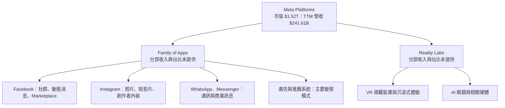
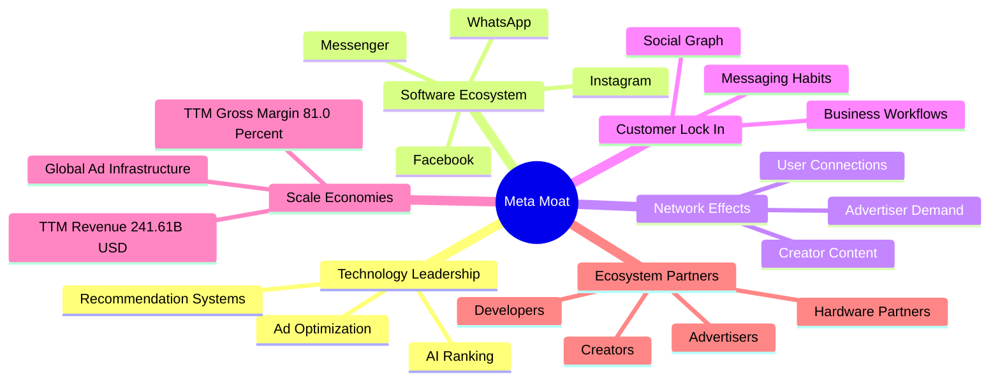
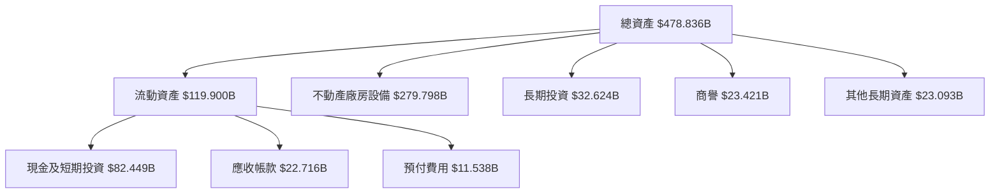
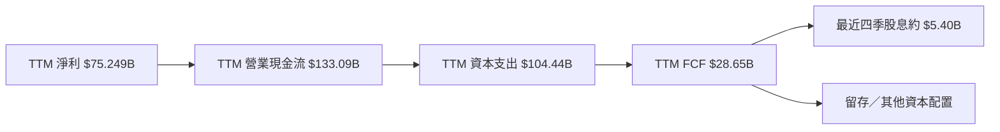
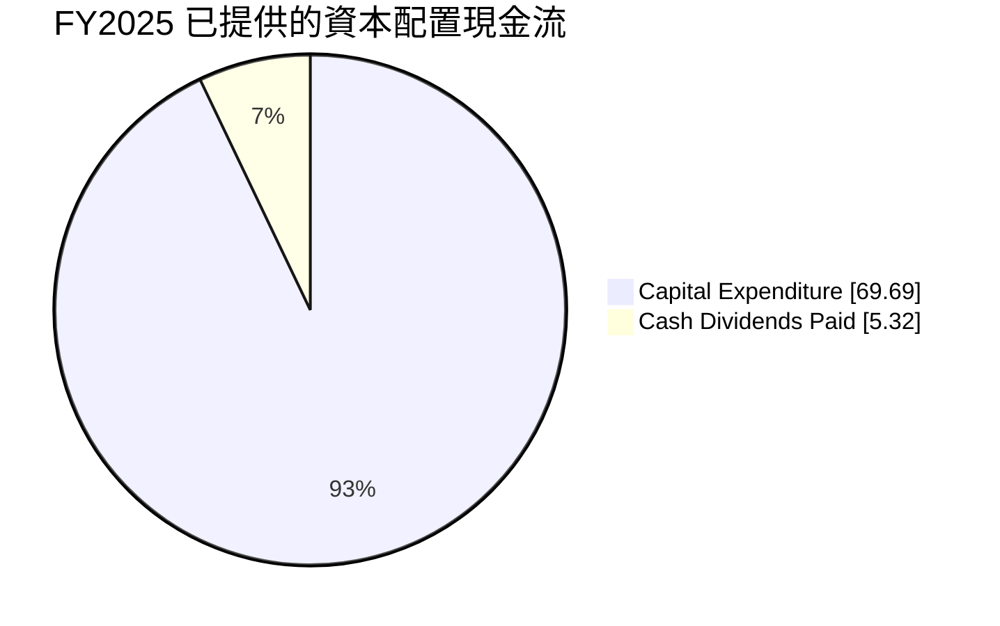
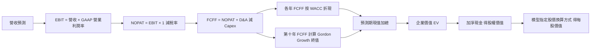
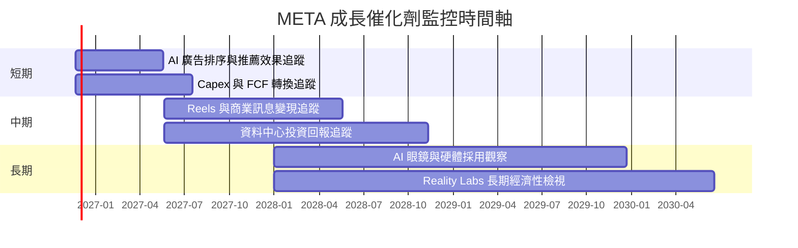
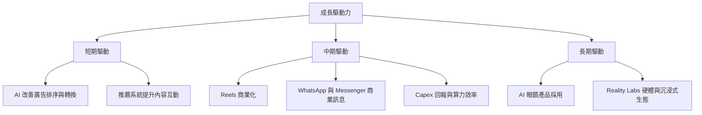
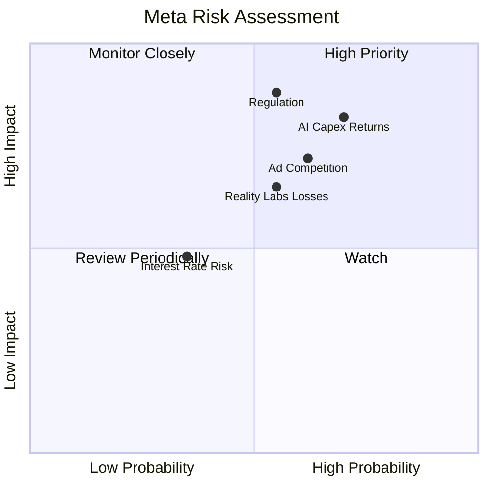
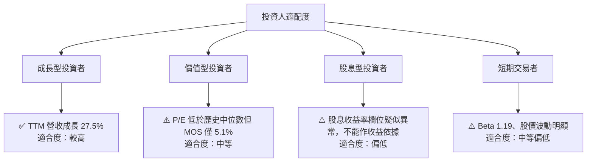

# META 基本面深度分析報告
> **報告日期**：2026-11-20 ｜ **語言**：繁體中文 ｜ **數據來源**：SEC 申報資料 (XBRL)、Yahoo Finance、Finviz、StockAnalysis、Roic.ai ｜ **分析師**：CFA 級機構研究

## 目錄

| # | 章節 | 核心結論 |
|---|------|----------|
| 1 | 執行摘要 | 持有；加權合理價值 $628.12；MOS +5.1% |
| 2 | 公司概覽與商業模式 | FoA 的廣告與社交平台構成核心，網路效應和規模效應是主要護城河 |
| 3 | 損益表深度分析 | TTM 營收 $241.61B、年增 27.5%；TTM 營業利益率 32.9% |
| 4 | 資產負債表分析 | VERIFIED 指標為淨負債 $1.22B；流動性尚足，但債務數據來源有差異 |
| 5 | 現金流量深度分析 | TTM FCF $28.65B，Capex 大幅提高使現金轉換率承壓 |
| 6 | 獲利能力與資本效率 | ROIC 27.7% 高於 WACC 10.46%，仍創造經濟價值 |
| 7 | 相對估值分析 | 自身 P/E 低於五年中位數；同業倍數差異大，結論需結合獲利品質 |
| 8 | DCF 內在價值評估 | DCF 基準 $564.84；加權合理價值 $628.12，MOS +5.1% |
| 9 | 成長催化劑 | AI 廣告工具、推薦系統、Reels 與新硬體是主要潛在驅動因素 |
| 10 | 風險矩陣 | AI 基建支出、監管與廣告需求／競爭為主要風險 |
| 11 | 投資建議 | 持有；以 $565.31 以下作為 MOS 至少 10% 的買入價上限 |

---

## 1. 執行摘要

META 的 2026-11-19 收盤價為 **$596.22**。TTM 營收 **$241.61B**、營收年增 **27.5%**，ROIC **27.7%** 高於 WACC **10.46%**；但 TTM Capex **$104.44B** 已接近營業現金流 **$133.09B**，使 FCF 僅 **$28.65B**、FCF Yield **1.88%**。DCF 基準價值 **$564.84** 低於現價，而 DCF、同業估值與分析師共識加權後的合理價值為 **$628.12**，MOS 僅 **+5.1%**，因此依規則 20 評級為 **持有**，不作質化上調或下調。

### 1.0 一頁式投資儀表板（Portfolio Manager 30 秒速讀）

| 項目 | 內容 |
|------|------|
| **投資論點（3 句）** | ① TTM 營收年增 **27.5%**，最新一季年增 **26.1%**，主業仍在擴張。② ROIC **27.7%** 對比 WACC **10.46%**，目前資本回報高於資本成本。③ TTM FCF **$28.65B**，相較 OCF **$133.09B** 的落差顯示 AI／資料中心投資正在壓縮可分配現金。 |
| **綜合評分** | **7.3/10**（引用 1.1 評分卡） |
| **財務健康** | 🟡 VERIFIED 淨負債 **$1.22B**、流動比率 **1.903**；但不同來源總債務數字不一致，須以後續申報核對 |
| **ROIC vs WACC** | **27.7% vs 10.46%**；利差 **+17.24 個百分點**，創造股東價值 |
| **FCF 趨勢** | TTM FCF **$28.65B**；受 TTM Capex **$104.44B** 影響，FCF Yield **1.88%** |
| **估值** | Forward P/E **16.7x** ｜ EV/EBITDA **13.4x**（市場資料欄位） ｜ FCF Yield **1.88%** |
| **DCF 內在價值（基準）** | **$564.84** ｜現價相對 DCF 溢價 **+5.6%** |
| **安全邊際（MOS）** | **+5.1%＝($628.12 − $596.22) ÷ $628.12**｜🔴 低於 10%，保護有限 |
| **預期報酬（基準情境 12M）** | 以加權合理價值計算，上行空間 **+5.4%**；此為估值隱含空間，不是保證報酬 |
| **關鍵風險（前二）** | AI／資料中心 Capex 維持高檔導致 FCF 受壓；監管或競爭削弱廣告變現 |
| **評級 + 信心度** | 🟡 **持有**｜信心：中 |

### 1.1 綜合評分卡（全報告唯一）

| 維度 | 評分（1–10） | 主要依據（引用數字與其來源章節） |
|------|--------------|----------------------------------|
| 成長性 | 8.5 | TTM 營收年增 27.5%、最新一季年增 26.1%（第 3 章） |
| 獲利能力 | 8.0 | TTM 營業利益率 32.9%、ROIC 27.7% 高於 WACC 10.46%；F-Score 3/8（第 3、6 章） |
| 財務健康 | 6.5 | VERIFIED 淨負債 $1.22B，流動比率 1.903；DSO 34 天（第 4 章） |
| 估值 | 5.5 | MOS +5.1%；P/E 20.3x 低於自身五年中位數 24.5x，但 FCF Yield 1.88%（第 7、8 章） |
| 護城河 | 9.0 | 多平台網路效應、TTM 毛利率 81.0%、TTM 營收 $241.61B（第 2 章） |
| 管理層與資本配置 | 6.5 | 2025 SBC $20.43B；TTM Capex $104.44B；稀釋股數測試未通過（第 3、5、6 章） |
| **綜合評分** | **7.3** | 六項算術平均：**(8.5 + 8.0 + 6.5 + 5.5 + 9.0 + 6.5) ÷ 6 = 7.3** |

### 1.2 五大投資論點 + 三大核心風險

| 類型 | 項目 | 具體依據 | 信心度 |
|------|------|----------|--------|
| 🟢 **投資論點①** | 核心廣告平台仍具成長性 | TTM 營收年增 27.5%，最新一季年增 26.1%；若 AI 推薦與廣告排序改善轉換率，收入成長可延續 | 🟢 高 |
| 🟢 **投資論點②** | 資本回報高於資本成本 | ROIC 27.7%，WACC 10.46%，利差 +17.24pp | 🟢 高 |
| 🟢 **投資論點③** | 高毛利商業模式 | TTM 毛利率 81.0%，提供技術與基建投資的內部資金來源 | 🟢 高 |
| 🟢 **投資論點④** | 估值低於自身中期中位數 | P/E 20.3x 對比五年中位數 24.5x；目前歷史百分位 19% | 🟡 中 |
| 🟢 **投資論點⑤** | 平台規模具變現延展性 | 2025 年收入 $200.97B，TTM 收入 $241.61B；AI 工具若提高廣告效果，既有流量可增值 | 🟡 中 |
| 🟡 **風險①** | Capex 壓縮 FCF | TTM Capex $104.44B、FCF $28.65B，Capex 約為 OCF 的 78.5% | 🟡 中 |
| 🔴 **風險②** | 監管及平台競爭 | Apple AI agent、平台政策與隱私規則變化可能影響觸達、廣告定向與轉換效率；財務影響尚無可靠量化資料 | 🔴 高衝擊 |
| 🔴 **風險③** | Reality Labs 投資回收不確定 | 公司分部營收、虧損及使用者數據未提供，無法證實硬體／沉浸式平台的回報速度 | 🔴 高衝擊 |

### 1.3 快速統計卡片

同業中位數只依有明確 Peer multiples 數據的項目計算。三家同業為 GOOG、SNAP、PINS；中位數為三家公司有效數值的中位數，P/E TTM 因 SNAP 缺值，僅以 GOOG、PINS 比較。

| 指標 | 公司實際值（期間） | 同業中位數 | 狀態 |
|------|--------------------|------------|------|
| 營收成長（TTM） | **27.5%** | — | 🟢 |
| 營收成長（最新一季年增） | **26.1%** | **14.3%** | 🟢 |
| 毛利率（TTM） | **81.0%** | **60.9%** | 🟢 |
| 營業利益率（TTM） | **32.9%** | — | 🟢 |
| ROIC（TTM） | **27.7%** | — | 🟢 |
| Forward P/E | **16.7x** | **7.4x** | 🟡 |
| FCF Yield（TTM） | **1.88%** | — | 🟡 |
| Piotroski F-Score | **3 / 8** | — | 🔴 |

### 1.4 投資結論

```text
╔══════════════════════════════════════════════════════════════════╗
║                    📊 投資結論摘要                               ║
╠══════════════════════════════════════════════════════════════════╣
║  評級：持有（依 MOS +5.1%，落在 -10% 至 +10% 區間）              ║
║  價格（2026-11-19 收盤）：$596.22                                ║
║  DCF 內在價值（基準）：$564.84（現價溢價 +5.6%）                 ║
║  安全邊際 MOS：+5.1%（＝($628.12−$596.22)÷$628.12）             ║
║  加權合理價值（8.8）：$628.12                                    ║
║  DCF 情境價值：                                                   ║
║    悲觀情境：$189.71（-68.2%）                                   ║
║    基準情境：$564.84（-5.3%）                                    ║
║    樂觀情境：$1,374.05（+130.5%）                                ║
║  綜合評分：7.3/10（引用 1.1）                                    ║
║  適合投資人：能承受高波動、重視長期平台成長，且不依賴高股息者    ║
╚══════════════════════════════════════════════════════════════════╝
```

---

## 2. 公司概覽與商業模式

### 2.1 業務結構與收入來源

公司營運包含 Family of Apps（FoA）與 Reality Labs（RL）。來源資料未提供各分部收入、分部利潤或收入佔比，因此不臆測金額或比例。



### 2.2 市場份額

市場份額的數字、來源與年份未提供，因此不製作市場份額圖表。可確認的相對規模證據是 META TTM 營收 **$241.61B**、最新一季營收年增 **26.1%**；同業 GOOG 最新一季營收年增 **24.7%**，SNAP 為 **14.3%**，PINS 為 **11.9%**。這些數字顯示 META 近期成長速度高於所列同業，但不等於市場份額資料。

### 2.3 競爭護城河分析



### 2.4 護城河強度

| 護城河項目 | 強度（強／中／弱） | 證據（引用數字或事實） | 會削弱它的情況 |
|------------|--------------------|------------------------|----------------|
| 技術與推薦系統 | 強 | TTM 毛利率 81.0%；公司開發廣告排序、內容推薦與 AI 工具 | 推薦品質下降、AI 投入回報不佳或算力成本持續上升 |
| 軟體生態系統 | 強 | Facebook、Instagram、WhatsApp、Messenger 多產品涵蓋社交與通訊 | 使用者遷移、產品體驗惡化或政策限制跨產品資料使用 |
| 網路效應 | 強 | 社交圖譜與創作者內容提升平台互動；量化使用者數據未提供 | 新平台形成更強的年輕族群網路效應 |
| 客戶鎖定 | 中至強 | 企業廣告主需累積轉換與受眾資料；廣告主留存數據未提供 | 企業廣告預算轉向其他平台或能更精準衡量成效的媒體 |
| 規模效應 | 強 | TTM 營收 $241.61B、毛利率 81.0% | 基建成本增幅長期高於收入增幅 |
| 生態夥伴 | 中 | 廣告主、創作者與開發者共同供應需求及內容；夥伴數據未提供 | 內容供應或第三方分發政策改變 |

**1.1「護城河」評分 9.0/10 的理由**：多產品社交網路、廣告變現能力與 81.0% TTM 毛利率形成規模優勢；但使用者趨勢、分部經濟性與廣告主留存資料不足，評分未給滿分。

---

## 3. 損益表深度分析

### 3.1 年度收入成長趨勢（近4年）

收入與年度數值依年報資料；百分比為年度收入變動計算，四捨五入至一位小數。

```text
╔══════════════════════════════════════════════════════════════════╗
║              Meta 年度收入趨勢（FY2022-FY2025）                 ║
╠══════════════════════════════════════════════════════════════════╣
║  FY2022  $116.61B  ████████████░░░░░░░░░░░░  YoY: -1.1%  🟡   ║
║  FY2023  $134.90B  ██████████████░░░░░░░░░░  YoY:+15.7%  🟢   ║
║  FY2024  $164.50B  █████████████████░░░░░░░  YoY:+21.9%  🟢   ║
║  FY2025  $200.97B  █████████████████████░░░  YoY:+22.2%  🟢   ║
║                                                                  ║
║  FY2022-FY2025 CAGR：((200.97 ÷ 116.61)^(1/3) − 1) = 約 19.9%  ║
╚══════════════════════════════════════════════════════════════════╝
```

2022 年收入下降 1.1%，隨後三年恢復成長；2025 年收入年增 22.2%，與數位廣告需求回升、推薦系統改善及短影片變現相符。TTM 收入增速進一步至 27.5%，但單一 TTM 增速不應直接外推為長期成長率。

### 3.2 季度收入趨勢分析

QoQ 以同一份季度收入資料計算；YoY 優先引用單季年增率欄位。金額單位為 USD billions。

| 季度 | 營收 | QoQ 成長 | YoY 成長 | 備註 |
|------|-----:|---------:|---------:|------|
| 2025 Q4 | 59.89 | +16.9% | +23.8% | 相對 2025 Q3 的季節性回升 |
| 2026 Q1 | 56.31 | -6.0% | +33.1% | QoQ 回落，但年度比較基數較低 |
| 2026 Q2 | 60.80 | +8.0% | +28.0% | 營收重新加速 |
| 2026 Q3 | 64.60 | +6.2% | +26.1% | 單季年增仍高，但增速較 Q1、Q2 收斂 |

單季營收由 2026 Q1 的 **$56.31B** 增至 Q3 的 **$64.60B**，QoQ 連續增長；年度增速由 Q1 的 33.1% 放緩至 Q3 的 26.1%，仍維持雙位數，反映收入基期提高後增速自然降溫。

### 3.3 利潤率演變分析

年度毛利率、營業利益率及淨利率依年度損益數字計算，四捨五入至一位小數。TTM 營業利益率採 VERIFIED FIGURES 的 32.9%。

| 利潤率指標 | FY2022 | FY2023 | FY2024 | FY2025 | 趨勢 | 評估 |
|------------|-------:|-------:|-------:|-------:|------|------|
| **毛利率** | 78.4% | 80.8% | 81.7% | 82.0% | 逐步提高 | 🟢 |
| **營業利益率** | 24.8% | 34.7% | 42.2% | 41.4% | 2022 復甦後上升，2025 略降 | 🟡 |
| **淨利率** | 19.9% | 29.0% | 37.9% | 30.1% | 2025 下降 | 🟡 |

毛利率持續提高，通常代表平台服務的增量收入成本較低，以及產品／廣告組合改善；營業利益率由 FY2022 的 24.8% 升至 FY2024 的 42.2%，顯示費用控制與營收回升帶來營運槓桿。FY2025 營業利益率回落至 41.4%，而淨利率降至 30.1%，表示稅項、非營業項目或成本變動也可能影響淨利。季度來源間存在營業利益數據不一致：最新季度營業利益率在資料欄位中同時出現 **20.1%** 與其他來源推算的不同結果；本報告涉及「最新一季營業利益率」時以 VERIFIED FIGURES 的 **20.1%** 為準，不混用其他來源值。

### 3.4 費用結構分析

分項費用的完整 TTM 金額未提供，不能製作費用佔比圓餅圖。已知 FY2025 研發費用 **$57.37B**，約佔 FY2025 收入 **28.5%**（$57.37B ÷ $200.97B）；此為年度比率，不能當作 TTM 費用佔比。R&D 支出支持 AI、推薦系統與產品開發，但回報需觀察新增收入與 FCF，而非只看研發投入金額。

```text
╔══════════════════════════════════════════════════════════════════╗
║                 FY2025 研發投入參考                             ║
╠══════════════════════════════════════════════════════════════════╣
║  研發費用：$57.37B                                               ║
║  年度營收：$200.97B                                              ║
║  研發費用／營收：$57.37B ÷ $200.97B = 約 28.5%                  ║
║  其他費用分項：未提供，故不推算完整費用結構                      ║
╚══════════════════════════════════════════════════════════════════╝
```

### 3.5 季度 EPS 趨勢與盈餘品質（Quality of Earnings）

EPS 預期值缺失，因此無法判定過去四季究竟超預期或不及預期。可檢視的實際 EPS 年增率中，2026 Q3 為 **+264.8%**，但 2025 Q3 基期 EPS 僅 **$1.05**，2026 Q3 為 **$3.83**，因此大幅年增含有低基期效應；2026 Q2 EPS 年增 **-13.4%**，顯示季度盈餘並非每季同步加速。

| 盈餘品質項目 | 數值／佔比 | 評估 |
|--------------|------------|------|
| 股權薪酬 SBC / 營收 | 估計 TTM SBC $26.94B ÷ TTM 營收 $241.61B = **約 11.1%** | 🔴 對股東報酬稀釋顯著；TTM SBC 由最近四季 SBC 加總估算 |
| SBC / 營業現金流 | **約 20.2%**（$26.94B ÷ $133.09B） | 🟡 SBC 不是現金流出，但代表股東稀釋成本 |
| FCF / 淨利（現金轉換率） | **約 38.1%**（$28.65B ÷ TTM 淨利 $75.249B） | 🔴 Capex 壓低自由現金流轉換 |
| 一次性／非經常性損益 | 無法完整判定；季度 EPS 年增受 2025 Q3 低基期影響 | 🟡 應檢視 SEC 季報附註，不將單季年增直接外推 |
| 有效稅率異常 | WACC 輸入採最新年度有效稅率 **29.6%** | 🟡 缺少完整 TTM 稅前利潤與稅項拆分，不能斷言稅率異常 |
| 資本化支出 vs 費用化 | TTM Capex **$104.44B**；資本化明細與軟體資本化額未提供 | 🟡 資本化基建投資會先影響現金流，折舊費用則分期認列 |

**盈餘品質結論**：GAAP 獲利有大規模 SBC 費用化，但 SBC 作為非現金費用仍以稀釋方式由既有股東承擔；TTM SBC 約為營收 11.1%。此外，FCF／淨利僅約 38.1%，主要需關注 AI 基建投資回收。故淨利不能單獨代表可分配股東現金，估值宜同時看 FCF 與 Capex 回報。

---

## 4. 資產負債表分析

### 4.1 資產結構分解

最新 TTM 資產負債表總資產為 **$478.836B**，其中流動資產 **$119.900B**、不動產廠房設備 **$279.798B**。下圖依來源提供的金額呈現；未列項目不代表為零。



PP&E 由 FY2025 的 **$196.804B** 增至最新 TTM **$279.798B**，與大規模資料中心與運算基建投資方向一致。資產基礎擴大若能提高廣告轉換、算力效率與產品使用，將支持未來收入；若利用率或變現未達預期，折舊及維護負擔會拖累回報。

### 4.2 流動性與營運資金分析

| 指標 | 最新 TTM | 一年前 TTM | 變化 | 解讀 |
|------|----------|------------|------|------|
| 流動比率 | **1.903** | N/A | N/A | 流動資產高於流動負債；歷史同口徑數值未提供 |
| 速動比率 | **1.669** | N/A | N/A | 具一定短期流動性緩衝 |
| DSO 應收帳款天數 | **34 天** | **33 天** | **+1 天** | 收款天數略增，變化不大；原因尚無帳齡資料佐證 |
| DIO 存貨天數 | **N/A** | **N/A** | N/A | 公司未報告可用存貨餘額 |
| DPO 應付帳款天數 | **152 天** | **N/A** | N/A | 一年前缺少可比數據；不可據此判斷付款政策變化 |
| CCC 現金轉換週期 | **N/A** | **N/A** | N/A | DIO 缺失，無法計算 |

### 4.3 債務結構分析

不同來源的負債資料不一致：VERIFIED FIGURES 的總債務為 **$83.67B**，而合併市場資料另列 **$114.84B**。依嚴格規則，以下核心財務指標採 VERIFIED FIGURES 的債務 **$83.67B** 與淨負債 **$1.22B**；差異需以 SEC 同期債務附註核實，不能混用兩套口徑。

```text
╔══════════════════════════════════════════════════════════════════╗
║                   Meta 債務健康診斷                              ║
╠══════════════════════════════════════════════════════════════════╣
║  VERIFIED 總債務：        $83.67B                                ║
║  現金及短期投資：         $82.45B                                ║
║  VERIFIED 淨現金／負債：  淨負債 $1.22B                          ║
║  流動比率：               1.903                                  ║
║  速動比率：               1.669                                  ║
║  Debt/EBITDA：            N/A（同口徑 EBITDA 未列於核驗區）       ║
║  Interest Coverage：      N/A（利息費用與營業利益口徑未提供）     ║
║  備註：合併市場資料另列總債務 $114.84B，口徑差異需核對。        ║
╚══════════════════════════════════════════════════════════════════╝
```

### 4.4 股東權益趨勢

股東權益年度資料截至 FY2025；FY2026 期末數據未提供，不延伸推算。

```text
╔══════════════════════════════════════════════════════════════════╗
║                    股東權益年度變化                              ║
╠══════════════════════════════════════════════════════════════════╣
║  FY2022  $125.71B  █████████████░░░░░░░░░░                      ║
║  FY2023  $153.17B  ████████████████░░░░░░                       ║
║  FY2024  $182.64B  ███████████████████░░░                       ║
║  FY2025  $217.24B  ███████████████████████                       ║
║  解讀：FY2022-FY2025 權益增加，反映獲利留存為主要累積來源。   ║
╚══════════════════════════════════════════════════════════════════╝
```

---

## 5. 現金流量深度分析

### 5.1 現金流量瀑布圖

以下採 TTM OCF、Capex、FCF 核驗數字。淨利與 OCF 不是簡單相加關係，而是經非現金項目及營運資金調整後形成。



### 5.2 FCF 轉換率趨勢

| 期間 | FCF | 淨利 | FCF／淨利 | 解讀 |
|------|----:|----:|----------:|------|
| FY2022 | $19.29B | $23.20B | 約 83.1% | 轉換率較高 |
| FY2023 | $44.07B | $39.10B | 約 112.7% | FCF 高於淨利 |
| FY2024 | $54.07B | $62.36B | 約 86.7% | 資本支出上升後轉換率下滑 |
| FY2025 | $46.11B | $60.46B | 約 76.3% | Capex 增長使轉換率進一步下降 |
| TTM 至 2026-09-30 | $28.65B | $75.249B | 約 38.1% | 投資週期明顯壓低可分配現金 |

### 5.3 自由現金流趨勢

```text
╔══════════════════════════════════════════════════════════════════╗
║                    自由現金流年度走勢                            ║
╠══════════════════════════════════════════════════════════════════╣
║  FY2022  $19.29B  ████████░░░░░░░░░░░░░░  FCF Yield：N/A       ║
║  FY2023  $44.07B  █████████████████░░░░░  FCF Yield：N/A       ║
║  FY2024  $54.07B  █████████████████████░  FCF Yield：N/A       ║
║  FY2025  $46.11B  ██████████████████░░░░  FCF Yield：N/A       ║
║  TTM     $28.65B  ███████████░░░░░░░░░░░  FCF Yield：1.88%     ║
║                                                                  ║
║  TTM 定義：營業現金流 $133.09B − Capex $104.44B = $28.65B      ║
╚══════════════════════════════════════════════════════════════════╝
```

### 5.4 資本配置評估



上圖僅呈現 FY2025 有明確數值的 Capex 與股息支付（單位：USD billions），不代表完整資本配置；回購金額及留存現金未提供，不能補成 100% 圓餅。

| 項目 | FY2025 數值 | 評估 |
|------|------------:|------|
| 資本支出 | $69.69B | 支持 AI／資料中心容量擴建；投資回報仍需追蹤 |
| 現金股息 | $5.32B | 相較 Capex 規模較小 |
| SBC | $20.43B | 形成持續稀釋成本 |
| 股票回購 | N/A | 本期回購金額未提供，不據此推論淨回購量 |

---

## 6. 獲利能力與資本效率

### 6.1 ROE / ROA / ROIC 趨勢

| 指標 | 最新值 | 歷史資料 | 評估 |
|------|-------:|----------|------|
| ROE（TTM，核驗值） | **27.6%** | 完整同口徑年度序列未提供 | 🟢 高資本回報 |
| ROA（TTM） | N/A | QUALITY FIGURES 未提供 ROA 數值 | N/A |
| ROIC（TTM） | **27.7%** | 完整同口徑年度序列未提供 | 🟢 明顯高於 WACC |
| ROE（另一合併市場欄位） | 32.3% | 與核驗值不一致 | 不作核心分析，優先採核驗值 |

行業均值沒有可核實的同口徑來源，故不列行業對比。不同資料來源的 ROE 數值不一致，本報告用 VERIFIED FIGURES 的 **27.6%** 作為核心值。

### 6.2 ROIC vs WACC 分析（核心價值創造判斷）

```text
╔══════════════════════════════════════════════════════════════════╗
║                ROIC vs WACC 深度分析                            ║
╠══════════════════════════════════════════════════════════════════╣
║  WACC（依資本成本核驗數值）：10.46%                              ║
║  ├── 無風險利率（10Y 美債）： 5.05%                              ║
║  ├── 市場風險溢酬 ERP：        5.00%                              ║
║  ├── Beta：原始 1.28；採用調整後 1.19                            ║
║  ├── 股權成本：10.98%                                             ║
║  ├── 稅前債務成本：1.39%；稅後約 0.98%                           ║
║  ├── 資本結構：股權 94.8%，債務 5.2%                             ║
║  └── WACC：10.46%                                                 ║
║                                                                  ║
║  ROIC（TTM）：27.7%                                                ║
║  EVA 利差 = ROIC − WACC = 27.7% − 10.46% = +17.24pp             ║
║                                                                  ║
║  ROIC 27.7%  ▓▓▓▓▓▓▓▓▓▓▓▓▓▓▓▓▓▓▓▓▓▓▓▓▓▓▓▓▓▓▓▓▓▓▓▓░░░░░░░░░░   ║
║  WACC 10.46% ▓▓▓▓▓▓▓▓▓▓▓▓▓▓▓▓▓▓▓▓░░░░░░░░░░░░░░░░░░░░░░░░░░   ║
║                                                                  ║
║  結論：ROIC 約為 WACC 的 2.65 倍，現階段創造經濟價值；         ║
║  若 AI 基建回報下降，新增資本的邊際 ROIC 可能低於目前水準。     ║
╚══════════════════════════════════════════════════════════════════╝
```

ROIC／WACC 比值：**27.7% ÷ 10.46% = 約 2.65 倍**。這代表現有投入資本回報明顯高於資本成本，但不保證新增大型基建同樣具備 27.7% 的回報率。

### 6.3 杜邦三因素分解

| 因素 | 數值（TTM） | 解讀 |
|------|-------------|------|
| 淨利率 | **31.1%** | 每 1 美元收入形成約 0.311 美元淨利 |
| 資產週轉率 | **0.50** | 每 1 美元資產產生約 0.50 美元營收 |
| 權益乘數 | **1.76** | 槓桿程度不高，ROE 不主要靠高槓桿支撐 |
| **ROE** | **27.6%** | **31.1% × 0.50 × 1.76 = 27.4%**；核驗值 27.6%，差異來自組成數值四捨五入 |

### 6.4 財務體質：Piotroski F-Score

**Piotroski F-Score：3 / 8**。毛利率測試因資料缺失而未能判定，分母依已判定測試數計，不補足為 9。

| 測試 | 結果 | 解讀 |
|------|------|------|
| ROA > 0 | ✅ 通過 | 公司維持正獲利資產回報 |
| 營業現金流 > 0 | ✅ 通過 | TTM OCF 為 $133.09B |
| ROA 高於一年前 | ❌ 未通過 | 回報改善未能在此測試中證實 |
| 營業現金流 > 淨利 | ✅ 通過 | 營運現金流高於淨利，現金盈餘品質有支持 |
| 長期負債 ÷ 總資產低於一年前 | ❌ 未通過 | 負債比率改善測試未通過 |
| 流動比率高於一年前 | ❌ 未通過 | 流動性指標未較一年前提高 |
| 稀釋股數未增加 | ❌ 未通過 | SBC 造成的股數稀釋值得關注 |
| 毛利率高於一年前 | — 無法判定 | 缺少同口徑測試輸入 |
| 資產週轉率高於一年前 | ❌ 未通過 | 資產效率改善未獲數據支持 |

F-Score 3/8 反映獲利及現金流有正面項目，但負債、流動性、股數與資產效率測試偏弱；該分數與高 ROIC 並不矛盾，兩者衡量範圍不同。

---

## 7. 相對估值分析

### 7.1 同業估值比較表格

公司同業倍數依 Peer multiples 指定來源；META 自身倍數取市場估值欄位。META 的 EV/EBITDA 市場資料值與估值歷史資料區塊略有差異，表中當前比較採市場資料的 **13.4x**，歷史定位則使用核驗歷史序列的 **14.7x**。

| 估值指標 | **META** | **GOOG** | **SNAP** | **PINS** | META 評估 |
|----------|---------:|--------:|--------:|--------:|-----------|
| **Trailing P/E** | 20.3x | 14.2x | N/A | 70.4x | 🟡 高於 GOOG，低於高倍數 PINS |
| **Forward P/E** | 16.7x | 17.7x | 6.5x | 7.4x | 🟡 高於同業中位數 7.4x；同業成長與盈利質量差異大 |
| **P/S Ratio** | 6.3x | 7.1x | 1.3x | 2.1x | 🟡 高於 SNAP、PINS，略低於 GOOG |
| **EV/EBITDA** | 13.4x | 17.4x | 53.8x | 31.8x | 🟢 低於三家同業倍數 |
| **最新一季營收年增** | 26.1% | 24.7% | 14.3% | 11.9% | 🟢 成長速度高於所列同業 |
| **毛利率（TTM）** | 81.0% | 60.9% | 59.2% | 79.0% | 🟢 高於 GOOG、SNAP，略高於 PINS |

Forward P/E 同業中位數偏低，主要受 SNAP、PINS 指標所列低倍數影響；這些倍數不能不加調整地視為 META 的合理估值。META 的成長率與毛利率較高，但資本支出正在侵蝕 FCF，估值比較應結合現金流品質。

### 7.2 歷史估值區間分析

```text
╔══════════════════════════════════════════════════════════════════╗
║                 META 五年估值區間（TTM）                         ║
╠══════════════════════════════════════════════════════════════════╣
║  P/E：      12.9x ─────────── 20.3x ─────── 24.5x ───── 33.4x  ║
║                         現值       五年中位數      區間高點       ║
║  當前百分位：19%                                                ║
║                                                                  ║
║  P/S：       2.8x ─────────── 6.3x ───────── 7.7x ───── 10.6x  ║
║                         現值       五年中位數      區間高點       ║
║  當前百分位：38%                                                ║
║                                                                  ║
║  EV/EBITDA： 7.7x ───────────14.7x ─────────16.5x ────19.7x   ║
║                         現值       五年中位數      區間高點       ║
║  當前百分位：33%                                                ║
╚══════════════════════════════════════════════════════════════════╝
```

P/E 現值 **20.3x** 低於五年中位數 **24.5x**，處於歷史第 19 百分位；P/S 與 EV/EBITDA 亦低於各自中位數。這說明相較 META 自身歷史，估值不高；但若 FCF 持續受高 Capex 壓制，歷史估值中位數未必能直接恢復。

### 7.3 情境價值（Bear / Base / Bull）

以下情境數字依 DCF MODEL 原值列示，不改動模型假設或價值。

| 情境 | 第 1 年營收成長 | 期末營業利潤率 | WACC | 每股價值 | 相對現價 | 機率 | 會發生的條件 |
|------|----------------:|----------------:|-----:|----------:|---------:|-----:|--------------|
| 🔴 悲觀 | 13.8% | 29.5% | 11.46% | $189.71 | -68.2% | 25% | 廣告增長明顯減速、成本與 Capex 剛性高，資本成本上升 |
| 🟡 基準 | 27.5% | 34.7% | 10.46% | $564.84 | -5.3% | 50% | TTM 成長逐步降速，利潤率略擴張，WACC 維持基準 |
| 🟢 樂觀 | 41.3% | 38.1% | 9.46% | $1,374.05 | +130.5% | 25% | AI 廣告變現顯著超預期、收入持續高速成長且融資風險下降 |

### 7.4 相對估值隱含價格區間

```text
╔══════════════════════════════════════════════════════════════════╗
║             相對估值及交叉驗證每股價值                          ║
╠══════════════════════════════════════════════════════════════════╣
║  $265.67        $564.84         $596.22         $848.23        ║
║  Forward P/E     DCF基準         現價             分析師共識      ║
║                                                                  ║
║  同業 EV/EBITDA：$1,003.76（遠高於現價，對倍數假設敏感）         ║
╚══════════════════════════════════════════════════════════════════╝
```

- 同業 Forward P/E：同業中位數 **7.4x** × META Forward EPS **$35.68** = 每股 **$265.67**（價值取核驗方法區塊）。
- 同業 EV/EBITDA：同業中位數 **24.6x**（GOOG、PINS）套用 META TTM EBITDA 並加回淨現金，價值 **$1,003.76**；此結果高度受同業倍數差異影響。
- 分析師共識：58 位分析師平均目標價 **$848.23**，屬參考值，非內在價值保證。

---

## 8. DCF 內在價值評估（Discounted Cash Flow）

### 8.0 估值推理鏈（Thinking Logic）

**Step 1 — 價值來源與主導變數**

本 DCF 以 META 整體企業自由現金流估值，主要價值來源是 FoA 的現有廣告現金流；AI 廣告工具與推薦系統可能提高既有流量變現，Reality Labs 則具長期選擇權性質。由於分部收入佔比未提供，不能將這些業務拆成具體營收金額或比例。模型終值現值佔 EV **80.6%**，故主導估值的變數是長期現金流、WACC 與永續成長率，而不是單一年度收入。

**Step 2 — 模型選擇**

| 決策點 | 本報告採用 | 理由（含數字） | 曾考慮但否決 | 否決理由 |
|--------|-----------|----------------|--------------|----------|
| 現金流定義 | FCFF | 用 WACC 折現得出 EV，再加淨現金／扣淨負債 | FCFE | 債務與現金先在 EV 至股權價值橋接處處理 |
| 預測期 N | 10 年 | 模型設定 10 年，讓 27.5% 成長逐步淡化至 3.0% | 5 年 | 在高成長及高 Capex 階段，較短期限會把較多價值壓入終值 |
| 終值方法 | Gordon Growth | DCF MODEL 以第 10 年 FCFF 和 3.0% 永續成長計算 | 退出倍數 | 模型未提供退出倍數結果；不另建終值模型 |
| EBIT 基礎 | GAAP EBIT | 模型註明採 GAAP EBIT，SBC 已作為費用入帳 | 非 GAAP EBIT | 以免將 SBC 於現金流及股數重複處理 |

**Step 3 — 關鍵假設推導鏈**

- **營收成長**：錨點＝TTM 營收成長 27.5% → 模型由 FY+1 的 27.5% 線性降至 FY+10 的 3.0%，代表競爭與基期提高後逐步成熟 → **採用模型指定的 27.5% 至 3.0% 路徑** → 不採用把 27.5% 維持十年的假設，因為那會忽視高基期與成熟期增速放緩。
- **營業利潤率**：錨點＝TTM 32.9% → 模型逐步提高至 FY+10 的 34.7%，反映規模效益，但僅提高 1.8pp → **採用 32.9% 至 34.7%** → 不採用 FY2024 年度推算的 42.2%作為終值利潤率，因 TTM／年度口徑不同且近期基準較低。
- **有效稅率**：錨點＝最新年度有效稅率 29.6% → **採用 29.6%**；未提供更完整未來稅率財測，故不另調整。
- **Capex／營收**：錨點＝TTM 43.2% → 隨投資強度下降，FY+10 降至 11.3% → **採用模型逐年遞減路徑** → 不把 TTM 43.2% 永久維持，因模型假設長期 Capex 收斂至折舊的 1.1 倍。
- **D&A／營收**：錨點＝TTM 10.3% → **採用 10.3% 固定**；缺少逐年折舊預測，模型保持固定。
- **WACC**：錨點＝核驗資本成本 10.46% → 不自行重估，因統一使用公司資本成本資料 → **採用 10.46%** → 不採更低折現率，避免忽略 Beta 1.19、ERP 5.00% 及 10 年期美債 5.05% 的風險訊號。
- **永續成長率 g**：錨點＝模型 3.0%，且低於 WACC 10.46% → **採用 3.0%** → 不採 4.0% 或更高作基準，避免讓終值依賴過度樂觀的永久成長。
- **預測期 N**：錨點＝模型 10 年 → **採用 10 年**；不縮短或延長，避免偏離核驗模型。
- **GAAP EBIT、SBC 與股數**：模型採 GAAP EBIT，SBC 已經費用化；不再另扣 SBC，亦不對股數加年稀釋率。**本模型採用組合 (A)，故 SBC 影響已計入一次。**
- **營運資金變動**：模型未建模 ΔWC，故不添加現金流扣項，也不另行估算其比例。

**Step 4 — 最脆弱環節**

最脆弱假設是長期 Capex 從 TTM 營收的 43.2% 降至第十年的 11.3%；若資料中心投資不收斂，FCF 會低於基準路徑，估值可能向敏感度矩陣的低值區間移動。

**Step 5 — 計算路徑圖**



### 8.1 模型假設總表（Model Inputs）

| 假設項目 | 採用值 | 依據／來源 | 敏感度 |
|----------|--------|-------------|--------|
| 預測期長度 N | 10 年 | DCF MODEL 指定預測期 | 🟡 中 |
| 營收成長 | FY+1 27.5% 線性降至 FY+10 3.0% | TTM vs prior TTM 成長 27.5%；終期成長為模型假設 | 🔴 高 |
| 營業利潤率 | 32.9% 升至 34.7% | TTM 營業利益率及模型指定五年歷史中位數錨點 | 🔴 高 |
| 有效稅率 | 29.6% | 最新年度有效稅率 | 🟢 低 |
| Capex／營收 | FY+1 43.2% 降至 FY+10 11.3% | TTM Capex／營收；模型逐步收斂設定 | 🔴 高 |
| D&A／營收 | 10.3% | TTM 比率，模型固定 | 🟢 低 |
| 營運資金變動 | 未建模 | DCF MODEL 明示 Working capital is not modelled | 🟢 低 |
| EBIT 基礎 | GAAP | 模型指定 GAAP EBIT | 🟡 中 |
| SBC 處理 | 不再另扣；GAAP 費用已含 SBC | 模型採組合 (A) | 🟡 中 |
| 年稀釋率 | 0% | 組合 (A)：固定股數，SBC 已反映在 GAAP 費用 | 🟡 中 |
| 永續成長率 g | 3.0% | DCF MODEL 指定，低於 WACC | 🔴 高 |
| 終值方法 | Gordon Growth | DCF MODEL 指定 | 🔴 高 |
| WACC | 10.46% | 資本成本核驗值，見 8.2 | 🔴 高 |

**FCFF 定義**：`FCFF = NOPAT + D&A − Capex`。本模型不含 ΔWC 列，且不另扣 SBC。

### 8.2 折現率推導（WACC）

```text
╔══════════════════════════════════════════════════════════════════╗
║                    WACC 推導（折現率）                           ║
╠══════════════════════════════════════════════════════════════════╣
║  股權成本 Ke（CAPM）：                                           ║
║  ├── 無風險利率 Rf（10Y 美債）：       5.05%                     ║
║  ├── 市場風險溢酬 ERP：                5.00%                     ║
║  ├── Beta 原始值：1.28；採調整後 Beta：1.19                     ║
║  ├── Beta 調整：2/3 × 1.28 + 1/3 × 1 = 1.19                    ║
║  ├── 規模／國別溢酬：0.00%（核驗輸入未列額外溢酬）               ║
║  └── Ke = 5.05% + 1.19 × 5.00% = 10.98%                        ║
║                                                                  ║
║  債務成本 Kd：                                                    ║
║  ├── 稅前 Kd：1.39%                                               ║
║  ├── 有效稅率：29.6%                                              ║
║  └── 稅後 Kd = 1.39% × (1 − 29.6%) = 0.98%                     ║
║                                                                  ║
║  資本結構權重：股權 94.8%，債務 5.2%                              ║
║  └── WACC = 94.8% × 10.98% + 5.2% × 0.98% = 10.46%             ║
╚══════════════════════════════════════════════════════════════════╝
```

**逐步演算（核驗資本成本輸入）**

1. **Ke（CAPM）**＝5.05%＋1.19×5.00%＝**10.98%**。
2. **稅前 Kd**＝核驗資本成本資料提供 **1.39%**；利息費用與平均計息負債的逐項原始金額未提供，因此不可另行反推。
3. **稅後 Kd**＝1.39%×(1−29.6%)＝0.97856% ≈ **0.98%**。
4. **權重**＝股權 **94.8%**；債務 **5.2%**；94.8%＋5.2%＝**100.0%**。
5. **WACC**＝94.8%×10.98%＋5.2%×0.97856%＝10.458% ≈ **10.46%**。

此處沿用核驗資本成本區塊的資本權重與 WACC，不用帳面股東權益取代市值權重。原始利息費用、平均計息負債及該資本成本權重的完整底稿未提供，故逐項來源計算不能獨立完全重建；但模型採用值與第 6.2 節均為 **10.46%**。

### 8.3 逐年自由現金流預測（基準情境）

以下數值依 DCF MODEL 原值列示，金額單位 USD billions；折現因子列至三位小數。由於模型輸出只顯示四捨五入後數字，個別中間值若以顯示值重算，可能出現 0.01 的尾差。

| 年度 | FY+1 | FY+2 | FY+3 | FY+4 | FY+5 | FY+6 | FY+7 | FY+8 | FY+9 | FY+10 |
|------|-----:|-----:|-----:|-----:|-----:|-----:|-----:|-----:|-----:|------:|
| 營收 | 308.11 | 384.52 | 469.41 | 560.24 | 653.38 | 744.20 | 827.37 | 897.28 | 948.65 | 977.11 |
| 營收 YoY | 27.5% | 24.8% | 22.1% | 19.4% | 16.6% | 13.9% | 11.2% | 8.5% | 5.7% | 3.0% |
| 營業利潤率 | 32.9% | 33.1% | 33.3% | 33.5% | 33.7% | 33.9% | 34.1% | 34.3% | 34.5% | 34.7% |
| EBIT | 101.23 | 127.10 | 156.10 | 187.43 | 219.90 | 251.95 | 281.76 | 307.37 | 326.86 | 338.62 |
| − 稅 | (30.01) | (37.68) | (46.28) | (55.56) | (65.19) | (74.69) | (83.53) | (91.12) | (96.90) | (100.38) |
| = NOPAT | 71.22 | 89.43 | 109.83 | 131.87 | 154.71 | 177.26 | 198.24 | 216.25 | 229.97 | 238.24 |
| + D&A | 31.78 | 39.66 | 48.42 | 57.78 | 67.39 | 76.76 | 85.34 | 92.55 | 97.85 | 100.78 |
| − Capex | (133.19) | (152.59) | (169.65) | (182.64) | (189.85) | (189.88) | (181.79) | (165.37) | (141.24) | (110.86) |
| **= FCFF** | **-30.18** | **-23.51** | **-11.41** | **7.02** | **32.25** | **64.14** | **101.78** | **143.43** | **186.58** | **228.16** |
| 折現因子 @10.46% | 0.905 | 0.820 | 0.742 | 0.672 | 0.608 | 0.550 | 0.498 | 0.451 | 0.408 | 0.370 |
| **FCFF 現值 PV** | **-27.33** | **-19.27** | **-8.47** | **4.71** | **19.61** | **35.31** | **50.72** | **64.71** | **76.20** | **84.36** |

**預測期 PV 加總**：

`-27.33 + (-19.27) + (-8.47) + 4.71 + 19.61 + 35.31 + 50.72 + 64.71 + 76.20 + 84.36 = 280.55B`

模型列示合計為 **$280.56B**；差異 **$0.01B** 為逐年 PV 四捨五入尾差，符合 1% 內容許誤差。

**FY+1 代表年度逐步演算**：以模型未四捨五入的內部數值計算，報表顯示值有細微尾差。

1. 營收：模型以 TTM 收入基數及 27.5% 成長計算，輸出 **$308.11B**。
2. EBIT：**$308.11B × 32.9% ≈ $101.23B**。
3. 稅：模型輸出 **$30.01B**；按顯示的 EBIT、稅率回算會有 0.01B 內尾差。
4. NOPAT：**$101.23B − $30.01B = $71.22B**。
5. D&A：模型輸出 **$31.78B**。
6. Capex：模型輸出 **$133.19B**。
7. ΔWC：**未建模，無此列**。
8. FCFF：以未四捨五入值計算輸出 **-$30.18B**；顯示值直接相減為 $71.22B+$31.78B−$133.19B＝-$30.19B，為 0.01B 顯示尾差。
9. 折現因子：**1÷(1+10.46%)¹ ≈ 0.905**；PV：**模型輸出 -$27.33B**。

**合理性自檢**

- 預測 FCFF 由前期負值轉正，無法定義全期間正常的 FCF CAGR；2025 年 FCF $46.11B，TTM FCF $28.65B，模型前 3 年 FCFF 為負，反映 Capex 收斂假設主導。
- FY+10 FCF 利潤率＝**$228.16B ÷ $977.11B ≈ 23.4%**；目前 TTM FCF 利潤率＝**$28.65B ÷ $241.61B ≈ 11.9%**。同業最佳 FCF 利潤率資料未提供，不作比較。
- FY+1 至 FY+3 FCFF 為負，折現後會降低預測期價值；模型並未將負值刪除或設為零。

```text
╔══════════════════════════════════════════════════════════════════╗
║            自由現金流：歷史實際 vs 模型預測                      ║
╠══════════════════════════════════════════════════════════════════╣
║  FY2023(實)  $44.07B  ████████░░░░░░░░░░░░  FCF                 ║
║  FY2024(實)  $54.07B  ██████████░░░░░░░░░░  FCF                 ║
║  FY2025(實)  $46.11B  █████████░░░░░░░░░░░  FCF                 ║
║  TTM(實)     $28.65B  ██████░░░░░░░░░░░░░░  FCF                 ║
║  FY+1 (預)  -$30.18B  負值：高額 Capex                          ║
║  FY+10(預)  $228.16B  ████████████████████  FCF                 ║
╠══════════════════════════════════════════════════════════════════╣
║  預測前期 FCF 為負，後期估值依賴 Capex 逐步收斂至 11.3%。       ║
╚══════════════════════════════════════════════════════════════════╝
```

### 8.4 終值計算（Terminal Value）

**適用性檢查**：`WACC 10.46% vs g 3.0% → WACC > g？✅`

DCF MODEL 提供 Gordon Growth 終值，未提供退出倍數的逐項計算結果；為遵守不另建模型的要求，退出倍數法列為 N/A。

| 方法 | 計算式 | 終值 TV | TV 現值 | 佔總 EV 比重 |
|------|--------|---------|---------|--------------|
| Gordon Growth | 228.16 × (1+3.0%) ÷ (10.46%−3.0%) | $3,149.63B | $1,164.53B | 80.6% |
| 退出倍數法 | N/A（DCF MODEL 未提供退出倍數輸入及結果） | N/A | N/A | N/A |

**逐步演算**

1. FY+N 的 FCFF＝**$228.16B**。
2. 分子＝**$228.16B × (1+3.0%) = $235.00B**（模型原始終值計算結果依未四捨五入輸入列示）。
3. 分母＝**10.46%−3.0%=7.46%**；終值＝**模型列示 $3,149.63B**。
4. PV(TV)＝**$3,149.63B × 0.370 = $1,164.53B**（因折現因子顯示至三位小數，模型使用未四捨五入因子）。
5. 終值佔比＝**$1,164.53B ÷ $1,445.09B = 80.6%**。

**估值高度依賴終值假設，短期現金流貢獻有限。**模型終值依賴第十年後的穩定成長與 Capex 收斂。

### 8.5 企業價值 → 每股內在價值（Bridge）

```text
╔══════════════════════════════════════════════════════════════════╗
║              企業價值 → 每股內在價值 橋接表                      ║
╠══════════════════════════════════════════════════════════════════╣
║  預測期 FCF 現值合計            +$280.56B                        ║
║  終值現值 PV(TV)                +$1,164.53B                      ║
║  ─────────────────────────────────────────────                  ║
║  = 企業價值 EV                   $1,445.09B                      ║
║  + Net cash（負值代表淨負債）    -$1.22B                          ║
║  = 股權價值                      $1,443.87B                      ║
║  稀釋股數                         模型依市值／價格換算，不另替代  ║
║  ─────────────────────────────────────────────                  ║
║  ★ DCF 每股內在價值              $564.84                          ║
║    2026-11-19 收盤價              $596.22                          ║
║    折溢價（現價÷內在價值−1）      +5.6%（溢價）                   ║
╚══════════════════════════════════════════════════════════════════╝
```

1. **EV**＝$280.56B＋$1,164.53B＝**$1,445.09B**。
2. **股權價值**＝$1,445.09B＋($1.22B 的淨現金負值)＝**$1,443.87B**。
3. **每股內在價值**：DCF MODEL 指定換算式為股權價值結合價格／市值換算，輸出 **$564.84**。模型要求照抄；由於市場資料市值、流通股數與此換算可能使用不同口徑，本報告不自行替換。
4. **折溢價**＝**$596.22 ÷ $564.84 − 1 = +5.6%**。
5. **本節不計算 MOS**；MOS 僅採 8.8 的加權合理價值計算。

股數／淨現金口徑：DCF MODEL 使用固定股數與其自身市值換算方法；現金與債務橋接採核驗淨現金數值 **-$1.22B**。市場資料其他欄位列有不同總債務及流通股數，不能混入本模型另算每股價值。

### 8.6 敏感性分析（WACC × 永續成長率）

表中價值直接取 DCF MODEL 的敏感度矩陣；括號為相對 **$596.22** 現價的上行空間，按公式 `(每股價值÷現價)−1` 計算。

| g（列）／WACC（欄） | 8.46% | 9.46% | **10.46%（基準）** | 11.46% | 12.46% |
|-----------|------:|------:|--------------------:|-------:|-------:|
| **2.0%** | $755.12 (+26.7%) | $613.14 (+2.8%) | $507.10 (-15.0%) | $425.44 (-28.6%) | $361.03 (-39.5%) |
| **2.5%** | $810.90 (+36.0%) | $651.22 (+9.2%) | $534.16 (-10.4%) | $445.26 (-25.3%) | $375.91 (-37.0%) |
| **3.0%** | $876.89 (+47.1%) | $695.20 (+16.6%) | **$564.84 (-5.3%)** | $467.43 (-21.6%) | $392.37 (-34.2%) |
| **3.5%** | $956.18 (+60.4%) | $746.56 (+25.2%) | $599.93 (+0.6%) | $492.38 (-17.4%) | $410.66 (-31.1%) |
| **4.0%** | $1,053.24 (+76.7%) | $807.31 (+35.4%) | $640.45 (+7.4%) | $520.67 (-12.7%) | $431.11 (-27.7%) |

模型原始敏感度矩陣已提供最終每股值，但未提供每個新 WACC 情境下的逐年 PV 明細；因此不重建另一套模型或臆造替代折現中間值。矩陣顯示在基準 WACC 下，g 從 2.0% 變至 4.0%，價值從 **$507.10** 升至 **$640.45**；WACC 從 9.46% 升至 11.46%、g 固定 3.0%，價值從 **$695.20** 降至 **$467.43**。

**三情境 DCF（原模型輸出）**

| 情境 | 第 1 年營收成長 | 期末營業利潤率 | WACC | 每股內在價值 | 相對現價 | 主觀機率 |
|------|----------------:|----------------:|-----:|--------------:|---------:|----------:|
| 🔴 悲觀 | 13.8% | 29.5% | 11.46% | $189.71 | -68.2% | 25% |
| 🟡 基準 | 27.5% | 34.7% | 10.46% | $564.84 | -5.3% | 50% |
| 🟢 樂觀 | 41.3% | 38.1% | 9.46% | $1,374.05 | +130.5% | 25% |
| **機率加權** | — | — | — | **$673.36** | **+12.9%** | **100%** |

DCF MODEL 未提供三情境各自的逐年收入、FCFF 與終值分解，因此不虛構各情境的完整逐年推導鏈；每股情境價值及假設均照模型輸出。機率加權檢算：**$189.71×25%＋$564.84×50%＋$1,374.05×25%＝$673.36**（使用未四捨五入模型值）。

**敏感度結論**

- g 由 2.5% 升至 3.5%（+1pp），基準 WACC 下價值由 **$534.16** 升至 **$599.93**：**+$65.77，約 +12.3%**（相對起點 $534.16）。
- WACC 由 9.46% 升至 11.46%（+2pp），g=3.0% 時價值由 **$695.20** 降至 **$467.43**：**-$227.77，約 -32.8%**；換算每 1pp 約 **-$113.89**，屬區間平均近似。
- 期末營業利潤率每 +1pp 的獨立敏感度：**N/A（模型未提供該單變數敏感度）**。
- 終值占 EV 80.6%，與 8.0 指出的長期現金流／折現假設主導估值一致。

### 8.7 反推 DCF（Reverse DCF：市場在預期什麼）

反推結果照 DCF MODEL。資料未提供逐級試算軌跡，也未提供「永續成長率」與「預測期長度」的反解結果，因此不補造迭代點或無解數值。

| 求解的變數（一次一個） | 其餘變數設定 | 市場隱含值（令 DCF＝現價） | 公司歷史實際 | 判斷 |
|------------------------|--------------|------------------------------|--------------|------|
| 年 1 營收成長 | 其餘變數固定基準 | **28.8%**（基準 27.5%） | TTM 成長 27.5% | 🟡 市場價格約要求比基準高 1.3pp |
| 固定營業利潤率 | 其餘變數固定基準 | **35.6%**（基準路徑 32.9%→34.7%） | TTM 32.9% | 🟡 要求長期利潤率高於基準終值 |
| 永續成長率 g | 未提供反解結果 | 未計算 | — | N/A |
| 預測期長度 N | 未提供反解結果 | 未計算 | — | N/A |

**反推結論**：在模型其他基準輸入固定的前提下，現價約隱含首年收入成長 28.8%，僅略高於 27.5% 基準；若以利潤率單獨解釋，固定營業利益率需達 35.6%。資料未提供所要求的試算軌跡，因此不宣稱已能獨立複現迭代收斂點。

### 8.8 估值三角驗證與安全邊際

| 估值方法 | 隱含每股價值 | 上行空間（÷現價） | 權重 | 說明 |
|----------|--------------:|-------------------:|-----:|------|
| DCF（基準） | $564.84 | -5.3% | 40% | 10 年 FCFF、WACC 10.46%、終值成長 3.0% |
| 同業 Forward P/E | $265.67 | -55.4% | 25% | 同業中位數 7.4x × META Forward EPS $35.68 |
| 同業 EV/EBITDA | $1,003.76 | +68.4% | 25% | 同業中位數 24.6x（GOOG、PINS），加回淨現金 |
| 分析師共識目標價 | $848.23 | +42.3% | 10% | 58 位分析師平均目標價 |
| **加權合理價值** | **$628.12** | **+5.4%** | **100%** | 獲利型公司的固定權重；所有方法均按指定權重納入 |

逐步演算：  
**$564.84×40%＋$265.67×25%＋$1,003.76×25%＋$848.23×10%  
＝$225.936＋$66.4175＋$250.94＋$84.823  
＝$628.1165 ≈ $628.12**。權重合計 **40%＋25%＋25%＋10%=100%**。方法未有剔除項目。

```text
╔══════════════════════════════════════════════════════════════════╗
║                  估值區間與安全邊際                              ║
╠══════════════════════════════════════════════════════════════════╣
║  $189.71 ─── $596.22 ─── [$628.12] ─── $564.84 ─── $1,374.05   ║
║  悲觀DCF       現價       加權合理值       基準DCF      樂觀DCF  ║
║                                                                  ║
║  MOS = ($628.12 − $596.22) ÷ $628.12 = +5.1%                   ║
║  評估：🔴 低於 10%，安全邊際不足                                 ║
║  上行空間 = ($628.12 − $596.22) ÷ $596.22 = +5.4%              ║
║  （MOS 與上行空間分母不同）                                      ║
║                                                                  ║
║  建議買入區間上限：$628.12 × 90% = $565.31（MOS 至少 10%）       ║
║  持有區間參考：MOS -10% 至 +10% 對應股價約 $565.31-$698.00       ║
║  減碼考慮：高於 $1,374.05 樂觀情境價值時重新評估                 ║
╚══════════════════════════════════════════════════════════════════╝
```

> 🔎 **程式複算（Python，依本節各項自動重算）**
>
> 加權合理價值 = $564.84 × 40% + $265.67 × 25% + $1,003.76 × 25% + $848.23 × 10% = **$628.12**（權重合計 100%）
>
> 以價格 $596.22 計：MOS = **+5.1%**，上行空間 = **+5.4%**
>
> ✅ 與本節所寫數值一致。

### 8.9 DCF 模型的局限與失效條件

- **終值依賴度**：終值現值佔 EV **80.6%**，估值主要由 FY+10 後的假設決定。
- **最脆弱假設**：Capex／營收由 TTM **43.2%** 降至 FY+10 **11.3%**；若投入長期維持高檔，FCF 將低於基準。另一脆弱假設是營業利潤率由 32.9% 緩升至 34.7%。
- **不適用情境**：若企業長期處於高再投資期、FCF 持續負值或資本回報率劇烈變動，傳統 DCF 可靠度下降；應補充 EV/Sales、分部估值（SOTP）及 AI 基建單位經濟分析。分部資料不足，無法在本報告可靠建立 SOTP。
- **與第 10 章風險連結**：AI 基建支出超預期會推高 Capex 比率；廣告競爭或監管會壓低營收成長和利潤率；利率上升會推高 WACC。以上均直接影響 DCF 敏感度。

### 8.10 複算檢核表（Audit Trail）

| # | 檢核項目 | 檢查方式 | 結果 |
|---|----------|----------|------|
| 1 | 所有 🔴高／🟡中敏感度輸入均有推導 | 對照 8.0 Step 3 及 8.1 | ✅ 已列出；部分模型來源底稿未提供並明示 |
| 2 | 每個假設都有來歷 | 檢查 8.1 依據欄 | ✅ |
| 3 | WACC 五步算式與權重 | 權重合計 100%；用核驗輸入重算 | ✅ |
| 4 | Kd 與債務權重範圍 | Kd 原始平均負債明細未提供，沿用核驗 WACC，不自行替換 | ⚠️ 原始分母不可獨立複核 |
| 5 | WACC 與第 6.2 節一致 | 兩處均 10.46% | ✅ |
| 6 | 預測年數為 N=10 且無省略 | 表列 FY+1 至 FY+10 | ✅ |
| 7 | FY+1 計算可複核 | 模型原始精度未公開，顯示值有 0.01 尾差 | ⚠️ 已揭露尾差 |
| 8 | 預測期 PV 合計 | 顯示項目加總 $280.55B；模型合計 $280.56B | ✅ 0.01B 尾差 |
| 9 | WACC > g | 10.46% > 3.0% | ✅ |
| 10 | 終值以 FY+10 現金流及 10 期折現 | 取模型 FY+10 FCFF、折現因子 | ✅ |
| 11 | EV 至每股價值橋接 | EV、股權價值按模型輸出；每股換算沿用模型 | ⚠️ 價格／市值／股數來源口徑有差異 |
| 12 | SBC 組合合法 | GAAP EBIT、無額外 SBC 扣除、年稀釋率 0% | ✅ 組合 (A) |
| 13 | 敏感度矩陣基準格 | 基準格 $564.84，等於 8.5 | ✅ |
| 14 | 矩陣有效區格 | 所列 WACC 均高於 g | ✅ |
| 15 | 三情境機率與加權 | 25%+50%+25%=100%；加權值 $673.36 | ✅ |
| 16 | 反推 DCF 逐列單一變數及迭代軌跡 | 有兩個模型反解值，逐級軌跡未提供 | ⚠️ 未虛構試算軌跡 |
| 17 | MOS、折溢價基準 | MOS 以 $628.12；折溢價以 $564.84 | ✅ |
| 18 | 報告完整至第 11 章 | 章節 1–11 齊全 | ✅ |
| 19 | 加權合理價值算術 | 加權和 $628.1165，四捨五入 $628.12 | ✅ |
| 20 | 評級符合 MOS 門檻 | MOS +5.1% 對應持有 | ✅ |

**未能完全獨立複算的項目**：DCF 原始模型中間精度、利息費用與平均計息負債底稿、逐情境 FCFF 明細、反推迭代軌跡及市值／股數換算口徑未提供。報告採核驗輸出原值，並將相關限制列為估值信心折扣，不以自建數字填補。

---

## 9. 成長催化劑

### 9.1 催化劑時間軸

以下為研究監控時間窗口，不代表公司已公布確定時程。



### 9.2 TAM 市場規模分析

**N/A（TAM 數據未提供）**。現有資料可確認 META TTM 營收 **$241.61B**、TTM 營收年增 **27.5%**，但沒有可引用的廣告市場、AI 廣告、VR 或智慧眼鏡 TAM 金額及年份。故不計算滲透率，也不自填市場規模。

### 9.3 成長驅動力結構圖



---

## 10. 風險矩陣

### 10.1 風險評分矩陣

機率與衝擊座標為研究定性判斷，不是財務資料或實際事件機率預測。



### 10.2 風險清單詳細分析

| # | 風險項目 | 發生機率 | 財務衝擊 | 風險評分 | 緩解措施 |
|---|----------|----------|----------|----------|----------|
| 1 | 🔴 **AI／資料中心投資回報不及預期** | 中高（定性） | 高；TTM Capex $104.44B、FCF $28.65B，若 Capex 高檔延續會壓低 FCF | 🔴 高 | 逐季比較 Capex、收入增長、營業利潤率與 FCF；要求新增算力逐步帶來變現 |
| 2 | 🔴 **監管、隱私與平台政策變化** | 中（定性） | 高；廣告定向、跨平台資料使用或內容分發受限會影響變現，未有可靠量化幅度 | 🔴 高 | 觀察 SEC 風險披露、產品政策與區域營收變化 |
| 3 | 🟡 **廣告競爭及預算轉移** | 中高（定性） | 中高；最新一季營收仍年增 26.1%，若持續低於 15% 需下修成長假設 | 🟡 中高 | 追蹤廣告增長、定價、轉換與同業增速 |
| 4 | 🟡 **高 Capex 與折舊累積** | 高（定性） | 中高；TTM Capex $104.44B，FCF Yield 1.88% | 🟡 中高 | 追蹤 Capex／收入、折舊與基建利用率 |
| 5 | 🟡 **Reality Labs 長期變現不確定** | 中（定性） | 中；分部營收及虧損資料未提供，估值無法量化 | 🟡 中 | 觀察硬體出貨、使用者活躍度、分部營業損益披露 |
| 6 | 🟡 **股權薪酬稀釋** | 中 | 中；估計 TTM SBC 約 $26.94B，約佔收入 11.1% | 🟡 中 | 追蹤稀釋股數、SBC／營收及回購抵銷效果 |

---

## 11. 投資建議

### 11.1 最終評級與評分

依加權合理價值 **$628.12** 與 2026-11-19 收盤價 **$596.22** 計算，MOS 為 **+5.1%**，依規則 20 對應 **持有**；沒有質化調整。綜合評分 **7.3/10**，六項分數依序為成長性 **8.5**、獲利能力 **8.0**、財務健康 **6.5**、估值 **5.5**、護城河 **9.0**、管理層與資本配置 **6.5**。

### 11.2 合理價值與隱含報酬率

| 估值依據 | 每股價值 | 相對現價 | 機率／權重 | 解讀 |
|----------|---------:|---------:|------------:|------|
| 加權合理價值 | **$628.12** | **+5.4%** | 估值方法權重合計 100% | MOS +5.1%，折價緩衝有限 |
| 悲觀 DCF | $189.71 | -68.2% | 25% | 廣告放緩、利潤率下降、WACC 上升 |
| 基準 DCF | $564.84 | -5.3% | 50% | DCF 基準模型結果 |
| 樂觀 DCF | $1,374.05 | +130.5% | 25% | 高成長、較高終期利潤率與較低 WACC 同時成立 |

買入價格參考：若要求相對加權合理價值至少 10% 的 MOS，股價需不高於 **$628.12×90%=$565.31**。目前股價高於該門檻，故不宜僅以公司品質高作為追價理由。

### 11.3 買入時機與觸發因素

```text
╔══════════════════════════════════════════════════════════════════╗
║                  ✅ 買入觸發因素 Checklist                      ║
╠══════════════════════════════════════════════════════════════════╣
║  立即買入觸發條件（建議多數符合）：                              ║
║  ✅ 股價回落至 $565.31 以下，對應加權合理價值至少 10% MOS        ║
║  ✅ 最新一季營收年增仍維持 20% 以上                              ║
║  ✅ 營業利益率回升且 Capex／收入開始下降                          ║
║                                                                  ║
║  加碼觸發條件（出現以下任一並確認非短期波動）：                  ║
║  ☐ FCF 連續兩季改善，且 Capex 沒有同步加速                      ║
║  ☐ ROIC 維持高於 WACC 10.46%，且核心收入仍雙位數成長            ║
║  ☐ AI 廣告工具改善收入或轉換，且能由財報數字驗證                ║
║                                                                  ║
║  減碼／停損觸發條件（出現以下任一）：                            ║
║  ☐ 最新一季收入年增連續兩季低於 15%                              ║
║  ☐ FCF 持續低於淨利的 30%，且 Capex／收入沒有下降               ║
║  ☐ ROIC 跌破 WACC 10.46%                                         ║
║  ☐ 嚴重監管變化削弱廣告定向或平台分發能力                        ║
╚══════════════════════════════════════════════════════════════════╝
```

### 11.4 投資人適配度分析



股息收益率資料欄列為 **34.0%**，與股息支付及派息率資料不相稱，且無可靠交叉驗證，因此不採用該數字作為股息投資依據。年化股息金額與收益率應以最新 SEC 申報及公司公告重新確認。

### 11.5 每季財報監控清單（Quarterly Watch List）

| 監控指標 | 目前基準 | 加碼／正面觸發 | 減碼／負面觸發 |
|----------|----------|---------------|---------------|
| 營收成長 | TTM +27.5%；最新季 YoY +26.1% | 年增維持 ≥20% | 連續兩季低於 15% |
| 營業利益率 | TTM 32.9%；最新季度核驗數 20.1% | TTM 維持或回升至 33% 以上 | TTM 跌破 28% 或連續收縮 |
| Capex | TTM $104.44B | Capex／收入連續下降且營收維持成長 | Capex 持續增長、FCF 同時走低 |
| FCF | TTM $28.65B；Yield 1.88% | FCF／淨利回升至 60% 以上 | FCF 連續兩季轉負或長期低於淨利 30% |
| SBC | 估計 TTM $26.94B，約佔營收 11.1% | SBC／營收下降、稀釋股數穩定 | SBC／營收升高且股數持續增加 |
| ROIC／WACC | 27.7%／10.46% | ROIC 維持高於 WACC | ROIC 跌破 WACC |
| AI／研發 | FY2025 R&D $57.37B | 可觀察到營收、毛利或效率改善 | 投入增加但營收與現金流無改善 |
| 預測與指引 | 最新季度指引資料未提供 | 收入與利潤率指引上修 | 指引下修或成本增幅大於營收增幅 |

### 11.6 反面論證：什麼會證明論點錯誤（What Would Change My Mind）

```text
╔══════════════════════════════════════════════════════════════════╗
║              ⚠️ 論點失效條件（Disconfirming Evidence）           ║
╠══════════════════════════════════════════════════════════════════╣
║  本投資論點在下列情況成立時應重新檢視或退出：                    ║
║  ☐ 核心營收成長連續兩季低於 15%                                  ║
║  ☐ TTM 營業利益率跌破 28%，或較 32.9% 基準收縮超過 4.9pp        ║
║  ☐ TTM FCF 轉負，或 FCF／淨利連續兩季低於 30%                    ║
║  ☐ ROIC 跌破 WACC 10.46%，代表新增資本不再創造經濟價值          ║
║  ☐ Capex／收入長期維持接近 TTM 43.2%，且 FCF 未隨收入改善        ║
║  ☐ SBC／收入持續高於估計 TTM 約 11.1%，且稀釋股數繼續增加        ║
║  ☐ 監管或平台政策令廣告定向、分發或跨產品變現能力實質下降        ║
╚══════════════════════════════════════════════════════════════════╝
```

> **免責聲明**：本報告為 AI 自動生成，僅供研究參考，不構成投資建議。投資有風險，入市需謹慎。

---

## 資料與來源

| 項目 | 內容 |
|------|------|
| 價格 | 596.22 USD，2026-11-19 收盤（Yahoo Finance 即時報價（該交易日已收盤）） |
| 財務報表 | SEC 10-Q filed 2026-10-22，最新季度 2026-09-30（FY2026 Q3） |
| 有回應的資料來源 | SEC 申報資料 (XBRL)、Yahoo Finance、Finviz、StockAnalysis、Roic.ai |
| 由程式計算 | TTM 數字、WACC、DCF 模型、估值方法與權重、加權合理價值、MOS、評級門檻、F-Score、杜邦分解、營運資金天數、綜合評分 |
| 撰寫模型 | openai / gpt-6-luna |

> 本區塊由產生報告的程式依實際取得的資料填寫，非模型撰寫。「由程式計算」的數字不是模型的估計；其餘判斷（評分、情境、策略）是模型的分析。
