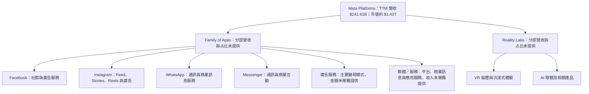
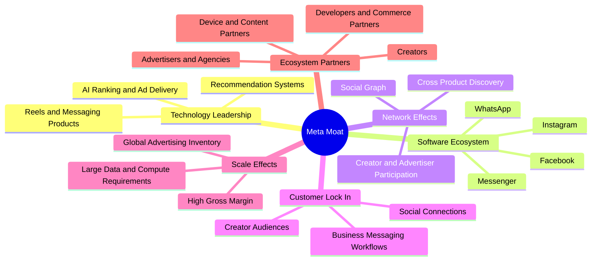
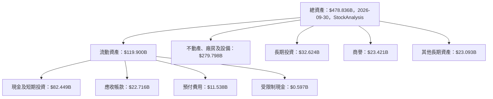
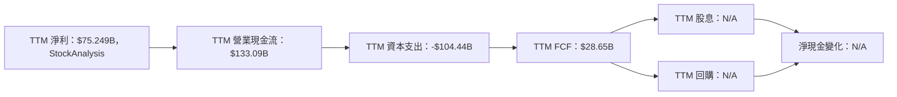
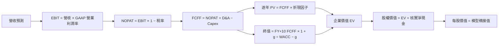
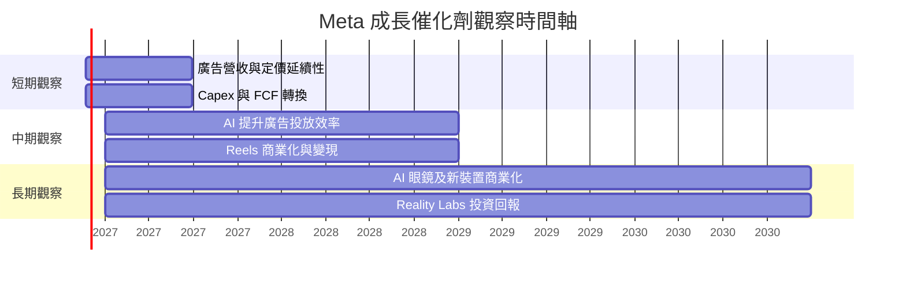
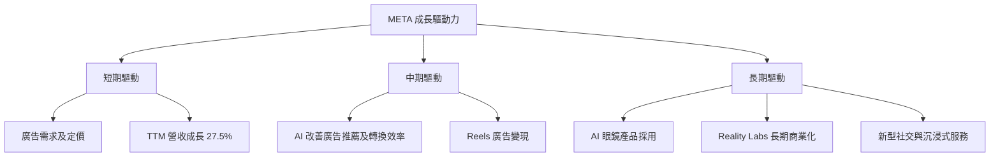
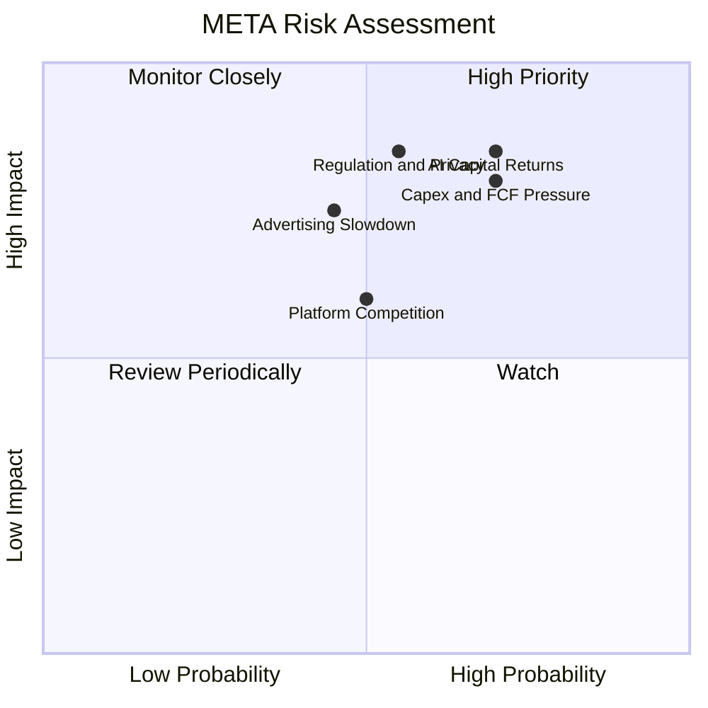
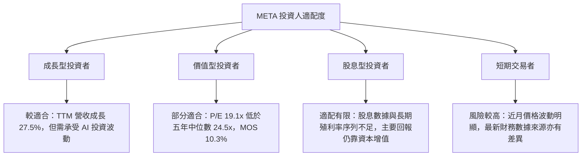

# META 基本面深度分析報告
> **報告日期**：2026-11-21 ｜ **語言**：繁體中文 ｜ **數據來源**：SEC 申報資料 (XBRL)、Yahoo Finance、Finviz、StockAnalysis、Roic.ai ｜ **分析師**：CFA 級機構研究

## 目錄

| # | 章節 | 核心結論 |
|---|------|----------|
| 1 | 執行摘要 | 買入；加權合理價值 $625.48，MOS 10.3% |
| 2 | 公司概覽與商業模式 | FoA 廣告業務及社交網路效應是主要護城河，分部營收明細未提供 |
| 3 | 損益表深度分析 | TTM 營收 $241.61B、年增 27.5%；最新一季營業利益率資料存在來源差異 |
| 4 | 資產負債表分析 | 按核心核實口徑淨負債 $1.22B；現金及短期投資 $82.45B |
| 5 | 現金流量深度分析 | TTM FCF $28.65B；高資本支出使現金轉換率承壓 |
| 6 | 獲利能力與資本效率 | ROIC 27.7% 高於 WACC 10.30%，目前仍創造股東價值 |
| 7 | 相對估值分析 | 自身估值低於五年中位數；相對估值方法結果分歧 |
| 8 | DCF 內在價值評估 | 基準 DCF 每股 $583.51；高度依賴終值且每股橋接可稽核性有限 |
| 9 | 成長催化劑 | 廣告、AI 與 Reels 是主要驅動；TAM 數據未提供 |
| 10 | 風險矩陣 | AI 資本支出、監管與核心廣告成長放緩是前三大風險 |
| 11 | 投資建議 | 維持買入；以 $625.48 加權合理價值作估值錨，設定量化監控門檻 |

---

## 1. 執行摘要

### 1.0 一頁式投資儀表板

| 項目 | 內容 |
|------|------|
| **投資論點（3 句）** | ① TTM 營收 $241.61B、年增 27.5%，最新一季營收年增 26.1%，反映廣告需求仍有韌性。② TTM ROIC 27.7% 對比 WACC 10.30%，資本回報仍高於資金成本。③ TTM FCF 為 $28.65B、FCF Yield 2.00%，但 TTM 資本支出 $104.44B 已對現金流形成明顯壓力。 |
| **綜合評分** | **7.3/10**（引用 1.1 六項平均） |
| **財務健康** | 🟡 現金及短期投資 $82.45B，但核實口徑淨負債為 $1.22B；最新季度流動比率未在核實品質指標中提供 |
| **ROIC vs WACC** | **27.7% vs 10.30%**；利差 17.4 個百分點，創造價值 |
| **FCF 趨勢** | TTM FCF $28.65B，較 2025 年全年 $46.11B 低；FCF Yield **2.00%**。期間不同，不宜視為嚴格同比 |
| **估值** | Forward P/E **15.72x** ｜ EV/EBITDA（Yahoo Finance）**12.62x** ｜ FCF Yield **2.00%** |
| **DCF 內在價值（基準）** | **$583.51** ｜ 現價相對 DCF 折價 **3.9%**（第 8.5 節基準值） |
| **安全邊際（MOS）** | **+10.3%＝($625.48 − $560.84) ÷ $625.48**，有限；🟡 10–25% 有限 |
| **預期報酬（基準情境 12M）** | **+4.0%**，採 DCF MODEL 基準情境相對現價幅度 |
| **關鍵風險（前二）** | AI 基礎設施投資令 Capex 持續高企；平台監管與廣告定價／需求回落 |
| **評級 + 信心度** | 🟢 **買入** ｜ 信心：中。MOS 10.3% 達買入門檻，但基準 DCF 僅較現價高 4.0%，且資本支出與估值橋接需審慎看待 |

### 1.1 綜合評分卡

| 維度 | 評分（1–10） | 主要依據（引用數字與其來源章節） |
|------|--------------|----------------------------------|
| 成長性 | 8.5 | TTM 營收成長 27.5%、最新一季營收年增 26.1%（第 3 章） |
| 獲利能力 | 8.0 | TTM 營業利益率 32.9%、ROIC 27.7%，但 Piotroski F-Score 為 3/8（第 3、6 章） |
| 財務健康 | 7.0 | 現金及短期投資 $82.45B，核實淨負債 $1.22B；Piotroski 多項趨勢測試未通過（第 4、6 章） |
| 估值 | 6.0 | MOS 10.3%；P/E 19.1x 低於五年中位數 24.5x，但 FCF Yield 僅 2.00%（第 7、8 章） |
| 護城河 | 9.0 | TTM 毛利率 81.0%、廣告業務規模與社交網路效應；市場份額與分部營收比例未提供（第 2 章） |
| 管理層與資本配置 | 5.0 | 2025 SBC $20.43B、TTM Capex $104.44B；AI 投資回報與回購資料未完整提供（第 3、5 章） |
| **綜合評分** | **7.3** | 六項算術平均：(8.5 + 8.0 + 7.0 + 6.0 + 9.0 + 5.0) ÷ 6 = 7.25，四捨五入為 **7.3** |

### 1.2 五大投資論點 + 三大核心風險

| 類型 | 項目 | 具體依據 | 信心度 |
|------|------|----------|--------|
| 🟢 **投資論點①** | 廣告主業仍具成長性 | TTM 營收 $241.61B、年增 27.5%；最新一季營收年增 26.1% | 🟢 高 |
| 🟢 **投資論點②** | 高資本回報提供價值底盤 | ROIC 27.7% 對比 WACC 10.30%，正利差 17.4 個百分點 | 🟢 高 |
| 🟢 **投資論點③** | 估值低於自身歷史中位數 | P/E 19.1x 對比五年中位數 24.5x；P/S 6.0x 對比 7.7x | 🟡 中 |
| 🟢 **投資論點④** | 現金資源可支撐長期投資 | 現金及短期投資 $82.45B，足以提供資本支出與研發的資金緩衝 | 🟡 中 |
| 🟢 **投資論點⑤** | 廣告平台具規模與數據優勢 | TTM 毛利率 81.0%；但提供資料未列廣告分部營收或活躍用戶數 | 🟡 中 |
| 🟡 **風險①** | AI 投資回報落後於支出 | TTM Capex $104.44B，TTM FCF 僅 $28.65B；若投入持續增加，可能壓低 FCF Yield | 🟡 中 |
| 🔴 **風險②** | 業績資料品質與季度利潤波動 | 核實資料最新一季營業利益率 20.1%，其他來源列 37.8%；同一季度營業利益也有差異 | 🔴 高 |
| 🔴 **風險③** | 監管、隱私與平台競爭 | 法規或平台政策若限制廣告定向與資料使用，可能損害廣告轉換率與定價能力 | 🟡 中 |

### 1.3 快速統計卡片

| 指標 | 公司實際值（期間） | 同業中位數 | 狀態 |
|------|--------------------|------------|------|
| 營收成長（TTM） | **27.5%** | — | 🟢 |
| 營收成長（最新一季年增） | **26.1%** | **14.3%**（GOOG、SNAP、PINS 中位數） | 🟢 |
| 毛利率（TTM） | **81.0%** | **60.9%** | 🟢 |
| 營業利益率（TTM） | **32.9%** | — | 🟢 |
| ROIC（TTM） | **27.7%** | — | 🟢 |
| Forward P/E | **15.72x** | **7.2x**（GOOG、SNAP、PINS 中位數） | 🟡 |
| FCF Yield（TTM） | **2.00%** | — | 🟡 |
| Piotroski F-Score | **3 / 8** | — | 🔴 |

> 同業中位數只使用有提供數值的同業倍數／成長率；Forward P/E 中位數偏低，受 SNAP 與 PINS 數據影響，並不代表可直接套用至 META。

### 1.4 投資結論

╔══════════════════════════════════════════════════════════════════╗  
║                    📊 投資結論摘要                               ║  
╠══════════════════════════════════════════════════════════════════╣  
║  評級：買入（依 MOS 10.3% 的規則 20 門檻）                        ║  
║  價格（2026-11-20 收盤）：$560.84                                ║  
║  DCF 內在價值（基準）：$583.51（現價折價 3.9%）                  ║  
║  安全邊際 MOS：+10.3%（＝($625.48−$560.84)÷$625.48）             ║  
║  加權合理價值（8.8）：$625.48                                    ║  
║  DCF 情境價值：                                                   ║  
║    悲觀情境：$196.16（−65.0%）                                   ║  
║    基準情境：$583.51（+4.0%）                                    ║  
║    樂觀情境：$1,423.19（+153.8%）                                ║  
║  綜合評分：7.3/10（引用 1.1）                                    ║  
║  適合投資人：能承受資本支出、監管與估值波動的長線成長型投資人    ║  
╚══════════════════════════════════════════════════════════════════╝  

---

## 2. 公司概覽與商業模式

### 2.1 業務結構與收入來源

公司資料顯示 Meta 主要由 Family of Apps（FoA）與 Reality Labs（RL）兩個分部構成；但分部營收、各產品營收與營收占比未提供，因此不拆分金額或比例。公司 TTM 營收為 $241.61B。

### 2.2 市場份額

市場份額數據未提供，因此不列比例或繪製市場份額圖。可觀察到 META TTM 營收成長 27.5%，高於 GOOG、SNAP、PINS 最新一季營收年增率中位數 14.3%；但單季與 TTM 期間不同，僅能作方向性比較。

### 2.3 競爭護城河分析

### 2.4 護城河強度

| 護城河項目 | 強度（強／中／弱） | 證據（引用數字或事實） | 會削弱它的情況 |
|------------|--------------------|------------------------|----------------|
| 技術與推薦系統 | 強 | TTM 毛利率 81.0%、TTM 營收成長 27.5%；廣告匹配與內容推薦具規模優勢 | 推薦品質下降、AI 產品成本高於新增廣告收益 |
| 軟體生態系統 | 強 | Facebook、Instagram、WhatsApp、Messenger 多產品並存；使用者數未提供 | 使用者轉移至新平台、年輕族群參與下降 |
| 網路效應 | 強 | 社交關係與創作者內容提高平台互動價值；營收及用戶分部資料未提供 | 競爭平台取得創作者與使用者注意力 |
| 客戶鎖定 | 中至強 | 廣告主可透過平台取得多種版位；廣告主留存率未提供 | 隱私政策或監管限制精準投放 |
| 規模效應 | 強 | TTM 營收 $241.61B、毛利率 81.0%，可分攤全球平台研發與基礎設施支出 | AI Capex 增長快於收入與現金流 |
| 生態夥伴 | 中 | 廣告主、代理商、創作者及裝置夥伴共同參與；合作夥伴營收貢獻未提供 | 夥伴轉向其他平台或第三方規範改變 |

> 1.1「護城河」評分 9.0/10，主要依據平台網路效應、TTM 毛利率 81.0% 與 $241.61B 營收規模；由於缺少用戶留存、廣告主數量與分部經濟數據，評分並非建立在可直接驗證的市場份額上。

---

## 3. 損益表深度分析

### 3.1 年度收入成長趨勢（近 4 年）

╔══════════════════════════════════════════════════════════════════╗  
║              Meta 年度收入趨勢（FY2022–FY2025）                 ║  
╠══════════════════════════════════════════════════════════════════╣  
║  FY2022  $116.61B  ████████████░░░░░░░░░░░░  YoY: −1.1% 🟡     ║  
║  FY2023  $134.90B  ██████████████░░░░░░░░░░  YoY: +15.7% 🟢    ║  
║  FY2024  $164.50B  █████████████████░░░░░░░  YoY: +21.9% 🟢    ║  
║  FY2025  $200.97B  █████████████████████░░░░  YoY: +22.2% 🟢    ║  
║                                                                  ║  
║  2022–2025 營收 CAGR：                                           ║  
║  ($200.97B ÷ $116.61B)^(1/3) − 1 = 約 19.9%                     ║  
╚══════════════════════════════════════════════════════════════════╝  

2022 年收入略降後，2023–2025 年營收成長逐年加速至 22.2%。TTM 營收成長進一步達 27.5%，顯示最近四季成長高於 FY2025；廣告需求、內容推薦與影片產品變現是可能的業務解釋，但公司資料未提供各驅動因素的定量拆解。

### 3.2 季度收入趨勢分析

以下 QoQ 以已提供季度營收計算；YoY 採資料列示的單季年增率。

| 季度 | 營收 | QoQ 成長 | YoY 成長（單季） | 備註 |
|------|------:|---------:|-----------------:|------|
| 2025 Q4 | $59.89B | +41.5% | 23.78% | QoQ 受季節性因素影響，不宜當作趨勢年化 |
| 2026 Q1 | $56.31B | −6.0% | 33.08% | 季節性回落，但年增加速 |
| 2026 Q2 | $60.80B | +8.0% | 27.96% | 營收恢復成長，年增仍高 |
| 2026 Q3 | $64.60B | +6.2% | 26.07% | 最新一季年增率為單季數字，非 TTM 成長率 |

計算示例：2026 Q3 QoQ = ($64.601B ÷ $60.801B) − 1 = 約 6.2%。最新一季營收年增由 Q1 的 33.08% 降至 Q3 的 26.07%，仍屬高成長，但增速已有回落，後續需確認廣告單價與曝光量是否持續支撐營收。

### 3.3 利潤率演變分析

| 利潤率指標 | FY2022 | FY2023 | FY2024 | FY2025 | 趨勢 | 評估 |
|------------|-------:|-------:|-------:|-------:|------|------|
| **毛利率** | 78.3% | 80.8% | 81.7% | 82.0% | 緩步改善 | 🟢 |
| **營業利益率** | 24.8% | 34.7% | 42.2% | 41.4% | 2022 低點後回升，2025 略回落 | 🟢 |
| **淨利率** | 19.9% | 29.0% | 37.9% | 30.1% | 2025 明顯下降 | 🟡 |

年度毛利率與營業利益率依年度損益表的毛利、營業利益除以營收計算。2022 年營業利益率低至 24.8%，其後隨收入恢復與成本控制提升；FY2024 達 42.2%，FY2025 回落至 41.4%。淨利率在 FY2025 下滑，可能涉及非營業項目、稅項或投資收益變動，提供資料不足以將變化歸因於特定一次性項目。

**最新季度數據須注意來源差異**：SEC 10-Q 核實摘要的最新一季營業利益率為 20.1%；其他彙整資料則列 37.8%，而 StockAnalysis 的 Q3 營業利益 $22.878B ÷ 營收 $64.601B 約為 35.4%。同一季度營業利益也出現 $12.99B 與 $22.878B 的差異。本文在標示核實指標時採用 20.1%，但將該季營業獲利判讀列為低信心，應回查原始 SEC 申報。

### 3.4 費用結構分析

費用細項未提供完整且一致的最新 TTM 金額分解，因此不製作費用比例圓餅圖，也不以不完整資料推算費用占比。可引用的 FY2025 數據包括 R&D $57.37B、營業利益 $83.28B；兩者不能代表全部營運費用結構。

╔══════════════════════════════════════════════════════════════════╗  
║  FY2025 已知費用／獲利項目                                      ║  
╠══════════════════════════════════════════════════════════════════╣  
║  研發支出 R&D：$57.37B                                           ║  
║  營業利益：      $83.28B                                         ║  
║  SBC：           $20.43B                                         ║  
║  注意：上列項目口徑不同，並非互斥費用分類，不可相加為費用總額。║  
╚══════════════════════════════════════════════════════════════════╝  

### 3.5 季度 EPS 趨勢與盈餘品質（Quality of Earnings）

EPS 資料來源顯示 2026 Q3、Q2、Q1、2025 Q4 EPS 分別為 $3.83、$6.18、$10.44、$8.88；同比增幅分別為 264.76%、−13.44%、62.36%、10.70%。但分析師 EPS 預期值皆為 NaN，因此無法判定過去四季是否超預期或不及預期。

| 季度 | EPS 實際 | EPS 年增 | 超預期／不及預期 | 可觀察原因與限制 |
|------|---------:|--------:|------------------|------------------|
| 2026 Q3 | $3.83 | +264.76% | N/A | 前一年同期 EPS 僅 $1.05，低基期使同比增幅失真；分析師預期缺失 |
| 2026 Q2 | $6.18 | −13.44% | N/A | 同比轉負；EPS 估值預期缺失，無法判斷是否符合市場預期 |
| 2026 Q1 | $10.44 | +62.36% | N/A | 盈餘同比改善，但季度 EPS 受稅項與非營業項目影響的可能性無法拆分 |
| 2025 Q4 | $8.88 | +10.70% | N/A | 正成長但增幅較低；分析師預期缺失 |

| 盈餘品質項目 | 數值／佔比 | 評估 |
|--------------|-----------|------|
| 股權薪酬 SBC / 營收 | FY2025：$20.43B ÷ $200.97B = **10.2%** | 🟡 SBC 是實質稀釋成本；不可只因非現金而忽略 |
| SBC / 營業現金流 | FY2025：$20.43B ÷ $115.80B = **17.6%** | 🟡 SBC 規模相對現金流不低；FY2026 TTM SBC 未提供 |
| FCF / 淨利（現金轉換率） | TTM FCF $28.65B ÷ StockAnalysis TTM 淨利 $75.249B = 約 **38.1%** | 🔴 FCF 低於會計淨利，主要需結合高額 Capex 解讀 |
| 一次性／非經常性損益 | N/A（細項未提供） | 無法判定是否有一次性項目美化或壓低獲利 |
| 有效稅率異常 | 29.6%（最新年度有效稅率） | 🟡 未提供足夠歷史細節判斷異常；DCF 沿用該值 |
| 資本化支出 vs 費用化 | TTM Capex $104.44B；TTM D&A/營收 10.3% | 🟡 大額基建投資可能使現金流短期低於淨利；未提供資本化政策細節 |

**盈餘品質結論**：GAAP 盈餘有營業現金流支持，但 TTM FCF/淨利約 38.1%，表明資本密集型投資大幅消耗現金。FY2025 SBC 約為營收 10.2%，對股東報酬構成實質稀釋。估值不宜只看 EPS 或 P/E，應同步追蹤 Capex、FCF 轉換與稀釋股數。

---

## 4. 資產負債表分析

### 4.1 資產結構分解

最新 TTM 總資產為 $478.836B（StockAnalysis），但各項資產合計與 SEC 核實口徑需以原始申報為準；以下僅呈現已列明的資產項目，不製作占比圖。

### 4.2 流動性與營運資金分析

| 指標 | 最新 TTM | 一年前 TTM | 變化 | 解讀 |
|------|----------|------------|------|------|
| DSO 應收帳款天數 | 34 天 | 33 天 | +1 天 | 收款天數微增；資料不足以判定是否代表客戶付款變慢 |
| DIO 存貨天數 | N/A | N/A | N/A | 公司未列可計算存貨餘額；不得補值 |
| DPO 應付帳款天數 | 152 天 | N/A | N/A | 一年前資料缺失，無法比較；最新值可能反映供應商付款條款 |
| CCC 現金轉換週期 | N/A | N/A | N/A | DIO 缺失，故週期不可計算 |

SEC／彙整資產負債表顯示 FY2025 流動比率約 2.60（流動資產 $108.72B ÷ 流動負債 $41.84B）；Yahoo 彙整的最新流動比率為 1.903。期間與來源不同，顯示流動性仍為正，但不宜混用成連續趨勢。快速比率 1.669，仍高於 1 倍。

### 4.3 債務結構分析

╔══════════════════════════════════════════════════════════════════╗  
║                   META 債務健康診斷                              ║  
╠══════════════════════════════════════════════════════════════════╣  
║  總債務（核實口徑）：        $83.67B                              ║  
║  現金及短期投資：            $82.45B                              ║  
║  淨現金（負值代表淨負債）：  −$1.22B  🟡                         ║  
║                                                                  ║  
║  以其他彙整資料計的總債務：  $114.84B                            ║  
║  對應淨負債：                $32.39B                              ║  
║  差異可能與租賃負債／負債口徑有關，不能與核實口徑混算。          ║  
║  Debt/EBITDA、利息保障倍數： N/A（同口徑資料不足）                ║  
╚══════════════════════════════════════════════════════════════════╝  

### 4.4 股東權益趨勢

╔══════════════════════════════════════════════════════════════════╗  
║              META 歷年股東權益（年度）                           ║  
╠══════════════════════════════════════════════════════════════════╣  
║  FY2022  $125.71B  █████████████░░░░░░░░░░░░░░░                 ║  
║  FY2023  $153.17B  ████████████████░░░░░░░░░░░░                 ║  
║  FY2024  $182.64B  ███████████████████░░░░░░░░░                 ║  
║  FY2025  $217.24B  ███████████████████████░░░░░                 ║  
╚══════════════════════════════════════════════════════════════════╝  

FY2022–FY2025 股東權益持續上升，與累積盈利一致；但 FY2026 最新季度股東權益未提供，因此不能延伸成同口徑 TTM 趨勢。FY2025 至 FY2024 增加 $34.60B，不能單純解讀為現金創造，仍須結合回購、SBC 與其他權益項目。

---

## 5. 現金流量深度分析

### 5.1 現金流量瀑布圖

淨利 TTM 數據引用 StockAnalysis；現金流與 Capex 採核實 TTM 數據。股息、回購與淨現金變化的 TTM 完整金額未提供，故不補入圖中數字。

### 5.2 FCF 轉換率趨勢

| 年度 | 營業現金流 | 資本支出 | FCF | 淨利 | FCF／淨利 |
|------|-----------:|---------:|----:|-----:|----------:|
| FY2022 | $50.48B | $31.19B | $19.29B | $23.20B | 83.1% |
| FY2023 | $71.11B | $27.05B | $44.07B | $39.10B | 112.7% |
| FY2024 | $91.33B | $37.26B | $54.07B | $62.36B | 86.7% |
| FY2025 | $115.80B | $69.69B | $46.11B | $60.46B | 76.3% |
| TTM 至 2026-09-30 | $133.09B | $104.44B | $28.65B | $75.249B* | 約 38.1% |

\* TTM 淨利採 StockAnalysis；與不同來源的季度淨利資料存在差異。

FY2025 Capex 上升至 $69.69B，使 FCF 由 FY2024 的 $54.07B 降至 $46.11B。最新 TTM Capex 再升至 $104.44B，令 FCF 降至 $28.65B。投資可能為算力與資料中心擴張，但若新增收入／利潤未能追上資本支出，股東可分配現金將持續受壓。

### 5.3 自由現金流趨勢

╔══════════════════════════════════════════════════════════════════╗  
║                 META 自由現金流趨勢                              ║  
╠══════════════════════════════════════════════════════════════════╣  
║  FY2022  $19.29B  ████████░░░░░░░░░░░░░░  FCF Yield：N/A       ║  
║  FY2023  $44.07B  ██████████████████░░░░  FCF Yield：N/A       ║  
║  FY2024  $54.07B  ██████████████████████  FCF Yield：N/A       ║  
║  FY2025  $46.11B  ███████████████████░░░  FCF Yield：N/A       ║  
║  TTM      $28.65B  ████████████░░░░░░░░░░  FCF Yield：2.00%     ║  
║                                                                  ║  
║  FY 數字與 TTM 期間不同；TTM FCF 下滑與 Capex 增加同時發生。   ║  
╚══════════════════════════════════════════════════════════════════╝  

### 5.4 資本配置評估

目前資料沒有提供一致口徑的 TTM 回購、投資收購、股息與留存現金明細，因此不以比例繪製資本配置圓餅圖。

| 項目 | 可用數據 | 評估 |
|------|----------|------|
| 資本支出 | TTM $104.44B；FY2025 $69.69B | 近期資本需求明顯增加，應要求以營收與 FCF 回報驗證 |
| 股息 | FY2025 支付 $5.32B；FY2026 每季約 $1.34B–$1.36B | 現金分配規模遠低於營業現金流 |
| 股票回購 | TTM 金額未提供 | 不推定回購是否足以抵銷 SBC 稀釋 |
| 留存／其他投資 | TTM 明細未提供 | 無法計算配置比例 |

---

## 6. 獲利能力與資本效率

### 6.1 ROE / ROA / ROIC 趨勢

| 指標 | FY2022 | FY2023 | FY2024 | FY2025／TTM | 評估 |
|------|-------:|-------:|-------:|------------:|------|
| ROE | N/A | N/A | N/A | 27.6%（核實 TTM） | 🟢 資本回報高；另一彙整來源列 32.3%，口徑不同 |
| ROA | N/A | N/A | N/A | 14.6%（彙整資料） | 🟢 顯示資產具獲利能力，與核實品質指標的年度趨勢測試不同 |
| ROIC | N/A | N/A | N/A | 27.7%（核實 TTM） | 🟢 明顯高於 WACC 10.30% |

歷史年度 ROIC、ROA、ROE 的一致口徑序列未提供，因此不補造年度值或同業均值。核實 TTM ROE 為 27.6%，Yahoo 彙整資料列 32.3%，下文採核實口徑。

### 6.2 ROIC vs WACC 分析（核心價值創造判斷）

╔══════════════════════════════════════════════════════════════════╗  
║                ROIC vs WACC 深度分析                             ║  
╠══════════════════════════════════════════════════════════════════╣  
║  WACC（採用資料庫計算值）：10.30%                                ║  
║  ├── 無風險利率（10Y 美債）：4.91%                               ║  
║  ├── 股權風險溢酬 ERP：5.00%                                     ║  
║  ├── 原始 Beta：1.28；調整後 Beta：1.19                          ║  
║  ├── 股權成本 Ke：10.84%                                         ║  
║  ├── 稅前債務成本：1.39%；有效稅率：29.6%                       ║  
║  ├── 股權／債務權重：94.5%／5.5%                                 ║  
║  └── WACC：10.30%                                                 ║  
║                                                                  ║  
║  ROIC（TTM）：27.7%                                               ║  
║  EVA 利差：27.7% − 10.30% = +17.4 個百分點                      ║  
║                                                                  ║  
║  ROIC  27.7%  ▓▓▓▓▓▓▓▓▓▓▓▓▓▓▓▓▓▓▓▓▓▓▓▓▓▓                       ║  
║  WACC  10.3%  ▓▓▓▓▓▓▓▓▓▓░░░░░░░░░░░░░░░░                       ║  
║                                                                  ║  
║  結論：按核實 TTM 指標，ROIC 約為 WACC 的 2.7 倍，創造股東價值。║  
╚══════════════════════════════════════════════════════════════════╝  

計算：ROIC/WACC = 27.7% ÷ 10.30% = 約 2.69 倍；EVA 利差 = 27.7% − 10.30% = 17.40 個百分點。ROIC 是核實數據直接提供的稅後營業獲利／投入資本指標；不以其他來源的期末資產負債表另行重算。

### 6.3 杜邦三因素分解

| 因素 | 數值（TTM） | 解讀 |
|------|-------------|------|
| 淨利率 | 31.1% | 淨利率為 ROE 的主要獲利來源 |
| 資產週轉率 | 0.50 | 每美元資產產生約 $0.50 收入 |
| 權益乘數 | 1.76 | 有槓桿，但非主要 ROE 驅動因素 |
| **ROE** | **27.6%** | 31.1% × 0.50 × 1.76 = 27.368% ≈ 27.6%；差異為輸入數字四捨五入 |

### 6.4 財務體質：Piotroski F-Score

Piotroski F-Score 為 **3/8**；因毛利率測試缺少輸入，九項測試中僅八項可判定。

| 測試 | 結果 | 解讀 |
|------|------|------|
| ROA > 0 | ✅ 通過 | 公司仍有正向資產報酬 |
| 營業現金流 > 0 | ✅ 通過 | TTM 營業現金流為 $133.09B |
| ROA 高於一年前 | ❌ 未通過 | 資產獲利趨勢未改善 |
| 營業現金流 > 淨利（應計品質） | ✅ 通過 | 現金流高於淨利，對應較佳現金應計品質 |
| 長期負債 ÷ 總資產低於一年前 | ❌ 未通過 | 槓桿指標較一年前惡化 |
| 流動比率高於一年前 | ❌ 未通過 | 流動性相對前期未改善 |
| 稀釋股數未增加 | ❌ 未通過 | 股數增加可能反映 SBC 稀釋 |
| 毛利率高於一年前 | 無法判定 | 缺少可比較輸入，不計入分母 |
| 資產週轉率高於一年前 | ❌ 未通過 | 資產效率未改善 |

F-Score 3/8 反映的是部分趨勢指標未改善，不足以推翻公司高 ROIC 的現況；但稀釋股數、負債與資產效率均值得持續追蹤。

---

## 7. 相對估值分析

### 7.1 同業估值比較表格

| 估值指標 | **META** | **GOOG** | **SNAP** | **PINS** | META 評估 |
|----------|---------:|---------:|---------:|---------:|-----------|
| **Trailing P/E** | 19.1x | 13.8x | N/A | 68.0x | 🟡 高於 GOOG、低於 PINS；SNAP 無值 |
| **Forward P/E** | 15.72x | 17.3x | 5.8x | 7.2x | 🟡 高於同業中位數 7.2x；獲利與業務成熟度不同 |
| **P/S** | 6.0x | 6.9x | 1.2x | 2.0x | 🟡 高於 SNAP、PINS，略低於 GOOG |
| **EV/EBITDA** | 13.8x（核實歷史估值口徑） | 17.0x | 48.6x | 30.7x | 🟢 低於三家同業倍數；但 SNAP 倍數偏高且公司品質有差異 |
| **最新一季營收年增** | 26.1% | 24.7% | 14.3% | 11.9% | 🟢 META 成長高於三家 |
| **毛利率（TTM）** | 81.0% | 60.9% | 59.2% | 79.0% | 🟢 毛利率高於所列同業 |

META EV/EBITDA 在核實自身歷史區間表為 13.8x；Yahoo 彙整估值則列 12.618x。為遵守同一核實估值來源比較，表中使用 13.8x，來源差異不應被忽略。

### 7.2 歷史估值區間分析

╔══════════════════════════════════════════════════════════════════╗  
║              META 五年 P/E 歷史位置                              ║  
╠══════════════════════════════════════════════════════════════════╣  
║  五年區間：12.9x ─────────────────────────────── 33.4x          ║  
║  五年中位數：24.5x                                               ║  
║  目前：19.1x（百分位 19%）                                       ║  
║                                                                  ║  
║  P/S：目前 6.0x；五年中位數 7.7x；區間 2.8x–10.6x；百分位 24%   ║  
║  EV/EBITDA：目前 13.8x；中位數 16.5x；區間 7.7x–19.7x；百分位29%║  
╚══════════════════════════════════════════════════════════════════╝  

目前 P/E、P/S 與 EV/EBITDA 均低於自身五年中位數，歷史百分位落在 19%–29%。這支持估值較自身歷史便宜，但不能單獨證明低估：目前 Capex 強度升高、FCF Yield 僅 2.00%，且歷史估值區間也可能反映不同成長與資本支出環境。

### 7.3 情境價值（Bear / Base / Bull，依 DCF MODEL）

| 情境 | 第 1 年營收成長 | 期末營業利潤率 | WACC | 每股價值 | 相對現價 | 機率 | 可能條件 |
|------|----------------:|----------------:|-----:|---------:|---------:|-----:|----------|
| 🔴 悲觀 | 13.8% | 29.5% | 11.30% | $196.16 | −65.0% | 25% | 廣告成長放緩、AI 資本開支回收延後，且風險溢酬上升 |
| 🟡 基準 | 27.5% | 34.7% | 10.30% | $583.51 | +4.0% | 50% | TTM 成長起點延續後逐步降速，利潤率靠規模與效率略升 |
| 🟢 樂觀 | 41.3% | 38.1% | 9.30% | $1,423.19 | +153.8% | 25% | AI 變現顯著加速、廣告效率提升並使營業槓桿擴大 |

### 7.4 相對估值隱含價格區間

╔══════════════════════════════════════════════════════════════════╗  
║                   相對估值隱含價格                               ║  
╠══════════════════════════════════════════════════════════════════╣  
║  同業 Forward P/E：$256.86（低於現價 $560.84）                   ║  
║  現價：          $560.84                                          ║  
║  DCF 基準：      $583.51                                          ║  
║  同業 EV/EBITDA：$972.14（高於現價）                              ║  
║  分析師共識：    $848.23                                          ║  
╚══════════════════════════════════════════════════════════════════╝  

| 方法 | 每股價值 | 依據 |
|------|---------:|------|
| 同業 Forward P/E | $256.86 | 同業中位數 7.2x × META Forward EPS $35.68 |
| 同業 EV/EBITDA | $972.14 | 同業中位數 23.8x（GOOG、PINS）× TTM EBITDA，再加淨現金 |
| 分析師共識目標價 | $848.23 | 58 位分析師平均目標價；屬外部參考，不等同內在價值 |

Forward P/E 方法給出的價格遠低於其他方法，主要因同業中位數 7.2x 受到 SNAP 與 PINS 倍數資料影響，不能假定其風險與成長特徵等同 META。EV/EBITDA 方法則使用 GOOG、PINS 中位數 23.8x，對同業樣本選擇敏感。

---

## 8. DCF 內在價值評估（Discounted Cash Flow）

### 8.0 估值推理鏈（Thinking Logic）

**Step 1 — 價值由哪些變數決定？**

META 的估值主要取決於現有應用平台廣告現金流、AI 提升廣告投放效率的增量價值，以及 Reality Labs／AI 眼鏡等新產品的長期選擇權。現有資料沒有提供 FoA 與 RL 分部營收，故無法合法量化兩者的營收占比；本模型以合併 TTM 營收 $241.61B 作起點。模型敏感度顯示，終值假設、WACC 與資本支出由 43.2% 營收逐步下降，是估值的主要主導因素。

**Step 2 — 模型選擇**

| 決策點 | 本報告採用 | 理由（含數字） | 曾考慮但否決 | 否決理由 |
|--------|-----------|----------------|--------------|----------|
| 現金流定義 | FCFF | 以 WACC 10.30% 折現，先得 EV 再橋接股權價值 | FCFE | 公司有債務且資料以企業價值橋接為主 |
| 預測期 N | 10 年 | DCF MODEL 固定 10 年，營收成長由 27.5% 線性降至 3.0% | 5 年 | 會縮短模型指定的成長淡化期，且與原模型不一致 |
| 終值方法 | Gordon Growth | 程式模型指定永續成長率 3.0% | 退出倍數 | 模型未提供退出倍數，不能自建或改動 |
| EBIT 基礎 | GAAP EBIT | 模型指定 GAAP EBIT；SBC 已是費用 | 非 GAAP EBIT | 加回 SBC 會與既定模型不一致 |

**Step 3 — 關鍵假設推導鏈**

- **營收成長路徑**：錨點＝TTM 成長 27.5% 且最新一季營收年增 26.1% → 調整＝預期成長隨基期擴大及成熟市場競爭逐步降速 → **採用 FY+1 27.5%、FY+10 3.0%，逐年線性遞減** → 曾考慮將 27.5% 維持十年，但否決，因其會把目前高增速永久化。
- **期末營業利益率**：錨點＝TTM GAAP 營業利益率 32.9%；近年 FY2024、FY2025 年度利潤率約 42.2%、41.4%，但來源口徑存在差異 → 調整＝採用模型指定的五年財報中位數為成熟期錨點 → **FY+10 採用 34.7%** → 曾考慮沿用 FY2024 42.2%，因年度高點未必可持續而否決。
- **永續成長率 g**：錨點＝長期成熟企業需低於 WACC；此處 WACC 為 10.30% → 調整＝由模型固定採 3.0%，低於 WACC 且不將短期成長外推至永續期 → **採用 3.0%** → 曾考慮更高永續成長率，但會放大終值依賴而否決。
- **預測期 N**：錨點＝模型明確設定 10 年，並將成長由 27.5% 衰減至 3.0% → 調整＝不另改模型期限 → **採用 10 年** → 曾考慮 5 年，因無法對應模型原有逐年現金流而否決。
- **Capex／營收**：錨點＝TTM Capex $104.44B ÷ TTM 營收 $241.61B = 約 43.2% → 調整＝模型假設投資強度逐步回歸至 D&A 的 1.1 倍 → **FY+1 43.2% 線性降至 FY+10 11.3%** → 曾考慮永久維持 43.2%，因該值會將當前建設高峰永久化而否決。
- **WACC**：錨點＝資本成本資料庫計算 WACC 10.30% → 調整＝不自行調整或另算 → **採用 10.30%** → 曾考慮依市場波動另加折價率，但與規定的核實資本成本不一致而否決。
- **EBIT 與 SBC**：錨點＝模型以 GAAP EBIT，並指出 SBC 已費用化 → 調整＝不再從 FCFF 重複扣 SBC，也不額外稀釋股數 → **採用組合 (A)，年稀釋率 0%** → 曾考慮另外扣 SBC 或提高股數，會重複計入同一成本，故否決。
- **D&A／營收、稅率、營運資金**：錨點＝D&A/營收 10.3%、有效稅率 29.6%；模型不計營運資金變動 → **採用 D&A 10.3%、稅率 29.6%、ΔWC 不建模**。營運資金缺少模型輸入，不能自行添加。

**Step 4 — 最脆弱假設**

最脆弱的一環是 Capex/營收從 FY+1 的 43.2% 下降至 FY+10 的 11.3%；若 AI 基建投資未如假設回落，FCFF 與終值都會下修。模型敏感度顯示基準值 $583.51，在 WACC 10.30%、g 2.0% 時降至 $522.51；在 WACC 10.30%、g 4.0% 時升至 $663.89，僅永續成長率區間便形成顯著價值差。

**Step 5 — 計算路徑圖**

### 8.1 模型假設總表（Model Inputs）

| 假設項目 | 採用值 | 依據／來源 | 敏感度 |
|----------|-------|------------|--------|
| 預測期長度 N | 10 年 | DCF MODEL 固定預測期；營收成長由 27.5% 淡化至 3.0% | 🟡 中 |
| 營收成長路徑 | FY+1 27.5% → FY+10 3.0% | TTM vs prior TTM 成長 27.5%；模型線性淡化 | 🔴 高 |
| 營業利潤率 | 32.9% → 34.7% | TTM GAAP 32.9%，終值採近五年財報中位數 | 🔴 高 |
| 有效稅率 | 29.6% | 最新年度有效稅率 | 🟢 低 |
| Capex／營收 | 43.2% → 11.3% | TTM Capex/營收 43.2%；期末為 D&A 的 1.1 倍 | 🔴 高 |
| D&A／營收 | 10.3% | TTM 模型輸入 | 🟢 低 |
| 營運資金變動 | 不建模 | DCF MODEL 明確未納入；ΔWC 輸入未提供 | 🟢 低 |
| EBIT 基礎 | GAAP EBIT | DCF MODEL 指定 GAAP EBIT，已含 SBC 費用 | 🟡 中 |
| SBC 處理 | 不再扣 SBC | 採組合 (A)：GAAP EBIT + 固定股數 | 🟡 中 |
| 年稀釋率 | 0% | 組合 (A) 模型設定；不對現有股數再放大 | 🟡 中 |
| 永續成長率 g | 3.0% | 模型指定，低於 WACC 10.30% | 🔴 高 |
| 終值方法 | Gordon Growth | DCF MODEL 採用 | 🔴 高 |
| WACC | 10.30% | 資本成本資料庫計算值；第 6.2 節同值 | 🔴 高 |

本模型採用 **(A) GAAP EBIT + 固定股數**，因此 SBC 影響已計入一次；FCFF 不另減 SBC，股數不再逐年稀釋。FCFF 定義為 `NOPAT + D&A − Capex`；營運資金變動依模型設定不納入。

### 8.2 折現率推導（WACC）

╔══════════════════════════════════════════════════════════════════╗  
║                    WACC 推導（折現率）                           ║  
╠══════════════════════════════════════════════════════════════════╣  
║  股權成本 Ke（CAPM）：                                           ║  
║  ├── 無風險利率 Rf：4.91%                                        ║  
║  ├── ERP：5.00%（資本成本資料庫假設值）                           ║  
║  ├── 原始 Beta：1.28；採用調整後 Beta：1.19                      ║  
║  ├── 調整方式：(⅔ × 1.28) + (⅓ × 1) = 1.19                     ║  
║  ├── 規模／國別溢酬：0%（未提供額外溢酬）                        ║  
║  └── Ke = 4.91% + 1.19 × 5.00% = 10.86%（模型列示 10.84%）     ║  
║                                                                  ║  
║  債務成本 Kd：                                                   ║  
║  ├── 稅前 Kd：1.39%（核實資本成本資料）                          ║  
║  ├── 稅率：29.6%                                                 ║  
║  └── 稅後 Kd = 1.39% × (1−29.6%) = 0.9786%                      ║  
║                                                                  ║  
║  資本結構：股權權重 94.5%，債務權重 5.5%                         ║  
║  └── 採用 WACC：10.30%（程式計算值；第 6.2 節同值）             ║  
╚══════════════════════════════════════════════════════════════════╝  

逐步演算與一致性說明：

1. **Ke（CAPM）**：資料庫列示公式為 `4.91% + 1.19 × 5.00%`。直接代入得 10.86%，但資料庫列出的 Ke 是 **10.84%**。本文依規定採用資本成本資料庫的 Ke/WACC，不以自行重算覆蓋核實值；此處存在約 0.02 個百分點差異，列為稽核限制。
2. **稅前 Kd**：資料庫直接列示 **1.39%**；利息費用與平均計息負債的絕對金額未提供，因此不可再反推分子或分母。
3. **稅後 Kd**：`1.39% × (1 − 29.6%) = 0.9786%`，約 0.98%。
4. **權重**：核實權重為股權 94.5%、債務 5.5%，合計 100%；股權市值及計息債務同一口徑的金額拆解未提供，不能另行換算。
5. **WACC**：依核實資本成本資料採用 **10.30%**。若以已列示四捨五入輸入自行加權，可能因輸入精度與 Ke 差異產生小幅尾差，因此以資料庫 WACC 作 DCF 折現率及 ROIC 比較基準。

Rf 日期、ERP 推導樣本、Beta 觀察期間與計息負債平均餘額未提供；這些不是本文自行填入的假設，而是資本成本資料的可稽核性限制。第 6.2 與第 8 章均採同一 WACC 10.30%。

### 8.3 逐年自由現金流預測（基準情境）

金額單位：$B。表格逐年照錄 DCF MODEL；折現因子取三位小數。

| 年度 | FY+1 | FY+2 | FY+3 | FY+4 | FY+5 | FY+6 | FY+7 | FY+8 | FY+9 | FY+10 |
|------|-----:|-----:|-----:|-----:|-----:|-----:|-----:|-----:|-----:|------:|
| 營收 | 308.11 | 384.52 | 469.41 | 560.24 | 653.38 | 744.20 | 827.37 | 897.28 | 948.65 | 977.11 |
| 營收 YoY | 27.5% | 24.8% | 22.1% | 19.4% | 16.6% | 13.9% | 11.2% | 8.5% | 5.7% | 3.0% |
| 營業利潤率 | 32.9% | 33.1% | 33.3% | 33.5% | 33.7% | 33.9% | 34.1% | 34.3% | 34.5% | 34.7% |
| EBIT（GAAP） | 101.23 | 127.10 | 156.10 | 187.43 | 219.90 | 251.95 | 281.76 | 307.37 | 326.86 | 338.62 |
| − 稅（29.6%） | (30.01) | (37.68) | (46.28) | (55.56) | (65.19) | (74.69) | (83.53) | (91.12) | (96.90) | (100.38) |
| = NOPAT | 71.22 | 89.43 | 109.83 | 131.87 | 154.71 | 177.26 | 198.24 | 216.25 | 229.97 | 238.24 |
| + D&A | 31.78 | 39.66 | 48.42 | 57.78 | 67.39 | 76.76 | 85.34 | 92.55 | 97.85 | 100.78 |
| − Capex | (133.19) | (152.59) | (169.65) | (182.64) | (189.85) | (189.88) | (181.79) | (165.37) | (141.24) | (110.86) |
| **= FCFF** | **−30.18** | **−23.51** | **−11.41** | **7.02** | **32.25** | **64.14** | **101.78** | **143.43** | **186.58** | **228.16** |
| 折現因子 @10.30% | 0.907 | 0.822 | 0.745 | 0.676 | 0.613 | 0.555 | 0.504 | 0.457 | 0.414 | 0.375 |
| **FCFF 現值 PV** | **−27.37** | **−19.32** | **−8.50** | **4.74** | **19.75** | **35.62** | **51.25** | **65.48** | **77.22** | **85.62** |

預測期現值合計完整算式：

`−$27.37B − $19.32B − $8.50B + $4.74B + $19.75B + $35.62B + $51.25B + $65.48B + $77.22B + $85.62B = $284.49B`

**FY+1 逐步演算**

1. 營收：`$241.61B × (1 + 27.5%) = $308.05B`；模型表列 **$308.11B**，由於起始數字與成長率顯示精度有限，以下模型各行採用程式輸出值，不以重新計算覆蓋。
2. EBIT：`$308.11B × 32.9% = $101.37B`；模型列 **$101.23B**，顯示模型中間輸入精度未完整列示。
3. 稅：模型列 **$30.01B**；以表列 EBIT 計 `101.23 × 29.6% = $29.96B`，有約 $0.05B 差異。
4. NOPAT：模型列 **$71.22B**；表列 EBIT 減表列稅為 `$101.23 − $30.01 = $71.22B`。
5. D&A：模型列 **$31.78B**；以顯示營收乘 10.3% 約為 $31.74B，精度差異來自未顯示的小數輸入。
6. Capex：模型列 **$133.19B**；以顯示營收乘 43.2% 約為 $133.10B，差異同樣來自未顯示精度。
7. ΔWC：DCF MODEL 不建模，故不納入。
8. FCFF：`$71.22B + $31.78B − $133.19B = −$30.19B`；程式列 **−$30.18B**，尾差約 $0.01B。
9. 折現與 PV：`−$30.18B × 0.907 = −$27.37B`。

以上差異顯示 DCF MODEL 未提供全精度中間輸入，故表格遵循程式列示數字，不聲稱每一行均可由已四捨五入欄位精確復算。

**合理性自檢**

- FY+1 至 FY+10 FCFF 由 −$30.18B 轉為 $228.16B，因前期 Capex 高於 NOPAT+D&A，後期假設 Capex/營收逐步回落；負 FCFF 並非短期營業虧損，而是模型設定下的高額再投資結果。
- FY+10 FCFF 利潤率 = `$228.16B ÷ $977.11B` = 約 **23.3%**；目前 TTM FCF 利潤率 = `$28.65B ÷ $241.61B` = 約 **11.9%**。所提供同業最佳 FCF 利潤率未提供，不能作同業比較。
- FY+1 至 FY+3 FCFF 為負，會拖低預測期 PV；這些負值不被忽略，且仍以折現後金額納入 $284.49B 預測期現值。

╔══════════════════════════════════════════════════════════════════╗  
║             自由現金流：歷史實際 vs 模型預測                    ║  
╠══════════════════════════════════════════════════════════════════╣  
║  FY2023（實） $44.07B  ████████░░░░░░░░░░░░░░                   ║  
║  FY2024（實） $54.07B  ██████████░░░░░░░░░░░░                   ║  
║  FY2025（實） $46.11B  █████████░░░░░░░░░░░░░                   ║  
║  FY+1（預）  −$30.18B  負值：高 Capex 假設                      ║  
║  FY+10（預） $228.16B  ████████████████████████████████████████ ║  
╠══════════════════════════════════════════════════════════════════╣  
║  預測由負轉正依賴 Capex/營收從 43.2% 降至 11.3%；此為主要模型風險。║  
╚══════════════════════════════════════════════════════════════════╝  

### 8.4 終值計算（Terminal Value）

**適用性檢查**：`WACC 10.30% vs g 3.0% → WACC > g？✅`

DCF MODEL 只提供 Gordon Growth 終值，未提供退出倍數，因此退出倍數法為 **N/A（模型未提供退出倍數，依規則不得自建）**。

| 方法 | 計算式 | 終值 TV | TV 現值 | 佔總 EV 比重 |
|------|--------|--------:|-------:|-------------:|
| Gordon Growth | `$228.16B × (1+3.0%) ÷ (10.30%−3.0%)` | $3,220.10B | $1,208.33B | 80.9% |
| 退出倍數法 | N/A（DCF MODEL 未提供退出倍數） | N/A | N/A | N/A |

逐步演算：

1. FY+10 FCFF = **$228.16B**。
2. 分子：`$228.16B × 1.03 = $235.0048B`。
3. 分母：`10.30% − 3.0% = 7.30%`；模型列示 `235.0048 ÷ 7.30% = $3,220.10B`。
4. PV(TV)：模型列示 `$3,220.10B × 0.375 = $1,208.33B`。以已四捨五入的 0.375 乘法會有尾差，模型使用未四捨五入折現因子。
5. TV 佔比：`$1,208.33B ÷ $1,492.82B = 80.9%`。

> **本估值高度依賴終值假設，短期現金流貢獻有限。**終值現值占企業價值 80.9%，若長期成長率、資本支出收斂或折現率變化，估值將顯著波動。

### 8.5 企業價值 → 每股內在價值（Bridge）

╔══════════════════════════════════════════════════════════════════╗  
║              企業價值 → 每股內在價值橋接表                      ║  
╠══════════════════════════════════════════════════════════════════╣  
║  預測期 FCF 現值合計            +$284.49B                        ║  
║  終值現值 PV(TV)                +$1,208.33B                      ║  
║  = 企業價值 EV                   $1,492.82B                      ║  
║  + Net cash（負值代表淨負債）    −$1.22B                          ║  
║  = 股權價值                      $1,491.60B                      ║  
║  每股內在價值（模型列示）        $583.51                          ║  
║  2026-11-20 收盤價               $560.84                          ║  
║  折溢價 = 現價÷DCF價值−1         −3.9%（折價）                   ║  
╚══════════════════════════════════════════════════════════════════╝  

逐步演算：

1. **EV**：`$284.49B + $1,208.33B = $1,492.82B`。
2. **股權價值**：`$1,492.82B + (−$1.22B) = $1,491.60B`。
3. **每股價值**：DCF MODEL 列示 **$583.51**；原模型註明以股權價值、價格及市值換算，但所給的股數、股價與市值口徑無法讓該轉換以目前顯示數字直接重現，因此照錄程式結果，不另行重算或替換。
4. **折溢價**：`$560.84 ÷ $583.51 − 1 = −3.884%`，約 **−3.9%**，代表現價相對 DCF 基準值折價。
5. **本節不計算 MOS**：MOS 唯一基準為第 8.8 節加權合理價值。

現金與債務採核實 TTM 口徑的淨現金 −$1.22B；DCF 模型以此作橋接。稀釋股數來歷與每股轉換中間值未完整提供，且模型明示採固定股數；這是每股估值可稽核性的限制。

### 8.6 敏感性分析（WACC × 永續成長率）

每股價值及括號內相對現價的上行空間，照錄 DCF MODEL；基準格以粗體標示。

| g（列）／WACC（欄） | 8.30% | 9.30% | **10.30%（基準）** | 11.30% | 12.30% |
|-----------|------:|------:|-------------------:|-------:|-------:|
| **2.0%** | $782.92（+39.6%） | $633.47（+12.9%） | $522.51（−6.8%） | $437.45（−22.0%） | $370.59（−33.9%） |
| **2.5%** | $842.55（+50.2%） | $673.88（+20.2%） | $551.06（−1.7%） | $458.26（−18.3%） | $386.16（−31.2%） |
| **3.0%（基準）** | $913.45（+62.8%） | $720.71（+28.5%） | **$583.51（+4.0%）** | $481.59（−14.1%） | $403.41（−28.1%） |
| **3.5%** | $999.12（+78.1%） | $775.61（+38.3%） | $620.74（+10.7%） | $507.91（−9.4%） | $422.61（−24.7%） |
| **4.0%** | $1,104.72（+96.8%） | $840.88（+49.9%） | $663.89（+18.4%） | $537.83（−4.1%） | $444.14（−20.8%） |

**代表格重算限制**：矩陣各格的折現後預測期現金流、終值與稀釋股數換算中間值並未提供；依 VERIFIED FIGURES 優先原則，不自行建立第二套模型。矩陣數值照錄，基準格與第 8.5 節 DCF 基準值均為 $583.51。

**三情境 DCF（照錄模型結果）**

| 情境 | 營收成長起點 | 期末營業利潤率 | WACC | 每股內在價值 | 相對現價 | 機率 |
|------|-------------:|----------------:|-----:|-------------:|---------:|-----:|
| 🔴 悲觀 | 13.8% | 29.5% | 11.30% | $196.16 | −65.0% | 25% |
| 🟡 基準 | 27.5% | 34.7% | 10.30% | $583.51 | +4.0% | 50% |
| 🟢 樂觀 | 41.3% | 38.1% | 9.30% | $1,423.19 | +153.8% | 25% |

模型未提供各情境完整逐年營收、Capex、FCFF、終值及每股橋接細節；為避免另建模型，不能補寫情境逐步算式。可複核的機率加權結果為模型列示 **$696.59**，其依據為三個情境值與 25%／50%／25% 機率；該值僅供情境參考，不取代第 8.8 節基準方法權重。

**敏感度觀察（取矩陣相鄰點）**

- g 從 2.0% 升至 3.0%、WACC 固定 10.30%：`$522.51 → $583.51`，增加 **$61.00／約 11.7%**。
- WACC 從 9.30% 升至 10.30%、g 固定 3.0%：`$720.71 → $583.51`，減少 **$137.20／約 19.0%**。
- 期末營業利潤率每 +1 個百分點的估值變化，DCF MODEL 未提供單獨敏感度值，故不另行推算。
- 在模型所列相鄰點中，WACC 變化帶來的價值影響較大，與終值占 EV 80.9%、資本成本敏感的結論一致。

### 8.7 反推 DCF（Reverse DCF）

DCF MODEL 提供兩項單變數反推結果；其他固定輸入沿用基準假設：WACC 10.30%、稅率 29.6%、預測期 10 年、基準 Capex 路徑、營運資金不建模、股數固定。ΔWC/營收增額未建模，故不另設數值。

| 求解的變數（一次一個） | 其餘變數設定 | 市場隱含值 | 公司歷史／基準 | 判斷 |
|------------------------|--------------|------------:|---------------:|------|
| 年 1 營收成長率 | 其他基準輸入固定 | 26.6% | 基準 27.5%；TTM 實際 27.5% | 🟡 現價隱含的起始增長略低於基準 |
| 固定營業利潤率 | 營收路徑、g 等基準固定 | 33.4% | 基準由 32.9% 升至 34.7% | 🟡 與目前營業利益率附近的假設相若 |
| 永續成長率 g | 其他輸入固定 | 未計算 | 基準 3.0% | N/A（反推結果未提供） |
| 預測期長度 N | 其他輸入固定 | 未計算 | 基準 10 年 | N/A（反推結果未提供） |

模型只公布反推解，未提供每個試算點的營收、FCFF 與每股值軌跡，故不偽造疊代表。方向上，現價所隱含的年 1 營收成長 26.6% 僅略低於 TTM 成長 27.5%，市場並未要求遠高於現況的起始成長；然而估值仍隱含高 Capex 最終回落及成熟期營業利潤率改善。

### 8.8 估值三角驗證與安全邊際

| 估值方法 | 隱含每股價值 | 上行空間（÷現價） | 權重 | 說明 |
|----------|--------------:|-------------------:|-----:|------|
| DCF（基準） | $583.51 | +4.0% | 40% | 10 年 FCFF、WACC 10.30%、永續成長 3.0% |
| 同業 Forward P/E | $256.86 | −54.2% | 25% | 同業中位數 7.2x × META Forward EPS $35.68 |
| 同業 EV/EBITDA | $972.14 | +73.3% | 25% | GOOG、PINS 中位數 23.8x × TTM EBITDA，再加淨現金 |
| 分析師共識目標價 | $848.23 | +51.2% | 10% | 58 位分析師平均目標價 |
| **加權合理價值** | **$625.48** | **+11.5%** | **100%** | 按盈利型公司固定權重加權 |

加權計算：

`$583.51 × 40% + $256.86 × 25% + $972.14 × 25% + $848.23 × 10% = $233.404 + $64.215 + $243.035 + $84.823 = $625.477 ≈ $625.48`

權重合計：`40% + 25% + 25% + 10% = 100%`。公司類型為盈利型；四種方法均有計算值，沒有方法被剔除。相對估值的 Forward P/E 低估值與 EV/EBITDA 高估值互相抵銷，故加權值不等同於單一方法結論。

MOS 與上行空間：

- **MOS** = `($625.48 − $560.84) ÷ $625.48` = `$64.64 ÷ $625.48` = **10.3%**。
- **上行空間** = `($625.48 − $560.84) ÷ $560.84` = `$64.64 ÷ $560.84` = **11.5%**。
- DCF 折溢價固定以第 8.5 節 DCF 值作基準：`$560.84 ÷ $583.51 − 1` = **−3.9%**。

╔══════════════════════════════════════════════════════════════════╗  
║                  估值區間與安全邊際                              ║  
╠══════════════════════════════════════════════════════════════════╣  
║  $196.16 ── $560.84 ── [$625.48] ── $583.51 ── $1,423.19        ║  
║  悲觀DCF       現價      加權合理值       基準DCF       樂觀DCF    ║  
║                                                                  ║  
║  安全邊際 MOS = ($625.48−$560.84)÷$625.48 = 10.3%                ║  
║  MOS 評估：🟡 有限（10–25%）                                     ║  
║  上行空間 = ($625.48−$560.84)÷$560.84 = 11.5%                    ║  
║                                                                  ║  
║  建議買入區間：$560.84–$562.93（按 MOS ≥10% 的數學上限）         ║  
║  合理持有區間：$562.93–$625.48                                   ║  
║  減碼考慮區間：高於 $1,423.19，需同時重估樂觀假設                 ║  
╚══════════════════════════════════════════════════════════════════╝  

買入區間上限計算：要維持 MOS ≥10%，價格上限 = `$625.48 × (1−10%)` = **$562.93**。現價 $560.84 略低於該上限，因此買入評級與買入區間一致，但可用安全邊際不寬。

> 🔎 **程式複算（Python，依本節各項自動重算）**
>
> 加權合理價值 = $583.51 × 40% + $256.86 × 25% + $972.14 × 25% + $848.23 × 10% = **$625.48**（權重合計 100%）
>
> 以價格 $560.84 計：MOS = **+10.3%**，上行空間 = **+11.5%**
>
> ✅ 與本節所寫數值一致。

### 8.9 DCF 模型的局限與失效條件

- **終值依賴度**：終值現值占 EV **80.9%**，估值主要由 FY+10 之後的現金流決定。
- **最脆弱假設一：Capex 逐步下降**。Capex/營收由 FY+1 的 43.2% 降至 FY+10 的 11.3%；若此收斂失敗，FCFF 與每股價值將低於基準 $583.51。
- **最脆弱假設二：每股橋接**。EV、股權價值與模型每股價值由程式提供，但所列市場股數、股價、市值與每股換算中間值不足以逐項重現；因此每股價值的稽核信心低於企業價值計算。
- **不適用／可靠度限制**：FY+1 至 FY+3 FCFF 為負，反映高再投資期；在這種環境中 DCF 依賴未來資本回報假設，建議同時追蹤 EV/Sales、單位經濟性與業務分部回報，但本資料沒有足夠分部數字建立 SOTP。
- **風險連結**：AI 需求不如預期會削弱營收成長率；資料中心投資超預期會提高 Capex/營收；監管與隱私限制可能壓低營業利潤率；利率或風險溢酬上升會提高 WACC，矩陣顯示 WACC 上升會明顯壓低估值。

### 8.10 複算檢核表（Audit Trail）

| # | 檢核項目 | 檢查方式 | 結果 |
|---|----------|----------|------|
| 1 | 所有 🔴高／🟡中敏感度輸入都有完整推導 | 對照 8.0 與 8.1；部分原模型未提供另行敏感度或替代值的完整數據 | ⚠️ 部分受模型輸入缺漏限制 |
| 2 | 每個假設都有來歷 | 8.1 依據欄列明 TTM、模型設定或資料缺漏 | ✅ |
| 3 | WACC 五步算式齊全且相乘相加正確 | Ke 公式以顯示值重算與來源列示 Ke 差約 0.02pp；沿用核實 WACC 10.30% | ⚠️ 原始精度不足 |
| 4 | Kd 分母與權重的 D 為同一範圍 | 計息負債及平均餘額金額未提供，無法獨立檢查 | ⚠️ |
| 5 | WACC 與第 6.2 節同值 | 兩處均為 10.30% | ✅ |
| 6 | 逐年表格年度數等於 N，無省略 | 10 個年度欄，N=10 | ✅ |
| 7 | FY+1 九步算式可複算 | 已列算式；以模型顯示精度重算存在小額尾差 | ⚠️ |
| 8 | 預測期 PV 逐項加總 | 表列現值相加為 $284.49B | ✅ |
| 9 | WACC > g | 10.30% > 3.0% | ✅ |
| 10 | 終值以 FY+N FCFF 為基礎、折現 N 期 | FY+10 FCFF $228.16B；折現 10 期 | ✅ |
| 11 | 橋接 EV 至每股價值 | EV 與股權價值可重現；每股轉換中間值不足 | ⚠️ |
| 12 | SBC 組合相容 | GAAP EBIT、無額外 SBC 列、年稀釋率 0% | ✅ |
| 13 | 矩陣基準格等於 8.5 DCF | 兩者均 $583.51 | ✅ |
| 14 | 矩陣格有效性 | 所列 WACC 均高於 g，無無效格 | ✅ |
| 15 | 三情境機率合計 100% | 25% + 50% + 25% = 100% | ✅ |
| 16 | 反推 DCF 每列只放開一個變數 | 只引用模型實際提供的年 1 成長與固定利潤率兩個解 | ✅ |
| 17 | MOS、折溢價基準一致 | MOS 以 $625.48；折溢價以 $583.51；儀表板一致 | ✅ |
| 18 | 報告完整至第 11 章 | 全部 11 章均列出 | ✅ |
| 19 | 加權合理價值無事後調整 | 四方法加權總和 $625.477，四捨五入 $625.48 | ✅ |
| 20 | 評級符合 MOS 規則 | MOS 10.3%，對應買入 | ✅ |

修正與限制說明：原始 DCF 模型只公開至兩位小數，故若逐行以顯示值相乘會出現微小尾差；此外 Ke、每股橋接及計息債務口徑無法完全獨立重建。本文已保留程式指定的 WACC、DCF 結果與估值方法，不自行替換模型數字，並相應降低 DCF 每股估值的稽核信心。

---

## 9. 成長催化劑

### 9.1 催化劑時間軸

以下時間軸是研究觀察期間，不代表公司已公布的財務指引或產品發表日期。

### 9.2 TAM 市場規模分析

N/A（TAM 數據未提供）。META TTM 營收 $241.61B、TTM 成長 27.5%，顯示目前可服務市場仍支持大規模收入成長；但未提供廣告市場規模、AI 眼鏡市場規模或分部營收，不能推算滲透率。

### 9.3 成長驅動力結構圖

---

## 10. 風險矩陣

### 10.1 風險評分矩陣

下圖位置為分析師定性判斷，不是歷史發生率或財務數據預測。

### 10.2 風險清單詳細分析

| # | 風險項目 | 發生機率 | 財務衝擊 | 風險評估 | 緩解措施／監控 |
|---|----------|----------|----------|----------|----------------|
| 1 | 🔴 AI／資料中心投資回報不足 | 中高（分析師判斷，非統計機率） | TTM Capex 已達 $104.44B，FCF 僅 $28.65B；若 Capex/營收不回落，FCF 可能持續受壓 | 高 | 追蹤 Capex/營收、營業現金流、FCF Yield 與新增廣告收益 |
| 2 | 🔴 法規、隱私及訴訟風險 | 中 | 可能限制資料使用、定向廣告與產品設計，影響收入成長及營業利潤率 | 高 | 追蹤監管裁決、平台政策變更與廣告定價／曝光趨勢 |
| 3 | 🟠 廣告需求或成長率下滑 | 中 | 最新一季營收年增 26.1%，若連續下滑，DCF 年 1 成長假設 27.5% 將不成立 | 中高 | 觀察單季營收年增、P/S、廣告產品與地域需求 |
| 4 | 🟠 競爭與使用者注意力轉移 | 中 | Reels、短影音、訊息及新平台競爭可能削弱平台黏著與定價能力 | 中 | 追蹤活躍用戶、使用時間、創作者供給與廣告主留存；相關數據未提供 |
| 5 | 🟡 資料一致性與季節性干擾 | 已存在 | 最新一季營業利益率在來源間列為 20.1%、37.8% 等不同數值，增加估值輸入不確定性 | 中 | 以 SEC 10-Q 原始財報及公司財報電話會議更新核對 |

---

## 11. 投資建議

### 11.1 最終評級與評分

依加權合理價值 $625.48、2026-11-20 收盤價 $560.84 計算，MOS 為 10.3%，按規則 20 對應 **買入**；沒有上下調整評級。1.1 綜合評分為 **7.3/10**，六項分數依序為成長性 8.5、獲利能力 8.0、財務健康 7.0、估值 6.0、護城河 9.0、管理層與資本配置 5.0。

### 11.2 合理價值與隱含報酬率

| 估值來源 | 每股價值 | 相對 $560.84 | 機率／權重 | 解讀 |
|----------|---------:|-------------:|-----------:|------|
| 加權合理價值 | $625.48 | +11.5% 上行 | 權重合計 100% | 唯一 MOS 基準 |
| 悲觀 DCF | $196.16 | −65.0% | 25% | 成長放慢、利潤率較低、WACC 上升 |
| 基準 DCF | $583.51 | +4.0% | 50% | DCF 基準假設 |
| 樂觀 DCF | $1,423.19 | +153.8% | 25% | 高成長、利潤率擴張及較低 WACC |

基準 DCF 上行僅 4.0%，而加權合理價值上行 11.5%；差距來自同業 EV/EBITDA 與分析師共識估值高於 DCF，並由低 Forward P/E 方法部分抵銷。評級雖為買入，但不宜將加權估值視為保證報酬。

### 11.3 買入時機與觸發因素

╔══════════════════════════════════════════════════════════════════╗  
║                  ✅ 買入觸發因素 Checklist                       ║  
╠══════════════════════════════════════════════════════════════════╣  
║  目前狀態：2026-11-20 收盤 $560.84，位於 MOS ≥10% 價格上限內。  ║  
║                                                                  ║  
║  立即買入觸發條件（多數符合）：                                  ║  
║  ✅ 價格不高於 $562.93，對 $625.48 加權價值保留至少 10% MOS。   ║  
║  ✅ TTM 營收年增維持在 20% 以上。                               ║  
║  ✅ ROIC 維持高於 WACC 10.30%。                                  ║  
║                                                                  ║  
║  加碼觸發條件（出現以下任一）：                                  ║  
║  ☐ 股價回落至加權合理價值的 90% 以下，即低於約 $562.93。        ║  
║  ☐ FCF 隨 Capex 穩定後回升，且 FCF Yield 高於目前 2.00%。       ║  
║  ☐ 最新季度營收年增維持 20% 以上，利潤率數據經 SEC 核對一致。   ║  
║                                                                  ║  
║  減碼／重新評估條件（出現以下任一）：                            ║  
║  ☐ Capex 持續高於營業現金流，FCF 進一步下降或轉負。             ║  
║  ☐ 單季營收年增連續兩季低於 15%。                               ║  
║  ☐ ROIC 降至 WACC 10.30% 以下。                                  ║  
║  ☐ DCF 關鍵假設失效，尤其 Capex/營收無法朝模型預期下降。         ║  
╚══════════════════════════════════════════════════════════════════╝  

### 11.4 投資人適配度分析

### 11.5 每季財報監控清單（Quarterly Watch List）

| 監控指標 | 目前基準 | 觸發加碼 | 觸發減碼／重新評估 |
|----------|----------|----------|--------------------|
| 營收成長 | TTM 27.5%；最新一季年增 26.1% | 最新一季年增維持 ≥20% | 連續兩季 <15% |
| 營業利益率 | TTM 32.9%；最新一季核實值 20.1%（有來源差異） | SEC 數據確認利潤率穩定或改善 | 核實後持續低於 25%，或同比收縮超過 5 個百分點 |
| Capex | TTM $104.44B；占 TTM 營收約 43.2% | Capex/營收下降且營收仍成長 | Capex/營收維持 40% 以上且收入增長放緩 |
| FCF | TTM $28.65B；Yield 2.00% | FCF 同比改善且 FCF Yield 上升 | FCF 轉負或連續兩季下降 |
| 營業現金流 | TTM $133.09B | OCF 持續覆蓋 Capex | OCF 低於 Capex，且無明確投資回收證據 |
| SBC／股數稀釋 | FY2025 SBC $20.43B，約為收入 10.2%；F-Score 稀釋股數測試未通過 | SBC/營收下降且股數穩定 | SBC/營收持續上升或稀釋加快 |
| ROIC 對 WACC | 27.7% vs 10.30% | 利差維持正值且高於 10 個百分點 | ROIC 跌破 WACC |
| DCF 核心假設 | FY+10 Capex/營收模型值 11.3% | 實際投資效率改善、Capex 強度下降 | 長期 Capex 強度未見下降或 FCF 回收延遲 |
| EPS／市場預期 | 四季實際 EPS 有值，但分析師 EPS 預期缺失 | 連續兩季公布實際 EPS 與營收均高於可取得共識 | 實際 EPS 連續不及共識；須先取得一致預期來源 |

### 11.6 反面論證：什麼會證明論點錯誤（What Would Change My Mind）

╔══════════════════════════════════════════════════════════════════╗  
║              ⚠️ 論點失效條件（Disconfirming Evidence）           ║  
╠══════════════════════════════════════════════════════════════════╣  
║  本投資論點在下列情況成立時應重新檢視或退出：                    ║  
║  ☐ 最新一季營收年增連續兩季低於 15%。                           ║  
║  ☐ TTM 營業利益率由 32.9% 下滑至 25% 以下，且無可驗證復原路徑。 ║  
║  ☐ TTM FCF 轉負，或連續兩季 Capex 高於營業現金流。              ║  
║  ☐ ROIC 跌破 WACC 10.30%，代表資本回報低於資金成本。            ║  
║  ☐ Capex/營收長期無法由目前約 43.2% 向模型假設的 11.3% 收斂。   ║  
║  ☐ SBC/營收持續高於 FY2025 的約 10.2%，且稀釋股數持續增加。     ║  
║  ☐ SEC 財報核對後，最新季度營業利益率仍顯著低於 TTM 32.9%。     ║  
╚══════════════════════════════════════════════════════════════════╝  

---

> **免責聲明**：本報告為 AI 自動生成，僅供研究參考，不構成投資建議。投資有風險，入市需謹慎。

---

## 資料與來源

| 項目 | 內容 |
|------|------|
| 價格 | 560.84 USD，2026-11-20 收盤（Yahoo Finance 日線） |
| 財務報表 | SEC 10-Q filed 2026-10-22，最新季度 2026-09-30（FY2026 Q3） |
| 有回應的資料來源 | SEC 申報資料 (XBRL)、Yahoo Finance、Finviz、StockAnalysis、Roic.ai |
| 由程式計算 | TTM 數字、WACC、DCF 模型、估值方法與權重、加權合理價值、MOS、評級門檻、F-Score、杜邦分解、營運資金天數、綜合評分 |
| 撰寫模型 | openai / gpt-6-luna |

> 本區塊由產生報告的程式依實際取得的資料填寫，非模型撰寫。「由程式計算」的數字不是模型的估計；其餘判斷（評分、情境、策略）是模型的分析。
