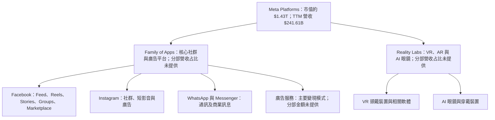
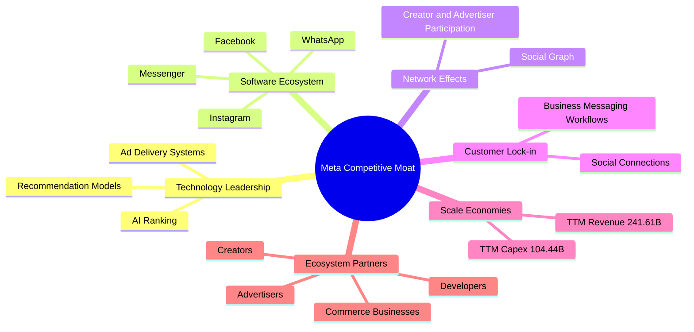
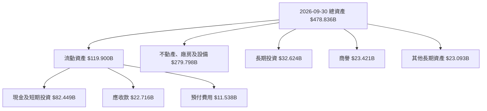
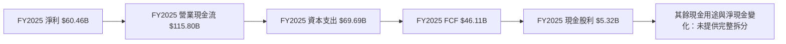
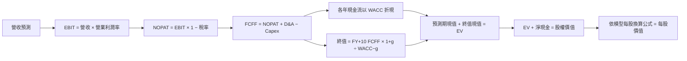
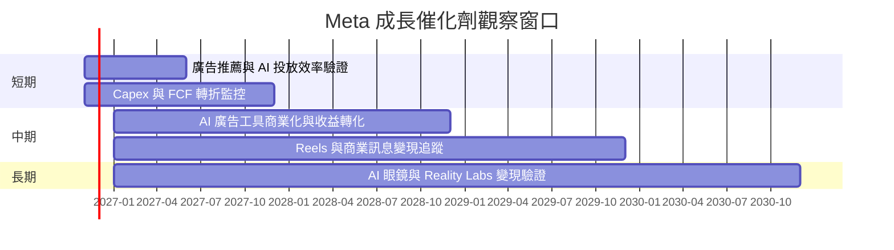
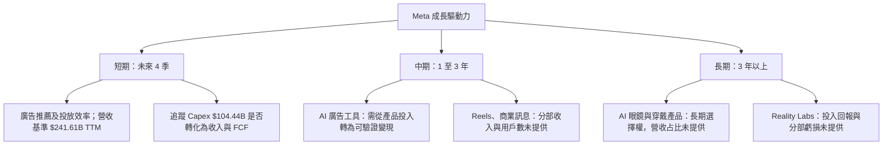
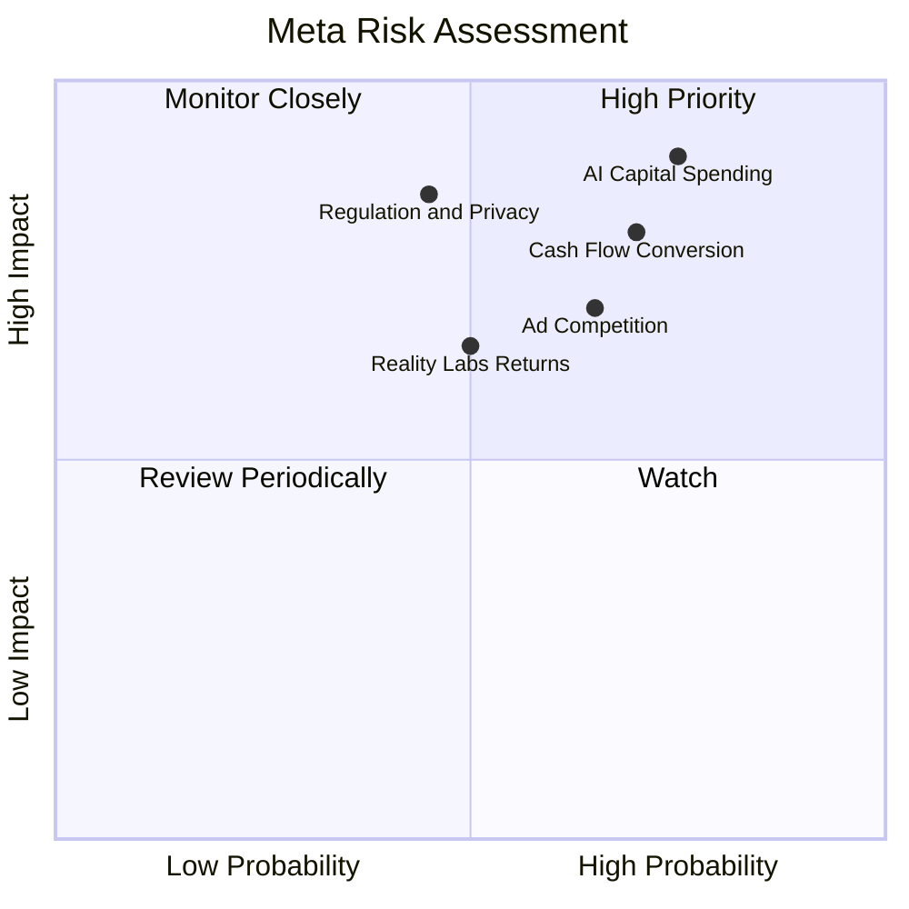
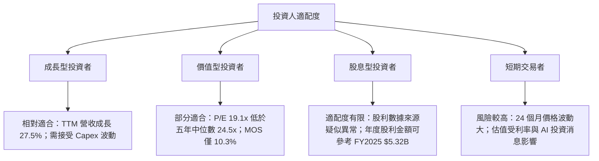

# META 基本面深度分析報告

> **報告日期**：2026-11-21 ｜ **語言**：繁體中文 ｜ **數據來源**：SEC 申報資料 (XBRL)、Yahoo Finance、Finviz、StockAnalysis、Roic.ai ｜ **分析師**：CFA 級機構研究  
> **價格基準**：2026-11-20 收盤價 **$560.84**。財務數據截至 2026-09-30，最新季報於 2026-10-22 申報。  
> **口徑提醒**：多個來源對部分季度營業利益、TTM 淨利、總債務及股數存在差異。以下涉及估值、WACC、ROIC、營業利益率等指定指標時，以 SEC 數據計算欄所列數字為主；其他來源數字另行標示，不混合計算。

## 目錄

| # | 章節 | 核心結論 |
|---|------|----------|
| 1 | 執行摘要 | 買入；加權合理價值 $625.52；MOS +10.3% |
| 2 | 公司概覽與商業模式 | Family of Apps 的平台規模與廣告變現構成核心護城河 |
| 3 | 損益表深度分析 | TTM 營收 $241.61B、TTM 年增 27.5%；營業利益率口徑有來源差異 |
| 4 | 資產負債表分析 | 指定口徑為淨負債 $1.22B，流動性仍有緩衝 |
| 5 | 現金流量深度分析 | TTM FCF $28.65B，資本支出升至 $104.44B，現金轉換承壓 |
| 6 | 獲利能力與資本效率 | ROIC 27.7% 對 WACC 10.30%，仍創造股東價值 |
| 7 | 相對估值分析 | P/E 低於自身五年中位數，但同業估值分散 |
| 8 | DCF 內在價值評估 | 基準 DCF $583.51；終值佔 EV 80.9%，估值對長期假設敏感 |
| 9 | 成長催化劑 | 廣告工具與 AI 變現是近中期重點；TAM 數字未提供 |
| 10 | 風險矩陣 | 資本支出、監管與廣告競爭為主要風險 |
| 11 | 投資建議 | 依 MOS 評級買入；以季度 FCF、利潤率與資本支出作為監控核心 |

---

## 1. 執行摘要

Meta 的 TTM 營收為 **$241.61B**，TTM 年增 **27.5%**，最新單季營收年增 **26.1%**；但 TTM FCF 僅 **$28.65B**，FCF Yield **2.00%**，反映資料中心與運算投資正在吸收大量現金。ROIC **27.7%** 高於 WACC **10.30%**，代表現有資本配置仍創造經濟價值。DCF 基準值 **$583.51**，相對 2026-11-20 收盤價的上行空間約 **4.0%**；估值方法加權後合理價值為 **$625.52**，MOS **+10.3%**。依規則 20，MOS 對應**買入**，無需質化調級；但有限 MOS、低 FCF Yield、以及 DCF 終值比重偏高，使投資報酬更依賴 AI 變現與資本支出回落。

### 1.0 一頁式投資儀表板（Portfolio Manager 30 秒速讀）

| 項目 | 內容 |
|------|------|
| **投資論點（3 句）** | ① TTM 營收 $241.61B、年增 27.5%，平台廣告仍具規模與成長。② ROIC 27.7% 高於 WACC 10.30%，現有業務仍在創造價值。③ TTM FCF $28.65B、FCF Yield 2.00%，Capex $104.44B，需確認 AI 投資逐步轉化為現金流。 |
| **綜合評分** | **7.3/10**（引用 1.1 評分卡） |
| **財務健康** | 🟡 指定口徑淨負債 $1.22B，現金與短期投資 $82.45B；但 Piotroski F-Score 3/8。 |
| **ROIC vs WACC** | **27.7% vs 10.30%**，創造價值，差距 17.4 個百分點。 |
| **FCF 趨勢** | TTM FCF $28.65B；最新年度 FCF 由 2024 年 $54.07B 降至 2025 年 $46.11B；TTM FCF Yield **2.00%**。 |
| **估值** | Forward P/E **15.7x** ｜ EV/EBITDA **12.6x**（市場數據欄）｜ FCF Yield **2.00%**。 |
| **DCF 內在價值（基準）** | **$583.51** ｜現價相對 DCF 折價 **3.9%**（折溢價 = 現價 ÷ DCF − 1）。 |
| **安全邊際（MOS）** | **+10.3%**＝($625.52 − $560.84) ÷ $625.52；依加權合理價值計，屬有限安全邊際。 |
| **預期報酬（基準情境 12M）** | **+4.0%**（DCF 基準情境 $583.51 相對現價；不是保證報酬）。 |
| **關鍵風險（前二）** | AI 基建 Capex 維持高位、壓抑 FCF；監管與平台競爭削弱廣告變現。 |
| **評級 + 信心度** | 🟢 **買入** ｜信心：中。MOS 為 +10.3%，ROIC 高於 WACC；但估值方法分歧及資料口徑差異降低信心。 |

### 1.1 綜合評分卡（全報告唯一）

| 維度 | 評分（1–10） | 主要依據（引用數字與其來源章節） |
|------|--------------|----------------------------------|
| 成長性 | 8.5 | TTM 營收年增 27.5%、最新一季年增 26.1%（第 3 章）；成長率仍高，但尚未拆出業務別營收。 |
| 獲利能力 | 8.5 | TTM ROIC 27.7%、營業利益率 32.9%，ROIC 高於 WACC 10.30%；Piotroski 3/8 對短期趨勢構成扣分（第 6 章）。 |
| 財務健康 | 7.0 | 現金及短期投資 $82.45B、總債務 $83.67B、淨負債 $1.22B；流動比率 1.903，F-Score 3/8（第 4、6 章）。 |
| 估值 | 6.5 | MOS +10.3%，P/E 19.1x 低於自身五年中位數 24.5x；同業估值分散，DCF 終值佔比 80.9%（第 7、8 章）。 |
| 護城河 | 8.5 | TTM 營收 $241.61B、最新單季年增 26.1%，平台與廣告網絡具規模；市場份額、FoA/RL 分部收入未提供（第 2 章）。 |
| 管理層與資本配置 | 6.5 | FY2025 SBC $20.43B、TTM Capex $104.44B；AI 投資可能形成長期資產，但短期 FCF 轉弱、稀釋股數測試未通過（第 3、5、6 章）。 |
| **綜合評分** | **7.6** | 六項算術平均：(8.5 + 8.5 + 7.0 + 6.5 + 8.5 + 6.5) ÷ 6 = **7.6**。 |

### 1.2 五大投資論點 + 三大核心風險

| 類型 | 項目 | 具體依據 | 信心度 |
|------|------|----------|--------|
| 🟢 **投資論點①** | 廣告主業仍在成長 | TTM 營收年增 27.5%，最新單季年增 26.1%；平台流量與廣告排序改進若能延續，營收可支撐高固定成本平台的營業槓桿。 | 🟢 高 |
| 🟢 **投資論點②** | 資本回報高於資金成本 | ROIC 27.7% 對 WACC 10.30%，差距 17.4 個百分點。 | 🟢 高 |
| 🟢 **投資論點③** | 歷史估值低於自身中位數 | P/E 19.1x，低於五年中位數 24.5x；目前位於五年區間 12.9x–33.4x 的第 19 百分位。 | 🟡 中 |
| 🟢 **投資論點④** | 現金與投資資產提供緩衝 | 現金與短期投資 $82.45B；指定總債務 $83.67B，淨負債僅 $1.22B。 | 🟡 中 |
| 🟢 **投資論點⑤** | AI 投資有望改善廣告效率 | 公司同時擁有大規模廣告產品與 $104.44B TTM Capex 投入；若投資改善推薦、創意生成和轉換率，可能提升廣告產出，但回報尚須驗證。 | 🟡 中 |
| 🟡 **風險①** | AI 基建投資回收期不確定 | TTM FCF $28.65B，低於 FY2025 FCF $46.11B；高 Capex 若未帶來相稱收入或效率提升，估值與回購能力受壓。 | 🔴 高衝擊 |
| 🔴 **風險②** | 監管及平台規則改變 | 隱私、廣告定向、內容與反壟斷規範可能降低廣告效果或提高合規成本；資料無法量化其概率。 | 🟡 中 |
| 🟡 **風險③** | 獲利資料及現金流呈現不一致 | 單季營業利益在 SEC 摘要與 StockAnalysis 顯示不同數值；TTM FCF Yield 僅 2.00%，估值對資本開支及利潤率敏感。 | 🟡 中 |

### 1.3 快速統計卡片

| 指標 | 公司實際值（期間） | 同業中位數 | 狀態 |
|------|--------------------|------------|------|
| 營收成長（TTM） | **27.5%** | — | 🟢 |
| 營收成長（最新一季年增） | **26.1%** | **14.3%**（GOOG、SNAP、PINS 中位數） | 🟢 |
| 毛利率（TTM） | **81.0%** | **60.9%** | 🟢 |
| 營業利益率（TTM） | **32.9%** | — | 🟢 |
| ROIC（TTM） | **27.7%** | — | 🟢 |
| Forward P/E | **15.7x** | **7.2x**（GOOG、SNAP、PINS 中位數） | 🟡 |
| FCF Yield（TTM） | **2.00%** | — | 🟡 |
| Piotroski F-Score | **3 / 8** | — | 🔴 |

### 1.4 投資結論

```text
╔══════════════════════════════════════════════════════════════════╗
║                    📊 投資結論摘要                               ║
╠══════════════════════════════════════════════════════════════════╣
║  評級：買入（MOS +10.3%；ROIC 27.7% > WACC 10.30%）             ║
║  價格（2026-11-20 收盤）：$560.84                                ║
║  DCF 內在價值（基準）：$583.51（現價折價 3.9%）                 ║
║  安全邊際 MOS：+10.3%（＝(加權合理價值−現價)÷加權合理價值）    ║
║  加權合理價值（8.8）：$625.52                                    ║
║  DCF 情境價值：                                                  ║
║    悲觀情境：$196.16（-65.0%）                                  ║
║    基準情境：$583.51（+4.0%）                                   ║
║    樂觀情境：$1,423.19（+153.8%）                               ║
║  綜合評分：7.6/10（引用 1.1）                                    ║
║  適合投資人：能承受較高資本支出與估值波動的長期成長型投資人     ║
╚══════════════════════════════════════════════════════════════════╝
```

---

## 2. 公司概覽與商業模式

### 2.1 業務結構與收入來源

Meta Platforms, Inc. 透過 Facebook、Instagram、WhatsApp、Messenger、Reality Labs 等產品經營。資料確認公司分為 Family of Apps（FoA）與 Reality Labs（RL），但未提供兩分部營收、分部損益或各產品收入占比，因此不推估百分比。



Meta 的經濟模式以免費服務累積用戶互動，再向廣告主出售受眾觸及與成效型廣告。這種模式的核心變現指標通常包括廣告曝光、每則廣告價格、廣告轉換效果與使用者互動；本次數據未提供上述拆分，故不以推估值代替。

### 2.2 市場份額

**市場份額數據未提供**，也未提供可引用的市場規模與年份，因此不繪製份額圖表。以公司本身數據看，TTM 營收 $241.61B、年增 27.5%，規模及成長均高；Peer data 顯示最新一季營收年增率高於 GOOG 24.7%、SNAP 14.3%、PINS 11.9%，但此比較不等同市場份額。

### 2.3 競爭護城河分析



護城河的商業證據是高規模營收與持續成長，而不是單一技術宣稱。廣告主可將預算移往其他平台，使用者也能同時使用多個服務；因此護城河是「規模、社交網絡與廣告成效」的組合，不代表競爭不可撼動。

### 2.4 護城河強度

| 護城河項目 | 強度（強／中／弱） | 證據（引用數字或事實） | 會削弱它的情況 |
|------------|--------------------|------------------------|----------------|
| 技術與推薦系統 | 強 | TTM 營收年增 27.5%，廣告平台需要大量互動與資料支援排序；具體 AI 對收入貢獻未披露。 | 推薦效果停滯、資料使用限制或競爭平台提升轉換效率。 |
| 軟體生態系 | 強 | Facebook、Instagram、WhatsApp、Messenger 覆蓋社群、通訊與商業場景。 | 年輕族群使用習慣轉移、產品互動下滑。 |
| 網路效應 | 強 | 社交連結與廣告主規模相互支撐；分部用戶與活躍度數字未提供。 | 使用者時間轉移、內容供給不足、信任或安全事件。 |
| 客戶鎖定 | 中 | 個人社交圖譜及商業訊息流程帶來黏著，但廣告主可跨平台配置預算。 | 廣告投放回報下降或政策限制定向。 |
| 規模效應 | 強 | TTM 營收 $241.61B，資本支出 TTM $104.44B，具備投資算力與產品研發的財務能力。 | 投資規模超前需求，資本報酬持續低於資金成本。 |
| 生態夥伴 | 中 | 廣告主、創作者、商家及開發者參與平台；夥伴收入與數量未提供。 | 夥伴轉往替代平台或平台抽成、政策改動降低參與誘因。 |

**1.1 護城河評分 8.5/10**：以 TTM $241.61B 營收、27.5% 成長及多產品社交網絡為依據；未提供市場份額與用戶數，因此不給更高分。

---

## 3. 損益表深度分析

### 3.1 年度收入成長趨勢（近 4 年）

年營收由 FY2022 的 $116.61B 增至 FY2025 的 $200.97B；三年 CAGR 約 19.9%。計算採年度財報數字，顯示增長並非單季跳升所致，但 FY2026 全年營收尚未公布。

```text
╔══════════════════════════════════════════════════════════════════╗
║          Meta 年度收入趨勢（FY2022–FY2025，USD）                ║
╠══════════════════════════════════════════════════════════════════╣
║  FY2022  $116.61B  ████████████░░░░░░░░░░░░  YoY：-1.1% 🟡     ║
║  FY2023  $134.90B  ██████████████░░░░░░░░░░  YoY：+15.7% 🟢    ║
║  FY2024  $164.50B  █████████████████░░░░░░░  YoY：+21.9% 🟢    ║
║  FY2025  $200.97B  █████████████████████░░░  YoY：+22.2% 🟢    ║
║                                                                  ║
║  三年收入 CAGR：(200.97 ÷ 116.61)^(1/3) − 1 ≈ 19.9%             ║
╚══════════════════════════════════════════════════════════════════╝
```

### 3.2 季度收入趨勢分析

| 季度 | 營收 | QoQ 成長 | YoY 成長 | 備註 |
|------|------|----------|----------|------|
| 2025 Q4 | $59.893B | +16.9%（對 2025 Q3） | +23.78% | 節慶季及年度廣告預算特性可能影響季節性；不將 QoQ 外推為全年趨勢。 |
| 2026 Q1 | $56.311B | -6.0% | +33.08% | QoQ 回落，但同比仍高，基期與季節性需分開判讀。 |
| 2026 Q2 | $60.801B | +8.0% | +27.96% | 營收重新增加；同比增速較 Q1 放緩。 |
| 2026 Q3 | $64.601B | +6.3% | +26.07% | 最新季度營收創資料表列季度新高；同比仍維持兩位數。 |

QoQ 使用相鄰季度營收計算；YoY 採 StockAnalysis 列示的單季年增率。TTM 營收成長率另依指定值為 **27.5%**，不可與單季年增率混稱。

### 3.3 利潤率演變分析

以下年度利潤率依年報營收、毛利、營業利益及淨利計算；TTM 指標則引用指定的 TTM 數值，因不同來源季度營業利益有差異，不將兩種口徑拼接。

| 利潤率指標 | FY2022 | FY2023 | FY2024 | FY2025 | 趨勢 | 評估 |
|------------|--------|--------|--------|--------|------|------|
| **毛利率** | 78.3% | 80.8% | 81.7% | 82.0% | 上升，反映收入增長快於直接成本 | 🟢 |
| **營業利益率** | 24.8% | 34.7% | 42.2% | 41.4% | 2022–2024 擴張，2025 略回落 | 🟡 |
| **淨利率** | 19.9% | 29.0% | 37.9% | 30.1% | FY2025 回落，淨利低於 FY2024 | 🟡 |

**利潤率演變深度解析：** FY2022 至 FY2024 營業利益率由 24.8% 升至 42.2%，高於營收增長的費用控制與平台規模帶來營業槓桿；FY2025 營業利益仍升至 $83.28B，但淨利由 $62.36B 降至 $60.46B，顯示營業層級改善未必一比一落入淨利。TTM 營業利益率指定值為 32.9%，與 StockAnalysis TTM 營業利益 $91.27B 除以營收 $241.61B 所得約 37.8% 不一致，故本報告估值與評分採指定 32.9%，並將差異視為資料限制。

### 3.4 費用結構分析

FY2025 已提供研發支出 $57.37B、營業利益 $83.28B、營收 $200.97B；但銷售與行銷、一般行政費用及費用項目完整拆分未提供，不能以不完整數字繪製費用比例圓餅圖。

```text
╔══════════════════════════════════════════════════════════════════╗
║           FY2025 已披露費用與營業成果（USD）                    ║
╠══════════════════════════════════════════════════════════════════╣
║  營收                 $200.97B  ████████████████████             ║
║  研發支出              $57.37B  ██████                           ║
║  營業利益              $83.28B  ████████                         ║
║  其他費用細項          未提供，故不反推或補列                    ║
╚══════════════════════════════════════════════════════════════════╝
```

### 3.5 季度 EPS 趨勢與盈餘品質（Quality of Earnings）

| 季度 | EPS 實際值 | EPS 年增 | EPS 預估／驚喜 | 評估 |
|------|------------|----------|----------------|------|
| 2025 Q4 | $8.88 | +10.70% | 預估值 N/A；無法判定超預期或不及預期 | 盈餘年增為正，但無一致預估資料。 |
| 2026 Q1 | $10.44 | +62.36% | 預估值 N/A；無法判定 | EPS 年增高於營收增長，可能包含利潤與稅務／非營業因素；拆分不足。 |
| 2026 Q2 | $6.18 | -13.44% | 預估值 N/A；無法判定 | EPS 同比下滑，需追蹤營業利益與稅率。 |
| 2026 Q3 | $3.83 | +264.76% | 預估值 N/A；無法判定 | 去年同期基數較低；StockAnalysis 顯示 2025 Q3 EPS $1.08。 |

「Earnings History」預估 EPS 欄位為 NaN，因此不能將任何季度標為 beat 或 miss；另 Q3 EPS 表現應搭配低基期理解。

| 盈餘品質項目 | 數值／佔比 | 評估 |
|--------------|------------|------|
| 股權薪酬 SBC / 營收 | TTM SBC 估算 $26.94B ÷ $241.61B = **11.1%**；TTM SBC 為四季已列 SBC 加總 | 🟡 SBC 不屬小額項目；GAAP 已列費用，但股權支付仍可能稀釋股東。 |
| SBC / 營業現金流 | $26.94B ÷ $133.09B = **20.2%** | 🟡 現金流中有相當部分的 SBC 加回項目，應避免將其視為無成本。 |
| FCF / 淨利（現金轉換率） | $28.65B ÷ TTM 淨利 $75.249B = **38.1%** | 🔴 Capex 上升使自由現金流明顯低於會計淨利。 |
| 一次性／非經常性損益 | N/A（未提供可核實的 TTM 調整項拆分） | 無法確認是否有一次性項目推高或壓低淨利。 |
| 有效稅率異常 | **29.6%**（最新年度有效稅率） | 🟡 單年稅率與營運表現需分開分析；DCF 依指定稅率。 |
| 資本化支出 vs 費用化 | TTM Capex $104.44B；資本化明細未提供 | Capex 會先列資產並逐年折舊，若投資回收低於預期，當期 FCF 比淨利更能顯示現金負擔。 |

**盈餘品質結論：**Meta 有正營業現金流 $133.09B，且應計品質測試通過；但 FCF 對淨利轉換僅約 38.1%，主要與高額資本支出相符。GAAP 淨利並非明顯失真，但以淨利單獨評估可分配現金會高估短期股東可得現金。SBC 佔營收約 11.1%，需將稀釋作為實質股東成本監控。

---

## 4. 資產負債表分析

### 4.1 資產結構分解

最新季度總資產 $478.836B，與年度報表 $366.021B 的資產總額不同，採 StockAnalysis 列示的 2026-09-30 TTM 資產細項；資產類別數字僅呈現已披露項目，不把未列項目反推為完整分解。



### 4.2 流動性與營運資金分析

| 指標 | 最新值 | 歷史參照 | 評估 |
|------|--------|----------|------|
| 流動比率 | 1.903 | 年報 2025 流動資產 $108.72B、流動負債 $41.84B；與最新季資料口徑不同 | 🟢 短期流動性高於 1 倍，但資料期間不完全一致。 |
| 速動比率 | 1.669 | 一年前數值未提供 | 🟢 現金與應收款提供短期緩衝。 |
| 現金及短期投資 | $82.45B | FY2025 $81.592B | 🟢 相較 FY2025 增加。 |
| 淨現金／負債 | 淨負債 $1.22B | 以指定總債務 $83.67B 計 | 🟡 淨負債規模小，但其他資料來源列示債務更高，須核對負債口徑。 |

**營運資金天數（照錄品質指標）：**

| 指標 | 最新 TTM | 一年前 TTM | 變化 | 解讀 |
|------|----------|------------|------|------|
| DSO 應收帳款天數 | 34 天 | 33 天 | +1 天 | 輕微延長；不單獨代表收款惡化，需結合客戶及合約結構追蹤。 |
| DIO 存貨天數 | N/A | N/A | N/A | 公司未列示可供計算的存貨餘額。 |
| DPO 應付帳款天數 | 152 天 | N/A | N/A | 方向無法與去年比較；高天數可能代表付款條款與供應商結算週期較長。 |
| CCC 現金轉換週期 | N/A | N/A | N/A | 因 DIO 缺失，不補算 CCC。 |

### 4.3 債務結構分析

```text
╔══════════════════════════════════════════════════════════════════╗
║                 Meta 債務健康診斷（指定口徑）                    ║
╠══════════════════════════════════════════════════════════════════╣
║  總債務：              $83.67B  ████████████████████             ║
║  現金+短期投資：       $82.45B  ███████████████████              ║
║  淨負債：               $1.22B  ▏                                ║
║                                                                  ║
║  總債務／EBITDA：       N/A（指定資料未提供可一致匹配的 EBITDA）  ║
║  利息保障倍數：         N/A（未提供可匹配的利息支出及 EBIT 口徑）║
║  短期流動性：           流動比率 1.903；速動比率 1.669           ║
╚══════════════════════════════════════════════════════════════════╝
```

市場資料區塊另列總債務 $114.84B、淨負債 $32.39B；SEC 計算區塊則列總債務 $83.67B、淨負債 $1.22B。估值與 WACC 指標依指定計算口徑引用 $83.67B，不把來源不同的負債範圍混算；該差異是本報告的重要資料風險。

### 4.4 股東權益趨勢

| 年度 | 股東權益 | 年增 |
|------|----------|------|
| 2022 | $125.71B | — |
| 2023 | $153.17B | +21.8% |
| 2024 | $182.64B | +19.2% |
| 2025 | $217.24B | +19.0% |

```text
╔══════════════════════════════════════════════════════════════════╗
║                股東權益趨勢（USD）                              ║
╠══════════════════════════════════════════════════════════════════╣
║  2022  $125.71B  ████████████░░░░░░░░░░░░                       ║
║  2023  $153.17B  ███████████████░░░░░░░░░                       ║
║  2024  $182.64B  ██████████████████░░░░░░                       ║
║  2025  $217.24B  ██████████████████████░░                       ║
╚══════════════════════════════════════════════════════════════════╝
```

---

## 5. 現金流量深度分析

### 5.1 現金流量瀑布圖

FY2025 淨利及現金流量可用年度財報表列數字；最新 TTM 淨利則採 StockAnalysis TTM $75.249B，與其他季度摘要口徑有差異，因此圖示不將不同期間數字硬接成同一瀑布。



### 5.2 FCF 轉換率趨勢

| 年度 | 營業現金流 | Capex | FCF | 淨利 | FCF / 淨利 |
|------|------------|-------|-----|------|------------|
| 2022 | $50.48B | $31.19B | $19.29B | $23.20B | 83.1% |
| 2023 | $71.11B | $27.05B | $44.07B | $39.10B | 112.7% |
| 2024 | $91.33B | $37.26B | $54.07B | $62.36B | 86.7% |
| 2025 | $115.80B | $69.69B | $46.11B | $60.46B | 76.3% |

FY2025 營業現金流增加，但 Capex 近乎倍增，令 FCF 和現金轉換率下降。TTM FCF / 淨利按指定 TTM FCF $28.65B 與 StockAnalysis TTM 淨利 $75.249B 計算約 38.1%；因淨利來源口徑不同，與年度比率不可直接視為完全同口徑序列。

### 5.3 自由現金流趨勢

```text
╔══════════════════════════════════════════════════════════════════╗
║              自由現金流趨勢（USD）                              ║
╠══════════════════════════════════════════════════════════════════╣
║  FY2022  $19.29B  ███████░░░░░░░░░░░░░░░   FCF Yield：N/A       ║
║  FY2023  $44.07B  ███████████████░░░░░░░   FCF Yield：N/A       ║
║  FY2024  $54.07B  ███████████████████░░░   FCF Yield：N/A       ║
║  FY2025  $46.11B  ████████████████░░░░░░   FCF Yield：N/A       ║
║  TTM     $28.65B  ██████████░░░░░░░░░░░░   FCF Yield：2.00%     ║
╠══════════════════════════════════════════════════════════════════╣
║  TTM FCF = 營業現金流 $133.09B − Capex $104.44B = $28.65B      ║
╚══════════════════════════════════════════════════════════════════╝
```

### 5.4 資本配置評估

可核實的 FY2025 現金配置項目包括 Capex $69.69B、股利 $5.32B、SBC $20.43B；回購金額及完整投資／留存拆分未提供，因此不繪製比例圓餅圖。

| 項目 | FY2025 數值 | 評估 |
|------|------------|------|
| 資本支出 | $69.69B | 2024 年 $37.26B，年增約 87.0%；顯示基建投資加速。 |
| 現金股利 | $5.32B | 2024 年 $5.07B；在高 Capex 之下仍可維持現金分配。 |
| 股權薪酬 | $20.43B | FY2024 $16.69B；約為 FY2025 營收的 10.2%，需留意稀釋。 |
| 回購 | N/A | 資料未提供完整回購金額，不作推估。 |
| 留存／其他投資 | N/A | 無完整現金用途拆分。 |

---

## 6. 獲利能力與資本效率

### 6.1 ROE / ROA / ROIC 趨勢

| 指標 | 目前可用數值 | 歷史趨勢資料 | 評估 |
|------|--------------|--------------|------|
| ROE | 指定 TTM **27.6%** | 市場資料欄另列 32.3%；口徑不一致 | 🟢 資本報酬高，但以指定品質口徑為準。 |
| ROA | TTM **14.6%** | 年度逐年序列未提供 | 🟢 資產獲利能力高；F-Score 顯示 ROA 未高於一年前。 |
| ROIC | TTM **27.7%** | 10 年歷史表列 ROC 等歷史序列，但計算口徑不完全一致 | 🟢 高於 WACC。 |
| WACC | **10.30%** | 依成本資本資料 | — |

行業均值未提供，故不作同業 ROE／ROA／ROIC 均值對照。

### 6.2 ROIC vs WACC 分析（核心價值創造判斷）

```text
╔══════════════════════════════════════════════════════════════════╗
║                ROIC vs WACC 深度分析                            ║
╠══════════════════════════════════════════════════════════════════╣
║  WACC（指定成本資本數據）：                                      ║
║  ├── 無風險利率（10Y 美債）：       4.91%                        ║
║  ├── 市場風險溢酬 ERP：             5.00%                        ║
║  ├── 原始 Beta（Yahoo）：            1.28                         ║
║  ├── 調整後 Beta（採用）：           1.19                         ║
║  ├── 股權成本（指定值）：            10.84%                       ║
║  ├── 稅前債務成本：                  1.39%                        ║
║  ├── 稅率：                          29.6%                        ║
║  ├── 股權／債務權重：                94.5%／5.5%                   ║
║  └── ✅ WACC（指定採用）：           10.30%                       ║
║                                                                  ║
║  ROIC（TTM）：                       27.7%                        ║
║  EVA Spread：27.7% − 10.30% =        +17.4 個百分點              ║
║                                                                  ║
║  ROIC 27.7%  ▓▓▓▓▓▓▓▓▓▓▓▓▓▓▓▓▓▓▓▓▓▓▓▓░░░░                      ║
║  WACC 10.30% ▓▓▓▓▓▓▓▓▓▓░░░░░░░░░░░░░░░░░                      ║
║                                                                  ║
║  結論：ROIC 約為 WACC 的 2.69 倍，現有業務創造股東價值。       ║
╚══════════════════════════════════════════════════════════════════╝
```

**一致性說明：**成本資本區塊直接提供 WACC 10.30%、股權成本 10.84%、稅前債務成本 1.39%及權重 94.5%／5.5%，故本節與第 8.2 節照用相同 WACC，不另行重算替換。原始 Beta 1.28 經調整公式「⅔ × 1.28 + ⅓」得到 1.19（按指定值引用）。股權成本簡化公式 4.91% + 1.19 × 5.00% 與區塊列示 10.84% 存在小幅四捨五入差異；以指定 10.84% 為準。此 WACC 輸入沒有提供具體 10 年美債觀察日期以外的估值日細節，亦未列規模／國別溢酬，報告不另加溢酬。

### 6.3 杜邦三因素分解

| 因素 | 數值（TTM） | 解讀 |
|------|-------------|------|
| 淨利率 | 31.1% | 利潤率提供 ROE 的主要基礎。 |
| 資產週轉率 | 0.50 | 每單位資產產生約 0.50 單位營收。 |
| 權益乘數 | 1.76 | 有槓桿，但非極高槓桿。 |
| **ROE** | **27.6%** | **31.1% × 0.50 × 1.76 = 27.4%（四捨五入；品質數據指定 ROE 27.6%）** |

ROE 主要由淨利率與資產效率驅動，不是單靠高財務槓桿；乘數 1.76 對 ROE 有助益，但不是唯一來源。

### 6.4 財務體質：Piotroski F-Score

**Piotroski F-Score：3 / 8**；可判定測試共 8 項，毛利率測試因缺資料未納入分母。

| 測試 | 結果 | 解讀 |
|------|------|------|
| ROA > 0 | ✅ 通過 | 公司保持正資產報酬。 |
| 營業現金流 > 0 | ✅ 通過 | TTM 營業現金流 $133.09B。 |
| ROA 高於一年前 | ❌ 未通過 | 獲利資產效率未改善。 |
| 營業現金流 > 淨利（應計品質） | ✅ 通過 | 現金營運流高於淨利，支持會計盈餘品質。 |
| 長期負債 ÷ 總資產低於一年前 | ❌ 未通過 | 負債率方向未改善；與 Capex 投資擴張相符但須監控。 |
| 流動比率高於一年前 | ❌ 未通過 | 短期流動性相對去年未改善。 |
| 稀釋股數未增加 | ❌ 未通過 | 股數測試未通過，SBC 的稀釋成本不可忽略。 |
| 毛利率高於一年前 | — 無法判定 | 缺少比較輸入，不補值。 |
| 資產週轉率高於一年前 | ❌ 未通過 | 資產擴張未同步帶來更高周轉。 |

3/8 顯示雖然公司獲利與現金流仍為正，但近一年財務趨勢並非全面改善，與 Capex、資產及負債擴張背景一致。

---

## 7. 相對估值分析

### 7.1 同業估值比較表格

同業倍數依 Peer multiples 區塊引用；本公司倍數依市場估值欄與歷史估值區塊引用。不同來源可能造成差異，表內依指標分別照錄。

| 估值指標 | **META** | **GOOG** | **SNAP** | **PINS** | META 評估 |
|----------|---------|---------|---------|---------|------------|
| **Trailing P/E** | 19.1x | 13.8x | N/A | 68.0x | 🟡 高於 GOOG、低於 PINS；SNAP 無可比數值。 |
| **Forward P/E** | 15.7x | 17.3x | 5.8x | 7.2x | 🟡 高於同業中位數 7.2x，反映較高成長與獲利品質期待。 |
| **P/S（TTM）** | 5.9x | 6.9x | 1.2x | 2.0x | 🟡 高於 SNAP、PINS，低於 GOOG。 |
| **EV/EBITDA（TTM）** | 12.6x | 17.0x | 48.6x | 30.7x | 🟢 低於所列三家同業；SNAP、PINS 倍數可能受 EBITDA 基數影響。 |
| **最新季營收年增** | 26.1% | 24.7% | 14.3% | 11.9% | 🟢 META 成長高於三家對手。 |
| **毛利率（TTM）** | 81.0% | 60.9% | 59.2% | 79.0% | 🟢 高毛利支持廣告平台規模效益。 |

### 7.2 歷史估值區間分析

```text
╔══════════════════════════════════════════════════════════════════╗
║             META 五年 P/E 歷史估值位置                          ║
╠══════════════════════════════════════════════════════════════════╣
║  五年區間：12.9x ├───────────────●───────────────┤ 33.4x        ║
║  五年中位數：24.5x                                                ║
║  目前：19.1x                                                     ║
║  目前百分位：19%                                                  ║
║                                                                  ║
║  P/S：目前 6.0x；中位數 7.7x；區間 2.8x–10.6x；百分位 24%      ║
║  EV/EBITDA：目前 13.8x；中位數 16.5x；區間 7.7x–19.7x；29%    ║
╚══════════════════════════════════════════════════════════════════╝
```

當前 P/E、P/S 與 EV/EBITDA 均低於各自五年中位數，支持「相對自身歷史不貴」的觀點；但歷史低百分位不等於絕對低估，尤其 TTM FCF Yield 只有 2.00%，且高 Capex 可能令現金流估值低於會計獲利估值。

### 7.3 情境價值（Bear / Base / Bull，依 DCF Scenarios）

| 情境 | 第 1 年營收成長 | 期末營業利潤率 | WACC | 每股價值 | 相對現價 | 機率 | 會發生的條件 |
|------|----------------|----------------|------|----------|----------|------|--------------|
| 🔴 悲觀 | 13.8% | 29.5% | 11.30% | $196.16 | -65.0% | 25% | 廣告增長顯著放慢，AI 投資回收遞延，營業利潤率下降且風險溢酬上升。 |
| 🟡 基準 | 27.5% | 34.7% | 10.30% | $583.51 | +4.0% | 50% | TTM 成長短期延續、其後逐年淡出；長期利潤率回升至歷史中位附近。 |
| 🟢 樂觀 | 41.3% | 38.1% | 9.30% | $1,423.19 | +153.8% | 25% | AI 推升廣告變現與新產品收入，利潤率擴張且資金成本降低。 |

### 7.4 相對估值隱含價格區間

```text
╔══════════════════════════════════════════════════════════════════╗
║                  相對估值與當前價格位置                         ║
╠══════════════════════════════════════════════════════════════════╣
║  $256.86 ─────── $560.84 ─────── $583.51 ─────── $848.23 ─── $972.33
║  Forward P/E       現價           DCF 基準       分析師共識       EV/EBITDA
╠══════════════════════════════════════════════════════════════════╣
║  Forward P/E：同業中位數 7.2x × Forward EPS $35.68 = $256.86    ║
║  EV/EBITDA：同業中位數 23.8x × TTM EBITDA，加回淨現金 = $972.33 ║
║  分析師共識：58 位分析師平均目標價 = $848.23                    ║
╚══════════════════════════════════════════════════════════════════╝
```

Forward P/E 方法採 GOOG、SNAP、PINS 同業中位數 7.2x；EV/EBITDA 方法採 GOOG、PINS 中位數 23.8x。兩種相對估值推導差異大，反映同業盈利結構與所選倍數敏感性；估值方法的正式權重依 8.8 固定，不自行調整。

---

## 8. DCF 內在價值評估（Discounted Cash Flow）

> 以下 DCF 逐年假設、現金流、敏感度、情境與反推結果均依程式計算模型列示，不重建或改動模型數值。模型與輸入財務數字存在若干可見口徑差異，本章將其列入複算檢核及估值限制。

### 8.0 估值推理鏈（Thinking Logic）

**Step 1 — 價值由哪些變數決定？**  
模型核心是既有廣告平台現金流，加上廣告推薦與 AI 產品變現所帶來的成長；Reality Labs 可能構成長期選擇權，但分部營收占比未提供，無法拆估。估值最敏感變數是 WACC 與永續成長率：基準情境終值現值佔 EV 80.9%，故長期現金流假設比近年單季成長更能主導估值。

**Step 2 — 模型選擇**

| 決策點 | 本報告採用 | 理由（含數字） | 曾考慮但否決 | 否決理由 |
|--------|-----------|----------------|--------------|----------|
| 現金流定義 | FCFF | 配合 WACC 折現並推導企業價值；基準模型明列 FCFF = NOPAT + D&A − Capex | FCFE | 模型已指定使用 WACC 與 EV 橋接。 |
| 預測期 N | 10 年 | DCF 模型指定 10 年，營收成長由 27.5% 線性淡出至 3.0% | 5 年 | 不符合已計算模型，且需另建模型。 |
| 終值方法 | Gordon Growth | 模型指定永續成長率 3.0% | 退出倍數替代主估值 | 不改動模型終值法；相對估值另作三角驗證。 |
| EBIT 基礎 | GAAP | 模型以 GAAP EBIT 作為營業利益基礎 | 非 GAAP | 不加回 SBC，避免更改指定模型。 |

**Step 3 — 關鍵假設推導鏈**

- **營收成長**：錨點＝TTM 年增 27.5%、最新單季年增 26.1% → 調整＝模型要求第 1 年承接 TTM 成長，此後線性降至第 10 年 3.0% → **採用第 1 年 27.5%、第 10 年 3.0%** → 曾考慮直接採用最新季度年增作為全期固定成長，但否決，因與成熟期收斂假設不一致。
- **期末營業利潤率**：錨點＝TTM 營業利益率 32.9% → 調整＝模型沿用逐年擴張並於 FY+10 達 34.7%，依五年歷史中位數（模型所稱）收斂 → **採用 FY+10 34.7%** → 曾考慮將近期年度 41.4%作終值利潤率，但否決，因可能把高年度利潤率無限延續。
- **永續成長率 g**：錨點＝模型採用 3.0%，且低於 WACC 10.30% → 調整＝模型以成熟期低個位數名目成長作長期假設 → **採用 3.0%** → 不採高於 3.0% 的值，以免把長期成長設得過高；此為模型假設，並非公司財測。
- **預測期 N**：錨點＝模型指定 10 年 → 調整＝涵蓋成長淡出至成熟期 → **採用 10 年** → 曾考慮較短預測期，但更改 N 會變更模型而不符指定數據。
- **Capex / 營收**：錨點＝TTM Capex $104.44B ÷ TTM 營收 $241.61B = 43.2% → 調整＝模型假設 Capex 比率逐年下降，至 FY+10 為 11.3% → **採用 43.2% 緩降至 11.3%** → 曾考慮維持高位，否決理由是模型採長期收斂假設；若建設週期延長，DCF 可能高估。
- **EBIT、SBC 與股數**：錨點＝模型採 GAAP EBIT，並明列固定股數處理 → **採用組合 (A)：GAAP EBIT + 固定股數、不另扣 SBC、不另增稀釋率** → 拒絕再扣 SBC 或再放大股數，避免在該指定組合內重複計入。此處與實際 F-Score 稀釋股數未通過並不矛盾：模型是假設，不代表實際稀釋為零。
- **WACC**：錨點＝成本資本區塊 WACC 10.30% → **採用 10.30%** → 不另以其他利率取代，避免偏離指定模型；其組成與限制見 8.2。
- **稅率、D&A／營收**：錨點分別為 29.6% 及 10.3%（模型所列 TTM 比率）→ **採用 29.6% 及 10.3%**；不另調整。
- **ΔWC**：模型明確未建模營運資金變化 → **採用未列入 FCFF 的模型處理**，不是假設 ΔWC 等於某個特定可估值金額。

**Step 4 — 最脆弱一環**  
最脆弱假設是 Capex 由營收 43.2% 降至 FY+10 的 11.3%，以及終值依賴度 80.9%；若 AI 基建需求令資本支出比率長期高於模型假設，FCFF 及內在價值將向下，敏感性矩陣顯示在基準 g 3.0%、WACC 11.30%時每股價值為 $481.59，而不是基準 $583.51。

**Step 5 — 計算路徑圖**



### 8.1 模型假設總表（Model Inputs）

| 假設項目 | 採用值 | 依據／來源 | 敏感度 |
|----------|--------|-------------|--------|
| 預測期長度 N | 10 年 | DCF 模型指定 | 🟡 中 |
| 營收成長率 | FY+1 27.5%，FY+10 3.0%，線性淡出 | TTM 成長率 27.5%；終值期 3.0% 為模型假設 | 🔴 高 |
| 營業利潤率 | FY+1 32.9% → FY+10 34.7% | TTM 營業利益率 32.9%；模型稱淡出至五年中位數 | 🔴 高 |
| 有效稅率 | 29.6% | 最新年度有效稅率 | 🟢 低 |
| Capex / 營收 | FY+1 43.2% → FY+10 11.3% | TTM Capex／營收及模型長期收斂假設 | 🔴 高 |
| D&A / 營收 | 10.3% | DCF 模型所列 TTM 值 | 🟢 低 |
| 營運資金變動 | 未建模 | DCF 模型明列 Working capital is not modelled | 🟡 中 |
| EBIT 基礎 | GAAP | DCF 模型明列 GAAP EBIT | 🟡 中 |
| SBC 處理 | 組合 (A)：GAAP EBIT、固定股數、不再扣 SBC | 模型註明 SBC 已在 GAAP EBIT 費用化，股數不再稀釋 | 🟡 中 |
| 年稀釋率 | 模型未額外稀釋，等同 DCF 固定股數處理 | 組合 (A) 的模型規則 | 🟡 中 |
| 永續成長率 g | 3.0% | DCF 模型指定，低於 WACC 10.30% | 🔴 高 |
| 終值方法 | Gordon Growth | DCF 模型終值公式 | 🔴 高 |
| WACC | 10.30% | 指定 Cost of capital | 🔴 高 |

模型 FCFF 定義為 **NOPAT + D&A − Capex**，不含 ΔWC 列；不得將未建模誤讀為已量化為零。模型採組合 (A)，因此 GAAP EBIT 已含 SBC 費用，不再扣 SBC，亦不另增加股數稀釋。

### 8.2 折現率推導（WACC）

```text
╔══════════════════════════════════════════════════════════════════╗
║                    WACC 推導（折現率）                           ║
╠══════════════════════════════════════════════════════════════════╣
║  股權成本 Ke（指定 CAPM 輸入）：                                 ║
║  ├── 無風險利率 Rf：                  4.91%                      ║
║  ├── 市場風險溢酬 ERP：               5.00%                      ║
║  ├── Beta 原始值：                    1.28                       ║
║  ├── Beta 調整值：                    1.19                       ║
║  ├── 規模／國別溢酬：                 未另列                     ║
║  └── Ke（指定值）：                   10.84%                     ║
║                                                                  ║
║  債務成本：                                                        ║
║  ├── 稅前 Kd（指定值）：              1.39%                      ║
║  ├── 有效稅率：                       29.6%                      ║
║  └── 稅後 Kd：1.39% × (1−29.6%) =    0.98%                      ║
║                                                                  ║
║  資本結構（指定權重）：                                           ║
║  ├── 股權權重 E：                     94.5%                      ║
║  ├── 債務權重 D：                     5.5%                       ║
║  └── ✅ WACC（指定採用）：            10.30%                     ║
╚══════════════════════════════════════════════════════════════════╝
```

**逐步演算及可核驗性：**

1. **Ke（CAPM）**：指定數據直接列 Ke = **10.84%**。以已四捨五入輸入計算：4.91% + 1.19 × 5.00% = 10.86%；與指定 Ke 差 0.02 個百分點，報告依要求採指定 10.84%，不自行替換。
2. **稅前 Kd**：指定成本資本區塊提供 **1.39%**，但未提供利息費用與平均計息負債分母的逐項數值，故無法獨立重建此除法；不推導缺漏金額。
3. **稅後 Kd**：1.39% × (1 − 29.6%) = 1.39% × 70.4% = 0.97856% ≈ **0.98%**。
4. **權重**：指定 E/D 權重 **94.5% / 5.5%**，兩者合計 100.0%；區塊未提供權重計算所用精確市場資本與同口徑計息債務明細，故照錄，不以不同來源債務重算。
5. **WACC**：用已四捨五入的 Ke、稅後 Kd 與權重演算為 94.5% × 10.84% + 5.5% × 0.98% = 10.2438% + 0.0539% = 10.2977% ≈ 10.30%。因此與指定 WACC 相符至兩位小數。

### 8.3 逐年自由現金流預測（基準情境）

單位：USD 十億；折現因子依模型列示至三位小數。模型沒有 ΔWC 列，亦沒有單獨 SBC 扣除列。

| 年度 | FY+1 | FY+2 | FY+3 | FY+4 | FY+5 | FY+6 | FY+7 | FY+8 | FY+9 | FY+10 |
|------|------:|------:|------:|------:|------:|------:|------:|------:|------:|------:|
| 營收 | 308.11 | 384.52 | 469.41 | 560.24 | 653.38 | 744.20 | 827.37 | 897.28 | 948.65 | 977.11 |
| 營收 YoY | 27.5% | 24.8% | 22.1% | 19.4% | 16.6% | 13.9% | 11.2% | 8.5% | 5.7% | 3.0% |
| 營業利潤率 | 32.9% | 33.1% | 33.3% | 33.5% | 33.7% | 33.9% | 34.1% | 34.3% | 34.5% | 34.7% |
| EBIT（GAAP） | 101.23 | 127.10 | 156.10 | 187.43 | 219.90 | 251.95 | 281.76 | 307.37 | 326.86 | 338.62 |
| − 稅 | (30.01) | (37.68) | (46.28) | (55.56) | (65.19) | (74.69) | (83.53) | (91.12) | (96.90) | (100.38) |
| = NOPAT | 71.22 | 89.43 | 109.83 | 131.87 | 154.71 | 177.26 | 198.24 | 216.25 | 229.97 | 238.24 |
| + D&A | 31.78 | 39.66 | 48.42 | 57.78 | 67.39 | 76.76 | 85.34 | 92.55 | 97.85 | 100.78 |
| − Capex | (133.19) | (152.59) | (169.65) | (182.64) | (189.85) | (189.88) | (181.79) | (165.37) | (141.24) | (110.86) |
| **= FCFF** | **-30.18** | **-23.51** | **-11.41** | **7.02** | **32.25** | **64.14** | **101.78** | **143.43** | **186.58** | **228.16** |
| 折現因子 @10.30% | 0.907 | 0.822 | 0.745 | 0.676 | 0.613 | 0.555 | 0.504 | 0.457 | 0.414 | 0.375 |
| **FCFF 現值 PV** | **-27.37** | **-19.32** | **-8.50** | **4.74** | **19.75** | **35.62** | **51.25** | **65.48** | **77.22** | **85.62** |

**預測期 FCF 現值合計：**  
−$27.37 + (−$19.32) + (−$8.50) + $4.74 + $19.75 + $35.62 + $51.25 + $65.48 + $77.22 + $85.62 = **$284.49B**。

**逐步演算（FY+1 代表年度）：**

1. 營收 = $241.61B × (1 + 27.5%) = $308.05B；模型列示 **$308.11B**。模型內部使用未顯示精度起始值或計算方式，故逐項呈現其列值，不把自行複算差額替換模型。
2. EBIT = $308.11B × 32.9% = $101.37B；模型列示 **$101.23B**。
3. 稅 = $101.23B × 29.6% = $29.96B；模型列示 **$30.01B**。
4. NOPAT = $101.23B − $30.01B = **$71.22B**。
5. D&A = $308.11B × 10.3% = $31.74B；模型列示 **$31.78B**。
6. Capex = $308.11B × 43.2% = $133.10B；模型列示 **$133.19B**。
7. ΔWC = 未建模，模型未列此項。
8. FCFF = $71.22B + $31.78B − $133.19B = **−$30.19B**；模型列示 **−$30.18B**，差異為呈現精度尾差。
9. 折現因子 = 1 ÷ (1 + 10.30%)¹ = 0.9066 ≈ 0.907；PV = −$30.18B × 0.907 = **−$27.37B**。

上述模型表格若以公開的四捨五入輸入逐項乘算，FY+1 的 EBIT、稅、D&A、Capex 與營收存在超過單純顯示精度可完全解釋的差異；為遵守不得改動模型原值，本報告保留模型列值，並在 8.10 標示為複算限制。

**合理性自檢：**

- 歷史 FY2022–FY2025 FCF 從 $19.29B 增至 $46.11B，三年 CAGR 約 33.8%；模型 FY+1 FCFF 為負、FY+10 為 $228.16B，跨期 CAGR 因前段為負而不適用，不能以一般 CAGR 比較。
- FY+10 FCF 利潤率 = $228.16B ÷ $977.11B = **23.4%**；目前 TTM FCF 利潤率 = $28.65B ÷ $241.61B = **11.9%**。同業最佳同口徑 FCF 利潤率未提供。
- FY+1 至 FY+3 FCFF 為負，反映模型前期 Capex 高於 NOPAT 加 D&A；負現金流會降低前期折現現值，估值高度依賴後期 Capex 比率下降與終值。

```text
╔══════════════════════════════════════════════════════════════════╗
║          自由現金流：歷史實際 vs 模型預測（USD）                ║
╠══════════════════════════════════════════════════════════════════╣
║  FY2023（實） $44.07B  ████████░░░░░░░░░░░░░░                  ║
║  FY2024（實） $54.07B  ██████████░░░░░░░░░░░░                  ║
║  FY2025（實） $46.11B  █████████░░░░░░░░░░░░░                  ║
║  FY+1（預）  -$30.18B  負值                                      ║
║  FY+10（預） $228.16B  █████████████████████████                ║
╠══════════════════════════════════════════════════════════════════╣
║  模型主要轉折：Capex/營收由 43.2% 緩降至 FY+10 的 11.3%。       ║
╚══════════════════════════════════════════════════════════════════╝
```

### 8.4 終值計算（Terminal Value）

**適用性檢查：**WACC **10.30%** vs g **3.0%** → WACC > g？✅

| 方法 | 計算式 | 終值 TV | TV 現值 | 佔總 EV 比重 |
|------|--------|---------|---------|--------------|
| Gordon Growth | $228.16 × (1 + 3.0%) ÷ (10.30% − 3.0%) | $3,220.10B（模型列值） | $1,208.33B（模型列值） | 80.9% |
| 退出倍數法 | N/A | N/A | N/A | N/A |

退出倍數終值未列在 DCF MODEL，故不自行新增模型值。基準終值現值佔 EV 80.9%，屬高度依賴終值假設；短期現金流現值貢獻有限。

**逐步演算（按模型列值展示）：**

1. FY+10 FCFF = **$228.16B**。
2. 分子 = $228.16B × (1 + 3.0%) = $228.16B × 1.03 = **$235.0048B**。
3. 分母 = 10.30% − 3.0% = **7.30%**；以未四捨五入數值計算終值，模型列值 **$3,220.10B**。以已列示的兩位小數直接計算，$235.0048B ÷ 0.073 = $3,219.24B，與模型列值相差約 $0.86B，故不能用已四捨五入輸入精確重現模型終值。
4. PV(TV) 模型列值 = **$1,208.33B**；模型同時列折現因子 0.375。按已顯示數字相乘為 $3,220.10B × 0.375 = $1,207.54B，與模型列值有差異。
5. 終值佔比依模型列示 **80.9%**；模型 EV 為 $1,492.82B，$1,208.33B ÷ $1,492.82B = 80.9%。

以上為模型內部算式的可見差異；以下橋接依指定模型數字照錄，不自行修正價值。

### 8.5 企業價值 → 每股內在價值（Bridge）

```text
╔══════════════════════════════════════════════════════════════════╗
║              企業價值 → 每股內在價值 橋接表                      ║
╠══════════════════════════════════════════════════════════════════╣
║  預測期 FCF 現值合計            +$284.49B                        ║
║  終值現值 PV(TV)                +$1,208.33B                      ║
║  = 企業價值 EV                   $1,492.82B                       ║
║  + 淨現金（負值代表淨負債）       -$1.22B                          ║
║  = 股權價值                      $1,491.60B                       ║
║  每股換算依模型公式               $583.51                          ║
║  當前股價（2026-11-20）           $560.84                          ║
║  折溢價（現價÷DCF內在價值−1）     -3.9%（折價）                   ║
║  本節不計算 MOS；MOS 一律依 8.8 加權合理價值。                    ║
╚══════════════════════════════════════════════════════════════════╝
```

**逐步演算：**

1. EV = $284.49B + $1,208.33B = **$1,492.82B**。
2. 股權價值 = $1,492.82B + (−$1.22B) = **$1,491.60B**。
3. 模型每股價值照錄其換算行：`股權價值 × 價格 ÷ 市值 = $583.51`。因區塊未列出該公式使用的未四捨五入市值與股數明細，且其他資料來源股數有差異，不能以表內已提供數字獨立還原每股值；不將模型值改寫成以另一來源股數相除的結果。
4. 折溢價 = $560.84 ÷ $583.51 − 1 = **−3.9%**。現價低於 DCF 基準價，因此是折價；DCF 的「+4.0% vs price」是反向表示的上行空間。
5. 本節不計算 MOS；MOS 只在 8.8 以加權合理價值 $625.52 為分母。

### 8.6 敏感性分析（WACC × 永續成長率）

下表每格先列模型每股價值，再以同一現價 $560.84 計算上行空間；因來源矩陣值照錄，括號百分比為依現價直接換算。

| g（列）／WACC（欄） | 8.30% | 9.30% | **10.30%（基準）** | 11.30% | 12.30% |
|-----------|------:|------:|------:|------:|------:|
| **2.0%** | $782.92（+39.6%） | $633.47（+12.9%） | $522.51（-6.8%） | $437.45（-22.0%） | $370.59（-33.9%） |
| **2.5%** | $842.55（+50.2%） | $673.88（+20.2%） | $551.06（-1.7%） | $458.26（-18.3%） | $386.16（-31.2%） |
| **3.0%** | $913.45（+62.8%） | $720.71（+28.5%） | **$583.51（+4.0%）** | $481.59（-14.1%） | $403.41（-28.1%） |
| **3.5%** | $999.12（+78.1%） | $775.61（+38.3%） | $620.74（+10.7%） | $507.91（-9.4%） | $422.61（-24.7%） |
| **4.0%** | $1,104.72（+97.0%） | $840.88（+49.9%） | $663.89（+18.4%） | $537.83（-4.1%） | $444.14（-20.8%） |

**逐步演算：**選格 WACC **9.30% > g 3.0% ✅**。該格模型每股值為 $720.71。由於 DCF MODEL 未提供該格的預測期逐年折現因子合計及終值未四捨五入數字，無法從已披露輸入重建該格 EV；依嚴格數據規則照錄矩陣值，不另造中間現金流。上行空間 = ($720.71 − $560.84) ÷ $560.84 = **28.5%**。

**三情境 DCF（模型列值照錄）：**

| 情境 | 營收成長／終期假設 | 期末營業利潤率 | WACC | 每股內在價值 | 相對現價 | 主觀機率 |
|------|--------------------|----------------|------|--------------|----------|----------|
| 🔴 悲觀 | 第 1 年 13.8% | 29.5% | 11.30% | $196.16 | -65.0% | 25% |
| 🟡 基準 | 第 1 年 27.5% | 34.7% | 10.30% | $583.51 | +4.0% | 50% |
| 🟢 樂觀 | 第 1 年 41.3% | 38.1% | 9.30% | $1,423.19 | +153.8% | 25% |
| **機率加權** | — | — | — | **$696.59** | **+24.2%** | **100%** |

模型未在情境區塊提供各情境的 FY+10 營收、FY+10 FCFF 與 TV 逐項數字，不能遵守另行展開完整情境現金流的同時又不編造數值；故採用模型的情境每股值與假設，不自建推導鏈。機率加權核對：$196.16 × 25% + $583.51 × 50% + $1,423.19 × 25% = **$696.59**（依模型列值；直接以顯示精度計算為 $696.59）。

**敏感度結論（依矩陣量化）：**

- g 每 +1 個百分點（2.5% 至 3.5%，基準 WACC 10.30%）：$551.06 → $620.74，增加 **$69.68，約 +12.0%**（以 $583.51 為基準）。
- WACC 每 +1 個百分點（9.30% 至 11.30%，g 3.0%）：$720.71 → $481.59，下降 **$239.12，約 -33.3%**（以 $720.71 為起點）。
- 期末營業利潤率每 +1 個百分點的獨立敏感度未提供，不能以三情境混合變數差額冒充該敏感度。
- 敏感度顯示折現率與終值假設主導價值，與 8.0 指出的終值依賴一致。

### 8.7 反推 DCF（Reverse DCF）

DCF MODEL 直接提供兩項反推結果；其餘變數沒有求解結果，不補算。

| 求解的變數（一次一個） | 其餘變數設定 | 市場隱含值（令 DCF = 現價） | 公司歷史／基準實際 | 判斷 |
|------------------------|--------------|------------------------------|--------------------|------|
| 第 1 年營收成長 | 其餘採基準假設 | 26.6% | TTM 成長 27.5% | 🟡 市場要求的起始成長略低於 TTM 成長。 |
| 固定營業利潤率 | 其餘採基準假設 | 33.4% | TTM 32.9%；基準終期 34.7% | 🟡 需維持略高於目前的利潤率。 |
| 永續成長率 g | 未提供解 | 未計算 | — | N/A。 |
| 預測期長度 N | 未提供解 | 未計算 | 模型基準 N=10 年 | N/A。 |

**被固定的基準輸入：**WACC 10.30%、稅率 29.6%、Capex / 營收依模型逐年變化、ΔWC 未建模、預測期 10 年、固定股數處理。原始模型未提供反推迭代軌跡與每一試算點，因此不偽造求解步驟。模型含義是：在其他假設保持基準時，現價約要求 26.6% 的第 1 年營收增長，接近目前 TTM 年增 27.5%；不是明顯低門檻，但也未要求遠高於近期增長。

### 8.8 估值三角驗證與安全邊際

| 估值方法 | 隱含每股價值 | 上行空間（÷現價） | 權重 | 說明 |
|----------|--------------|-------------------|------|------|
| DCF（基準） | $583.51 | +4.0% | 40% | 10 年 FCFF、WACC 10.30%、終值成長 3.0%。 |
| 同業 Forward P/E | $256.86 | -54.2% | 25% | 同業中位數 7.2x × Forward EPS $35.68。 |
| 同業 EV/EBITDA | $972.33 | +73.4% | 25% | 同業中位數 23.8x × TTM EBITDA，加回淨現金。 |
| 分析師共識目標價 | $848.23 | +51.2% | 10% | 58 位分析師平均目標價，作為參照。 |
| **加權合理價值** | **$625.52** | **+11.5%** | **100%** | 固定權重公司類型：盈利公司。 |

**加權計算：**  
$583.51 × 40% + $256.86 × 25% + $972.33 × 25% + $848.23 × 10%  
= $233.404 + $64.215 + $243.0825 + $84.823  
= $625.5245 ≈ **$625.52**。  
權重合計 40% + 25% + 25% + 10% = **100%**；沒有方法被剔除。

```text
╔══════════════════════════════════════════════════════════════════╗
║                  估值區間與安全邊際                              ║
╠══════════════════════════════════════════════════════════════════╣
║  $196.16 ─── $560.84 ─── [$625.52] ─── $583.51 ─── $1,423.19  ║
║  悲觀 DCF       現價        加權合理值       基準 DCF      樂觀 DCF║
║                                                                  ║
║  MOS = ($625.52 − $560.84) ÷ $625.52 = +10.3%                   ║
║  MOS 評估：🟡 有限                                                ║
║  上行空間 = ($625.52 − $560.84) ÷ $560.84 = +11.5%              ║
║                                                                  ║
║  建議買入區間：$560.84 – $562.97（MOS 約至少 10%）               ║
║  合理持有區間：$562.97 – $625.52                                 ║
║  減碼考慮區間：高於 $1,423.19（超過模型樂觀情境值）             ║
╚══════════════════════════════════════════════════════════════════╝
```

MOS 門檻 10% 對應最高買入價約為 $625.52 × (1 − 10%) = **$562.97**；以評級一致性要求，買入區間上限不低於現價。區間是估值框架而非保證的市場支撐位。

> 🔎 **程式複算（Python，依本節各項自動重算）**
>
> 加權合理價值 = $583.51 × 40% + $256.86 × 25% + $972.33 × 25% + $848.23 × 10% = **$625.52**（權重合計 100%）
>
> 以價格 $560.84 計：MOS = **+10.3%**，上行空間 = **+11.5%**
>
> ✅ 與本節所寫數值一致。

### 8.9 DCF 模型的局限與失效條件

- **終值依賴度：**終值現值佔 EV **80.9%**，代表估值主要由 FY+10 以後假設決定。
- **最脆弱假設：**Capex / 營收由 43.2% 降至 11.3%；若降幅不成立，FCF 低於模型。現有敏感性矩陣在 g 3.0%、WACC 11.30% 給出 $481.59，提供折現率壓力情境，但不是直接量化 Capex 失誤的價值。
- **營運資金：**模型未納入 ΔWC；若營收擴張需要更多應收或營運資金，模型可能高估 FCFF。
- **每股換算：**模型指定使用股權價值、價格及市值換算，但完整未四捨五入股數與市值未披露；市場資料列 2.21B 股，Roic.ai 列 2.548B 股，數據互異。
- **適用性：**公司 TTM FCF 仍為正，但 FCF Yield 2.00% 且 Capex 高，DCF 短期現金流可見性較低。可用 EV/Sales、同業倍數及分部估值作交叉檢驗，但缺少完整分部財務數據，無法獨立建立 SOTP。
- **風險連結：**AI 基建支出超預期直接衝擊 Capex / 營收；廣告成長放慢衝擊營收路徑；監管或競爭壓縮毛利與營業利益率；利率上升提高 WACC。

### 8.10 複算檢核表（Audit Trail）

| # | 檢核項目 | 檢查方式 | 結果 |
|---|----------|----------|------|
| 1 | 所有高／中敏感度輸入均有推導鏈 | 對照 8.0 與 8.1 | ✅ 逐項說明；但部分原模型缺少逐年精度。 |
| 2 | 每個假設有來歷 | 檢查 8.1 依據欄 | ✅ 已列數據錨點或模型假設。 |
| 3 | WACC 計算及權重正確 | 94.5% + 5.5%=100%；使用指定 WACC | ✅ 以指定組成重算約 10.30%；Ke 指定值與四捨五入 CAPM 輸入差 0.02pp。 |
| 4 | Kd 分母與 D 權重同範圍 | 檢查計息債務明細 | ❌ 未提供利息費用與平均計息負債明細；權重與稅前 Kd 只可照錄，不能獨立確認同範圍。 |
| 5 | WACC 與第 6.2 節相同 | 比較兩節 | ✅ 均為 10.30%。 |
| 6 | 逐年年度數符合 N，無省略 | 計數 10 欄 | ✅ FY+1 至 FY+10。 |
| 7 | FY+1 九步算式可複算 | 用表列輸入重算 | ❌ 模型列值與已顯示營收、利潤率、稅率及比率不能逐項完全重現；保留原模型值。 |
| 8 | 預測期 PV 加總 | 逐項重加 | ✅ −27.37 −19.32 −8.50 +4.74 +19.75 +35.62 +51.25 +65.48 +77.22 +85.62 = 284.49。 |
| 9 | WACC > g | 10.30% > 3.0% | ✅ |
| 10 | 終值以 FY+N 為基礎、折現 N 期 | 核對 FY+10 與 10 年 | ✅ 模型採 FY+10 FCFF；❌ 已顯示 TV、折現因子與 PV(TV) 不能完全重現。 |
| 11 | EV 至每股橋接可重算 | 檢查 EV 與股權價值 | ✅ EV 與淨負債橋接；❌ 每股換算所需精確市值／股數不完整。 |
| 12 | SBC 組合相容 | GAAP、無 SBC 扣除列、固定股數 | ✅ 模型採組合 (A)。 |
| 13 | 敏感度基準格等於 DCF | 對照矩陣及基準 | ✅ 均為 $583.51。 |
| 14 | 敏感度格有效性 | 全部 g < WACC | ✅ 25 格均有效。 |
| 15 | 情境機率相加與加權 | 25% + 50% + 25% | ✅ 100%；加權值 $696.59。 |
| 16 | 反推每列只放開一變數、有迭代軌跡 | 檢查模型輸出 | ❌ 僅有兩項解，未提供迭代表；不補造。 |
| 17 | MOS 與折溢價口徑一致 | 8.8、1.0、8.5 對照 | ✅ MOS 用 $625.52；折溢價用 $583.51。 |
| 18 | 完整輸出至第 11 章 | 檢查章節 | ✅ |
| 19 | 加權合理價值等於加權總和 | 重算四項 | ✅ $625.5245，四捨五入 $625.52。 |
| 20 | 評級符合 MOS 規則 | MOS +10.3% | ✅ 買入，未調級。 |

**未通過項目說明：**原始模型輸出不含足以獨立重建的未四捨五入逐年輸入，且模型中間數值與顯示假設存在差異；本報告未擅自修正或重建，故 DCF 數值照錄但信心度採中等。

---

## 9. 成長催化劑

### 9.1 催化劑時間軸

資料未提供正式產品推出時程或公司管理層指引日期。以下時間軸是研究觀察窗口，不代表已確認的公司行事曆。



### 9.2 TAM 市場規模分析

**N/A（TAM 數據未提供）**。現有數據顯示 TTM 營收 $241.61B、年增 27.5%，最新一季年增 26.1%，代表目前業務仍有增長；但在缺少可引用的市場總量、各產品分部收入與滲透率資料下，不推算 TAM 或市場滲透率。

### 9.3 成長驅動力結構圖



---

## 10. 風險矩陣

### 10.1 風險評分矩陣

以下象限位置是分析師對相對可能性與衝擊的定性評估，不是公司公布的概率或財務數值。



### 10.2 風險清單詳細分析

| # | 風險項目 | 發生機率 | 財務衝擊 | 風險評估 | 緩解措施 |
|---|----------|----------|----------|----------|----------|
| 1 | 🔴 **AI 基建 Capex 高於模型路徑** | 中高；非公司概率 | 高：TTM Capex $104.44B，若維持高比率，FCF 受壓 | 🔴 高 | 每季檢視 Capex／營收、折舊增幅、廣告收益變化；要求新增投資顯示可量化回報。 |
| 2 | 🔴 **隱私、競爭及內容監管** | 中；未量化 | 高：可能改變資料使用、定向廣告及合規成本 | 🔴 高 | 監控重大法規、訴訟及平台政策變動；檢視廣告成效與地區營收變化。 |
| 3 | 🟡 **廣告平台競爭升高** | 中高 | 中高：最新單季成長 26.1%，若回落會影響收入及 DCF 成長路徑 | 🟡 中高 | 監控營收年增率、廣告價格與曝光量；同業 GOOG 最新季營收年增 24.7%。 |
| 4 | 🟡 **FCF 轉換率持續走低** | 中高 | 高：TTM FCF $28.65B，FCF Yield 2.00%，TTM FCF／淨利約 38.1% | 🔴 高 | 追蹤營業現金流、Capex、FCF 及資產周轉，避免以淨利取代可分配現金。 |
| 5 | 🟡 **Reality Labs 投資回報落後** | 中 | 中高：分部營收、虧損與回報資料未提供 | 🟡 中 | 要求分部披露；若投入增加而收入或毛利缺乏改善，降低長期選擇權價值。 |
| 6 | 🟡 **股權薪酬稀釋** | 中 | 中：FY2025 SBC $20.43B，估算 TTM SBC 約佔營收 11.1% | 🟡 中 | 監控稀釋股數、回購與 SBC 比率；評估回購是否足以抵銷稀釋。 |
| 7 | 🟡 **財務數據口徑不一致** | 中 | 中：總債務 $83.67B 與 $114.84B、營業利益率 32.9% 與約 37.8% 不一致 | 🟡 中 | 以 SEC 10-Q 與 10-K 逐項對表；重大口徑未釐清前降低模型信心。 |

---

## 11. 投資建議

### 11.1 最終評級與評分

依加權合理價值 $625.52 與 2026-11-20 收盤價 $560.84，MOS 為 **+10.3%**，符合規則 20 的**買入**門檻；ROIC 27.7% 亦高於 WACC 10.30%，因此不作質化調級。1.1 評分卡的六項分數為成長性 8.5、獲利能力 8.5、財務健康 7.0、估值 6.5、護城河 8.5、管理層與資本配置 6.5，綜合評分 **7.6/10**。

### 11.2 合理價值與隱含報酬率

| 方法／情境 | 每股價值 | 相對現價 | 權重／機率 | 解讀 |
|------------|----------|----------|------------|------|
| 加權合理價值 | $625.52 | +11.5% | 固定權重 100% | MOS +10.3%，為正式評級依據。 |
| 🔴 悲觀 DCF | $196.16 | -65.0% | 25% | 成長降至第 1 年 13.8%，期末利潤率 29.5%，WACC 11.30%。 |
| 🟡 基準 DCF | $583.51 | +4.0% | 50% | 第 1 年成長 27.5%，期末利潤率 34.7%，WACC 10.30%。 |
| 🟢 樂觀 DCF | $1,423.19 | +153.8% | 25% | 第 1 年成長 41.3%，期末利潤率 38.1%，WACC 9.30%。 |
| 機率加權 DCF（參考） | $696.59 | +24.2% | 100% | 僅作情境參考；8.8 正式加權價值仍為 $625.52。 |

### 11.3 買入時機與觸發因素

```text
╔══════════════════════════════════════════════════════════════════╗
║                  ✅ 買入觸發因素 Checklist                      ║
╠══════════════════════════════════════════════════════════════════╣
║  立即買入觸發條件（需同時評估估值與基本面）：                    ║
║  ✅ 股價不高於約 $562.97，對 $625.52 合理價值保留約 10% MOS     ║
║  ✅ TTM 或季度營收年增率維持雙位數，未連續兩季急速下滑           ║
║  ✅ ROIC 維持高於 10.30% WACC                                    ║
║                                                                  ║
║  加碼觸發條件（出現以下任一並經基本面確認）：                    ║
║  ☐ 股價下跌、但廣告收入成長及營業利潤率沒有相應惡化              ║
║  ☐ Capex／營收開始回落，FCF 連續兩季改善                         ║
║  ☐ SBC／營收下降且稀釋股數不再增加                               ║
║                                                                  ║
║  減碼／重新評估條件：                                             ║
║  ☐ FCF 連續兩季為負，或 Capex 增長持續快於營收                   ║
║  ☐ 最新單季營收年增低於 10% 且連續兩季未改善                     ║
║  ☐ 營業利益率較 32.9% 下滑超過 5 個百分點                         ║
║  ☐ ROIC 降至 10.30% WACC 以下                                    ║
╚══════════════════════════════════════════════════════════════════╝
```

### 11.4 投資人適配度分析



資料中的 Dividend Yield 35.0% 與 Payout Ratio 7.2% 明顯不一致，不能視為可靠收益率；股息型投資人應以 SEC 申報及公司正式公告核實後再作判斷。

### 11.5 每季財報監控清單（Quarterly Watch List）

| 指標 | 最新基準 | 加碼／正向觸發 | 減碼／負向觸發 |
|------|----------|----------------|----------------|
| 營收年增 | 最新單季 26.1%；TTM 27.5% | 單季年增維持 20% 以上 | 連續兩季低於 10% |
| 營業利益率 | 指定 TTM 32.9%；最新季度來源口徑不一致 | 以 SEC 同口徑持平或改善 | 以同口徑較 32.9% 下滑超過 5pp |
| Capex | TTM $104.44B | Capex／營收下降且營收成長維持 | Capex 再加速、FCF 同步惡化 |
| FCF | TTM $28.65B；Yield 2.00% | FCF 連續兩季改善 | 連續兩季為負 |
| 營業現金流 | TTM $133.09B | OCF 增長快於 Capex | OCF 下滑而資本支出維持高位 |
| SBC | FY2025 $20.43B；估算 TTM 約 $26.94B | SBC／營收與稀釋股數下降 | SBC／營收持續高於約 11.1% 且稀釋加速 |
| 資產週轉／應收 | DSO 34 天，一年前 33 天 | DSO 穩定、資產增長帶來收入 | DSO 持續上升且營收放緩 |
| 廣告與 AI 變現 | 分部資料未提供 | 公司披露可量化轉換率、價格或廣告效率改善 | 投資提升但收入／利潤率無改善 |
| 財測與資料一致性 | 總債務、營業利益率多來源不一致 | SEC 10-Q 口徑可完整對表 | 關鍵數據差異擴大或無法解釋 |

### 11.6 反面論證：什麼會證明論點錯誤（What Would Change My Mind）

```text
╔══════════════════════════════════════════════════════════════════╗
║              ⚠️ 論點失效條件（Disconfirming Evidence）           ║
╠══════════════════════════════════════════════════════════════════╣
║  本投資論點在下列情況成立時應重新檢視或退出：                    ║
║  ☐ 最新單季營收年增低於 10%，且連續兩季未回升                     ║
║  ☐ 以 SEC 同口徑計算的營業利益率低於 27.9%（較 32.9% 低 5pp）   ║
║  ☐ TTM FCF 轉負，或 FCF／淨利連續兩季低於 20%                    ║
║  ☐ ROIC 跌至 WACC 10.30% 以下                                    ║
║  ☐ Capex／營收長期無法由 TTM 43.2% 向下收斂，且收入未補償投資    ║
║  ☐ SBC／營收持續高於約 11.1%，稀釋股數同步增加                    ║
║  ☐ 監管或平台政策變化使廣告收入成長連續兩季低於 10%               ║
║  ☐ 核心資產負債及營業利益口徑差異無法由 SEC 申報資料釐清           ║
╚══════════════════════════════════════════════════════════════════╝
```

---

> **免責聲明**：本報告為 AI 自動生成，僅供研究參考，不構成投資建議。投資有風險，入市需謹慎。

---

## 資料與來源

| 項目 | 內容 |
|------|------|
| 價格 | 560.84 USD，2026-11-20 收盤（Yahoo Finance 日線） |
| 財務報表 | SEC 10-Q filed 2026-10-22，最新季度 2026-09-30（FY2026 Q3） |
| 有回應的資料來源 | SEC 申報資料 (XBRL)、Yahoo Finance、Finviz、StockAnalysis、Roic.ai |
| 由程式計算 | TTM 數字、WACC、DCF 模型、估值方法與權重、加權合理價值、MOS、評級門檻、F-Score、杜邦分解、營運資金天數、綜合評分 |
| 撰寫模型 | openai / gpt-6-luna |

> 本區塊由產生報告的程式依實際取得的資料填寫，非模型撰寫。「由程式計算」的數字不是模型的估計；其餘判斷（評分、情境、策略）是模型的分析。
