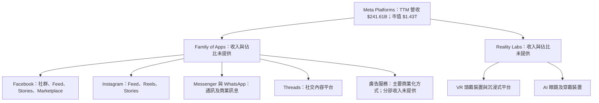
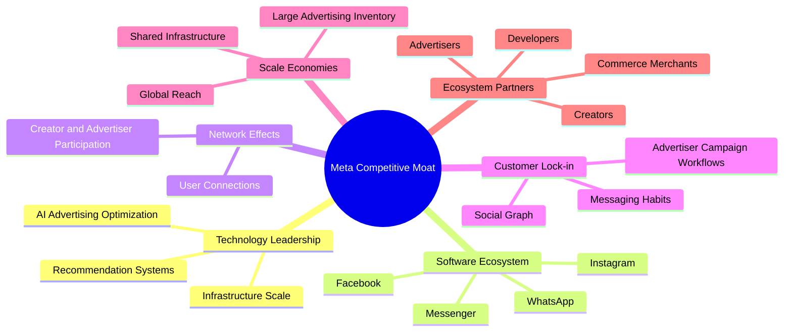
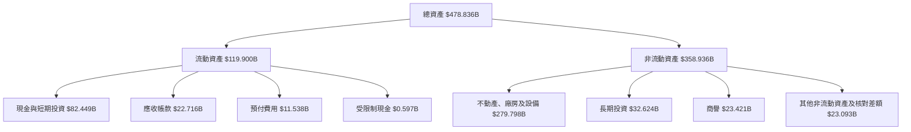
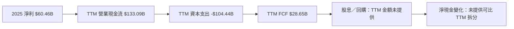
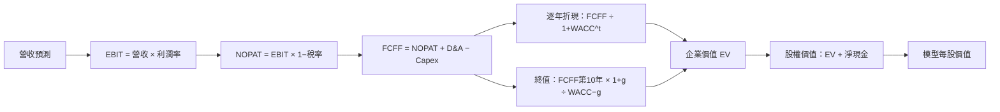
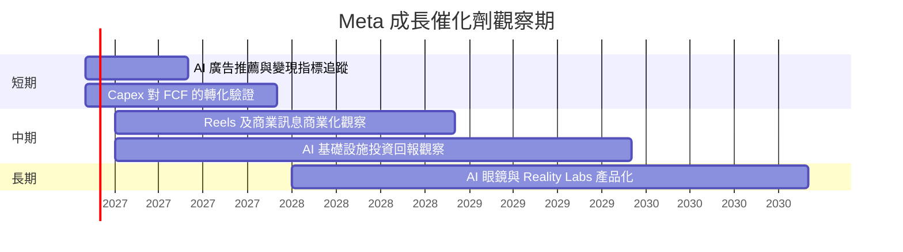
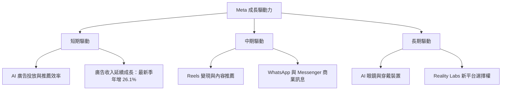
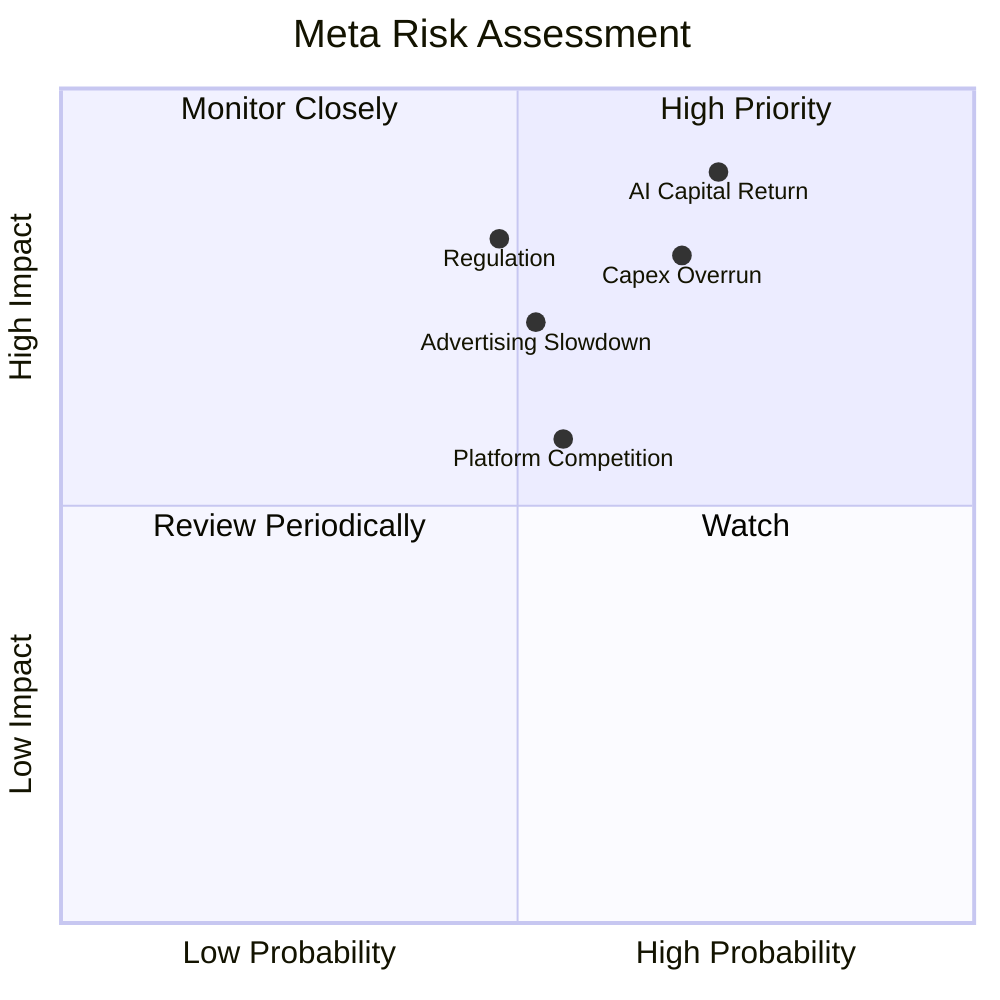
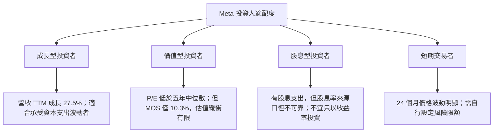

# META 基本面深度分析報告
> **報告日期**：2026-11-23 ｜ **語言**：繁體中文 ｜ **數據來源**：SEC 申報資料 (XBRL)、Yahoo Finance、Finviz、StockAnalysis、Roic.ai ｜ **分析師**：CFA 級機構研究

## 目錄

| # | 章節 | 核心結論 |
|---|------|----------|
| 1 | 執行摘要 | 買入；加權合理價值 $625.48；MOS +10.3% |
| 2 | 公司概覽與商業模式 | Family of Apps 網路效應構成主要護城河；業務別營收未提供 |
| 3 | 損益表深度分析 | TTM 營收 $241.61B、成長 27.5%；最新季營業利益率數據需審慎解讀 |
| 4 | 資產負債表分析 | 依一致口徑現金短投 $82.45B、債務 $83.67B，淨負債 $1.22B |
| 5 | 現金流量深度分析 | TTM FCF $28.65B；資本支出提高使現金轉換承壓 |
| 6 | 獲利能力與資本效率 | ROIC 27.7% 高於 WACC 10.30%，仍創造股東價值 |
| 7 | 相對估值分析 | META 估值低於自身五年中位數；同業倍數分歧大 |
| 8 | DCF 內在價值評估 | 基準 DCF $583.51；估值高度依賴終值與資本支出回落 |
| 9 | 成長催化劑 | AI 廣告效率、Reels 變現與商業訊息是主要觀察方向 |
| 10 | 風險矩陣 | AI 資本支出回報、監管及廣告週期為主要風險 |
| 11 | 投資建議 | 買入；建議買入區間上限不低於現價，並以現金流驗證投資回報 |

---

## 1. 執行摘要

Meta 的 TTM 營收為 **$241.61B**、TTM 年增 **27.5%**，ROIC **27.7%** 高於 WACC **10.30%**；但 TTM 資本支出 **$104.44B** 將營業現金流 **$133.09B** 壓低至 FCF **$28.65B**，FCF Yield 僅 **2.00%**。以 DCF 基準價值 **$583.51**、同業法及分析師共識加權後合理價值 **$625.48** 計算，對 **2026-11-20 收盤價 $560.84** 的 MOS 為 **+10.3%**，依規則 20 評級為**買入**。估值並非毫無疑慮：DCF 終值現值佔 EV **80.9%**，而高額資本支出使近季 FCF 為負，投資論點需要後續現金流轉化驗證。

### 1.0 一頁式投資儀表板

| 項目 | 內容 |
|------|------|
| **投資論點（3 句）** | ① TTM 營收年增 27.5%，最新一季營收年增 26.1%，營收動能仍高。② ROIC 27.7% 對 WACC 10.30%，資本回報高於資金成本。③ TTM FCF $28.65B、FCF Yield 2.00%，Capex $104.44B 是主要估值約束。 |
| **綜合評分** | **7.4/10**（引用 1.1 評分卡） |
| **財務健康** | 🟡 現金及短期投資 $82.45B，對照指定口徑債務 $83.67B，淨負債 $1.22B；短期流動性充足，但資本支出高。 |
| **ROIC vs WACC** | **27.7% vs 10.30%**；利差 +17.4 個百分點，創造價值。 |
| **FCF 趨勢** | 年度 FCF 2024 年 $54.07B、2025 年 $46.11B；TTM $28.65B。FCF Yield **2.00%**，近期資本支出上升造成下滑。 |
| **估值** | Forward P/E **15.72x** ｜ EV/EBITDA（TTM）**12.618x** ｜ FCF Yield **2.00%** |
| **DCF 內在價值（基準）** | **$583.51**；現價相對 DCF 折價 **3.9%**（$560.84 ÷ $583.51 − 1）。 |
| **安全邊際（MOS）** | **+10.3%**＝($625.48 − $560.84) ÷ $625.48；基準為 8.8 加權合理價值。🟡有限。 |
| **預期報酬（基準情境 12M）** | DCF 基準情境相對現價 **+4.0%**；加權合理價值隱含上行 **+11.5%**。 |
| **關鍵風險（前二）** | AI 基礎設施資本支出增加但未同步變現；監管、隱私及平台競爭削弱廣告效率。 |
| **評級 + 信心度** | 🟢 **買入** ｜ 信心：中（估值有折價，但終值依賴高且近期 FCF 受壓）。 |

### 1.1 綜合評分卡

| 維度 | 評分（1–10） | 主要依據（引用數字與其來源章節） |
|------|--------------|----------------------------------|
| 成長性 | 8.5 | TTM 營收成長 27.5%、最新一季年增 26.1%（第 3 章）；增長仍快但後續基期上升。 |
| 獲利能力 | 8.5 | TTM 營業利益率 32.9%、ROIC 27.7%，高於 WACC 10.30%；F-Score 為 3/8（第 6 章）。 |
| 財務健康 | 7.0 | 淨負債 $1.22B，現金短投 $82.45B；流動比率 1.903（補充財務資料），但資本支出高（第 4–5 章）。 |
| 估值 | 6.0 | MOS +10.3%；P/E 19.1x 低於五年中位數 24.5x，但 FCF Yield 僅 2.00%（第 7–8 章）。 |
| 護城河 | 9.0 | 多個大型社交平台形成網路效應，廣告投放與內容推薦具規模優勢；市場份額數據未提供（第 2 章）。 |
| 管理層與資本配置 | 5.5 | 2025 年 SBC $20.43B；Capex TTM $104.44B，而 FCF 降至 $28.65B，回報節奏仍須驗證（第 3、5 章）。 |
| **綜合評分** | **7.4** | 六項算術平均： (8.5 + 8.5 + 7.0 + 6.0 + 9.0 + 5.5) ÷ 6 = **7.4167，四捨五入 7.4**。 |

> 更正：依六項子評分的算術平均，綜合評分為 **7.4/10**；本報告所有引用均以此為準。

### 1.2 五大投資論點 + 三大核心風險

| 類型 | 項目 | 具體依據 | 信心度 |
|------|------|----------|--------|
| 🟢 **投資論點①** | 廣告主業仍具成長動能 | TTM 營收年增 27.5%，最新一季營收年增 26.1%；若 AI 推薦改善轉換與廣告定價，成長有望延續。 | 🟢 高 |
| 🟢 **投資論點②** | 資本回報高於資金成本 | ROIC 27.7% 對 WACC 10.30%，利差 +17.4 個百分點。 | 🟢 高 |
| 🟢 **投資論點③** | 資產負債表仍有承受力 | 現金及短期投資 $82.45B；按一致口徑淨負債僅 $1.22B。 | 🟢 高 |
| 🟢 **投資論點④** | 估值低於自身歷史中位數 | P/E 19.1x 對五年中位數 24.5x；P/S 6.0x 對中位數 7.7x。 | 🟡 中 |
| 🟢 **投資論點⑤** | 多元平台帶來流量與廣告觸達 | Facebook、Instagram、WhatsApp、Messenger、Threads 等共享推薦與廣告基礎設施；各產品收入拆分未提供。 | 🟡 中 |
| 🟡 **風險①** | AI 資本支出回報不確定 | TTM Capex $104.44B，約為營收 43.2%；TTM FCF 僅 $28.65B。 | 🔴 高衝擊 |
| 🔴 **風險②** | 營業利益及 FCF 可能顯著波動 | 最新一季營業利益率在不同來源口徑中有 20.1% 與 37.8% 兩個數字；TTM FCF 亦低於 2025 年全年。 | 🔴 高衝擊 |
| 🟡 **風險③** | SBC 與監管成本侵蝕股東回報 | 2025 年 SBC $20.43B；監管、隱私與內容政策可能限制廣告定向及產品變現。 | 🟡 中度 |

### 1.3 快速統計卡片

| 指標 | 公司實際值（期間） | 同業中位數 | 狀態 |
|------|--------------------|------------|------|
| 營收成長（TTM） | **27.5%** | — | 🟢 |
| 營收成長（最新一季年增） | **26.1%** | **14.3%** | 🟢 |
| 毛利率（TTM） | **81.0%** | **60.9%** | 🟢 |
| 營業利益率（TTM） | **32.9%** | — | 🟢 |
| ROIC（TTM） | **27.7%** | — | 🟢 |
| Forward P/E | **15.72x** | **7.2x** | 🟡 |
| FCF Yield（TTM） | **2.00%** | — | 🟡 |
| Piotroski F-Score | **3 / 8** | — | 🔴 |

> 同業中位數依可用的 Peer multiples 計算：最新一季營收成長的中位數為 14.3%；毛利率中位數為 60.9%。Forward P/E 三家中位數為 7.2x。

### 1.4 投資結論

```text
╔══════════════════════════════════════════════════════════════════╗
║                    📊 投資結論摘要                               ║
╠══════════════════════════════════════════════════════════════════╣
║  評級：買入（依 MOS 門檻；未作質化調整）                         ║
║  價格（2026-11-20 收盤）：$560.84                                ║
║  DCF 內在價值（基準）：$583.51（現價折價 3.9%）                  ║
║  安全邊際 MOS：+10.3%（以加權合理價值為分母）                   ║
║  加權合理價值（8.8）：$625.48                                    ║
║  DCF 情境價值：                                                   ║
║    悲觀情境：$196.16（-65.0%）                                   ║
║    基準情境：$583.51（+4.0%）                                    ║
║    樂觀情境：$1,423.19（+153.8%）                                ║
║  綜合評分：7.4/10（引用 1.1）                                    ║
║  適合投資人：能承受估值及資本支出波動的成長型、長線投資人        ║
╚══════════════════════════════════════════════════════════════════╝
```

---

## 2. 公司概覽與商業模式

### 2.1 業務結構與收入來源

Meta 透過 Family of Apps（FoA）與 Reality Labs（RL）營運。已提供公司 TTM 營收 **$241.61B**，但未提供兩部門收入、佔比及子產品營收；依規則不推算分部比例。



### 2.2 市場份額

市場份額數據未提供，因此不列百分比或製作比例圖。Meta 的 TTM 營收 $241.61B、年增 27.5%，在所列社交與數位廣告同業中，營收成長高於 Alphabet、Snap 與 Pinterest 的最新季度年增率；但公司與同業的業務口徑不同，不能直接由此推算市場份額。

### 2.3 競爭護城河分析



### 2.4 護城河強度

| 護城河項目 | 強度（強／中／弱） | 證據（引用數字或事實） | 會削弱它的情況 |
|------------|--------------------|------------------------|----------------|
| 網路效應 | 強 | Facebook、Instagram、WhatsApp 等社交網路可讓使用者、創作者與廣告主互相增值；平台用戶數未提供，故不量化。 | 使用者遷移至新平台，或年輕用戶參與度下降。 |
| 技術與推薦系統 | 中至強 | TTM 營收成長 27.5%，與廣告與內容推薦效率改善相容，但資料未提供 AI 對收入的獨立貢獻。 | 推薦品質下降、競爭者模型或平台政策變動。 |
| 規模效應 | 強 | TTM 營收 $241.61B、毛利率 81.0%，有較大資源支持研發及基礎設施。 | AI 算力投資上升而無法轉化為收入或利潤。 |
| 軟體生態系 | 強 | 多個社交與通訊產品共用使用者與廣告觸達；各產品用戶及收入拆分未提供。 | 跨平台資料使用受限，或用戶注意力分散。 |
| 客戶鎖定 | 中 | 廣告主可在平台進行投放及受眾觸達；客戶留存率與切換成本數據未提供。 | 廣告主預算轉往其他媒體，或成效成本惡化。 |
| 生態夥伴 | 中 | 創作者、商家及廣告主共同參與平台；夥伴規模數據未提供。 | 內容供給、商業訊息變現或第三方合作受限。 |

護城河評分 **9.0/10** 的理由是大型社交圖譜、產品群及廣告規模共同支撐變現；扣分在於分部用戶與收入數據缺漏，且 AI 投資回報尚未由現金流充分證實。

---

## 3. 損益表深度分析

### 3.1 年度收入成長趨勢（近 4 年）

年度營收採 SEC／StockAnalysis 年度數據。2022 年收入較 2021 年下降 1.12%；其後 2023–2025 年恢復成長。2022–2025 年 CAGR 約 **19.9%**，計算為 \((200.97 ÷ 116.61)^{1/3}-1\)。

```text
╔══════════════════════════════════════════════════════════════════╗
║              Meta 年度收入趨勢（FY2022–FY2025）                 ║
╠══════════════════════════════════════════════════════════════════╣
║  FY2022  $116.61B  ████████████░░░░░░░░░░░░  YoY: -1.12% 🟡   ║
║  FY2023  $134.90B  ██████████████░░░░░░░░░░  YoY: +15.69% 🟢  ║
║  FY2024  $164.50B  █████████████████░░░░░░░  YoY: +21.94% 🟢  ║
║  FY2025  $200.97B  █████████████████████░░░  YoY: +22.17% 🟢  ║
║                                                                  ║
║  2022–2025 營收 CAGR：約 +19.9%                                 ║
╚══════════════════════════════════════════════════════════════════╝
```

### 3.2 季度收入趨勢分析

QoQ 以季度營收相對上一季計算；Q3 YoY 亦列出 SEC／StockAnalysis 所示單季年增。2026 年第四季尚未提供。

| 季度 | 營收 | QoQ | YoY | 備註 |
|------|------|-----|-----|------|
| 2025 Q4 | $59.89B | +16.9% | +23.8% | 季節性較強；QoQ 以 2025 Q3 $51.24B 計。 |
| 2026 Q1 | $56.31B | -6.0% | +33.1% | QoQ 回落，但對比 2025 Q1 基期的 YoY 仍高。 |
| 2026 Q2 | $60.80B | +8.0% | +28.0% | 營收回升。 |
| 2026 Q3 | $64.60B | +6.2% | +26.1% | 最新季度年增率；與 TTM 成長率 27.5% 是不同期間指標。 |

### 3.3 利潤率演變分析

| 利潤率指標 | FY2022 | FY2023 | FY2024 | FY2025 | 趨勢 | 評估 |
|------------|--------|--------|--------|--------|------|------|
| **毛利率** | 79.0% | 80.8% | 81.7% | 82.0% | 逐年上升 | 🟢 |
| **營業利益率** | 24.8% | 34.7% | 42.2% | 41.4% | 2022 低點後明顯改善 | 🟢 |
| **淨利率** | 19.9% | 29.0% | 37.9% | 30.1% | 2024 高點後回落 | 🟡 |

計算依年度毛利、營業利益、淨利除以年度營收。2023–2025 年毛利率改善，代表收入增加而直接成本增長較慢；營業利益率由 2022 年 24.8% 回升至 2024 年 42.2%，反映費用控制與收入恢復的營業槓桿。2025 年淨利率回落至 30.1%，而年度淨利由 2024 年 $62.36B 降至 2025 年 $60.46B；年報表列數字不足以將變化精確拆分至稅項或一次性項目，故不臆測原因。

TTM 營業利益率為 32.9%，低於 2025 全年計算值 41.4%。最新季度營業利益率存在來源差異：SEC 核心數據標示 **20.1%**，補充資料與季度營業利益數字換算則接近 **35.4%**（$22.878B ÷ $64.601B）。本報告以 VERIFIED FIGURES 的 TTM 32.9% 為估值錨點，並將最新季度營業利益率差異列為資料限制，不以單季數字替代 TTM。

### 3.4 費用結構分析

年度損益表提供研發支出，但未提供同一年度完整成本及費用拆分；資本支出屬現金流，不是損益費用。為避免把不完整項目誤畫成費用比例，不製作費用圓餅圖。

已知 2025 年研發費用 **$57.37B**，相當於營收 **28.5%**（$57.37B ÷ $200.97B）。研發投入支持 AI、推薦、廣告與硬體產品，但其未來回報須以收入增量、營業利潤及 FCF 轉化驗證。

### 3.5 季度 EPS 趨勢與盈餘品質（Quality of Earnings）

EPS 預估值與實際值的歷史欄位均為缺失，因此無法判定超預期或不及預期；下表列可取得的實際 EPS 及年增率。Q3 2026 EPS 年增 264.76% 是相對 Q3 2025 的低基期結果，不應解讀為可持續的常態增長率。

| 季度 | EPS 實際 | EPS YoY | 超預期／不及預期 |
|------|----------|---------|-------------------|
| 2025 Q4 | $9.02 | N/A | N/A（分析師 EPS 預估缺失） |
| 2026 Q1 | $10.57 | +62.36% | N/A（分析師 EPS 預估缺失） |
| 2026 Q2 | $6.23 | -13.44% | N/A（分析師 EPS 預估缺失） |
| 2026 Q3 | $3.86 | +264.76% | N/A（分析師 EPS 預估缺失） |

| 盈餘品質項目 | 數值／佔比 | 評估 |
|--------------|-----------|------|
| 股權薪酬 SBC / 營收 | 2025 年 $20.43B ÷ $200.97B = **10.2%** | 🟡 SBC 非現金但造成稀釋；需與回購抵消程度一併觀察。 |
| SBC / 營業現金流 | 2025 年 $20.43B ÷ $115.80B = **17.6%** | 🟡 SBC 相對現金流占比不低。 |
| FCF / 淨利 | TTM $28.65B ÷ TTM 淨利 $75.249B = **38.1%** | 🔴 現金轉換偏低，主要受高 Capex 影響；TTM 淨利引用 StockAnalysis。 |
| 一次性／非經常性損益 | N/A（未提供可核對明細） | 不推斷其對本期盈餘的影響。 |
| 有效稅率異常 | **29.6%**（最新年度有效稅率） | 🟡 無資料證明稅務利益帶動本期盈餘；DCF 按此稅率建模。 |
| 資本化支出 vs 費用化 | TTM Capex $104.44B；資本化與費用化拆分 N/A | 高額 Capex 先形成資產，再由折舊反映；可能令短期營業費用低於現金投入，但不代表盈餘必然高估。 |

**盈餘品質結論：** TTM 營業現金流 $133.09B 顯示核心業務具現金產生能力，但 Capex $104.44B 使 FCF 轉換僅 38.1%（依上述淨利口徑）。因此 GAAP 淨利不是唯一衡量標準；對估值更重要的是資本支出高峰後能否恢復 FCF。SBC 已包含於 GAAP 費用，但其經濟成本仍透過股數稀釋影響股東回報。

---

## 4. 資產負債表分析

### 4.1 資產結構分解

以下資產明細採 2026-09-30 StockAnalysis 資產負債表；「其他資產」為總資產扣除已列項目的餘額，屬計算值。



### 4.2 流動性與營運資金分析

流動比率與速動比率採補充財務資料；應收、存貨及應付天數依 QUALITY FIGURES 原值引用。

| 指標 | 最新 TTM | 一年前 TTM | 變化 | 解讀 |
|------|----------|------------|------|------|
| DSO 應收帳款天數 | 34 天 | 33 天 | +1 天 | 略微延長，單年變動幅度小；需持續追蹤回款。 |
| DIO 存貨天數 | N/A | N/A | N/A | 公司未提供可計算存貨餘額，不補值。 |
| DPO 應付帳款天數 | 152 天 | N/A | N/A | 一年前缺資料，無法比較；較長付款週期可能反映供應商融資，但不能僅據此判定議價力。 |
| CCC 現金轉換週期 | N/A | N/A | N/A | 因 DIO 缺失，CCC 無法計算。 |

流動比率 **1.903**、速動比率 **1.669**，代表短期資產對流動負債具覆蓋能力；但現金流投資能力應更關注 Capex 對 FCF 的影響，而非只看流動比率。

### 4.3 債務結構分析

債務與淨現金以 VERIFIED FIGURES 的一致口徑為準。補充市場資料另列總債務 $114.84B、淨負債 $32.39B，與 SEC 核心數據 $83.67B 不一致；本節採 $83.67B，並在分析中保留口徑提醒。

```text
╔══════════════════════════════════════════════════════════════════╗
║                   Meta 債務健康診斷                              ║
╠══════════════════════════════════════════════════════════════════╣
║  總債務：             $83.67B  ████████████████░░░░  🟡         ║
║  現金+短期投資：      $82.45B  ████████████████░░░░  🟢         ║
║  淨負債：              $1.22B  ░░░░░░░░░░░░░░░░░░░░  🟢         ║
║                                                                  ║
║  Debt/EBITDA：        N/A（未提供一致口徑 EBITDA 計算輸入）      ║
║  Interest Coverage： N/A（利息費用未提供）                      ║
║  判斷：現金儲備大致覆蓋核心口徑債務；資本支出與債務口徑需監控。  ║
╚══════════════════════════════════════════════════════════════════╝
```

### 4.4 股東權益趨勢

| 財年 | 股東權益 | 年增 |
|------|----------|------|
| 2022 | $125.71B | — |
| 2023 | $153.17B | +21.8% |
| 2024 | $182.64B | +19.2% |
| 2025 | $217.24B | +19.0% |

股東權益持續上升，與盈利累積一致；但年度權益增加不等於每股價值同步增加，仍須同時監控 SBC 稀釋與回購。2025 年 SBC 為 $20.43B。

---

## 5. 現金流量深度分析

### 5.1 現金流量瀑布圖

年度淨利與營業現金流使用 2025 年資料；TTM FCF 依指定定義為營業現金流減 Capex。股息及回購現金金額的完整 TTM 數據未提供，因此不補列。



### 5.2 FCF 轉換率趨勢

| 財年 | 營業現金流 | Capex | FCF | 淨利 | FCF / 淨利 |
|------|------------|-------|-----|------|------------|
| 2023 | $71.11B | $27.05B | $44.07B | $39.10B | 112.7% |
| 2024 | $91.33B | $37.26B | $54.07B | $62.36B | 86.7% |
| 2025 | $115.80B | $69.69B | $46.11B | $60.46B | 76.3% |

FCF 轉換率逐年下降，主要算術原因是 Capex 增長快於營業現金流；2025 年 Capex 年增約 87.1%（$69.69B ÷ $37.26B − 1），使 FCF 由 $54.07B 降至 $46.11B。這是 AI 與資料中心投資回報能否成立的核心檢驗點。

### 5.3 自由現金流趨勢

```text
╔══════════════════════════════════════════════════════════════════╗
║                 Meta 自由現金流趨勢                              ║
╠══════════════════════════════════════════════════════════════════╣
║  2023 FY  $44.07B  █████████████████░░░  FCF / 淨利：112.7%     ║
║  2024 FY  $54.07B  █████████████████████░  FCF / 淨利：86.7%    ║
║  2025 FY  $46.11B  ██████████████████░░  FCF / 淨利：76.3%      ║
║  TTM      $28.65B  ███████████░░░░░░░░  FCF Yield：2.00%        ║
╠══════════════════════════════════════════════════════════════════╣
║  TTM FCF = $133.09B OCF − $104.44B Capex = $28.65B              ║
╚══════════════════════════════════════════════════════════════════╝
```

### 5.4 資本配置評估

股息、研發支出及 Capex 數字並非同一期間或同一資本配置分類，故不製作比例圓餅圖。

| 資本配置項目 | 已知數據 | 評估 |
|--------------|----------|------|
| 資本支出 | TTM $104.44B；FY2025 $69.69B | 🟡 高投入有助基礎設施擴建，但短期壓低 FCF。 |
| 研發 | FY2025 $57.37B | 🟡 支持 AI 與產品迭代，需驗證變現成果。 |
| SBC | FY2025 $20.43B | 🔴 造成稀釋；須衡量員工留任效益與股東稀釋的平衡。 |
| 股息 | FY2025 $5.32B | 🟢 現金支出相對 OCF 不高；最新股息率來源顯示 37.0%，與常見股息率口徑不一致，故不採用該百分比作判斷。 |
| 回購 | 金額未提供 | N/A；不能由股數或權益變化反推金額。 |

---

## 6. 獲利能力與資本效率

### 6.1 ROE / ROA / ROIC 趨勢

可用來源對 ROE 存在口徑差異；依 QUALITY FIGURES 優先採用 ROE 27.6%。ROIC 歷史序列除 TTM 外未提供一致計算口徑。

| 指標 | 可取得數據 | 評估 |
|------|------------|------|
| ROE | TTM **27.6%**（QUALITY FIGURES）；補充資料另列 32.3% | 🟢 資本回報高；以指定品質指標為準。 |
| ROA | TTM **14.6%**（補充資料） | 🟢 資產盈利能力高；與不同口徑資料可能不完全一致。 |
| ROIC | TTM **27.7%** | 🟢 高於 WACC 10.30%。 |
| 同業／行業均值 | 未提供 | 不列未有來源的同業均值。 |

### 6.2 ROIC vs WACC 分析（核心價值創造判斷）

```text
╔══════════════════════════════════════════════════════════════════╗
║                  ROIC vs WACC 深度分析                           ║
╠══════════════════════════════════════════════════════════════════╣
║  WACC 輸入（Cost of capital）：                                   ║
║  ├── 無風險利率（10Y 美債）：       4.91%                        ║
║  ├── 市場風險溢酬 ERP：             5.00%                        ║
║  ├── Beta（調整後）：               1.19                         ║
║  ├── 股權成本：4.91% + 1.19×5.00% = 10.86%（輸入值 10.84%）     ║
║  ├── 稅前債務成本：                 1.39%                        ║
║  ├── 稅率：                         29.6%                        ║
║  ├── 股權／債務權重：               94.5%／5.5%                  ║
║  └── ✅ 採用 WACC：                 10.30%                       ║
║                                                                  ║
║  ROIC（TTM）：                     27.7%                         ║
║  經濟利差 = 27.7% − 10.30% =       +17.4 個百分點                ║
║                                                                  ║
║  ROIC  27.7%  ▓▓▓▓▓▓▓▓▓▓▓▓▓▓▓▓▓▓▓▓▓▓▓▓▓▓░░░░  🟢               ║
║  WACC  10.3%  ▓▓▓▓▓▓▓▓▓▓░░░░░░░░░░░░░░░░░░░░  ──               ║
║  結論：ROIC 約為 WACC 的 2.69 倍，仍創造股東價值。              ║
╚══════════════════════════════════════════════════════════════════╝
```

提供的 WACC 是 **10.30%**，本節與 DCF 均採用此值。原始 Beta 為 1.28，調整 Beta 為 \(⅔×1.28+⅓=1.19\)。成本資料列出的股權成本為 10.84%，但直接以展示後已四捨五入的 4.91%、1.19、5.00% 計算得 10.86%；這是輸入精度差異，WACC 不重新計算或替換。10 年期美債日期未另列，ERP 依據為程式採用值，無風險利率及 ERP 日期／來源細節未提供。

依定義 ROIC−WACC = **17.4 個百分點**，代表資本投入的稅後回報高於資金成本；但若高額 AI 投資令未來 ROIC 下滑至 10.30% 以下，價值創造將減弱。

### 6.3 杜邦三因素分解

| 因素 | 數值（TTM） | 解讀 |
|------|-------------|------|
| 淨利率 | 31.1% | 盈利能力是 ROE 的重要來源。 |
| 資產週轉率 | 0.50 | 每單位資產產生約 0.50 單位營收。 |
| 權益乘數 | 1.76 | 有槓桿影響，但非極高槓桿主導。 |
| **ROE** | **27.6%** | **31.1% × 0.50 × 1.76 = 27.368%，品質指標列示 ROE 27.6%**；差異屬輸入值四捨五入。 |

### 6.4 財務體質：Piotroski F-Score

品質指標原列 **3/8**；九項中毛利率比較缺資料而不計分，故可判定項目共八項。

| 測試 | 結果 | 解讀 |
|------|------|------|
| ROA > 0 | ✅ 通過 | 公司保持正資產報酬。 |
| 營業現金流 > 0 | ✅ 通過 | 現金流為正。 |
| ROA 高於一年前 | ❌ 未通過 | 資產報酬未改善。 |
| 營業現金流 > 淨利（應計品質） | ✅ 通過 | 現金流高於淨利，支持應計品質。 |
| 長期負債 ÷ 總資產低於一年前 | ❌ 未通過 | 槓桿相對資產未改善。 |
| 流動比率高於一年前 | ❌ 未通過 | 短期流動性指標未改善。 |
| 稀釋股數未增加 | ❌ 未通過 | 股數稀釋是每股報酬的風險。 |
| 毛利率高於一年前 | — 無法判定 | 缺少比較所需輸入。 |
| 資產週轉率高於一年前 | ❌ 未通過 | 資產運用效率未改善。 |

F-Score 3/8 不代表經營失速，但指出當期財務趨勢並非全面改善；尤其股數增加、流動比率與資產週轉率未改善，應與盈利成長並列監控。

---

## 7. 相對估值分析

### 7.1 同業估值比較表格

本公司倍數採估值資料；同業倍數依 Peer multiples。Snap 的 TTM P/E 為 N/A，不補值。

| 估值指標 | **META** | **GOOG** | **SNAP** | **PINS** | 本公司評估 |
|----------|----------|---------|---------|---------|-----------|
| **Trailing P/E** | 19.1x | 13.8x | N/A | 68.0x | 🟡 低於 PINS、高於 GOOG；同業差異很大。 |
| **Forward P/E** | 15.72x | 17.3x | 5.8x | 7.2x | 🟡 高於同業中位數 7.2x，市場可能給予更高成長品質溢價。 |
| **P/S Ratio** | 5.93x | 6.9x | 1.2x | 2.0x | 🟡 高於 SNAP、PINS，略低於 GOOG。 |
| **EV/EBITDA（TTM）** | 12.618x | 17.0x | 48.6x | 30.7x | 🟢 低於三家同業可比倍數。 |
| **最新一季營收年增** | 26.1% | 24.7% | 14.3% | 11.9% | 🟢 高於三家同業。 |
| **毛利率（TTM）** | 81.0% | 60.9% | 59.2% | 79.0% | 🟢 高於同業中位數。 |

同業 P/E 差異受盈利能力、成長預期及資料口徑影響；不宜將較低倍數直接視為便宜。Meta 的 EV/EBITDA 低於同業所列倍數，但 Forward P/E 高於同業中位數，估值結論需結合盈利可持續性與 Capex。

### 7.2 歷史估值區間分析

```text
╔══════════════════════════════════════════════════════════════════╗
║              META 五年估值位置（TTM）                            ║
╠══════════════════════════════════════════════════════════════════╣
║  P/E：     12.9x ───────●19.1x────── 33.4x                     ║
║                       中位數 24.5x｜目前百分位 19%               ║
║  P/S：      2.8x ───────●6.0x─────── 10.6x                     ║
║                       中位數 7.7x｜目前百分位 24%                ║
║  EV/EBITDA：7.7x ──────●13.8x────── 19.7x                     ║
║                       中位數 16.5x｜目前百分位 29%               ║
╚══════════════════════════════════════════════════════════════════╝
```

目前三項倍數均低於各自五年中位數，且位於五年區間較低位置；此比較是歷史相對估值，不等於絕對低估，也未反映資本支出週期變化。

### 7.3 情境價值（照抄 DCF MODEL 的 Scenarios）

| 情境 | 第 1 年營收成長 | 期末營業利潤率 | WACC | 每股價值 | 相對現價 | 機率 | 會發生的條件 |
|------|----------------|----------------|------|----------|----------|------|--------------|
| 🔴 悲觀 | 13.8% | 29.5% | 11.30% | $196.16 | -65.0% | 25% | 廣告增長減速、資本支出高企、長期利潤率低於基準。 |
| 🟡 基準 | 27.5% | 34.7% | 10.30% | $583.51 | +4.0% | 50% | 近年成長短期延續，利潤率逐步升至模型期末假設。 |
| 🟢 樂觀 | 41.3% | 38.1% | 9.30% | $1,423.19 | +153.8% | 25% | AI 廣告及產品變現推動高成長，且折現率下降。 |

### 7.4 相對估值隱含價格區間

```text
╔══════════════════════════════════════════════════════════════════╗
║            估值方法回推每股價值（美元）                          ║
╠══════════════════════════════════════════════════════════════════╣
║  $256.86 ───────── $560.84 ───────── $583.51 ─────── $972.14   ║
║  同業 Forward P/E     現價             DCF 基準       EV/EBITDA  ║
║                                                                  ║
║  分析師共識目標價：$848.23                                        ║
╚══════════════════════════════════════════════════════════════════╝
```

- **同業 Forward P/E：$256.86**＝同業中位數 7.2x × Forward EPS $35.68。
- **同業 EV/EBITDA：$972.14**＝同業中位數 23.8x（GOOG、PINS）× TTM EBITDA，再加淨現金。
- **分析師共識：$848.23**＝58 位分析師平均目標價。
- 各方法數值差異大，顯示倍數法對利潤與可比公司選擇敏感；不得將其中單一極端值視為確定目標價。

---

## 8. DCF 內在價值評估（Discounted Cash Flow）

> DCF 數字依程式模型原值引用。由於輸入表中部分數字經四捨五入、且個別公式不能以展示精度完全重現，以下明確區分「模型原值」及「以展示數字重算的差異」，不以自建數字取代原值。

### 8.0 估值推理鏈（Thinking Logic）

**Step 1 — 價值來源與主導變數：** Meta 的價值主要來自 Family of Apps 廣告與社交服務現金流、AI 對廣告效率與內容推薦的增量，以及 Reality Labs／AI 眼鏡的選擇權；但分部營收及佔比未提供，不能量化各項權重。模型最敏感的輸入是長期現金流、終值成長率與 WACC；基準情境下終值佔 EV 80.9%，與此判斷一致。

**Step 2 — 模型選擇**

| 決策點 | 本報告採用 | 理由（含數字） | 曾考慮但否決 | 否決理由 |
|--------|-----------|----------------|--------------|----------|
| 現金流定義 | FCFF | 對應 WACC 折現並先估 EV；模型明列 FCFF | FCFE | 融資結構與債務口徑不宜直接混入營運現金流。 |
| 預測期 N | 10 年 | 模型列 FY+1 至 FY+10；長期成長由 27.5% 線性淡化至 3.0% | 5 年 | 模型既定為 10 年，不改動。 |
| 終值方法 | Gordon Growth | 模型已給永續成長率 3.0% | 僅退出倍數 | DCF 輸入未提供退出倍數，不能自行補值。 |
| EBIT 基礎 | GAAP EBIT | 模型明確使用 GAAP EBIT，SBC 已作費用 | 非 GAAP EBIT | 加回 SBC 會改變模型假設。 |

**Step 3 — 關鍵假設推導鏈**

- **營收成長**：錨點＝TTM 年增 **27.5%**；調整＝模型由第 1 年 27.5% 線性淡化至第 10 年 3.0%，反映成熟化；**採用模型逐年路徑**；不採全期固定 27.5%，因會忽略基期擴大及增長自然收斂。
- **期末營業利潤率**：錨點＝TTM 32.9%；調整＝模型向過去五年中位數收斂；**FY+10 採用 34.7%**；不採明顯高於此值的更高利潤率，因模型未提供支持依據。
- **永續成長率 g**：錨點＝模型採 3.0%；調整＝未提供可引用 GDP／通膨序列，故採模型設定，不另調；**採用 3.0%**；不採 ≥WACC 的值，因 Gordon Growth 分母將失效。
- **預測期 N**：錨點＝DCF 模型 10 年；調整＝不改動程式模型期限；**採用 10 年**；不改為 5 年，因會違反既定模型輸入。
- **Capex／營收**：錨點＝TTM 43.2%；調整＝模型逐步降至 FY+10 的 11.3%，約為 D&A 10.3% 的 1.1 倍；**採用模型逐年淡化路徑**；不採固定 43.2%，因模型假設目前資本建設高峰逐步回落，但此假設具重大下行風險。
- **WACC**：錨點＝指定成本資本數據 WACC 10.30%；調整＝不調整；**採用 10.30%**；不自行另算 WACC，以維持與規定的成本資本輸入一致。
- **EBIT／SBC／稀釋**：錨點＝GAAP EBIT 已包含 SBC 費用；**採用組合 (A)：GAAP EBIT、FCFF 不再扣 SBC、固定股數／年稀釋率 0%**；不採「再扣 SBC」或「再放大股數」，避免重複計入同一經濟成本。
- **稅率**：錨點＝有效稅率 29.6%；採用 29.6%，未提供足以另行調整的長期稅率依據。
- **D&A／營收**：錨點及採用值均為 10.3%（TTM）。
- **ΔWC／營收增額**：DCF 明示不建模營運資金；採用「不列 ΔWC」而非假設為零的獨立估計。

**Step 4 — 最脆弱環節：** Capex／營收由 43.2% 降至 11.3% 是模型由負 FCF 轉為高正 FCF 的重要條件；若 AI 基礎設施投入長期高於此路徑，估值將低於基準，且敏感度表不能反映 Capex 假設變動的完整影響。

**Step 5 — 計算路徑圖**



### 8.1 模型假設總表（Model Inputs）

| 假設項目 | 採用值 | 依據／來源 | 敏感度 |
|----------|--------|-------------|--------|
| 預測期長度 N | 10 年 | DCF MODEL 固定預測期 | 🟡 中 |
| 營收成長 | FY+1 27.5% 線性淡化至 FY+10 3.0% | TTM 成長 27.5%；終年 3.0% 為模型假設 | 🔴 高 |
| 營業利潤率 | 32.9% → 34.7% | TTM 32.9%；FY+10 對應近五年中位數假設 | 🔴 高 |
| 有效稅率 | 29.6% | 最新年度有效稅率 | 🟢 低 |
| Capex／營收 | 43.2% → 11.3% | TTM Capex／營收 43.2%；末年為 D&A 的 1.1 倍 | 🔴 高 |
| D&A／營收 | 10.3% | TTM 錨點，模型固定 | 🟢 低 |
| 營運資金變動 | 未建模 | DCF MODEL 明示 working capital is not modelled | 🟢 低 |
| EBIT 基礎 | GAAP | 模型使用 GAAP EBIT | 🟡 中 |
| SBC 處理 | 不另扣 SBC | SBC 已在 GAAP EBIT 中費用化 | 🟡 中 |
| 年稀釋率 | 0% | 組合 (A)；模型固定股數，不另稀釋 | 🟡 中 |
| 永續成長率 g | 3.0% | DCF MODEL | 🔴 高 |
| 終值方法 | Gordon Growth | DCF MODEL 提供；退出倍數未提供 | 🔴 高 |
| WACC | 10.30% | 成本資本輸入原值 | 🔴 高 |

本模型採用 **組合 (A)**：GAAP EBIT + 固定股數 + 不另扣 SBC；因此 SBC 影響已計入一次。FCFF 定義為 **NOPAT + D&A − Capex**；營運資金不建模，故不設 ΔWC 列。

### 8.2 折現率推導（WACC）

```text
╔══════════════════════════════════════════════════════════════════╗
║                    WACC 推導（折現率）                           ║
╠══════════════════════════════════════════════════════════════════╣
║  股權成本 Ke（CAPM）：                                            ║
║  ├── 無風險利率 Rf：                  4.91%                      ║
║  ├── 市場風險溢酬 ERP：               5.00%                      ║
║  ├── Beta 原始值／調整值：             1.28／1.19                ║
║  ├── Beta 調整：                       ⅔×1.28 + ⅓ = 1.19        ║
║  ├── 規模／國別溢酬：                  未另加計                   ║
║  └── 指定股權成本：                    10.84%                    ║
║                                                                  ║
║  債務成本：                                                       ║
║  ├── 稅前 Kd（輸入原值）：              1.39%                     ║
║  ├── 有效稅率：                        29.6%                     ║
║  └── 稅後 Kd：1.39%×(1−29.6%) =        0.9786% ≈ 0.98%           ║
║                                                                  ║
║  資本結構（成本資本輸入）：                                       ║
║  ├── 股權權重 E：                      94.5%                     ║
║  ├── 債務權重 D：                       5.5%                     ║
║  └── ✅ 指定 WACC：                    10.30%                    ║
╚══════════════════════════════════════════════════════════════════╝
```

**逐步演算與資料限制：**

1. **Ke（CAPM）**：使用未四捨五入的原始輸入時，成本資本區塊給定 Ke **10.84%**；以展示數字重算則 \(4.91\%+1.19×5.00\%=10.86\%\)。差異為展示精度所致，模型採用原始輸入 Ke。
2. **稅前 Kd**：資料給定稅前 Kd **1.39%**；利息費用及計息負債平均餘額未提供，不能由利率反推或獨立複算。
3. **稅後 Kd**：\(1.39\%×(1-29.6\%)=1.39\%×70.4\%=0.97856\%\approx0.98\%\)。
4. **權重**：成本資本區塊直接提供股權 94.5%、債務 5.5%，兩者合計 100%。市值以 2026-11-20 收盤價 $560.84 為基準；市值原值 $1.43T。計息債務細項及同一期間市值計算所用股數未能與權重完全重建。
5. **WACC**：以提供的未四捨五入成本資本輸入計算並採用 **10.30%**；使用展示後兩位數成本及權重重算可能有小幅尾差。DCF 與第 6.2 節均使用 10.30%。

### 8.3 逐年自由現金流預測（基準情境）

表格完全引用 DCF MODEL；單位為 $B，折現因子保留三位小數。

| 年度 | FY+1 | FY+2 | FY+3 | FY+4 | FY+5 | FY+6 | FY+7 | FY+8 | FY+9 | FY+10 |
|------|------|------|------|------|------|------|------|------|------|-------|
| 營收 | 308.11 | 384.52 | 469.41 | 560.24 | 653.38 | 744.20 | 827.37 | 897.28 | 948.65 | 977.11 |
| 營收 YoY | 27.5% | 24.8% | 22.1% | 19.4% | 16.6% | 13.9% | 11.2% | 8.5% | 5.7% | 3.0% |
| 營業利潤率 | 32.9% | 33.1% | 33.3% | 33.5% | 33.7% | 33.9% | 34.1% | 34.3% | 34.5% | 34.7% |
| EBIT（GAAP） | 101.23 | 127.10 | 156.10 | 187.43 | 219.90 | 251.95 | 281.76 | 307.37 | 326.86 | 338.62 |
| − 稅 | (30.01) | (37.68) | (46.28) | (55.56) | (65.19) | (74.69) | (83.53) | (91.12) | (96.90) | (100.38) |
| = NOPAT | 71.22 | 89.43 | 109.83 | 131.87 | 154.71 | 177.26 | 198.24 | 216.25 | 229.97 | 238.24 |
| + D&A | 31.78 | 39.66 | 48.42 | 57.78 | 67.39 | 76.76 | 85.34 | 92.55 | 97.85 | 100.78 |
| − Capex | (133.19) | (152.59) | (169.65) | (182.64) | (189.85) | (189.88) | (181.79) | (165.37) | (141.24) | (110.86) |
| = FCFF | -30.18 | -23.51 | -11.41 | 7.02 | 32.25 | 64.14 | 101.78 | 143.43 | 186.58 | 228.16 |
| 折現因子 @10.30% | 0.907 | 0.822 | 0.745 | 0.676 | 0.613 | 0.555 | 0.504 | 0.457 | 0.414 | 0.375 |
| FCFF 現值 PV | -27.37 | -19.32 | -8.50 | 4.74 | 19.75 | 35.62 | 51.25 | 65.48 | 77.22 | 85.62 |

**預測期 FCF 現值加總：**

\[
-27.37-19.32-8.50+4.74+19.75+35.62+51.25+65.48+77.22+85.62
=284.49\text{B}
\]

**FY+1 逐步演算（模型列值）：**

1. 營收：模型基期 $241.61B × (1 + 27.5%)；DCF 列值 **$308.11B**。以顯示值直接算為 $308.05275B，與列值有四捨五入／模型精度差異。
2. EBIT：模型列值 **$101.23B**；展示營收 $308.11B × 32.9% = $101.37B，與列值不完全一致，故不得把重算值替換模型值。
3. 稅：模型列值 **$30.01B**。
4. NOPAT：$101.23B − $30.01B = **$71.22B**。
5. D&A：模型列值 **$31.78B**。
6. Capex：模型列值 **$133.19B**。
7. ΔWC：DCF 不建模，該項不列。
8. FCFF：依模型列值 **-$30.18B**；表列 NOPAT + D&A − Capex 以展示值計算為 $71.22+$31.78−$133.19 = -$30.19B，差異為 0.01B 的四捨五入差。
9. 折現因子：\(1÷(1+10.30\%)^1=0.9066\approx0.907\)；模型 PV 列值 **-$27.37B**。

**合理性自檢：**

- 模型預測期 FCFF 由 FY+1 -$30.18B 升至 FY+10 $228.16B，負值轉正主要依賴 Capex／營收從 43.2% 降至 11.3%；沒有完整可比歷史 TTM FCF 序列可精確計算預測 FCF CAGR，故為 N/A。
- FY+10 FCFF 利潤率＝$228.16B ÷ $977.11B＝**23.35%**；目前 TTM FCF 利潤率＝$28.65B ÷ $241.61B＝**11.86%**。同業最佳 FCF 利潤率未提供，不能比較。
- FY+1 至 FY+3 FCFF 為負，因模型 Capex 高於 NOPAT 加 D&A；折現價值已列負貢獻，不可忽略。

```text
╔══════════════════════════════════════════════════════════════════╗
║            自由現金流：歷史實際 vs 模型預測                      ║
╠══════════════════════════════════════════════════════════════════╣
║  FY2023(實)  $44.07B  ████████░░░░░░░░░░░░  FCF／淨利 112.7%   ║
║  FY2024(實)  $54.07B  ██████████░░░░░░░░░░  FCF／淨利 86.7%    ║
║  FY2025(實)  $46.11B  █████████░░░░░░░░░░░  FCF／淨利 76.3%    ║
║  FY+1 (預)   -$30.18B  模型為負，Capex 高於 NOPAT+D&A           ║
║  FY+10(預)   $228.16B  模型假設 Capex 比率逐步回落              ║
╠══════════════════════════════════════════════════════════════════╣
║  ⚠️ 預測現金流轉正取決於 Capex 比率下降；非營收成長單獨可解釋。  ║
╚══════════════════════════════════════════════════════════════════╝
```

### 8.4 終值計算（Terminal Value）

**適用性檢查：** WACC **10.30%** vs g **3.0%** → WACC > g？✅

| 方法 | 計算式 | 終值 TV | TV 現值 | 佔總 EV 比重 |
|------|--------|---------|---------|--------------|
| Gordon Growth | 228.16 × (1 + 3.0%) ÷ (10.30% − 3.0%) | $3,220.10B（模型值） | $1,208.33B（模型值） | 80.9% |
| 退出倍數法 | N/A（DCF 模型未提供退出倍數） | N/A | N/A | N/A |

**逐步演算（按模型原值並揭露精度差異）：**

1. FY+N FCFF = **$228.16B**。
2. 分子：$228.16B × 1.03 = **$235.0048B**。
3. 分母：10.30% − 3.0% = **7.30%**；依展示數字重算 TV = $235.0048B ÷ 7.30% = **$3,219.24B**，模型列值為 **$3,220.10B**，因內部未四捨五入輸入與列示精度不同。
4. PV(TV)：模型列值 $3,220.10B × 模型折現因子 0.375 = **$1,208.33B**（使用展示後數字相乘為 $1,207.54B；模型內部折現因子未四捨五入）。
5. 終值佔比：模型列值 $1,208.33B ÷ EV $1,492.82B = **80.9%**。

終值現值佔 EV 超過 75%，本估值高度依賴終值假設，短期現金流貢獻有限。退出倍數法所需倍數未提供，不能自行假設或計算。

### 8.5 企業價值 → 每股內在價值（Bridge）

```text
╔══════════════════════════════════════════════════════════════════╗
║              企業價值 → 每股內在價值 橋接表                      ║
╠══════════════════════════════════════════════════════════════════╣
║  預測期 FCF 現值合計              +$284.49B                      ║
║  終值現值 PV(TV)                 +$1,208.33B                    ║
║  ─────────────────────────────────────────────                  ║
║  = 企業價值 EV                    $1,492.82B                     ║
║  + 淨現金（原值為負）             -$1.22B                        ║
║  = 股權價值                       $1,491.60B                     ║
║  每股內在價值（模型原值）         $583.51                        ║
║  當前股價（2026-11-20）           $560.84                        ║
║  折溢價：現價÷DCF價值−1           -3.9%（折價）                  ║
╚══════════════════════════════════════════════════════════════════╝
```

1. **EV** = $284.49B + $1,208.33B = **$1,492.82B**。
2. **股權價值** = $1,492.82B − $1.22B = **$1,491.60B**（淨現金欄位為負，即淨負債）。
3. **每股內在價值**：DCF 模型原值為 **$583.51**。模型公式使用「股權價值 × 價格 ÷ 市值」換算；提供資料未完整列出其內部股數／市值精度，不能以其他來源股數替換。以 $1,491.60B ÷ 2.548B 股直接計算會得到不同結果，因此保留模型指定值並列為複算限制。
4. **折溢價**：\((560.84÷583.51)-1=-3.885\%\approx\)**-3.9%**。
5. **本節不計算 MOS**：MOS 僅在 8.8 以加權合理價值為分母計算。

股數處理採 DCF 模型固定股數／不額外稀釋，與 SBC 組合 (A) 一致；現金、債務依模型淨現金輸入 **-$1.22B**。DCF 模型的每股換算與展示的股權價值、價格及市值無法完全由列示精度重現，這是估值可稽核性限制。

### 8.6 敏感性分析（WACC × 永續成長率）

下表為 DCF MODEL 原值；括號內上行空間以 2026-11-20 收盤價 $560.84 計算。基準格為 10.30% WACC、3.0% g。

| g（列）／WACC（欄） | 8.30% | 9.30% | **10.30%（基準）** | 11.30% | 12.30% |
|-----------|------|------|------------------|-------|-------|
| 2.0% | $782.92（+39.6%） | $633.47（+12.9%） | $522.51（-6.8%） | $437.45（-22.0%） | $370.59（-33.9%） |
| 2.5% | $842.55（+50.2%） | $673.88（+20.2%） | $551.06（-1.7%） | $458.26（-18.3%） | $386.16（-31.1%） |
| **3.0%（基準）** | $913.45（+62.8%） | $720.71（+28.5%） | **$583.51（+4.0%）** | $481.59（-14.1%） | $403.41（-28.1%） |
| 3.5% | $999.12（+78.1%） | $775.61（+38.3%） | $620.74（+10.7%） | $507.91（-9.4%） | $422.61（-24.7%） |
| 4.0% | $1,104.72（+97.0%） | $840.88（+49.9%） | $663.89（+18.4%） | $537.83（-4.1%） | $444.14（-20.8%） |

**矩陣演算示範：** 所選格 **WACC = 9.30% > g = 3.0% ✅**。此格模型每股價值為 **$720.71**。模型表未提供該格預測期 PV、終值現值及未四捨五入股數橋接，因此無法在不重建模型的前提下完整重算；不自行補造中間值。矩陣格值依規定照抄程式輸出。

**三情境 DCF：**

| 情境 | 營收成長假設 | 期末營業利潤率 | 永續 g | WACC | 每股內在價值 | 相對現價 | 主觀機率 |
|------|--------------|----------------|--------|------|--------------|----------|----------|
| 🔴 悲觀 | 第 1 年 13.8% | 29.5% | 未另列，沿用模型情境設定 | 11.30% | $196.16 | -65.0% | 25% |
| 🟡 基準 | 第 1 年 27.5% | 34.7% | 3.0% | 10.30% | $583.51 | +4.0% | 50% |
| 🟢 樂觀 | 第 1 年 41.3% | 38.1% | 未另列，沿用模型情境設定 | 9.30% | $1,423.19 | +153.8% | 25% |
| **機率加權** | — | — | — | — | **$696.59** | **+24.2%** | **100%** |

情境的年度營收路徑、FY+10 營收、FCFF 與終值拆分未提供，故不能逐段還原情境模型。可複算的機率加權為：

\[
\$196.16×25\%+\$583.51×50\%+\$1,423.19×25\%
=\$49.04+\$291.755+\$355.7975
=\$696.5925\approx\$696.59
\]

**敏感度結論：**

- g 從 2.5% 升至 3.5%（WACC 10.30%）：$551.06 升至 $620.74，變動 **+$69.68／+12.6%**。
- WACC 從 9.30% 升至 11.30%（g 3.0%）：$720.71 降至 $481.59，變動 **-$239.12／-33.2%**。
- 期末營業利潤率每 +1 個百分點的單獨敏感度未提供，故為 N/A。
- 在已提供的敏感度矩陣中，WACC 變化的價格影響最大；終值佔比 80.9% 亦支持折現率與終值假設主導估值的判斷。

### 8.7 反推 DCF（Reverse DCF）

程式提供兩個反推結果；其他變數未解出，不以自行疊代替代。

| 求解的變數（一次一個） | 其餘變數設定 | 市場隱含值 | 公司歷史實際 | 判斷 |
|------------------------|--------------|--------------|--------------|------|
| 第 1 年營收成長 | 其他基準假設固定 | 26.6% | TTM 成長 27.5% | 🟡 市場隱含值接近近期增長。 |
| 固定營業利潤率 | 營收增長等其他假設固定 | 33.4% | TTM 32.9%；基準路徑 32.9%→34.7% | 🟡 接近基準利潤率。 |
| 永續成長率 g | 未計算 | N/A | — | 不補反推值。 |
| 預測期 N | 未計算 | N/A | — | 不補反推值。 |

DCF 模型未提供固定輸入明細、試算迭代軌跡或逐點每股值，故無法展示可重現的收斂表。可得結論僅為：若其餘假設維持基準，現價隱含的第一年成長率 26.6% 略低於 TTM 27.5%，未要求營收成長大幅超越近期表現；但這不代表估值已反映長期高 Capex 風險。

### 8.8 估值三角驗證與安全邊際

| 估值方法 | 隱含每股價值 | 上行空間（÷現價） | 權重 | 說明 |
|----------|--------------|-------------------|------|------|
| DCF（基準） | $583.51 | +4.0% | 40% | 10 年 FCFF、WACC 10.30%、終值成長 3.0%。 |
| 同業 Forward P/E | $256.86 | -54.2% | 25% | 同業中位數 7.2x × Forward EPS $35.68。 |
| 同業 EV/EBITDA | $972.14 | +73.3% | 25% | GOOG、PINS 同業中位數 23.8x × TTM EBITDA，加回淨現金。 |
| 分析師共識目標價 | $848.23 | +51.2% | 10% | 58 位分析師平均目標價。 |
| **加權合理價值** | **$625.48** | **+11.5%** | **100%** | 盈利公司固定方法權重。 |

加權計算：

\[
\$583.51×40\%+\$256.86×25\%+\$972.14×25\%+\$848.23×10\%
=\$233.404+\$64.215+\$243.035+\$84.823
=\$625.477\approx\$625.48
\]

公司類型為盈利公司，權重依指定固定；區塊提供四種方法，沒有方法被剔除。

```text
╔══════════════════════════════════════════════════════════════════╗
║                  估值區間與安全邊際                              ║
╠══════════════════════════════════════════════════════════════════╣
║  $196.16 ── $560.84 ── [$625.48] ── $848.23 ── $1,423.19       ║
║  悲觀DCF      現價       加權合理值     共識目標       樂觀DCF   ║
║                                                                  ║
║  MOS = ($625.48−$560.84) ÷ $625.48 = +10.3%                     ║
║  MOS 評估：🟡 有限                                               ║
║  上行空間 = ($625.48−$560.84) ÷ $560.84 = +11.5%                ║
║  折溢價（相對 DCF）：$560.84÷$583.51−1 = -3.9%                   ║
║                                                                  ║
║  建議買入區間：$504.44–$560.84                                   ║
║  合理持有區間：$560.84–$625.48                                   ║
║  減碼考慮區間：高於 $1,423.19，且基本面未同步上修                ║
╚══════════════════════════════════════════════════════════════════╝
```

買入區間下緣 $504.44 為加權合理價值的 80.6%（對應 MOS 19.4%）；上限採現價 $560.84，符合買入評級的區間一致性要求。區間是價格框架，不代表股價必然觸及。

> 🔎 **程式複算（Python，依本節各項自動重算）**
>
> 加權合理價值 = $583.51 × 40% + $256.86 × 25% + $972.14 × 25% + $848.23 × 10% = **$625.48**（權重合計 100%）
>
> 以價格 $560.84 計：MOS = **+10.3%**，上行空間 = **+11.5%**
>
> ✅ 與本節所寫數值一致。

### 8.9 DCF 模型的局限與失效條件

- **終值依賴度：** 終值 PV 佔 EV **80.9%**，主要價值由 FY+10 後假設決定。
- **最脆弱假設：** Capex／營收由 43.2% 降至 11.3%；若 Capex 長期維持高位，FCFF 與估值下降。矩陣中即使基準 g 3.0%，WACC 從 10.30% 升至 11.30%，每股值由 $583.51 降至 $481.59。
- **折現率風險：** WACC 與 g 的敏感度高；模型基準每股價值 $583.51 僅較現價高 4.0%。
- **模型可用性：** TTM FCF 為正，但近季 Capex 高，年度 FCF 有波動；若現金流仍受投資週期干擾，需同步使用 EV/EBITDA、Forward P/E 與分部估值，而非只依賴 DCF。
- **資料與精度限制：** DCF 的展示輸入經四捨五入後，FY+1 EBIT、FCFF、終值及每股換算無法逐項完全重現模型原值；依規定保留模型值並揭露差異。
- **與第 10 章連結：** AI 投資回報不佳會使 Capex／營收高於模型路徑；廣告監管或競爭則衝擊營收增長與營業利潤率；利率上升則提高 WACC。

### 8.10 複算檢核表（Audit Trail）

| # | 檢核項目 | 檢查方式 | 結果 |
|---|----------|----------|------|
| 1 | 高／中敏感度假設有推導 | 逐項對照 8.0 與 8.1 | ✅ 已列明；部分模型依據未提供時已揭露。 |
| 2 | 每項假設有來歷 | 檢查 8.1 依據欄 | ✅ |
| 3 | WACC 五步算式與乘加 | 成本資本原值、展示精度差異已揭露 | 🟡 指定值可引用；部分原始輸入精度未提供。 |
| 4 | Kd 分母與權重債務範圍一致 | 檢查利息、計息負債明細 | ❌ 利息費用及債務組成／平均額缺失，無法完全核對。 |
| 5 | WACC 與第 6.2 節一致 | 兩處均 10.30% | ✅ |
| 6 | 逐年欄位數與 N 相符 | FY+1 至 FY+10 共 10 年 | ✅ |
| 7 | FY+1 九步算式可複算 | 以展示數字重算 | 🟡 因模型未四捨五入輸入未公開，展示值有小幅差異。 |
| 8 | 預測期 PV 加總 | 逐項相加 | ✅ $284.49B。 |
| 9 | WACC > g | 10.30% > 3.0% | ✅ |
| 10 | 終值使用 FY+N 並折現 10 期 | 檢查 FY+10 FCFF 與折現因子 | ✅ 模型原值；內部未四捨五入。 |
| 11 | EV → 每股價值橋接 | 重算 EV 與股權價值 | 🟡 EV、股權價值相加成立；每股模型換算因內部股數／市值精度不足無法重現。 |
| 12 | SBC 組合一致 | GAAP EBIT、不另扣 SBC、股數不增 | ✅ 組合 (A)。 |
| 13 | 矩陣基準格等於 DCF 基準值 | 10.30%、3.0% | ✅ $583.51。 |
| 14 | 矩陣格有效性 | WACC 測試範圍均大於 g | ✅ |
| 15 | 情境機率及加權 | 25%+50%+25% | ✅ 加權值 $696.59。 |
| 16 | 反推一次一個變數及軌跡 | 檢查反推欄位 | 🟡 僅提供兩個解；未提供迭代軌跡，未自行補造。 |
| 17 | MOS 與折溢價分母 | 8.8 加權值；8.5 DCF 值 | ✅ MOS 10.3%；DCF 折價 3.9%。 |
| 18 | 完整輸出至第 11 章 | 檢查章節 | ✅ |
| 19 | 8.8 加權價值與逐項乘權重 | 逐項重算 | ✅ $625.48。 |
| 20 | 評級符合 MOS 門檻 | MOS +10.3% | ✅ 買入。 |

**尚未能修正的項目：**成本資本與 DCF 模型僅提供已計算結果，缺少未四捨五入原始輸入、計息債務明細及部分橋接股數，故無法完全重建個別運算；報告保留原值並標示限制，不用自行估算值替換。

---

## 9. 成長催化劑

### 9.1 催化劑時間軸

資料未提供可核實的產品發布日期或公司財測時間表，因此以下以觀察期分類，不虛構具體日期。



### 9.2 TAM 市場規模分析

N/A（TAM 數據未提供）。Meta TTM 營收 $241.61B、年增 27.5%，可見當前商業規模及增長速度，但未提供廣告、社交商務、AI 眼鏡等市場的可引用 TAM 數字，因此不估算市場滲透率。

### 9.3 成長驅動力結構圖



主要催化劑尚缺各產品營收及獲利拆分，投資者應以廣告收入成長、營業利潤率、Capex、FCF 為可量化替代觀察指標。

---

## 10. 風險矩陣

### 10.1 風險評分矩陣

機率與衝擊位置為研究判斷而非歷史統計值；圖表用於風險排序，不代表精確損失預測。



### 10.2 風險清單詳細分析

| # | 風險項目 | 發生機率 | 財務衝擊 | 風險評分 | 緩解措施 |
|---|----------|----------|----------|----------|----------|
| 1 | 🔴 **AI 與資料中心投資回報不及預期** | 中高（約 60% 主觀估計） | 高：Capex TTM $104.44B；若回報未跟上，FCF 低於 $28.65B | 🔴 8.5/10 | 逐季追蹤 Capex／營收、營業利益率、FCF；若連續兩季 FCF 惡化且收入未加速，降低預期。 |
| 2 | 🔴 **監管、隱私及競爭法風險** | 中（約 45% 主觀估計） | 高：可能限制廣告定向或產品整合；損失金額未提供 | 🔴 8.0/10 | 追蹤監管案件、資料使用政策及地區收入變化；不以單一產品成長外推整體業務。 |
| 3 | 🟡 **數位廣告週期轉弱** | 中（約 40% 主觀估計） | 中高：最新季營收年增 26.1%；若增長跌至低雙位數，估值可能下修 | 🟠 7.5/10 | 監控最新季度營收年增、廣告需求指標及營業利潤率。 |
| 4 | 🟡 **產品競爭與使用者注意力轉移** | 中（約 40% 主觀估計） | 中：同業成長差異大；Meta 最新季成長 26.1%，但未提供活躍用戶資料 | 🟡 6.5/10 | 追蹤產品使用量、創作者供給與廣告轉換效率。 |
| 5 | 🟡 **利率與折現率上升** | 中（約 35% 主觀估計） | 高估值敏感度：WACC 9.30% 至 11.30% 時，基準 g 下 DCF $720.71 至 $481.59 | 🟠 7.0/10 | 以 WACC 敏感性管理部位，避免只依賴終值估值。 |

---

## 11. 投資建議

### 11.1 最終評級與評分

依加權合理價值 $625.48、收盤價 $560.84 計算，MOS **+10.3%**，按規則 20 為**買入**，未作質化調整。綜合評分引用 1.1：**7.4/10**；六項維度為成長性 8.5、獲利能力 8.5、財務健康 7.0、估值 6.0、護城河 9.0、管理層與資本配置 5.5。

### 11.2 合理價值與隱含報酬率

| 價值參考 | 每股價值 | 相對現價 | 機率／權重 | 解讀 |
|----------|----------|----------|------------|------|
| 加權合理價值 | $625.48 | +11.5% 上行 | 權重合計 100% | MOS +10.3%，為評級依據。 |
| DCF 悲觀情境 | $196.16 | -65.0% | 25% | 廣告減速、終值及利潤率假設轉弱。 |
| DCF 基準情境 | $583.51 | +4.0% | 50% | 營收成長淡化、利潤率升至 34.7%。 |
| DCF 樂觀情境 | $1,423.19 | +153.8% | 25% | 高成長、高利潤率及較低 WACC 同時成立。 |

### 11.3 買入時機與觸發因素

```text
╔══════════════════════════════════════════════════════════════════╗
║                  ✅ 買入觸發因素 Checklist                       ║
╠══════════════════════════════════════════════════════════════════╣
║  立即買入觸發條件（多數符合）：                                  ║
║  ✅ 現價 $560.84 低於加權合理價值 $625.48                        ║
║  ✅ ROIC 27.7% 高於 WACC 10.30%                                  ║
║  ✅ 最新季度營收年增 26.1%，TTM 成長 27.5%                       ║
║                                                                  ║
║  加碼觸發條件（出現以下任一）：                                  ║
║  ☐ 股價回落至 $504.44 以下，且營收／利潤率假設未惡化             ║
║  ☐ Capex 增速放緩，FCF 從 TTM $28.65B 恢復成長                   ║
║  ☐ 連續兩季營收年增維持 20% 以上且營業利潤率穩定                 ║
║                                                                  ║
║  減碼／停損觸發條件（出現以下任一）：                            ║
║  ☐ 連續兩季營收年增低於 15%                                      ║
║  ☐ TTM FCF 轉負或 Capex 持續高於營業現金流                      ║
║  ☐ ROIC 跌至 WACC 10.30% 以下                                    ║
╚══════════════════════════════════════════════════════════════════╝
```

### 11.4 投資人適配度分析



### 11.5 每季財報監控清單（Quarterly Watch List）

| 追蹤指標 | 基準 | 觸發加碼 | 觸發減碼 |
|----------|------|----------|----------|
| 營收年增率 | 最新一季 26.1%；TTM 27.5% | ≥20%，且連續兩季穩定 | 連續兩季 <15% |
| 營業利益率 | TTM 32.9%；季度來源口徑需核對 | TTM 維持 ≥32.9% | TTM 低於 28% 或連續下滑 |
| Capex | TTM $104.44B；約營收 43.2% | Capex 增速低於營收增速、FCF 同步改善 | Capex 持續增加而營收增速下滑 |
| FCF | TTM $28.65B；Yield 2.00% | FCF 同比恢復成長 | TTM FCF 轉負 |
| 營業現金流 | TTM $133.09B | OCF 成長維持正向 | OCF 轉負或明顯落後淨利 |
| SBC／稀釋股數 | FY2025 SBC $20.43B；Piotroski 稀釋股數測試未通過 | SBC／營收下降，稀釋放緩 | 稀釋加速且回購未抵銷 |
| 研發支出 | FY2025 $57.37B | AI 產品變現伴隨收入與利潤改善 | 支出增加但營收／利潤率未改善 |
| 分部與產品變現 | 分部收入未提供 | 公司增加可比披露且新產品收入增長 | Reality Labs 或 AI 投資持續擴大損失且無變現證據 |
| 財測與資本配置 | 最新管理層財測未提供 | 維持增長且資本開支回報清楚 | 下修營收／利潤展望或上調 Capex |

### 11.6 反面論證：什麼會證明論點錯誤（What Would Change My Mind）

| 可量化失效條件 | 重新評估／行動 |
|----------------|----------------|
| 核心營收成長連續兩季低於 15% | 下修成長假設，重新檢查同業相對估值及 DCF 基準。 |
| TTM 營業利益率低於 28%，或較 32.9% 基準收縮超過 5 個百分點 | 下修利潤率路徑與合理價值。 |
| TTM FCF 轉負，或 OCF−Capex 連續兩季為負且未能由營收增長改善 | 檢視 Capex 回報；若無可信回收路徑，降低持倉。 |
| ROIC 跌破 WACC 10.30% | 多頭核心價值創造論點失效，重新評估資本配置。 |
| Capex／營收長期高於 43.2%，同時營收增長低於 15% | DCF 資本支出淡化假設不成立，基準價值需下修。 |
| SBC／營收持續高於 10.2%，且稀釋股數繼續上升 | 下修每股盈利與股東實際回報預期。 |
| AI 廣告或新產品投入未能在數年內轉為可觀察的收入、利潤或 FCF 改善 | 不再為尚未驗證的投資回報給予估值溢價。 |

> **免責聲明**：本報告為 AI 自動生成，僅供研究參考，不構成投資建議。投資有風險，入市需謹慎。

---

## 資料與來源

| 項目 | 內容 |
|------|------|
| 價格 | 560.84 USD，2026-11-20 收盤（Yahoo Finance 日線） |
| 財務報表 | SEC 10-Q filed 2026-10-22，最新季度 2026-09-30（FY2026 Q3） |
| 有回應的資料來源 | SEC 申報資料 (XBRL)、Yahoo Finance、Finviz、StockAnalysis、Roic.ai |
| 由程式計算 | TTM 數字、WACC、DCF 模型、估值方法與權重、加權合理價值、MOS、評級門檻、F-Score、杜邦分解、營運資金天數、綜合評分 |
| 撰寫模型 | openai / gpt-6-luna |

> 本區塊由產生報告的程式依實際取得的資料填寫，非模型撰寫。「由程式計算」的數字不是模型的估計；其餘判斷（評分、情境、策略）是模型的分析。
