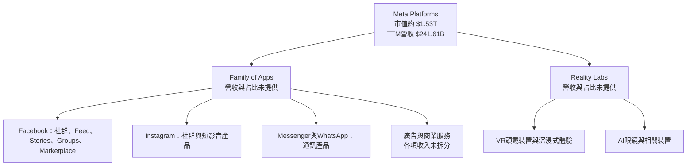
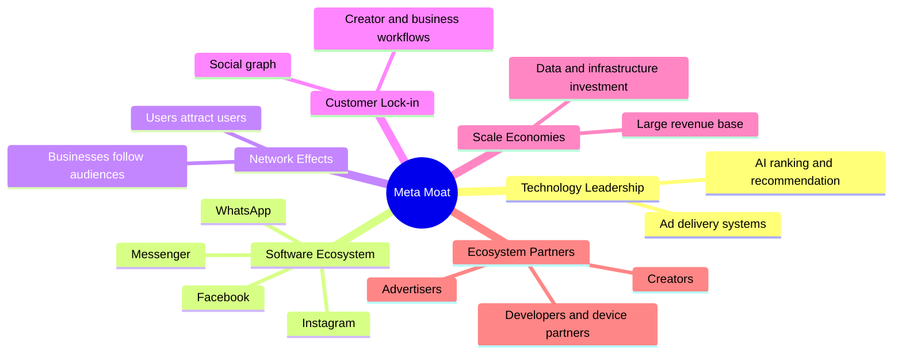
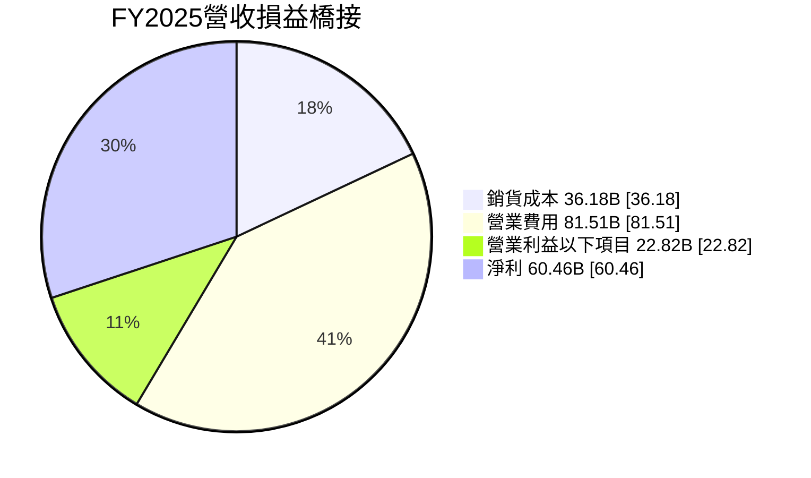
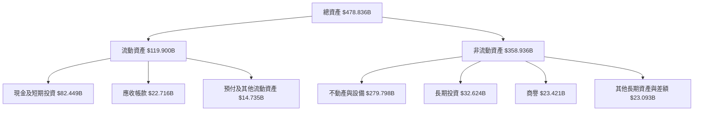
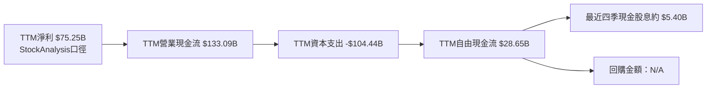
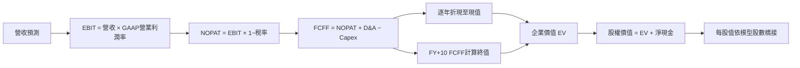
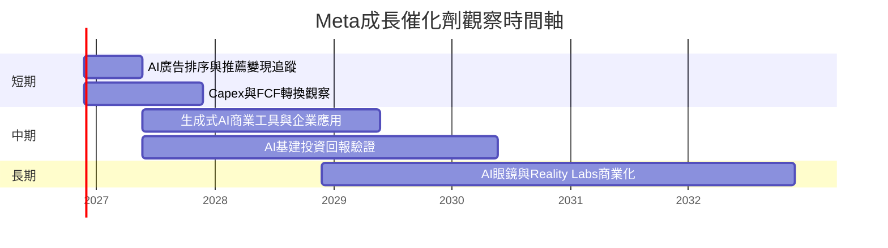
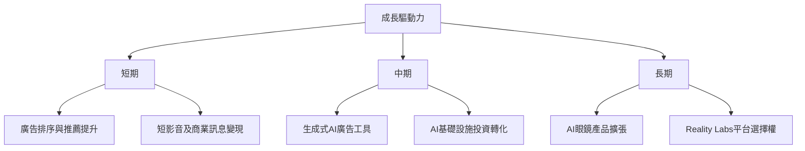
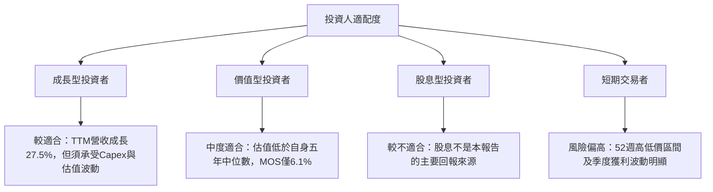

# META 基本面深度分析報告
> **報告日期**：2026-11-24 ｜ **語言**：繁體中文 ｜ **數據來源**：SEC 申報資料 (XBRL)、Yahoo Finance、Finviz、StockAnalysis、Roic.ai ｜ **分析師**：CFA 級機構研究

## 目錄

| # | 章節 | 核心結論 |
|---|------|----------|
| 1 | 執行摘要 | 持有；加權合理價值 $636.57，MOS 6.1% |
| 2 | 公司概覽與商業模式 | FoA 廣告與社交網絡為核心，細分營收占比未提供 |
| 3 | 損益表深度分析 | TTM 營收 $241.61B、成長 27.5%；最新季度營業利益率 20.1% |
| 4 | 資產負債表分析 | 依核實口徑淨負債 $1.22B，現金與短期投資 $82.45B |
| 5 | 現金流量深度分析 | TTM FCF $28.65B；巨額資本支出壓低現金轉換 |
| 6 | 獲利能力與資本效率 | ROIC 27.7% 高於 WACC 10.34%，仍創造股東價值 |
| 7 | 相對估值分析 | 自身估值低於五年中位數；同業估值分歧大 |
| 8 | DCF 內在價值評估 | 基準 DCF $579.16；估值高度依賴終值假設 |
| 9 | 成長催化劑 | AI 廣告、推薦系統與生成式 AI 產品是主要催化劑 |
| 10 | 風險矩陣 | AI 基建資本支出、監管、廣告週期為核心風險 |
| 11 | 投資建議 | 持有；等待估值折價擴大或現金流改善再加碼 |

## 1. 執行摘要

### 1.0 一頁式投資儀表板（Portfolio Manager 30 秒速讀）

| 項目 | 內容 |
|------|------|
| **投資論點（3 句）** | ① TTM 營收 $241.61B、年增 27.5%，廣告與推薦系統的規模效應仍支持成長。② TTM ROIC 27.7% 對比 WACC 10.34%，資本回報高於資金成本。③ TTM FCF 僅 $28.65B、FCF Yield 1.88%，主要因資本支出達 $104.44B，AI 基建投資回報仍待驗證。 |
| **綜合評分** | **7.1/10**（引用 1.1 評分卡） |
| **財務健康** | 🟡 核實口徑淨負債 $1.22B；現金及短期投資 $82.45B，但資料源的總債務口徑不一致 |
| **ROIC vs WACC** | **27.7% vs 10.34%**；目前創造股東價值 |
| **FCF 趨勢** | TTM FCF $28.65B，低於 FY2025 的 $46.11B；FCF Yield **1.88%** |
| **估值** | Forward P/E 16.75x ｜ EV/EBITDA（核實歷史比較口徑）14.8x ｜ FCF Yield 1.88% |
| **DCF 內在價值（基準）** | $579.16 ｜ 現價相對 DCF **溢價 3.2%**（折溢價公式見第 8 章） |
| **安全邊際（MOS）** | **+6.1%**＝($636.57 − $597.60) ÷ $636.57；🟡/🔴 交界，低於 10% |
| **預期報酬（基準情境 12M）** | **−3.1%**（採 DCF 基準情境價值 $579.16 相對現價） |
| **關鍵風險（前二）** | AI 基建投入長期高於現金流增長；最新季度營業利益率較 TTM 水準低 |
| **評級 + 信心度** | 🟡 **持有** ｜ 信心：中 |

### 1.1 綜合評分卡（全報告唯一）

| 維度 | 評分（1–10） | 主要依據（引用數字與其來源章節） |
|------|--------------|----------------------------------|
| 成長性 | 8.5 | TTM 營收年增 27.5%，最新季度營收年增 26.1%（第 3 章） |
| 獲利能力 | 8.0 | TTM 營業利益率 32.9%、ROIC 27.7%；Piotroski 3/8（第 3、6 章） |
| 財務健康 | 7.5 | 核實淨負債 $1.22B、現金及短期投資 $82.45B；DSO 34 天（第 4 章） |
| 估值 | 5.5 | MOS 6.1%；P/E 低於自身五年中位數，但 DCF 基準低於現價（第 7、8 章） |
| 護城河 | 8.5 | 多產品網絡與廣告觸及規模；TTM 營收 $241.61B，最新季度年增 26.1%（第 2 章） |
| 管理層與資本配置 | 4.5 | FY2025 SBC $20.43B；FY2025 Capex $69.69B，TTM Capex 已增至 $104.44B（第 3、5 章） |
| **綜合評分** | **7.1** | 六項算術平均：$(8.5+8.0+7.5+5.5+8.5+4.5)÷6=7.08$，四捨五入為 7.1 |

### 1.2 五大投資論點 + 三大核心風險

| 類型 | 項目 | 具體依據 | 信心度 |
|------|------|----------|--------|
| 🟢 **投資論點①** | 廣告主業仍具成長動能 | TTM 營收年增 27.5%，最新季度年增 26.1%；同業 GOOG 最新季度年增 24.7% | 🟢 高 |
| 🟢 **投資論點②** | 資本回報顯著高於資金成本 | ROIC 27.7%，WACC 10.34%，差距 17.36 個百分點 | 🟢 高 |
| 🟢 **投資論點③** | 自身估值低於五年中位數 | P/E 20.4x，低於五年中位數 24.5x；估值百分位 19% | 🟡 中 |
| 🟢 **投資論點④** | 現金與投資提供財務緩衝 | 現金及短期投資 $82.45B；核實淨負債僅 $1.22B | 🟢 高 |
| 🟢 **投資論點⑤** | AI 可改善廣告投放效率 | AI 推薦、排序與廣告工具可提升使用者參與及廣告轉換；具體增量營收未提供 | 🟡 中 |
| 🟡 **風險①** | 資本支出侵蝕自由現金流 | TTM Capex $104.44B，約為 TTM OCF $133.09B 的 78.5%；TTM FCF Yield 僅 1.88% | 🟡 中 |
| 🔴 **風險②** | 營業利潤率近期波動 | TTM 營業利益率 32.9%，最新季度僅 20.1%；若低利潤率延續，估值下修風險上升 | 🔴 高 |
| 🟡 **風險③** | 資料口徑與債務數字不一致 | 核實債務 $83.67B；其他市場資料列示 $114.84B，投資者須核對租賃負債等口徑 | 🟡 中 |

### 1.3 快速統計卡片

| 指標 | 公司實際值（期間） | 同業中位數 | 狀態 |
|------|--------------------|------------|------|
| 營收成長（TTM） | **27.5%** | — | 🟢 |
| 營收成長（最新一季年增） | **26.1%** | 14.3% | 🟢 |
| 毛利率（TTM） | **81.0%** | 60.9% | 🟢 |
| 營業利益率（TTM） | **32.9%** | — | 🟢 |
| ROIC（TTM） | **27.7%** | — | 🟢 |
| Forward P/E | **16.75x** | 7.5x | 🟡 |
| FCF Yield（TTM） | **1.88%** | — | 🔴 |
| Piotroski F-Score | **3 / 8** | — | 🔴 |

### 1.4 投資結論

```
╔══════════════════════════════════════════════════════════════════╗
║                    📊 投資結論摘要                               ║
╠══════════════════════════════════════════════════════════════════╣
║  評級：持有（依 MOS 規則；不作質化調整）                         ║
║  價格（2026-11-23 收盤）：$597.60                                ║
║  DCF 內在價值（基準）：$579.16（現價溢價 3.2%）                 ║
║  安全邊際 MOS：+6.1%（＝(加權合理價值−現價)÷加權合理價值）      ║
║  加權合理價值（8.8）：$636.57                                    ║
║  DCF 情境價值：                                                  ║
║    悲觀情境：$194.66（相對現價 -67.4%）                          ║
║    基準情境：$579.16（相對現價 -3.1%）                           ║
║    樂觀情境：$1,411.70（相對現價 +136.2%）                      ║
║  綜合評分：7.1/10（引用 1.1）                                    ║
║  適合投資人：可承受資本支出與估值波動的長線成長型投資人          ║
╚══════════════════════════════════════════════════════════════════╝
```

## 2. 公司概覽與商業模式

### 2.1 業務結構與收入來源

公司營運分為 Family of Apps（FoA）與 Reality Labs（RL）。財務資料未提供各部門營收、占比或利潤，因此不以推估值繪製部門占比圖。公司總 TTM 營收為 $241.61B。



FoA 的平台流量、使用者互動及廣告投放工具構成主要商業化基礎；RL 則承擔裝置與新平台投資。由於缺少部門收入和獲利資料，無法量化 RL 的虧損程度或 FoA 對總營收的精確貢獻。

### 2.2 市場份額

市場份額數據未提供。相對可比的規模指標是 META TTM 營收 $241.61B、最新季度營收年增 26.1%；GOOG 最新季度營收年增 24.7%，SNAP 與 PINS 分別為 14.3% 及 11.9%。這些數字說明 META 的營收成長較快，但不等同市場份額變化。

### 2.3 競爭護城河分析



### 2.4 護城河強度

| 護城河項目 | 強度（強／中／弱） | 證據（引用數字或事實） | 會削弱它的情況 |
|------------|--------------------|------------------------|----------------|
| 網路效應 | 強 | Facebook、Instagram、WhatsApp 等多產品跨市場營運；TTM 營收 $241.61B | 使用者轉向新平台、年輕族群參與下降 |
| 廣告投放與推薦技術 | 強 | TTM 毛利率 81.0%；AI 可用於內容排序和廣告投放 | 隱私限制、投放效果下降、競爭者提升推薦品質 |
| 規模效應 | 強 | TTM OCF $133.09B，可支撐龐大研發與基建投入 | Capex 長期上升且回報率降低 |
| 軟體生態系統 | 中至強 | 多個社交與通訊產品形成跨產品觸及 | 產品體驗惡化、平台政策降低開發者與創作者誘因 |
| 客戶鎖定 | 中 | 商家、創作者與使用者的社交關係及工具形成轉換成本 | 廣告預算轉移至其他平台、跨平台轉換成本下降 |
| 生態夥伴 | 中 | 廣告主、創作者、裝置與技術合作夥伴支援商業化 | 夥伴依賴單一平台下降或監管限制資料使用 |

**1.1 護城河分數 8.5/10**，反映多產品網絡與廣告平台的規模；但部門收入、使用者指標及廣告轉換數據缺漏，限制了對護城河變化的量化驗證。

## 3. 損益表深度分析

### 3.1 年度收入成長趨勢（近4年）

FY2022–FY2025 營收由 $116.61B 增至 $200.97B，三年 CAGR 約 19.9%，顯示 2022 年下滑後恢復成長。年度增長率依年度財務資料計算；CAGR 為首尾數值計算結果。

```
╔══════════════════════════════════════════════════════════════════╗
║              Meta 年度收入趨勢（FY2022-FY2025）                 ║
╠══════════════════════════════════════════════════════════════════╣
║  FY2022  $116.61B  ████████████░░░░░░░░░░░░  基期              ║
║  FY2023  $134.90B  ██████████████░░░░░░░░░░  YoY: +15.7% 🟢   ║
║  FY2024  $164.50B  █████████████████░░░░░░░  YoY: +21.9% 🟢   ║
║  FY2025  $200.97B  █████████████████████░░░  YoY: +22.2% 🟢   ║
║                                                                  ║
║  📊 FY2022-FY2025 營收 CAGR：約 +19.9%                           ║
╚══════════════════════════════════════════════════════════════════╝
```

2025 年營收增速高於 2023 年，與最新 TTM 27.5% 成長方向一致；這為 AI 廣告工具與短影音變現提供了較高的基期，但不代表未來能維持相同增速。

### 3.2 季度收入趨勢分析

| 季度 | 營收 | QoQ 成長 | YoY 成長 | 備註 |
|------|------|----------|----------|------|
| 2025 Q4 | $59.89B | +16.9% | +23.8% | 相較 2025 Q3 季節性回升 |
| 2026 Q1 | $56.31B | −6.0% | +33.1% | 季節性回落，但年增仍高 |
| 2026 Q2 | $60.80B | +8.0% | +28.0% | QoQ 回升 |
| 2026 Q3 | $64.60B | +6.3% | +26.1% | 成長仍快，但 YoY 低於 Q1、Q2 |

QoQ 由相鄰季度營收計算；季度收入有季節性，解讀應以 YoY 為主。最新季度營收 $64.60B 的年增率為 **單季 26.1%**，不是 TTM 成長率。

### 3.3 利潤率演變分析

| 利潤率指標 | FY2022 | FY2023 | FY2024 | FY2025 | 趨勢 | 評估 |
|------------|--------|--------|--------|--------|------|------|
| **毛利率** | 78.3% | 80.8% | 81.7% | 82.0% | 逐年改善 | 🟢 |
| **營業利益率** | 24.8% | 34.7% | 42.2% | 41.4% | 大幅回升後略降 | 🟢 |
| **淨利率** | 19.9% | 29.0% | 37.9% | 30.1% | FY2025 回落 | 🟡 |

年度毛利率與營業利益率依財務報表金額計算，2022 年毛利使用年度損益表所列 $91.36B。TTM 核實營業利益率為 32.9%，最新季度則為 20.1%，均低於 FY2024–FY2025 年度比率。差異可能反映期間組成、資料來源口徑與最新季度費用變化；現有資料不足以把變動精確歸因於單一成本項目。未來需觀察 AI 基建折舊、研發與人事支出是否持續壓低營業槓桿。

### 3.4 費用結構分析

以下依 FY2025 報表數字分解：銷貨成本＝營收減毛利；營業費用＝毛利減營業利益；營業利益以下項目＝營業利益減淨利。它是損益橋接，不代表各項都是同一性質的營業費用。



FY2025 研發支出 $57.37B，約占營收 28.5%。這代表 META 持續投入 AI、平台與硬體研發；其投資價值取決於能否轉化為廣告效率、收入增長或可持續產品營收。

### 3.5 季度 EPS 趨勢與盈餘品質（Quality of Earnings）

| 季度 | EPS 實際值 | EPS 年增率 | 超預期／不及預期 |
|------|------------|------------|------------------|
| 2025 Q4 | $8.88 | +10.7% | N/A（預估 EPS 缺漏） |
| 2026 Q1 | $10.44 | +62.4% | N/A（預估 EPS 缺漏） |
| 2026 Q2 | $6.18 | −13.4% | N/A（預估 EPS 缺漏） |
| 2026 Q3 | $3.83 | +264.8% | N/A（預估 EPS 缺漏） |

EPS 成長率沿用季度資料。2026 Q3 的同比高增長來自比較基期 EPS $1.05 偏低；不能因此直接推論當季經常性獲利加速。資料庫提供的四季 EPS 預估值為缺漏，故無法判定各季是否 beat 或 miss。

| 盈餘品質項目 | 數值／佔比 | 評估 |
|--------------|-----------|------|
| 股權薪酬 SBC / 營收 | FY2025：$20.43B ÷ $200.97B＝**10.2%** | 🟡 對股東有實質稀釋成本；年度 SBC 占營收仍高 |
| SBC / 營業現金流 | FY2025：$20.43B ÷ $115.80B＝**17.6%** | 🟡 現金流未扣 SBC，需將稀釋一併考慮 |
| FCF / 淨利（現金轉換率） | TTM：$28.65B ÷ StockAnalysis TTM 淨利 $75.25B＝**38.1%** | 🔴 Capex 高，會計盈餘尚未轉化為同等規模自由現金流 |
| 一次性／非經常性損益 | 未提供可核實明細 | N/A，無法量化當期一次性損益影響 |
| 有效稅率異常 | 最新年度有效稅率 **29.6%** | 估值模型採用該值；未提供更完整季度稅率橋接 |
| 資本化支出 vs 費用化 | TTM Capex $104.44B；FY2025 研發費用 $57.37B | Capex 主要形成長期資產，折舊會在後續期間進入費用；資本化比例明細未提供 |

**盈餘品質結論**：GAAP 營業利益已把 SBC 作為費用處理，但經營現金流對 SBC 有非現金加回效果；股東仍承受稀釋成本。TTM FCF 僅為淨利的約 38.1%，反映高資本支出是當前盈餘含金量的主要折扣項。估值應更重視資本支出正常化與現金流回收，而非只用 EPS 成長。

## 4. 資產負債表分析

### 4.1 資產結構分解

以下資產明細取自 StockAnalysis 2026-09-30 資產負債表；總資產 $478.836B，與其他資料源口徑可能不同。



### 4.2 流動性與營運資金分析

流動比率與速動比率採市場資料中的最新列示值；因來源期間及口徑未完整標示，與最新 TTM 營運資金天數分開解讀。

| 指標 | 最新值 | 評估 |
|------|--------|------|
| 流動比率 | 1.903x | 🟢 流動資產高於流動負債 |
| 速動比率 | 1.669x | 🟢 短期流動性有緩衝 |

| 指標 | 最新 TTM | 一年前 TTM | 變化 | 解讀 |
|------|----------|------------|------|------|
| DSO 應收帳款天數 | 34 天 | 33 天 | +1 天 | 略微延長；幅度小，需持續觀察收款周期 |
| DIO 存貨天數 | N/A | N/A | N/A | 公司未報告可用存貨餘額 |
| DPO 應付帳款天數 | 152 天 | N/A | N/A | 一年前數據缺漏，不能判斷趨勢 |
| CCC 現金轉換週期 | N/A | N/A | N/A | 因 DIO 缺漏而無法計算 |

### 4.3 債務結構分析

核實數據列示總債務 $83.67B、現金與短期投資 $82.45B。另一市場資料源列示總債務 $114.84B，可能涵蓋不同債務範圍；本報告的淨負債採核實數字，不將兩套口徑混用。

```
╔══════════════════════════════════════════════════════════════════╗
║                   Meta 債務健康診斷                              ║
╠══════════════════════════════════════════════════════════════════╣
║  核實總債務：       $83.67B                                       ║
║  現金及短期投資：   $82.45B                                       ║
║  淨現金／淨負債：   -$1.22B（淨負債）                            ║
║                                                                  ║
║  流動比率：         1.903x  🟢                                   ║
║  Debt/EBITDA：      N/A（債務與 EBITDA 口徑未能一致核對）         ║
║  利息保障倍數：     N/A（利息費用資料未提供）                     ║
║                                                                  ║
║  判讀：現金投資接近核實債務，整體短期償債壓力有限；              ║
║        但必須核對含不含融資租賃的債務口徑。                      ║
╚══════════════════════════════════════════════════════════════════╝
```

### 4.4 股東權益趨勢

| 財年 | 股東權益 | YoY 變化 | 解讀 |
|------|----------|----------|------|
| 2022 | $125.71B | — | 基期 |
| 2023 | $153.17B | +21.8% | 盈利與累積權益推升 |
| 2024 | $182.64B | +19.2% | 持續增長 |
| 2025 | $217.24B | +19.0% | 權益增加，但仍須同時觀察回購與 SBC 稀釋 |

## 5. 現金流量深度分析

### 5.1 現金流量瀑布圖



淨利至營業現金流間包含折舊、SBC、營運資金等調整；因此圖中連線表示現金流關係，不是逐項加減的完整調節表。回購金額與期末淨現金變化資料未提供。

### 5.2 FCF 轉換率趨勢

| 財年 | OCF | Capex | FCF | 淨利 | FCF / 淨利 |
|------|-----|-------|-----|------|------------|
| 2022 | $50.48B | $31.19B | $19.29B | $23.20B | 83.1% |
| 2023 | $71.11B | $27.05B | $44.07B | $39.10B | 112.7% |
| 2024 | $91.33B | $37.26B | $54.07B | $62.36B | 86.7% |
| 2025 | $115.80B | $69.69B | $46.11B | $60.46B | 76.3% |
| TTM 至 2026-09-30 | $133.09B | $104.44B | $28.65B | $75.25B | 38.1% |

2023–2024 年 FCF 曾高於 FY2022，但 FY2025 起 Capex 上升，TTM FCF 進一步降至 $28.65B。TTM 現金轉換弱化主要反映投資支出增加；如果支出未帶來收入與生產力回報，FCF Yield 會持續受壓。

### 5.3 自由現金流趨勢

```text
╔══════════════════════════════════════════════════════════════════╗
║                 自由現金流與現金流收益率                         ║
╠══════════════════════════════════════════════════════════════════╣
║  FY2022  $19.29B  ███████░░░░░░░░░░░░░░  FCF/NI 83.1%          ║
║  FY2023  $44.07B  ████████████████░░░░░  FCF/NI 112.7%         ║
║  FY2024  $54.07B  ████████████████████░  FCF/NI 86.7%          ║
║  FY2025  $46.11B  █████████████████░░░░  FCF/NI 76.3%          ║
║  TTM     $28.65B  ███████████░░░░░░░░░░  FCF Yield 1.88%       ║
╠══════════════════════════════════════════════════════════════════╣
║  TTM Capex $104.44B，已吸收約 78.5% 的 TTM 營業現金流          ║
╚══════════════════════════════════════════════════════════════════╝
```

### 5.4 資本配置評估

FY2025 資本配置數字顯示，Capex $69.69B、股息支付 $5.32B、SBC $20.43B；回購、現金留存的精確金額未提供，故不繪製比例圓餅圖。

| 項目 | 可用數據 | 評估 |
|------|----------|------|
| 資本支出 | FY2025 $69.69B；TTM $104.44B | 🔴 投資強度快速上升，應以回報率與 FCF 追蹤 |
| 現金股息 | FY2025 $5.32B | 🟢 相對現金流規模可承受 |
| SBC | FY2025 $20.43B | 🟡 需將稀釋成本納入股東回報評估 |
| 股票回購 | N/A（金額未提供） | 無法評估回購是否抵銷 SBC 稀釋 |
| 留存現金 | N/A（完整資金來源用途未提供） | 不以餘額推算 |

## 6. 獲利能力與資本效率

### 6.1 ROE / ROA / ROIC 趨勢

| 期間 | ROE | ROA | ROIC | 評估 |
|------|-----|-----|------|------|
| 2016 | N/A | N/A | 19.56% | ROIC 歷史數據 |
| 2017 | N/A | N/A | 23.31% | ROIC 歷史數據 |
| 2018 | N/A | N/A | 27.20% | ROIC 歷史數據 |
| TTM 至 2026-09-30 | 27.6% | N/A | 27.7% | ROIC 高於 WACC |

ROIC 歷史數字取自 Roic.ai，與最新 TTM 計算口徑可能不同；沒有可比的歷年 ROE、ROA 資料，因此不補填。最新 TTM ROIC 高於資金成本，是資本配置創造價值的直接證據。

### 6.2 ROIC vs WACC 分析（核心價值創造判斷）

```
╔══════════════════════════════════════════════════════════════════╗
║                 ROIC vs WACC 深度分析                            ║
╠══════════════════════════════════════════════════════════════════╣
║  WACC（資本成本，採核實輸入）：                                  ║
║  ├── 無風險利率（10Y美債）：4.92%                               ║
║  ├── 股權風險溢酬：5.00%                                        ║
║  ├── 原始 Beta：1.28；採用調整 Beta：1.19                       ║
║  ├── 股權成本：10.85%                                           ║
║  ├── 稅前債務成本：1.39%；有效稅率：29.6%                       ║
║  ├── 股權／債務權重：94.8%／5.2%                                ║
║  └── WACC：10.34%                                               ║
║                                                                  ║
║  ROIC：27.7%                                                     ║
║  EVA利差 = ROIC − WACC = 27.7% − 10.34% = +17.36個百分點       ║
║                                                                  ║
║  ROIC 27.7%  ▓▓▓▓▓▓▓▓▓▓▓▓▓▓▓▓▓▓▓▓▓▓▓▓▓▓░░░░░░ 🟢            ║
║  WACC 10.34% ▓▓▓▓▓▓▓▓▓▓░░░░░░░░░░░░░░░░░░░░░░ ──              ║
║                                                                  ║
║  結論：ROIC約為WACC的2.68倍，當前投入資本仍在創造價值。       ║
╚══════════════════════════════════════════════════════════════════╝
```

ROIC/WACC 比值計算：$27.7\%÷10.34\%=2.68$。ROIC 的定義為稅後營業利益除以（權益＋債務−現金），沿用核實口徑；此處不以其他報表中的總債務替代。

### 6.3 杜邦三因素分解

| 因素 | 數值（TTM） | 解讀 |
|------|-------------|------|
| 淨利率 | 31.1% | 高毛利廣告平台及成本結構支持獲利 |
| 資產週轉率 | 0.50x | 每單位資產產生約 0.50 倍收入 |
| 權益乘數 | 1.76x | 槓桿有貢獻，但不是 ROE 的唯一來源 |
| **ROE** | **27.6%** | 31.1% × 0.50 × 1.76 ≈ 27.6% |

杜邦三因素採 QUALITY FIGURES 原值。ROE 主要由淨利率和資產效率共同支撐，權益乘數並非主要驅動。

### 6.4 財務體質：Piotroski F-Score

**Piotroski F-Score：3 / 8**。九項檢查中，毛利率比較因資料缺漏不計分，故有效分母為八項。

| 測試 | 結果 | 解讀 |
|------|------|------|
| ROA > 0 | ✅ 通過 | 盈利資產報酬為正 |
| 營業現金流 > 0 | ✅ 通過 | TTM OCF $133.09B |
| ROA 高於一年前 | ❌ 未通過 | 盈利資產效率未勝過比較期 |
| 營業現金流 > 淨利（應計品質） | ✅ 通過 | 現金流仍高於淨利 |
| 長期負債 ÷ 總資產低於一年前 | ❌ 未通過 | 槓桿指標未改善 |
| 流動比率高於一年前 | ❌ 未通過 | 流動性比率未改善 |
| 稀釋股數未增加 | ❌ 未通過 | SBC 等因素使股數測試未通過 |
| 毛利率高於一年前 | — 無法判定 | 比較所需輸入缺漏 |
| 資產週轉率高於一年前 | ❌ 未通過 | 資產使用效率未改善 |

3/8 代表若干短期資產效率及槓桿方向未改善，與 ROIC 仍高的長期獲利能力並不矛盾；F-Score 是趨勢篩選，不是公司價值的單一判斷。

## 7. 相對估值分析

### 7.1 同業估值比較表格

| 估值指標 | **META** | **GOOG** | **SNAP** | **PINS** | META 評估 |
|----------|----------|---------|---------|---------|-----------|
| **Trailing P/E** | 20.4x | 14.6x | N/A | 70.4x | 🟡 介於 GOOG 與 PINS 之間 |
| **Forward P/E** | 16.75x | 18.3x | 6.3x | 7.5x | 🟡 高於同業中位數 7.5x；同業盈利結構差異大 |
| **P/S Ratio** | 6.4x | 7.3x | 1.3x | 2.1x | 🟢 相較 GOOG 折價，但高於 SNAP、PINS |
| **EV/EBITDA** | 14.8x | 18.0x | 52.0x | 31.8x | 🟢 低於列示三家同業 |
| **最新季度營收年增** | 26.1% | 24.7% | 14.3% | 11.9% | 🟢 成長高於同業 |
| **毛利率（TTM）** | 81.0% | 60.9% | 59.2% | 79.0% | 🟢 高於三家同業 |

Peer multiples 採 Yahoo Finance 數值。META Forward P/E 採市場估值資料；META EV/EBITDA 比較採五年估值序列中的當前值 14.8x，以符合同一核實估值口徑。SNAP 盈利為 N/A，故不以其 TTM P/E 作比較。由於不同公司業務組合、盈利階段及倍數來源可能不同，單一倍數不宜直接視為公平價值。

### 7.2 歷史估值區間分析

```
╔══════════════════════════════════════════════════════════════════╗
║                 META 五年估值區間與目前位置                     ║
╠══════════════════════════════════════════════════════════════════╣
║  P/E       12.9x ───────── 20.4x ───────── 33.4x               ║
║                         現值百分位：19%                          ║
║               五年中位數：24.5x                                 ║
║                                                                  ║
║  P/S        2.8x ───────── 6.4x ────────── 10.6x               ║
║                         現值百分位：38%                          ║
║               五年中位數：7.7x                                  ║
║                                                                  ║
║  EV/EBITDA  7.7x ───────── 14.8x ───────── 19.7x               ║
║                         現值百分位：33%                          ║
║               五年中位數：16.5x                                 ║
╚══════════════════════════════════════════════════════════════════╝
```

P/E、P/S、EV/EBITDA 均低於自身五年中位數，估值相對歷史偏低；但當前 FCF Yield 只有 1.88%，且最新季度營業利益率下滑，使低歷史百分位不等於低風險。

### 7.3 情境價值（Bear / Base / Bull，照抄 DCF MODEL 的 Scenarios）

| 情境 | 第 1 年營收成長 | 期末營業利潤率 | WACC | 每股價值 | 相對現價 | 機率 | 會發生的條件 |
|------|----------------|----------------|------|----------|----------|------|--------------|
| 🔴 悲觀 | 13.8% | 29.5% | 11.34% | $194.66 | −67.4% | 25% | 廣告成長降速、AI 投資支出持續增加、利潤率長期下滑 |
| 🟡 基準 | 27.5% | 34.7% | 10.34% | $579.16 | −3.1% | 50% | 廣告增長維持，Capex 比率逐年降至模型終點假設 |
| 🟢 樂觀 | 41.3% | 38.1% | 9.34% | $1,411.70 | +136.2% | 25% | AI 商業化帶來額外增長，利潤率擴張且資金成本下降 |

以上情境輸入及估值照錄模型輸出；細分情境的終年營收、FCFF 中間值未提供，因此不自行重建情境模型。概率加權值為 $691.17，僅作情境參考，不取代基準 DCF 或第 8.8 節加權合理價值。

### 7.4 相對估值隱含價格區間

```
╔══════════════════════════════════════════════════════════════════╗
║            估值方法隱含價值與市場價格位置                       ║
╠══════════════════════════════════════════════════════════════════╣
║  $265.82 ─── $579.16 ── $597.60 ─── $845.38 ─── $1,015.66      ║
║  同業P/E       DCF       現價       分析師共識      EV/EBITDA    ║
╚══════════════════════════════════════════════════════════════════╝
```

| 方法 | 隱含每股價值 | 依據 |
|------|--------------|------|
| 同業 Forward P/E | $265.82 | GOOG、SNAP、PINS Forward P/E 中位數 7.5x × META Forward EPS $35.68 |
| 同業 EV/EBITDA | $1,015.66 | GOOG、PINS EV/EBITDA 中位數 24.9x × META TTM EBITDA，加回淨現金 |
| 分析師共識 | $845.38 | 58 位分析師平均目標價 |
| DCF 基準 | $579.16 | 10 年 FCFF、WACC 10.34%、永續成長率 3.0% |

同業 EV/EBITDA 與 Forward P/E 回推的價值差距極大，顯示相對估值結果高度依賴選用倍數及同業盈利結構；第 8.8 節依固定方法權重整合，不以單一高估值方法主導結論。

## 8. DCF 內在價值評估（Discounted Cash Flow）

### 8.0 估值推理鏈（Thinking Logic：在算之前先想清楚）

**Step 1 — 價值由哪些變數決定？**  
模型價值可理解為「FoA 廣告及應用平台現金流底盤＋AI 廣告效率帶來的增長與利潤率變化＋RL 等新業務的選擇權」。目前缺少 FoA、RL 的分部營收與利潤，不能虛構各自占比。估值主導變數是終值現金流、Capex 正常化幅度與 WACC；這與敏感度表中 WACC、永續成長率變動造成的估值幅度一致。

**Step 2 — 模型選擇**

| 決策點 | 本報告採用 | 理由 | 曾考慮但否決 | 否決理由 |
|--------|-----------|------|--------------|----------|
| 現金流定義 | FCFF | 以 WACC 折現，先得企業價值再橋接股權價值 | FCFE | 模型已固定使用 FCFF，避免自行更換方法 |
| 預測期 N | 10 年 | 模型預測期固定 10 年，收入增速由 27.5% 線性淡化至 3.0% | 短期預測期 | 無法保留模型內既定的長期增速淡化路徑 |
| 終值方法 | Gordon Growth | 模型以永續成長率 3.0% 計算 | 退出倍數 | DCF MODEL 未提供退出倍數終值，不能自建替代模型 |
| EBIT 基礎 | GAAP EBIT | 模型明確採 GAAP EBIT，包含 SBC 費用 | 非 GAAP EBIT | 會把已費用化的 SBC 加回，與指定模型不相容 |

**Step 3 — 高／中敏感度假設推導**

- **營收成長路徑**：錨點＝TTM 營收年增 27.5%、最新季度年增 26.1% → 模型採第 1 年 27.5%，線性降至第 10 年 3.0% → 採用模型原值 → 否決永遠維持 27.5%，因為十年期高增長不宜視為無限延續；也不把單季成長率誤當 TTM。
- **期末營業利益率**：錨點＝TTM 32.9% → 模型第 1 年 32.9%，逐步升至第 10 年 34.7%，錨定最近五財年中位數（含 TTM）→ 採用 34.7% → 否決以最新季度 20.1% 直接代表十年終值，因單季值可能受期間費用與業務波動影響；但若低利潤率持續，基準假設偏樂觀。
- **永續成長率 g**：錨點＝長期成熟企業須低於 WACC；資料包模型採 3.0% → WACC 10.34% 下仍有正利差 → 採用 3.0% → 否決高於 WACC 的假設，因 Gordon Growth 公式會失效；沒有足夠資料支持再提高 g。
- **預測期 N**：錨點＝模型指定 10 年，且營收增速 27.5% 淡化至 3.0% → 採用 10 年 → 否決縮短期限的自行建模，因會改變模型輸出，且不符合固定模型要求。
- **Capex / 營收**：錨點＝TTM Capex 約占 TTM 營收 43.2% → 模型第 1 年 43.2%，降至第 10 年 11.3% → 採用模型原值 → 否決永久維持 43.2%，因其高於折舊率的終端再投資強度不適合永久外推；同時，降至 11.3% 是估值偏樂觀的重要假設。
- **EBIT、SBC 與股數**：採 **(A) GAAP EBIT + 固定股數**；模型 EBIT 已含 SBC 費用，不再扣 SBC，也不再加年稀釋率。這是模型指定的組合，SBC 影響在此處計入一次。
- **終值方法**：採用 Gordon Growth；FY+10 FCFF 為基礎，g=3.0%。模型未提供可交叉驗證的退出倍數，因此不補造倍數或終值。
- **WACC**：採核實 WACC 10.34%；由 4.92% 無風險利率、調整 Beta 1.19、ERP 5.00%、稅前債務成本 1.39% 與資本權重構成。否決自行另算 WACC，以免與 ROIC 對照及固定 DCF 模型不一致。

**Step 4 — 最脆弱一環**  
最脆弱的假設是 Capex/營收從 TTM 43.2% 降至第 10 年 11.3%；若高投資強度延續，FCFF 及終值都會下降，基準價值會低於 $579.16。模型敏感度表顯示在基準 g 下 WACC 從 10.34% 升至 11.34%，每股值由 $579.16 降至 $478.29。

**Step 5 — 計算路徑圖**



### 8.1 模型假設總表（Model Inputs）

| 假設項目 | 採用值 | 依據／來源 | 敏感度 |
|----------|--------|-------------|--------|
| 預測期長度 **N** | 10 年 | 固定 DCF 模型；由第 1 年增長淡化至第 10 年 | 🟡 中 |
| 營收成長路徑 | 第 1 年 27.5% → 第 10 年 3.0% | TTM 成長 27.5%，逐年線性淡化 | 🔴 高 |
| 營業利潤率 | 第 1 年 32.9% → 第 10 年 34.7% | TTM 32.9%；終點取最近五財年中位數 | 🔴 高 |
| 有效稅率 | 29.6% | 最新年度有效稅率 | 🟢 低 |
| Capex / 營收 | 第 1 年 43.2% → 第 10 年 11.3% | TTM 起點，向模型指定終點淡化 | 🔴 高 |
| D&A / 營收 | 10.3% | TTM 比率固定 | 🟢 低 |
| 營運資金變動 | 未建模 | DCF MODEL 明示 working capital is not modelled | 🟢 低／未納入 |
| EBIT 基礎 | GAAP | 模型使用 GAAP EBIT | 🟡 中 |
| 股權薪酬 SBC 處理 | 不另扣 SBC | GAAP EBIT 已含 SBC 費用 | 🟡 中 |
| 年稀釋率 | 0% | 模型採固定股數的組合 (A) | 🟡 中 |
| 永續成長率 g | 3.0% | DCF 模型假設，低於 WACC | 🔴 高 |
| 終值方法 | Gordon Growth | 固定 DCF 模型設定；未提供退出倍數法終值 | 🔴 高 |
| WACC | 10.34% | 核實資本成本資料 | 🔴 高 |

模型 FCFF 定義為 **NOPAT + D&A − Capex**；營運資金不建模，故不加減 ΔWC。固定股數以模型的每股價值換算方法為準；其隱含股數與股數來源沒有另行列在 DCF MODEL 中，見 8.5 局限說明。

### 8.2 折現率推導（WACC）

原始 Beta 1.28，調整 Beta 為 $⅔×1.28+⅓×1=1.19$。此為模型提供的調整方式。無風險利率採資料所列 10 年期美債 4.92%；觀察日期未列，故不自行補日期。ERP 5.00% 為模型假設值；未提供額外規模或國別溢酬，採 0%。

```
╔══════════════════════════════════════════════════════════════════╗
║                    WACC 推導（折現率）                           ║
╠══════════════════════════════════════════════════════════════════╣
║  股權成本 Ke（CAPM）：                                           ║
║  ├── 無風險利率 Rf：4.92%                                       ║
║  ├── 市場風險溢酬 ERP：5.00%                                     ║
║  ├── 原始 Beta：1.28；調整 Beta：1.19                            ║
║  ├── 額外規模／國別溢酬：0%                                      ║
║  └── Ke = 4.92% + 1.19 × 5.00% = 10.87%（提供值 10.85%）        ║
║                                                                  ║
║  債務成本 Kd：                                                   ║
║  ├── 稅前 Kd：1.39%（核實值；利息金額未提供）                   ║
║  ├── 有效稅率：29.6%                                             ║
║  └── 稅後 Kd = 1.39% × (1 − 29.6%) = 0.9786%                    ║
║                                                                  ║
║  資本結構權重：股權 94.8%；債務 5.2%                             ║
║  └── WACC = 94.8% × Ke + 5.2% × 稅後Kd = 10.34%（採用值）       ║
╚══════════════════════════════════════════════════════════════════╝
```

**逐步演算（WACC）**

1. **Ke（CAPM）**：用顯示值重算，$4.92\%+1.19×5.00\%=10.87\%$；核實資料所列 Ke 為 **10.85%**。差異源於調整 Beta 與輸入未四捨五入精度未提供，估值採核實 Ke 10.85%。
2. **稅前 Kd**：核實值 **1.39%**；利息費用及平均計息負債明細未提供，不能重建分子與分母。
3. **稅後 Kd**：$1.39\%×(1−29.6\%)=0.9786\%\approx0.98\%$。
4. **權重**：核實股權權重 **94.8%**，債務權重 **5.2%**；兩者合計 $94.8\%+5.2\%=100.0\%$。市值按 2026-11-23 收盤價計算的細部股數基礎與債務口徑未提供可重建表，故沿用模型權重。
5. **WACC**：使用核實 WACC **10.34%**。以四捨五入輸入手算會有細微差異；本報告不另改 WACC，並與第 6.2 節一致。

### 8.3 逐年自由現金流預測（基準情境）

金額單位為美元十億元；依模型原值列示。四捨五入：金額兩位小數、百分比一位小數、折現因子三位小數。模型不含營運資金變動，也不另扣 SBC。

| 年度 | FY+1 | FY+2 | FY+3 | FY+4 | FY+5 | FY+6 | FY+7 | FY+8 | FY+9 | FY+10 |
|------|------|------|------|------|------|------|------|------|------|-------|
| 營收 | 308.11 | 384.52 | 469.41 | 560.24 | 653.38 | 744.20 | 827.37 | 897.28 | 948.65 | 977.11 |
| 營收 YoY | 27.5% | 24.8% | 22.1% | 19.4% | 16.6% | 13.9% | 11.2% | 8.5% | 5.7% | 3.0% |
| 營業利潤率 | 32.9% | 33.1% | 33.3% | 33.5% | 33.7% | 33.9% | 34.1% | 34.3% | 34.5% | 34.7% |
| 營業利益 EBIT（GAAP） | 101.23 | 127.10 | 156.10 | 187.43 | 219.90 | 251.95 | 281.76 | 307.37 | 326.86 | 338.62 |
| − 稅 | (30.01) | (37.68) | (46.28) | (55.56) | (65.19) | (74.69) | (83.53) | (91.12) | (96.90) | (100.38) |
| = NOPAT | 71.22 | 89.43 | 109.83 | 131.87 | 154.71 | 177.26 | 198.24 | 216.25 | 229.97 | 238.24 |
| + D&A | 31.78 | 39.66 | 48.42 | 57.78 | 67.39 | 76.76 | 85.34 | 92.55 | 97.85 | 100.78 |
| − Capex | (133.19) | (152.59) | (169.65) | (182.64) | (189.85) | (189.88) | (181.79) | (165.37) | (141.24) | (110.86) |
| − ΔWC | 未建模 | 未建模 | 未建模 | 未建模 | 未建模 | 未建模 | 未建模 | 未建模 | 未建模 | 未建模 |
| **= FCFF** | **−30.18** | **−23.51** | **−11.41** | **7.02** | **32.25** | **64.14** | **101.78** | **143.43** | **186.58** | **228.16** |
| 折現因子 @10.34% | 0.906 | 0.821 | 0.744 | 0.675 | 0.612 | 0.554 | 0.502 | 0.455 | 0.413 | 0.374 |
| **FCFF 現值 PV** | **−27.36** | **−19.31** | **−8.49** | **4.73** | **19.72** | **35.55** | **51.13** | **65.30** | **76.99** | **85.33** |

**預測期 FCF 現值合計**：  
$-27.36+(-19.31)+(-8.49)+4.73+19.72+35.55+51.13+65.30+76.99+85.33=\mathbf{283.59B}$。  
模型列示合計 **$283.58B**，差額 $0.01B（約 0.004%），屬各年顯示值四捨五入尾差；採用模型合計 $283.58B。

**逐步演算（FY+1）**

1. 營收：$241.61×(1+27.5\%)=308.05B$；模型列示 $308.11B$，差額來自未四捨五入的輸入與顯示精度。
2. EBIT：模型列示 **$101.23B**；按顯示營收與 32.9% 重算為約 $101.37B，模型細部輸入精度未提供。
3. 稅：模型列示 **$30.01B**；按顯示 EBIT × 29.6% 為約 $29.96B。
4. NOPAT：$101.23−30.01=\mathbf{71.22B}$。
5. D&A：模型列示 **$31.78B**。
6. Capex：模型列示 **$133.19B**。
7. ΔWC：模型明示不建模，故沒有扣項。
8. FCFF：以模型內未四捨五入數字計算，模型列示 **−$30.18B**；用表內兩位小數重算會產生不超過 $0.01B 的尾差。
9. 折現因子：$1÷(1+10.34\%)^1=0.906$；PV：模型列示 **−$30.18×0.906=−$27.36B**（依未四捨五入現金流計算）。

> 模型公布的逐年數字並非全以表內已四捨五入的營收、比率重新計算；因此表中個別乘積會出現小額尾差。缺少未四捨五入輸入時，不以自算數值替換程式模型。

**合理性自檢**

- 近期年度 FCF：FY2022 $19.29B、FY2023 $44.07B、FY2024 $54.07B、FY2025 $46.11B；TTM $28.65B。模型 FCFF 由前 3 年負值轉正，不宜直接用首尾計算正向 CAGR。
- FY+10 FCFF 利潤率：$228.16÷977.11=23.4\%$；目前 TTM FCF/營收為 $28.65÷241.61=11.9\%$。同業最佳值未提供，不能做同業極值比較。
- FY+1 至 FY+3 FCFF 為負，主要因 Capex 高於 NOPAT 加 D&A；這些負值已納入現值合計，不應忽略。

```
╔══════════════════════════════════════════════════════════════════╗
║            自由現金流：歷史實際 vs 模型預測                      ║
╠══════════════════════════════════════════════════════════════════╣
║  FY2023(實)  $44.07B  █████████░░░░░░░░░░░░  FCF/NI 112.7%     ║
║  FY2024(實)  $54.07B  ███████████░░░░░░░░░░  FCF/NI 86.7%      ║
║  FY2025(實)  $46.11B  █████████░░░░░░░░░░░░  FCF/NI 76.3%      ║
║  FY+1 (預)   -$30.18B  負值                                     ║
║  FY+10(預)   $228.16B  ████████████████████  FCF率 23.4%        ║
╠══════════════════════════════════════════════════════════════════╣
║  預測前期 FCFF 為負；遠期價值依賴 Capex 率大幅回落。            ║
╚══════════════════════════════════════════════════════════════════╝
```

### 8.4 終值計算（Terminal Value）

**適用性檢查**：WACC **10.34%** vs g **3.0%** → WACC > g？✅

| 方法 | 計算式 | 終值 TV | TV 現值 | 佔總 EV 比重 |
|------|--------|---------|---------|--------------|
| Gordon Growth | FY+10 FCFF × (1+g) ÷ (WACC−g) | $3,203.68B | $1,198.10B | 80.9% |
| 退出倍數法 | DCF MODEL 未提供 | N/A | N/A | N/A |

**逐步演算**

1. FY+N FCFF：FY+10 為 **$228.16B**。
2. 分子：$228.16×(1+3.0\%)$；模型列示終值依未四捨五入現金流與折現率計算。
3. 分母：顯示值 $10.34\%−3.0\%=7.34\%$；模型列示 Gordon Growth TV 為 **$3,203.68B**。以顯示至兩位小數的 WACC 反算會有小額尾差，採用模型原值。
4. PV(TV)：模型列示 $3,203.68×0.374=\mathbf{1,198.10B}$；相乘差異在顯示精度尾差內。
5. 終值佔比：$1,198.10÷1,481.69=80.9\%$。

⚠️ 終值現值占 EV **80.9%**，本估值高度依賴終值假設，短期現金流貢獻有限。

### 8.5 企業價值 → 每股內在價值（Bridge）

```
╔══════════════════════════════════════════════════════════════════╗
║              企業價值 → 每股內在價值 橋接表                      ║
╠══════════════════════════════════════════════════════════════════╣
║  預測期 FCF 現值合計            +$283.58B                        ║
║  終值現值 PV(TV)                +$1,198.10B                      ║
║  = 企業價值 EV                    $1,481.69B                      ║
║  + 淨現金（淨負債為負）            -$1.22B                        ║
║  = 股權價值                       $1,480.47B                      ║
║  每股價值：模型股權價值與價格／市值換算                             ║
║  ★ 每股內在價值                   $579.16                         ║
║    現價（2026-11-23）              $597.60                         ║
║    折溢價                         +3.2%（現價溢價）              ║
╚══════════════════════════════════════════════════════════════════╝
```

1. EV：$283.58B+$1,198.10B=$1,481.68B；模型列示 **$1,481.69B**，差 $0.01B 為四捨五入尾差。
2. 股權價值：$1,481.69B−$1.22B=$1,480.47B。
3. 每股內在價值：模型算式為「股權價值 × 價格 ÷ 市值」，模型原值 **$579.16**；股數換算細節未單獨提供，故不另以不一致的股數來源替換。
4. 折溢價：$(597.60÷579.16)−1=3.18\%\approx\mathbf{3.2\%}$。
5. 本節不計算 MOS；MOS 固定以 8.8 加權合理價值為分母。

模型橋接採現金及債務淨額 **−$1.22B**，取自 2026-09-30 核實口徑；每股換算採模型原值。最新稀釋股數的精確定義與 DCF 隱含股數未提供，因此每股價值只能沿用核實模型結果。

### 8.6 敏感性分析（WACC × 永續成長率）

括號為相對現價 $597.60 的上行空間；敏感度矩陣照錄 DCF MODEL。基準格為 WACC 10.34%、g 3.0%。

| g（列）／WACC（欄） | 8.34% | 9.34% | **10.34%（基準）** | 11.34% | 12.34% |
|-----------|------|------|------------------|-------|-------|
| **2.0%** | $776.42（+29.9%） | $628.73（+5.2%） | $518.92（−13.2%） | $434.66（−27.3%） | $368.37（−38.4%） |
| **2.5%** | $835.14（+39.8%） | $668.59（+11.9%） | $547.12（−8.4%） | $455.24（−23.8%） | $383.78（−35.8%） |
| **3.0%（基準）** | $904.87（+51.4%） | $714.74（+19.6%） | **$579.16（−3.1%）** | $478.29（−20.0%） | $400.84（−32.9%） |
| **3.5%** | $989.02（+65.5%） | $768.81（+28.6%） | $615.88（+3.1%） | $504.29（−15.6%） | $419.83（−29.8%） |
| **4.0%** | $1,092.57（+82.8%） | $833.00（+39.4%） | $658.41（+10.2%） | $533.83（−10.7%） | $441.10（−26.2%） |

**逐步演算示範**：選格 WACC **11.34% > g 3.0% ✅**。  
模型敏感度中，該格每股價值為 **$478.29**。逐年 FCFF 不變，折現率提高後需重算預測期 PV 與終值 PV；這些中間值未在核實模型輸出中逐格列示，為避免自行重建模型，直接引用矩陣的逐股結果，不偽造中間計算。

**三情境 DCF（模型值照錄）**

| 情境 | 營收假設 | 期末營業利潤率 | g | WACC | 每股內在價值 | 相對現價 | 機率 |
|------|----------|----------------|---|------|--------------|----------|------|
| 🔴 悲觀 | 第 1 年成長 13.8% | 29.5% | 情境模型未列 | 11.34% | $194.66 | −67.4% | 25% |
| 🟡 基準 | 第 1 年成長 27.5% | 34.7% | 3.0% | 10.34% | $579.16 | −3.1% | 50% |
| 🟢 樂觀 | 第 1 年成長 41.3% | 38.1% | 情境模型未列 | 9.34% | $1,411.70 | +136.2% | 25% |
| **機率加權** | — | — | — | — | **$691.17** | **+15.7%** | **100%** |

情境細部終年營收、FCFF、終值中間值及悲觀／樂觀永續成長率未提供，不能自行補算；情境價值與假設照錄模型。機率加權：$194.66×25\%+$579.16×50\%+$1,411.70×25\%=$691.17$。

**敏感度結論**

- g 在 WACC 10.34% 時由 2.0% 升至 3.0%：$518.92→$579.16，增加 **$60.24，約 +11.6%**。
- WACC 在 g 3.0% 時由 10.34% 升至 11.34%：$579.16→$478.29，減少 **$100.87，約 −17.4%**。
- 期末營業利潤率每 +1pp 的單獨敏感度未提供，標示 **N/A（模型未提供單變數敏感度）**。
- WACC 的一個百分點變動對模型價值的影響，大於已列示的 g 1pp 變動；與 8.0 指出 WACC、終值及 Capex 路徑是估值脆弱點一致。

### 8.7 反推 DCF（Reverse DCF：市場在預期什麼）

核實反推 DCF 只提供兩個單變數解：第 1 年營收成長率與固定營業利潤率。其餘固定輸入的逐項反推表及疊代軌跡未提供，因此不虛構試算過程。

| 求解的變數 | 其餘變數設定 | 市場隱含值 | 基準值／比較值 | 判斷 |
|------------------------|--------------|--------------|--------------|------|
| 第 1 年營收成長率 | 其餘採基準模型 | 28.3% | 基準 27.5%；TTM 成長 27.5% | 🟡 現價要求略高於基準 |
| 固定營業利潤率 | 其餘採基準模型 | 35.1% | 模型由 32.9% 漸升至 34.7% | 🟡 略高於模型終點 |
| 永續成長率 g | N/A | 未計算 | N/A | 模型未提供解 |
| 預測期長度 N | N/A | 未計算 | 基準 10 年 | 模型未提供解 |

現價隱含的第 1 年營收成長 28.3%，較 TTM 27.5% 高 0.8 個百分點；另一解要求固定營業利潤率 35.1%，高於基準終點 34.7%。因此，現價不是建立在極低預期上，但也沒有大幅超越模型基準。沒有可核實的試算軌跡與終年營收數字，不補造逐級迭代表。

### 8.8 估值三角驗證與安全邊際

| 估值方法 | 隱含每股價值 | 上行空間（÷現價） | 權重 | 說明 |
|----------|--------------|-------------------|------|------|
| DCF（基準） | $579.16 | −3.1% | 40% | 10 年 FCFF、WACC 10.34%、g 3.0% |
| 同業 Forward P/E | $265.82 | −55.5% | 25% | 同業中位數 7.5x × META Forward EPS $35.68 |
| 同業 EV/EBITDA | $1,015.66 | +70.0% | 25% | 同業中位數 24.9x × TTM EBITDA，加回淨現金 |
| 分析師共識目標價 | $845.38 | +41.5% | 10% | 58 位分析師平均目標價 |
| **加權合理價值** | **$636.57** | **+6.5%** | **100%** | — |

**加權演算**：  
$579.16×40\%+$265.82×25\%+$1,015.66×25\%+$845.38×10\%  
$=231.664+66.455+253.915+84.538=\mathbf{636.572}\approx\mathbf{\$636.57}$。  
方法權重按獲利型公司規則固定；四種方法均納入，無項目剔除。

```
╔══════════════════════════════════════════════════════════════════╗
║                  估值區間與安全邊際                              ║
╠══════════════════════════════════════════════════════════════════╣
║  $194.66 ───── $579.16 ───── $597.60 ───── [$636.57] ── $1,411.70║
║  悲觀DCF       基準DCF       現價          加權價值      樂觀DCF ║
║                                                                  ║
║  MOS = ($636.57−$597.60)÷$636.57 = 6.1%                          ║
║  上行空間 = ($636.57−$597.60)÷$597.60 = 6.5%                     ║
║                                                                  ║
║  建議買入區間：N/A（評級為持有；非買入或強烈買入）               ║
║  合理持有區間：以 $636.57 加權合理價值為參考，非價格保證          ║
║  減碼考慮：若股價顯著高於合理價值且營運假設未上修，重新評估       ║
╚══════════════════════════════════════════════════════════════════╝
```

MOS 計算：$(636.57−597.60)÷636.57=38.97÷636.57=6.12\%\approx6.1\%$。上行空間則以現價作分母。依 MOS 門檻，**評級為持有**；ROIC 高於 WACC 不會改變 MOS 對應的評級。

> 🔎 **程式複算（Python，依本節各項自動重算）**
>
> 加權合理價值 = $579.16 × 40% + $265.82 × 25% + $1,015.66 × 25% + $845.38 × 10% = **$636.57**（權重合計 100%）
>
> 以價格 $597.60 計：MOS = **+6.1%**，上行空間 = **+6.5%**
>
> ✅ 與本節所寫數值一致。

### 8.9 DCF 模型的局限與失效條件

- **終值依賴度**：終值 PV 占 EV **80.9%**，價值主要取決於第 10 年後的永續假設。
- **最脆弱假設**：Capex/營收由 TTM 43.2% 降至 FY+10 11.3%；若降幅不成立，FCFF 會低於模型。WACC 由 10.34% 升至 11.34% 時，基準每股值由 $579.16 降至 $478.29。
- **FCF 投資期**：基準模型 FY+1 至 FY+3 FCFF 為負；若基建投入帶來的廣告效率與收入成長不如預期，DCF 可靠度下降，應搭配 EV/Sales、分部估值及單位經濟性分析。
- **資本化與折舊**：模型固定 D&A/營收 10.3%，但未列各年資產建置與折舊排程；若資料中心投資造成折舊率高於假設，利潤率可能承壓。
- **第 10 章連結**：監管與廣告需求影響營收增速；AI 資本支出與能源成本影響 Capex；利率上升直接提高 WACC。

### 8.10 複算檢核表（Audit Trail）

| # | 檢核項目 | 檢查方式 | 結果 |
|---|----------|----------|------|
| 1 | 高／中敏感度輸入有推導 | 對照 8.0 Step 3 | ✅ |
| 2 | 每項假設均有依據 | 逐項核對 8.1 | ✅ |
| 3 | WACC 算式、權重與採用值 | 權重 94.8%+5.2%=100%；顯示精度造成 Ke 小額差異 | ⚠️ 採用核實 WACC 10.34% |
| 4 | Kd 分母與債務權重範圍一致 | 利息及平均計息債務明細缺漏 | ⚠️ 沿用核實權重與 Kd |
| 5 | WACC 與第 6.2 節一致 | 兩處均為 10.34% | ✅ |
| 6 | 預測期年度數等於 N | 10 年、FY+1 至 FY+10 | ✅ |
| 7 | FY+1 九步算式 | 表內已四捨五入數字有小額差異；底層精度未提供 | ⚠️ 不替換模型原值 |
| 8 | 預測期 PV 合計 | 顯示值加總 $283.59B，模型列示 $283.58B，差 $0.01B | ✅（差異低於 1%） |
| 9 | WACC > g | 10.34% > 3.0% | ✅ |
| 10 | 終值取 FY+10 並折現 10 期 | 模型列示 FY+10 FCFF、折現因子 0.374 | ✅ |
| 11 | EV 至每股橋接 | EV、淨負債及股權價值可核；每股採模型原值 | ⚠️ 隱含股數資料未單列 |
| 12 | SBC 處理組合相容 | GAAP EBIT、無 SBC 扣項、股數不另稀釋 | ✅ 組合 A |
| 13 | 敏感度基準格等於 DCF 基準值 | $579.16 | ✅ |
| 14 | 敏感度矩陣有效格 | 公布矩陣列值皆為 WACC > g 的組合 | ✅ |
| 15 | 情境機率相加 | 25%+50%+25%=100%；加權值 $691.17 | ✅ |
| 16 | 反推每列單一變數 | 僅有兩個單變數解；疊代軌跡未提供 | ⚠️ 不虛構迭代 |
| 17 | MOS 與折溢價分母 | MOS 用 $636.57；折溢價用 $579.16 | ✅ |
| 18 | 報告完整至第 11 章 | 章節 1–11 齊全 | ✅ |
| 19 | 加權合理價值無事後調整 | 加權總和 $636.572，四捨五入 $636.57 | ✅ |
| 20 | 評級符合 MOS 門檻 | MOS 6.1%，持有；無質化調整 | ✅ |

檢核中的 ⚠️ 來自來源未提供未四捨五入輸入、利息／債務明細、隱含股數及反推疊代資料；未以推測數字填補，故 DCF 的可複算信心度為中等。

## 9. 成長催化劑

### 9.1 催化劑時間軸



時間軸是研究追蹤視窗，不代表公司公布的產品推出日或財測。

### 9.2 TAM 市場規模分析

N/A（TAM 數據未提供）。META TTM 營收 $241.61B、TTM 成長 27.5%，為已知規模與成長參考；由於缺少市場規模、可服務市場與細分收入數據，無法可靠估算滲透率。

### 9.3 成長驅動力結構圖



## 10. 風險矩陣

### 10.1 風險評分矩陣

財務資料未提供可驗證的風險發生機率與衝擊概率分布，因此不以主觀數值繪製 quadrantChart，避免把分析判斷誤表為統計估計。主要風險排序見下表。

### 10.2 風險清單詳細分析

| # | 風險項目 | 發生機率 | 財務衝擊 | 風險評分 | 緩解措施 |
|---|----------|----------|----------|----------|----------|
| 1 | 🔴 AI 基建資本支出回報低於預期 | 中高；無可核實機率數據 | 高；TTM Capex $104.44B，TTM FCF 僅 $28.65B | 高 | 按季度追蹤 Capex/營收、FCF 與廣告收入增長，若投入持續上升而 FCF 下降則降低預期 |
| 2 | 🔴 廣告週期與競爭 | 中；缺少機率數據 | 高；廣告收入為核心業務，但分部收入未提供 | 高 | 追蹤最新季度營收成長，並與 GOOG、SNAP、PINS 同期比較 |
| 3 | 🟡 利潤率收縮 | 中高；最新季度營業利益率 20.1%，低於 TTM 32.9% | 高；影響 EBIT、FCFF 及終值 | 高 | 監控季度營業利益率及研發、基建相關成本 |
| 4 | 🟡 監管及隱私限制 | 可能性未量化 | 中至高；可能影響個人化廣告與資料使用 | 中高 | 監測監管要求、廣告定向能力及地區性產品調整 |
| 5 | 🟡 資料口徑與債務透明度 | 已觀察到來源差異 | 中；核實債務 $83.67B，其他來源 $114.84B | 中 | 以 SEC 申報資料拆分借款、租賃與其他負債後再更新模型 |

## 11. 投資建議

### 11.1 最終評級與評分

依加權合理價值 $636.57、現價 $597.60 計算，MOS 為 6.1%，落在 −10% 至 +10% 區間，故評級為**持有**；依 MOS 應為持有，未作一級質化調整。1.1 綜合評分為 **7.1/10**，六項分數依序為成長性 8.5、獲利能力 8.0、財務健康 7.5、估值 5.5、護城河 8.5、管理層與資本配置 4.5。

### 11.2 合理價值與隱含報酬率

| 估值參考 | 每股價值 | 相對現價 | 機率／權重 |
|----------|----------|----------|------------|
| 加權合理價值 | $636.57 | +6.5% | 方法權重合計 100% |
| 悲觀 DCF 情境 | $194.66 | −67.4% | 25% |
| 基準 DCF 情境 | $579.16 | −3.1% | 50% |
| 樂觀 DCF 情境 | $1,411.70 | +136.2% | 25% |
| DCF 機率加權參考值 | $691.17 | +15.7% | 100% |

估值分布寬，反映模型對營收成長、Capex 正常化及 WACC 相當敏感；概率加權 DCF 是情境參考，不取代規則指定的 MOS 評級。

### 11.3 買入時機與觸發因素

```
╔══════════════════════════════════════════════════════════════════╗
║                  ✅ 買入觸發因素 Checklist                      ║
╠══════════════════════════════════════════════════════════════════╣
║  立即加碼前優先確認：                                            ║
║  ✅ TTM營收年增維持在20%以上，且不以單季基期效應解讀              ║
║  ✅ 季度營業利益率回升並穩定高於最新核實值20.1%                  ║
║  ✅ Capex增速放緩，FCF由TTM $28.65B改善                          ║
║                                                                  ║
║  加碼觸發條件：                                                  ║
║  ☐ 股價回到加權合理價值以下，且基本面未下修                       ║
║  ☐ FCF Yield較目前1.88%改善，並由Capex效率提升支持                ║
║  ☐ ROIC持續高於WACC 10.34%                                       ║
║                                                                  ║
║  減碼／重新評估觸發條件：                                        ║
║  ☐ 營收年增連續兩季低於20%                                        ║
║  ☐ 營業利益率持續低於TTM 32.9%，且成本趨勢未改善                 ║
║  ☐ TTM FCF轉負或ROIC跌破WACC                                      ║
╚══════════════════════════════════════════════════════════════════╝
```

### 11.4 投資人適配度分析



### 11.5 每季財報監控清單（Quarterly Watch List）

| 監控指標 | 基準值 | 觸發加碼 | 觸發減碼／重新評估 |
|----------|--------|----------|--------------------|
| 營收成長 | TTM 27.5%；最新季度 YoY 26.1% | 維持 20% 以上且廣告收入動能未減 | 連續兩季低於 20% |
| 營業利益率 | TTM 32.9%；最新季度 20.1% | 季度利潤率止跌回升 | 低於 20.1% 且持續惡化 |
| 資本支出 | TTM $104.44B | Capex 增速放緩且收入／FCF 改善 | Capex 持續升高、FCF 同步收縮 |
| 營業現金流 | TTM $133.09B | OCF 維持成長 | OCF 明顯放緩或轉負 |
| 自由現金流 | TTM $28.65B；Yield 1.88% | FCF 回升且轉換率改善 | TTM FCF 轉負 |
| SBC | FY2025 $20.43B；占營收 10.2% | SBC 占營收下降且股數稀釋改善 | SBC 占比上升、稀釋持續 |
| ROIC | TTM 27.7% | 高於 WACC 10.34% 並維持 | 跌破 WACC |
| 廣告及 AI 商業化 | 部門增量數據未提供 | 管理層披露可量化轉化或效率增益 | 投資增加但收入／轉換效果未改善 |

### 11.6 反面論證：什麼會證明論點錯誤（What Would Change My Mind）

```
╔══════════════════════════════════════════════════════════════════╗
║              ⚠️ 論點失效條件（Disconfirming Evidence）           ║
╠══════════════════════════════════════════════════════════════════╣
║  下列情況成立時，應重新檢視估值與持倉：                          ║
║  ☐ 核心營收成長連續兩季低於20%                                    ║
║  ☐ 營業利益率持續低於最新季度20.1%，且無回升跡象                 ║
║  ☐ TTM自由現金流轉負，或FCF Yield進一步低於目前1.88%             ║
║  ☐ ROIC跌破WACC 10.34%，代表投資回報不足以補償資金成本           ║
║  ☐ Capex/營收長期未從TTM約43.2%下降，AI投資回報無法驗證          ║
║  ☐ SBC占營收高於FY2025的10.2%，且稀釋股數仍增加                  ║
╚══════════════════════════════════════════════════════════════════╝
```

> **免責聲明**：本報告為 AI 自動生成，僅供研究參考，不構成投資建議。投資有風險，入市需謹慎。

---

## 資料與來源

| 項目 | 內容 |
|------|------|
| 價格 | 597.60 USD，2026-11-23 收盤（Yahoo Finance 日線） |
| 財務報表 | SEC 10-Q filed 2026-10-22，最新季度 2026-09-30（FY2026 Q3） |
| 有回應的資料來源 | SEC 申報資料 (XBRL)、Yahoo Finance、Finviz、StockAnalysis、Roic.ai |
| 由程式計算 | TTM 數字、WACC、DCF 模型、估值方法與權重、加權合理價值、MOS、評級門檻、F-Score、杜邦分解、營運資金天數、綜合評分 |
| 撰寫模型 | openai / gpt-6-luna |

> 本區塊由產生報告的程式依實際取得的資料填寫，非模型撰寫。「由程式計算」的數字不是模型的估計；其餘判斷（評分、情境、策略）是模型的分析。
