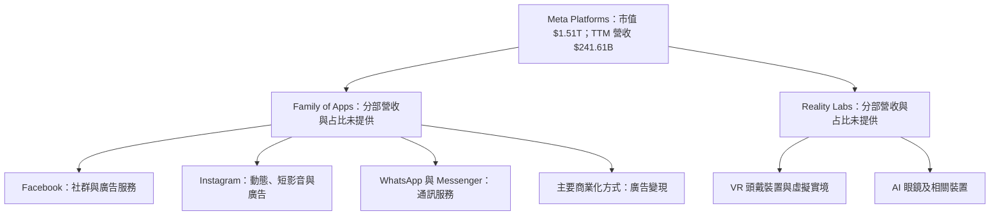
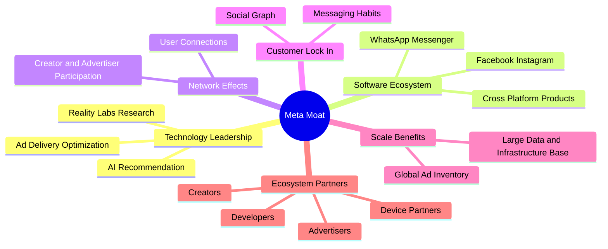
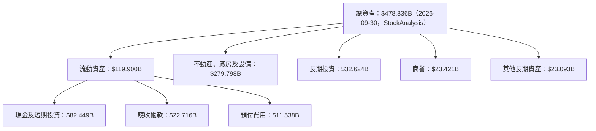
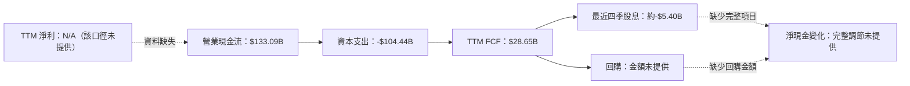
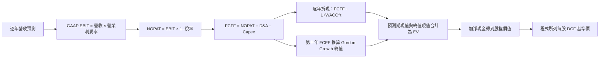
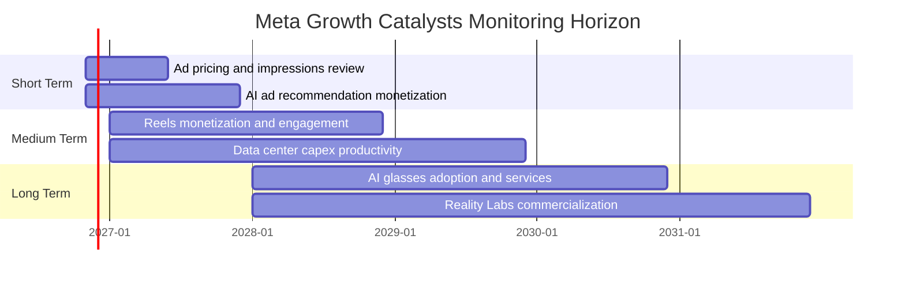
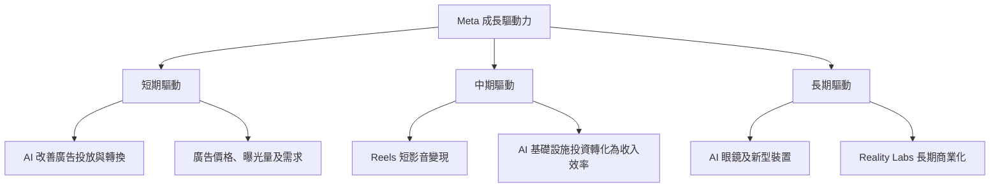
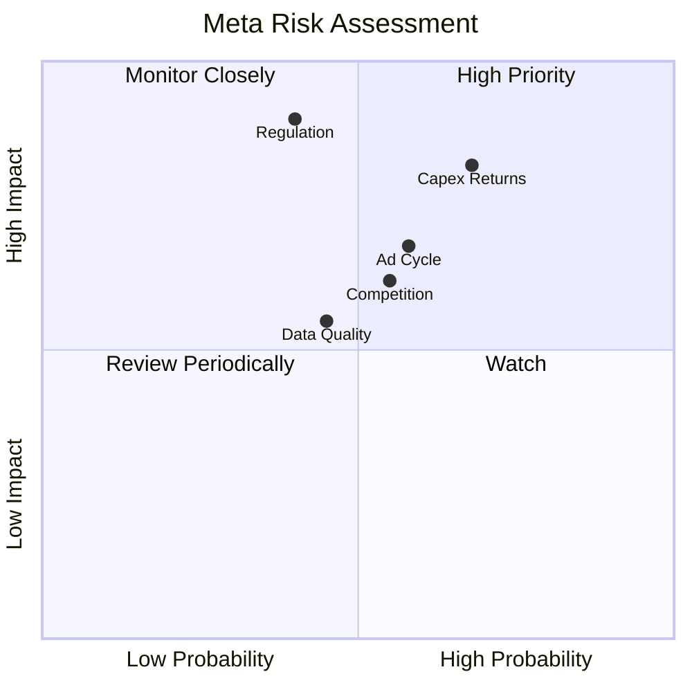
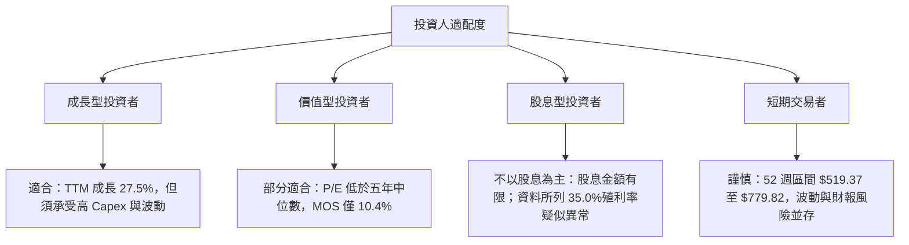

# META 基本面深度分析報告
> **報告日期**：2026-11-25 ｜ **語言**：繁體中文 ｜ **數據來源**：SEC 申報資料 (XBRL)、Yahoo Finance、Finviz、StockAnalysis、Roic.ai ｜ **分析師**：CFA 級機構研究

## 目錄

| # | 章節 | 核心結論 |
|---|------|----------|
| 1 | 執行摘要 | 買入；加權合理價值 $658.33；MOS +10.4% |
| 2 | 公司概覽與商業模式 | 廣告與社群網路構成核心；市場份額數據未提供 |
| 3 | 損益表深度分析 | TTM 營收 $241.61B、成長 27.5%；最新季度營業利益率須留意資料口徑差異 |
| 4 | 資產負債表分析 | TTM 淨負債 $1.22B；現金與短期投資 $82.45B |
| 5 | 現金流量深度分析 | TTM FCF $28.65B；資本支出上升令現金轉換承壓 |
| 6 | 獲利能力與資本效率 | ROIC 27.7% 高於 WACC 10.32%，正創造股東價值 |
| 7 | 相對估值分析 | 估值低於自身五年 P/E 中位數；同業倍數分歧大 |
| 8 | DCF 內在價值評估 | DCF 基準 $581.44；終值現值占 EV 80.9%，估值對長期假設敏感 |
| 9 | 成長催化劑 | AI 廣告效率、Reels 變現及新型裝置為主要潛在驅動 |
| 10 | 風險矩陣 | 資本支出回報、監管及廣告週期為主要風險 |
| 11 | 投資建議 | 買入；重視資本開支、FCF、營業利潤率與 AI 變現進展 |

---

## 1. 執行摘要

META 的 TTM 營收為 **$241.61B**、TTM 年增 **27.5%**，ROIC **27.7%** 高於 WACC **10.32%**；但 TTM 資本支出達 **$104.44B**，使 FCF 降至 **$28.65B**、FCF Yield 僅 **1.90%**。以 2026-11-24 收盤價 **$589.82**、加權合理價值 **$658.33** 計算，MOS 為 **+10.4%**、上行空間 **+11.6%**，依規則 20 評級為 **買入**；評級不作質化調整。DCF 基準價 **$581.44**，現價相對 DCF 基準溢價 **+1.4%**，反映加權估值的上行主要由同業 EV/EBITDA 與分析師共識估值貢獻，而非 DCF。

### 1.0 一頁式投資儀表板（Portfolio Manager 30 秒速讀）

| 項目 | 內容 |
|------|------|
| **投資論點（3 句）** | ① TTM 營收 $241.61B、成長 27.5%，顯示廣告主需求與平台變現仍有動能。② ROIC 27.7% 對比 WACC 10.32%，投入資本目前創造正經濟利潤。③ TTM FCF $28.65B、FCF Yield 1.90%，資本支出攀升使現金回報低於營業獲利所暗示的水準。 |
| **綜合評分** | **7.0/10**（引用 1.1 評分卡） |
| **財務健康** | 🟡 現金與短期投資 $82.45B，但總債務 $83.67B，TTM 淨負債 $1.22B；資本支出令 FCF 轉換承壓。 |
| **ROIC vs WACC** | **27.7% vs 10.32%**；目前創造價值，差額 17.38 個百分點。 |
| **FCF 趨勢** | TTM FCF $28.65B；對比 FY2025 $46.11B，資本支出上升令自由現金流承壓；FCF Yield **1.90%**。 |
| **估值** | Forward P/E **16.53x** ｜ EV/EBITDA **13.265x**（市場資料）｜ FCF Yield **1.90%** |
| **DCF 內在價值（基準）** | **$581.44** ｜ 現價相對 DCF 溢價 **+1.4%**（第 8 章） |
| **安全邊際（MOS）** | **+10.4%**＝($658.33 − $589.82) ÷ $658.33；🟡 有限（基準為 8.8 加權合理價值） |
| **預期報酬（基準情境 12M）** | **-1.4%**（DCF 基準情境 $581.44 相對現價） |
| **關鍵風險（前二）** | AI／資料中心資本支出轉化成 FCF 的時間與幅度；監管或隱私限制對廣告定向與平台變現的衝擊。 |
| **評級 + 信心度** | 🟢 **買入** ｜ 信心：中（公司營運數據具吸引力，但 FCF 與估值輸入有顯著不確定性） |

### 1.1 綜合評分卡（全報告唯一）

| 維度 | 評分（1–10） | 主要依據（引用數字與其來源章節） |
|------|--------------|----------------------------------|
| 成長性 | 8.0 | TTM 營收成長 27.5%、最新一季年增 26.1%（第 3 章）；成長率已高，未來需留意基期與競爭。 |
| 獲利能力 | 8.0 | TTM 營業利益率 32.9%、ROIC 27.7%，高於 WACC 10.32%；Piotroski 3/8 是保留因素（第 6 章）。 |
| 財務健康 | 6.0 | 現金與短期投資 $82.45B、總債務 $83.67B、淨負債 $1.22B；DSO 34 天，DIO、CCC 無資料（第 4 章）。 |
| 估值 | 6.0 | MOS +10.4%；P/E 20.1x 低於自身五年中位數 24.5x，但現價略高於 DCF 基準（第 7–8 章）。 |
| 護城河 | 8.0 | 多產品社群網路與廣告變現形成規模及網路效應；營收規模大且最新季度年增 26.1%（第 2 章）。 |
| 管理層與資本配置 | 6.0 | FY2025 資本支出 $69.69B、SBC $20.43B；TTM Capex $104.44B，投資回報與稀釋需持續檢視（第 3、5 章）。 |
| **綜合評分** | **7.0** | 六項算術平均：(8.0 + 8.0 + 6.0 + 6.0 + 8.0 + 6.0) ÷ 6 = 6.9。 |

### 1.2 五大投資論點 + 三大核心風險

| 類型 | 項目 | 具體依據 | 信心度 |
|------|------|----------|--------|
| 🟢 **投資論點①** | 大型社群與廣告平台仍在成長 | TTM 營收 $241.61B、TTM 成長 27.5%；最新季度收入年增 26.1%。 | 🟢 高 |
| 🟢 **投資論點②** | 資本回報高於資本成本 | ROIC 27.7% 對 WACC 10.32%，利差 17.38 個百分點。 | 🟢 高 |
| 🟢 **投資論點③** | 歷史估值不在高分位 | P/E 20.1x，低於自身五年中位數 24.5x；現時百分位 19%。 | 🟢 中 |
| 🟢 **投資論點④** | 現金資源足以支持大額投資 | 現金與短期投資 $82.45B，最新 TTM 營業現金流 $133.09B。 | 🟢 中 |
| 🟢 **投資論點⑤** | AI 可提高廣告推薦與轉換效率 | 目前是質化催化劑；財務資料沒有拆分 AI 對營收的獨立貢獻，故不能把整體成長歸因於 AI。 | 🟡 中 |
| 🟡 **風險①** | 資本開支擴張壓縮 FCF | TTM Capex $104.44B、FCF $28.65B；若投資回報未跟上，現金回報與估值將受壓。 | 🟡 中 |
| 🔴 **風險②** | 資料口徑與季度獲利波動 | 最新季度營業利益率在不同來源有 20.1% 與 37.8% 兩種讀數，必須以 SEC 季報調節確認；差異會改變利潤率判斷。 | 🔴 高 |
| 🔴 **風險③** | 監管、隱私與平台競爭 | 廣告定向、內容推薦或競爭格局若受限制，可能降低廣告轉換與變現能力；資料未提供量化潛在損失。 | 🟡 中 |

### 1.3 快速統計卡片

| 指標 | 公司實際值（期間） | 同業中位數 | 狀態 |
|------|--------------------|------------|------|
| 營收成長（TTM） | **27.5%** | — | 🟢 |
| 營收成長（最新一季年增） | **26.1%** | **14.3%**（GOOG、SNAP、PINS） | 🟢 |
| 毛利率（TTM） | **81.0%** | **69.95%**（三家公司） | 🟢 |
| 營業利益率（TTM） | **32.9%** | — | 🟢 |
| ROIC（TTM） | **27.7%** | — | 🟢 |
| Forward P/E | **16.53x** | **8.2x**（同業中位數） | 🟡 |
| FCF Yield（TTM） | **1.90%** | — | 🔴 |
| Piotroski F-Score | **3 / 8**（9 項中 1 項缺資料） | — | 🔴 |

### 1.4 投資結論

```text
╔══════════════════════════════════════════════════════════════════╗
║                    📊 投資結論摘要                               ║
╠══════════════════════════════════════════════════════════════════╣
║  評級：買入（MOS +10.4%，符合規則 20）                           ║
║  價格（2026-11-24 收盤）：$589.82                                ║
║  DCF 內在價值（基準）：$581.44（現價溢價 +1.4%）                ║
║  安全邊際 MOS：+10.4%（＝($658.33−$589.82)÷$658.33）            ║
║  加權合理價值（8.8）：$658.33                                    ║
║  DCF 情境價值：                                                   ║
║    悲觀情境：$195.45（-66.9%）                                   ║
║    基準情境：$581.44（-1.4%）                                    ║
║    樂觀情境：$1,417.72（+140.4%）                                ║
║  綜合評分：7.0/10（引用 1.1）                                    ║
║  適合投資人：可承受波動的成長型及長線投資人                       ║
╚══════════════════════════════════════════════════════════════════╝
```

---

## 2. 公司概覽與商業模式

### 2.1 業務結構與收入來源

公司資料顯示 Meta 透過 **Family of Apps（FoA）** 與 **Reality Labs（RL）** 經營，涵蓋 Facebook、Instagram、WhatsApp、Messenger、VR 頭戴裝置與 AI 眼鏡等產品。財務資料未提供兩個部門的分部營收及佔比，因此不推算板塊比例，也不繪製沒有依據的收入分布圖。



收入核心是廣告變現：使用者注意力與互動資料支援廣告投放及推薦。產品組合廣泛有助於跨平台觸達用戶，但公司沒有在本次財務資料中拆分廣告、訂閱、裝置或其他服務的營收。

### 2.2 市場份額

**市場份額數據未提供**，因此不列示市場份額或自行估算 TAM。相對規模方面，Meta TTM 營收為 $241.61B，TTM 成長 27.5%；同業資料中 GOOG、SNAP、PINS 最新季度年增分別為 24.7%、14.3%、11.9%，Meta 最新季度年增 26.1%，成長高於所列同業，但各公司業務結構並不完全相同。

### 2.3 競爭護城河分析



### 2.4 護城河強度

| 護城河項目 | 強度（強／中／弱） | 證據（引用數字或事實） | 會削弱它的情況 |
|------------|--------------------|------------------------|----------------|
| 網路效應 | 強 | Facebook、Instagram、WhatsApp、Messenger 跨產品觸達；TTM 營收 $241.61B。 | 用戶參與時間或創作者供給轉移至其他平台。 |
| 軟體生態系統 | 強 | 多個社群與通訊產品可互相導流，廣告商可觸達不同形式的受眾。 | 使用者習慣改變、產品體驗下降或平台間協同減弱。 |
| 規模效應 | 強 | TTM 營收規模與 $133.09B TTM 營業現金流支撐 AI、推薦系統及基礎設施投入。 | Capex 長期增長但沒有相應營收、利潤或現金流回報。 |
| 技術能力 | 中至強 | 公司持續投資 AI、廣告推薦與 Reality Labs；但財務資料沒有獨立列出 AI 帶來的增量收入。 | AI 研發無法轉為廣告效率或新產品收入，或競爭者追上。 |
| 客戶鎖定 | 中 | 社交關係與訊息往來形成轉換摩擦；沒有使用者留存、流失率或單一用戶收入資料可直接量化。 | 用戶多平台使用、替代產品快速改善，降低轉換成本。 |
| 生態夥伴 | 中 | 廣告商與創作者構成供給及需求兩端；未提供夥伴數量或集中度數據。 | 廣告商預算轉移、創作者供給分散或政策改變。 |

護城河評分引用 1.1 的 **8.0/10**：產品網路效應、規模與跨平台分發有事實支撐，但缺少市場份額、留存及分部盈利資料，故不給更高分。

---

## 3. 損益表深度分析

### 3.1 年度收入成長趨勢（近 4 年）

下表使用年度損益表所列收入；2022 至 2025 年收入 CAGR 約 **19.8%**。視覺條長度為依年度收入比例呈現，FY2025 為基準；年度收入與比率以提供的年度數據為準。

```text
╔══════════════════════════════════════════════════════════════════╗
║              Meta 年度收入趨勢（FY2022-FY2025）                 ║
╠══════════════════════════════════════════════════════════════════╣
║  FY2022  $116.61B  ████████████░░░░░░░░░░░░░░░░░░  YoY -1.1%   ║
║  FY2023  $134.90B  ██████████████░░░░░░░░░░░░░░░░  YoY +15.7%  ║
║  FY2024  $164.50B  █████████████████░░░░░░░░░░░░░  YoY +21.9%  ║
║  FY2025  $200.97B  █████████████████████░░░░░░░░░  YoY +22.2%  ║
╠══════════════════════════════════════════════════════════════════╣
║  2022-2025 收入 CAGR：約 +19.8%                                 ║
╚══════════════════════════════════════════════════════════════════╝
```

FY2022 收入下滑 1.1%，其後 FY2023–FY2025 回到兩位數增長。FY2025 收入 $200.97B，較 FY2024 的 $164.50B 增加 $36.47B；增長與廣告變現恢復、產品推薦及短影音商業化相符，但本資料未提供各因素的分項貢獻，不能將增長全數歸因於單一產品或 AI。

### 3.2 季度收入趨勢分析

QoQ 以相鄰季度收入計算；YoY 使用各季度對應的上一年同期成長率。QoQ 受季節性與季度收入組合影響，不能替代年度成長。

| 季度 | 營收 | QoQ 成長 | YoY 成長 | 備註 |
|------|------:|---------:|---------:|------|
| 2025 Q4 | $59.89B | +16.9% | +23.8% | 對比 2025 Q3 $51.24B；季節性可能影響環比。 |
| 2026 Q1 | $56.31B | -6.0% | +33.1% | 環比回落，但較 2025 Q1 $42.31B 高。 |
| 2026 Q2 | $60.80B | +8.0% | +28.0% | 收入連續恢復，YoY 仍高於 25%。 |
| 2026 Q3 | $64.60B | +6.3% | +26.1% | 最新季度 YoY 仍雙位數；此為單季年增，非 TTM 成長率。 |

最新季度收入由 $60.80B 升至 $64.60B，QoQ 增長約 6.3%；YoY 成長由 Q1 的 33.1% 降至 Q3 的 26.1%，仍維持高增長但有減速跡象。這可能反映比較基期提高或廣告收入增速正常化；需用後續季度廣告曝光、價格及廣告主需求數據驗證。

### 3.3 利潤率演變分析

以下以年度損益表原列收入、毛利、營業利益與淨利計算，可能因資料來源及報表分類而與 TTM 指標略有差異；TTM 營業利益率採 VERIFIED FIGURES 的 32.9%。

| 利潤率指標 | FY2022 | FY2023 | FY2024 | FY2025 | 趨勢 | 評估 |
|------------|-------:|-------:|-------:|-------:|------|------|
| **毛利率** | 78.3% | 80.8% | 81.7% | 82.0% | 緩步提高 | 🟢 |
| **營業利益率** | 24.8% | 34.7% | 42.2% | 41.4% | FY2022 後改善，FY2025 微降 | 🟢 |
| **淨利率** | 19.9% | 29.0% | 37.9% | 30.1% | FY2025 下滑 | 🟡 |

FY2022–FY2024 營業利益率提升，代表收入恢復及營運費用控制帶來槓桿；FY2025 營業利益率由 42.2% 降至 41.4%，淨利率由 37.9% 降至 30.1%。年度資料顯示 FY2025 營業利益增加至 $83.28B，但淨利由 FY2024 $62.36B 降至 $60.46B，反映營業利益以外項目、稅項或其他損益可能影響淨利；資料未提供足夠明細以判定單一原因。最新季度營業利益率出現來源差異：VERIFIED FIGURES 為 **20.1%**，另一行情數據為 **37.8%**；本報告涉及「最新季度營業利益率」時採用 VERIFIED FIGURES 的 20.1%，但建議核對 SEC 原始季報與資料商計算口徑。

### 3.4 費用結構分析

完整的費用細項與收入占比沒有以同一期間提供，因此不以不完整數字繪製 pie chart。FY2025 R&D 為 $57.37B，較 FY2024 $43.87B 增長約 30.8%；R&D 增長快於 FY2025 營收年增 22.2%，代表公司正加大 AI、基礎設施及新產品投入，短期可能壓抑費用率與現金流，長期回報取決於變現效率。

### 3.5 季度 EPS 趨勢與盈餘品質（Quality of Earnings）

近四季 EPS 實際值與財務資料列示如下，但歷史估計值為 nan，故不能判斷超預期或不及預期。EPS 成長率的季度資料顯示大幅波動，尤其 Q3 2026 年增 264.8%，而 Q3 2025 EPS 僅 $1.05，低基期可能放大年增率。

| 季度 | EPS 實際 | EPS YoY | 預期值／超預期判斷 |
|------|---------:|-------:|--------------------|
| 2025 Q4 | $8.88 | +10.7% | 預期值缺失，無法判斷 beat/miss |
| 2026 Q1 | $10.44 | +62.4% | 預期值缺失，無法判斷 beat/miss |
| 2026 Q2 | $6.18 | -13.4% | 預期值缺失，無法判斷 beat/miss |
| 2026 Q3 | $3.83 | +264.8% | 預期值缺失；年增率受低基期影響 |

| 盈餘品質項目 | 數值／佔比 | 評估 |
|--------------|------------|------|
| 股權薪酬 SBC / 營收 | 估計 11.1%（最近四季 SBC $26.94B ÷ TTM 營收 $241.61B） | 🔴 高於一般可忽略程度；SBC 是會稀釋股東持股的經濟成本。 |
| SBC / 營業現金流 | 估計 20.2%（$26.94B ÷ $133.09B） | 🟡 SBC 對營業現金流具有顯著非現金加回效果。 |
| FCF / 淨利（現金轉換率） | 估計 38.1%（TTM FCF $28.65B ÷ StockAnalysis TTM 淨利 $75.249B） | 🔴 轉換偏低，主要須結合高 Capex 解讀；淨利來源與期間口徑可能與 SEC TTM 不完全一致。 |
| 一次性／非經常性損益 | N/A（資料未提供完整 TTM 調節項目） | 無法確認是否有一次性項目美化或壓低獲利。 |
| 有效稅率異常 | 29.6%（最新年度有效稅率） | 🟡 DCF 採用同一稅率；沒有足夠歷史稅務調節資料判斷是否異常。 |
| 資本化支出 vs 費用化 | TTM Capex $104.44B；資本化明細 N/A | Capex 直接降低自由現金流；無法判斷資本化政策是否改變當期利潤。 |

盈餘品質結論：GAAP 獲利有營業現金流 $133.09B 支持，且營業現金流高於淨利的測試通過；但 TTM FCF 僅 $28.65B，FCF/淨利估計約 38.1%，顯示高額投資支出大幅降低可分配現金。SBC 佔收入估計約 11.1%，亦是實質股東成本；DCF 採 GAAP EBIT 並固定股數，已在費用中計入 SBC，避免再次扣除。

---

## 4. 資產負債表分析

### 4.1 資產結構分解



分類數據來自 StockAnalysis 2026-09-30 資產負債表。不同資產欄位存在四捨五入或分類差異，故不以子項反推總資產。

### 4.2 流動性與營運資金分析

| 指標 | 最新 TTM | 一年前 TTM | 變化 | 解讀 |
|------|----------|------------|------|------|
| DSO 應收帳款天數 | 34 天 | 33 天 | +1 天 | 應收回收略慢；變化幅度小，但需監察廣告主付款條件及應收帳款品質。 |
| DIO 存貨天數 | N/A | N/A | N/A | 公司未報告可計算此指標的存貨餘額；不可補估。 |
| DPO 應付帳款天數 | 152 天 | N/A | N/A | 最新期間付款天數較長，但沒有一年前可比值，不能判斷趨勢。 |
| CCC 現金轉換週期 | N/A | N/A | N/A | DIO 缺失，故 CCC 不可計算。 |

流動比率歷史資料列示 FY2025 流動資產 $108.72B、流動負債 $41.84B；最新季度 StockAnalysis 流動資產 $119.90B，但本資料未提供同期流動負債，因此不重算最新流動比率。另一市場資料列示 Current Ratio 1.903、Quick Ratio 1.669，口徑未標明期間，僅作補充參考。

### 4.3 債務結構分析

採用 VERIFIED FIGURES 的最新 TTM 現金與短期投資、總債務與淨負債數字。其他市場資料列示總債務 $114.84B、淨負債 $32.39B，與 VERIFIED FIGURES 的 $83.67B、$1.22B 不一致；本報告依規則以 VERIFIED FIGURES 為主，不將兩套數據混用。

```text
╔══════════════════════════════════════════════════════════════════╗
║                   Meta 債務健康診斷                              ║
╠══════════════════════════════════════════════════════════════════╣
║  總債務：        $83.67B   ████████████████████  VERIFIED       ║
║  現金+短期投資： $82.45B   ████████████████████  覆蓋大部分債務 ║
║  淨負債：         $1.22B   ░░░░░░░░░░░░░░░░░░░░  🟡 接近中性   ║
║                                                                  ║
║  Debt/EBITDA：N/A（同期間、同口徑 EBITDA 未提供）               ║
║  Interest Coverage：N/A（利息費用及 EBIT 同期口徑未提供）       ║
╚══════════════════════════════════════════════════════════════════╝
```

淨負債只占總資產與現金流規模的有限部分，但當季 Capex 快速增加，需把資產負債表安全性與未來自由現金流承受力分開看：目前流動性不差，不代表高額基建投資必然有足夠回報。

### 4.4 股東權益趨勢

| 年度 | 股東權益 | 年增變化 |
|------|---------:|---------:|
| 2022 | $125.71B | — |
| 2023 | $153.17B | +21.9% |
| 2024 | $182.64B | +19.2% |
| 2025 | $217.24B | +19.0% |

```text
╔══════════════════════════════════════════════════════════════════╗
║              Meta 股東權益變化（年度）                           ║
╠══════════════════════════════════════════════════════════════════╣
║  2022  $125.71B  ████████████░░░░░░░░░░░░░░░░░░                 ║
║  2023  $153.17B  ███████████████░░░░░░░░░░░░░░░                 ║
║  2024  $182.64B  ██████████████████░░░░░░░░░░░░                 ║
║  2025  $217.24B  ██████████████████████░░░░░░░░                 ║
╚══════════════════════════════════════════════════════════════════╝
```

權益連續增加，與獲利累積相符；但 FY2025 SBC 為 $20.43B，股東權益增加不能單獨視作每股價值增加，仍須結合稀釋股數、回購與資本回報評估。QUALITY FIGURES 顯示稀釋股數未增加測試未通過。

---

## 5. 現金流量深度分析

### 5.1 現金流量瀑布圖

財務資料未提供同期間 TTM 淨利的 VERIFIED FIGURES 數值，也沒有 TTM 回購金額及淨現金變化完整調節，因此圖中只列可引用的 TTM 現金流數字；股息使用最近四季現金流表列示金額。



### 5.2 FCF 轉換率趨勢

| 年度 | 營業現金流 | 資本支出 | FCF | 淨利 | FCF / 淨利 |
|------|-----------:|---------:|----:|-----:|-----------:|
| 2022 | $50.48B | $31.19B | $19.29B | $23.20B | 83.1% |
| 2023 | $71.11B | $27.05B | $44.07B | $39.10B | 112.7% |
| 2024 | $91.33B | $37.26B | $54.07B | $62.36B | 86.7% |
| 2025 | $115.80B | $69.69B | $46.11B | $60.46B | 76.3% |
| TTM 至 2026-09-30 | $133.09B | $104.44B | $28.65B | N/A（VERIFIED FIGURES 未提供） | N/A |

FY2023 FCF 高於淨利；其後 Capex 上升，FCF 轉換率下降至 FY2025 的 76.3%。TTM Capex 已達 $104.44B，營業現金流增長並未等比例轉化為可自由支配現金。這與 AI 計算資源、資料中心及設備投資相容，但投入回報需靠後續營收與利潤率驗證。

### 5.3 自由現金流趨勢

```text
╔══════════════════════════════════════════════════════════════════╗
║              自由現金流：年度實際與 TTM                         ║
╠══════════════════════════════════════════════════════════════════╣
║  FY2022  $19.29B  ███████░░░░░░░░░░░░░░░░░░░░░░                 ║
║  FY2023  $44.07B  ██████████████████████░░░░░░░                 ║
║  FY2024  $54.07B  ███████████████████████████░░                 ║
║  FY2025  $46.11B  ███████████████████████░░░░░░                 ║
║  TTM     $28.65B  ██████████████░░░░░░░░░░░░░░░                 ║
╠══════════════════════════════════════════════════════════════════╣
║  TTM FCF Yield：1.90%；計算口徑為 TTM FCF ÷ 市值               ║
╚══════════════════════════════════════════════════════════════════╝
```

TTM FCF 不等於年度趨勢的簡單延伸，且受近期高 Capex 影響。TTM FCF Yield 1.90%意味著以當前市值計算，未來回報需要依賴 FCF 增長及估值維持，單靠當期 FCF 收益率提供的下檔支撐有限。

### 5.4 資本配置評估

資本配置完整分項（回購、留存、投資及股息的同期間金額）未提供，故不以不完整總額製作 pie chart。

| 項目 | 可得數據 | 分析 |
|------|----------|------|
| 資本支出 | FY2025 $69.69B；TTM $104.44B | TTM 明顯高於 FY2025 水準；需追蹤投資是否帶來收入與 FCF 回報。 |
| 股息 | FY2025 $5.32B；季度近四季合計約 $5.40B | 相較 TTM OCF 規模不大；資料內另列股息殖利率 35.0%，與金額及公司背景不相稱，視為來源異常，不作投資判斷依據。 |
| SBC | FY2025 $20.43B；最近四季合計約 $26.94B | 具稀釋成本；需與回購抵銷稀釋的淨效果一併檢視。 |
| 股票回購 | N/A（金額未提供） | 不推算，也不以流通股變化反推回購金額。 |
| 留存與併購 | N/A（分項未提供） | 無法量化各類資本配置的回報率。 |

---

## 6. 獲利能力與資本效率

### 6.1 ROE / ROA / ROIC 趨勢

| 指標 | 最新 TTM | 歷史／補充數據 | 評估 |
|------|---------:|----------------|------|
| ROE | **27.6%**（QUALITY FIGURES） | 市場資料另列 32.3%，與品質指標口徑不一致 | 🟡 本報告採用品質指標 27.6%。 |
| ROA | 14.6%（市場資料） | QUALITY FIGURES 顯示 ROA 較一年前下降，但未提供兩期具體值 | 🟡 絕對值仍有盈利能力，趨勢分項需核對。 |
| ROIC | **27.7%**（TTM） | 10 年 ROIC.ai 歷史表只列至 2018，無法與最新值連續比較 | 🟢 顯著高於 WACC。 |
| 行業均值對比 | N/A | 無同口徑行業資料 | 不提供未驗證的同業均值。 |

ROE 存在兩組來源讀數，依 VERIFIED FIGURES 的品質指標採 27.6%，不與市場資料 32.3%混用。Piotroski 測試顯示 ROA 高於一年前未通過，表示獲利資產效率的方向需留意。

### 6.2 ROIC vs WACC 分析（核心價值創造判斷）

```text
╔══════════════════════════════════════════════════════════════════╗
║                ROIC vs WACC 深度分析                             ║
╠══════════════════════════════════════════════════════════════════╣
║  資本成本（直接採用 Cost of capital）：                          ║
║  ├── 無風險利率（10Y 美債）：       4.90%                        ║
║  ├── 市場風險溢酬 ERP：             5.00%                        ║
║  ├── Beta 原始值：                  1.28                         ║
║  ├── Beta 採用值：                  1.19（⅔×1.28 + ⅓×1.00）      ║
║  ├── 股權成本 Ke：                 10.83%                        ║
║  ├── 稅前債務成本：                  1.39%                        ║
║  ├── 有效稅率：                    29.6%                         ║
║  ├── 資本權重 E / D：             94.7% / 5.3%                   ║
║  └── ✅ 採用 WACC：                10.32%                        ║
║                                                                  ║
║  經濟價值利差：ROIC − WACC = 27.7% − 10.32% = +17.38 個百分點   ║
║  ROIC  27.7%  ▓▓▓▓▓▓▓▓▓▓▓▓▓▓▓▓▓▓▓▓▓▓▓░░░░░░░                  ║
║  WACC  10.32% ▓▓▓▓▓▓▓▓▓▓░░░░░░░░░░░░░░░░░░░░░                  ║
║  結論：🟢 ROIC 高於 WACC，TTM 資本回報目前創造股東價值。        ║
╚══════════════════════════════════════════════════════════════════╝
```

WACC、股權成本及各項資本權重依資本成本資料直接採用；Beta 調整方式為原始 Beta 1.28 經三分之二原始值、三分之一市場 Beta 1.00 調整，得到 1.19。債務成本與各組成數字為四捨五入資料，不能用已四捨五入的分項重算後取代模型所列 WACC 10.32%。ROIC 27.7% 高於 WACC 17.38 個百分點，表示目前投入資本創造正價值；若高額 AI／資料中心支出使未來 ROIC 下滑至 WACC 以下，價值創造論點即被削弱。

### 6.3 杜邦三因素分解

| 因素 | 數值（TTM） | 解讀 |
|------|-------------|------|
| 淨利率 | 31.1% | 獲利主要由高毛利廣告及平台規模支持；TTM。 |
| 資產週轉率 | 0.50 | 資產基礎較大，新增固定資產若未迅速帶來收入，週轉率可能承壓。 |
| 權益乘數 | 1.76 | 有槓桿但不屬高倍數；ROE 並非主要由高槓桿撐起。 |
| **ROE** | **27.6%** | 31.1% × 0.50 × 1.76 = 27.3%，與資料列示 27.6% 的小幅差異來自原始數字四捨五入。 |

### 6.4 財務體質：Piotroski F-Score

Piotroski F-Score 為 **3/8**；9 項測試中毛利率測試因缺資料未納入分母。分數偏低不是表示公司虧損，而是部分年度比較項目惡化或資料缺失。

| 測試 | 結果 | 解讀 |
|------|------|------|
| ROA > 0 | ✅ 通過 | 公司仍有正獲利。 |
| 營業現金流 > 0 | ✅ 通過 | TTM OCF 為 $133.09B。 |
| ROA 高於一年前 | ❌ 未通過 | 資產報酬率較一年前下降，需留意新增資產的盈利效率。 |
| 營業現金流 > 淨利 | ✅ 通過 | 現金流支持帳面盈利，但 FCF 仍受高資本支出壓制。 |
| 長期負債 ÷ 總資產低於一年前 | ❌ 未通過 | 負債比率方向不利；可能與投資週期資金需求相關。 |
| 流動比率高於一年前 | ❌ 未通過 | 流動性相對一年前惡化，需追蹤資本開支對流動資產的影響。 |
| 稀釋股數未增加 | ❌ 未通過 | 顯示股權薪酬可能造成股數稀釋；需與回購共同分析。 |
| 毛利率高於一年前 | — 無法判定 | 缺少測試所需資料，不計入分母。 |
| 資產週轉率高於一年前 | ❌ 未通過 | 資產增長可能快於收入，與投資及建置週期相符。 |

---

## 7. 相對估值分析

### 7.1 同業估值比較表格

同業資料來自 Peer multiples；META 市場倍數取自估值資料。META EV/EBITDA 市場資料為 13.265x，而自身歷史估值表列 14.6x，因計算來源與口徑可能不同，並列說明而不混為一個數字。

| 估值指標 | **META** | **GOOG** | **SNAP** | **PINS** | META 評估 |
|----------|---------:|--------:|--------:|--------:|-----------|
| **Trailing P/E** | 20.1x | 14.4x | N/A | 77.1x | 🟡 介於可盈利同業的兩端；PINS 倍數受盈利基礎影響。 |
| **Forward P/E** | 16.53x | 18.1x | 6.2x | 8.2x | 🟡 高於所列同業中位數 8.2x；META 盈利與商業模式不同，不能只按倍數判斷。 |
| **P/S Ratio** | 6.24x | 7.2x | 1.3x | 2.3x | 🟡 高於 SNAP、PINS，略低於 GOOG。 |
| **EV/EBITDA** | 13.265x | 17.8x | 51.7x | 34.9x | 🟢 META 市場資料倍數低於各列同業；SNAP、PINS 的高倍數可能受 EBITDA 基礎影響。 |
| **最新季度營收 YoY** | 26.1% | 24.7% | 14.3% | 11.9% | 🟢 META 略高於 GOOG，亦高於 SNAP、PINS。 |
| **毛利率（TTM）** | 81.0% | 60.9% | 59.2% | 79.0% | 🟢 META 高於所列三家。 |

同業 Forward P/E 中位數為 **8.2x**，同業 EV/EBITDA 中位數（GOOG、PINS）為 **26.4x**，採用程式計算的估值方法回推價格；但公司成長、利潤率及資本結構差異大，倍數差異不能視為直接的相對高低判決。

### 7.2 歷史估值區間分析

```text
╔══════════════════════════════════════════════════════════════════╗
║           META 五年 P/E 歷史區間與現時位置                       ║
╠══════════════════════════════════════════════════════════════════╣
║  五年低點：12.9x       中位數：24.5x       五年高點：33.4x       ║
║  現時 P/E：20.1x       百分位：19%                              ║
║  12.9x ├────────●──────────────┼──────────────────┤ 33.4x       ║
║                 20.1x          24.5x                            ║
╠══════════════════════════════════════════════════════════════════╣
║  評估：現時低於五年中位數，處於歷史區間偏低位置；低估值不等於   ║
║  價格必然回歸中位數，仍須檢視增長、Capex 與獲利品質。            ║
╚══════════════════════════════════════════════════════════════════╝
```

P/S 現時 6.3x、五年中位數 7.7x、現時百分位 33%；EV/EBITDA 現時 14.6x、五年中位數 16.5x、現時百分位 33%。三項倍數均低於自身五年中位數，但 P/E 百分位 19%較低，不足以抵銷 FCF Yield 僅 1.90%及 Capex 上升的疑慮。

### 7.3 情境價值（Bear / Base / Bull，照抄 DCF MODEL 的 Scenarios）

| 情境 | 第 1 年營收成長 | 期末營業利潤率 | WACC | 每股價值 | 相對現價 | 機率 | 會發生的條件 |
|------|----------------|----------------|------|----------:|---------:|-----:|--------------|
| 🔴 悲觀 | 13.8% | 29.5% | 11.32% | $195.45 | -66.9% | 25% | 廣告成長顯著放慢、資本支出持續高企、利潤率低於基準收斂路徑。 |
| 🟡 基準 | 27.5% | 34.7% | 10.32% | $581.44 | -1.4% | 50% | 近期成長延續後逐步放緩、利潤率溫和改善，Capex 逐步回落。 |
| 🟢 樂觀 | 41.3% | 38.1% | 9.32% | $1,417.72 | +140.4% | 25% | 廣告與 AI 變現快速加速，營業槓桿及資本回報同步改善。 |

模型提供的機率加權價值為 **$694.01（相對現價 +17.7%）**，但第 8.8 節依規則使用 DCF 基準值而非機率加權 DCF 值。

### 7.4 相對估值隱含價格區間

```text
╔══════════════════════════════════════════════════════════════════╗
║            相對估值與共識價格：股價 $589.82                      ║
╠══════════════════════════════════════════════════════════════════╣
║  $290.99 ───────── $589.82 ───────── $842.54 ─────── $1,075.00  ║
║  Forward P/E          現價            分析師共識      EV/EBITDA  ║
╚══════════════════════════════════════════════════════════════════╝
```

| 方法 | 每股價值 | 相對現價 | 方法依據 |
|------|---------:|---------:|----------|
| 同業 Forward P/E | $290.99 | -50.7% | 同業中位數 8.2x × META Forward EPS $35.68。 |
| 同業 EV/EBITDA | $1,075.00 | +82.3% | GOOG、PINS 同業中位數 26.4x × TTM EBITDA，再加回淨現金。 |
| 分析師共識目標價 | $842.54 | +42.8% | 58 位分析師平均目標價。 |

同業 Forward P/E 與 EV/EBITDA 回推的價值差距很大，顯示可比公司選擇與倍數口徑對相對估值影響重大；不宜把最高倍數回推值當作基本情境目標價。

---

## 8. DCF 內在價值評估（Discounted Cash Flow）

### 8.0 估值推理鏈（Thinking Logic）

**Step 1 — 價值由哪些變數決定？**  
Meta 的價值主要取決於既有廣告與社群平台的現金流、廣告推薦與短影音帶來的增量變現，以及 Reality Labs／AI 裝置的選擇權價值。分部營收佔比未提供，不能為各項指定收入比例。敏感度矩陣顯示，在基準附近，WACC 與永續成長率對價值有顯著影響；終值現值占 EV 80.9%，因此最主導估值的是長期折現與終值假設，而非單一年份收入。

**Step 2 — 模型選擇**

| 決策點 | 本報告採用 | 理由（含數字） | 曾考慮但否決 | 否決理由 |
|--------|-----------|----------------|--------------|----------|
| 現金流定義 | FCFF | 使用 WACC 折現並先得 EV，再以淨現金調整；TTM OCF $133.09B、Capex $104.44B。 | FCFE | 公司資料提供企業資本成本，FCFF 與 EV 橋接一致。 |
| 預測期 N | 10 年 | 模型既定 10 年，營收成長由 27.5%逐步淡出至 3.0%。 | 5 年 | 無法充分呈現長期投資回報與成長淡出。 |
| 終值方法 | Gordon Growth | 模型採終值成長率 3.0%、WACC 10.32%。 | 退出倍數 | DCF MODEL 未提供退出倍數估值，不能自行補建。 |
| EBIT 基礎 | GAAP EBIT | TTM GAAP 營業利益率 32.9%。 | 非 GAAP EBIT | 可能把 SBC 加回，造成股東成本漏計。 |

**Step 3 — 關鍵假設推導鏈**

- **營收成長**：錨點＝TTM 對前一 TTM 成長 27.5% → 調整＝預測期由近期高成長線性放緩，反映基期提高與成熟化 → **採用第 1 年 27.5%、第 10 年 3.0%** → 否決固定維持 27.5%，因 10 年不變會忽視成長淡出。
- **期末營業利潤率**：錨點＝TTM 32.9%，模型長期歷史中位數採 34.7% → 調整＝假設規模效應及廣告變現效率抵銷部分基建成本 → **採用第 10 年 34.7%** → 否決明顯高於 34.7%的值，因缺少財務資料支持長期超越歷史中位數。
- **永續成長率 g**：錨點＝模型設定 3.0%，接近長期名目經濟增長假設範圍 → 調整＝成熟平台仍具通膨與產品變現增長，但不能假設高增長永久延續 → **採用 3.0%** → 否決高於 WACC 10.32%的值，因 Gordon Growth 公式失效。
- **預測期 N**：錨點＝模型固定 10 年 → 調整＝讓收入由 27.5%成長淡出至 3.0% → **採用 10 年** → 否決縮短期限，因會把仍在淡出的中期現金流直接壓縮進終值。
- **Capex／營收**：錨點＝TTM Capex 約為營收 43.2% → 調整＝模型假設資本支出比率逐年下降至第 10 年 11.3%，長期接近 1.1 倍 D&A → **採用模型逐年淡出路徑** → 否決長期維持 43.2%，因這會令成熟期投資強度長期高於折舊且大幅壓低價值；但淡出速度本身仍有高不確定性。
- **稅率**：錨點＝最新年度有效稅率 29.6% → **採用 29.6%**，模型維持不變。
- **D&A／營收**：錨點＝TTM 10.3% → **採用 10.3%**，模型維持不變；高於許多成熟軟體型公司的直覺水平，可能反映大型基建折舊。
- **營運資金**：模型未建模；工作資本變動對現金流的影響不納入。這是模型簡化，不等於營運資金現金流為零。
- **SBC 與股數**：模型採 GAAP EBIT，SBC 已列為費用，固定股數、不再逐年稀釋；模型組合為 **(A)**。SBC 只透過費用計入一次。
- **WACC**：錨點＝Cost of capital 計算值 10.32% → **採用 10.32%** → 不另行以自行估算的折現率替換。
- **終值方法**：模型採 Gordon Growth，g=3.0% → **採用程式計算終值** → 退出倍數交叉檢驗因 DCF MODEL 未提供而不另建。

**Step 4 — 最脆弱一環**  
最脆弱的是 Capex／營收由 43.2%淡出至 11.3%的速度；若 AI 基建投資長期維持高位，FCFF 會低於模型，價值下行，且現有敏感度矩陣未涵蓋 Capex 路徑變化。

**Step 5 — 計算路徑**



### 8.1 模型假設總表（Model Inputs）

| 假設項目 | 採用值 | 依據／來源 | 敏感度 |
|----------|--------|-------------|--------|
| 預測期長度 N | 10 年 | DCF MODEL 設定，營收成長由 27.5%淡出至 3.0%。 | 🟡 中 |
| 營收成長路徑 | FY+1 27.5%，FY+10 3.0%，線性淡出 | TTM 成長 27.5%作起點；成熟化為淡出理由。 | 🔴 高 |
| 營業利潤率 | FY+1 32.9%至 FY+10 34.7% | TTM 32.9%；長期收斂至模型所採五年中位數 34.7%。 | 🔴 高 |
| 有效稅率 | 29.6% | 最新年度有效稅率。 | 🟢 低 |
| Capex／營收 | FY+1 43.2%至 FY+10 11.3% | TTM Capex／營收比率作近期起點；長期按模型淡出至高於 D&A 的 1.1 倍。 | 🔴 高 |
| D&A／營收 | 10.3% | TTM 比率，模型固定。 | 🟢 低 |
| 營運資金變動 | 未建模 | DCF MODEL 明確註明 working capital is not modelled。 | 🟡 中 |
| EBIT 基礎 | GAAP EBIT | DCF MODEL 註明採 GAAP。 | 🟡 中 |
| SBC 處理 | 組合 (A)：已含 GAAP EBIT，不另扣 SBC | 模型固定股數，不再另計稀釋。SBC 影響已計入一次。 | 🟡 中 |
| 年稀釋率 | 0%（模型固定股數） | 與 GAAP EBIT + 固定股數組合一致；非另行預測實際未來稀釋。 | 🟡 中 |
| 永續成長率 g | 3.0% | DCF MODEL 採用；低於 WACC 10.32%。 | 🔴 高 |
| 終值方法 | Gordon Growth | 模型提供終值及現值；退出倍數數字未提供。 | 🔴 高 |
| WACC | 10.32% | Cost of capital 區塊直接採用。 | 🔴 高 |
| 稀釋股數 | 模型以「股權價值 × 價格 ÷ 市值」換算每股，不提供單獨稀釋股數 | 依 DCF MODEL Per share 行，不能自行替換股數口徑。 | 🟡 中 |

FCFF 定義為 **FCFF = NOPAT + D&A − Capex**，不包含 ΔWC 列，因模型未建模營運資金。全章採用 FCFF 對應 WACC；不在 FCFF 另扣 SBC，也不對股數逐年稀釋。

### 8.2 折現率推導（WACC）

```text
╔══════════════════════════════════════════════════════════════════╗
║                    WACC 推導（折現率）                           ║
╠══════════════════════════════════════════════════════════════════╣
║  股權成本 Ke（CAPM，採用來源已計算數值）：                       ║
║  ├── 無風險利率 Rf（10Y 美債）：      4.90%                      ║
║  ├── 市場風險溢酬 ERP：               5.00%                      ║
║  ├── 原始 Beta：                      1.28                       ║
║  ├── 調整後 Beta：                    1.19                       ║
║  └── Ke = 4.90% + 1.19 × 5.00% = 10.83%                         ║
║                                                                  ║
║  債務成本：                                                      ║
║  ├── 稅前 Kd（來源計算）：             1.39%                      ║
║  ├── 有效稅率：                       29.6%                      ║
║  └── 稅後 Kd = 1.39% × (1 − 29.6%) = 0.9786%                    ║
║                                                                  ║
║  資本結構權重：                                                  ║
║  ├── 股權 E 權重：                    94.7%                      ║
║  ├── 債務 D 權重：                     5.3%                      ║
║  └── ✅ 採用 WACC：                  10.32%                      ║
╚══════════════════════════════════════════════════════════════════╝
```

逐步檢視：  
1. **Ke** = Rf + β × ERP = 4.90% + 1.19 × 5.00% = 10.85%（用顯示至兩位小數的輸入計算）；資本成本資料直接提供 Ke = **10.83%**，差異來自未四捨五入輸入，故保留來源 Ke。  
2. **稅前 Kd** = 資本成本資料直接提供 **1.39%**；利息費用與平均計息負債未同時列出，不能另行複算。  
3. **稅後 Kd** = 1.39% × (1 − 29.6%) = **0.9786%**。  
4. **權重** = 股權 **94.7%**、債務 **5.3%**；權重合計 94.7% + 5.3% = **100.0%**。市值、期末計息負債範圍及其平均餘額未完整提供，不能重建此權重。  
5. **WACC**：以已四捨五入分項計算，94.7% × 10.83% + 5.3% × 0.9786% = 10.31%；來源未四捨五入計算值採用 **10.32%**。因此全報告及 DCF 使用來源 WACC 10.32%，不以顯示輸入的近似重算值取代。

### 8.3 逐年自由現金流預測（基準情境）

金額單位為 USD billions；表格逐年照錄 DCF MODEL。因模型未建模營運資金，沒有 ΔWC 列。折現因子取 3 位小數，其他金額取 2 位小數。

| 年度 | FY+1 | FY+2 | FY+3 | FY+4 | FY+5 | FY+6 | FY+7 | FY+8 | FY+9 | FY+10 |
|------|-----:|-----:|-----:|-----:|-----:|-----:|-----:|-----:|-----:|------:|
| 營收 | 308.11 | 384.52 | 469.41 | 560.24 | 653.38 | 744.20 | 827.37 | 897.28 | 948.65 | 977.11 |
| 營收 YoY | 27.5% | 24.8% | 22.1% | 19.4% | 16.6% | 13.9% | 11.2% | 8.5% | 5.7% | 3.0% |
| 營業利潤率 | 32.9% | 33.1% | 33.3% | 33.5% | 33.7% | 33.9% | 34.1% | 34.3% | 34.5% | 34.7% |
| EBIT（GAAP） | 101.23 | 127.10 | 156.10 | 187.43 | 219.90 | 251.95 | 281.76 | 307.37 | 326.86 | 338.62 |
| − 稅 | (30.01) | (37.68) | (46.28) | (55.56) | (65.19) | (74.69) | (83.53) | (91.12) | (96.90) | (100.38) |
| = NOPAT | 71.22 | 89.43 | 109.83 | 131.87 | 154.71 | 177.26 | 198.24 | 216.25 | 229.97 | 238.24 |
| + D&A | 31.78 | 39.66 | 48.42 | 57.78 | 67.39 | 76.76 | 85.34 | 92.55 | 97.85 | 100.78 |
| − Capex | (133.19) | (152.59) | (169.65) | (182.64) | (189.85) | (189.88) | (181.79) | (165.37) | (141.24) | (110.86) |
| **= FCFF** | **-30.18** | **-23.51** | **-11.41** | **7.02** | **32.25** | **64.14** | **101.78** | **143.43** | **186.58** | **228.16** |
| 折現因子 @10.32% | 0.906 | 0.822 | 0.745 | 0.675 | 0.612 | 0.555 | 0.503 | 0.456 | 0.413 | 0.375 |
| **FCFF 現值 PV** | **-27.36** | **-19.32** | **-8.50** | **4.74** | **19.74** | **35.59** | **51.19** | **65.39** | **77.11** | **85.48** |

預測期 FCF 現值合計：  
**−27.36 + (−19.32) + (−8.50) + 4.74 + 19.74 + 35.59 + 51.19 + 65.39 + 77.11 + 85.48 = $284.06B**

**FY+1 逐步演算：**

1. 營收 = $241.61B × (1 + 27.5%) = **$308.11B**。  
2. EBIT = $308.11B × 32.9% = **$101.23B**。  
3. 稅 = $101.23B × 29.6% = **$30.01B**。  
4. NOPAT = $101.23B − $30.01B = **$71.22B**。  
5. D&A = $308.11B × 10.3% = **$31.78B**。  
6. Capex = $308.11B × 43.2% = **$133.19B**。  
7. ΔWC = **未建模**，不列入 FCFF。  
8. FCFF = $71.22B + $31.78B − $133.19B = **−$30.18B**。  
9. 折現因子 = 1 ÷ (1 + 10.32%)¹ = **0.906**；PV = −$30.18B × 0.906 = **−$27.36B**。

合理性自檢：

- FY+1 至 FY+10 FCFF 由 -$30.18B 轉為 $228.16B，因前期 Capex 高於 NOPAT+D&A，後續模型假設 Capex 比率逐年大幅下降；歷史 FCFF CAGR 不以不連續的年度序列作單一 CAGR 判斷。  
- FY+10 FCFF 利潤率 = $228.16B ÷ $977.11B = **23.4%**；目前 TTM FCF 利潤率 = $28.65B ÷ $241.61B = **11.9%**。此改善主要依賴 Capex 正常化與利潤率上升。  
- FY+1 至 FY+3 FCFF 為負，因 Capex 高於 NOPAT 加 D&A；負現金流會降低預測期現值，但第 4 年起轉正。  

```text
╔══════════════════════════════════════════════════════════════════╗
║            自由現金流：歷史實際 vs 模型預測                      ║
╠══════════════════════════════════════════════════════════════════╣
║  FY2023（實） $44.07B  ███████████░░░░░░░░░░░░░░░░░░            ║
║  FY2024（實） $54.07B  ██████████████░░░░░░░░░░░░░░            ║
║  FY2025（實） $46.11B  ████████████░░░░░░░░░░░░░░░            ║
║  FY+1（預）   -$30.18B  負值：Capex 高於 NOPAT + D&A            ║
║  FY+10（預）  $228.16B  ██████████████████████████████          ║
╠══════════════════════════════════════════════════════════════════╣
║  模型關鍵：FCFF 轉正倚賴 Capex/營收由 43.2%降至 11.3%。         ║
╚══════════════════════════════════════════════════════════════════╝
```

### 8.4 終值計算（Terminal Value）

**適用性檢查**：WACC **10.32%** vs g **3.0%** → WACC > g？✅

| 方法 | 計算式 | 終值 TV | TV 現值 | 佔總 EV 比重 |
|------|--------|--------:|--------:|-------------:|
| Gordon Growth | $228.16B × (1 + 3.0%) ÷ (10.32% − 3.0%) | $3,212.30B | $1,203.47B | 80.9% |
| 退出倍數法 | N/A（DCF MODEL 未提供退出倍數或該法價值） | N/A | N/A | N/A |

逐步演算：

1. FY+N FCFF = FY+10 FCFF = **$228.16B**。  
2. 分子 = $228.16B × (1 + 3.0%) = **$235.0048B**。  
3. 分母 = 10.32% − 3.0% = **7.32%**；TV = $235.0048B ÷ 7.32% = **$3,210.45B**。DCF MODEL 公布 TV 為 **$3,212.30B**；細微差異來自模型內部未四捨五入的原始輸入，依規則採用模型原值。  
4. PV(TV) = $3,212.30B × 0.375 = **$1,203.47B**（折現因子使用模型未四捨五入值）。  
5. 終值佔比 = $1,203.47B ÷ $1,487.53B = **80.9%**。

⚠️ **本估值高度依賴終值假設，短期現金流貢獻有限**。表中顯示值因四捨五入會使 TV 重算有小幅差異；正式估值採用 DCF MODEL 的原值，不替換其任何數字。

### 8.5 企業價值 → 每股內在價值（Bridge）

```text
╔══════════════════════════════════════════════════════════════════╗
║              企業價值 → 每股內在價值 橋接表                      ║
╠══════════════════════════════════════════════════════════════════╣
║  預測期 FCF 現值合計            +$284.06B                        ║
║  終值現值 PV(TV)               +$1,203.47B                       ║
║  ─────────────────────────────────────────────                  ║
║  = 企業價值 EV                  $1,487.53B                       ║
║  + 淨現金（負數代表淨負債）       -$1.22B                         ║
║  ─────────────────────────────────────────────                  ║
║  = 股權價值                     $1,486.31B                       ║
║  每股價值：模型按 equity × price ÷ market cap 換算              ║
║  ★ 每股 DCF 基準內在價值          $581.44                         ║
║    當前股價（2026-11-24）          $589.82                         ║
║    折溢價（現價÷DCF價值−1）        +1.4%（溢價）                 ║
╚══════════════════════════════════════════════════════════════════╝
```

逐步演算（橋接）：

1. EV = $284.06B + $1,203.47B = **$1,487.53B**。  
2. 股權價值 = $1,487.53B + 淨現金 (−$1.22B) = **$1,486.31B**。  
3. 每股內在價值：DCF MODEL 指定公式為「股權價值 × 價格 ÷ 市值」，模型結果 **$581.44**；模型未提供可獨立核驗的精確稀釋股數及市值底層未四捨五入值，故不改用另一股數重算。  
4. 折溢價 = $589.82 ÷ $581.44 − 1 = **+1.4%**。  
5. 本節不計算 MOS；MOS 僅以 8.8 加權合理價值為分母。

現金與債務採 VERIFIED FIGURES 的現金與短期投資 $82.45B、總債務 $83.67B所形成的淨負債 $1.22B；DCF 桥接遵照模型列示的淨現金欄位。模型採 GAAP EBIT + 固定股數，不另扣 SBC、不另計年稀釋。

### 8.6 敏感性分析（WACC × 永續成長率）

以下價值與 DCF MODEL 矩陣完全一致；括號為相對現價 $589.82 的上行／下行百分比。

| g／WACC | 8.32% | 9.32% | **10.32%（基準）** | 11.32% | 12.32% |
|---------|------:|------:|-------------------:|-------:|-------:|
| 2.0% | $779.82 (+32.2%) | $631.22 (+7.0%) | $520.81 (-11.7%) | $436.12 (-26.1%) | $369.53 (-37.3%) |
| 2.5% | $839.02 (+42.3%) | $671.37 (+13.8%) | $549.19 (-6.9%) | $456.83 (-22.5%) | $385.03 (-34.7%) |
| **3.0%（基準）** | $909.36 (+54.2%) | $717.87 (+21.7%) | **$581.44 (-1.4%)** | $480.02 (-18.6%) | $402.19 (-31.8%) |
| 3.5% | $994.31 (+68.6%) | $772.37 (+30.9%) | $618.43 (+4.9%) | $506.19 (-14.2%) | $421.29 (-28.6%) |
| 4.0% | $1,098.93 (+86.3%) | $837.13 (+41.9%) | $661.28 (+12.1%) | $535.93 (-9.1%) | $442.70 (-25.0%) |

逐步演算示例：所選格 **WACC = 9.32% > g = 3.0% ✅**。該格每股價值 **$717.87**，為 DCF MODEL 指定敏感度矩陣原值；矩陣沒有提供該格的預測期 PV、TV 與股權橋接中間值，故不能另造中間計算過程或聲稱可從提供數字獨立重算。

**三情境 DCF（直接採用 DCF MODEL）**

| 情境 | 營收成長假設 | 期末營業利潤率 | WACC | 每股內在價值 | 相對現價 | 主觀機率 |
|------|-------------:|----------------:|-----:|--------------:|---------:|---------:|
| 🔴 悲觀 | 第 1 年 13.8% | 29.5% | 11.32% | $195.45 | -66.9% | 25% |
| 🟡 基準 | 第 1 年 27.5% | 34.7% | 10.32% | $581.44 | -1.4% | 50% |
| 🟢 樂觀 | 第 1 年 41.3% | 38.1% | 9.32% | $1,417.72 | +140.4% | 25% |
| **機率加權** | — | — | — | **$694.01** | **+17.7%** | **100%** |

DCF MODEL 沒有提供各情境完整年度營收、FY+N FCFF 與 TV 分拆，因此不能補造各情境推導鏈。模型提供的機率加權算式為：**$195.45 × 25% + $581.44 × 50% + $1,417.72 × 25% = $694.01**（依模型未四捨五入值）。

**敏感度結論（採用矩陣原值）：**

- g 由 2.5% 升至 3.5%，WACC 10.32%固定：$549.19 → $618.43，變動 **+$69.24、+12.6%**。
- WACC 由 9.32%升至 11.32%，g 3.0%固定：$717.87 → $480.02，變動 **−$237.85、−33.1%**。
- 期末營業利潤率每 +1pp 的估值敏感度：**DCF MODEL 未提供該敏感度，N/A**。
- 敏感度矩陣顯示 WACC 變化對指定範圍的價值影響大於上述 g 測試範圍；這與 8.0 所指出終值折現假設主導估值一致。

### 8.7 反推 DCF（Reverse DCF：市場在預期什麼）

DCF MODEL 只提供「年 1 營收成長率」與「固定營業利潤率」兩個反推結果；其他變數沒有可引用的求解值，故不自行反推，也不編造疊代軌跡。

| 求解的變數（一次一個） | 其餘變數設定 | 市場隱含值（令 DCF = 現價） | 公司歷史實際 | 判斷 |
|------------------------|--------------|------------------------------:|--------------|------|
| 年 1 營收成長率 | 其餘參數固定為模型基準 | 27.9%（基準為 27.5%） | TTM 成長 27.5% | 🟡 現價隱含略高於近期 TTM 增長，但差距不大。 |
| 固定營業利潤率 | 其餘參數固定為模型基準 | 34.6% | TTM 32.9%；模型路徑第 1 年 32.9%至第 10 年 34.7% | 🟡 市場價格約要求利潤率接近模型第 10 年水平。 |
| 永續成長率 g | N/A | N/A（未提供反推結果） | — | N/A |
| 預測期長度 N | N/A | N/A（未提供反推結果） | — | N/A |

模型沒有提供年 1 成長率反推的中間試算點，不能補列假的收斂軌跡。反推結論是：市場價格大致要求 META 延續目前約 27.5% 的年 1 成長，並在長期把營業利潤率推升至約 34.6%；若成長顯著放緩且利潤率無法提高，DCF 基準價將低於市場價。

### 8.8 估值三角驗證與安全邊際

| 估值方法 | 隱含每股價值 | 上行空間（÷現價） | 權重 | 說明 |
|----------|--------------:|-------------------:|-----:|------|
| DCF（基準） | $581.44 | -1.4% | 40% | 10 年 FCFF、WACC 10.32%、終值成長 3.0%。 |
| 同業 Forward P/E | $290.99 | -50.7% | 25% | 同業中位數 8.2x × Forward EPS $35.68。 |
| 同業 EV/EBITDA | $1,075.00 | +82.3% | 25% | GOOG、PINS 中位數 26.4x × TTM EBITDA，再加淨現金。 |
| 分析師共識目標價 | $842.54 | +42.8% | 10% | 58 位分析師平均目標價。 |
| **加權合理價值** | **$658.33** | **+11.6%** | **100%** | 盈利型公司估值方法權重依資料設定。 |

加權合理價值算式：  
**$581.44 × 40% + $290.99 × 25% + $1,075.00 × 25% + $842.54 × 10%**  
= $232.576 + $72.7475 + $268.750 + $84.254  
= $658.3275 ≈ **$658.33**。權重合計 40% + 25% + 25% + 10% = **100%**。公司類型為盈利型；本組方法均有數值，因此沒有剔除方法。

MOS = ($658.33 − $589.82) ÷ $658.33 = **+10.4%**。  
上行空間 = ($658.33 − $589.82) ÷ $589.82 = **+11.6%**。  
兩者分母不同，MOS 衡量估值安全墊，上行空間衡量相對現價報酬。

```text
╔══════════════════════════════════════════════════════════════════╗
║                  估值區間與安全邊際                              ║
╠══════════════════════════════════════════════════════════════════╣
║  $195.45 ───── $589.82 ───── [$658.33] ───── $842.54 ── $1,417.72║
║  悲觀 DCF       現價          加權合理值       共識價       樂觀 DCF║
║                                                                  ║
║  安全邊際 MOS = ($658.33 − $589.82) ÷ $658.33 = +10.4%          ║
║  MOS 評估：🟡 有限                                                ║
║  上行空間 = ($658.33 − $589.82) ÷ $589.82 = +11.6%               ║
║                                                                  ║
║  建議買入區間：$589.82 – $592.50（買入區間上限不低於現價）        ║
║  合理持有參考：$592.51 – $658.33                                  ║
║  減碼考慮：高於加權合理價值後重新評估；非機械式賣出線             ║
╚══════════════════════════════════════════════════════════════════╝
```

買入區間採用 8.8 加權合理價值的 90%至 100%作為參考：$658.33 × 90% = $592.50。由於現價 $589.82 已略低於該區間下界，且評級為買入，依規則將買入區間下限延伸至現價。以上為估值參考範圍，不是基於額外模型算出的獨立目標價。

> 🔎 **程式複算（Python，依本節各項自動重算）**
>
> 加權合理價值 = $581.44 × 40% + $290.99 × 25% + $1,075.00 × 25% + $842.54 × 10% = **$658.33**（權重合計 100%）
>
> 以價格 $589.82 計：MOS = **+10.4%**，上行空間 = **+11.6%**
>
> ✅ 與本節所寫數值一致。

### 8.9 DCF 模型的局限與失效條件

- **終值依賴度**：終值現值占 EV **80.9%**，表示價值主要由第 10 年以後的現金流假設決定，短期預測現值貢獻有限。
- **最脆弱假設**：第一，Capex／營收從 43.2%降至 11.3%；若無法淡出，FCF 與合理價值均會下降，但模型沒有 Capex 敏感度。第二，營收由 27.5%淡出至 3.0%、營業利潤率升至 34.7%；若成長減速而利潤率未改善，估值低於基準。悲觀情境價值為 $195.45。
- **模型適用限制**：META 目前 TTM FCF 為正，但 FCF Yield 1.90%，且未來前三年模型 FCFF 為負；高再投資期 DCF 對 Capex 路徑及終值較敏感。相對估值與分部估值可作交叉檢驗，但分部營收及 Reality Labs 財務拆分未提供，不能自建 SOTP。
- **與第 10 章風險連結**：AI 基礎設施回報不佳會提高 Capex／營收、降低 FCFF；廣告需求或監管衝擊會降低營收成長與利潤率；利率上升會提高 WACC，敏感度矩陣顯示估值下行風險明顯。

### 8.10 複算檢核表（Audit Trail）

| # | 檢核項目 | 檢查方式 | 結果 |
|---|----------|----------|------|
| 1 | 所有高／中敏感度輸入均有推導理由 | 對照 8.0 Step 3 | ✅ 已列出可得輸入及資料限制 |
| 2 | 每個假設都有來歷 | 對照 8.1 依據欄 | ✅ 缺資料項已明確標示 |
| 3 | WACC 算式及權重 | 檢查來源 Ke、Kd、權重；已四捨五入分項與來源有尾差 | ⚠️ 採用來源 WACC 10.32%，分項重算差異因顯示精度 |
| 4 | Kd 分母與債務權重範圍一致 | 平均計息負債與市值權重底層未提供 | ⚠️ 不能獨立重建，沿用來源 WACC |
| 5 | WACC 與第 6.2 節一致 | 比對兩節 | ✅ 均為 10.32% |
| 6 | 逐年表格年度數等於 N | FY+1 至 FY+10 | ✅ |
| 7 | FY+1 FCFF 與 PV 演算 | 依表格中間值複算 | ✅ 金額四捨五入允許尾差 |
| 8 | 預測期 PV 合計 | 加總十年 PV | ✅ $284.06B |
| 9 | WACC > g | 10.32% > 3.0% | ✅ |
| 10 | 終值基於 FY+N 並折現 N 期 | FY+10 FCFF、折現因子 0.375 | ✅ |
| 11 | 橋接可複算 | EV + 淨現金 | ✅ EV $1,487.53B，股權價值 $1,486.31B |
| 12 | SBC 組合相容 | GAAP EBIT、無 SBC 再扣、固定股數 | ✅ 採組合 (A) |
| 13 | 敏感性矩陣基準格等於 DCF 基準 | 10.32%、g 3.0% | ✅ $581.44 |
| 14 | 矩陣有效格 | 提供矩陣所有 WACC 均大於 g | ✅ |
| 15 | 三情境機率 | 25% + 50% + 25% | ✅ 100%；加權值照錄模型 |
| 16 | 反推每列只放開一個變數 | 僅列出來源解出的兩項 | ✅ 其餘 N/A，不作虛構試算 |
| 17 | MOS 與折溢價基準 | MOS 用 $658.33；折溢價用 $581.44 | ✅ 與 1.0 一致 |
| 18 | 已輸出到第 11 章 | 檢查全文結構 | ✅ |
| 19 | 加權合理價值等於逐項加權總和 | 逐項相乘後相加 | ✅ $658.3275 ≈ $658.33 |
| 20 | 評級符合 MOS 門檻 | MOS +10.4% | ✅ 買入；未作一級調整 |

---

## 9. 成長催化劑

### 9.1 催化劑時間軸

財務資料沒有提供產品推出日期或管理層正式催化劑時程，以下按投資監控時間分類，並不代表公司已承諾的推出日。



### 9.2 TAM 市場規模分析

**N/A（TAM 數據未提供）**。Meta 的 TTM 營收 $241.61B、TTM 成長 27.5%，最新季度年增 26.1%，代表在現有業務規模上仍有增長，但不能在沒有外部 TAM 來源與年份的情況下填入市場規模或滲透率。

### 9.3 成長驅動力結構圖



短期最可量化的驗證方式是營收成長能否延續：TTM 成長 27.5%、最新季度年增 26.1%。中期需同時觀察利潤率與資本回報，因高 Capex 能否轉成收入及 FCF 才決定 AI 投資的經濟價值。長期裝置與 Reality Labs 的收入貢獻在現有財務資料中未拆分，應視為選擇權，而非基準估值已確定的現金流。

---

## 10. 風險矩陣

### 10.1 風險評分矩陣

以下機率與衝擊座標為分析師定性評估，不是公司財務披露數字；風險影響金額未提供，因此不虛構營收損失百分比。



### 10.2 風險清單詳細分析

| # | 風險項目 | 發生機率 | 財務衝擊 | 風險評估 | 緩解措施 |
|---|----------|----------|----------|----------|----------|
| 1 | 🔴 **Capex 回報低於預期** | 中高（定性） | TTM Capex $104.44B、FCF $28.65B；模型假設 Capex／營收從 43.2%降至 11.3%。 | 🔴 高 | 追蹤 Capex、折舊、AI 相關廣告效率與 FCF；若 Capex 持續上升但營收／FCF 沒有改善，降低估值假設。 |
| 2 | 🔴 **監管與隱私限制** | 中（定性） | 可能影響廣告定向、推薦及變現；資料未提供可量化損失。 | 🔴 高 | 追蹤監管案件、廣告定向政策、隱私功能與廣告轉換率變化。 |
| 3 | 🟡 **廣告景氣與客戶預算週期** | 中（定性） | TTM 營收成長 27.5%；若廣告需求減速，收入及營運槓桿可能同步轉弱。 | 🟡 中高 | 觀察季度收入 YoY、廣告價格／曝光量及區域需求；連續兩季成長明顯降速需重估。 |
| 4 | 🟡 **短影音與社群競爭** | 中（定性） | 最新季度年增 26.1%，但沒有使用者留存、使用時長及競爭平台分流數據。 | 🟡 中 | 追蹤參與度、創作者供給及 Reels 變現效率，不以整體營收成長取代產品指標。 |
| 5 | 🟡 **資料來源及口徑差異** | 中（已觀察到） | 最新季度營業利益率出現 20.1%與 37.8%兩個來源值；債務亦有不同讀數。 | 🟡 中 | 財務判斷優先對照 SEC 申報資料，核對期間、GAAP／非 GAAP 及資料商計算口徑。 |

---

## 11. 投資建議

### 11.1 最終評級與評分

依加權合理價值 $658.33、現價 $589.82 計算，MOS 為 +10.4%，對應 **買入**；未因質化因素調整規則評級。綜合評分為 **7.0/10**，引用 1.1 六項分數：成長性 8.0、獲利能力 8.0、財務健康 6.0、估值 6.0、護城河 8.0、管理層與資本配置 6.0。

### 11.2 合理價值與隱含報酬率

| 估值項目 | 每股價值 | 相對現價 | 機率／權重 | 用途 |
|----------|---------:|---------:|-----------:|------|
| 加權合理價值 | **$658.33** | **+11.6%** | 100% 加權結果 | 評級及 MOS 基準。 |
| 悲觀 DCF | $195.45 | -66.9% | 25% | 下行情境；廣告成長放慢、利潤率降低及 WACC 提高。 |
| 基準 DCF | $581.44 | -1.4% | 50% | 10 年 FCFF 基準估值。 |
| 樂觀 DCF | $1,417.72 | +140.4% | 25% | 高成長、高利潤率、較低 WACC 的上行情境。 |
| 機率加權 DCF（參考） | $694.01 | +17.7% | 100% 情境機率 | 只作情境參考，不替代 8.8 的加權合理價值。 |

### 11.3 買入時機與觸發因素

```text
╔══════════════════════════════════════════════════════════════════╗
║                  ✅ 買入觸發因素 Checklist                       ║
╠══════════════════════════════════════════════════════════════════╣
║  立即建立／維持部位的條件：                                      ║
║  ✅ 現價 $589.82 低於加權合理價值 $658.33                         ║
║  ✅ TTM 營收成長 27.5%，最新季度年增 26.1%                        ║
║  ✅ ROIC 27.7% 高於 WACC 10.32%                                   ║
║                                                                  ║
║  加碼觸發條件：                                                   ║
║  ☐ 營收成長維持雙位數，且營業利益率沒有連續收縮                  ║
║  ☐ Capex／營收開始下降，同時 TTM FCF 高於 $28.65B                 ║
║  ☐ AI／廣告效率改善能在財報或管理層指標中被量化                  ║
║                                                                  ║
║  減碼／重新評估條件：                                             ║
║  ☐ 營收成長連續兩季低於 15%                                       ║
║  ☐ TTM FCF 低於 $28.65B 且 Capex 未見回落                         ║
║  ☐ ROIC 跌至 WACC 10.32%以下                                      ║
║  ☐ 財報確認最新季度營業利益率持續接近 20.1%，而非口徑差異        ║
╚══════════════════════════════════════════════════════════════════╝
```

### 11.4 投資人適配度分析



### 11.5 每季財報監控清單（Quarterly Watch List）

| 監控指標 | 最新參考值 | 觸發加碼／正向確認 | 觸發減碼／需重估 |
|----------|-----------:|--------------------|------------------|
| 營收成長 | TTM +27.5%；最新季度 YoY +26.1% | 最新季度年增維持 20%以上 | 連續兩季低於 15% |
| 營業利益率 | TTM 32.9%；最新季度 VERIFIED FIGURES 20.1% | SEC 口徑確認回升並保持 TTM 約 30%以上 | 單季低位持續，且 TTM 明顯下滑 |
| 資本支出 | TTM $104.44B | Capex 增速低於營收增速，FCF 同步改善 | Capex 持續增加而收入或 FCF 未改善 |
| FCF | TTM $28.65B | TTM FCF 連續提高 | FCF 下降或轉負 |
| 營業現金流 | TTM $133.09B | OCF 維持正增長 | OCF 下滑且應收天數上升 |
| SBC | 最近四季估計 $26.94B | SBC／營收下降或稀釋被回購有效抵銷 | 稀釋股數持續增加、SBC 占收入擴大 |
| DSO | 34 天；一年前 33 天 | 穩定或下降 | 持續上升並伴隨應收帳款增長快於營收 |
| ROIC vs WACC | 27.7% vs 10.32% | ROIC 高於 WACC 並維持正利差 | ROIC 跌破 WACC |
| 廣告／AI 變現 | 分項數據未提供 | 公司披露可量化的增量收入、價格或轉換改善 | 投資支出上升但管理層持續無法提供成效指標 |
| EPS beat/miss | 最近四季估計值缺失 | 財報發布後對照一致口徑市場預期 | 不以缺失資料推定超預期或不及預期 |

### 11.6 反面論證：什麼會證明論點錯誤（What Would Change My Mind）

```text
╔══════════════════════════════════════════════════════════════════╗
║              ⚠️ 論點失效條件（Disconfirming Evidence）           ║
╠══════════════════════════════════════════════════════════════════╣
║  本投資論點在下列情況成立時應重新檢視或退出：                    ║
║  ☐ 最新季度營收年增連續兩季低於 15%                              ║
║  ☐ TTM 營業利益率由 32.9%持續下滑，且非短期投入造成              ║
║  ☐ TTM FCF 低於 $28.65B，或在 Capex 高企時轉為負值               ║
║  ☐ ROIC 跌破 WACC 10.32%，代表資本配置不再創造經濟價值           ║
║  ☐ Capex／營收長期無法由模型假設的 43.2%逐步下降                 ║
║  ☐ SBC 佔收入持續高於估計 11.1%，且稀釋股數沒有有效抵銷           ║
║  ☐ SEC 原始季報確認最新季度營業利益率約 20.1%，並連續數季未回升   ║
╚══════════════════════════════════════════════════════════════════╝
```

> **免責聲明**：本報告為 AI 自動生成，僅供研究參考，不構成投資建議。投資有風險，入市需謹慎。

---

## 資料與來源

| 項目 | 內容 |
|------|------|
| 價格 | 589.82 USD，2026-11-24 收盤（Yahoo Finance 日線） |
| 財務報表 | SEC 10-Q filed 2026-10-22，最新季度 2026-09-30（FY2026 Q3） |
| 有回應的資料來源 | SEC 申報資料 (XBRL)、Yahoo Finance、Finviz、StockAnalysis、Roic.ai |
| 由程式計算 | TTM 數字、WACC、DCF 模型、估值方法與權重、加權合理價值、MOS、評級門檻、F-Score、杜邦分解、營運資金天數、綜合評分 |
| 撰寫模型 | openai / gpt-6-luna |

> 本區塊由產生報告的程式依實際取得的資料填寫，非模型撰寫。「由程式計算」的數字不是模型的估計；其餘判斷（評分、情境、策略）是模型的分析。
