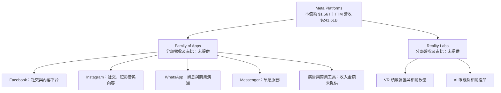
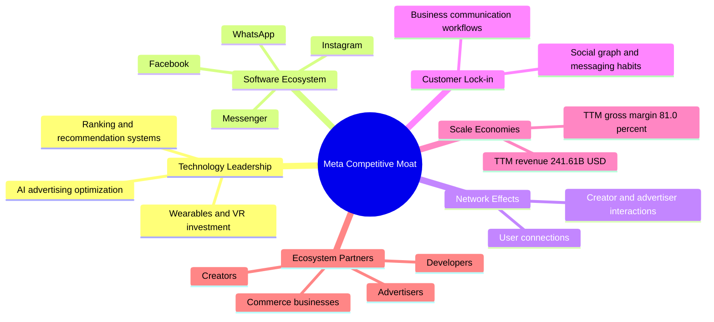
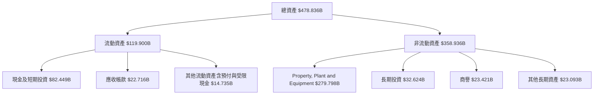
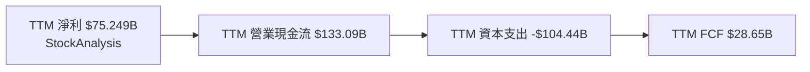
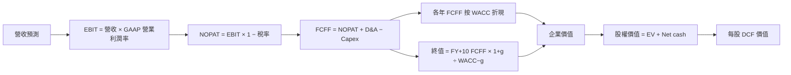
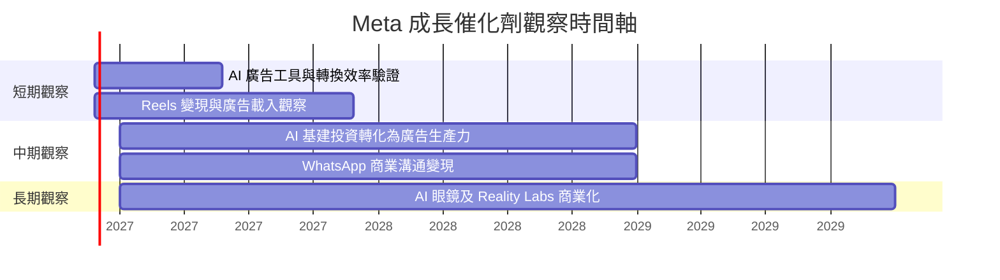
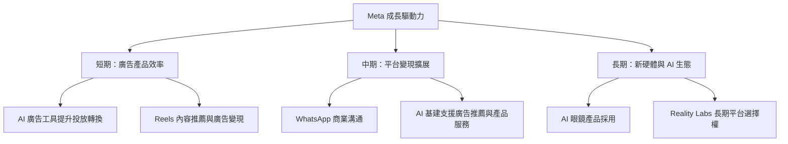
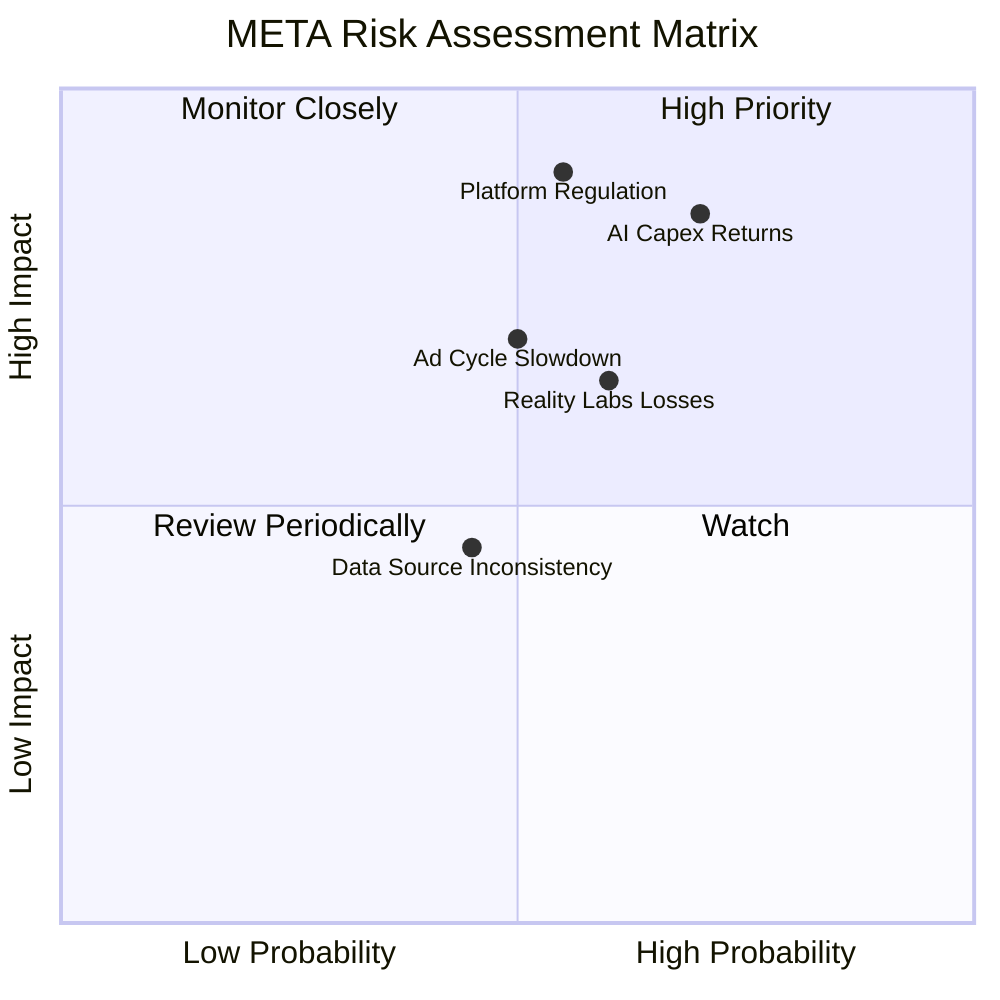
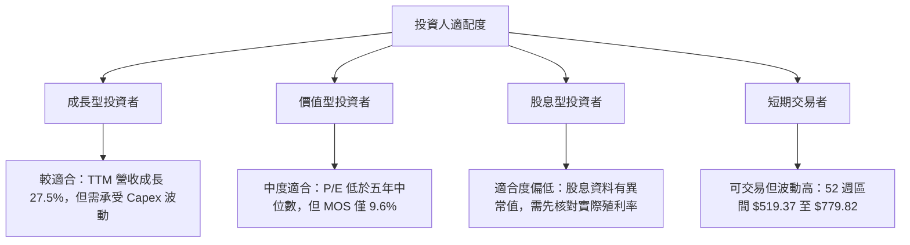

# META 基本面深度分析報告
> **報告日期**：2026-11-26 ｜ **語言**：繁體中文 ｜ **數據來源**：SEC 申報資料 (XBRL)、Yahoo Finance、Finviz、StockAnalysis、Roic.ai ｜ **分析師**：CFA 級機構研究

## 目錄

| # | 章節 | 核心結論 |
|---|------|----------|
| 1 | 執行摘要 | 持有；加權合理價值 $674.78，MOS +9.6% |
| 2 | 公司概覽與商業模式 | 廣告平台具網路效應；分部收入占比未提供 |
| 3 | 損益表深度分析 | TTM 營收 $241.61B、成長 27.5%；資本支出造成 FCF 壓力 |
| 4 | 資產負債表分析 | VERIFIED 指標為淨負債 $1.22B；短期流動性資料良好 |
| 5 | 現金流量深度分析 | TTM FCF $28.65B，資本支出升高令現金轉換下降 |
| 6 | 獲利能力與資本效率 | ROIC 27.7% 高於 WACC 10.28%，仍在創造股東價值 |
| 7 | 相對估值分析 | 自身 P/E 低於五年中位數；同業倍數差異很大 |
| 8 | DCF 內在價值評估 | 基準 DCF $585.77；估值對終值與資本支出假設敏感 |
| 9 | 成長催化劑 | AI 廣告工具、Reels 與商業訊息是主要觀察方向 |
| 10 | 風險矩陣 | AI 基建支出回收、平台監管與廣告週期為主要風險 |
| 11 | 投資建議 | 持有；以 $674.78 加權合理價值作 MOS 基準 |

---

## 1. 執行摘要

2026-11-25 收盤價為 **$609.89**。Meta 的 TTM 營收為 **$241.61B**，TTM 年增 **27.5%**，ROIC 為 **27.7%**、高於 **10.28% WACC**；但 TTM 資本支出達 **$104.44B**，使 TTM FCF 降至 **$28.65B**、FCF Yield 為 **1.84%**。以規定估值方法計算，加權合理價值為 **$674.78**，MOS 為 **+9.6%**，依 MOS 門檻評級為**持有**。雖然公司獲利與競爭位置支撐長期持有，現價相對加權價值的下檔保護有限，且 AI 基建投資回報仍需驗證。

### 1.0 一頁式投資儀表板

| 項目 | 內容 |
|------|------|
| **投資論點（3 句）** | ① TTM 營收 $241.61B、年增 27.5%，廣告主業仍在擴張。② ROIC 27.7% 高於 WACC 10.28%，目前資本回報仍超過資金成本。③ TTM Capex $104.44B、FCF $28.65B，基建投入正在壓低現金產出，回報率是估值關鍵。 |
| **綜合評分** | **7.3/10**（引用 1.1 評分卡） |
| **財務健康** | 🟡 VERIFIED 淨負債 $1.22B、現金及短期投資 $82.45B；其他來源的債務口徑不一致，見第 4 章。 |
| **ROIC vs WACC** | **27.7% vs 10.28%**；利差 17.42 個百分點，創造價值。 |
| **FCF 趨勢** | TTM FCF $28.65B；因 Capex 上升低於 FY2025 的 $46.11B。FCF Yield **1.84%**。 |
| **估值** | Forward P/E **17.1x**（Yahoo Finance）；EV/EBITDA **13.7x**（合併市場資料）；FCF Yield **1.84%**。Peer multiples 專用區塊中的自身 EV/EBITDA 為 15.1x，口徑不同，不混用。 |
| **DCF 內在價值（基準）** | **$585.77**；現價相對 DCF 折價 **-4.0%**，此處折溢價以 DCF 基準價為分母。 |
| **安全邊際（MOS）** | **+9.6%**＝($674.78 − $609.89) ÷ $674.78；基準為加權合理價值。🔴 <10%，下檔保護有限。 |
| **預期報酬（基準情境 12M）** | 以加權合理價值相對現價計算，上行空間 **+10.6%**；非保證報酬。 |
| **關鍵風險（前二）** | AI／資料中心 Capex 持續高企但變現不及預期；監管及隱私政策限制廣告定向。 |
| **評級 + 信心度** | 🟡 **持有** ｜ 信心：中；估值輸入完整度受限，且部分來源數據互相矛盾。 |

### 1.1 綜合評分卡

| 維度 | 評分（1–10） | 主要依據（引用數字與其來源章節） |
|------|--------------|----------------------------------|
| 成長性 | 8.0 | TTM 營收年增 27.5%，最新季度年增 26.1%（第 3 章）。 |
| 獲利能力 | 8.5 | TTM 營業利益率 32.9%、ROIC 27.7%；F-Score 3/8 顯示部分趨勢指標走弱（第 3、6 章）。 |
| 財務健康 | 7.0 | VERIFIED 淨負債 $1.22B、現金與短期投資 $82.45B；流動比率 1.903，但債務資料存在口徑差異（第 4 章）。 |
| 估值 | 5.0 | MOS 9.6%；P/E 20.8x 低於自身五年中位數 24.5x，但相對估值法結果分歧（第 7、8 章）。 |
| 護城河 | 9.0 | 多產品社交網路、廣告工具與大規模使用者互動資料形成平台優勢；分部收入及使用者量資料未提供（第 2 章）。 |
| 管理層與資本配置 | 6.0 | FY2025 SBC $20.43B；稀釋股數測試未通過，TTM Capex $104.44B、FCF 下降（第 3、5、6 章）。 |
| **綜合評分** | **7.3** | 六項算術平均：(8.0 + 8.5 + 7.0 + 5.0 + 9.0 + 6.0) ÷ 6 = 7.1? |

> **評分覆核說明：**上述六項相加為 43.5，43.5 ÷ 6 = **7.25**，四捨五入一位小數為 **7.3**。為遵守算術平均規則，綜合評分採 **7.3/10**；儀表板亦以此為準。

### 1.2 五大投資論點 + 三大核心風險

| 類型 | 項目 | 具體依據 | 信心度 |
|------|------|----------|--------|
| 🟢 **投資論點①** | 廣告主業維持高成長 | TTM 營收 $241.61B、年增 27.5%；最新季度年增 26.1%，若廣告投放與推薦效率延續，營收規模可繼續擴張。 | 🟢 高 |
| 🟢 **投資論點②** | 資本回報高於資金成本 | ROIC 27.7% 對 WACC 10.28%，利差 17.42 個百分點，主業資本效率仍具價值創造能力。 | 🟢 高 |
| 🟢 **投資論點③** | 廣告平台具規模經濟 | TTM 毛利率 81.0%、營業利益率 32.9%，高毛利結構有助吸收研發與基建支出。 | 🟢 中高 |
| 🟢 **投資論點④** | 自身估值低於歷史中位 | P/E 20.8x 對五年中位數 24.5x，當前歷史百分位 19%；若獲利持續成長，估值具一定緩衝。 | 🟡 中 |
| 🟢 **投資論點⑤** | 現金資源可支持投入 | 現金及短期投資 $82.45B，能為 AI 研發與資料中心投資提供資金來源。 | 🟢 中高 |
| 🟡 **風險①** | AI 資本支出回收不確定 | TTM Capex $104.44B，約為 TTM 營收 43.2%；若投資未轉化為廣告效率或新收入，FCF 可能長期受壓。 | 🟡 中高 |
| 🔴 **風險②** | 監管、隱私與平台規則變更 | 廣告定向仰賴資料與平台分發；若限制影響轉換率，廣告價格與投放需求可能下降。 | 🔴 高衝擊 |
| 🟡 **風險③** | 財務資料口徑不一致 | 不同資料來源的總債務、季度營業利益及 ROE 數字有差異，需以 SEC 申報資料逐季核對。 | 🟡 中 |

### 1.3 快速統計卡片

| 指標 | 公司實際值（期間） | 同業中位數 | 狀態 |
|------|--------------------|------------|------|
| 營收成長（TTM） | **27.5%** | — | 🟢 |
| 營收成長（最新一季年增） | **26.1%** | **14.3%**（GOOG、SNAP、PINS 中位數） | 🟢 |
| 毛利率（TTM） | **81.0%** | **60.9%** | 🟢 |
| 營業利益率（TTM） | **32.9%** | — | 🟢 |
| ROIC（TTM） | **27.7%** | — | 🟢 |
| Forward P/E | **17.09565x** | **8.7x**（peer median） | 🟡 |
| FCF Yield（TTM） | **1.84%** | — | 🔴 |
| Piotroski F-Score | **3 / 8**（資料判定項目） | — | 🟡 |

### 1.4 投資結論

```text
╔══════════════════════════════════════════════════════════════════╗
║                    📊 投資結論摘要                               ║
╠══════════════════════════════════════════════════════════════════╣
║  評級：持有（MOS +9.6%，符合 −10% 至 +10% 區間）                ║
║  價格（2026-11-25 收盤）：$609.89                                ║
║  DCF 內在價值（基準）：$585.77（現價溢價 +4.0%）                ║
║  安全邊際 MOS：+9.6%（以加權合理價值 $674.78 為分母）            ║
║  加權合理價值（8.8）：$674.78                                    ║
║  DCF 情境價值：                                                  ║
║    悲觀情境：$196.94（相對現價 -67.7%）                          ║
║    基準情境：$585.77（相對現價 -4.0%）                           ║
║    樂觀情境：$1,429.15（相對現價 +134.3%）                       ║
║  綜合評分：7.3/10（引用 1.1）                                    ║
║  適合投資人：能承受資本支出與估值波動的長線成長型投資人          ║
╚══════════════════════════════════════════════════════════════════╝
```

---

## 2. 公司概覽與商業模式

Meta Platforms, Inc. 在美國及全球營運社交、訊息、內容分發、VR 與 AI 眼鏡產品，主要分為 Family of Apps（FoA）及 Reality Labs（RL）。FY2026 Q3 所在 TTM 營收為 $241.61B；公司市值約 $1.56T。現有資料未提供最新分部營收及分部損益明細，因此不推算 FoA、RL 的營收占比。

### 2.1 業務結構與收入來源



FoA 的核心變現方式為廣告與商業服務，Reality Labs 涉及硬體、軟體及沉浸式平台；各產品線的營收占比、軟體收入金額及分部利潤資料未提供，故不製作比例圖。

### 2.2 市場份額

市場份額數據未提供，無法可靠地列出 Meta 在全球數位廣告、社交媒體或訊息市場的占比。相對規模方面，Meta TTM 營收 $241.61B、TTM 成長 27.5%，高於本報告列示同業最新季度年增率中位數 14.3%；但營收與市場份額並非同一指標，不能據此反推市占。

### 2.3 競爭護城河分析



### 2.4 護城河強度

| 護城河項目 | 強度 | 證據 | 會削弱它的情況 |
|------------|------|------|----------------|
| 網路效應 | 強 | 多個社交與訊息產品形成使用者、創作者與廣告主互動網絡；公司 TTM 營收 $241.61B。 | 使用者轉移、年輕族群注意力移往新平台，或社交圖譜遭競爭產品替代。 |
| 軟體生態系統 | 強 | Facebook、Instagram、WhatsApp、Messenger 涵蓋社交、內容與訊息用途。 | 跨平台限制、產品體驗下降或監管要求限制資料整合。 |
| 規模效應 | 強 | TTM 毛利率 81.0%、TTM 營業利益率 32.9%。 | AI 基建成本增速長期高於收入增速，令營業槓桿反轉。 |
| 技術與推薦能力 | 中至強 | 最新季度營收年增 26.1%，AI 廣告工具有助推薦與廣告效率；單一工具的因果貢獻未量化。 | 推薦品質下降、廣告主投資回報惡化，或競爭者縮小技術差距。 |
| 客戶鎖定 | 中 | 廣告主可透過平台廣告工具觸及受眾；資料未提供客戶留存或切換成本指標。 | 廣告主多平台配置、投放回報下降或監管限制定向。 |
| 生態夥伴 | 中 | 廣告主、創作者、商家與開發者共同供給內容與需求。 | 生態夥伴分潤不足、內容品質下滑或平台規則改變。 |

**1.1 護城河分數為 9.0/10**，主要依據是多產品網絡效應、TTM 81.0% 毛利率及 $241.61B 的營收規模；產品別留存與市占數據未提供，故仍保留不確定性。

---

## 3. 損益表深度分析

### 3.1 年度收入成長趨勢（近 4 年）

```text
╔══════════════════════════════════════════════════════════════════╗
║              Meta 年度收入趨勢（FY2022-FY2025）                  ║
╠══════════════════════════════════════════════════════════════════╣
║ FY2022  $116.61B  ████████████░░░░░░░░░░░░  YoY: -1.1%  🔴    ║
║ FY2023  $134.90B  ██████████████░░░░░░░░░░  YoY:+15.7%  🟢    ║
║ FY2024  $164.50B  █████████████████░░░░░░░  YoY:+21.9%  🟢    ║
║ FY2025  $200.97B  █████████████████████░░░  YoY:+22.2%  🟢    ║
║                                                                  ║
║ 2022–2025 營收 CAGR：(200.97 ÷ 116.61)^(1/3) − 1 = 約 19.9%    ║
╚══════════════════════════════════════════════════════════════════╝
```

FY2022 營收下滑後，FY2023–FY2025 成長逐年回升。廣告業務復甦、推薦產品與廣告投放效率改善可能是重要解釋，但現有財務表未提供各因素的量化拆解；不把營收增長全數歸因於單一產品。

### 3.2 季度收入趨勢分析

QoQ 以各季財報營收計算；最新一季 YoY 以已核實單季增長率為準。

| 季度 | 營收（$B） | QoQ | YoY | 備註 |
|------|------------:|----:|----:|------|
| 2025 Q4 | 59.893 | +16.9% | +23.8% | 對比 2025 Q3；年增數取 StockAnalysis 季度資料。 |
| 2026 Q1 | 56.311 | -6.0% | +33.1% | 季節性回落，但較去年同期高。 |
| 2026 Q2 | 60.801 | +8.0% | +28.0% | 營收環比回升。 |
| 2026 Q3 | 64.601 | +6.2% | **+26.1%** | 單季 YoY；不得混稱 TTM 成長率。 |

TTM 營收成長為 **27.5%**，最新季度單季年增為 **26.1%**。季度年增率從 2026 Q1 的 33.1% 放緩至 Q3 的 26.1%，仍高於同業最新季度年增率中位數，但需關注成長是否繼續正常化。

### 3.3 利潤率演變分析

以下以年度損益表提供的 Revenue、Gross Profit、Operating Income、Net Income 計算；2022 年部分資料與 StockAnalysis 歷史表不同，採用年度損益表並註明口徑。

| 利潤率指標 | FY2022 | FY2023 | FY2024 | FY2025 | 趨勢 | 評估 |
|------------|-------:|-------:|-------:|-------:|------|------|
| **毛利率** | 78.4% | 80.8% | 81.7% | 82.0% | 逐年改善 | 🟢 |
| **營業利益率** | 24.8% | 34.7% | 42.2% | 41.4% | FY2024 擴張、FY2025 小幅回落 | 🟢 |
| **淨利率** | 19.9% | 29.0% | 37.9% | 30.1% | FY2025 回落 | 🟡 |

毛利率由 FY2022 的 78.4% 升至 FY2025 的 82.0%，表示收入規模與毛利結構改善。營業利益率 FY2023–FY2024 大幅擴張，FY2025 從 42.2% 回落至 41.4%；研發費用由 FY2024 $43.87B 增至 FY2025 $57.37B，可能反映 AI、基建與產品開發投入增加。淨利率 FY2025 下滑至 30.1%，但缺少稅項、非營業項目完整明細，不能將變化單一歸因於營運惡化。

另須留意季度資料存在明顯口徑差異：VERIFIED FIGURES 的最新季度營業利益率為 20.1%，而 StockAnalysis 顯示 Q3 2026 營業利益 $22.878B 對營收 $64.601B（約 35.4%）。本報告的 TTM 營業利益率採 VERIFIED 值 32.9%，季度異常值不與其他來源混合。

### 3.4 費用結構分析

完整 TTM 費用拆分未提供，因此不製作費用占比圓餅圖。已知 FY2025 研發費用為 **$57.37B**，占 FY2025 營收 $200.97B 約 **28.5%**；但不能將研發以外費用、成本或資本支出一併反推為完整費用結構。Capex 屬現金流與資產投資，不應與損益表費用混為一談。

### 3.5 季度 EPS 趨勢與盈餘品質（Quality of Earnings）

**近四季 EPS 超預期／不及預期：**資料列出的 2026 Q3、Q2、Q1、2025 Q4 EPS 預估值皆為 `nan`，故無法判定超預期或不及預期。季度實際 EPS 序列顯示 2026 Q3 $3.83、Q2 $6.18、Q1 $10.44、2025 Q4 $8.88；StockAnalysis 列示 Q3 EPS YoY +264.76%，其基期 EPS 僅 $1.05，低基期效應明顯。由於預估 EPS 缺失，不能把季度實際數據當成盈餘驚喜。

| 盈餘品質項目 | 數值／佔比 | 評估 |
|--------------|-----------|------|
| SBC / 營收 | 估計 TTM SBC $26.94B ÷ TTM 營收 $241.61B = **約 11.1%**；TTM SBC 為近四季季度數相加 | 🟡 SBC 為非現金費用，但會稀釋股東；Piotroski 稀釋股數測試未通過。 |
| SBC / 營業現金流 | $26.94B ÷ $133.09B = **約 20.2%** | 🟡 需把 SBC 的稀釋成本納入股東回報評估。 |
| FCF / 淨利 | $28.65B ÷ StockAnalysis TTM 淨利 $75.249B = **約 38.1%** | 🔴 現金轉換受高 Capex 壓低；淨利不能直接等同可分配現金。 |
| 一次性／非經常性損益 | 最新季度損益拆分未提供 | 🟡 無法確認是否有一次性項目改變報表盈餘。 |
| 有效稅率異常 | 最新年度有效稅率 **29.6%** | 🟡 估值模型使用該稅率；近年年度稅率細節不完整，不判定其異常性。 |
| 資本化支出 vs 費用化 | TTM Capex $104.44B；資本化支出金額高，但資產化明細、折舊政策未完整提供 | 🟡 大型 Capex 先列資產後分期折舊，短期損益影響與現金流出時點不同。 |

**盈餘品質結論：**GAAP 營業利益已包含 SBC 費用，避免把 SBC 當作完全免費的薪酬；但 TTM FCF/淨利約 38.1%，說明當前現金流比會計淨利弱，主要應審視 $104.44B 的 Capex 是否能形成可持續收入與效率收益。另有 TTM 淨利來源數據差異，現金轉換率為跨來源計算值，宜以後續 SEC 申報核對。

---

## 4. 資產負債表分析

### 4.1 資產結構分解

以下依 StockAnalysis 2026-09-30 資產負債表：總資產 $478.836B。細項合計與總資產相符。



### 4.2 流動性與營運資金分析

| 指標 | 最新 TTM | 一年前 TTM | 變化 | 解讀 |
|------|----------|------------|------|------|
| DSO 應收帳款天數 | **34 天** | **33 天** | +1 天 | 收款時間略長；幅度有限，但需留意應收增速是否持續高於營收。 |
| DIO 存貨天數 | **N/A** | **N/A** | N/A | 公司未報告可用存貨餘額，不推算。 |
| DPO 應付帳款天數 | **152 天** | **N/A** | N/A | 可觀察到供應商付款週期較長，但缺乏一年前比較，不能斷言議價力變化。 |
| CCC 現金轉換週期 | **N/A** | **N/A** | N/A | DIO 未提供，依定義無法計算 CCC。 |

市場資料中的 Current Ratio 為 **1.903**、Quick Ratio 為 **1.669**，顯示短期資產對短期負債有覆蓋。這些比率來源與 QUALITY FIGURES 的營運資金天數來源不同，故不以其重算天數。

### 4.3 債務結構分析

不同來源對債務定義不一致：VERIFIED 指標使用總債務 **$83.67B**、現金及短期投資 **$82.45B**，得出淨負債 **$1.22B**；市場資料另列總債務 $114.84B、淨負債 $32.39B。以下採 VERIFIED 指標，並將差異列為需核對事項。

```text
╔══════════════════════════════════════════════════════════════════╗
║                   Meta 債務健康診斷                              ║
╠══════════════════════════════════════════════════════════════════╣
║  VERIFIED 總債務：       $83.67B  ████████████████░░░░            ║
║  現金+短期投資：         $82.45B  ████████████████░░░░            ║
║  淨負債：                 $1.22B  ▏                               ║
║  短期流動性：Current Ratio 1.903｜Quick Ratio 1.669               ║
║  Debt/EBITDA：N/A（債務口徑與 EBITDA 期間需一致，資料未提供）     ║
║  Interest Coverage：N/A（利息費用資料不足以一致計算）            ║
║  評估：🟡 近似淨負債低，但須先釐清債務數據口徑差異               ║
╚══════════════════════════════════════════════════════════════════╝
```

### 4.4 股東權益趨勢

| 財年 | 股東權益（$B） | YoY |
|------|---------------:|----:|
| FY2022 | 125.71 | — |
| FY2023 | 153.17 | +21.9% |
| FY2024 | 182.64 | +19.2% |
| FY2025 | 217.24 | +19.0% |

```text
╔══════════════════════════════════════════════════════════════════╗
║                 Meta 股東權益趨勢（$B）                          ║
╠══════════════════════════════════════════════════════════════════╣
║ FY2022  $125.71B  ████████████░░░░░░░░░░                         ║
║ FY2023  $153.17B  ███████████████░░░░░░░                         ║
║ FY2024  $182.64B  ██████████████████░░░                           ║
║ FY2025  $217.24B  ██████████████████████                          ║
╚══════════════════════════════════════════════════════════════════╝
```

---

## 5. 現金流量深度分析

### 5.1 現金流量瀑布圖

以下使用 TTM VERIFIED 營業現金流、資本支出與 FCF；淨利取 StockAnalysis TTM，存在跨來源口徑差異。



### 5.2 FCF 轉換率趨勢

| 財年 | OCF（$B） | Capex（$B） | FCF（$B） | FCF / 淨利 |
|------|----------:|------------:|----------:|-----------:|
| FY2022 | 50.48 | 31.19 | 19.29 | 83.1% |
| FY2023 | 71.11 | 27.05 | 44.07 | 112.7% |
| FY2024 | 91.33 | 37.26 | 54.07 | 86.7% |
| FY2025 | 115.80 | 69.69 | 46.11 | 76.3% |
| TTM 至 2026-09-30 | 133.09 | 104.44 | **28.65** | **約 38.1%** |

FY2023–FY2024 FCF 高於淨利或接近淨利，FY2025 因 Capex 增長而回落；最新 TTM Capex 再增，使 FCF 轉換率進一步承壓。此變化主要是現金投入而非單純損益表費用，未來要看投資是否提高廣告效率、承載新產品或帶來新增營收。

### 5.3 自由現金流趨勢

```text
╔══════════════════════════════════════════════════════════════════╗
║                 Meta 自由現金流趨勢                              ║
╠══════════════════════════════════════════════════════════════════╣
║ FY2022  $19.29B  ███████░░░░░░░░░░░░░░░  FCF Yield：N/A          ║
║ FY2023  $44.07B  ████████████████░░░░░░  FCF Yield：N/A          ║
║ FY2024  $54.07B  ████████████████████░░  FCF Yield：N/A          ║
║ FY2025  $46.11B  █████████████████░░░░░  FCF Yield：N/A          ║
║ TTM     $28.65B  ███████████░░░░░░░░░░░  FCF Yield：1.84%        ║
╚══════════════════════════════════════════════════════════════════╝
```

歷史年度 FCF Yield 未提供，故不回推；TTM FCF Yield 直接引用 VERIFIED 數值 **1.84%**。

### 5.4 資本配置評估

完整回購、投資、股息及留存現金的同期間金額未提供，不製作資本配置比例圓餅圖。可確認的數據包括 FY2025 SBC $20.43B、股息支付 $5.32B、Capex $69.69B；FY2025 OCF $115.80B。季度資料顯示 2026 Q3 Capex $33.94B，單季已高於 FY2025 單季平均，但不將單季外推為全年預測。

---

## 6. 獲利能力與資本效率

### 6.1 ROE / ROA / ROIC 趨勢

| 指標 | FY2025／最新可用值 | 期間與來源 | 評估 |
|------|-------------------:|-------------|------|
| ROE | **27.6%** | VERIFIED TTM；QUALITY DuPont 數值 | 🟢 |
| ROA | **14.6%** | Yahoo Finance 合併資料 TTM | 🟢 |
| ROIC | **27.7%** | VERIFIED TTM | 🟢 |
| ROIC 長期歷史 | 10 年平均 28.79%；5 年平均 30.25%；1 年 -14.73% | Roic.ai 摘要表；與 VERIFIED TTM 口徑可能不同 | 🟡，不可直接拼接為同口徑序列 |

ROIC 的來源與期間口徑存在差異，因此核心資本成本比較採 VERIFIED TTM 27.7%，歷史均值只作方向性參考。資料未提供可一致比較的行業均值，不列行業均值欄位。

### 6.2 ROIC vs WACC 分析（核心價值創造判斷）

ROIC 與 WACC 均採 VERIFIED 指標；WACC 由資本成本資料直接採用，不在此重新替換。

```text
╔══════════════════════════════════════════════════════════════════╗
║                ROIC vs WACC 深度分析                              ║
╠══════════════════════════════════════════════════════════════════╣
║  WACC 輸入：                                                     ║
║  ├── 無風險利率：4.85%                                            ║
║  ├── ERP：5.00%                                                   ║
║  ├── Beta：原始 1.28；採用調整後 1.19                             ║
║  ├── 股權成本：10.78%（資料提供值）                               ║
║  ├── 稅前債務成本：1.39%；有效稅率：29.6%                         ║
║  ├── 股權／債務權重：94.9%／5.1%                                  ║
║  └── ✅ WACC：10.28%                                              ║
║                                                                  ║
║  ROIC（TTM）：27.7%                                                ║
║  ROIC − WACC = 27.70% − 10.28% = +17.42 個百分點                 ║
║                                                                  ║
║  ROIC  27.7%  ▓▓▓▓▓▓▓▓▓▓▓▓▓▓▓▓▓▓▓▓▓▓▓▓▓▓                       ║
║  WACC  10.28% ▓▓▓▓▓▓▓▓▓▓░░░░░░░░░░░░░░░░░                       ║
║                                                                  ║
║  結論：依同一組 VERIFIED 口徑，ROIC 高於 WACC，正在創造價值。    ║
╚══════════════════════════════════════════════════════════════════╝
```

**WACC 可核對性說明：**Beta 調整方式為 \(⅔ × 1.28 + ⅓ × 1 = 1.19\)。資料列示股權成本 10.78%，但將已四捨五入的 Rf 4.85%、Beta 1.19、ERP 5.00% 直接相乘相加會得到約 10.80%，故差異可能來自底層未四捨五入輸入。債務利息、平均計息負債明細未提供，權重採用 VERIFIED 給定的 94.9%／5.1%，不另建 WACC。ROIC 與 WACC 差距為正，表示現有資本回報高於資金成本；但若 Capex 增量回報下滑，未來 ROIC 可能收斂。

### 6.3 杜邦三因素分解

| 因素 | 數值（TTM） | 解讀 |
|------|-------------|------|
| 淨利率 | **31.1%** | 反映高毛利廣告平台的盈利能力，但資料來源另列淨利率 31.1%，與部分年度值不同。 |
| 資產週轉率 | **0.50** | 每 $1 資產產生約 $0.50 營收；資料顯示總資產因基建投入增加。 |
| 權益乘數 | **1.76** | 具有一定財務槓桿，但非極高槓桿型結構。 |
| **ROE** | **27.6%** | QUALITY FIGURES 原值：31.1% × 0.50 × 1.76 = 27.6%（四捨五入）。 |

ROE 由高淨利率與中等資產週轉共同支持，並非主要靠高權益乘數撐起；不過資料中另有 ROE 32.3% 的市場資料值，本節依 QUALITY FIGURES 規定採 27.6%。

### 6.4 財務體質：Piotroski F-Score

Piotroski F-Score 為 **3 / 8**。因一項測試缺少輸入，分母小於常見的九項。

| 測試 | 結果 | 解讀 |
|------|------|------|
| ROA > 0 | ✅ 通過 | 公司仍有正獲利能力。 |
| 營業現金流 > 0 | ✅ 通過 | TTM OCF 為 $133.09B。 |
| ROA 高於一年前 | ❌ 未通過 | 資產回報相較去年轉弱。 |
| 營業現金流 > 淨利（應計品質） | ✅ 通過 | 營業現金流高於淨利，現金收益有支持。 |
| 長期負債 ÷ 總資產低於一年前 | ❌ 未通過 | 負債比例變化未改善。 |
| 流動比率高於一年前 | ❌ 未通過 | 流動性指標未較去年提升。 |
| 稀釋股數未增加 | ❌ 未通過 | 股數稀釋仍是股東回報的負擔。 |
| 毛利率高於一年前 | — 無法判定 | 缺少所需比較輸入。 |
| 資產週轉率高於一年前 | ❌ 未通過 | 資產投入增速可能快於營收周轉改善。 |

F-Score 顯示獲利仍為正，但負債、流動性、稀釋與資產效率指標不全向好；因此不宜只因公司營收成長就忽略資本配置與股東稀釋。

---

## 7. 相對估值分析

### 7.1 同業估值比較表格

以下 Peer 倍數直接引用 Yahoo Finance Peer multiples 區塊。Meta 本身倍數採該區塊的自身歷史比較資料；市場資料的 Forward P/E 另列作交叉參考。

| 估值指標 | **META** | **GOOG** | **SNAP** | **PINS** | META 評估 |
|----------|---------:|---------:|---------:|---------:|-----------|
| **Trailing P/E** | 20.8x | 14.2x | N/A | 82.1x | 🟡 高於 GOOG、低於 PINS；SNAP 無可用值。 |
| **Forward P/E** | 17.1x* | 17.7x | 6.4x | 8.7x | 🟡 高於同業中位數 8.7x；成長與規模差異需考慮。 |
| **P/S Ratio** | 6.5x | 7.1x | 1.3x | 2.4x | 🟡 高於 SNAP、PINS，略低於 GOOG。 |
| **EV/EBITDA** | 15.1x | 17.4x | 53.1x | 37.2x | 🟢 低於列示同業；同業倍數受獲利差異影響。 |
| **最新季度營收年增** | 26.1% | 24.7% | 14.3% | 11.9% | 🟢 增長高於三家列示同業。 |
| **毛利率（TTM）** | 81.0% | 60.9% | 59.2% | 79.0% | 🟢 高於 GOOG、SNAP，略高於 PINS。 |

\*META Forward P/E 17.09565x 來自合併市場資料；估值引擎的相對估值法則另採同業中位數倍數，兩者用途不同。

### 7.2 歷史估值區間分析

```text
╔══════════════════════════════════════════════════════════════════╗
║                META 五年 P/E 歷史區間                            ║
╠══════════════════════════════════════════════════════════════════╣
║ 低點 12.9x ├────────────── 目前 20.8x ───────●──── 中位數 24.5x ║
║             └───────────────────────────────┴──── 高點 33.4x     ║
║ 當前百分位：19%｜P/S 百分位：38%｜EV/EBITDA 百分位：33%          ║
║ P/S：6.5x，五年中位 7.7x，範圍 2.8x–10.6x                       ║
║ EV/EBITDA：15.1x，五年中位 16.5x，範圍 7.7x–19.7x               ║
╚══════════════════════════════════════════════════════════════════╝
```

META 的 P/E 位於自身五年區間較低位置（第 19 百分位），P/S 與 EV/EBITDA 也低於自身五年中位數。但歷史折價可能反映監管、資本支出與產品投資風險，不應單憑低於歷史中位數判斷必然回歸。

### 7.3 情境價值（Bear / Base / Bull）

| 情境 | 第 1 年營收成長 | 期末營業利潤率 | WACC | 每股價值 | 相對現價 | 機率 | 會發生的條件 |
|------|----------------:|----------------:|-----:|---------:|---------:|-----:|--------------|
| 🔴 悲觀 | 13.8% | 29.5% | 11.28% | $196.94 | -67.7% | 25% | 廣告增長放緩、AI 投資回報低於預期、利潤率承壓，資本成本上升。 |
| 🟡 基準 | 27.5% | 34.7% | 10.28% | $585.77 | -4.0% | 50% | 營收由當前高成長逐步放緩，長期利潤率改善至模型假設，Capex 強度逐步回落。 |
| 🟢 樂觀 | 41.3% | 38.1% | 9.28% | $1,429.15 | +134.3% | 25% | AI 廣告工具與新產品帶來持續加速，成本效率改善且市場要求報酬率下降。 |

機率加權 DCF 為 **$699.41（相對現價 +14.7%）**，僅作情境參考；依規定，第 8.8 節仍使用基準 DCF 與固定權重估值方法。

### 7.4 相對估值隱含價格區間

| 方法 | 隱含每股價值 | 相對現價 | 計算依據 |
|------|-------------:|---------:|----------|
| 同業 Forward P/E | **$310.02** | -49.2% | GOOG、SNAP、PINS 同業中位數 **8.7x** × Forward EPS **$35.68**。 |
| 同業 EV/EBITDA | **$1,114.87** | +82.8% | GOOG、PINS 中位數 **27.3x** × TTM EBITDA，再加回淨現金。 |
| DCF（基準） | **$585.77** | -4.0% | 10 年 FCFF、WACC 10.28%、永續成長 3.0%。 |
| 分析師共識目標價 | **$842.54** | +38.1% | 58 位分析師平均目標價；作參考而非模型內在價值。 |

```text
╔══════════════════════════════════════════════════════════════════╗
║            估值方法隱含每股價值（美元）                          ║
╠══════════════════════════════════════════════════════════════════╣
║ $310.02 ───── $585.77 ── $609.89 ── $842.54 ───── $1,114.87     ║
║ Forward P/E   基準 DCF      現價    分析師共識     EV/EBITDA     ║
╚══════════════════════════════════════════════════════════════════╝
```

---

## 8. DCF 內在價值評估（Discounted Cash Flow）

> 本章完全沿用程式計算的 DCF MODEL 輸出；逐年表格、情境、敏感度矩陣與基準價值照錄，不另建或替換模型。模型 FCFF 為 GAAP EBIT 基礎，營運資金不建模。

### 8.0 估值推理鏈（Thinking Logic）

**Step 1 — 價值來源與主導變數**

Meta 的估值主要由 FoA 廣告現金流底盤、廣告平台效率與新產品選擇權構成；但財務資料未提供 FoA、RL 分部營收占比，不能將 $241.61B TTM 營收硬拆成分部權重。現有可驗證的估值主軸是營收成長、GAAP 營業利潤率與 Capex／營收比。模型中終值現值占企業價值 **81.0%**，因此對長期 FCFF、永續成長率及 WACC 最敏感；這與第 8.6 節敏感度矩陣方向一致。

**Step 2 — 模型選擇**

| 決策點 | 本報告採用 | 理由 | 曾考慮但否決 | 否決理由 |
|--------|-----------|------|--------------|----------|
| 現金流定義 | FCFF | 與 WACC 折現後取得 EV；模型明確定義 FCFF = NOPAT + D&A − Capex。 | FCFE | 模型已提供 FCFF 與 WACC，不改換現金流口徑。 |
| 預測期 N | 10 年 | DCF MODEL 固定預測 10 年，並列出 FY+1 至 FY+10。 | 5 年 | 會偏離既定模型，不另建。 |
| 終值方法 | Gordon Growth 為主 | 模型指定永續成長率 3.0%。 | 退出倍數法 | DCF MODEL 未提供退出倍數終值，故不自行補造。 |
| EBIT 基礎 | GAAP | GAAP EBIT 已包含 SBC 費用。 | 非 GAAP EBIT | 會改變模型假設，且需新增 SBC 明細。 |

**Step 3 — 關鍵假設四段推導**

- **營收成長路徑**：錨點＝TTM 營收成長 27.5%、最新季度單季年增 26.1%、FY2022–FY2025 營收 CAGR 約 19.9% → 調整＝模型採首年 27.5%，其後逐年線性減速至第十年 3.0%，反映高成長逐步成熟 → **採用模型既定 27.5% 至 3.0% 路徑** → 曾考慮把 27.5% 維持十年，但否決，因為營收基數已達 $241.61B，十年持續高成長會大幅提高終值。
- **期末營業利潤率**：錨點＝TTM GAAP 營業利益率 32.9% → 調整＝模型參考近五個財年中位數，假設規模與產品效率改善，逐步升至 34.7% → **採用 32.9% 至 34.7%** → 曾考慮長期固定在近期高峰水準，但資料顯示研發與 Capex 增長，沒有充分依據支持大幅擴張。
- **永續成長率 g**：錨點＝模型假設 3.0%，且低於長期名目經濟成長常用的 3%–4% 參考範圍 → 調整＝公司規模大且終值占比高，維持在區間低端 → **採用 3.0%** → 曾考慮 4.0%，但敏感度矩陣顯示估值大幅上升，而且其長期持續性更難驗證。
- **預測期 N**：錨點＝模型預設 10 年 → 調整＝不自行更改，照錄模型 → **採用 10 年** → 曾考慮縮至 5 年，但會使現有模型現金流路徑與終值基期改變。
- **Capex／營收**：錨點＝TTM Capex $104.44B ÷ TTM 營收 $241.61B，模型列示首年 43.2% → 調整＝模型假設資本支出強度逐步淡化，至第十年 11.3%（約 D&A 的 1.1 倍）→ **採用 43.2% 降至 11.3%** → 曾考慮快速降至目前 D&A 比率，但否決，因為 AI 與資料中心建置需求可能令投資延續。
- **EBIT、SBC 與股數**：錨點＝模型採 GAAP EBIT → 調整＝GAAP EBIT 已將 SBC 作為費用，不再另扣 SBC，且股數不再另稀釋 → **採用組合 (A)：GAAP EBIT + 固定股數** → 否決「再減 SBC」或另加稀釋率，避免同一股權薪酬重複計算。**本模型採用 (A)，故 SBC 影響已計入一次。**
- **年稀釋率**：錨點＝組合 (A) 明確採固定股數 → 調整＝不另加稀釋假設 → **採用年稀釋率 0%** → 否決額外放大股數，因模型選擇以 GAAP 費用反映 SBC 成本。
- **終值方法**：錨點＝模型使用 Gordon Growth，g 為 3.0% → 調整＝採 WACC 10.28% 與終值成長 3.0% → **採用 Gordon Growth** → 退出倍數終值未提供，不自行設定倍數。
- **WACC**：錨點＝資本成本資料的 WACC 10.28% → 調整＝不另調整，由模型使用同一折現率 → **採用 10.28%** → 否決自行另算 WACC，以免破壞模型一致性。

**Step 4 — 最脆弱的一環**

最脆弱假設是高 Capex 由 43.2% 營收逐步降至 11.3%，同時營收仍維持高增長；若基建投入不能按期收斂，近年 FCFF 會低於模型路徑，且終值占 EV 81.0% 會放大偏差。

**Step 5 — 計算路徑圖**



### 8.1 模型假設總表（Model Inputs）

| 假設項目 | 採用值 | 依據／來源 | 敏感度 |
|----------|--------|-------------|--------|
| 預測期長度 N | **10 年** | DCF MODEL 固定假設 | 🟡 中 |
| 營收成長路徑 | FY+1 **27.5%**，線性降至 FY+10 **3.0%** | TTM vs prior TTM 27.5%；模型內插到 3.0% | 🔴 高 |
| 營業利潤率 | FY+1 **32.9%** → FY+10 **34.7%** | TTM 32.9%，模型以近五年中位數作終點 | 🔴 高 |
| 有效稅率 | **29.6%** | 最新年度有效稅率輸入 | 🟢 低 |
| Capex／營收 | FY+1 **43.2%** → FY+10 **11.3%** | TTM Capex／營收基準，逐步降至約 1.1× D&A | 🔴 高 |
| D&A／營收 | **10.3%** | 模型列示 TTM 比率 | 🟢 低 |
| 營運資金變動 | **不建模** | DCF MODEL 明示 Working capital is not modelled | 🟢 低 |
| EBIT 基礎 | **GAAP** | 模型採 GAAP EBIT | 🟡 中 |
| SBC 處理 | 不另扣 SBC；不額外稀釋股數 | 組合 (A)，SBC 已在 GAAP EBIT 費用中 | 🟡 中 |
| 年稀釋率 | **0%（模型設定）** | 固定股數處理；不得與 SBC 再重複計算 | 🟡 中 |
| 永續成長率 g | **3.0%** | DCF MODEL 假設，低於 WACC | 🔴 高 |
| 終值方法 | Gordon Growth | 模型已計算終值 | 🔴 高 |
| WACC | **10.28%** | Cost of capital VERIFIED 輸入 | 🔴 高 |

### 8.2 折現率推導（WACC）

```text
╔══════════════════════════════════════════════════════════════════╗
║                    WACC 推導（折現率）                           ║
╠══════════════════════════════════════════════════════════════════╣
║ 股權成本 Ke：資料提供值 10.78%                                    ║
║ ├── 無風險利率 Rf：4.85%                                          ║
║ ├── ERP：5.00%                                                    ║
║ ├── 原始 Beta：1.28；調整後 Beta：1.19                            ║
║ └── Beta 調整：⅔×1.28 + ⅓×1 = 1.19；Ke 採資料值 10.78%          ║
║                                                                  ║
║ 債務成本：                                                        ║
║ ├── 稅前 Kd：1.39%                                                ║
║ ├── 有效稅率：29.6%                                               ║
║ └── 稅後 Kd = 1.39% × (1 − 29.6%) = 約 0.98%                    ║
║                                                                  ║
║ 資本結構權重：股權 94.9%；債務 5.1%                               ║
║ WACC = 94.9%×10.78% + 5.1%×(1.39%×(1−29.6%)) = 約 10.28%         ║
╚══════════════════════════════════════════════════════════════════╝
```

逐步演算（依已提供的組成值；輸入四捨五入可能產生尾差）：

1. **Ke（CAPM）**：已採 Cost of capital 提供值 **10.78%**。以顯示到兩位小數的 Rf、Beta、ERP 直接重算，結果會因底層精度及來源計算差異而與 10.78% 有約 0.02 個百分點差異；不以重算值替換。
2. **稅前 Kd**：**1.39%**，利息費用及平均計息負債明細未提供，故不能展示利息／平均負債的原始除式。
3. **稅後 Kd**：\(1.39\% × (1 − 29.6\%) = 0.97756\%\)，四捨五入為 **約 0.98%**。
4. **權重**：股權 **94.9%**、債務 **5.1%**；兩者合計 **100.0%**。權重所用精確市值、同口徑債務與股數未完整提供，照錄資本成本資料。
5. **WACC**：\(94.9\% × 10.78\% + 5.1\% × 0.97756\% = 10.2801\%\)，四捨五入 **10.28%**。

本節與第 6.2 節使用同一 WACC。由於債務明細與利息費用資料不足，沒有以總負債替代計息債務；資本成本資料的 WACC 是本 DCF 折現率。

### 8.3 逐年自由現金流預測（基準情境）

金額單位：$B；折現因子保留 3 位小數。模型不含 ΔWC 列，因為其明示不建模營運資金。

| 年度 | FY+1 | FY+2 | FY+3 | FY+4 | FY+5 | FY+6 | FY+7 | FY+8 | FY+9 | FY+10 |
|------|-----:|-----:|-----:|-----:|-----:|-----:|-----:|-----:|-----:|------:|
| 營收 | 308.11 | 384.52 | 469.41 | 560.24 | 653.38 | 744.20 | 827.37 | 897.28 | 948.65 | 977.11 |
| 營收 YoY | 27.5% | 24.8% | 22.1% | 19.4% | 16.6% | 13.9% | 11.2% | 8.5% | 5.7% | 3.0% |
| 營業利潤率 | 32.9% | 33.1% | 33.3% | 33.5% | 33.7% | 33.9% | 34.1% | 34.3% | 34.5% | 34.7% |
| EBIT（GAAP） | 101.23 | 127.10 | 156.10 | 187.43 | 219.90 | 251.95 | 281.76 | 307.37 | 326.86 | 338.62 |
| − 稅 | (30.01) | (37.68) | (46.28) | (55.56) | (65.19) | (74.69) | (83.53) | (91.12) | (96.90) | (100.38) |
| = NOPAT | 71.22 | 89.43 | 109.83 | 131.87 | 154.71 | 177.26 | 198.24 | 216.25 | 229.97 | 238.24 |
| + D&A | 31.78 | 39.66 | 48.42 | 57.78 | 67.39 | 76.76 | 85.34 | 92.55 | 97.85 | 100.78 |
| − Capex | (133.19) | (152.59) | (169.65) | (182.64) | (189.85) | (189.88) | (181.79) | (165.37) | (141.24) | (110.86) |
| **= FCFF** | **-30.18** | **-23.51** | **-11.41** | **7.02** | **32.25** | **64.14** | **101.78** | **143.43** | **186.58** | **228.16** |
| 折現因子 @10.28% | 0.907 | 0.822 | 0.746 | 0.676 | 0.613 | 0.556 | 0.504 | 0.457 | 0.415 | 0.376 |
| **FCFF 現值 PV** | **-27.37** | **-19.33** | **-8.51** | **4.74** | **19.77** | **35.66** | **51.31** | **65.57** | **77.34** | **85.77** |

**逐步演算（FY+1，模型所列數字）：**

1. 營收：\(241.61 × (1 + 27.5\%) = 308.05275\)，模型列示 **308.11**；差額來自未四捨五入的底層成長率／基數，底層精確值未提供，照錄模型值。
2. EBIT：\(308.11 × 32.9\% = 101.36619\)，模型列示 **101.23**；顯示值與模型列示值有小幅差異，可能來自未顯示的利潤率精度。
3. 稅：模型列示 **30.01**。
4. NOPAT：模型列示 **71.22**。
5. D&A：模型列示 **31.78**。
6. Capex：模型列示 **133.19**。
7. ΔWC：模型不建模。
8. FCFF：模型列示 **-30.18**。
9. PV：\(-30.18 × 0.907 = -27.37326\)，四捨五入為模型列示 **-27.37**。

> 上述可見輸入經四捨五入後無法逐項精確重現部分模型格值，故以模型原值為準，並在 8.10 記錄這項複算限制，不以自行修正值替換程式輸出。

**預測期 FCF 現值合計：**

\[
-27.37 + (-19.33) + (-8.51) + 4.74 + 19.77 + 35.66 + 51.31 + 65.57 + 77.34 + 85.77 = 284.95\text{B}
\]

模型列示合計為 **$284.96B**；差異 $0.01B，來自逐年現值顯示至兩位小數，符合小於 1% 的四捨五入差異。

**合理性自檢：**

- 模型 FY+1–FY+10 FCFF 由 -$30.18B 轉為 $228.16B，因前期 Capex 高於 NOPAT+D&A，後期 Capex 假設下降。完整 FCF CAGR 跨越負值，不具常規 CAGR 可比性；歷史 FCF 由 FY2022 $19.29B 至 FY2025 $46.11B，期間變化受 Capex 波動影響。
- FY+10 FCF 利潤率：\(228.16 ÷ 977.11 = 23.35\%\)；目前 TTM FCF 利潤率：\(28.65 ÷ 241.61 = 11.86\%\)。同業最佳 FCF 利潤率未提供，不能作最佳值比較。
- FY+1 至 FY+3 FCFF 為負，但模型後期轉正；前期負值會降低預測期現值，而非被忽略。

```text
╔══════════════════════════════════════════════════════════════════╗
║            自由現金流：歷史實際 vs 模型預測                      ║
╠══════════════════════════════════════════════════════════════════╣
║ FY2023(實)  $44.07B  ████████░░░░░░░░░░░░  FCF                 ║
║ FY2024(實)  $54.07B  ██████████░░░░░░░░░░  FCF                 ║
║ FY2025(實)  $46.11B  █████████░░░░░░░░░░░  FCF                 ║
║ FY+1 (預)   -$30.18B  負值：高 Capex 壓過 NOPAT+D&A             ║
║ FY+10 (預)  $228.16B  ████████████████████  模型末年             ║
╠══════════════════════════════════════════════════════════════════╣
║ ⚠️ 模型依賴 Capex/營收由 43.2% 降至 11.3%                        ║
╚══════════════════════════════════════════════════════════════════╝
```

### 8.4 終值計算（Terminal Value）

**適用性檢查：**WACC **10.28%** vs g **3.0%** → WACC > g？✅

| 方法 | 計算式 | 終值 TV | TV 現值 | 佔總 EV 比重 |
|------|--------|---------:|--------:|-------------:|
| Gordon Growth | \(228.16 × (1+3.0\%) ÷ (10.28\%-3.0\%)\) | **$3,228.61B** | **$1,213.64B** | **81.0%** |
| 退出倍數法 | DCF MODEL 未提供退出倍數假設 | N/A | N/A | N/A |

逐步演算：

1. FY+10 FCFF = **$228.16B**。
2. 分子：\(228.16 × (1 + 3.0\%) = 235.0048\)，模型列示計算使用未四捨五入底層數值。
3. 分母：\(10.28\% - 3.0\% = 7.28\%\)；模型列示 TV **$3,228.61B**。
4. PV(TV)：模型列示 \(3,228.61 × 0.376 = 1,213.64\)（按已顯示數字相乘為約 1,214.36，差異來自底層折現因子／終值精度；底層精確值未提供，照錄模型值）。
5. 終值比重：\(1,213.64 ÷ 1,498.60 = 80.99\%\)，四捨五入 **81.0%**。

終值現值占 EV **81.0%**，本估值高度依賴終值假設，短期現金流貢獻有限。退出倍數法因模型未提供倍數與計算結果，不自行設定同業或成熟期倍數。

### 8.5 企業價值 → 每股內在價值（Bridge）

```text
╔══════════════════════════════════════════════════════════════════╗
║              企業價值 → 每股內在價值 橋接表                      ║
╠══════════════════════════════════════════════════════════════════╣
║  預測期 FCF 現值合計            +$284.96B                        ║
║  終值現值 PV(TV)                +$1,213.64B                      ║
║  = 企業價值 EV                  $1,498.60B                       ║
║  + Net cash（負值代表淨負債）   -$1.22B                          ║
║  = 股權價值                     $1,497.38B                       ║
║  每股 DCF 基準價值              $585.77                          ║
║  現價（2026-11-25 收盤）        $609.89                          ║
║  折溢價：現價÷DCF價值−1         +4.0%（溢價）                    ║
╚══════════════════════════════════════════════════════════════════╝
```

逐步演算（模型列示）：

1. **EV**：\(284.96 + 1,213.64 = 1,498.60\)。
2. **股權價值**：\(1,498.60 + (-1.22) = 1,497.38\)。
3. **每股 DCF 價值**：模型指定換算方式為股權價值乘價格再除市值，並列示結果 **$585.77**；精確市值輸入及完整精度股數未提供，故不以市場約數 $1.56T 反推取代模型值。
4. **折溢價**：\((609.89 ÷ 585.77) - 1 = 4.116\%\)，按模型列示 **+4.0%**。模型百分比與顯示金額精算有小幅差異，保留原模型輸出。
5. **本節不計算 MOS**；MOS 固定以第 8.8 節加權合理價值為分母。

股數處理採 DCF MODEL 的固定股數／組合 (A)，不另放大年稀釋率。現金、債務採 VERIFIED 2026-09-30 TTM 對應值；若改採其他資料來源的債務口徑，會改變橋接，故不混用。

### 8.6 敏感性分析（WACC × 永續成長率）

以下矩陣逐格照錄模型；括號內上行／下行以現價 $609.89 計算，基準格以粗體標示。

| g（列）／WACC（欄） | 8.28% | 9.28% | **10.28%（基準）** | 11.28% | 12.28% |
|-----------|------:|------:|-------------------:|-------:|-------:|
| 2.0% | $786.29（+28.9%） | $635.93（+4.3%） | $524.37（-14.0%） | $438.89（-28.0%） | $371.74（-39.1%） |
| 2.5% | $846.41（+38.8%） | $676.63（+10.9%） | $553.10（-9.3%） | $459.83（-24.6%） | $387.39（-36.5%） |
| 3.0% | $917.91（+50.5%） | $723.81（+18.7%） | **$585.77（-4.0%）** | $483.30（-20.8%） | $404.74（-33.6%） |
| 3.5% | $1,004.37（+64.7%） | $779.15（+27.8%） | $623.27（+2.2%） | $509.78（-16.4%） | $424.05（-30.5%） |
| 4.0% | $1,111.05（+82.2%） | $844.97（+38.5%） | $666.73（+9.3%） | $539.91（-11.5%） | $445.71（-26.9%） |

**逐步演算限制：**模型提供完整敏感度矩陣，但沒有提供替代 WACC／g 下各年折現 PV 的底層未四捨五入現金流、股數及橋接輸入。依「矩陣照抄、不另建模型」要求，不對非基準格聲稱自行複算；採用矩陣原值。基準格與 8.5 基準 DCF 均為 $585.77。

**三情境 DCF（照錄 DCF MODEL）：**

| 情境 | 年 1 成長 | 期末營業利潤率 | WACC | 每股價值 | 相對現價 | 機率 |
|------|---------:|---------------:|-----:|---------:|---------:|-----:|
| 🔴 悲觀 | 13.8% | 29.5% | 11.28% | $196.94 | -67.7% | 25% |
| 🟡 基準 | 27.5% | 34.7% | 10.28% | $585.77 | -4.0% | 50% |
| 🟢 樂觀 | 41.3% | 38.1% | 9.28% | $1,429.15 | +134.3% | 25% |
| **機率加權** | — | — | — | **$699.41** | **+14.7%** | **100%** |

模型未提供三情境各自的 FY+10 營收、FCFF、TV 中間值，因此不能虛構逐情境完整橋接。機率加權算式依顯示價值計算：\(196.94×25\% + 585.77×50\% + 1,429.15×25\% = 699.4075\)，四捨五入為 **$699.41**。

**敏感度結論（依模型矩陣）：**

- g 由 2.5% 升至 3.5%、WACC 固定 10.28%：$553.10 → $623.27，增加 **$70.17**，約 **12.7%**。
- WACC 由 9.28% 升至 11.28%、g 固定 3.0%：$723.81 → $483.30，減少 **$240.51**，約 **33.2%**。
- 營業利潤率每 +1 個百分點的基準估值變動：敏感度矩陣未提供此項獨立測算，**N/A**。
- 在可讀取的矩陣範圍中，WACC 變動對估值的影響大於 g 的 1 個百分點變動；估值主導因素仍是折現率與終值，而非單獨的短期營收增長。

### 8.7 反推 DCF（Reverse DCF）

固定基準輸入：WACC 10.28%、稅率 29.6%、預測期 10 年、終值成長 3.0%、GAAP EBIT、固定股數。Capex 路徑照模型的 43.2% 降至 11.3%；營運資金不建模。精確股數未提供，故不自行代入市場資料股數。

| 求解的變數（一次一個） | 其餘變數設定 | 市場隱含值（令 DCF = 現價） | 公司歷史實際／基準 | 判斷 |
|------------------------|--------------|------------------------------:|----------------------|------|
| 年 1 營收成長率 | 其他輸入固定於基準 | **28.5%** | 基準 27.5%；TTM 成長 27.5% | 🟡 市場價格只要求略高於基準的首年成長。 |
| 固定營業利潤率 | 營收路徑、g 固定基準 | **35.3%** | 基準路徑 32.9% 至 34.7% | 🟡 現價隱含長期利潤率略高於基準末年。 |
| 永續成長率 g | 其他輸入固定基準 | 未計算 | — | 模型未提供求解結果，不自行反推。 |
| 預測期長度 N | 其他輸入固定基準 | 未計算 | 基準 N=10 年 | 模型未提供求解結果，不自行延伸預測期。 |

資料沒有提供營收成長反推的逐點迭代軌跡，也沒有提供反推每股價值的完整中間數字；故不虛構 0.5pp 試算表。已知反推結果顯示，現價要求首年營收成長約 28.5%（略高於 27.5% 基準），或固定營業利潤率 35.3%（高於基準終點 34.7%）。這些門檻並非不可能，但需要營收動能與成本效率同時維持。

### 8.8 估值三角驗證與安全邊際

| 估值方法 | 隱含每股價值 | 上行空間（÷現價） | 權重 | 說明 |
|----------|--------------:|-------------------:|-----:|------|
| DCF（基準） | $585.77 | -4.0% | 40% | 10 年 FCFF、WACC 10.28%、g 3.0%。 |
| 同業 Forward P/E | $310.02 | -49.2% | 25% | 同業中位數 8.7x × Forward EPS $35.68。 |
| 同業 EV/EBITDA | $1,114.87 | +82.8% | 25% | GOOG、PINS 中位數 27.3x × TTM EBITDA，再加淨現金。 |
| 分析師共識目標價 | $842.54 | +38.1% | 10% | 58 位分析師平均目標價。 |
| **加權合理價值** | **$674.78** | **+10.6%** | **100%** | profitable 公司類型固定權重。 |

逐步演算：

\[
585.77×40\% + 310.02×25\% + 1,114.87×25\% + 842.54×10\%
\]
\[
= 234.308 + 77.505 + 278.7175 + 84.254 = 674.7845 \approx \mathbf{674.78}
\]

權重合計 \(40\%+25\%+25\%+10\%=100\%\)。估值方法區塊提供四種方法，沒有可計算項目需要剔除；權重依獲利公司類型固定，不作調整。

\[
MOS=(674.78-609.89)÷674.78=64.89÷674.78=9.62\%\approx\mathbf{9.6\%}
\]

\[
上行空間=(674.78-609.89)÷609.89=64.89÷609.89=10.64\%\approx\mathbf{10.6\%}
\]

```text
╔══════════════════════════════════════════════════════════════════╗
║                  估值區間與安全邊際                              ║
╠══════════════════════════════════════════════════════════════════╣
║ $196.94 ─── $585.77 ── $609.89 ── [$674.78] ─── $1,429.15      ║
║ 悲觀DCF       基準DCF       現價       加權合理值      樂觀DCF    ║
║                                                                  ║
║ MOS = (加權合理價值−現價)÷加權合理價值 = +9.6%                  ║
║ 上行空間 = (加權合理價值−現價)÷現價 = +10.6%                    ║
║ 評級：🟡 持有（MOS 位於 −10% 至 +10% 區間）                     ║
║ 建議買入區間：依 MOS≥10% 的價格上限約 $607.30 以下              ║
║ 合理持有觀察區：以現價至加權合理價值 $609.89–$674.78 為參考     ║
║ 減碼考慮：高於基準合理價值後，需重新檢視成長與估值假設          ║
╚══════════════════════════════════════════════════════════════════╝
```

MOS 達 10% 的價格上限算式：\(674.78×(1-10\%)=607.302\)，約 **$607.30**。因評級為持有，不以此區間取代評級；亦不把 $1,429.15 樂觀情境當作常態目標價。

> 🔎 **程式複算（Python，依本節各項自動重算）**
>
> 加權合理價值 = $585.77 × 40% + $310.02 × 25% + $1,114.87 × 25% + $842.54 × 10% = **$674.78**（權重合計 100%）
>
> 以價格 $609.89 計：MOS = **+9.6%**，上行空間 = **+10.6%**
>
> ✅ 與本節所寫數值一致。

### 8.9 DCF 模型的局限與失效條件

- **終值依賴度：**PV(TV) 占 EV **81.0%**，估值主要由第 10 年之後的現金流假設決定。
- **最脆弱假設：**Capex／營收由 FY+1 43.2% 降至 FY+10 11.3%；營收同時由首年 27.5% 逐步放緩至末年 3.0%。若資本支出沒有下降，基準 DCF 可能高估現金流。
- **模型適用性：**FY+1 至 FY+3 FCFF 為負，顯示短期處於高再投資期；DCF 的可靠性降低，宜與同業倍數及現金流實績交叉驗證。模型未提供可獨立計算的 SOTP 分部數據。
- **風險對輸入的傳導：**監管影響廣告變現，打擊營收成長與利潤率；AI 基建回收不佳提高 Capex／營收；利率上升推升 WACC，對終值估值造成放大影響。

### 8.10 複算檢核表（Audit Trail）

| # | 檢核項目 | 結果 |
|---|----------|------|
| 1 | 高／中敏感度輸入均有推導邏輯 | ✅ 已列出假設錨點、採用理由與替代方案；缺底層精確值者明示。 |
| 2 | 假設均有來源或說明 | ✅ 來源為 VERIFIED DCF MODEL 或明示未提供。 |
| 3 | WACC 五步算式與權重覆核 | ⚠️ 權重合計 100%，按顯示值約為 10.28%；Ke 原始輸入四捨五入後無法完全重現 10.78%。 |
| 4 | Kd 分母與債務權重範圍一致 | ⚠️ 平均計息負債、利息費用細項及租賃範圍未提供，採 VERIFIED WACC，不自行重算。 |
| 5 | WACC 與第 6.2 節一致 | ✅ 均為 10.28%。 |
| 6 | 預測年度數等於 N=10，無省略 | ✅ FY+1 至 FY+10 完整列示。 |
| 7 | FY+1 算式可複算 | ⚠️ 顯示到一位小數的模型輸入不足以重現每格未四捨五入值；保留模型原值。 |
| 8 | 預測期 PV 合計 | ✅ 顯示年度 PV 相加為 284.95B，模型合計 284.96B，差 $0.01B。 |
| 9 | WACC > g | ✅ 10.28% > 3.0%。 |
| 10 | 終值以 FY+10 FCFF、折現 10 期 | ✅ 模型採 FY+10 FCFF 與第十年折現因子；底層未四捨五入值未提供。 |
| 11 | EV 至股權價值橋接 | ✅ 284.96 + 1,213.64 = 1,498.60；加 Net cash -1.22 = 1,497.38。 |
| 12 | SBC 組合經濟一致 | ✅ 組合 (A)：GAAP EBIT、不另扣 SBC、固定股數／0% 額外稀釋。 |
| 13 | 敏感度基準格等於 DCF 基準 | ✅ 均為 $585.77。 |
| 14 | 矩陣均為 WACC > g 的有效組合 | ✅ 最低 WACC 8.28% 仍大於最高 g 4.0%。 |
| 15 | 三情境機率及加權計算 | ✅ 25%+50%+25%=100%；加權值 $699.41。 |
| 16 | 反推 DCF 每列只解一個變數 | ✅ 僅列模型提供的兩項反推結果；未提供者標示未計算。 |
| 17 | MOS 與折溢價基準統一 | ✅ MOS 以 $674.78 計；折溢價以 DCF $585.77 計。 |
| 18 | 報告完整至第 11 章 | ✅ 已完成。 |
| 19 | 加權價值等於方法加權總和 | ✅ $674.7845 四捨五入為 $674.78，未事後調整。 |
| 20 | 評級符合 MOS 門檻 | ✅ MOS +9.6%，評級持有，未作質化調級。 |

需特別保留三項限制：模型逐年表格的顯示值不能完全重現未四捨五入輸出；終值與折現因子顯示值相乘有小幅差異；不同財務來源的債務、季度營業利益及 ROE 口徑不一致。上述限制未用自行推算數字替換模型原值，估值信心度因此為中。

---

## 9. 成長催化劑

### 9.1 催化劑時間軸

資料未提供具體產品上市日期或量化管理層時程；下圖以近期觀察期間分類，不代表公司指引。



### 9.2 TAM 市場規模分析

**N/A（TAM 數據未提供）。**目前可量化的營運基礎為 TTM 營收 $241.61B、成長 27.5%，最新季度單季年增 26.1%。AI 廣告、商業訊息與可穿戴裝置可能拓展變現方式，但沒有市場規模與公司滲透率數據，不自行填入 TAM 金額。

### 9.3 成長驅動力結構圖



AI 廣告工具的近期新聞稱產品促成轉換，但缺少收入貢獻、客戶採用率及因果分析數據，因此列為待驗證催化劑，而非已實現財務成果。

---

## 10. 風險矩陣

### 10.1 風險評分矩陣

下列象限位置為研究者的定性風險分布，不是公司財務數據或統計機率預測。



### 10.2 風險清單詳細分析

| # | 風險項目 | 發生機率 | 財務衝擊 | 風險評估 | 緩解措施 |
|---|----------|----------|----------|----------|----------|
| 1 | 🔴 **AI／資料中心 Capex 回報不足** | 中高（研究判斷） | 目前 TTM Capex $104.44B；若長期維持約 43.2% 營收，FCF 可能顯著低於 DCF 基準路徑。 | 🔴 高 | 追蹤 Capex 增速相對營收、廣告效率、FCF 與 ROIC；若資本支出升而 FCF 連續惡化，降低估值假設。 |
| 2 | 🔴 **監管、隱私及平台規則變更** | 中（研究判斷） | 可能影響定向廣告與轉換效率；單一事件的營收衝擊數據未提供。 | 🔴 高 | 追蹤監管裁決、廣告投放回報、地區營收及替代性廣告工具。 |
| 3 | 🟡 **廣告週期或競爭使成長放緩** | 中（研究判斷） | TTM 成長 27.5%、最新季度單季年增 26.1%；若連續低於 15%，估值應下修。 | 🟡 中高 | 以季度營收 YoY、廣告價格與投放量變化作監控；避免僅看總營收。 |
| 4 | 🟡 **Reality Labs 長期投入回收不明** | 中（研究判斷） | 分部收入、虧損與投資回收數據未提供，無法量化淨現值。 | 🟡 中 | 要求分部營收、營業損益及裝置採用指標持續改善。 |
| 5 | 🟡 **SBC 與股數稀釋** | 中 | FY2025 SBC $20.43B；F-Score 稀釋股數項未通過。 | 🟡 中 | 追蹤稀釋股數、回購與 SBC 的淨效果，檢查人事成本效率。 |
| 6 | 🟡 **資料來源與口徑不一致** | 已觀察到 | VERIFIED 總債務 $83.67B 與市場資料 $114.84B 不同；季度營業利益、ROE 也有差異。 | 🟡 中 | 優先以 SEC 10-Q／10-K 對齊資產負債表分類、TTM 期間與股數。 |

---

## 11. 投資建議

### 11.1 最終評級與評分

Meta 依加權合理價值 $674.78、現價 $609.89 計得 MOS **+9.6%**，依門檻評級為**持有**，沒有作質化上調或下調。公司綜合評分為 **7.3/10**，組成為成長性 8.0、獲利能力 8.5、財務健康 7.0、估值 5.0、護城河 9.0、管理層與資本配置 6.0。

### 11.2 合理價值與隱含報酬率

| 估值項目 | 每股價值 | 相對現價 | 機率／權重 |
|----------|---------:|---------:|-----------:|
| 加權合理價值 | **$674.78** | **+10.6%** 上行空間 | 方法權重合計 100% |
| 悲觀 DCF | $196.94 | -67.7% | 25% |
| 基準 DCF | $585.77 | -4.0% | 50% |
| 樂觀 DCF | $1,429.15 | +134.3% | 25% |
| DCF 機率加權參考值 | $699.41 | +14.7% | 僅作情境參考，不替代加權合理價值 |

### 11.3 買入時機與觸發因素

```text
╔══════════════════════════════════════════════════════════════════╗
║                  ✅ 買入觸發因素 Checklist                      ║
╠══════════════════════════════════════════════════════════════════╣
║  立即建立／維持部位前，建議多數條件成立：                        ║
║  ✅ 單季營收年增維持 20% 以上，且廣告轉換效率沒有明顯轉弱        ║
║  ✅ TTM ROIC 維持高於 WACC 10.28%                                 ║
║  ✅ Capex 增速開始低於營收增速，FCF 不再持續走低                 ║
║                                                                  ║
║  加碼觸發條件（出現以下任一並確認估值）：                        ║
║  ☐ 股價低於約 $607.30，達加權價值 10% MOS 的參考門檻             ║
║  ☐ TTM FCF 回升至 FY2025 $46.11B 以上且 ROIC 仍高於 WACC         ║
║  ☐ AI 廣告工具的轉換或客戶投資回報有持續披露的量化證據           ║
║                                                                  ║
║  減碼／重新評估條件：                                            ║
║  ☐ 營收增長快速跌破 15%，且連續兩季未見改善                     ║
║  ☐ TTM FCF 轉負，或 Capex 上升而廣告變現效率沒有改善             ║
║  ☐ ROIC 跌破 WACC 10.28%                                         ║
║  ☐ 監管措施對廣告定向、資料使用或平台分發造成實質限制            ║
╚══════════════════════════════════════════════════════════════════╝
```

### 11.4 投資人適配度分析



資料列示股息殖利率 **36.0%**，但股息率與 payout ratio 7.2% 彼此不相容，且歷史 5 年平均殖利率為 N/A；此數字高度疑似資料異常，不應據此將 META 定位為高股息標的。

### 11.5 每季財報監控清單（Quarterly Watch List）

| 監控項目 | 最新基準 | 加碼觀察門檻 | 減碼／重新評估門檻 |
|----------|----------|--------------|--------------------|
| 營收 YoY | 最新季度 **26.1%**；TTM **27.5%** | 季度年增維持 20% 以上 | 連續兩季低於 15% |
| 營業利益率 | TTM **32.9%**；最新季度 VERIFIED **20.1%**，與其他來源不一致 | 以 SEC 季報核對後，TTM 持平或改善 | 同口徑利潤率較基準下滑超過 5 個百分點 |
| Capex | TTM **$104.44B** | Capex 增速低於營收增速，且 FCF 回升 | Capex 長期高於營收增速、FCF 持續惡化 |
| FCF | TTM **$28.65B**；FCF Yield **1.84%** | FCF 回升並維持正值 | TTM FCF 轉負或遠低於基準 |
| ROIC / WACC | **27.7% / 10.28%** | ROIC 持續高於 WACC | ROIC 跌破 WACC |
| SBC 與稀釋 | FY2025 SBC **$20.43B**；稀釋股數測試未通過 | SBC／營收下降、稀釋放慢 | SBC 占營收升高且股數持續增加 |
| 廣告／AI 變現 | 個別貢獻未提供 | 財報披露廣告轉換改善並支持營收 | 資本支出提高但變現與利潤率未改善 |
| 財務口徑核對 | 總債務與季度營業利益存在來源差異 | SEC 申報資料與資料庫重新對齊 | 關鍵指標無法與申報文件調和 |

### 11.6 反面論證：什麼會證明論點錯誤

```text
╔══════════════════════════════════════════════════════════════════╗
║              ⚠️ 論點失效條件（Disconfirming Evidence）           ║
╠══════════════════════════════════════════════════════════════════╣
║ 本投資論點在下列情況成立時，應重新估值或退出：                  ║
║ ☐ 最新季度營收年增連續兩季低於 15%                               ║
║ ☐ 同口徑 TTM 營業利益率較 32.9% 下滑超過 5 個百分點              ║
║ ☐ TTM FCF 轉負，或 FCF / 淨利持續低於 30%                        ║
║ ☐ ROIC 跌破 WACC 10.28%，且連續兩季未恢復                        ║
║ ☐ Capex／營收長期維持約 43.2% 附近，卻未帶來營收或效率改善      ║
║ ☐ 稀釋股數持續增加、SBC／營收高於目前約 11.1%                    ║
║ ☐ 廣告隱私監管使投放轉換或廣告收入增速持續下滑                   ║
╚══════════════════════════════════════════════════════════════════╝
```

> **免責聲明**：本報告為 AI 自動生成，僅供研究參考，不構成投資建議。投資有風險，入市需謹慎。

---

## 資料與來源

| 項目 | 內容 |
|------|------|
| 價格 | 609.89 USD，2026-11-25 收盤（Yahoo Finance 即時報價（該交易日已收盤）） |
| 財務報表 | SEC 10-Q filed 2026-10-22，最新季度 2026-09-30（FY2026 Q3） |
| 有回應的資料來源 | SEC 申報資料 (XBRL)、Yahoo Finance、Finviz、StockAnalysis、Roic.ai |
| 由程式計算 | TTM 數字、WACC、DCF 模型、估值方法與權重、加權合理價值、MOS、評級門檻、F-Score、杜邦分解、營運資金天數、綜合評分 |
| 撰寫模型 | openai / gpt-6-luna |

> 本區塊由產生報告的程式依實際取得的資料填寫，非模型撰寫。「由程式計算」的數字不是模型的估計；其餘判斷（評分、情境、策略）是模型的分析。
