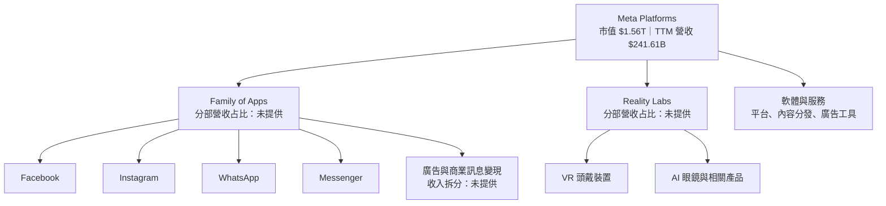
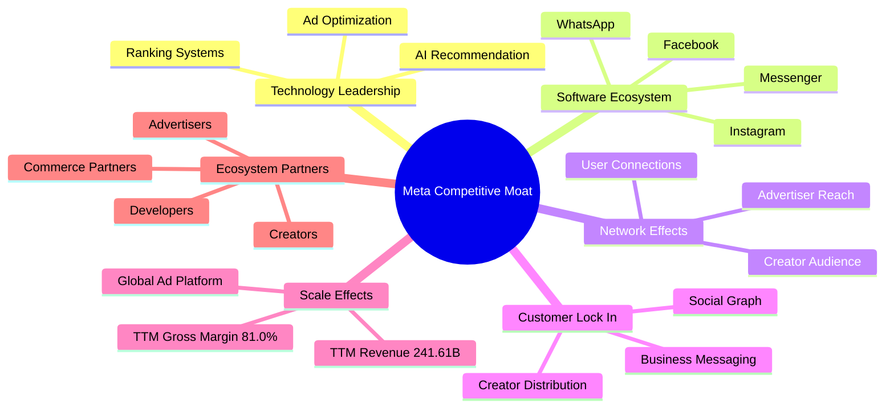
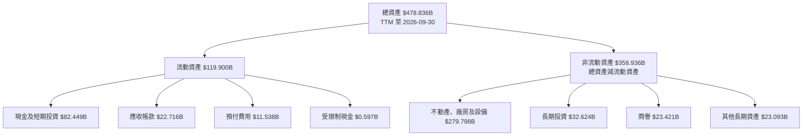
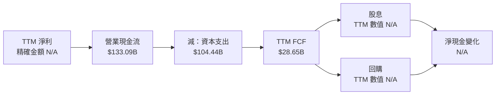
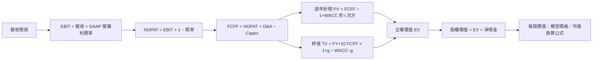
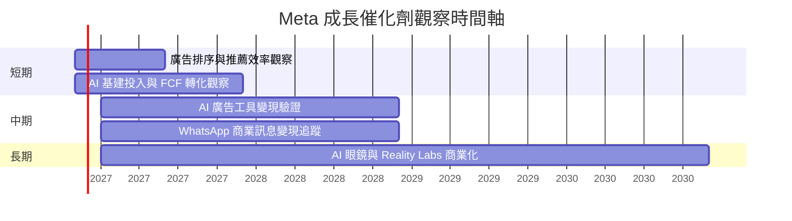
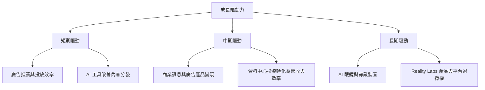
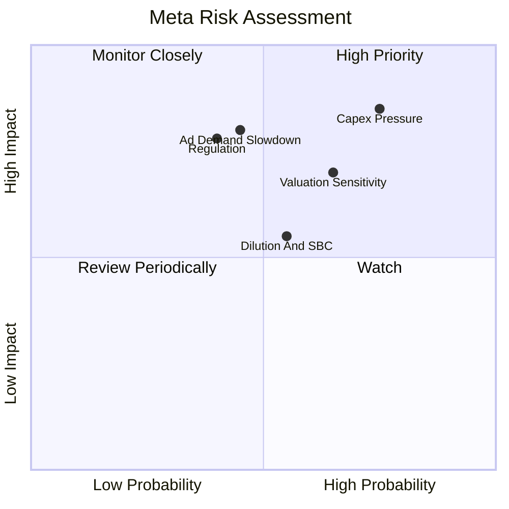
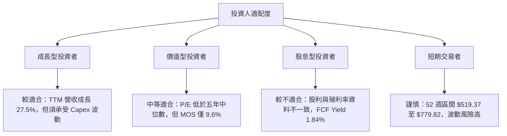

# META 基本面深度分析報告
> **報告日期**：2026-11-27 ｜ **語言**：繁體中文 ｜ **數據來源**：SEC 申報資料 (XBRL)、Yahoo Finance、Finviz、StockAnalysis、Roic.ai ｜ **分析師**：CFA 級機構研究

## 目錄

| # | 章節 | 核心結論 |
|---|------|----------|
| 1 | 執行摘要 | 持有；加權合理價值 $674.59，MOS +9.6% |
| 2 | 公司概覽與商業模式 | FoA 規模與網路效應構成核心護城河；分部營收占比未提供 |
| 3 | 損益表深度分析 | TTM 營收 $241.61B、年增 27.5%；最新季營業利益率需留意資料口徑差異 |
| 4 | 資產負債表分析 | 核心口徑為淨負債 $1.22B；流動性尚可，債務資料來源有差異 |
| 5 | 現金流量深度分析 | TTM FCF $28.65B；高資本支出使現金轉換承壓 |
| 6 | 獲利能力與資本效率 | ROIC 27.7% 高於 WACC 10.28%，仍創造股東價值 |
| 7 | 相對估值分析 | P/E 低於自身五年中位數；同業估值訊號分歧 |
| 8 | DCF 內在價值評估 | 基準 DCF $585.77；終值占 EV 81.0%，估值對長期假設敏感 |
| 9 | 成長催化劑 | 廣告變現、AI 工具與穿戴裝置是主要觀察方向；TAM 數字未提供 |
| 10 | 風險矩陣 | 資本支出、廣告周期與監管是主要風險 |
| 11 | 投資建議 | 持有；若按 MOS ≥10% 建立安全邊際，價格須約低於 $607.13 |

---

## 1. 執行摘要

### 1.0 一頁式投資儀表板（Portfolio Manager 30 秒速讀）

| 項目 | 內容 |
|------|------|
| **投資論點（3 句）** | ① TTM 營收 $241.61B、年增 27.5%，最新季年增 26.1%，顯示核心廣告與平台業務仍有規模成長。② TTM ROIC 27.7% 高於 WACC 10.28%，價差 17.42 個百分點，資本仍創造經濟價值。③ TTM FCF $28.65B、FCF Yield 1.84%，而資本支出達 $104.44B，投資回收與現金轉換是主要估值限制。 |
| **綜合評分** | **6.8/10**（引用 1.1 評分卡） |
| **財務健康** | 🟡 現金及短期投資 $82.45B，總債務 $83.67B，淨負債 $1.22B；流動比率 1.903，但 F-Score 為 3/8。 |
| **ROIC vs WACC** | **27.7% vs 10.28%**；目前創造股東價值。 |
| **FCF 趨勢** | TTM FCF 為 $28.65B；高 Capex 壓低現金流，FCF Yield **1.84%**。 |
| **估值** | Forward P/E 17.15x（Yahoo Finance）；EV/EBITDA 13.697x（合併市場資料）；FCF Yield 1.84%。 |
| **DCF 內在價值（基準）** | **$585.77**；現價相對 DCF 折價 **+4.1%**，即折溢價為 **−4.1%**（計算依 DCF 基準值）。 |
| **安全邊際（MOS）** | **+9.6%**＝($674.59 − $609.89) ÷ $674.59；以 **加權合理價值**為基準，🟡接近無安全邊際門檻。 |
| **預期報酬（基準情境 12M）** | **−4.0%**，以 DCF 基準情境 $585.77 相對現價計。 |
| **關鍵風險（前二）** | Capex 維持高位使 FCF 受壓；廣告需求、平台規則或監管變動影響核心變現。 |
| **評級 + 信心度** | **🟡 持有** ｜ 信心：中。估值模型與財務資料存在口徑差異，需折價看待。 |

> DCF 折溢價固定以第 8.5 節 DCF 基準價 $585.77 為基準；MOS 固定以第 8.8 節加權合理價值 $674.59 為基準。兩者用途及分母不同。

### 1.1 綜合評分卡（全報告唯一）

| 維度 | 評分（1–10） | 主要依據（引用數字與其來源章節） |
|------|--------------|----------------------------------|
| 成長性 | 8.0 | TTM 營收年增 27.5%、最新季年增 26.1%（第 3 章）；但單季成長較早期季度放緩。 |
| 獲利能力 | 8.0 | ROIC 27.7% 高於 WACC 10.28%；TTM 營業利益率 32.9%，F-Score 3/8（第 3、6 章）。 |
| 財務健康 | 6.5 | 現金及短期投資 $82.45B、淨負債 $1.22B、流動比率 1.903；F-Score 稀釋股數測試未通過（第 4、6 章）。 |
| 估值 | 5.0 | MOS +9.6%，低於 10% 買入門檻；P/E 20.8x 低於自身五年中位數 24.5x（第 7、8 章）。 |
| 護城河 | 8.0 | TTM 營收 $241.61B、毛利率 81.0%、最新季營收年增 26.1%；社交網路效應強，但市場份額與分部數據未提供（第 2 章）。 |
| 管理層與資本配置 | 6.5 | FY2025 Capex $69.69B、SBC $20.43B、股利支付 $5.32B；高額投資需以未來現金流驗證（第 5 章）。 |
| **綜合評分** | **7.0** | 六項算術平均： (8.0 + 8.0 + 6.5 + 5.0 + 8.0 + 6.5) ÷ 6 = **7.0**。 |

### 1.2 五大投資論點 + 三大核心風險

| 類型 | 項目 | 具體依據 | 信心度 |
|------|------|----------|--------|
| 🟢 **投資論點①** | 廣告平台仍具規模成長 | TTM 營收 $241.61B、年增 27.5%；最新一季營收年增 26.1%。 | 🟢 高 |
| 🟢 **投資論點②** | 高資本報酬率 | ROIC 27.7% 對比 WACC 10.28%，正利差 17.42 個百分點。 | 🟢 高 |
| 🟢 **投資論點③** | 毛利率與平台經濟性 | TTM 毛利率 81.0%，支持其平台業務具高毛利特性。 | 🟢 中高 |
| 🟢 **投資論點④** | 資產負債表仍有流動性緩衝 | 現金及短期投資 $82.45B；雖核心數據呈淨負債 $1.22B，絕對負債相對企業規模有限。 | 🟢 中高 |
| 🟢 **投資論點⑤** | 自身估值低於歷史中位 | P/E 20.8x，低於五年中位數 24.5x；但相對同業的便宜程度不一致。 | 🟡 中 |
| 🟡 **風險①** | AI 與資料中心投資拖累現金流 | TTM Capex $104.44B，約為營收 43.2%；TTM FCF 只有 $28.65B。 | 🟡 高衝擊 |
| 🔴 **風險②** | 盈餘與季度資料口徑有重大異常 | Q3 2026 GAAP 淨利 $9.86B，而營業利益資料來源出現 $12.99B 與 $22.878B 等差異；需確認稅項、一次性項目及資料口徑。 | 🔴 高 |
| 🟡 **風險③** | 監管與平台治理 | 已有印度內容限制相關訴訟新聞；若平台觸及、廣告定向或內容治理受限，可能影響變現。 | 🟡 中高 |

### 1.3 快速統計卡片

| 指標 | 公司實際值（期間） | 同業中位數 | 狀態 |
|------|--------------------|------------|------|
| 營收成長（TTM） | **27.5%** | — | 🟢 |
| 營收成長（最新一季年增） | **26.1%** | 14.3%（GOOG、SNAP、PINS 的中位數） | 🟢 |
| 毛利率（TTM） | **81.0%** | 60.9%（GOOG、SNAP、PINS 的中位數） | 🟢 |
| 營業利益率（TTM） | **32.9%** | — | 🟢 |
| ROIC（TTM） | **27.7%** | — | 🟢 |
| Forward P/E | **17.15x** | 8.7x（GOOG、SNAP、PINS 的中位數） | 🟡 |
| FCF Yield（TTM） | **1.84%** | — | 🔴 |
| Piotroski F-Score | **3 / 8** | — | 🔴 |

### 1.4 投資結論

```text
╔══════════════════════════════════════════════════════════════════╗
║                    📊 投資結論摘要                               ║
╠══════════════════════════════════════════════════════════════════╣
║  評級：持有（依規則 20；MOS +9.6%）                              ║
║  價格（2026-11-25 收盤）：$609.89                                ║
║  DCF 內在價值（基準）：$585.77（折溢價 −4.0%）                   ║
║  安全邊際 MOS：+9.6%（＝(加權合理價值−現價)÷加權合理價值）       ║
║  加權合理價值（8.8）：$674.59                                    ║
║  DCF 情境價值：                                                   ║
║    悲觀情境：$196.94（−67.7%）                                   ║
║    基準情境：$585.77（−4.0%）                                    ║
║    樂觀情境：$1,429.15（+134.3%）                                 ║
║  綜合評分：7.0/10（引用 1.1）                                     ║
║  適合投資人：可承受波動、看好平台廣告與 AI 變現的中長期投資人     ║
╚══════════════════════════════════════════════════════════════════╝
```

---

## 2. 公司概覽與商業模式

### 2.1 業務結構與收入來源

Meta Platforms, Inc. 經營 Facebook、Instagram、WhatsApp、Messenger 等產品，並分為 Family of Apps（FoA）及 Reality Labs（RL）。可核實資料只提供公司層級 TTM 營收 **$241.61B**，未提供最新期間各分部營收、占比或廣告與非廣告收入拆分，故不推估分部占比。



### 2.2 市場份額

市場份額數據未提供，不能可靠地繪製市場份額圖或填入占比。從財務規模看，Meta TTM 營收 $241.61B、年增 27.5%，最新季度營收成長 26.1%，高於所列三家同業最新季營收成長中位數 14.3%；不過這不是市場份額的直接替代指標。

### 2.3 競爭護城河分析



### 2.4 護城河強度

| 護城河項目 | 強度（強／中／弱） | 證據（引用數字或事實） | 會削弱它的情況 |
|------------|--------------------|------------------------|----------------|
| 技術與推薦系統 | 中強 | TTM 毛利率 81.0%、TTM 營業利益率 32.9%；AI 可用於推薦與廣告排序，但研發成果的單獨財務貢獻未提供。 | 推薦品質下降、競爭平台提升內容分發效率。 |
| 軟體生態系統 | 強 | Facebook、Instagram、WhatsApp、Messenger 覆蓋社交、內容及通訊場景。 | 使用者時間轉移至新平台或新介面。 |
| 網路效應 | 強 | 社交關係及創作者受眾形成雙邊網路；最新季營收年增 26.1%。 | 年輕使用者活躍度或廣告主投放意願下降。 |
| 客戶鎖定 | 中 | 社交圖譜、粉絲受眾及商業訊息可提高切換成本；缺少留存率與廣告主續約率數據。 | 廣告預算轉向搜尋、零售媒體或其他短影音平台。 |
| 規模效應 | 強 | TTM 營收 $241.61B，毛利率 81.0%。 | 高 Capex 或內容、基礎設施成本增幅長期高於營收。 |
| 生態夥伴 | 中 | 廣告主、創作者與商家共同參與；目前未提供合作夥伴數或交易額。 | 監管限制資料使用與廣告定向。 |

表後理由：1.1「護城河」評分為 **8.0/10**，依據是 $241.61B TTM 營收、81.0% 毛利率與多產品網路效應；因缺少使用者、留存和分部營收等直接指標，未給更高評分。

---

## 3. 損益表深度分析

### 3.1 年度收入成長趨勢（近 4 年）

年度營收與年增率來自年度損益表；2022 年年增率以資料所列 −1.12% 引用。FY2022–FY2025 營收 CAGR 約 19.9%，算式為 \((200.97 ÷ 116.61)^{1/3} - 1\)。

```text
╔══════════════════════════════════════════════════════════════════╗
║              Meta 年度收入趨勢（FY2022-FY2025）                  ║
╠══════════════════════════════════════════════════════════════════╣
║  FY2022  $116.61B  ██████████████░░░░░░░░░░░░  YoY: −1.12% 🟡   ║
║  FY2023  $134.90B  ████████████████░░░░░░░░░░  YoY:+15.69% 🟢   ║
║  FY2024  $164.50B  ████████████████████░░░░░░  YoY:+21.94% 🟢   ║
║  FY2025  $200.97B  ████████████████████████░░  YoY:+22.17% 🟢   ║
║                                                                  ║
║  FY2022–FY2025 營收 CAGR：約 +19.9%                              ║
╚══════════════════════════════════════════════════════════════════╝
```

### 3.2 季度收入趨勢分析

QoQ 以所列相鄰季度營收計算；YoY 優先引用 StockAnalysis 的單季年增率。QoQ 有季節性，不應單獨視為長期成長趨勢。

| 季度 | 營收（$B） | QoQ | YoY（單季） | 備註 |
|------|------------|-----|-------------|------|
| 2025 Q4 | 59.893 | +16.9% | +23.78% | 相對 Q3 季節性回升。 |
| 2026 Q1 | 56.311 | −6.0% | +33.08% | QoQ 回落但 YoY 高，受比較基期影響。 |
| 2026 Q2 | 60.801 | +8.0% | +27.96% | 季營收重新上升。 |
| 2026 Q3 | 64.601 | +6.3% | **+26.1%** | 最新季度；單季年增率，不是 TTM 成長率。 |

TTM 營收成長率為 **27.5%**，與最新單季 YoY **26.1%** 定義不同。兩者均顯示成長，但單季較 2026 Q1 的 33.08% 放緩，後續應觀察廣告需求和定價是否能支撐。

### 3.3 利潤率演變分析

以下年度利潤率以年度損益表毛利、營業利益、淨利除以營收計算；TTM 指標另列以免混淆。年度資料與其他市場資料存在口徑差異，解讀應以期間標記為準。

| 利潤率指標 | FY2022 | FY2023 | FY2024 | FY2025 | 趨勢 | 評估 |
|------------|--------|--------|--------|--------|------|------|
| **毛利率** | 78.3% | 80.8% | 81.7% | 82.0% | 逐年改善 | 🟢 |
| **營業利益率** | 24.8% | 34.7% | 42.2% | 41.4% | 2022 後大幅回升，2025 略降 | 🟢 |
| **淨利率** | 19.9% | 29.0% | 37.9% | 30.1% | 2024 高點後回落 | 🟡 |

TTM 指標另據 VERIFIED FIGURES 為毛利率 81.0%、營業利益率 32.9%、淨利率 31.1%。季度營業利益率資料亦有衝突：VERIFIED FIGURES 列最新季度 20.1%，另一市場資料列 37.8%，而季度營業利益 $22.878B ÷ 營收 $64.601B 約為 35.4%。本報告在要求引用驗證口徑的場合採 **20.1%**，並視為需查核的資料品質風險，而不把不同口徑混合。

利潤率改善的可能機制包括平台規模、廣告排序效率及費用紀律；FY2025 營業利益率較 FY2024 略降，且 TTM Capex 顯著增加，顯示 AI 基礎設施投入可能提高折舊與營運成本。現有資料不足以將變化精確拆分至產品組合、價格或成本項目。

### 3.4 費用結構分析

可用資料沒有一致且完整的最新 TTM 費用細項拆分，因此不繪製費用占比圓餅圖，以免以殘差或估算比例冒充實際數據。FY2025 R&D 為 $57.37B，約占當年營收 28.5%；此比率是以年度兩項實際數字計算，不代表完整費用結構。

```text
╔══════════════════════════════════════════════════════════════════╗
║                  FY2025 研發費用錨點                             ║
╠══════════════════════════════════════════════════════════════════╣
║  R&D：$57.37B                                                    ║
║  營收：$200.97B                                                  ║
║  R&D / Revenue = 57.37 ÷ 200.97 = 28.5%                          ║
║  其餘費用分類占比：本資料未提供，不作比例推估                    ║
╚══════════════════════════════════════════════════════════════════╝
```

### 3.5 季度 EPS 趨勢與盈餘品質（Quality of Earnings）

| 季度 | EPS（$） | EPS YoY | EPS 是否超／不及預期 |
|------|----------|---------|-----------------------|
| 2025 Q4 | 8.88 | +10.70% | N/A：預期 EPS 為缺值 |
| 2026 Q1 | 10.44 | +62.36% | N/A：預期 EPS 為缺值 |
| 2026 Q2 | 6.18 | −13.44% | N/A：預期 EPS 為缺值 |
| 2026 Q3 | 3.83 | +264.76% | N/A：預期 EPS 為缺值 |

過去四季的 EPS 實際數字可列，但分析師預期 EPS 欄位為 NaN，不能據此標示超預期或不及預期。Q3 2026 EPS 年增 264.76% 的比較基期 2025 Q3 EPS 僅 $1.05；其淨利也出現明顯基期差，不能直接當作常態化盈餘增速。

| 盈餘品質項目 | 數值／佔比 | 評估 |
|--------------|------------|------|
| 股權薪酬 SBC / 營收 | FY2025：$20.43B ÷ $200.97B = **10.2%** | 🟡 SBC 為顯著股東成本；且 F-Score 的稀釋股數測試未通過。 |
| SBC / 營業現金流 | FY2025：$20.43B ÷ $115.80B = **17.6%** | 🟡 股權薪酬占現金流比例不低；SBC 本身為非現金費用，但以稀釋方式轉嫁給股東。 |
| FCF / 淨利（現金轉換率） | TTM FCF $28.65B；TTM 淨利按 31.1% 淨利率推算不作替代；精確 TTM 淨利未提供，**N/A** | 🟡 不以不相容口徑計算轉換率；FY2025 年度 FCF/淨利為 76.3%。 |
| 一次性／非經常性損益 | N/A：未提供一致明細 | Q3 2026 淨利年增 264.0%，而季度資料存在口徑差異，須查稅項與一次性損益。 |
| 有效稅率異常 | DCF 採用最新年度有效稅率 **29.6%**；單季拆分 N/A | 不足以證明最新季度盈餘由稅務利益驅動。 |
| 資本化支出 vs 費用化 | TTM Capex $104.44B；資本化與費用化拆分 N/A | 資本開支占營收高，折舊可能滯後反映成本；須留意資產壽命及未來折舊。 |

**盈餘品質結論**：營收與營業現金流規模支持 GAAP 盈餘有實質經營基礎，但 TTM Capex $104.44B 使 FCF 僅 $28.65B，且 SBC/年度營收 10.2% 帶來稀釋成本。Q3 年增 EPS 數字不宜直接外推；估值應偏重現金流及 SBC 成本，而非單看 EPS 增速。

---

## 4. 資產負債表分析

### 4.1 資產結構分解

最新 TTM 資產總額為 $478.836B（StockAnalysis），其中流動資產 $119.900B；細項按該來源列示。該資料與 SEC 口徑可能有差異，不用來反推未提供的資產項目。



### 4.2 流動性與營運資金分析

核心驗證數據的現金及短期投資為 $82.45B；流動比率 1.903、速動比率 1.669 取市場資料。營運資金天數照抄品質指標。

| 指標 | 最新 TTM | 一年前 TTM | 變化 | 解讀 |
|------|----------|------------|------|------|
| DSO 應收帳款天數 | 34 天 | 33 天 | +1 天 | 收款周期略延長，變化幅度有限；應收帳款增長仍需與營收同步檢視。 |
| DIO 存貨天數 | N/A | N/A | N/A | 公司未報告該項存貨餘額，不推估。 |
| DPO 應付帳款天數 | 152 天 | N/A | N/A | 一年前資料缺漏，無法判斷趨勢；不據此推斷供應商議價力變化。 |
| CCC 現金轉換週期 | N/A | N/A | N/A | DIO 缺漏且品質區塊列 N/A，不自行補算。 |

| 流動性指標 | 數值 | 評估 |
|------------|------|------|
| 現金及短期投資 | $82.45B | 🟢 規模可觀，但與總債務同時考慮。 |
| 流動比率 | 1.903 | 🟢 流動資產高於流動負債。 |
| 速動比率 | 1.669 | 🟢 短期流動性尚可。 |
| Piotroski F-Score | 3/8 | 🔴 有多項同比測試未通過，見第 6.4 節。 |

### 4.3 債務結構分析

市場彙整資料另列總債務 $114.84B、淨負債 $32.39B；但 SEC 驗證口徑列總債務 $83.67B、淨負債 $1.22B。本報告依規則以 **VERIFIED FIGURES** 為主，其他來源不混算。缺少可一致對應的 EBITDA 與利息支出明細，Debt/EBITDA 和利息保障倍數不列。

```text
╔══════════════════════════════════════════════════════════════════╗
║                   Meta 債務健康診斷                              ║
╠══════════════════════════════════════════════════════════════════╣
║  總債務：        $83.67B   ████████████████████  SEC 驗證口徑      ║
║  現金+短期投資： $82.45B   ███████████████████  SEC 驗證口徑      ║
║  淨負債：         $1.22B   ▏                     接近淨現金平衡    ║
║                                                                  ║
║  Debt/EBITDA：N/A（口徑不一致，未以其他來源反推）                 ║
║  Interest Coverage：N/A（利息費用資料未提供）                    ║
║  ⚠️ 次級市場資料列債務 $114.84B，與驗證口徑不同，不混用           ║
╚══════════════════════════════════════════════════════════════════╝
```

### 4.4 股東權益趨勢

| 年度 | 股東權益（$B） | YoY 變化 |
|------|----------------|----------|
| 2022 | 125.71 | — |
| 2023 | 153.17 | +21.9% |
| 2024 | 182.64 | +19.2% |
| 2025 | 217.24 | +19.0% |

```text
╔══════════════════════════════════════════════════════════════════╗
║                  股東權益趨勢（年度）                             ║
╠══════════════════════════════════════════════════════════════════╣
║  2022  $125.71B  ████████████░░░░░░░░░░░░                        ║
║  2023  $153.17B  ███████████████░░░░░░░░░                        ║
║  2024  $182.64B  ██████████████████░░░░░░                        ║
║  2025  $217.24B  ██████████████████████░░                        ║
╚══════════════════════════════════════════════════════════════════╝
```

---

## 5. 現金流量深度分析

### 5.1 現金流量瀑布圖

季度淨利、股息、回購與現金變化的完整同期間對帳資料未提供；圖中僅呈現有數據的 TTM 營業現金流、Capex 與 FCF，不補造回購或現金變動金額。



### 5.2 FCF 轉換率趨勢

| 年度 | 營業現金流（$B） | Capex（$B） | FCF（$B） | 淨利（$B） | FCF / 淨利 |
|------|------------------|-------------|-----------|------------|------------|
| 2022 | 50.48 | 31.19 | 19.29 | 23.20 | 83.1% |
| 2023 | 71.11 | 27.05 | 44.07 | 39.10 | 112.7% |
| 2024 | 91.33 | 37.26 | 54.07 | 62.36 | 86.7% |
| 2025 | 115.80 | 69.69 | 46.11 | 60.46 | 76.3% |
| TTM 至 2026-09-30 | 133.09 | 104.44 | 28.65 | N/A | N/A |

2025 年 FCF 較 2024 年下降 14.7%，主因 Capex 從 $37.26B 上升至 $69.69B；TTM Capex 進一步升至 $104.44B，導致 FCF Yield 只有 1.84%。這代表 AI、伺服器及資料中心投入尚未在現金流中充分轉化為回報。

### 5.3 自由現金流趨勢

```text
╔══════════════════════════════════════════════════════════════════╗
║              Meta 歷史 FCF 與現金流壓力                          ║
╠══════════════════════════════════════════════════════════════════╣
║  FY2022  $19.29B  ███████░░░░░░░░░░░░░░░░                        ║
║  FY2023  $44.07B  █████████████████░░░░░░░                        ║
║  FY2024  $54.07B  █████████████████████░░░                        ║
║  FY2025  $46.11B  ██████████████████░░░░░░                        ║
║  TTM     $28.65B  ███████████░░░░░░░░░░░░                        ║
║                                                                  ║
║  TTM FCF Yield：1.84%｜TTM Capex：$104.44B                        ║
╚══════════════════════════════════════════════════════════════════╝
```

### 5.4 資本配置評估

FY2025 已知資本配置項目為 Capex $69.69B、股利 $5.32B、SBC $20.43B；回購與留存現金金額未提供，不繪製無法核對的比例圖。

| 項目 | FY2025 金額 | 解讀 |
|------|-------------|------|
| 資本支出 | $69.69B | 較 FY2024 的 $37.26B 大幅增加；擴建基礎設施同時壓低 FCF。 |
| 股利支付 | $5.32B | 規模低於 Capex；派息率資料來源標示 7.2%，但與其他股利數據口徑可能不一致。 |
| SBC | $20.43B | 佔營收 10.2%，即使非現金，仍有稀釋成本。 |
| 股票回購 | N/A | 資料未提供可核對的年度回購數值。 |
| 留存現金／併購 | N/A | 無完整配置拆分，不作比例估計。 |

---

## 6. 獲利能力與資本效率

### 6.1 ROE / ROA / ROIC 趨勢

| 指標 | 可用期間／數值 | 評估 |
|------|----------------|------|
| ROE | TTM **27.6%**（驗證口徑） | 🟢 高回報；與另一來源 32.3% 有差異，以驗證口徑為準。 |
| ROA | TTM 14.6% | 🟢 資產回報率具規模，但 F-Score 顯示較一年前下降。 |
| ROIC | TTM **27.7%** | 🟢 明顯高於 WACC 10.28%。 |
| 歷史 ROIC | 2018 年 27.2%；完整近年同口徑序列未提供 | 不建立不完整年度趨勢。 |

行業均值未提供，不列虛構對照值。

### 6.2 ROIC vs WACC 分析（核心價值創造判斷）

```text
╔══════════════════════════════════════════════════════════════════╗
║                ROIC vs WACC 深度分析                             ║
╠══════════════════════════════════════════════════════════════════╣
║  WACC（VERIFIED FIGURES 原值）：10.28%                           ║
║  ├── 無風險利率（10Y 美債）：       4.85%                         ║
║  ├── 市場風險溢酬 ERP：             5.00%                         ║
║  ├── 原始 Beta：                    1.28                          ║
║  ├── 調整後 Beta：                  1.19                          ║
║  ├── 股權成本 Ke（資料原值）：      10.78%                        ║
║  ├── 稅前債務成本：                 1.39%                         ║
║  ├── 有效稅率：                     29.6%                         ║
║  ├── 股權／債務權重：               94.9%／5.1%                   ║
║  └── ✅ WACC（直接採用）：           10.28%                        ║
║                                                                  ║
║  ROIC（TTM，驗證口徑）：             27.7%                         ║
║  EVA 利差 = ROIC − WACC：            27.7% − 10.28% = 17.42pp     ║
║  ROIC / WACC = 27.7% ÷ 10.28%：     約 2.69 倍                    ║
║                                                                  ║
║  結論：ROIC 高於 WACC，現階段創造經濟價值；但高 Capex 是否能      ║
║        維持目前 ROIC，須由未來投資回報驗證。                      ║
╚══════════════════════════════════════════════════════════════════╝
```

資本成本區塊的 Ke 原值為 10.78%；直接套用顯示的 Rf 4.85%、調整後 Beta 1.19、ERP 5.00% 會得到 10.80%，存在 0.02 個百分點的輸入四捨五入差異。本報告依規則直接採用資料列示的 Ke 10.78% 及 WACC 10.28%，不另行替換。預稅債務成本與稅率亦依區塊原值採用。

### 6.3 杜邦三因素分解

| 因素 | 數值（TTM） | 解讀 |
|------|-------------|------|
| 淨利率 | 31.1% | 淨利潤率提供 ROE 的主要獲利基礎。 |
| 資產週轉率 | 0.50 | 每單位資產創造約 0.50 單位營收；資產擴張可能壓低週轉率。 |
| 權益乘數 | 1.76 | 槓桿有貢獻，但 ROE 並非主要依賴高槓桿。 |
| **ROE** | **27.6%** | **31.1% × 0.50 × 1.76 = 27.6%**（來源：QUALITY FIGURES）。 |

### 6.4 財務體質：Piotroski F-Score

**Piotroski F-Score：3/8**。品質計算排除一項缺少輸入的測試，因此分母為 8；逐項照列原測試結果。

| 測試 | 結果 | 解讀 |
|------|------|------|
| ROA > 0 | ✅ 通過 | TTM 資產回報為正。 |
| 營業現金流 > 0 | ✅ 通過 | TTM 營業現金流為 $133.09B。 |
| ROA 高於一年前 | ❌ 未通過 | 資產獲利能力未較一年前改善。 |
| 營業現金流 > 淨利（應計品質） | ✅ 通過 | 現金流高於淨利，應計品質測試通過。 |
| 長期負債／總資產低於一年前 | ❌ 未通過 | 槓桿相對資產未改善。 |
| 流動比率高於一年前 | ❌ 未通過 | 短期流動性同比未改善。 |
| 稀釋股數未增加 | ❌ 未通過 | SBC 及股數變化可能稀釋股東持分。 |
| 毛利率高於一年前 | — 無法判定 | 缺少比較輸入，已從分母排除。 |
| 資產週轉率高於一年前 | ❌ 未通過 | 資產擴張尚未帶來同比周轉改善。 |

F-Score 低於滿分主要由資產效率、流動比率、槓桿趨勢與稀釋股數測試拖累；它不否定正現金流與高 ROIC，但提示近期增長伴隨資本投入與資產效率壓力。

---

## 7. 相對估值分析

### 7.1 同業估值比較表格

公司自身倍數採市場估值資料；Peer 倍數嚴格採同業倍數資料。公司 P/E 市場資料與五年歷史資料存在差異：此表按估值資料列示，歷史分析則按驗證歷史區間列示。

| 估值指標 | **META** | **GOOG** | **SNAP** | **PINS** | META 評估 |
|----------|---------:|--------:|--------:|--------:|-----------|
| **Trailing P/E** | 20.12x | 14.2x | N/A | 82.1x | 🟡 低於 PINS、高於 GOOG；SNAP 無 TTM 值。 |
| **Forward P/E** | 17.15x | 17.7x | 6.4x | 8.7x | 🟡 相對同業中位數 8.7x 偏高；同業組合獲利品質差異大。 |
| **P/S Ratio** | 6.45x | 7.1x | 1.3x | 2.4x | 🟡 高於 SNAP、PINS，低於 GOOG。 |
| **EV/EBITDA** | 13.697x | 17.4x | 53.1x | 37.2x | 🟢 低於所列同業，但 SNAP、PINS 倍數可能受盈利基數影響。 |
| **最新季營收 YoY** | 26.1% | 24.7% | 14.3% | 11.9% | 🟢 成長高於三家列示同業。 |
| **毛利率（TTM）** | 81.0% | 60.9% | 59.2% | 79.0% | 🟢 高於所列同業。 |

### 7.2 歷史估值區間分析

```text
╔══════════════════════════════════════════════════════════════════╗
║              Meta 五年估值區間與當前位置                         ║
╠══════════════════════════════════════════════════════════════════╣
║  P/E：      12.9x ───────── 20.8x ─────── 24.5x ───── 33.4x     ║
║                         現值 19 百分位      中位數               ║
║  P/S：       2.8x ─────────  6.5x ───────  7.7x ───── 10.6x     ║
║                         現值 38 百分位      中位數               ║
║  EV/EBITDA： 7.7x ───────── 15.1x ─────── 16.5x ───── 19.7x     ║
║                         現值 33 百分位      中位數               ║
╚══════════════════════════════════════════════════════════════════╝
```

P/E 位於自身五年區間第 19 百分位，P/S 第 38 百分位，EV/EBITDA 第 33 百分位，整體低於各自五年中位數。這支持「相對自身歷史不貴」，但不等於低估：DCF 基準仍低於現價，且 FCF Yield 僅 1.84%。

### 7.3 情境價值（Bear / Base / Bull，照抄 DCF MODEL 的 Scenarios）

| 情境 | 第 1 年營收成長 | 期末營業利潤率 | WACC | 每股價值 | 相對現價 | 機率 | 會發生的條件 |
|------|----------------|----------------|------|----------|----------|------|--------------|
| 🔴 悲觀 | 13.8% | 29.5% | 11.28% | $196.94 | −67.7% | 25% | 廣告成長顯著降速、AI 投資回報不足、成本與資本成本上升。 |
| 🟡 基準 | 27.5% | 34.7% | 10.28% | $585.77 | −4.0% | 50% | 成長由 27.5% 線性降至第十年 3.0%，利潤率溫和擴張。 |
| 🟢 樂觀 | 41.3% | 38.1% | 9.28% | $1,429.15 | +134.3% | 25% | AI 推薦與廣告變現令短期成長高於 TTM，且利潤率同步擴張、折現率下降。 |

機率加權值為 $699.41（相對現價 +14.7%），僅作情境背景；第 8.8 節評級與 MOS 仍按基準 DCF 及固定估值方法計算。

### 7.4 相對估值隱含價格區間

```text
╔══════════════════════════════════════════════════════════════════╗
║             估值方法隱含價格與現價 $609.89                        ║
╠══════════════════════════════════════════════════════════════════╣
║  $309.00 ───── $585.77 ── 現價 $609.89 ───── $842.54 ─── $1,115.11║
║  Forward P/E     基準 DCF       ●            分析師共識    EV/EBITDA║
╚══════════════════════════════════════════════════════════════════╝
```

| 方法 | 每股價值 | 依據 |
|------|----------|------|
| 同業 Forward P/E | $309.00 | GOOG、SNAP、PINS 中位數 Forward P/E 8.7x × META Forward EPS $35.56。 |
| 同業 EV/EBITDA | $1,115.11 | GOOG 與 PINS 中位數 EV/EBITDA 27.3x × TTM EBITDA，再加淨現金。 |
| DCF 基準 | $585.77 | 10 年 FCFF、WACC 10.28%、永續成長率 3.0%。 |
| 分析師共識 | $842.54 | 58 位分析師平均目標價，僅作參考，不視作獨立營運驗證。 |

---

## 8. DCF 內在價值評估（Discounted Cash Flow）

> DCF 逐年預測、敏感度與情境數字照 DCF MODEL 原值列示。金額為美元十億，除每股金額外；表格四捨五入至小數兩位，折現因子三位。因模型內部使用未四捨五入輸入，展示值以 ±$0.01B 的四捨五入差異看待。

### 8.0 估值推理鏈（Thinking Logic）

**Step 1 — 價值來源與主導變數**

Meta 價值主要由既有 FoA 廣告與社交平台現金流、AI 改善推薦及廣告投放效率的成長選擇權，以及 Reality Labs／穿戴裝置的長期選擇權構成。最新資料未提供分部營收，不能填寫各來源占比；唯一可量化錨點是公司 TTM 營收 $241.61B。DCF 對價值最具主導性的因素是**長期自由現金流與終值**：終值 PV 占 EV 81.0%，所以持續成長率、資本支出回落及 WACC 是模型關鍵。

**Step 2 — 模型選擇**

| 決策點 | 本報告採用 | 理由（含數字） | 曾考慮但否決 | 否決理由 |
|--------|-----------|----------------|--------------|----------|
| 現金流定義 | FCFF | 與 WACC 10.28% 折現，先得 EV 再橋接股權價值。 | FCFE | 模型已提供 FCFF 架構，不另建另一種模型。 |
| 預測期 N | 10 年 | DCF MODEL 固定列 FY+1 至 FY+10，涵蓋高成長逐步成熟。 | 5 年 | 不能改動驗證模型預測期。 |
| 終值方法 | Gordon Growth | 終值以 FY+10 FCFF $228.16B、g 3.0% 推算。 | 單獨退出倍數 | 模型未提供退出倍數終值，不自行補入。 |
| EBIT 基礎 | GAAP EBIT | DCF 明確採 GAAP EBIT。 | 非 GAAP EBIT | 會改變原模型與 SBC 處理。 |

**Step 3 — 關鍵假設推導鏈**

- **營收成長路徑**：錨點＝TTM 營收成長 27.5%，最新一季 YoY 26.1% → 調整＝基準模型將年 1 設為 27.5%，再線性降至年 10 的 3.0%，反映由高增長轉向成熟 → **採用模型所列逐年數值** → 曾考慮固定維持 27.5% 至第十年，但因成熟期不宜永續維持當前高速成長而不採用。
- **期末營業利潤率**：錨點＝TTM 32.9%，近五個財年中位數為模型選定的 34.7% → 調整＝十年漸進提高 1.8 個百分點，依規模與營運槓桿假設 → **FY+10 採用 34.7%** → 曾考慮 38.1%（樂觀情境），基準案未採，因當前資料未證明如此擴張已實現。
- **永續成長率 g**：錨點＝成熟企業長期成長應低於 WACC，且模型採 3.0% → 調整＝令終值反映成熟後低速成長 → **採用 3.0%** → 不採 4.0% 作為基準，因終值占比已達 81.0%，更高 g 會顯著放大終值。
- **預測期 N**：錨點＝模型明列 10 年 → 調整＝不另調整，忠實沿用程式模型 → **採用 10 年** → 不採 5 年或更長期，因不允許重建模型。
- **Capex／營收**：錨點＝TTM Capex/Revenue 43.2% → 調整＝模型從 43.2% 逐步降至第十年的 11.3%，約等於 1.1 倍 D&A/營收；反映初期基礎設施高投入後回落 → **沿用模型路徑** → 不採固定 43.2%，因會忽略模型假定的投資成熟；也不採立即降至 11.3%，因基建資產需逐步建成。
- **有效稅率**：錨點＝最新年度有效稅率 29.6% → **模型全期採 29.6%**。
- **D&A／營收**：錨點＝TTM 10.3% → **模型維持 10.3%**；固定假設可能未反映 Capex 結構變化。
- **EBIT 與 SBC**：錨點＝模型使用 GAAP EBIT，SBC 已作費用處理 → **採組合 (A)：GAAP EBIT + 固定股數，不再扣 SBC，年稀釋率 0%** → 不採非 GAAP 加回或另扣 SBC，以免偏離模型或重複計成本。
- **營運資金**：DCF MODEL 明列未建模；ΔWC 不另填估值數字。這是簡化假設，不代表營運資金變動為零。
- **WACC**：錨點＝資本成本資料列 WACC 10.28% → **採用 10.28%** → 不另以外部債務或市場參數重算，避免覆蓋驗證模型輸入。
- **終值方法**：錨點＝DCF MODEL 採 Gordon Growth → **照模型採用**；未另加退出倍數法，因模型未提供該終值值數。

**Step 4 — 最脆弱環節**

最脆弱的是 Capex／營收由 43.2% 降至 11.3% 的長期收斂；若投入長期維持高位，FCFF 與終值均會下修。敏感度矩陣顯示在 g 3.0% 下，WACC 由 10.28% 升至 11.28%，每股價值由 $585.77 降至 $483.30；g 由 3.0% 升至 4.0%，在 WACC 10.28% 下價值升至 $666.73。

**Step 5 — 計算路徑圖**



### 8.1 模型假設總表（Model Inputs）

| 假設項目 | 採用值 | 依據／來源 | 敏感度 |
|----------|--------|-------------|--------|
| 預測期長度 N | 10 年 | DCF MODEL 明列 FY+1 至 FY+10。 | 🟡 中 |
| 營收成長 | 年 1 27.5% 線性降至年 10 3.0% | TTM 成長 27.5%；終值成熟化假設。 | 🔴 高 |
| 營業利潤率 | 32.9%（年 1）至 34.7%（年 10） | TTM 32.9%，模型以近五年中位數收斂。 | 🔴 高 |
| 有效稅率 | 29.6% | 最新年度有效稅率。 | 🟢 低 |
| Capex／營收 | 年 1 43.2% 至年 10 11.3% | TTM 43.2%，依模型逐年降至 1.1×D&A。 | 🔴 高 |
| D&A／營收 | 10.3% | TTM 數值，模型固定。 | 🟢 低 |
| 營運資金變動 | 未建模 | DCF MODEL 指明未建模；不將其視作經驗證的零值。 | 🟡 中 |
| EBIT 基礎 | GAAP | 模型定義為 GAAP EBIT。 | 🟡 中 |
| SBC 處理 | 採 (A)：GAAP EBIT、無 −SBC 列、股數不再稀釋 | GAAP EBIT 已含 SBC 費用；股數成本由費用端反映。 | 🟡 中 |
| 年稀釋率 | 0% | 模型指定固定股數；與組合 (A) 相容。 | 🟡 中 |
| 永續成長率 g | 3.0% | DCF MODEL 原值，低於 WACC。 | 🔴 高 |
| 終值方法 | Gordon Growth | 模型直接提供。 | 🔴 高 |
| WACC | 10.28% | Cost of capital 原值。 | 🔴 高 |

### 8.2 折現率推導（WACC）

```text
╔══════════════════════════════════════════════════════════════════╗
║                    WACC 推導（折現率）                           ║
╠══════════════════════════════════════════════════════════════════╣
║  股權成本 Ke（CAPM，資料原值）：                                  ║
║  ├── 無風險利率 Rf：                   4.85%                     ║
║  ├── 市場風險溢酬 ERP：                 5.00%                     ║
║  ├── 原始 Beta（Yahoo）：               1.28                      ║
║  ├── 調整後 Beta：                      1.19                      ║
║  ├── Beta 調整：                        ⅔×1.28 + ⅓×1 = 1.19      ║
║  └── Ke（資料原值）：                   10.78%                    ║
║                                                                  ║
║  債務成本：                                                       ║
║  ├── 稅前 Kd：                          1.39%                     ║
║  ├── 有效稅率：                         29.6%                     ║
║  └── 稅後 Kd：                          1.39%×(1−29.6%) = 0.98%  ║
║                                                                  ║
║  資本結構（資料原值權重）：                                       ║
║  ├── 股權權重 E：                       94.9%                     ║
║  ├── 債務權重 D：                       5.1%                      ║
║  └── ✅ WACC（直接採用）：               10.28%                    ║
╚══════════════════════════════════════════════════════════════════╝
```

**WACC 逐步演算與資料邊界：**

1. **Ke（CAPM）**：資料列示公式為 \(4.85\% + 1.19×5.00\%\)，直接算為 10.80%；資本成本輸入列原值為 **10.78%**。本報告照規則採原值 10.78%，差異 0.02 個百分點屬輸入精度差。
2. **稅前 Kd**：資料原值 **1.39%**；利息費用金額與符合指定口徑的平均計息負債明細未提供，不能自行重算。
3. **稅後 Kd**：\(1.39\%×(1−29.6\%)=0.97756\%\)，四捨五入為 **0.98%**。
4. **權重**：採資本成本區塊列示 E/D 權重 **94.9%／5.1%**。市值及計息負債的精確同口徑拆解數據未完整提供，故不以另一來源重新計算權重。
5. **WACC**：資料直接給出 **10.28%**。用顯示的 Ke、Kd 與權重重算約為 \(94.9\%×10.78\%+5.1\%×0.98\%=10.28\%\)（四捨五入）。

Rf 的觀察日期、ERP 的外部估計依據、債務市場價值及計息負債同口徑明細未提供；不臆造。WACC 與第 6.2 節相同，均採 10.28%。

### 8.3 逐年自由現金流預測（基準情境）

單位：$B。模型不建模 ΔWC；組合 (A) 不設 −SBC 列。

| 年度 | FY+1 | FY+2 | FY+3 | FY+4 | FY+5 | FY+6 | FY+7 | FY+8 | FY+9 | FY+10 |
|------|-----:|-----:|-----:|-----:|-----:|-----:|-----:|-----:|-----:|------:|
| 營收 | 308.11 | 384.52 | 469.41 | 560.24 | 653.38 | 744.20 | 827.37 | 897.28 | 948.65 | 977.11 |
| 營收 YoY | 27.5% | 24.8% | 22.1% | 19.4% | 16.6% | 13.9% | 11.2% | 8.5% | 5.7% | 3.0% |
| 營業利潤率 | 32.9% | 33.1% | 33.3% | 33.5% | 33.7% | 33.9% | 34.1% | 34.3% | 34.5% | 34.7% |
| EBIT | 101.23 | 127.10 | 156.10 | 187.43 | 219.90 | 251.95 | 281.76 | 307.37 | 326.86 | 338.62 |
| − 稅 | (30.01) | (37.68) | (46.28) | (55.56) | (65.19) | (74.69) | (83.53) | (91.12) | (96.90) | (100.38) |
| = NOPAT | 71.22 | 89.43 | 109.83 | 131.87 | 154.71 | 177.26 | 198.24 | 216.25 | 229.97 | 238.24 |
| + D&A | 31.78 | 39.66 | 48.42 | 57.78 | 67.39 | 76.76 | 85.34 | 92.55 | 97.85 | 100.78 |
| − Capex | (133.19) | (152.59) | (169.65) | (182.64) | (189.85) | (189.88) | (181.79) | (165.37) | (141.24) | (110.86) |
| − ΔWC | 未建模 | 未建模 | 未建模 | 未建模 | 未建模 | 未建模 | 未建模 | 未建模 | 未建模 | 未建模 |
| = FCFF | **−30.18** | **−23.51** | **−11.41** | **7.02** | **32.25** | **64.14** | **101.78** | **143.43** | **186.58** | **228.16** |
| 折現因子 | 0.907 | 0.822 | 0.746 | 0.676 | 0.613 | 0.556 | 0.504 | 0.457 | 0.415 | 0.376 |
| FCFF 現值 PV | **−27.37** | **−19.33** | **−8.51** | **4.74** | **19.77** | **35.66** | **51.31** | **65.57** | **77.34** | **85.77** |

預測期 PV 合計完整加總：  
\[
-27.37 + (-19.33) + (-8.51) + 4.74 + 19.77 + 35.66 + 51.31 + 65.57 + 77.34 + 85.77 = 284.95
\]
模型原列合計 **$284.96B**；與顯示兩位小數加總差 $0.01B，屬逐項四捨五入差異。

**FY+1 逐步演算示範**（模型內部使用未四捨五入輸入，以下結果按原表呈現）：

1. 營收：\(241.61×(1+27.5\%)\)，模型列值 **$308.11B**。
2. EBIT：\(308.11×32.9\%\)，模型列值 **$101.23B**；差異來自未顯示的模型精度。
3. 稅：\(101.23×29.6\%\)，模型列值 **$30.01B**。
4. NOPAT：\(101.23−30.01=\) **$71.22B**。
5. D&A：\(308.11×10.3\%\)，模型列值 **$31.78B**。
6. Capex：\(308.11×43.2\%\)，模型列值 **$133.19B**。
7. ΔWC：模型未建模，不列數值。
8. FCFF：以模型未四捨五入數值計算，列值 **−$30.18B**；展示數字直接相減為 \(71.22+31.78−133.19=-30.19\)，差 $0.01B 為模型內部精度與展示值的四捨五入差。
9. 折現：\(1÷(1+10.28\%)^1\) 列示為 **0.907**；\(-30.18×0.907\) 約為 **−$27.37B**。

**合理性自檢**

- 預測 FCF CAGR：FY+1 FCFF 為負，傳統 CAGR 無定義；不以負值起點硬算。FY2022–FY2025 年度 FCF 由 $19.29B 至 $46.11B，期間 CAGR 約 33.8%，但 TTM FCF 已降至 $28.65B，預測模型依賴 Capex 逐年回落。
- FY+10 FCFF 利潤率：\(228.16÷977.11=23.35\%\)；相對 TTM FCF/營收 \(28.65÷241.61=11.86\%\) 更高。未提供同業最佳 FCF 利潤率，不能補入。
- FY+1 至 FY+3 FCFF 為負，原因是模型假設 Capex 高於 NOPAT 加 D&A；負值直接拉低預測期 PV，但模型假設後期 Capex／營收回落。

```text
╔══════════════════════════════════════════════════════════════════╗
║            自由現金流：歷史實際 vs 模型預測                      ║
╠══════════════════════════════════════════════════════════════════╣
║  FY2023(實)  $44.07B  █████░░░░░░░░░░░░░░░░░░░                 ║
║  FY2024(實)  $54.07B  ██████░░░░░░░░░░░░░░░░░░                 ║
║  FY2025(實)  $46.11B  █████░░░░░░░░░░░░░░░░░░░                 ║
║  TTM(實)     $28.65B  ███░░░░░░░░░░░░░░░░░░░░░                 ║
║  FY+1 (預)  −$30.18B  負值                                       ║
║  FY+10(預)  $228.16B  █████████████████████████                 ║
╠══════════════════════════════════════════════════════════════════╣
║  ⚠️ 預測依賴 Capex／營收從 43.2% 下滑至 11.3%；須逐年驗證。       ║
╚══════════════════════════════════════════════════════════════════╝
```

### 8.4 終值計算（Terminal Value）

適用性檢查：**WACC 10.28% vs g 3.0% → WACC > g？✅**

| 方法 | 計算式 | 終值 TV | TV 現值 | 佔總 EV 比重 |
|------|--------|---------|---------|--------------|
| Gordon Growth | 228.16 × (1 + 3.0%) ÷ (10.28% − 3.0%) | $3,228.61B | $1,213.64B | 81.0% |
| 退出倍數法 | N/A | N/A | N/A | N/A |

逐步演算：

1. FY+10 FCFF：**$228.16B**。
2. 分子：\(228.16×(1+3.0\%)=\) **$235.0048B**，模型結果依內部精度列示。
3. 分母：\(10.28\%−3.0\%=7.28\%\)；終值：模型原值 **$3,228.61B**。
4. 終值現值：\(3,228.61×0.376=\) **$1,213.64B**（使用模型未四捨五入折現因子）。
5. 終值占比：\(1,213.64÷1,498.60=80.99\%\)，列示 **81.0%**。

終值現值占 EV **81.0%**，明確表示估值高度依賴終值假設，短期現金流貢獻有限。模型未提供退出倍數終值或其倍數依據，故不另建交叉驗證。

### 8.5 企業價值 → 每股內在價值（Bridge）

```text
╔══════════════════════════════════════════════════════════════════╗
║              企業價值 → 每股內在價值 橋接表                      ║
╠══════════════════════════════════════════════════════════════════╣
║  預測期 FCF 現值合計            +$284.96B                         ║
║  終值現值 PV(TV)               +$1,213.64B                        ║
║  ─────────────────────────────────────────────                   ║
║  = 企業價值 EV                  $1,498.60B                        ║
║  + 淨現金（負值代表淨負債）        −$1.22B                         ║
║  = 股權價值                     $1,497.38B                        ║
║  每股價值（模型換算）              $585.77                         ║
║  當前股價（2026-11-25）            $609.89                         ║
║  折溢價（現價÷DCF價值−1）          +4.1% 溢價                      ║
╚══════════════════════════════════════════════════════════════════╝
```

逐步演算：

1. \(EV=284.96+1,213.64=\) **$1,498.60B**。
2. \(股權價值=1,498.60−1.22=\) **$1,497.38B**。
3. 模型每股價值照原列公式：**股權價值 × 報價 ÷ 市值 = $585.77**。DCF MODEL 未提供可精確重建此換算的市值精度及與股數完全一致的市場資料；市場資料列流通股數 2.21B，Roic.ai 列 2.548B，兩者不一致，因此不以任一股數替換模型原值。
4. 折溢價：\((609.89÷585.77)−1=4.12\%\)，約 **+4.1% 溢價**。
5. 本節不計算 MOS；MOS 一律以 8.8 加權合理價值為分母。

**股數與 SBC 來歷**：模型採 GAAP EBIT、SBC 已包含在費用中，採組合 (A)，不另扣 SBC、股數不再稀釋。現金及債務採最新 TTM／2026-09-30 驗證值：現金與短期投資 $82.45B、債務 $83.67B，淨負債 $1.22B。

### 8.6 敏感性分析（WACC × 永續成長率）

下表每股價值照 DCF MODEL 原值；括號為相對現價 $609.89 的上行空間，按 \((價值−609.89)÷609.89\) 計算後四捨五入至一位百分點。

| g（列）／WACC（欄） | 8.28% | 9.28% | **10.28%（基準）** | 11.28% | 12.28% |
|-----------|------:|------:|-------------------:|-------:|-------:|
| **2.0%** | $786.29（+28.9%） | $635.93（+4.3%） | $524.37（−14.0%） | $438.89（−28.0%） | $371.74（−39.1%） |
| **2.5%** | $846.41（+38.8%） | $676.63（+10.9%） | $553.10（−9.3%） | $459.83（−24.6%） | $387.39（−36.5%） |
| **3.0%（基準）** | $917.91（+50.5%） | $723.81（+18.7%） | **$585.77（−4.0%）** | $483.30（−20.8%） | $404.74（−33.6%） |
| **3.5%** | $1,004.37（+64.7%） | $779.15（+27.8%） | $623.27（+2.2%） | $509.78（−16.4%） | $424.05（−30.5%） |
| **4.0%** | $1,111.05（+82.2%） | $844.97（+38.5%） | $666.73（+9.3%） | $539.91（−11.5%） | $445.71（−26.9%） |

**非基準格重算限制**：例如 WACC 11.28%、g 3.0% 為有效格（11.28% > 3.0%），其模型值照表為 $483.30；DCF MODEL 未提供該折現率下各年 PV 的未四捨五入明細，故不能在不另建模型的前提下重算其預測期 PV 與 EV。敏感度表直接採程式計算值，不補造中間值。

**三情境 DCF（營運假設、折現率均按原模型）**

| 情境 | 年 1 成長 | 期末利潤率 | g | WACC | 每股價值 | 相對現價 | 機率 |
|------|----------:|-----------:|---:|-----:|---------:|---------:|-----:|
| 🔴 悲觀 | 13.8% | 29.5% | DCF MODEL 未另列情境 g | 11.28% | $196.94 | −67.7% | 25% |
| 🟡 基準 | 27.5% | 34.7% | 3.0% | 10.28% | $585.77 | −4.0% | 50% |
| 🟢 樂觀 | 41.3% | 38.1% | DCF MODEL 未另列情境 g | 9.28% | $1,429.15 | +134.3% | 25% |
| **機率加權** | — | — | — | — | **$699.41** | **+14.7%** | **100%** |

模型未提供悲觀與樂觀情境的終值成長率、FY+10 營收、FCFF 及終值逐步明細，因此不能合法補造完整數值推導。已提供的結果是由程式情境模型計算，照原值引用。

敏感度量化：

- g 從 3.0% 升至 4.0%（WACC 10.28%）：價值由 $585.77 升至 $666.73，增加 **$80.96／13.8%**。
- WACC 從 10.28% 升至 11.28%（g 3.0%）：價值由 $585.77 降至 $483.30，減少 **$102.47／17.5%**。
- 期末營業利潤率每 +1pp 的獨立敏感值，模型未提供，故不自行估算。
- 可見 WACC 的 1pp 變化影響大於 g 的 1pp 變化；但由於終值 PV 占 81.0%，g 仍是重要變數。此結論與 8.0 所指「長期 FCFF、Capex 收斂及終值」為核心風險一致。

### 8.7 反推 DCF（Reverse DCF：市場在預期什麼）

基準固定輸入包括 WACC 10.28%、稅率 29.6%、Capex 路徑、D&A／營收 10.3%、營運資金未建模、預測期 10 年，以及模型固定股數換算方式。程式只提供兩個單變數反推結果，不對其他變數自行求解。

| 求解的變數（一次一個） | 其餘變數設定 | 市場隱含值 | 公司歷史／基準 | 判斷 |
|------------------------|--------------|------------|----------------|------|
| 年 1 營收成長 | 其餘模型輸入固定 | 28.5% | 基準 27.5%；TTM 實際 27.5% | 🟡 市價隱含略高於基準，但差距有限。 |
| 固定營業利潤率 | 其餘模型輸入固定 | 35.3% | 基準路徑 32.9% 至 34.7% | 🟡 市價要求較基準期末值再高 0.6pp。 |
| 永續成長率 g | 未計算 | N/A | 基準 3.0% | 程式未提供，不推估。 |
| 高成長持續年數 N | 未計算 | N/A | 基準 10 年 | 程式未提供，不推估。 |

程式反推模型未提供逐級試算軌跡與各步中間數字，不能宣稱使用某個自建迭代軌跡。反推結果顯示，要使 DCF 等於 $609.89，營收首年成長需約 28.5%，或固定營業利潤率需約 35.3%；相對基準模型並非極端要求，但利潤率假設已高於基準期末值。

### 8.8 估值三角驗證與安全邊際

| 估值方法 | 隱含每股價值 | 上行空間（÷現價） | 權重 | 說明 |
|----------|--------------:|-------------------:|------:|------|
| DCF（基準） | $585.77 | −4.0% | 40% | 10 年 FCFF、WACC 10.28%、g 3.0%。 |
| 同業 Forward P/E | $309.00 | −49.3% | 25% | 同業中位數 8.7x × META Forward EPS $35.56。 |
| 同業 EV/EBITDA | $1,115.11 | +82.8% | 25% | 同業中位數 27.3x × TTM EBITDA，加回淨現金。 |
| 分析師共識目標價 | $842.54 | +38.1% | 10% | 58 位分析師平均目標價。 |
| **加權合理價值** | **$674.59** | **+10.6%** | **100%** | 盈利型公司固定權重。 |

**加權計算**：  
\[
585.77×40\% + 309.00×25\% + 1,115.11×25\% + 842.54×10\%
=234.308+77.25+278.7775+84.254
=674.5895
\]
四捨五入至美分為 **$674.59**。估值方法類型為盈利型公司；區塊所列四種方法均納入，未剔除方法。

MOS 與上行空間：

- **MOS** \(=(674.59−609.89)÷674.59=64.70÷674.59=9.6\%\)。
- **上行空間** \(=(674.59−609.89)÷609.89=64.70÷609.89=10.6\%\)。
- **評級：持有**，因 MOS 落於 −10% 至 +10% 門檻區間；程式規則評級為持有，不作質化調整。

```text
╔══════════════════════════════════════════════════════════════════╗
║                  估值區間與安全邊際                              ║
╠══════════════════════════════════════════════════════════════════╣
║  $196.94 ─── $585.77 ─── $609.89 ─── [$674.59] ─── $1,429.15     ║
║  悲觀DCF       基準DCF       現價        加權合理值     樂觀DCF     ║
║                                                                  ║
║  安全邊際 MOS = (674.59 − 609.89) ÷ 674.59 = +9.6%              ║
║  MOS 評估：🔴 <10% 無足夠緩衝                                     ║
║  上行空間 = (674.59 − 609.89) ÷ 609.89 = +10.6%                 ║
║                                                                  ║
║  MOS ≥10% 對應價格上限：674.59 × 90% = $607.13                  ║
║  建議買入觀察區：$519.37 – $607.13（52 週低點至 MOS 門檻）       ║
║  合理持有區：$607.13 – $742.05（MOS 約 +10% 至 −10%）            ║
║  減碼觀察區：高於約 $742.05；不等同自動賣出                       ║
╚══════════════════════════════════════════════════════════════════╝
```

評級仍為持有；買入觀察區上限 $607.13 低於現價 $609.89，符合持有評級，不將現價以上價格誤稱為具 MOS 的買入價。

> 🔎 **程式複算（Python，依本節各項自動重算）**
>
> 加權合理價值 = $585.77 × 40% + $309.00 × 25% + $1,115.11 × 25% + $842.54 × 10% = **$674.59**（權重合計 100%）
>
> 以價格 $609.89 計：MOS = **+9.6%**，上行空間 = **+10.6%**
>
> ✅ 與本節所寫數值一致。

### 8.9 DCF 模型的局限與失效條件

- **終值依賴度**：終值 PV 占 EV **81.0%**，價值主要由 FY+10 之後的假設決定。
- **最脆弱假設**：Capex／營收從 43.2% 降至 11.3%；若無法回落，FCF 將低於基準。第二項為 WACC：g 3.0% 下，WACC 11.28% 對應價值 $483.30，較基準 $585.77 低 $102.47。
- **模型可靠度**：FY+1 至 FY+3 FCFF 為負，代表仍處高再投資期；本 DCF 對資本支出正常化較敏感。可用 EV/EBITDA、同業估值及分部現金流交叉檢驗，但不得取代固定方法表。
- **資料限制**：分部營收、完整稀釋股數與市場市值換算口徑、季度營業利益率、SBC TTM 數據均存在缺漏或來源差異。
- **第 10 章風險連結**：AI 基建投資影響 Capex／營收；廣告需求放緩影響營收成長；監管或平台限制可能影響營業利潤率與終值成長。

### 8.10 複算檢核表（Audit Trail）

| # | 檢核項目 | 檢查方式 | 結果 |
|---|----------|----------|------|
| 1 | 高／中敏感度輸入均有推導說明 | 對照 8.0 與 8.1 | ✅ |
| 2 | 每個假設有來源或缺漏標記 | 核對 8.1 依據欄 | ✅ |
| 3 | WACC 五項資料有列示並說明原值差異 | 權重 94.9%+5.1%=100%；Ke 存在 0.02pp 顯示差 | ⚠️ 原始利息費用及負債明細不足以重建 |
| 4 | Kd 分母與債務權重同一範圍 | 以資料原值，不自行重算 | ⚠️ 同口徑計息負債明細未提供 |
| 5 | WACC 與第 6.2 節同值 | 10.28% 對 10.28% | ✅ |
| 6 | 逐年表格年度數為 N=10 | FY+1 至 FY+10 | ✅ |
| 7 | FY+1 算式可依模型原值核對 | 顯示值存在 $0.01B 四捨五入差 | ⚠️ 已註明模型內部精度 |
| 8 | 預測期 PV 加總 | 展示值相加 $284.95B；原模型 $284.96B | ⚠️ $0.01B 四捨五入差 |
| 9 | WACC > g | 10.28% > 3.0% | ✅ |
| 10 | 終值以 FY+10 FCFF、折現 10 期 | 模型值照列 | ✅ |
| 11 | EV、股權價值橋接 | 284.96+1,213.64=1,498.60；減 1.22=1,497.38 | ✅ |
| 12 | SBC 組合相容 | GAAP EBIT、無 −SBC 列、固定股數 | ✅ |
| 13 | 敏感度基準格等於 DCF 基準 | $585.77 | ✅ |
| 14 | 敏感度格有效性 | 所列矩陣各格 WACC 均高於 g | ✅ |
| 15 | 情境機率加總 | 25%+50%+25%=100% | ✅ |
| 16 | 反推每列只解一個變數 | 僅列模型提供的兩個反推結果 | ✅ |
| 17 | MOS、折溢價分母正確 | MOS 用 $674.59；折溢價用 $585.77 | ✅ |
| 18 | 報告完整至第 11 章 | 核對章節完整性 | ✅ |
| 19 | 加權合理價值等於加權和 | 算式結果 $674.5895，四捨五入 $674.59 | ✅ |
| 20 | 評級符合 MOS 門檻 | MOS +9.6%，持有 | ✅ |

---

## 9. 成長催化劑

### 9.1 催化劑時間軸

具體產品推出日期與管理層量化財測未提供；以下時間軸呈現投資人應追蹤的催化方向，不代表公司承諾的上市日程。



### 9.2 TAM 市場規模分析

**N/A（TAM 數據未提供）**。Meta TTM 營收 $241.61B、成長 27.5%，最新季度營收年增 26.1%，表明現有業務仍在擴張；但未提供可引用的廣告市場、AI、VR 或穿戴市場 TAM 金額與年份，故不推估市場滲透率。

### 9.3 成長驅動力結構圖



---

## 10. 風險矩陣

### 10.1 風險評分矩陣

以下機率與衝擊位置是研究判斷，不是 SEC 財務披露或程式輸出統計；量化影響以可觀察財務輸入表示，不冒充公司指引。



### 10.2 風險清單詳細分析

| # | 風險項目 | 發生機率 | 財務衝擊 | 風險評分 | 緩解措施 |
|---|----------|----------|----------|----------|----------|
| 1 | 🔴 **Capex 長期高於模型假設** | 中高 | TTM Capex 已達 $104.44B、占營收 43.2%；若維持高位，FCF 可能低於 $28.65B 的基準 | 🔴 高 | 每季追蹤 Capex／營收、FCF Yield、折舊與 AI 投資收入轉化。 |
| 2 | 🔴 **廣告需求及定價放緩** | 中 | TTM 營收成長 27.5%，最新季 YoY 26.1%；若連續減速，DCF 年 1 成長 27.5% 假設將偏高 | 🔴 高 | 追蹤廣告展示量、單價、區域需求及收入 YoY。 |
| 3 | 🔴 **監管、訴訟與平台限制** | 中 | 可能影響內容分發、資料使用及廣告定向，具體損失未能量化 | 🔴 高 | 追蹤監管裁決、產品功能限制、地區收入及合規成本。 |
| 4 | 🟡 **AI 投資回報低於預期** | 中 | 基準 DCF 終值占 EV 81.0%；若 AI 投資不改善營收或成本效率，價值與終值成長均承壓 | 🟡 高 | 將 Capex、FCF、營業利益率及廣告變現連結追蹤。 |
| 5 | 🟡 **SBC 與股數稀釋** | 中 | FY2025 SBC $20.43B，占營收 10.2%；F-Score 稀釋股數測試未通過 | 🟡 中 | 監控 SBC／營收、稀釋後股數及回購是否抵銷稀釋。 |
| 6 | 🟡 **估值與折現率風險** | 中 | WACC 由 10.28% 升至 11.28%，基準 DCF 由 $585.77 降至 $483.30 | 🟡 高 | 設定估值緩衝，不以分析師目標價代替現金流驗證。 |

---

## 11. 投資建議

### 11.1 最終評級與評分

依加權合理價值 $674.59、現價 $609.89 計算，MOS 為 **+9.6%**，依規則 20 評級為 **持有**，不作一級調整。1.1 綜合評分為 **7.0/10**，六項分數依序為成長性 8.0、獲利能力 8.0、財務健康 6.5、估值 5.0、護城河 8.0、管理層與資本配置 6.5。

### 11.2 合理價值與隱含報酬率

| 估值 | 每股價值 | 相對現價 | 機率／權重 | 解讀 |
|------|----------:|---------:|-----------:|------|
| 加權合理價值 | $674.59 | +10.6% | 估值方法權重 100% | MOS +9.6%，仍低於 10% 買入門檻。 |
| 悲觀 DCF | $196.94 | −67.7% | 25% | 低成長、低利潤率與較高 WACC 同時發生。 |
| 基準 DCF | $585.77 | −4.0% | 50% | 資本支出逐步下降、營收增長逐步成熟。 |
| 樂觀 DCF | $1,429.15 | +134.3% | 25% | 高成長與利潤率擴張並存，且 WACC 較低。 |
| 機率加權 DCF | $699.41 | +14.7% | 100% | 僅作情境參考；規則評級與 MOS 仍用固定加權合理價值。 |

### 11.3 買入時機與觸發因素

```text
╔══════════════════════════════════════════════════════════════════╗
║                  ✅ 買入觸發因素 Checklist                       ║
╠══════════════════════════════════════════════════════════════════╣
║  目前狀態：現價 $609.89，略高於 MOS 10% 門檻價 $607.13           ║
║                                                                  ║
║  建立部位前可觀察：                                               ║
║  ☐ 股價進入 $519.37–$607.13 區間，提供至少約 10% MOS             ║
║  ☐ 最新季營收 YoY 維持在 20% 以上（分析師監控門檻）              ║
║  ☐ TTM Capex／營收開始由 43.2% 下行，且不以營業利益率大幅惡化換取 ║
║  ☐ TTM FCF 高於 $28.65B 並連續改善                               ║
║                                                                  ║
║  加碼觸發條件（出現以下任一並經財報驗證）：                       ║
║  ☐ 加權合理價值提高，且 MOS 達 10% 以上                           ║
║  ☐ 連續兩季營收年增 ≥25%，同時營業利益率保持穩定                  ║
║  ☐ Capex 增幅低於營收增幅，FCF Yield 較 1.84% 上升                ║
║                                                                  ║
║  減碼／重新評估條件：                                             ║
║  ☐ 連續兩季營收年增低於 15%                                       ║
║  ☐ TTM FCF 轉負或 Capex 長期高於營收的 43.2%                      ║
║  ☐ ROIC 跌至 WACC 10.28% 以下                                     ║
║  ☐ SBC／營收高於 FY2025 的 10.2%，且稀釋股數持續增加              ║
╚══════════════════════════════════════════════════════════════════╝
```

### 11.4 投資人適配度分析



### 11.5 每季財報監控清單（Quarterly Watch List）

| 追蹤指標 | 最新基準 | 加碼／正面觸發 | 減碼／負面觸發 |
|----------|----------|----------------|----------------|
| 營收年增率 | TTM 27.5%；最新季 26.1% | 單季 YoY ≥25%，且沒有依賴一次性因素 | 連續兩季 <15% |
| 營業利益率 | TTM 32.9%；驗證區塊最新季 20.1% | TTM 維持或高於 32.9% | TTM 低於 28%，或季度口徑差異持續無法對帳 |
| Capex／營收 | TTM 43.2% | 比率下降且營收、利潤同步成長 | 長期維持或高於 43.2%，而 FCF 未改善 |
| FCF | TTM $28.65B | TTM 高於基準並逐季改善 | 轉負或持續低於 $28.65B |
| FCF Yield | 1.84% | 隨 FCF 增加而改善 | 股價上升但 FCF 停滯、Yield 進一步下降 |
| SBC／營收 | FY2025 10.2% | SBC 占比下降、稀釋股數穩定 | SBC 占比上升且股數持續擴張 |
| ROIC | TTM 27.7% | 維持高於 WACC 10.28% | 跌破 WACC 10.28% |
| 廣告與 AI 變現 | 分部量化數據未提供 | 公司披露可量化轉化並帶動收入或效率 | 投資擴大但營收、利潤率、FCF均無改善 |
| 財測與資本計畫 | 最新管理層數值未提供 | 指引支持營收與利潤率，並可見 Capex 回收 | 下修收入或持續上調 Capex，未提供投資回報證據 |

### 11.6 反面論證：什麼會證明論點錯誤（What Would Change My Mind）

```text
╔══════════════════════════════════════════════════════════════════╗
║              ⚠️ 論點失效條件（Disconfirming Evidence）            ║
╠══════════════════════════════════════════════════════════════════╣
║  本投資論點在下列情況成立時應重新檢視或退出：                    ║
║  ☐ 核心營收連續兩季 YoY <15%，且非短期基期因素                   ║
║  ☐ TTM 營業利益率由 32.9% 降至 28% 以下並持續兩季                 ║
║  ☐ TTM FCF 轉負，或 Capex／營收長期不低於 43.2%                   ║
║  ☐ ROIC 跌破 WACC 10.28%，代表增量投資不再創造價值                ║
║  ☐ SBC／營收高於 FY2025 的 10.2%，且稀釋股數持續增加              ║
║  ☐ AI 投入未能改善廣告營收、營業利益率或 FCF，終值假設失去支撐    ║
║  ☐ 監管事件使廣告定向、資料使用或核心產品分發受到實質限制        ║
╚══════════════════════════════════════════════════════════════════╝
```

> **免責聲明**：本報告為 AI 自動生成，僅供研究參考，不構成投資建議。投資有風險，入市需謹慎。

---

## 資料與來源

| 項目 | 內容 |
|------|------|
| 價格 | 609.89 USD，2026-11-25 收盤（Yahoo Finance 日線） |
| 財務報表 | SEC 10-Q filed 2026-10-22，最新季度 2026-09-30（FY2026 Q3） |
| 有回應的資料來源 | SEC 申報資料 (XBRL)、Yahoo Finance、Finviz、StockAnalysis、Roic.ai |
| 由程式計算 | TTM 數字、WACC、DCF 模型、估值方法與權重、加權合理價值、MOS、評級門檻、F-Score、杜邦分解、營運資金天數、綜合評分 |
| 撰寫模型 | openai / gpt-6-luna |

> 本區塊由產生報告的程式依實際取得的資料填寫，非模型撰寫。「由程式計算」的數字不是模型的估計；其餘判斷（評分、情境、策略）是模型的分析。
