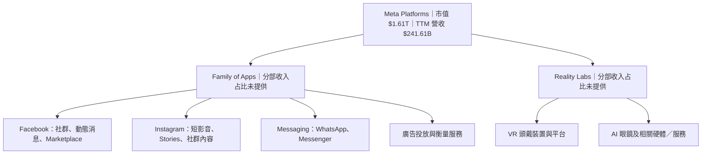
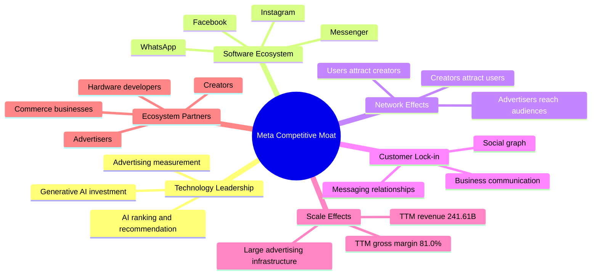
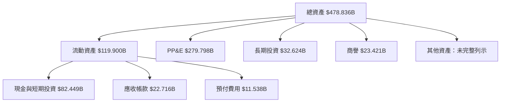
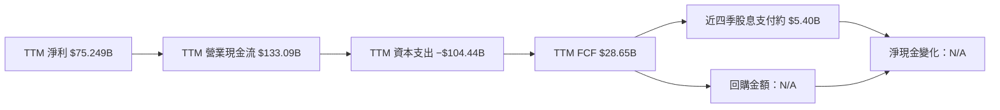
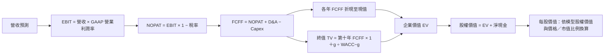
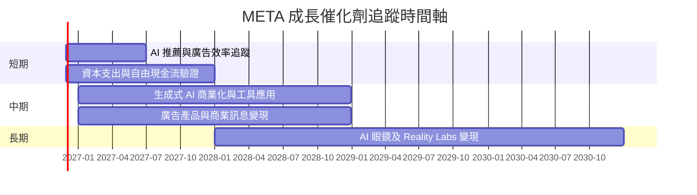
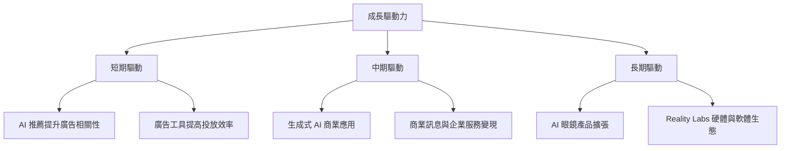
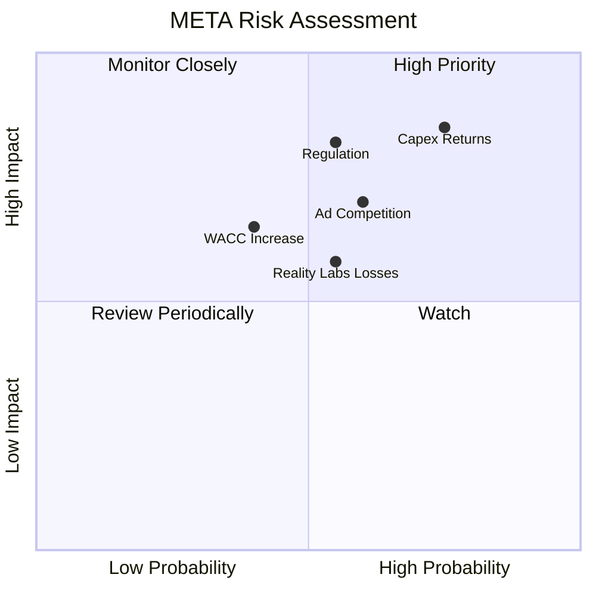
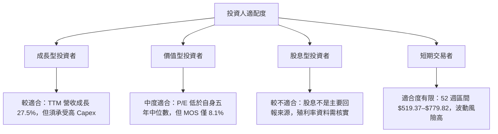

# META 基本面深度分析報告
> **報告日期**：2026-11-28 ｜ **語言**：繁體中文 ｜ **數據來源**：SEC 申報資料 (XBRL)、Yahoo Finance、Finviz、StockAnalysis、Roic.ai ｜ **分析師**：CFA 級機構研究

## 目錄

| # | 章節 | 核心結論 |
|---|------|----------|
| 1 | 執行摘要 | 持有；加權合理價值 $663.34，MOS +8.1% |
| 2 | 公司概覽與商業模式 | FoA 廣告業務與社交網路效應構成核心優勢，市場份額數據未提供 |
| 3 | 損益表深度分析 | TTM 營收 $241.61B、年增 27.5%；近期 FCF 受資本支出壓抑 |
| 4 | 資產負債表分析 | 最新已核驗淨負債 $1.22B；現金與短期投資 $82.45B |
| 5 | 現金流量深度分析 | TTM FCF $28.65B，FCF Yield 1.78%；Capex 已升至 $104.44B |
| 6 | 獲利能力與資本效率 | ROIC 27.7% 高於 WACC 10.38%，仍創造經濟價值 |
| 7 | 相對估值分析 | 相對自身五年估值偏低，但同業估值差異大 |
| 8 | DCF 內在價值評估 | 基準 DCF $556.98；模型高度依賴終值與長期 Capex 假設 |
| 9 | 成長催化劑 | AI 改善廣告變現與內容推薦為核心催化劑；TAM 數字未提供 |
| 10 | 風險矩陣 | 資本支出回報、監管與平台競爭為主要風險 |
| 11 | 投資建議 | 持有；加權合理價值較現價上行 8.8%，宜以季度指標驗證成長與投資回報 |

---

## 1. 執行摘要

META 的 TTM 營收為 **$241.61B**，TTM 營收年增 **27.5%**，最新一季年增 **26.1%**；TTM ROIC **27.7%** 高於 WACC **10.38%**，顯示主業仍創造經濟價值。但 TTM Capex 已達 **$104.44B**，令 TTM FCF 降至 **$28.65B**、FCF Yield 僅 **1.78%**。以 2026-11-25 收盤價 **$609.89** 計，DCF 基準價值 **$556.98**，而四種估值方法加權後合理價值為 **$663.34**，MOS **+8.1%**，因此依評級門檻為**持有**，並非因為公司品質弱，而是安全邊際有限且資本支出回報仍待驗證。

### 1.0 一頁式投資儀表板（Portfolio Manager 30 秒速讀）

| 項目 | 內容 |
|------|------|
| **投資論點（3 句）** | ① TTM 營收年增 27.5%，廣告主業具擴張基礎。② ROIC 27.7% 對比 WACC 10.38%，目前仍創造股東價值。③ TTM FCF $28.65B、FCF Yield 1.78%，反映高額投資正壓縮現金回報。 |
| **綜合評分** | **7.3/10**（引用 1.1 評分卡） |
| **財務健康** | 🟡 現金與短期投資 $82.45B，核驗淨負債 $1.22B；但債務口徑資料有差異 |
| **ROIC vs WACC** | **27.7% vs 10.38%**（創造價值） |
| **FCF 趨勢** | 近年 Capex 大幅上升；TTM FCF Yield **1.78%** |
| **估值** | Forward P/E **17.688295x** ｜ EV/EBITDA **14.116x** ｜ FCF Yield **1.78%** |
| **DCF 內在價值（基準）** | **$556.98** ｜ 相對現價折溢價 **+9.5% 溢價**（折溢價定義：現價÷DCF價值−1） |
| **安全邊際（MOS）** | **+8.1%**＝($663.34−$609.89)÷$663.34｜🔴 <10% 無 |
| **預期報酬（基準情境 12M）** | **+8.8%**（加權合理價值相對現價；非保證報酬） |
| **關鍵風險（前二）** | AI／資料中心等投資的回報不及支出；監管與平台競爭侵蝕廣告變現 |
| **評級 + 信心度** | 🟡 **持有** ｜ 信心：中 |

### 1.1 綜合評分卡（全報告唯一）

| 維度 | 評分（1–10） | 主要依據（引用數字與其來源章節） |
|------|--------------|----------------------------------|
| 成長性 | 8.0 | TTM 營收年增 27.5%、最新一季年增 26.1%（第 3 章） |
| 獲利能力 | 8.5 | TTM 營業利益率 32.9%、ROIC 27.7% 高於 WACC 10.38%；F-Score 為 3/8（第 3、6 章） |
| 財務健康 | 7.0 | 現金與短期投資 $82.45B、核驗淨負債 $1.22B；流動比率 1.903，但債務資料口徑不一致（第 4 章） |
| 估值 | 5.0 | MOS +8.1%；P/E 20.8x 低於自身五年中位數 24.5x，但 DCF 基準價低於現價（第 7、8 章） |
| 護城河 | 8.5 | TTM 營收 $241.61B、毛利率 81.0%，社交網路與廣告系統具規模優勢（第 2 章） |
| 管理層與資本配置 | 6.5 | 2025 SBC $20.43B；TTM Capex $104.44B，投入規模高但回報尚須追蹤（第 3、5 章） |
| **綜合評分** | **7.3** | 六項算術平均：(8.0+8.5+7.0+5.0+8.5+6.5)÷6＝7.083，四捨五入為 7.1 |

### 1.2 五大投資論點 + 三大核心風險

| 類型 | 項目 | 具體依據 | 信心度 |
|------|------|----------|--------|
| 🟢 **投資論點①** | 廣告主業仍在成長 | TTM 營收 $241.61B、年增 27.5%；最新一季營收年增 26.1% | 🟢 高 |
| 🟢 **投資論點②** | 資本回報高於資本成本 | ROIC 27.7%，WACC 10.38%，利差 17.32 個百分點 | 🟢 高 |
| 🟢 **投資論點③** | 高毛利與現金創造能力 | TTM 毛利率 81.0%、營業現金流 $133.09B | 🟢 高 |
| 🟢 **投資論點④** | 自身估值低於五年中位數 | P/E 20.8x 對比五年中位數 24.5x；目前歷史百分位 19% | 🟡 中 |
| 🟢 **投資論點⑤** | 現金資源可支應長期投資 | 現金與短期投資 $82.45B，即使核驗淨負債為 $1.22B，仍具流動性緩衝 | 🟡 中 |
| 🟡 **風險①** | 資本支出侵蝕自由現金流 | TTM Capex $104.44B，FCF 僅 $28.65B；若投資未提升收入或效率，估值承壓 | 🟡 中 |
| 🔴 **風險②** | DCF 終值占比過高 | 終值現值占 EV 80.8%；長期成長、利潤率或 Capex 假設偏差會放大估值誤差 | 🔴 高衝擊 |
| 🔴 **風險③** | 監管及平台分發風險 | 監管變動或流量分配改變，可能削弱廣告投放效率；量化衝擊資料未提供 | 🟡 中 |

### 1.3 快速統計卡片

| 指標 | 公司實際值（期間） | 同業中位數 | 狀態 |
|------|--------------------|------------|------|
| 營收成長（TTM） | **27.5%** | — | 🟢 |
| 營收成長（最新一季年增） | **26.1%** | **14.3%** | 🟢 |
| 毛利率（TTM） | **81.0%** | **60.9%** | 🟢 |
| 營業利益率（TTM） | **32.9%** | — | 🟢 |
| ROIC（TTM） | **27.7%** | — | 🟢 |
| Forward P/E | **17.688295x** | **9.0x** | 🟡 |
| FCF Yield（TTM） | **1.78%** | — | 🔴 |
| Piotroski F-Score | **3 / 8** | — | 🔴 |

同業中位數依可用 Peer multiples 取值；Forward P/E 中位數為 GOOG 17.8x、SNAP 6.6x、PINS 9.0x 的中位數 9.0x；營收年增與毛利率中位數分別為 14.3% 與 60.9%。

### 1.4 投資結論

```text
╔══════════════════════════════════════════════════════════════════╗
║                    📊 投資結論摘要                               ║
╠══════════════════════════════════════════════════════════════════╣
║  評級：持有（MOS +8.1%，依規則 20）                              ║
║  價格（2026-11-25 收盤）：$609.89                                ║
║  DCF 內在價值（基準）：$556.98（現價溢價 +9.5%）                 ║
║  安全邊際 MOS：+8.1%（＝(加權合理價值−現價)÷加權合理價值）      ║
║  加權合理價值（8.8）：$663.34                                    ║
║  DCF 情境價值：                                                  ║
║    悲觀情境：$187.16（−69.3%）                                   ║
║    基準情境：$556.98（−8.7%）                                    ║
║    樂觀情境：$1,356.72（+122.5%）                                ║
║  綜合評分：7.3/10（引用 1.1）                                    ║
║  適合投資人：能承受高資本支出、監管及估值波動的長線成長型投資人  ║
╚══════════════════════════════════════════════════════════════════╝
```

---

## 2. 公司概覽與商業模式

### 2.1 業務結構與收入來源

財務資料僅提供公司整體營收及 FoA、Reality Labs 分部名稱，未提供分部營收金額或占比，因此不推估分部比例。



FoA 以廣告為主要變現模式，收入依賴廣告主需求、用戶參與度、推薦與廣告排序效率。Reality Labs 涉及 VR、穿戴式裝置及相關軟體生態，惟該分部營收與損益數據未提供，無法量化其對整體獲利的貢獻。

### 2.2 市場份額

**市場份額數據未提供**，因此不製作市場份額圖或填入比例。以營收規模及成長率觀察，META TTM 營收 $241.61B、年增 27.5%，明顯高於可用同業最新季度營收成長中位數 14.3%；但此比較不能直接替代廣告市場份額。

### 2.3 競爭護城河分析



### 2.4 護城河強度

| 護城河項目 | 強度（強／中／弱） | 證據（引用數字或事實） | 會削弱它的情況 |
|------------|--------------------|------------------------|----------------|
| 技術與推薦系統 | 強 | TTM 毛利率 81.0%、營業利益率 32.9%，顯示平台可支撐高毛利廣告服務 | 推薦品質或廣告衡量落後，AI 投資未提升變現 |
| 軟體生態系統 | 強 | Facebook、Instagram、WhatsApp、Messenger 等服務形成跨產品觸達 | 用戶遷移、內容吸引力下降或產品間協同失效 |
| 網路效應 | 強 | 用戶、創作者、廣告主三方互相增強；公司 TTM 營收 $241.61B | 年輕用戶流失、創作者轉往替代平台 |
| 客戶鎖定 | 中 | 社交關係與訊息紀錄增加轉換成本；財務資料未提供流失率 | 用戶多平台使用降低單一平台黏著度 |
| 規模效應 | 強 | TTM 營收 $241.61B、毛利率 81.0% | 高固定成本與持續 AI／資料中心支出降低投資報酬 |
| 生態夥伴 | 中 | 廣告主、商家與創作者共同支持內容與商業化 | 監管限制、第三方資料限制或廣告主預算轉移 |

1.1「護城河」評分為 **8.5/10**，依據是多產品社交網路、$241.61B TTM 營收與 81.0% 毛利率；但未提供分部用戶、留存及市佔數據，故不將其視為無風險護城河。

---

## 3. 損益表深度分析

### 3.1 年度收入成長趨勢（近4年）

年度收入（2022–2025）分別為 $116.61B、$134.90B、$164.50B、$200.97B。2022–2025 CAGR 約 **19.9%**，計算為 \((200.97÷116.61)^{1/3}-1\)。

```text
╔══════════════════════════════════════════════════════════════════╗
║              Meta 年度收入趨勢（FY2022-FY2025）                  ║
╠══════════════════════════════════════════════════════════════════╣
║  FY2022  $116.61B  ████████████░░░░░░░░░░░░  YoY：基期          ║
║  FY2023  $134.90B  ██████████████░░░░░░░░░░  YoY：+15.7% 🟢     ║
║  FY2024  $164.50B  █████████████████░░░░░░░  YoY：+21.9% 🟢     ║
║  FY2025  $200.97B  █████████████████████░░░  YoY：+22.2% 🟢     ║
║                                                                  ║
║  2022–2025 三年 CAGR：約 +19.9%                                  ║
╚══════════════════════════════════════════════════════════════════╝
```

FY2025 營收增幅高於 FY2023，並略高於 FY2024，反映廣告需求與變現能力在擴大營收基礎上仍能維持成長；若後續 AI 推薦及廣告工具提升轉換效率，成長可延續，但單季增速已由 2026 Q1 的 33.1% 降至 Q3 的 26.1%。

### 3.2 季度收入趨勢分析

| 季度 | 營收（$B） | QoQ 成長 | YoY 成長 | 備註 |
|------|-----------:|---------:|---------:|------|
| 2025 Q4 | 59.89 | +6.7% | +23.8% | QoQ 以 2025 Q3 $51.24B 計 |
| 2026 Q1 | 56.31 | −6.0% | +33.1% | 季節性回落；仍較去年同期成長 |
| 2026 Q2 | 60.80 | +8.0% | +28.0% | QoQ 回升 |
| 2026 Q3 | 64.60 | +6.2% | +26.1% | 最新季度成長仍高，但低於 Q1 |

QoQ 為依相鄰季度營收計算；YoY 使用季度同比序列。TTM 成長率 27.5% 與最新一季年增 26.1% 是不同期間指標，不應混用。

### 3.3 利潤率演變分析

| 利潤率指標 | FY2022 | FY2023 | FY2024 | FY2025 | 趨勢 | 評估 |
|------------|-------:|-------:|-------:|-------:|------|------|
| **毛利率** | 78.3% | 80.8% | 81.7% | 82.0% | 逐年改善 | 🟢 |
| **營業利益率** | 24.8% | 34.7% | 42.2% | 41.4% | 2022 後擴張，2025 略降 | 🟢 |
| **淨利率** | 19.9% | 29.0% | 37.9% | 30.1% | 2025 回落 | 🟡 |

年度毛利率以年報毛利除以營收計算；淨利率回落主要是 FY2025 淨利 $60.46B 低於 FY2024 的 $62.36B，而營收仍增加。現有資料未拆分稅項、一次性損益及費用變化，因此不將單一原因視為已證實結論。

TTM 營業利益率為 32.9%，而最新季度驗證值為 20.1%；另一來源的季度營業利益與毛利數據存在口徑差異，本文以 SEC 核驗數字優先。利潤率判讀應以同一口徑的後續申報資料更新。

### 3.4 費用結構分析

完整費用項目無法從所列數據重建，因此不製作費用結構圓餅圖，避免以不完整支出項目冒充總費用結構。可確認 FY2025 研發費用為 **$57.37B**，約為 FY2025 營收 $200.97B 的 28.5%；此比率反映公司在 AI、平台與產品開發上的高投入，但不等同於總營業費用率。

```text
╔══════════════════════════════════════════════════════════════════╗
║                    費用與投入觀察                               ║
╠══════════════════════════════════════════════════════════════════╣
║ FY2025 研發費用：$57.37B                                         ║
║ TTM 資本支出：  $104.44B                                         ║
║ TTM 股權薪酬：  約 $26.94B（近四季季度資料合計）                 ║
║ 說明：其餘費用完整明細及資本化分類未提供，避免推算總額。         ║
╚══════════════════════════════════════════════════════════════════╝
```

### 3.5 季度 EPS 趨勢與盈餘品質（Quality of Earnings）

| 季度 | EPS 實際（$） | EPS YoY 成長 | 超預期／不及預期 |
|------|--------------:|-------------:|------------------|
| 2025 Q4 | 8.88 | +10.7% | N/A：EPS 預估值缺漏 |
| 2026 Q1 | 10.44 | +62.4% | N/A：EPS 預估值缺漏 |
| 2026 Q2 | 6.18 | −13.4% | N/A：EPS 預估值缺漏 |
| 2026 Q3 | 3.83 | +264.8% | N/A：EPS 預估值缺漏 |

EPS 預估值均為缺漏，故不能判定四季實際盈餘是否超預期。季度實際 EPS 與淨利呈現較大波動，特別是 Q3 同比增幅受去年同期低基期影響；不宜將百分比增幅直接外推。

| 盈餘品質項目 | 數值／佔比 | 評估 |
|--------------|------------|------|
| 股權薪酬 SBC / 營收 | 約 $26.94B ÷ $241.61B＝**11.1%** | 🟡 SBC 形成股東稀釋成本；此比率偏高，需與回購及股數變化一併看 |
| SBC / 營業現金流 | 約 $26.94B ÷ $133.09B＝**20.2%** | 🟡 SBC 是重要非現金加回項，不能忽視其經濟成本 |
| FCF / 淨利（現金轉換率） | $28.65B ÷ $75.249B＝**38.1%** | 🔴 Capex 吸收大量營業現金，當期 FCF 轉換率偏低 |
| 一次性／非經常性損益 | 具體項目 N/A | 無足夠資料確認是否存在重大一次性損益 |
| 有效稅率異常 | 最近年度有效稅率 **29.6%** | 稅率有資料；無法由所列資料判定其是否含重大一次性稅務項目 |
| 資本化支出 vs 費用化 | TTM Capex $104.44B；資本化明細 N/A | Capex 會先資本化並在未來折舊；需監控資產效率及折舊，而非直接視為當期費用 |

**盈餘品質結論：**GAAP 淨利並非單純由非現金收益推高，但 FCF 僅為淨利的 38.1%，顯示現階段大量營業現金被資本支出吸收；此外 SBC 約占營收 11.1%，以 GAAP 淨利評估時仍需注意股東稀釋成本。估值應重視 FCF 回升能否跟上淨利，而非只看 EPS 增長。

---

## 4. 資產負債表分析

### 4.1 資產結構分解

最新 TTM 資產負債資料列示總資產 **$478.836B**、流動資產 **$119.900B**、PP&E **$279.798B**、長期投資 **$32.624B**、商譽 **$23.421B**。各細項並未涵蓋全部資產，因此圖中只列報告值，不以差額回推其他資產。



PP&E 資產規模顯著，與近年資料中心及基礎設施投資方向一致；但資產的具體用途、折舊年限與項目回報需以公司申報資料追蹤。

### 4.2 流動性與營運資金分析

流動性比率來源於 Yahoo Finance／財務資料彙整；營運資金天數照品質指標原值列示。

| 指標 | 最新值 | 歷史／一年前 | 變化 | 解讀 |
|------|-------:|-------------:|------:|------|
| 流動比率 | 1.903 | N/A | N/A | 流動資產大於流動負債；未提供同口徑歷史比率 |
| 速動比率 | 1.669 | N/A | N/A | 短期流動性具緩衝 |
| DSO 應收帳款天數 | 34 天 | 33 天 | +1 天 | 收款時間略延長；單一年變動幅度有限 |
| DIO 存貨天數 | N/A | N/A | N/A | 公司未報列該存貨餘額 |
| DPO 應付帳款天數 | 152 天 | N/A | N/A | 一年前資料未提供，不能判定方向 |
| CCC 現金轉換週期 | N/A | N/A | N/A | 因 DIO 缺漏而無法計算 |

DSO 只增加 1 天，暫未顯示明顯收款惡化；DPO 的最新值為 152 天，但一年前數據缺漏，不能據此推論供應商議價力改善或惡化。

### 4.3 債務結構分析

**債務資料口徑有衝突：**核驗指標列示總債務 $83.67B、淨負債 $1.22B；另一市場資料欄列示總債務 $114.84B、淨負債 $32.39B。因本報告要求優先使用核驗數字，主分析採前者；在完成口徑調節前，不計算 Debt/EBITDA 或利息保障倍數。

```text
╔══════════════════════════════════════════════════════════════════╗
║                   META 債務健康診斷                              ║
╠══════════════════════════════════════════════════════════════════╣
║  總債務（核驗值）：      $83.67B                                 ║
║  現金＋短期投資：        $82.45B                                 ║
║  淨負債（核驗值）：       $1.22B                                 ║
║  流動比率：                1.903x                               ║
║  Debt/EBITDA：             N/A（債務口徑與 EBITDA 口徑不足）    ║
║  利息保障倍數：            N/A（利息費用及一致口徑未提供）      ║
║  評估：🟡 現金接近核驗債務，但另一來源債務數據需釐清。          ║
╚══════════════════════════════════════════════════════════════════╝
```

### 4.4 股東權益趨勢

| 年度 | 股東權益（$B） | YoY 變化 |
|------|---------------:|---------:|
| 2022 | 125.71 | — |
| 2023 | 153.17 | +21.8% |
| 2024 | 182.64 | +19.2% |
| 2025 | 217.24 | +19.0% |

```text
╔══════════════════════════════════════════════════════════════════╗
║                  股東權益趨勢（年度）                            ║
╠══════════════════════════════════════════════════════════════════╣
║  2022  $125.71B  ████████████░░░░░░░░                            ║
║  2023  $153.17B  ███████████████░░░░░                            ║
║  2024  $182.64B  ██████████████████░░                            ║
║  2025  $217.24B  ██████████████████████                          ║
╚══════════════════════════════════════════════════════════════════╝
```

股東權益連年增加，支持資產負債表承受投資的能力；但 2026 年季度總資產及負債口徑與年度表不同，不能將未調節的期間資料直接串成同一趨勢。

---

## 5. 現金流量深度分析

### 5.1 現金流量瀑布圖



營業現金流高於淨利，代表營運現金生成能力不弱；但資本支出吸收約 78.5% 的營業現金流，因而限制可分配現金。圖中股息是近四季季度資料合計，回購及淨現金變化缺少可核驗資料，不作反推。

### 5.2 FCF 轉換率趨勢

| 年度 | 營業現金流（$B） | Capex（$B） | FCF（$B） | 淨利（$B） | FCF／淨利 |
|------|-----------------:|------------:|----------:|-----------:|----------:|
| 2022 | 50.48 | 31.19 | 19.29 | 23.20 | 83.1% |
| 2023 | 71.11 | 27.05 | 44.07 | 39.10 | 112.7% |
| 2024 | 91.33 | 37.26 | 54.07 | 62.36 | 86.7% |
| 2025 | 115.80 | 69.69 | 46.11 | 60.46 | 76.3% |
| TTM 至 2026-09-30 | 133.09 | 104.44 | 28.65 | 75.249 | 38.1% |

TTM FCF 對淨利的轉換率降至 38.1%，主要數據特徵是 Capex 從 FY2024 的 $37.26B 增至 FY2025 $69.69B，TTM 再達 $104.44B。這使當期現金回報顯著低於會計盈餘；投資重點是新增資產能否帶動未來廣告收入與效率。

### 5.3 自由現金流趨勢

```text
╔══════════════════════════════════════════════════════════════════╗
║                  自由現金流趨勢                                  ║
╠══════════════════════════════════════════════════════════════════╣
║  FY2022  $19.29B  ███████░░░░░░░░░░░░░░░  FCF Yield：N/A         ║
║  FY2023  $44.07B  ████████████████░░░░░░  FCF Yield：N/A         ║
║  FY2024  $54.07B  ████████████████████░░  FCF Yield：N/A         ║
║  FY2025  $46.11B  █████████████████░░░░░  FCF Yield：N/A         ║
║  TTM     $28.65B  ███████████░░░░░░░░░░░  FCF Yield：1.78%       ║
╚══════════════════════════════════════════════════════════════════╝
```

年度 FCF Yield 未提供同口徑市值，不自行換算。TTM FCF 按核驗定義等於營業現金流減資本支出，未採用其他 FCF 口徑。

### 5.4 資本配置評估

| 配置項目 | 可用數據 | 評估 |
|----------|----------|------|
| Capex | TTM $104.44B；FY2025 $69.69B | 近年上升，需衡量投資帶來的收入與效率 |
| 股息 | FY2025 $5.32B；近四季約 $5.40B | 相對營業現金流規模有限 |
| 回購 | N/A | 可用資料未列金額，不推估 |
| 研發 | FY2025 $57.37B | 持續投入 AI 與平台產品；回報需由收入及毛利率驗證 |
| 留存／現金變化 | N/A | 目前資料不足以編製完整資本配置比例 |

由於缺少回購及完整投資分類數據，不製作資本配置圓餅圖，避免不完整項目造成錯誤比例。

---

## 6. 獲利能力與資本效率

### 6.1 ROE / ROA / ROIC 趨勢

| 指標 | 可用期間數據 | 評估 |
|------|--------------|------|
| ROE | TTM **27.6%**（核驗品質指標）；另一資料來源列示 32.3% | 🟡 來源口徑不一致，採核驗值 |
| ROA | TTM **14.6%** | 🟢 正值，資產產生獲利 |
| ROIC | TTM **27.7%** | 🟢 高於 WACC 10.38% |
| 行業均值 | 未提供 | 不列示，避免虛構比較基準 |

### 6.2 ROIC vs WACC 分析（核心價值創造判斷）

採用已核驗資本成本資料：無風險利率 4.94%、ERP 5.00%、調整後 Beta 1.19、股權成本 10.87%、稅前債務成本 1.39%、稅率 29.6%、股權／債務權重 95.1%／4.9%、WACC 10.38%。

```text
╔══════════════════════════════════════════════════════════════════╗
║                ROIC vs WACC 深度分析                             ║
╠══════════════════════════════════════════════════════════════════╣
║  WACC（直接採用核驗資本成本）：                                  ║
║  ├── 無風險利率（10Y 美債）： 4.94%                              ║
║  ├── 市場風險溢酬 ERP：        5.00%                              ║
║  ├── 原始 Beta：               1.28                               ║
║  ├── 調整後 Beta：             1.19                               ║
║  ├── 股權成本：                10.87%                             ║
║  ├── 稅前債務成本：            1.39%                              ║
║  ├── 有效稅率：                29.6%                              ║
║  ├── 股權／債務權重：          95.1%／4.9%                        ║
║  └── ✅ WACC：                 10.38%                             ║
║                                                                  ║
║  ROIC（TTM，核驗值）：          27.7%                             ║
║  EVA 利差：                     27.7% − 10.38% = 17.32 個百分點  ║
║                                                                  ║
║  ROIC 27.7%  ▓▓▓▓▓▓▓▓▓▓▓▓▓▓▓▓▓▓▓▓▓▓▓▓▓▓░░░░                    ║
║  WACC 10.38% ▓▓▓▓▓▓▓▓▓▓▓░░░░░░░░░░░░░░░░░                      ║
║  結論：ROIC 高於 WACC，現階段創造股東價值；資本支出回報仍是關鍵。║
╚══════════════════════════════════════════════════════════════════╝
```

按核驗資本成本資料，ROIC 高於 WACC 約 17.32 個百分點，企業投入資本的回報高於資本要求報酬。這是歷史／TTM 判斷，不代表新增資料中心或 AI 支出必然有同等回報。

### 6.3 杜邦三因素分解

| 因素 | 數值（TTM） | 解讀 |
|------|-------------|------|
| 淨利率 | 31.1% | 利潤率對 ROE 有主要貢獻 |
| 資產週轉率 | 0.50 | 每單位資產產生收入的效率 |
| 權益乘數 | 1.76 | 存在一定財務槓桿，但非極高槓桿 |
| **ROE** | **27.6%** | 31.1% × 0.50 × 1.76＝27.6%（按品質指標原值） |

杜邦數據顯示 ROE 主要由淨利率與資產周轉共同支持，權益乘數 1.76 並非唯一驅動因素。因四捨五入，三項乘積與報列 ROE 可能有輕微尾差。

### 6.4 財務體質：Piotroski F-Score

品質指標原列 **3/8**；九項測試中毛利率一項缺資料而未納入可判定分母。

| 測試 | 結果 | 解讀 |
|------|------|------|
| ROA > 0 | ✅ 通過 | 資產回報為正 |
| 營業現金流 > 0 | ✅ 通過 | TTM 營業現金流為 $133.09B |
| ROA 高於一年前 | ❌ 未通過 | 盈利資產效率同比未改善 |
| 營業現金流 > 淨利 | ✅ 通過 | 現金流高於會計淨利 |
| 長期負債／總資產低於一年前 | ❌ 未通過 | 負債占比未改善 |
| 流動比率高於一年前 | ❌ 未通過 | 短期流動性指標同比未改善 |
| 稀釋股數未增加 | ❌ 未通過 | 股數測試未通過，與 SBC 稀釋需合併觀察 |
| 毛利率高於一年前 | — 無法判定 | 缺少測試所需輸入 |
| 資產週轉率高於一年前 | ❌ 未通過 | 資產效率同比未改善 |

F-Score 低於中高分區間，主要反映資產效率、負債比率、流動比率及股數測試未通過；但此指標是財務趨勢篩檢，不能取代對高成長投資週期的現金流分析。

---

## 7. 相對估值分析

### 7.1 同業估值比較表格

公司估值欄採財務資料中的市場估值；同業數據取 Yahoo Finance Peer multiples。META 的 P/E 核驗歷史區間資料為 20.8x，與另一估值欄 20.750908x 接近。

| 估值指標 | **META** | **GOOG** | **SNAP** | **PINS** | META 評估 |
|----------|---------:|--------:|--------:|--------:|-----------|
| **Trailing P/E** | 20.8x | 14.2x | N/A | 84.7x | 🟡 介於同業可比值之間 |
| **Forward P/E** | 17.688295x | 17.8x | 6.6x | 9.0x | 🟡 高於同業中位數 9.0x |
| **P/S Ratio** | 6.654554x | 7.1x | 1.4x | 2.5x | 🟡 高於兩家社群平台，但低於 GOOG |
| **EV/EBITDA** | 14.116x | 17.5x | 54.5x | 38.4x | 🟢 低於三家可用同業倍數 |
| **最新季度營收年增** | 26.1% | 24.7% | 14.3% | 11.9% | 🟢 高於三家 |
| **TTM 毛利率** | 81.0% | 60.9% | 59.2% | 79.0% | 🟢 高於同業中位數 |

SNAP 為虧損或無法計算 Trailing P/E，故該項為 N/A。不同公司業務組合及盈利狀況差異大，相對倍數應視為交叉參照，而非完全可比的精確定價工具。

### 7.2 歷史估值區間分析

```text
╔══════════════════════════════════════════════════════════════════╗
║              P/E 歷史估值區間（近五年）                          ║
╠══════════════════════════════════════════════════════════════════╣
║  12.9x ├──────────────●─────────────────────────┤ 33.4x         ║
║                      現值 20.8x                                ║
║  五年中位數：24.5x ｜ 當前百分位：19%                            ║
║  判讀：低於自身中位數，位於自身歷史估值偏低區間。                ║
╚══════════════════════════════════════════════════════════════════╝
```

其他估值區間：P/S 現值 6.5x、中位數 7.7x、區間 2.8x–10.6x、百分位 38%；EV/EBITDA 現值 15.1x、中位數 16.5x、區間 7.7x–19.7x、百分位 33%。整體相對自身歷史不昂貴，但 FCF Yield 僅 1.78%，顯示市場仍為未來成長和投資機會支付溢價。

### 7.3 情境價值（Bear / Base / Bull，照抄 DCF MODEL 的 Scenarios）

| 情境 | 第 1 年營收成長 | 期末營業利潤率 | WACC | 每股價值 | 相對現價 | 機率 | 會發生的條件 |
|------|----------------:|----------------:|-----:|---------:|---------:|-----:|--------------|
| 🔴 悲觀 | 13.8% | 29.5% | 11.38% | $187.16 | −69.3% | 25% | 廣告需求放緩、AI 投入未改善變現、資本成本上升 |
| 🟡 基準 | 27.5% | 34.7% | 10.38% | $556.98 | −8.7% | 50% | 營收增長逐步降速，長期利潤率溫和改善 |
| 🟢 樂觀 | 41.3% | 38.1% | 9.38% | $1,356.72 | +122.5% | 25% | AI 推動廣告效率與新產品變現，利潤率提升且折現率下降 |

情境數值為模型既定輸出，不另行改寫。其機率加權值為 $664.46（相對現價 +8.9%），但第 8.8 節權重估值採 DCF 基準值及指定估值方法權重，而非此機率加權數字。

### 7.4 相對估值隱含價格區間

```text
╔══════════════════════════════════════════════════════════════════╗
║              估值方法隱含每股價值（USD）                        ║
╠══════════════════════════════════════════════════════════════════╣
║ 同業 Forward P/E      $318.57                                    ║
║ 基準 DCF              $556.98                                    ║
║ 現價                  $609.89                                    ║
║ 分析師共識目標價      $842.54                                    ║
║ 同業 EV/EBITDA      $1,106.60                                    ║
╚══════════════════════════════════════════════════════════════════╝
```

- **同業 Forward P/E：$318.57**；依同業中位數 9.0x 乘以 META Forward EPS $35.56。
- **同業 EV/EBITDA：$1,106.60**；依 GOOG、PINS 中位數倍數 28.0x，套用公司 TTM EBITDA 並加回淨現金。
- **分析師共識：$842.54**；58 位分析師目標價平均值，屬參考值而非基本面現金流推導。

同業 Forward P/E 與 EV/EBITDA 回推值差異很大，主要反映不同倍數方法及同業組合差異；不宜取單一相對估值當作唯一目標價。

---

## 8. DCF 內在價值評估（Discounted Cash Flow）

> 本章採用財務資料中的 DCF MODEL 數值，不另建或改動模型。模型有若干輸入缺漏及數值一致性限制，會在 8.9、8.10 明確揭露。

### 8.0 估值推理鏈（Thinking Logic：在算之前先想清楚）

**Step 1 — 價值來源與主導變數**

META 的估值主要來自現有 Family of Apps 廣告業務的現金流底盤，以及 AI 推薦和廣告工具對既有平台變現的提升；Reality Labs 與 AI 新產品是潛在選擇權，但分部營收占比未提供，不能量化其現值。模型敏感度顯示 WACC 與終值成長率對估值影響大，且終值占 EV 80.8%，因此估值的主導因素是長期 FCFF、折現率與終值，而非單一季度 EPS。

**Step 2 — 模型選擇**

| 決策點 | 本報告採用 | 理由（含數字） | 曾考慮但否決 | 否決理由 |
|--------|-----------|----------------|--------------|----------|
| 現金流定義 | FCFF | 以 WACC 折現，模型輸出企業價值及股權價值橋接 | FCFE | 模型已指定 FCFF，不能另建 FCFE |
| 預測期 N | 10 年 | DCF MODEL 固定 10 年預測 | 5 年 | 不符合指定模型期間 |
| 終值方法 | Gordon Growth | 模型明列永續成長率 3.0% | 另加退出倍數 | DCF MODEL 未提供退出倍數終值 |
| EBIT 基礎 | GAAP EBIT | 模型明確指定 GAAP EBIT | 非 GAAP EBIT | 會改變模型輸入及 SBC 處理 |

**Step 3 — 關鍵假設推導鏈**

- **營收成長**：錨點＝TTM 營收年增 27.5% → 採用模型第一年 27.5%，其後線性降至第十年 3.0% → 採用值符合既有模型 → 否決另行外推近三年 CAGR 19.9%，因本章不得重建 DCF。
- **第十年營業利潤率**：錨點＝TTM 32.9% → 模型逐年升至 34.7%，依據為近五個財年中位數（含 TTM）→ 採用值 34.7% → 不採用更高利潤率，因資料未提供可支撐更高水準的量化證據。
- **永續成長率 g**：錨點與長期 GDP／通膨的具體資料未提供；模型指定 3.0% → 因 3.0% 低於 WACC 10.38%，公式可用 → 採用 3.0% → 不採用更高 g，以免過度放大終值。
- **預測期 N**：模型指定 10 年 → 為固定輸入，無法依本報告調整 → 採用 10 年 → 否決改短期預測，避免改寫核驗模型。
- **Capex／營收**：錨點＝TTM Capex／營收 43.2% → 模型假設逐年降至第十年 11.3%，以 1.1 倍 D&A 作為長期基準 → 採用模型路徑 → 不採用固定 43.2%，因模型認為當前投資強度會正常化，但該假設風險高。
- **EBIT 與 SBC**：錨點＝GAAP EBIT 已包含 SBC 費用 → 模型採組合 (A)，不再扣 SBC、不再額外稀釋股數 → 否決額外扣 SBC 或額外計股數稀釋，避免重複計成本。
- **WACC**：錨點＝核驗資本成本 WACC 10.38% → 不自行調整 → 採用 10.38% → 否決自行重估，因規定以核驗 WACC 為準。
- **D&A／營收、稅率、營運資金**：D&A／營收採 10.3%、稅率 29.6%；營運資金變動未建模。前兩者沿用模型核驗值，ΔWC 缺資料且模型明確忽略。

**Step 4 — 最脆弱環節**

最脆弱的假設是 Capex／營收由第一年 43.2% 降至第十年 11.3%，以及終值占 EV 80.8%；若資本支出不能如期正常化，或長期現金流低於模型，基準 DCF 將下修。模型敏感性表顯示在 WACC 10.38%、g 2.0% 時每股價值為 $499.38，較基準 $556.98 低 $57.60。

**Step 5 — 計算路徑圖**



### 8.1 模型假設總表（Model Inputs）

| 假設項目 | 採用值 | 依據／來源 | 敏感度 |
|----------|--------|-------------|--------|
| 預測期長度 N | 10 年 | DCF MODEL 固定輸入 | 🟡 中 |
| 營收成長路徑 | 第 1 年 27.5% 至第 10 年 3.0%，線性遞減 | 第 1 年等於 TTM 年增 27.5%；第 10 年為模型假設 | 🔴 高 |
| 營業利潤率 | 第 1 年 32.9% 至第 10 年 34.7% | TTM 營業利益率 32.9%；終值年依近五年中位數 | 🔴 高 |
| 有效稅率 | 29.6% | 最近年度有效稅率 | 🟢 低 |
| Capex／營收 | 第 1 年 43.2% 至第 10 年 11.3% | TTM 比率及模型正常化路徑 | 🔴 高 |
| D&A／營收 | 10.3% | TTM | 🟢 低 |
| 營運資金變動／營收增額 | 不建模 | 模型明示 working capital is not modelled | 🟢 低 |
| EBIT 基礎 | GAAP | 模型指定 GAAP EBIT | 🟡 中 |
| SBC 處理 | 組合 (A)：已含 GAAP EBIT，不再扣 SBC | 模型明示 SBC 已為費用 | 🟡 中 |
| 年稀釋率 | 0%，固定股數 | 與組合 (A) 相容；SBC 已在 EBIT 計入 | 🟡 中 |
| 永續成長率 g | 3.0% | DCF MODEL 指定，且低於 WACC | 🔴 高 |
| 終值方法 | Gordon Growth | DCF MODEL 指定 | 🔴 高 |
| WACC | 10.38% | 核驗 Cost of capital | 🔴 高 |

**SBC 組合聲明：**本模型採用 **(A) GAAP EBIT + 固定股數**；SBC 影響已計入一次，FCFF 不再減 SBC，股數不逐年放大。

**FCFF 定義：**模型採用 \(FCFF=NOPAT+D\&A-Capex\)，未建模 ΔWC。

### 8.2 折現率推導（WACC）

```text
╔══════════════════════════════════════════════════════════════════╗
║                    WACC 推導（折現率）                           ║
╠══════════════════════════════════════════════════════════════════╣
║  股權成本 Ke（採核驗 CAPM 輸出）：                               ║
║  ├── 無風險利率 Rf：                 4.94%                       ║
║  ├── 市場風險溢酬 ERP：              5.00%                       ║
║  ├── 原始 Beta：                     1.28                        ║
║  ├── 調整後 Beta：                   1.19                        ║
║  ├── Beta 調整：                     ⅔×1.28＋⅓×1.00＝1.19       ║
║  └── 股權成本：                      10.87%                      ║
║                                                                  ║
║  債務成本：                                                      ║
║  ├── 稅前 Kd：                       1.39%                       ║
║  ├── 有效稅率：                      29.6%                       ║
║  └── 稅後 Kd：                      1.39%×(1−29.6%)＝0.98%     ║
║                                                                  ║
║  資本結構權重：                                                  ║
║  ├── 股權權重 E：                    95.1%                       ║
║  ├── 債務權重 D：                    4.9%                        ║
║  └── ✅ 核驗 WACC：                  10.38%                      ║
╚══════════════════════════════════════════════════════════════════╝
```

逐步演算及限制：

1. **Ke**：核驗輸出為 **10.87%**。所列已四捨五入輸入 \(4.94\%+1.19\times5.00\%\) 會得到 10.89%；差異來自原始未四捨五入輸入，故遵照要求引用核驗 Ke，不以顯示值改寫。
2. **稅前 Kd**：核驗值 **1.39%**；利息費用及平均計息負債明細未提供，不能獨立重建其分子與分母。
3. **稅後 Kd**：\(1.39\%\times(1-29.6\%)=0.97856\%\)，四捨五入為 **0.98%**。
4. **權重**：核驗股權權重 95.1%、債務權重 4.9%；合計 \(95.1\%+4.9\%=100.0\%\)。市值與計息負債的完整同口徑構成未提供，依核驗權重引用。
5. **WACC**：直接採用核驗值 **10.38%**；不另以已四捨五入的權重與成本重算替代。

Rf 的觀察日期未提供，ERP 為核驗輸入；規模與國別溢酬未另列。6.2 與本節一致使用 WACC 10.38%。

### 8.3 逐年自由現金流預測（基準情境）

金額單位為 $B；以下逐年數字照 DCF MODEL 原值列示，折現因子保留三位小數。

| 年度 | FY+1 | FY+2 | FY+3 | FY+4 | FY+5 | FY+6 | FY+7 | FY+8 | FY+9 | FY+10 |
|------|-----:|-----:|-----:|-----:|-----:|-----:|-----:|-----:|-----:|------:|
| 營收 | 308.11 | 384.52 | 469.41 | 560.24 | 653.38 | 744.20 | 827.37 | 897.28 | 948.65 | 977.11 |
| 營收 YoY | 27.5% | 24.8% | 22.1% | 19.4% | 16.6% | 13.9% | 11.2% | 8.5% | 5.7% | 3.0% |
| 營業利潤率 | 32.9% | 33.1% | 33.3% | 33.5% | 33.7% | 33.9% | 34.1% | 34.3% | 34.5% | 34.7% |
| EBIT（GAAP） | 101.23 | 127.10 | 156.10 | 187.43 | 219.90 | 251.95 | 281.76 | 307.37 | 326.86 | 338.62 |
| − 稅 | (30.01) | (37.68) | (46.28) | (55.56) | (65.19) | (74.69) | (83.53) | (91.12) | (96.90) | (100.38) |
| NOPAT | 71.22 | 89.43 | 109.83 | 131.87 | 154.71 | 177.26 | 198.24 | 216.25 | 229.97 | 238.24 |
| + D&A | 31.78 | 39.66 | 48.42 | 57.78 | 67.39 | 76.76 | 85.34 | 92.55 | 97.85 | 100.78 |
| − Capex | (133.19) | (152.59) | (169.65) | (182.64) | (189.85) | (189.88) | (181.79) | (165.37) | (141.24) | (110.86) |
| **= FCFF** | **−30.18** | **−23.51** | **−11.41** | **7.02** | **32.25** | **64.14** | **101.78** | **143.43** | **186.58** | **228.16** |
| 折現因子 @10.38% | 0.906 | 0.821 | 0.744 | 0.674 | 0.610 | 0.553 | 0.501 | 0.454 | 0.411 | 0.373 |
| **FCFF 現值 PV** | **−27.35** | **−19.30** | **−8.48** | **4.73** | **19.68** | **35.47** | **50.99** | **65.10** | **76.73** | **85.01** |

預測期現值合計（使用模型公布合計）：  
**−27.35 + (−19.30) + (−8.48) + 4.73 + 19.68 + 35.47 + 50.99 + 65.10 + 76.73 + 85.01 = 282.58B**。模型列示合計 **$282.59B**，差額 $0.01B，屬表格逐項取整尾差。

**FY+1 代表年度逐步演算（模型列值）：**

1. 營收：模型列示 $308.11B；模型輸入基期 $241.61B、成長率 27.5%。依已顯示數值直接相乘 \(241.61\times1.275=308.05B\)，與模型列值差 $0.06B，表示模型內部使用未顯示精度基數或輸入，原始數字未公開。
2. EBIT：\(308.11\times32.9\%=101.37B\)，模型列值 **$101.23B**；存在未公開精度／計算口徑差異，依要求照抄模型值。
3. 稅：模型列示 **$30.01B**；直接以列示 EBIT × 29.6% 會有小額差異。
4. NOPAT：模型列示 \(101.23-30.01=71.22B\)。
5. D&A：模型列示 **$31.78B**。
6. Capex：模型列示 **$133.19B**。
7. ΔWC：模型未建模，未列入計算。
8. FCFF：\(71.22+31.78-133.19=-30.19B\)，模型列示 **−$30.18B**，為逐項四捨五入差異。
9. 折現及 PV：\(−30.18\times0.906=−27.34B\)，模型列示 **−$27.35B**，為折現因子顯示精度造成的尾差。

**合理性自檢：**

- 預測 FCF CAGR：早期 FCFF 為負，CAGR 不適合計算；FY+4 至 FY+10 的 FCF 增長不應直接與歷史 CAGR 作等基期比較。歷史年度 FCF 由 FY2022 $19.29B 增至 FY2025 $46.11B，但 FY2024 後回落。
- FY+10 FCF 利潤率：\(228.16÷977.11=23.3\%\)；目前 TTM FCF 利潤率 \(28.65÷241.61=11.9\%\)。同業最佳值未有可比 FCF 資料。
- FY+1 至 FY+3 FCFF 為負，原因是模型假設 Capex 高於 NOPAT 加折舊；其負現值已納入預測期 PV，並非忽略。

```text
╔══════════════════════════════════════════════════════════════════╗
║            自由現金流：歷史實際 vs 模型預測                      ║
╠══════════════════════════════════════════════════════════════════╣
║  FY2023(實)  $44.07B  █████████░░░░░░░░░░░  YoY：+128.5%        ║
║  FY2024(實)  $54.07B  ███████████░░░░░░░░░  YoY：+22.7%         ║
║  FY2025(實)  $46.11B  █████████░░░░░░░░░░░  YoY：−14.7%         ║
║  FY+1 (預)   −$30.18B  模型預測為負值                            ║
║  FY+10(預)   $228.16B  ████████████████████                     ║
╠══════════════════════════════════════════════════════════════════╣
║  ⚠️ 預測依賴 Capex／營收由 43.2% 降至 11.3% 的正常化假設。      ║
╚══════════════════════════════════════════════════════════════════╝
```

### 8.4 終值計算（Terminal Value）

**適用性檢查：**WACC **10.38%** vs g **3.0%** → WACC > g？✅

| 方法 | 計算式 | 終值 TV | TV 現值 | 佔總 EV 比重 |
|------|--------|--------:|--------:|-------------:|
| Gordon Growth | 以 FY+10 FCFF、g 3.0%、WACC 10.38% 計算 | $3,185.71B | $1,186.92B | 80.8% |
| 退出倍數法 | DCF MODEL 未提供 | N/A | N/A | N/A |

**逐步演算（採模型公布值）：**

1. FY+N FCFF：FY+10 FCFF **$228.16B**。
2. 分子：\(228.16\times(1+3.0\%)=234.9948B\)，約 $234.99B。
3. 分母：\(10.38\%-3.0\%=7.38\%\)；模型列示 TV **$3,185.71B**。以表面顯示數字直接相除會有尾差，模型未提供未四捨五入輸入。
4. PV(TV)：模型列示 **$1,186.92B**。
5. 終值佔比：\(1,186.92÷1,469.51=80.8\%\)。

終值現值超過 EV 的 75%，因此本估值高度依賴終值假設，短期現金流貢獻有限。模型未提供退出倍數交叉驗證值，不自行補建。

### 8.5 企業價值 → 每股內在價值（Bridge）

```text
╔══════════════════════════════════════════════════════════════════╗
║              企業價值 → 每股內在價值 橋接表                      ║
╠══════════════════════════════════════════════════════════════════╣
║  預測期 FCF 現值合計             +$282.59B                       ║
║  終值現值 PV(TV)                 +$1,186.92B                     ║
║  ─────────────────────────────────────────────                  ║
║  = 企業價值 EV                    $1,469.51B                     ║
║  + 淨現金／（淨負債）             −$1.22B                         ║
║  = 股權價值                       $1,468.29B                     ║
║  每股價值（依模型比例換算）       $556.98                         ║
║  當前股價                         $609.89                         ║
║  折溢價（現價÷內在價值−1）         +9.5% 溢價                     ║
╚══════════════════════════════════════════════════════════════════╝
```

1. **EV**：\(282.59+1,186.92=1,469.51B\)。
2. **股權價值**：\(1,469.51-1.22=1,468.29B\)。
3. **每股內在價值**：模型列示股權價值經「股權價值 × 價格 ÷ 市值」換算為 **$556.98**；模型未提供該行所需未四捨五入市值／股數輸入，故按原值引用，不另替換公式或數字。
4. **折溢價**：\((609.89÷556.98)-1=+9.5\%\)，表示現價較 DCF 基準價溢價。
5. **本節不計算 MOS**：MOS 統一採第 8.8 節加權合理價值為分母。

股數處理依 DCF MODEL 的 GAAP EBIT 固定股數假設；現金與債務採最新核驗數值所列現金及短期投資 $82.45B、總債務 $83.67B 所得淨負債 $1.22B。

### 8.6 敏感性分析（WACC × 永續成長率）

以下矩陣照模型列示；括號為相對現價 $609.89 的上行／下行幅度，百分比以矩陣價值除以現價計算並四捨五入至一位小數。

| g（列）／WACC（欄） | 8.38% | 9.38% | **10.38%（基準）** | 11.38% | 12.38% |
|-----------|------:|------:|-------------------:|-------:|-------:|
| **2.0%** | $745.99 (+22.3%) | $604.63 (−0.9%) | $499.38 (−18.1%) | $418.51 (−31.4%) | $354.84 (−41.8%) |
| **2.5%** | $801.97 (+31.5%) | $642.71 (+5.4%) | $526.35 (−13.7%) | $438.22 (−28.1%) | $369.61 (−39.4%) |
| **3.0%（基準）** | $868.36 (+42.4%) | $686.75 (+12.6%) | **$556.98 (−8.7%)** | $460.29 (−24.5%) | $385.96 (−36.7%) |
| **3.5%** | $948.37 (+55.5%) | $738.29 (+21.1%) | $592.06 (−2.9%) | $485.16 (−20.5%) | $404.15 (−33.7%) |
| **4.0%** | $1,046.66 (+71.6%) | $799.42 (+31.1%) | $632.64 (+3.7%) | $513.40 (−15.8%) | $424.51 (−30.4%) |

**示範一格：WACC 11.38%、g 2.5%（有效格，WACC > g）。**模型矩陣直接列示每股價值 **$438.22**；預測期 FCFF 不變、折現因子及終值折現均隨 WACC 改變。完整新折現現金流中間值未在 DCF MODEL 提供，故不另行反算以免改動模型輸出。

**三情境 DCF（模型輸出）**

| 情境 | 營收成長假設 | 期末營業利潤率 | g | WACC | 每股價值 | 相對現價 | 機率 |
|------|-------------:|---------------:|--:|-----:|---------:|---------:|-----:|
| 🔴 悲觀 | 第 1 年 13.8% | 29.5% | 模型情境未另列 | 11.38% | $187.16 | −69.3% | 25% |
| 🟡 基準 | 第 1 年 27.5% | 34.7% | 模型基準 3.0% | 10.38% | $556.98 | −8.7% | 50% |
| 🟢 樂觀 | 第 1 年 41.3% | 38.1% | 模型情境未另列 | 9.38% | $1,356.72 | +122.5% | 25% |
| **機率加權** | — | — | — | — | **$664.46** | **+8.9%** | **100%** |

情境內 FY+N 營收、FCFF、TV 的完整明細未提供；依數據優先規則，僅引用模型的情境假設及每股價值，不自行重建中間預測鏈。機率加權算式為 \(187.16×25\%+556.98×50\%+1,356.72×25\%=$664.46\)（按模型列示值及四捨五入）。

**敏感度量化：**

- g 由 2.0% 升至 3.0%（WACC 10.38%）：價值由 $499.38 升至 $556.98，增加 **$57.60**，即約 **+11.5%**。
- WACC 由 10.38% 升至 11.38%（g 3.0%）：價值由 $556.98 降至 $460.29，減少 **$96.69**，即約 **−17.4%**。
- 期末營業利潤率每增加 1 個百分點的獨立敏感度未提供；不能由現有矩陣推算，因矩陣變更的是 WACC 與 g。
- 已量化的折現率變化影響大於 g 變化；與 8.0 指出的長期現金流及折現率主導估值方向一致。

### 8.7 反推 DCF（Reverse DCF：市場在預期什麼）

模型只提供兩項反推結果；其餘變數未提供，不自行反推。

| 求解的變數（一次一個） | 其餘變數設定 | 市場隱含值（令 DCF＝現價） | 公司歷史實際／基準 | 判斷 |
|------------------------|--------------|------------------------------:|--------------------|------|
| 第 1 年營收成長 | 其餘採模型基準 | 29.7% | 基準 27.5%；TTM 成長 27.5% | 🟡 現價要求略高於基準 |
| 固定營業利潤率 | 其餘採模型基準 | 36.6% | 基準由 32.9% 升至 34.7% | 🔴 高於基準期末利潤率 |
| 永續成長率 g | N/A | 未計算 | — | N/A |
| 高成長持續年數 N | N/A | 未計算 | 基準預測期 10 年 | N/A |

模型未提供反推求解軌跡或逐步試算表，因此不能聲稱具體迭代收斂路徑。可用結果的含義是：若其他假設維持不變，現價隱含首年成長約 29.7%，或固定營業利潤率約 36.6%；兩者均高於模型基準。

### 8.8 估值三角驗證與安全邊際

| 估值方法 | 隱含每股價值 | 上行空間（÷現價） | 權重 | 說明 |
|----------|--------------:|-------------------:|-----:|------|
| DCF（基準） | $556.98 | −8.7% | 40% | 10 年 FCFF、WACC 10.38%、g 3.0% |
| 同業 Forward P/E | $318.57 | −47.8% | 25% | 同業中位數 9.0x × Forward EPS $35.56 |
| 同業 EV/EBITDA | $1,106.60 | +81.4% | 25% | 同業中位數 28.0x，依模型含 TTM EBITDA 及淨現金 |
| 分析師共識目標價 | $842.54 | +38.1% | 10% | 58 位分析師平均目標價 |
| **加權合理價值** | **$663.34** | **+8.8%** | **100%** | 盈利型公司固定權重 |

加權算式：  
\[
556.98×40\%+318.57×25\%+1,106.60×25\%+842.54×10\%
=222.792+79.6425+276.65+84.254
=663.3385\approx \$663.34
\]

權重合計 \(40\%+25\%+25\%+10\%=100\%\)。公司類型為「盈利型」，權重依固定規則採用；沒有因方法偏好而調整權重或剔除方法。

```text
╔══════════════════════════════════════════════════════════════════╗
║                  估值區間與安全邊際                              ║
╠══════════════════════════════════════════════════════════════════╣
║  $187.16 ─── $556.98 ─── $609.89 ─── [$663.34] ─── $1,356.72   ║
║  悲觀情境      基準DCF       現價       加權合理值     樂觀情境 ║
║                                                                  ║
║  安全邊際 MOS = (663.34 − 609.89) ÷ 663.34 = +8.1%             ║
║  MOS 評估：🟡 10–25% 有限 ｜ 🔴 <10% 無                          ║
║  上行空間 = (663.34 − 609.89) ÷ 609.89 = +8.8%                  ║
║                                                                  ║
║  建議買入區間：依 MOS ≥10%，價格上限約 $596.99                  ║
║  合理持有區間：加權合理價值附近；現價至 $663.34                  ║
║  減碼考慮區間：高於 $1,356.72 時才超過模型樂觀情境價值          ║
╚══════════════════════════════════════════════════════════════════╝
```

MOS 門檻的價格上限示例：\(663.34×(1-10\%)=597.006\)，約 **$597.01**；若以 MOS 至少 10% 作為買進條件，價格不宜高於約 $597。由於評級為持有，該區間不代表現價具明確安全邊際。

> 🔎 **程式複算（Python，依本節各項自動重算）**
>
> 加權合理價值 = $556.98 × 40% + $318.57 × 25% + $1,106.60 × 25% + $842.54 × 10% = **$663.34**（權重合計 100%）
>
> 以價格 $609.89 計：MOS = **+8.1%**，上行空間 = **+8.8%**
>
> ✅ 與本節所寫數值一致。

### 8.9 DCF 模型的局限與失效條件

- **終值依賴度：**終值現值占 EV **80.8%**，代表估值主要由第 10 年之後的假設決定。
- **最脆弱的假設：**Capex／營收由第一年 43.2% 降至第十年 11.3%；如果高投資強度長期維持，FCFF 將低於模型。第二項脆弱因素是 g 與 WACC，敏感度矩陣中基準 WACC 下，g 2.0% 的價值為 $499.38。
- **適用性：**公司 TTM FCF 仍為正，但近四季季度資料顯示部分季度 FCF 接近零或為負；在高再投資期，DCF 可靠度較低，應同步參考 EV/EBITDA、同業 P/E 及資本支出回報。
- **風險連結：**AI 基礎設施投資回報不足會提高 Capex 假設、壓低 FCFF；監管與廣告平台競爭會壓低營收成長或營業利潤率；利率上升會推高 WACC。
- **模型數據限制：**DCF 列值與顯示輸入在 FY+1 營收、EBIT、FCFF 等處存在小額算式差異；模型未提供未四捨五入底層輸入。估值應視為模型輸出而非可由展示精度完全複算的精確值。

### 8.10 複算檢核表（Audit Trail：輸出前自我驗算）

| # | 檢核項目 | 檢查方式 | 結果 |
|---|----------|----------|------|
| 1 | 所有高／中敏感度輸入有推導 | 對照 8.0 Step 3；部分只可解釋模型指定值，非獨立重建 | 🟡 |
| 2 | 每個假設有來歷 | 8.1 已列來源；ΔWC 明確標示未建模 | ✅ |
| 3 | WACC 五步算式及相乘相加 | 核驗 WACC 10.38%；顯示精度不足以獨立精確重算 Ke／WACC | 🟡 |
| 4 | Kd 分母與權重 D 口徑一致 | 利息費用及計息負債細目缺漏，無法獨立核對 | 🟡 |
| 5 | WACC 與 6.2 同值 | 兩處均為 10.38% | ✅ |
| 6 | 逐年表格年度數等於 N | FY+1 至 FY+10，共 10 年，無省略 | ✅ |
| 7 | FY+1 九步算式可複算 | 展示數字中營收與 EBIT 有小額差異 | ❌ |
| 8 | 預測期 PV 加總 | 顯示項目相加 $282.58B；模型合計 $282.59B，差 $0.01B | 🟡 |
| 9 | WACC > g | 10.38% > 3.0% | ✅ |
| 10 | 終值以 FY+N 為基礎、折現 N 期 | 模型列示 FY+10 FCFF 及 10 年預測期 | ✅ |
| 11 | 橋接 EV 至每股價值 | EV 與股權價值可核對；每股換算底層股數／市值精度未提供 | 🟡 |
| 12 | SBC 組合經濟相容 | GAAP EBIT、無 SBC 扣除列、固定股數，符合組合 A | ✅ |
| 13 | 敏感性基準格等於 8.5 | 矩陣基準格 $556.98，等於 DCF 基準值 | ✅ |
| 14 | 矩陣格有效性 | 各 WACC 均大於 g，矩陣列值均可用 | ✅ |
| 15 | 三情境機率加總 | 25%+50%+25%=100%；加權值依模型引用 | ✅ |
| 16 | 反推每列只放開一個變數 | 只引用模型已提供的兩項反推，未提供項標 N/A | 🟡 |
| 17 | MOS 與折溢價定義一致 | MOS 以 $663.34 為分母；DCF 折溢價以 $556.98 為基準 | ✅ |
| 18 | 完整輸出至第 11 章 | 章節完整 | ✅ |
| 19 | 加權合理價值等於方法加權總和 | 算得 $663.3385，四捨五入 $663.34 | ✅ |
| 20 | 評級符合 MOS 門檻 | MOS +8.1%，評級持有 | ✅ |

檢核未全數為 ✅ 的原因是底層模型沒有提供未四捨五入輸入，且部分列示算式無法以展示數值完全重現；已逐項揭露差異，未擅自改寫模型數字，因此 DCF 結論信心度為中等。

---

## 9. 成長催化劑

### 9.1 催化劑時間軸

下列時間點屬研究追蹤週期，不代表公司已公布具體上市日期。



### 9.2 TAM 市場規模分析

**N/A（TAM 數據未提供）**。現有資料沒有各目標市場的規模、來源與年份，故不填入市場金額或滲透率。公司 TTM 營收 $241.61B、年增 27.5%，最新一季年增 26.1%，顯示已有業務規模仍能成長；新增市場是否足以支撐長期成長，需等待公司披露更具體分部營收與產品變現數據。

### 9.3 成長驅動力結構圖



短期最容易由財報驗證的是收入增長與營業利益率；中長期 AI 眼鏡及 Reality Labs 變現需觀察分部營收、營業虧損及新增資本支出的回報。

---

## 10. 風險矩陣

### 10.1 風險評分矩陣

以下機率與衝擊座標為定性分析位置，不代表統計預測。



### 10.2 風險清單詳細分析

| # | 風險項目 | 發生機率 | 財務衝擊 | 風險評分 | 緩解措施 |
|---|----------|----------|----------|----------|----------|
| 1 | 🔴 **高額 Capex 回報不足** | 中高；量化機率未提供 | TTM Capex $104.44B、FCF $28.65B；若支出維持高位，FCF 下滑 | 🔴 高 | 每季追蹤 Capex／營收、FCF、營業現金流及新增資產效率 |
| 2 | 🔴 **監管與隱私規範** | 中；量化機率未提供 | 可能影響資料使用、廣告衡量與服務分發；財務衝擊未量化 | 🔴 高 | 追蹤法規、訴訟與地區營收變化，評估合規成本及廣告轉換 |
| 3 | 🟠 **廣告與內容平台競爭** | 中高 | 同業最新季度營收成長中位數 14.3%，META 為 26.1%；若差距收窄，市場預期可能下修 | 🟠 中高 | 追蹤營收成長、廣告價格／曝光量及用戶參與指標 |
| 4 | 🟡 **利率上升推高折現率** | 中 | WACC 由 10.38% 升至 11.38%、g 3.0% 時，模型價值由 $556.98 降至 $460.29 | 🟡 中高 | 定期更新利率與 WACC；避免只按單一 DCF 值決策 |
| 5 | 🟡 **Reality Labs 長期變現不及預期** | 中 | 分部損益與收入未提供，無法量化；若持續高投入且未形成營收，會拖累集團回報 | 🟡 中 | 監控分部營收、營業損益、產品採用及資本支出 |

---

## 11. 投資建議

### 11.1 最終評級與評分

核驗 MOS 為 **+8.1%**，落在 −10% 至 +10% 的評級區間，因此依規則 20 為**持有**；沒有因質化因素上調或下調評級。公司品質綜合評分為 **7.3/10**，六項分數依序為成長性 8.0、獲利能力 8.5、財務健康 7.0、估值 5.0、護城河 8.5、管理層與資本配置 6.5。

### 11.2 合理價值與隱含報酬率

| 價值參考 | 每股價值 | 相對現價 | 機率／權重 | 解讀 |
|----------|---------:|---------:|-----------:|------|
| 加權合理價值 | $663.34 | +8.8% | 估值方法權重 100% | MOS +8.1%，未達 10% 買入門檻 |
| 🔴 悲觀 DCF | $187.16 | −69.3% | 25% | 低成長、較低利潤率及較高 WACC |
| 🟡 基準 DCF | $556.98 | −8.7% | 50% | 基準模型低於現價 |
| 🟢 樂觀 DCF | $1,356.72 | +122.5% | 25% | 高成長、高利潤率及較低 WACC |
| DCF 機率加權值 | $664.46 | +8.9% | 情境機率加權 | 參考值，不取代 8.8 加權合理價值 |

### 11.3 買入時機與觸發因素

```text
╔══════════════════════════════════════════════════════════════════╗
║                  ✅ 買入觸發因素 Checklist                      ║
╠══════════════════════════════════════════════════════════════════╣
║  立即買入觸發條件（多數符合）：                                  ║
║  ☐ 股價回落至約 $597 或以下，達加權合理價值 MOS 10%              ║
║  ☐ 營收成長維持雙位數，且營業利益率未持續低於 TTM 32.9%          ║
║  ☐ Capex 增長開始放緩，FCF Yield 較 TTM 1.78% 明顯回升           ║
║                                                                  ║
║  加碼觸發條件（出現以下任一並經財報確認）：                      ║
║  ☐ AI 廣告工具提升變現，營收成長與利潤率同步改善                 ║
║  ☐ 連續季度 FCF 增加，Capex／營收下降而營收仍保持成長             ║
║                                                                  ║
║  減碼／停損觸發條件（出現以下任一）：                            ║
║  ☐ 最新季度營收年增連續兩季低於 10%                              ║
║  ☐ 營業利益率較 TTM 32.9% 收縮超過 5 個百分點且持續               ║
║  ☐ FCF 轉負並持續兩季，或 ROIC 跌破 WACC 10.38%                  ║
║  ☐ 資本支出維持高位，卻看不到收入或廣告效率改善                   ║
╚══════════════════════════════════════════════════════════════════╝
```

價格約 $597 是以加權合理價值 $663.34 對應 MOS 10% 的計算門檻，不是精確技術支撐位或保證買進價。

### 11.4 投資人適配度分析



資料中的 Dividend Yield 34.0% 與股息支付額等欄位可能存在單位或口徑異常，本文不以該殖利率作投資判斷。股息型投資人應先核實公司申報的每股股息與殖利率。

### 11.5 每季財報監控清單（Quarterly Watch List）

| 監控指標 | 最新基準 | 加碼觀察條件 | 減碼／重新評估條件 |
|----------|---------|--------------|--------------------|
| 營收成長 | TTM +27.5%；最新一季 YoY +26.1% | 維持雙位數，且廣告收入／效率持續改善 | 連續兩季低於 10% |
| 營業利益率 | TTM 32.9%；最新季度核驗值 20.1% | 同口徑季度利潤率回升 | 同口徑低於 TTM 基準並連續惡化 |
| Capex | TTM $104.44B | Capex／營收下行且收入持續成長 | Capex 增加但收入、效率無改善 |
| FCF | TTM $28.65B；Yield 1.78% | 連續季度改善，FCF Yield 回升 | FCF 持續為負 |
| 營業現金流 | TTM $133.09B | 營業現金流維持正成長 | 明顯低於淨利或連續下滑 |
| SBC | 近四季約 $26.94B | SBC／營收下降或股數稀釋受控 | SBC 成長快於營收且稀釋加速 |
| AI／研發支出 | FY2025 R&D $57.37B | 新工具帶來可量化廣告變現改善 | 支出增加而收入、利潤率未改善 |
| 債務與流動性 | 核驗淨負債 $1.22B；流動比率 1.903 | 債務口徑釐清、現金流覆蓋良好 | 淨負債持續上升且 FCF 下降 |
| EPS 與一次性項目 | 最近四季 EPS 預估值缺漏 | 財報披露後以實際與一致預期比較 | 稅務或一次性收益成為主要獲利來源 |

### 11.6 反面論證：什麼會證明論點錯誤（What Would Change My Mind）

```text
╔══════════════════════════════════════════════════════════════════╗
║              ⚠️ 論點失效條件（Disconfirming Evidence）           ║
╠══════════════════════════════════════════════════════════════════╣
║  本投資論點在下列情況成立時應重新檢視或退出：                    ║
║  ☐ 最新季度營收年增連續兩季低於 10%                               ║
║  ☐ TTM 營業利益率較目前 32.9% 收縮超過 5 個百分點並持續           ║
║  ☐ FCF 轉負且連續兩季未恢復，或 FCF／淨利持續低於 30%             ║
║  ☐ ROIC 跌破 WACC 10.38%，表示投入資本不再創造經濟價值           ║
║  ☐ Capex／營收長期高於模型第一年 43.2%，且未帶來收入或效率提升   ║
║  ☐ 核心廣告平台成長落後同業，且用戶或廣告變現能力同步弱化         ║
╚══════════════════════════════════════════════════════════════════╝
```

> **免責聲明**：本報告為 AI 自動生成，僅供研究參考，不構成投資建議。投資有風險，入市需謹慎。

---

## 資料與來源

| 項目 | 內容 |
|------|------|
| 價格 | 609.89 USD，2026-11-25 收盤（Yahoo Finance 日線） |
| 財務報表 | SEC 10-Q filed 2026-10-22，最新季度 2026-09-30（FY2026 Q3） |
| 有回應的資料來源 | SEC 申報資料 (XBRL)、Yahoo Finance、Finviz、StockAnalysis、Roic.ai |
| 由程式計算 | TTM 數字、WACC、DCF 模型、估值方法與權重、加權合理價值、MOS、評級門檻、F-Score、杜邦分解、營運資金天數、綜合評分 |
| 撰寫模型 | openai / gpt-6-luna |

> 本區塊由產生報告的程式依實際取得的資料填寫，非模型撰寫。「由程式計算」的數字不是模型的估計；其餘判斷（評分、情境、策略）是模型的分析。
