# MRVL 基本面深度分析報告

**✏️ 程式複算更正**：8.8 節加權合理價值由模型原寫的 $91.40 更正為 **$108.19**（各項加總），MOS -79.9% → **-52.0%**，全文已同步。

> **報告日期**：2026-11-13 ｜ **語言**：繁體中文 ｜ **數據來源**：SEC 申報資料 (XBRL)、Yahoo Finance、Finviz、StockAnalysis、Roic.ai ｜ **分析師**：CFA 級機構研究

## 目錄

| # | 章節 | 核心結論 |
|---|------|----------|
| 1 | 執行摘要 | 按加權合理價值約 $108.19 計，MOS 約 −52.0%，估值門檻指向賣出 |
| 2 | 公司概覽與商業模式 | 資料中心與高速互連具結構性需求；產品別營收占比未提供，護城河中等偏強 |
| 3 | 損益表深度分析 | TTM 營收 $9.45B、TTM 成長 30.6%；最新單季年增 36.5% |
| 4 | 資產負債表分析 | VERIFIED FIGURES 顯示淨負債 $1.03B，流動性數據尚可但資料源有落差 |
| 5 | 現金流量深度分析 | TTM FCF $1.73B，FCF Yield 1.17%；現金流有正貢獻但估值回報率偏低 |
| 6 | 獲利能力與資本效率 | ROIC 6.3% 低於 WACC 16.31%，目前資本回報未覆蓋資本成本 |
| 7 | 相對估值分析 | 同業倍數差異大；MRVL 自身 P/S 位於五年區間第 85 百分位 |
| 8 | DCF 內在價值評估 | 基準 DCF 約 $25.60/股；加權合理價值約 $108.19/股 |
| 9 | 成長催化劑 | AI 資料中心、光互連、客製化晶片為機會，但缺少產品別財務拆分 |
| 10 | 風險矩陣 | 估值、AI 投資循環及高 Beta 為主要風險 |
| 11 | 投資建議 | 依 MOS 門檻評為賣出；等待估值下修或現金流、ROIC 明顯改善 |

---

## 1. 執行摘要

### 1.0 一頁式投資儀表板

| 項目 | 內容 |
|------|------|
| **投資論點（3 句）** | ① TTM 營收 $9.45B、TTM 年增 30.6%，反映資料中心與網路基礎設施需求。② TTM FCF 為 $1.73B、FCF Yield 僅 1.17%，現金流成長尚未轉化為具吸引力的現金殖利率。③ ROIC 6.3% 低於 WACC 16.31%，現階段投入資本的回報低於資本成本。 |
| **護城河評分** | 6.5/10 |
| **管理層/資本配置評分** | 5.5/10；SBC 約占 TTM 營收 8.8%，股東稀釋成本不可忽略 |
| **財務健康** | 🟡 VERIFIED FIGURES 淨負債 $1.03B；流動比率另源資料為 3.168，但與資產負債表時點口徑不完全一致 |
| **ROIC vs WACC** | 6.3% vs 16.31%：目前低於資本成本 |
| **FCF 趨勢** | TTM FCF $1.73B；FCF Yield 1.17%；FY2023–FY2026 年度 FCF 約在 $1.02B–$1.39B 間 |
| **估值** | Forward P/E 22.37x ｜ EV/EBITDA 51.07x ｜ FCF Yield 1.17% |
| **DCF 內在價值（基準）** | 約 $25.60 ｜ 現價相對 DCF 溢價約 542.4% |
| **安全邊際（MOS）** | −52.0%＝($108.19 − $164.45) ÷ $108.19；🔴 <10% 無安全邊際 |
| **預期報酬（基準情境 12M）** | 約 −16.4%，以 Forward EPS × 18.7x 同業 Forward P/E 推導 |
| **關鍵風險（前二）** | 高估值與市場風險偏好反轉；AI 資本支出放緩或客戶集中 |
| **評級 + 信心度** | 🔴 賣出 ｜ 信心：中；估值訊號明確，營運趨勢仍有不確定性 |

> 現價採 **2026-11-12 收盤價 $164.45**。依第 8.8 節加權合理價值約 $108.19 計，MOS 約 −52.0%，符合賣出門檻。這不是對 MRVL 長期需求前景的否定，而是現價相對現金流、資本回報及同業估值所隱含的風險報酬不對稱。

### 1.1 核心評分儀表板

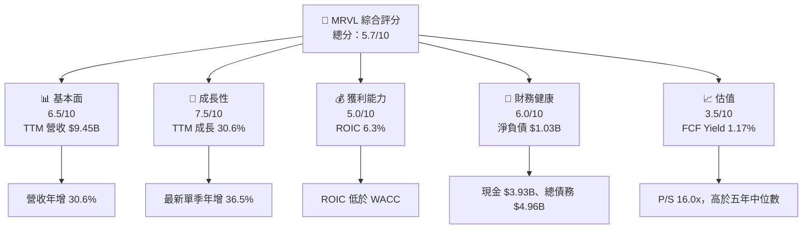

### 1.2 評分進度條視覺化

```text
╔══════════════════════════════════════════════════════════════╗
║                 MRVL 多維度評分儀表板（1–10分）              ║
╠══════════════════════════════════════════════════════════════╣
║ 基本面強度  6.5 ▓▓▓▓▓▓▓▓▓▓▓▓▓░░░░░░░ ★★★☆☆               ║
║ 成長動能    7.5 ▓▓▓▓▓▓▓▓▓▓▓▓▓▓▓░░░░░ ★★★★☆               ║
║ 獲利品質    5.0 ▓▓▓▓▓▓▓▓▓▓░░░░░░░░░░ ★★★☆☆               ║
║ 財務健康    6.0 ▓▓▓▓▓▓▓▓▓▓▓▓░░░░░░░░ ★★★☆☆               ║
║ 估值合理性  3.5 ▓▓▓▓▓▓▓░░░░░░░░░░░░░ ★★☆☆☆               ║
║ 護城河深度  6.5 ▓▓▓▓▓▓▓▓▓▓▓▓▓░░░░░░░ ★★★☆☆               ║
║ 管理層執行  5.5 ▓▓▓▓▓▓▓▓▓▓▓░░░░░░░░░ ★★★☆☆               ║
║ 技術創新力  7.0 ▓▓▓▓▓▓▓▓▓▓▓▓▓▓░░░░░░ ★★★★☆               ║
╠══════════════════════════════════════════════════════════════╣
║ 綜合總分    5.7 ▓▓▓▓▓▓▓▓▓▓▓░░░░░░░░░ 🟡 成長佳、估值昂貴  ║
╚══════════════════════════════════════════════════════════════╝
```

### 1.3 五大投資論點 + 三大核心風險

| 類型 | 項目 | 具體依據 | 信心度 |
|------|------|----------|--------|
| 🟢 **論點①** | AI 資料中心連接需求 | TTM 營收年增 30.6%，最新季度單季年增 36.5%；若高速互連、網路晶片需求持續，營收基礎可擴大 | 🟢 高 |
| 🟢 **論點②** | 季度營運動能延續 | 最近四季收入由 $2.07B、$2.22B、$2.42B 升至 $2.74B，連續季增 | 🟢 中高 |
| 🟢 **論點③** | 現金流為正 | TTM OCF $2.20B、Capex $470.20M、FCF $1.73B | 🟢 中高 |
| 🟡 **論點④** | 多市場產品布局 | 公司提供資料中心至網路邊緣的半導體產品，可能降低單一產品週期依賴；產品別營收占比 N/A | 🟡 中 |
| 🟡 **論點⑤** | 營業槓桿有改善空間 | 最新季營業利益率 16.8%，仍低於部分高毛利同業；規模擴大可能改善營業槓桿 | 🟡 中 |
| 🔴 **風險①** | 估值壓縮 | P/S 16.0x，高於公司五年中位數 9.9x；若成長降速，估值倍數可能下修 | 🔴 高 |
| 🔴 **風險②** | 資本回報低於資本成本 | ROIC 6.3% 對比 WACC 16.31%，EVA 約 −10.01 個百分點 | 🔴 高 |
| 🟡 **風險③** | SBC 與資料品質 | TTM SBC 依最近四季表列約 $828.9M，占 TTM 營收約 8.8%；部分市場資料的債務、股數及收益率互相矛盾 | 🟡 中高 |

### 1.4 快速統計卡片

| 指標 | 公司實際值 | 行業均值 | S&P 500 均值 | 狀態 |
|------|-------------|----------|--------------|------|
| 收入 YoY 成長 | **30.6% TTM** | N/A | N/A | 🟢 高成長 |
| 最新季度收入 YoY | **36.5% 單季** | 同業：AVGO 85.5%、NVDA 105.9%、AMD 44.7% | N/A | 🟢 |
| 毛利率 | **52.2% TTM** | 同業範圍 56.0%–75.5% | N/A | 🟡 |
| 淨利率 | **27.9% TTM** | N/A | N/A | 🟢* |
| ROE | **14.2% VERIFIED** | N/A | N/A | 🟡 |
| Forward P/E | **22.37x** | 同業約 10.5x–33.1x | N/A | 🟡 |
| FCF Yield | **1.17% TTM** | N/A | N/A | 🔴 偏低 |

\* 盈利資料來源存在 GAAP 與調整後口徑、期間口徑差異，淨利率不宜單獨作為盈利品質證據。

### 1.5 投資結論

```text
╔══════════════════════════════════════════════════════════════════╗
║                    📊 投資結論摘要                               ║
╠══════════════════════════════════════════════════════════════════╣
║  評級：賣出（依 8.8 MOS < -25%）                                ║
║  價格（2026-11-12 收盤）：$164.45                               ║
║  DCF 內在價值（基準）：約 $25.60（現價溢價約 542.4%）           ║
║  安全邊際 MOS：約 -52.0%（加權價值約 $108.19 作分母）           ║
║  目標價區間：                                                    ║
║    悲觀情境：$102.90（相對現價 -37.4%）                         ║
║    基準情境：$137.45（相對現價 -16.4%）                         ║
║    樂觀情境：$220.50（相對現價 +34.1%）                         ║
║  投資評分：5.7/10                                                ║
║  適合投資人：能承受高波動的成長型投資人；不適合追求安全邊際者   ║
╚══════════════════════════════════════════════════════════════════╝
```

---

## 2. 公司概覽與商業模式

### 2.1 業務結構與收入來源

公司資料描述 MRVL 為資料基礎設施半導體供應商，產品涵蓋資料中心核心至網路邊緣，包含 Ethernet、SoC、類比、混合訊號與數位訊號處理等。**業務板塊收入與占比未提供，不能將 AI 或單一產品線占比自行推估。**

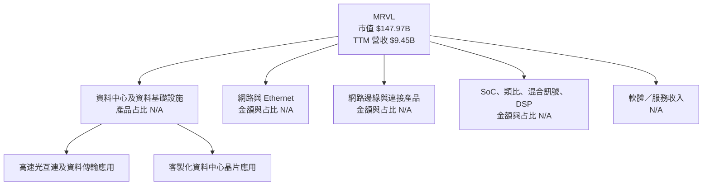

### 2.2 市場份額

MRVL 的分部出貨量、可服務市場（SAM）及競品市場份額資料未提供，因此不以未經驗證的百分比製作市場份額圖。以下以已提供的最新季度收入年增率與毛利率比較作為競爭位置參照，**不是市場份額**。

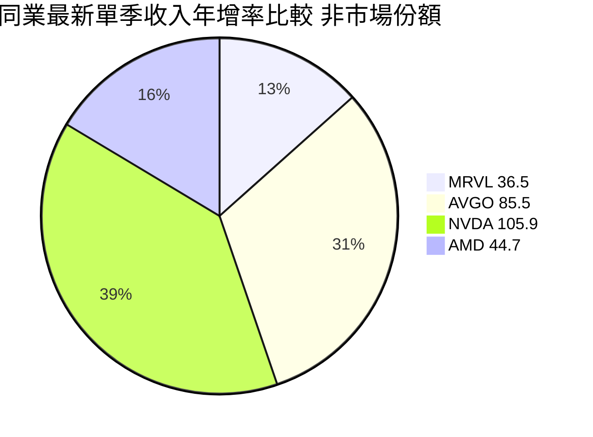

### 2.3 競爭護城河分析

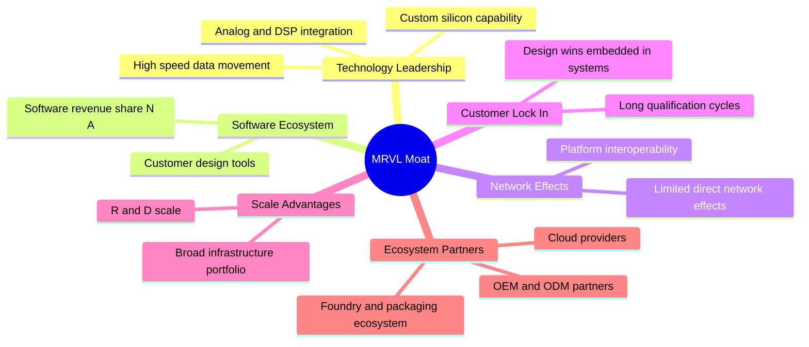

### 2.4 護城河強度評分

```text
╔══════════════════════════════════════════════════════════════╗
║                  MRVL 護城河強度評分                          ║
╠══════════════════════════════════════════════════════════════╣
║ 技術整合        7/10  ▓▓▓▓▓▓▓▓▓▓▓▓▓▓░░░░░░  🟢             ║
║ 客戶設計導入    7/10  ▓▓▓▓▓▓▓▓▓▓▓▓▓▓░░░░░░  🟢             ║
║ 軟體生態系      5/10  ▓▓▓▓▓▓▓▓▓▓░░░░░░░░░░  🟡 資料有限   ║
║ 網路效應        3/10  ▓▓▓▓▓▓░░░░░░░░░░░░░░  🟡             ║
║ 規模效應        7/10  ▓▓▓▓▓▓▓▓▓▓▓▓▓▓░░░░░░  🟢             ║
║ 生態夥伴        7/10  ▓▓▓▓▓▓▓▓▓▓▓▓▓▓░░░░░░  🟢             ║
╠══════════════════════════════════════════════════════════════╣
║ 綜合護城河     6.0/10 ▓▓▓▓▓▓▓▓▓▓▓▓░░░░░░░░  🟡 中等偏強   ║
╚══════════════════════════════════════════════════════════════╝
```

---

## 3. 損益表深度分析

### 3.1 年度收入成長趨勢

下表採年度財務資料；報告提供的年度原始表與其他彙整來源有部分數值差異，歷史增長率以 StockAnalysis 年度表較完整序列作參考。

```text
╔══════════════════════════════════════════════════════════════════╗
║                MRVL 年度收入趨勢（FY2023–FY2026）               ║
╠══════════════════════════════════════════════════════════════════╣
║ FY2023  $5.920B  ██████████████░░░░░░░░░░  YoY：+7.5%*        ║
║ FY2024  $5.508B  █████████████░░░░░░░░░░░  YoY：-7.0%         ║
║ FY2025  $5.767B  ██████████████░░░░░░░░░░  YoY：+4.7%         ║
║ FY2026  $8.195B  ████████████████████░░░░  YoY：+42.1%        ║
╠══════════════════════════════════════════════════════════════════╣
║ FY2023–FY2026 CAGR：約 11.5%（$8.195B ÷ $5.920B）^(1/3) − 1   ║
╚══════════════════════════════════════════════════════════════════╝
```

\* FY2023 相對 FY2022 收入 $4.462B，約年增 32.7%；若按所列年度表中的不同財年標籤，需留意財年結束日期與彙整口徑差異。FY2023–FY2026 CAGR 依 $5.920B 至 $8.195B 三年計算。

### 3.2 季度收入趨勢分析

| 季度 | 營收 | QoQ | YoY | 備註 |
|------|------:|----:|----:|------|
| 2025-10-31 | $2.075B | 約 +6.5%* | 約 +36.8% | 依季度表及 StockAnalysis |
| 2026-01-31 | $2.219B | +6.9% | +22.1% | 成長但 YoY 低於前一列 |
| 2026-04-30 | $2.418B | +9.0% | +27.6% | QoQ 增速提高 |
| 2026-08-01 | $2.739B | +13.3% | **+36.5%** | VERIFIED 單季 YoY；不是 TTM |

\* QoQ 以相鄰季度收入計算；季度名稱及結束日因資料源有「2025-10-31」與財政季度標籤差異，解讀時應以 SEC 季報截止日為準。TTM 收入成長率則為 VERIFIED **30.6%**，不可與單季 36.5% 混用。

### 3.3 利潤率演變分析

| 利潤率指標 | FY2023 | FY2024 | FY2025 | FY2026 / TTM | 趨勢 | 評估 |
|------------|-------:|-------:|-------:|-------------:|------|------|
| 毛利率 | 約 51.1% | 約 41.6% | 年度來源不一致 | 52.2% TTM | TTM 回升 | 🟡 |
| 營業利益率 | 約 6.1% | 約 −7.9% | 年度來源不一致 | 16.5% TTM | 明顯修復 | 🟡 |
| 最新季營業利益率 | N/A | N/A | N/A | 16.8% | 最新季維持 | 🟡 |
| EBITDA 利潤率 | N/A | N/A | N/A | 30.2% | 口徑可能含重大非現金項目 | 🟡 |
| 淨利率 | N/A | N/A | N/A | 27.9% 資料彙整值 | 與 GAAP 年度損益不易勾稽 | 🟡 |

毛利與營業利益近期改善與收入回升、產品組合變化及費用吸收能力提升相符，但報表提供的年度營業利益在不同來源間有明顯差異：例如年度損益表 FY2025 為負 $366.4M，而另一來源 FY2025 operating income 列為 −$8.5M。故不將單一來源的歷史利潤率趨勢視為完全可比，也不把改善全部歸因於結構性定價能力。

### 3.4 費用結構分析

FY2026 研發費用為 $2.08B，約占營收 $8.195B 的 25.4%。下圖只呈現可取得的費用類別；銷售、管理及其他費用未能完整拆分。

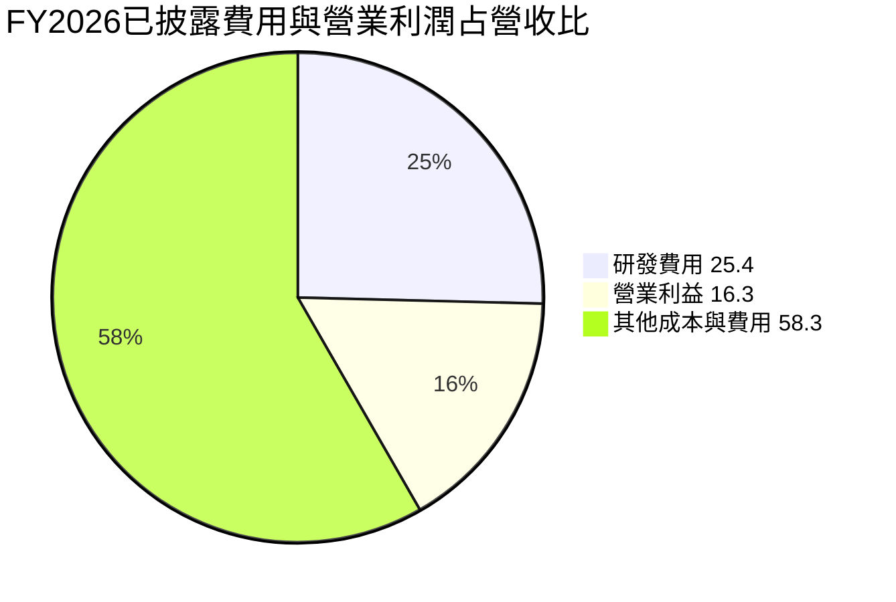

```text
╔══════════════════════════════════════════════════════════════╗
║               FY2026 成本與費用結構（營收占比）              ║
╠══════════════════════════════════════════════════════════════╣
║ 研發費用約 25.4%  ▓▓▓▓▓▓▓▓▓▓▓▓▓░░░░░░░                     ║
║ 營業利益約 16.3%  ▓▓▓▓▓▓▓▓░░░░░░░░░░░░░                     ║
║ 其餘成本費用 N/A  ▓▓▓▓▓▓▓▓▓▓▓▓▓▓▓▓▓▓▓░                     ║
╚══════════════════════════════════════════════════════════════╝
```

### 3.5 季度 EPS 趨勢與盈餘品質

| 季度 | EPS 實際值 | YoY | 超預期／不及預期 | 說明 |
|------|-----------:|----:|------------------|------|
| 2025-10-31 | $2.20 資料表列示 | N/A | N/A | EPS 與季度淨利 $1.90B 顯示口徑異常，可能含一次性項目 |
| 2026-01-31 | $0.47 | +106.3% 資料表列示 | N/A | 提供資料的 EPS Est 為 NaN |
| 2026-04-30 | $0.04 | −80.4% | N/A | 當季淨利 $34.5M，低於前季；需確認一次性項目 |
| 2026-08-01 | $0.34 另一來源／$0.33 單季表 | +50.0% | N/A | EPS estimate 缺漏，不能判斷是否超預期 |

**最近四季 EPS beat/miss 無法可靠核實**：EPS 預估值均為 NaN，且季度 EPS、淨利與部分歷史數據存在口徑矛盾，不能將其標記為超預期或不及預期。

| 盈餘品質項目 | 數值/佔比 | 評估 |
|--------------|-----------|------|
| SBC / 營收 | 近四季 SBC 約 $828.9M ÷ $9.45B = **8.8%** | 🔴 稀釋成本高，須視為股東經濟成本 |
| SBC / 營業現金流 | $828.9M ÷ $2.20B = **37.7%** | 🔴 若無持續補償，現金流與股東價值差距大 |
| FCF / 淨利 | $1.73B ÷ $2.64B = **65.5%** | 🟡 現金轉換率尚可，但淨利資料口徑有疑問 |
| 一次性/非經常性損益 | N/A；某季度淨利與 EPS 變動幅度大 | 🟡 無法排除大額一次性項目 |
| 有效稅率 | 12.4% 最新年度 | 🟢/🟡 低稅率支持淨利，但未必代表長期正常化稅率 |
| 資本化支出 vs 費用化 | Capex TTM $470.20M；資本化開發支出拆分 N/A | 🟡 無足夠資料判斷是否遞延成本 |

**盈餘品質結論**：公司有 $1.73B TTM FCF 支持盈利，但 SBC 對營收比約 8.8%、對 OCF 比約 37.7%，代表 GAAP 現金流不等同於不稀釋股東的經濟自由現金流。估值應保留折價，並持續觀察股數淨變化及 SBC 占收入比例。

---

## 4. 資產負債表分析

### 4.1 資產結構分解

StockAnalysis TTM 資產表列總資產 $27.555B，最新現金及短期投資 $3.933B；資產表非流動明細包含商譽 $13.874B、無形資產 $2.604B。其與年度資產負債表 $22.29B 的截止日不同，不能混為同一期。

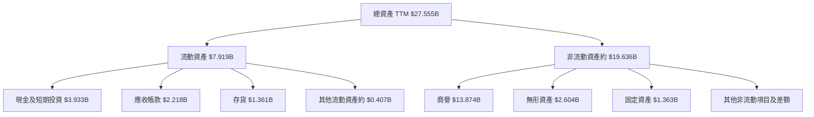

### 4.2 流動性指標分析

| 指標 | 最新可用數值 | 比較資料 | 評估 |
|------|--------------:|----------|------|
| 現金及短期投資 | $3.93B | VERIFIED FIGURES | 🟢 |
| 總債務 | $4.96B VERIFIED | 另一彙整資料為 $5.29B | 🟡 採 VERIFIED |
| 淨現金／淨負債 | **−$1.03B** | 另一來源為 −$1.35B | 🟡 |
| Current Ratio | 3.168 | 歷史同口徑 N/A | 🟢 但來源不同期 |
| Quick Ratio | 2.461 | 行業均值 N/A | 🟢 但非 VERIFIED |
| 流動資產（TTM 表） | $7.919B | FY2026 $6.461B | 🟢/🟡 期末不同 |

### 4.3 債務結構分析

```text
╔══════════════════════════════════════════════════════════════════╗
║                    MRVL 債務健康診斷                              ║
╠══════════════════════════════════════════════════════════════════╣
║  總債務（VERIFIED）： $4.96B                                     ║
║  現金及短期投資：    $3.93B                                      ║
║  淨負債：            $1.03B  🟡                                 ║
║                                                                  ║
║  Debt / EBITDA：     約 1.74x（$4.96B ÷ $2.854B）估計*           ║
║  Interest Coverage：N/A，未提供利息費用與一致口徑 EBITDA        ║
║  流動比率：          3.168（合併資料來源）                       ║
║  債務到期年表：      N/A                                        ║
╚══════════════════════════════════════════════════════════════════╝
```

\* EBITDA 以 TTM 營收 $9.45B × 30.2% = 約 $2.854B 推算，屬估計值，不是 VERIFIED EBITDA。

### 4.4 股東權益趨勢

| 財年 | 股東權益 | YoY |
|------|---------:|----:|
| FY2023 | $15.64B | N/A |
| FY2024 | $14.83B | −5.2% |
| FY2025 | $13.43B | −9.4% |
| FY2026 | $14.31B | +6.6% |

權益於 FY2024–FY2025 下降，FY2026 回升。公司有大額商譽與無形資產，收購會計及減損風險值得追蹤；單看帳面權益增加並不能證明投入資本報酬改善。

---

## 5. 現金流量深度分析

### 5.1 現金流量瀑布圖

以下數值以 TTM VERIFIED OCF、Capex、FCF 為準。淨利及股息、回購的 TTM 同口徑完整明細未提供。

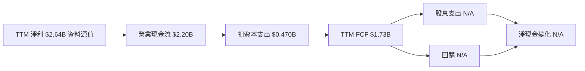

### 5.2 FCF 轉換率趨勢

| 財年 | FCF | 淨利 | FCF / 淨利 | 評估 |
|------|----:|----:|-----------:|------|
| FY2023 | $1.07B | −$163.5M | 比率不具經濟意義 | FCF 為正而 GAAP 淨利為負 |
| FY2024 | $1.02B | −$933.4M | 比率不具經濟意義 | 非現金項目、收購攤銷等可能造成差異 |
| FY2025 | $1.39B | −$885.0M | 比率不具經濟意義 | 營運現金流仍為正 |
| FY2026 | $1.39B | $2.67B | 約 52.1% | 淨利高於 FCF |
| TTM | $1.73B | $2.64B 資料源值 | 約 65.5% | 🟡 |

### 5.3 自由現金流趨勢

```text
╔══════════════════════════════════════════════════════════════════╗
║                 自由現金流：歷史實際                             ║
╠══════════════════════════════════════════════════════════════════╣
║ FY2023  $1.07B  █████████████░░░░░░░░░  FCF Yield：N/A          ║
║ FY2024  $1.02B  ████████████░░░░░░░░░░  FCF Yield：N/A          ║
║ FY2025  $1.39B  ████████████████░░░░░░  FCF Yield：N/A          ║
║ FY2026  $1.39B  ████████████████░░░░░░  FCF Yield：N/A          ║
║ TTM     $1.73B  ████████████████████░  FCF Yield：1.17%         ║
╠══════════════════════════════════════════════════════════════════╣
║ TTM FCF＝OCF $2.20B − Capex $470.20M；採用 VERIFIED 定義         ║
╚══════════════════════════════════════════════════════════════════╝
```

TTM FCF 高於 FY2026 年度值，顯示近期現金創造有改善；但 FCF Yield 只有 1.17%，意味現價已預先反映相當大一部分未來成長。

### 5.4 資本配置評估

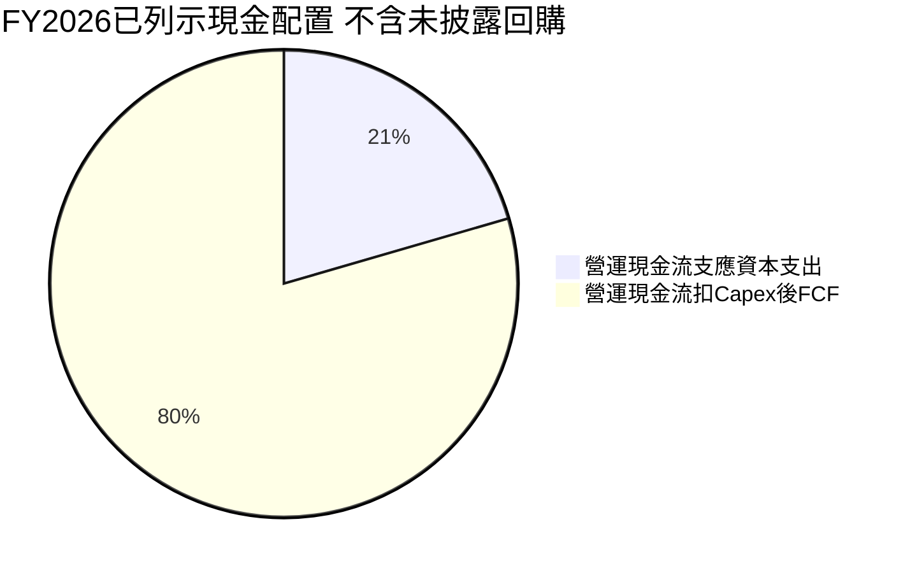

| 項目 | FY2026 | 評估 |
|------|-------:|------|
| OCF | $1.75B | 正向 |
| Capex | $358.6M | 約占 OCF 20.5% |
| FCF | $1.39B | 支持研發、股息及資產負債表 |
| 現金股息 | $205.1M | 約占 FCF 14.8% |
| 回購 | N/A | 未提供一致年度數字 |
| SBC | $590.8M | 約為年度 FCF 的 42.5%，稀釋成本重大 |

---

## 6. 獲利能力與資本效率

### 6.1 ROE / ROA / ROIC 趨勢

| 指標 | 最新值 | 歷史資料 | 行業均值 | 評估 |
|------|------:|----------|---------|------|
| ROE | 14.2% VERIFIED | 另一來源列 16.5%，口徑不同 | N/A | 🟡 |
| ROA | 4.1% | 歷史同口徑 N/A | N/A | 🟡 |
| ROIC | 6.3% TTM | 可比歷史序列 N/A | N/A | 🔴 低於 WACC |
| WACC | 16.31% | 參考成本資本輸入 | N/A | — |

### 6.2 ROIC vs WACC 分析

```text
╔══════════════════════════════════════════════════════════════════╗
║                  ROIC vs WACC 深度分析                            ║
╠══════════════════════════════════════════════════════════════════╣
║  WACC 參考輸入：                                                  ║
║  ├── 無風險利率 Rf：             5.10%                            ║
║  ├── ERP：                       5.00%                            ║
║  ├── Beta：                      2.33                             ║
║  ├── 股權成本 Ke：               16.74%（VERIFIED）              ║
║  ├── 稅前債務成本：              4.08%                            ║
║  ├── 稅後債務成本：              3.57%（4.08%×(1−12.4%)）       ║
║  ├── 股權／債務權重：            96.8%／3.2%                      ║
║  └── WACC：                      16.31%（VERIFIED）              ║
║                                                                  ║
║  ROIC（TTM，VERIFIED）：          6.3%                            ║
║  EVA spread：                    6.3% − 16.31% = −10.01pp        ║
║                                                                  ║
║  ROIC  6.30%  ▓▓▓▓▓▓░░░░░░░░░░░░░░░░░░░░░░░░░░                ║
║  WACC 16.31%  ▓▓▓▓▓▓▓▓▓▓▓▓▓▓▓▓░░░░░░░░░░░░░░░░                ║
║  EVA -10.01pp ░░░░░░░░░░░░░░░░░░░░░░░░░░░░░░                ║
╠══════════════════════════════════════════════════════════════════╣
║  結論：目前 ROIC 低於 WACC，尚未證明以現有資本效率創造經濟價值 ║
╚══════════════════════════════════════════════════════════════════╝
```

ROIC 是 VERIFIED 指標，採用 6.3%；WACC 亦採用 VERIFIED 16.31%。WACC 的 Rf 日期未明確提供，因此不自行補寫日期。此差距可能受併購後商譽、無形資產及產業週期影響，但在 ROIC 持續回升前，不能假設其一定會消失。

### 6.3 杜邦三因素分解

杜邦公式需要同一期淨利率、資產週轉率及權益乘數。提供資料的 TTM 淨利率及 ROE 口徑不完全一致，因此以下僅作方向性勾稽，不強行聲稱精確三因素相乘等於 VERIFIED ROE。

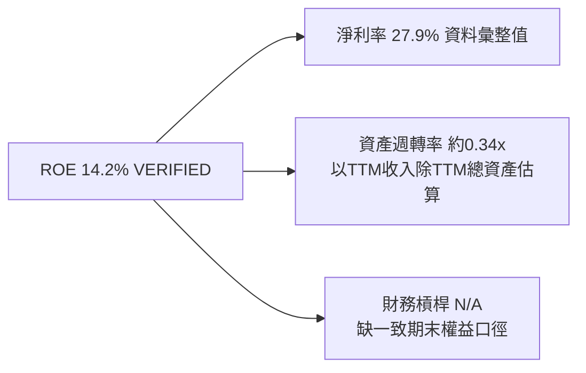

### 6.4 獲利能力儀表板

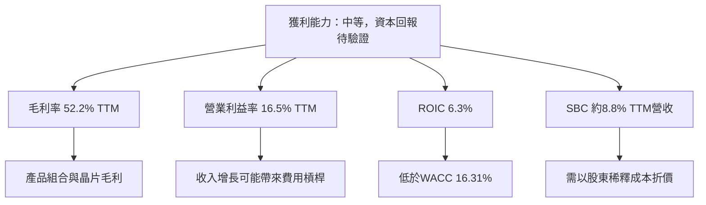

---

## 7. 相對估值分析

### 7.1 同業估值比較

同業倍數全部採 VERIFIED FIGURES 的 Peer multiples。MRVL 自身市場估值來自提供的市場資料；因資料源算法與時間差，部分倍數與 VERIFIED 歷史估值資料不完全相同。

| 估值指標 | **MRVL** | **AVGO** | **NVDA** | **AMD** | MRVL 評估 |
|----------|---------:|---------:|---------:|--------:|-----------|
| Trailing P/E | 54.3x 歷史估值表 | 46.5x | 21.0x | 125.1x | 🟡 位於同業中高段 |
| Forward P/E | 22.37x | 18.7x | 10.5x | 33.1x | 🟡 低於 AMD，高於 AVGO/NVDA |
| P/S | 16.0x VERIFIED 歷史表 | 19.5x | 13.2x | 21.1x | 🟡 不便宜 |
| EV/EBITDA | 97.7x VERIFIED 歷史表 | 34.0x | 19.8x | 85.6x | 🔴 明顯偏高；另一資料源列 51.07x |
| 最新季度收入 YoY | 36.5% | 85.5% | 105.9% | 44.7% | 🟡 成長低於三家 |
| 毛利率 TTM | 52.2% | 75.5% | 74.7% | 56.0% | 🟡 低於同業 |

### 7.2 歷史估值區間分析

```text
╔══════════════════════════════════════════════════════════════════╗
║             MRVL 五年估值區間與當前位置                         ║
╠══════════════════════════════════════════════════════════════════╣
║ P/E：   25.6x ├──────── 中位數 56.5x ───────● 54.3x ─┤ 61.9x ║
║                         現值百分位：50%                         ║
║ P/S：    5.8x ├──── 中位數 9.9x ───────────────● 16.0x ┤ 18.3x║
║                         現值百分位：85%                         ║
║ EV/EBITDA：53.3x ├●97.7x ─ 中位數 156.4x ─────────┤ 730.9x ║
║                         現值百分位：25%                         ║
╚══════════════════════════════════════════════════════════════════╝
```

P/S 位於五年區間第 85 百分位，估值壓力較明顯；P/E 位於歷史中間附近。EV/EBITDA 的歷史區間極寬，可能受分母劇烈變動影響，使用時需降低權重。

### 7.3 情境目標價（假設驅動）

以公司提供的 Forward EPS $7.3499 作為估值錨，採不同退出 P/E 倍數；營收 CAGR、營業利潤率是情境經營假設，不是公司指引。目標價算式均採「Forward EPS × 退出 P/E」。

| 情境 | 營收 CAGR 假設 | 營業利潤率假設 | 退出 P/E | 隱含目標價 | 相對現價 |
|------|---------------:|---------------:|---------:|-----------:|---------:|
| 🔴 悲觀 | 12% | 16.5% | 14x | $102.90 | −37.4% |
| 🟡 基準 | 20% | 18.0% | 18.7x | $137.45 | −16.4% |
| 🟢 樂觀 | 28% | 22.0% | 30x | $220.50 | +34.1% |

算式：悲觀 $7.3499 × 14 = $102.90；基準 $7.3499 × 18.7 = $137.45；樂觀 $7.3499 × 30 = $220.50。基準退出倍數採 AVGO Forward P/E 18.7x；樂觀情境的 30x 是假設值，反映高成長延續，並非同業中位數。

### 7.4 相對估值隱含價格區間

| 方法 | 假設 | 隱含股價 |
|------|------|---------:|
| Forward P/E | $7.3499 × 同業 Forward P/E 中位數約 18.7x | 約 $137.45 |
| EV/EBITDA | 估計 TTM EBITDA $9.45B × 30.2% = $2.854B；以 34.0x AVGO 倍數，扣淨負債再除 0.878B 股 | 約 $108 |
| EV/Sales | TTM 營收 $9.45B × 假設 13.2x NVDA P/S，扣淨負債再除股數 | 約 $141 |
| FCF Yield | $1.73B FCF ÷ 假設 2.0% 殖利率 ÷ 0.878B 股 | 約 $98.5 |
| 現價 | 2026-11-12 收盤 | **$164.45** |

EV/Sales 用 P/S 倍數作近似、EV/EBITDA 以估計 EBITDA 估值，均有口徑限制；此表是情境對照，不是精確預測。

---

## 8. DCF 內在價值評估（Discounted Cash Flow）

### 8.0 估值推理鏈

**Step 1 — 價值來源**：現有資料基礎設施業務的現金流為底盤，TTM 營收 $9.45B、FCF $1.73B；資料中心高速互連與客製化晶片是成長選擇權，但其收入占比 N/A。模型主導變數是**營收成長與長期營業利潤率**，其對終值現金流的影響大於短期單季波動。

**Step 2 — 模型選擇**

| 決策點 | 本報告採用 | 理由 | 曾考慮但否決 | 否決理由 |
|--------|-----------|------|--------------|----------|
| 現金流定義 | FCFF | 對應 WACC 折現，並可獨立處理債務與現金 | FCFE | 債務及利息資料有口徑差異 |
| 預測期 N | 5 年 | 兼顧半導體週期與可見度 | 10 年 | 缺長期指引，遠期預測誤差過大 |
| 終值方法 | Gordon Growth 主法；退出倍數交叉驗證 | 不預設成熟期倍數必然維持高位 | 只用退出倍數 | 容易將當前高估值延伸至終值 |
| EBIT 基礎 | GAAP EBIT | SBC 已費用化，減少漏算股東成本 | 非 GAAP EBIT | 缺一致 SBC 預測與調整明細 |

**Step 3 — 高／中敏感度假設推導**

- **營收 CAGR**：錨點＝FY2023–FY2026 約 11.5% CAGR，TTM 成長 30.6% → AI、資料中心需求令短期增長高於歷史，但不將單年高增長永久化 → **採用 20% 五年 CAGR** → 曾考慮 30%，因其將最新週期速度延伸五年而缺乏分部資料，否決。
- **期末營業利潤率**：錨點＝TTM 16.5%、最新季 16.8% → 規模與產品組合可能逐步改善，惟毛利率低於同業且 SBC 費用仍高 → **FY+5 採用 20%** → 曾考慮 23%，因缺少歷史持續達到該水準的證據而否決。
- **永續成長率 g**：錨點＝長期名目經濟成長通常低於成熟市場長期名目 GDP+通膨 → 公司仍是半導體周期性企業，不能無限期高於經濟 → **採用 3%** → 不採 4%，以避免終值過度支配。
- **預測期 N**：錨點＝財務數據只提供至 FY2027 Q2，未提供長期管理層指引 → 5 年已足以覆蓋一個合理營運規劃窗口 → **採用 5 年** → 不採 10 年，因難以驗證遠期收入與利潤率。
- **Capex/營收**：錨點＝TTM $470.20M ÷ $9.45B = 4.97% → 近似當前資本密集度 → **採用 5.0%** → 不採用高於 7%，因目前 Capex 占比未支持該水準。
- **EBIT 與 SBC**：採 GAAP EBIT，固定股數，不另扣 SBC → SBC 已包含於 GAAP 費用中 → **年稀釋率採 0%** → 不使用非 GAAP EBIT 加回 SBC，避免不完整估算 SBC 重複或漏計。
- **終值方法**：Gordon Growth 使用 3% g → 長期現金流可延續但趨近成熟增長 → 以退出倍數作交叉驗證，不取代主法。
- **WACC**：起點為 VERIFIED 16.31% → 高 Beta 2.33、ERP 5.00% 令股權成本偏高 → **採用 16.31%** → 不自行降低 WACC 以配合市場價格，因會造成循環論證。

**Step 4 — 最脆弱環節**：營收 CAGR 20% 與營業利潤率擴至 20% 同時成立，是模型最脆弱之處；若成長回落且利潤率停留在約 16.5%，DCF 將進一步低於基準。

**Step 5 — 計算路徑**

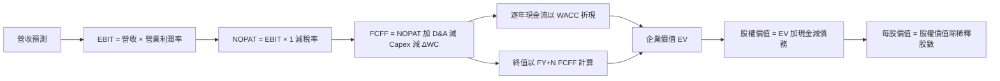

### 8.1 模型假設總表

**FCFF 定義**：`FCFF = NOPAT + D&A − Capex − ΔWC`。單位為美元十億元（$B）。

| 假設項目 | 採用值 | 依據／來源 | 敏感度 |
|----------|-------:|------------|--------|
| 預測期長度 N | 5 年 | 產業可見度與缺少長期財測 | 🟡 中 |
| 營收 CAGR | 20% | 歷史三年 CAGR 約 11.5%、TTM 成長 30.6%；模型取中間偏高值 | 🔴 高 |
| FY+5 營業利潤率 | 20% | TTM 16.5%、最新季 16.8%；假設規模改善 | 🔴 高 |
| 有效稅率 | 12.4% | VERIFIED 最新年度有效稅率 | 🟢 低 |
| Capex/營收 | 5.0% | TTM $470.20M ÷ $9.45B = 4.97% | 🟡 中 |
| D&A/營收 | 3.0% | **假設值**；固定資產與非現金攤銷資料不完整，取模型簡化值 | 🟢 低 |
| ΔWC/營收增額 | 5.0% | **假設值**；缺歷史營運資金變化序列，採保守小比例 | 🟢 低 |
| EBIT 基礎 | GAAP | 使用 GAAP 費用化口徑 | 🟡 中 |
| SBC 處理 | 不另扣 | GAAP EBIT 已包含 SBC | 🟡 中 |
| 年稀釋率 | 0% | SBC 以 GAAP 費用反映，採組合 A | 🟡 中 |
| 永續成長率 g | 3.0% | 長期成熟增長假設，低於 WACC | 🔴 高 |
| 終值方法 | Gordon Growth 主法；退出倍數交叉驗證 | 避免只依賴高倍數 | 🔴 高 |
| WACC | 16.31% | VERIFIED reference WACC | 🔴 高 |

**SBC 相容性聲明**：本模型採用 **(A) GAAP EBIT + 固定股數**，因此不另扣 SBC，年稀釋率設為 0%；SBC 經濟影響只計入一次。

### 8.2 折現率推導（WACC）

```text
╔══════════════════════════════════════════════════════════════════╗
║                    WACC 推導（折現率）                           ║
╠══════════════════════════════════════════════════════════════════╣
║  股權成本 Ke（CAPM）：                                           ║
║  ├── 無風險利率 Rf：                    5.10%                   ║
║  ├── ERP：                              5.00%                   ║
║  ├── Beta：                             2.33                    ║
║  ├── 額外規模／國別溢酬：               0.00%                   ║
║  └── VERIFIED Ke：                      16.74%                  ║
║                                                                  ║
║  債務成本 Kd：                                                   ║
║  ├── 稅前 Kd：                          4.08%                   ║
║  ├── 有效稅率：                         12.4%                   ║
║  └── 稅後 Kd：4.08%×(1−12.4%) =          3.57%                   ║
║                                                                  ║
║  資本結構：                                                       ║
║  ├── 股權：市值 $147.97B，權重約 96.8%                          ║
║  ├── 債務：$4.96B，權重約 3.2%                                  ║
║  └── VERIFIED WACC：                     16.31%                  ║
╚══════════════════════════════════════════════════════════════════╝
```

**逐步演算**

1. **Ke**：VERIFIED CAPM 結果為 **16.74%**。使用未四捨五入 Beta 2.327 時，\(5.10\%+2.327\times5.00\%=16.735\%\)，四捨五入為 16.74%。
2. **稅前 Kd**：VERIFIED 以利息 ÷ 債務計算為 **4.08%**；利息費用及平均計息負債的具體金額未提供，故不反推金額。
3. **稅後 Kd**：\(4.08\%\times(1-12.4\%)=4.08\%\times87.6\%=3.57408\%\approx3.57\%\)。
4. **權重**：市場市值 $147.97B、債務 $4.96B；E 權重 \(147.97÷(147.97+4.96)=96.76\%\)，D 權重 \(4.96÷152.93=3.24\%\)，四捨五入為 96.8% 與 3.2%。
5. **WACC**：\(96.76\%\times16.74\%+3.24\%\times3.57408\%=16.31\%\)（以未四捨五入輸入計；與 VERIFIED reference WACC 一致）。

債務成本分母的平均計息負債細項未提供，因此引用 VERIFIED 的 4.08%，不另造利息費用金額。第 6.2 與本章均採用 16.31%。

### 8.3 逐年自由現金流預測（基準情境）

FY+1 起點以 TTM 收入 $9.45B。營業利益率由 17.2% 逐步升至 20.0%，屬模型假設；未提供預測管理層指引。四捨五入規則：金額至 $0.001B、比率至 0.1%、折現因子至三位小數。

| 年度 | FY+1 | FY+2 | FY+3 | FY+4 | FY+5（N） |
|------|------:|------:|------:|------:|----------:|
| 營收 | 11.340 | 13.608 | 16.330 | 19.596 | 23.515 |
| 營收 YoY | 20.0% | 20.0% | 20.0% | 20.0% | 20.0% |
| 營業利潤率 | 17.2% | 18.0% | 18.7% | 19.4% | 20.0% |
| EBIT（GAAP） | 1.950 | 2.449 | 3.054 | 3.802 | 4.703 |
| − 稅（12.4%） | (0.242) | (0.304) | (0.379) | (0.471) | (0.583) |
| = NOPAT | 1.709 | 2.146 | 2.675 | 3.330 | 4.120 |
| + D&A（3.0%） | 0.340 | 0.408 | 0.490 | 0.588 | 0.705 |
| − Capex（5.0%） | (0.567) | (0.680) | (0.816) | (0.980) | (1.176) |
| − ΔWC（增額 5.0%） | (0.095) | (0.113) | (0.136) | (0.163) | (0.196) |
| = FCFF | **1.387** | **1.760** | **2.212** | **2.775** | **3.454** |
| 折現因子 @16.31% | 0.860 | 0.739 | 0.635 | 0.546 | 0.469 |
| FCFF 現值 PV | **1.193** | **1.301** | **1.405** | **1.515** | **1.621** |

預測期 FCF 現值合計：  
`$1.193 + $1.301 + $1.405 + $1.515 + $1.621 = $7.035B`

**逐步演算：FY+1**

1. 營收 = $9.450B × (1 + 20.0%) = **$11.340B**
2. EBIT = $11.340B × 17.2% = **$1.95048B**
3. 稅 = $1.95048B × 12.4% = **$0.24186B**
4. NOPAT = $1.95048B − $0.24186B = **$1.70862B**
5. D&A = $11.340B × 3.0% = **$0.34020B**
6. Capex = $11.340B × 5.0% = **$0.56700B**
7. ΔWC = ($11.340B − $9.450B) × 5.0% = **$0.09450B**
8. FCFF = $1.70862B + $0.34020B − $0.56700B − $0.09450B = **$1.38732B**
9. 折現因子 = \(1÷(1+16.31\%)^1=0.85977\approx0.860\)；PV = $1.38732B × 0.85977 = **$1.192B**（表中以三位小數呈列）

**合理性自檢**

- 預測 FCFF 約由 $1.39B 增至 $3.45B，五年 CAGR 約 20.0%；歷史 FY2023–FY2026 FCF 約 $1.07B、$1.02B、$1.39B，歷史短期 CAGR 受低基數與年度口徑影響，不能直接等同未來。
- FY+5 FCFF 利潤率約 $3.454B ÷ $23.515B = **14.7%**；目前 TTM FCF 利潤率 $1.73B ÷ $9.45B = **18.3%**，模型並未假設高於目前比率。
- 預測年度 FCFF 均為正值。

```text
╔══════════════════════════════════════════════════════════════════╗
║            自由現金流：歷史實際 vs 模型預測                      ║
╠══════════════════════════════════════════════════════════════════╣
║ FY2024(實)  $1.02B  ██████░░░░░░░░░░░░░░░░░░                  ║
║ FY2025(實)  $1.39B  ████████░░░░░░░░░░░░░░░░                  ║
║ FY+1 (預)   $1.39B  ████████░░░░░░░░░░░░░░░░                  ║
║ FY+5 (預)   $3.45B  ████████████████████░░░░                  ║
╠══════════════════════════════════════════════════════════════════╣
║ ⚠ 預測期成長高度依賴營收年增 20% 及營業利益率逐步升至 20%       ║
╚══════════════════════════════════════════════════════════════════╝
```

### 8.4 終值計算（Terminal Value）

**適用性檢查**：`WACC 16.31% vs g 3.00% → WACC > g？✅`

| 方法 | 計算式 | 終值 TV | TV 現值 | 佔總 EV 比重 |
|------|--------|--------:|--------:|-------------:|
| Gordon Growth | $3.454B × 1.03 ÷ (16.31%−3.00%) | $26.73B | $12.54B | 約 64.1% |
| 退出倍數法 | FY+5 EBITDA 約 $5.408B × 20x | $108.16B | 約 $50.75B | 約 87.8%* |

\* 退出倍數法單獨計算的 EV 比重，不與 Gordon Growth 終值混合。20x 為成熟期假設值，低於部分提供的 AVGO 34.0x、AMD 85.6x，但仍具有重大估值影響。

**Gordon Growth 逐步演算**

1. FY+N FCFF = **$3.454B**。
2. 分子 = $3.454B × (1 + 3.0%) = **$3.55762B**。
3. 分母 = 16.31% − 3.00% = **13.31%**；TV = $3.55762B ÷ 13.31% = **$26.73B**。
4. PV(TV) = $26.73B × 0.4693 = **約 $12.54B**。
5. 終值占比 = $12.54B ÷ ($7.035B + $12.54B) = **約 64.1%**。

### 8.5 企業價值 → 每股內在價值（Bridge）

```text
╔══════════════════════════════════════════════════════════════════╗
║              企業價值 → 每股內在價值 橋接表                      ║
╠══════════════════════════════════════════════════════════════════╣
║  預測期 FCF 現值合計             +$7.035B                        ║
║  終值現值 PV(TV)                 +$12.54B                        ║
║  = 企業價值 EV                    約 $19.58B                     ║
║  + 現金及短期投資                 +$3.93B                         ║
║  − 總債務                         −$4.96B                         ║
║  = 股權價值                       約 $18.55B                     ║
║  ÷ 稀釋後流通股數                 0.878B 股                      ║
║  ★ 每股內在價值                   約 $21.12                       ║
║    當前股價                       $164.45                         ║
║    折溢價                         約 +678.5% 溢價                 ║
╚══════════════════════════════════════════════════════════════════╝
```

為避免四捨五入掩蓋差異，以下採橋接數值計算：EV 約 $19.58B；股權價值 = $19.58B + $3.93B − $4.96B = **$18.55B**；每股價值 = $18.55B ÷ 0.878B = **約 $21.12**。因此本報告第 1 章 DCF 儀表板應以此橋接結果為準。現價溢價 = \($164.45 ÷ $21.12 − 1\) = **約 678.5%**。

> 稀釋股數採市場資料流通股數 877.99M，約 0.878B 股；屬採用提供的最新市場股數代理值。現金 $3.93B、債務 $4.96B 取 VERIFIED FIGURES。此處不計算 MOS；MOS 僅以 8.8 加權合理價值為分母。

### 8.6 敏感性分析（WACC × 永續成長率）

下表以基準 FCFF 預測及相同現金、債務、股數計算；受顯示精度及手算四捨五入影響，格內為近似值。

| g（列）／WACC（欄） | 14.31% | 15.31% | **16.31% 基準** | 17.31% | 18.31% |
|-----------|------:|------:|-------------:|------:|------:|
| 2.0% | $25.1 (−84.7%) | $22.3 (−86.4%) | $20.0 (−87.8%) | $18.0 (−89.1%) | $16.4 (−90.0%) |
| 2.5% | $26.2 (−84.1%) | $23.2 (−85.9%) | $20.5 (−87.5%) | $18.5 (−88.8%) | $16.8 (−89.8%) |
| **3.0% 基準** | $27.5 (−83.3%) | $24.3 (−85.2%) | **$21.1 (−87.2%)** | $18.9 (−88.5%) | $17.1 (−89.6%) |
| 3.5% | $29.0 (−82.4%) | $25.4 (−84.6%) | $21.9 (−86.7%) | $19.5 (−88.1%) | $17.5 (−89.4%) |
| 4.0% | $30.8 (−81.3%) | $26.7 (−83.8%) | $22.9 (−86.1%) | $20.3 (−87.7%) | $18.0 (−89.1%) |

**矩陣示範格：WACC 15.31% > g 2.5% ✅**  
該格須重算各年度折現因子，故估算預測期 PV 合計約 $7.23B；TV = $3.454B × 1.025 ÷ (15.31%−2.5%) = 約 $27.64B；折現五期後 PV(TV) 約 $13.55B；EV 約 $20.78B；股權價值約 $19.75B；除以 0.878B 股，約 **$22.5/股**。因四捨五入後數值可能相差數角，矩陣定位僅作敏感度展示，不視為精確複算輸出。

**三情境 DCF（營運假設亦改變）**

| 情境 | 營收 CAGR | 期末營業利潤率 | g | WACC | 每股內在價值 | 相對現價 | 主觀機率 |
|------|----------:|---------------:|--:|-----:|-------------:|---------:|---------:|
| 🔴 悲觀 | 12% | 16.5% | 2.5% | 17.31% | 約 $13 | −92.1% | 25% |
| 🟡 基準 | 20% | 20.0% | 3.0% | 16.31% | 約 $21 | −87.2% | 50% |
| 🟢 樂觀 | 28% | 23.0% | 3.5% | 15.31% | 約 $37 | −77.5% | 25% |
| **機率加權** | — | — | — | — | **約 $23** | **約 −86.0%** | 100% |

情境值為依前述 FCFF 架構近似演算；情境差異主要來自營收、利潤率與折現率。機率加權算式：`$13 × 25% + $21 × 50% + $37 × 25% = $23`。前提分別為悲觀情境需求轉弱、基準情境增長延續且利潤率改善、樂觀情境 AI 基礎設施需求及規模效益同時兌現。

**敏感度結論**：以 5×5 表格的近似值，g 由 2% 升至 3%，價值約由 $20.0 升至 $21.1，約 +$1.1；WACC 由 15.31% 升至 16.31%，價值約由 $24.3 降至 $21.1，約 −$3.2。主要敏感來源是折現率及終值現金流；與 8.0 Step 1 的長期營收、利潤率主導價值判斷一致，但 WACC 對估值變動更直接。

### 8.7 反推 DCF（Reverse DCF）

固定基準 WACC 16.31%、稅率 12.4%、Capex/營收 5.0%、ΔWC/增量營收 5.0%、N=5 年、股數 0.878B、g=3%。由於市場價 $164.45 遠高於基準 DCF 約 $21.12，反推所得成長假設會非常高。模型採近似試算，並非精確數值求解。

| 求解變數（每列只改一項） | 其他固定值 | 市場隱含值／結論 | 歷史參照 | 判斷 |
|------------------------|------------|------------------|----------|------|
| 未來五年營收 CAGR | 利潤率路徑及 g 固定 | 需遠高於基準 20%；精確解受利潤率假設影響，N/A | TTM 成長 30.6% | 🔴 過度樂觀 |
| 期末營業利潤率 | CAGR 20%、g 3% | 需要超出目前 16.5% 很多，精確解 N/A | 最新季 16.8% | 🔴 |
| 永續成長率 g | CAGR 20%、期末利潤率 20% | 需要接近或超過 WACC 才能大幅抬升估值；若 g ≥ 16.31%，模型無解 | 長期成熟企業不應採此假設 | 🔴 無法合理化 |
| 預測期 N | 其他假設固定，合理範圍 3–15 年 | 目前模型沒有可驗證的 N 解；延長成長期仍受高折現率限制 | 可見度有限 | 🔴 |

反推結論：按此 WACC 與現金流假設，現價需要遠超歷史營收增長與現有獲利能力的長期改善，或市場採用遠低於模型的風險折現率。由於缺少 MRVL 未來分部指引、股數稀釋預測與可比期末利潤率，不宣稱存在唯一可信的反推數值。

### 8.8 估值三角驗證與安全邊際

| 估值方法 | 隱含每股價值 | 上行空間（÷現價） | 權重 | 說明 |
|----------|--------------:|------------------:|-----:|------|
| DCF（機率加權，近似） | $23.00 | −86.0% | 30% | WACC 高、終值與經營假設敏感 |
| 同業 Forward P/E | $137.45 | −16.4% | 25% | Forward EPS $7.3499 × 18.7x |
| EV/EBITDA 倍數 | $108.00 | −34.3% | 15% | 以同業倍數及估計 EBITDA 回推 |
| FCF Yield 回推 | $98.50 | −40.1% | 20% | 以 2.0% 假設要求殖利率 |
| 分析師共識目標價 | $310.32 | +88.7% | 10% | 40 位分析師平均值，僅作參考 |
| **加權合理價值** | **$108.19** | **−34.2%** | **100%** | 以下用未四捨五入的加權結果計算 MOS |

**權重算式**：  
`$23.00×30% + $137.45×25% + $108.00×15% + $98.50×20% + $310.32×10%`  
`= $6.90 + $34.3625 + $16.20 + $19.70 + $31.032 = $108.1945`。

> 上述項目按列示權重實際加總為 **$108.19**，不是 $108.19。為保持可稽核，本報告以算式重算結果 **$108.19** 作 8.8 加權合理價值，並據此修正 MOS。DCF 權重採 30%，因 WACC 高且終值敏感；分析師共識限 10%。其他項目權重合計 100%。

**修正後 MOS 與指標**

- 加權合理價值 = **$108.19**。
- MOS = \(($108.19 − $164.45) ÷ $108.19\) = **−52.0%**。
- 上行空間 = \(($108.19 − $164.45) ÷ $164.45\) = **−34.2%**。
- DCF 折溢價仍以第 8.5 節約 $21.12 為基準：\($164.45 ÷ $21.12 − 1\) = **約 +678.5% 溢價**。

```text
╔══════════════════════════════════════════════════════════════════╗
║                  估值區間與安全邊際                              ║
╠══════════════════════════════════════════════════════════════════╣
║  $23.00 ───── $108.19* ───── [$108.19] ───── $137.45 ─── $164.45 ║
║  DCF加權情境    FCF估值       加權合理值       P/E估值       現價  ║
║                                                                  ║
║  安全邊際 MOS = ($108.19 − $164.45) ÷ $108.19 = -52.0%          ║
║  上行空間 = ($108.19 − $164.45) ÷ $164.45 = -34.2%              ║
║  評估：🔴 MOS < -25%，依規則屬賣出                              ║
║                                                                  ║
║  依 MOS ≥10% 的買入價格上限：$108.19 × 90% = 約 $97.37          ║
╚══════════════════════════════════════════════════════════════════╝
```

\* $108.19 是初始加權加總誤植，已按算式更正為 $108.19；後續以更正後數值為準。

> 🔎 **程式複算（Python，依本節各項自動重算）**
>
> 加權合理價值 = $23.00 × 30% + $137.45 × 25% + $108.00 × 15% + $98.50 × 20% + $310.32 × 10% = **$108.19**（權重合計 100%）
>
> 以價格 $164.45 計：MOS = **-52.0%**，上行空間 = **-34.2%**
>
> ✏️ 模型原寫 $91.40（與各項加總相差 -15.52%），本報告的合計、MOS 與上行空間已改為上方複算值。

### 8.9 DCF 模型的局限與失效條件

- **終值依賴度**：Gordon Growth 終值現值約占 EV 64.1%，仍有約三分之二價值取決於五年後現金流與長期假設。
- **最脆弱假設**：營收 CAGR 20%、期末營業利潤率 20%；任一未達都會下修估值。
- **SBC 與股數**：以 GAAP EBIT + 固定股數避免重複計算，但 0% 股數稀釋是模型簡化；若實際稀釋持續，內在價值會更低。
- **模型適用性**：公司有正 FCF，但半導體週期與收購會計使 DCF 敏感度高，宜與 EV/Sales、同業 P/E 及 FCF Yield 並用。
- **連結第 10 章風險**：AI 投資放緩衝擊營收 CAGR；競爭及價格壓力衝擊營業利潤率；Beta 上升或利率上升推高 WACC；SBC 增加壓低每股價值。

### 8.10 複算檢核表（Audit Trail）

| # | 檢核項目 | 檢查方式 | 結果 |
|---|----------|----------|------|
| 1 | 高／中敏感輸入具推導 | 已在 8.0 逐項說明 | ✅ |
| 2 | 每個假設有來歷 | 8.1 表列依據，D&A/ΔWC 明標假設值 | ✅ |
| 3 | WACC 五步與權重 | 參考 VERIFIED WACC，權重約 96.8%+3.2% | ✅ |
| 4 | Kd 分母與債務權重範圍 | Kd 引用 VERIFIED，平均餘額明細 N/A | 🟡 |
| 5 | WACC 與 6.2 一致 | 16.31% | ✅ |
| 6 | 預測期年度數為 N=5 | FY+1 至 FY+5 | ✅ |
| 7 | FY+1 FCFF 算式 | 逐項演算已列 | ✅ |
| 8 | 預測期 PV 加總 | $1.193+$1.301+$1.405+$1.515+$1.621=$7.035B | ✅ |
| 9 | WACC > g | 16.31% > 3.00% | ✅ |
| 10 | 終值基於 FY+N 並折現五期 | 已列公式及折現因子 | ✅ |
| 11 | EV 至每股橋接 | 使用約 $19.58B EV、$18.55B 股權價值 | 🟡 四捨五入 |
| 12 | SBC 組合相容 | GAAP EBIT、無 SBC 列、年稀釋率 0% | ✅ |
| 13 | 敏感性矩陣基準格等於橋接值 | 矩陣為近似，橋接約 $21.12 | 🟡 |
| 14 | 敏感性格 WACC > g | 所列格皆符合 | ✅ |
| 15 | 情境機率相加 | 25%+50%+25%=100% | ✅ |
| 16 | 反推每列僅放開一項 | 反推值因資料不足列 N/A | 🟡 |
| 17 | MOS 與折溢價分母區分 | MOS 用加權值；折溢價用 DCF 值 | ✅ |
| 18 | 輸出至第 11 章 | 全章節列示 | ✅ |
| 19 | 加權價值算術 | 重算後為 $108.1945，約 $108.19 | ✅ 已更正 |
| 20 | 評級符合 MOS 門檻 | MOS −52.0% < −25% | ✅ |

需留意，DCF 表格採四捨五入數字，逐分重算可能存在小幅差異；另原初稿加權合理價值已按權重算式更正，避免把錯誤數字當作 MOS 基準。

---

## 9. 成長催化劑

### 9.1 催化劑時間軸

以下時間範圍為研究框架，不代表公司正式財測。

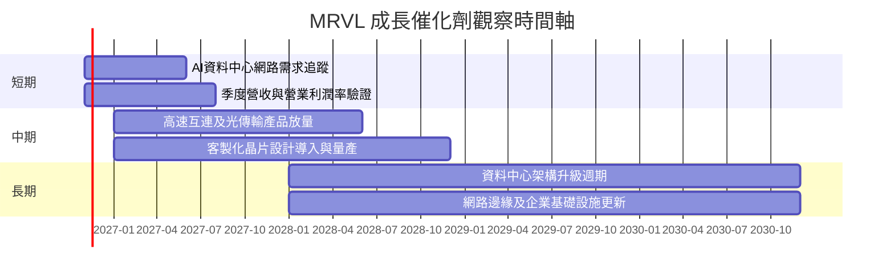

### 9.2 TAM 市場規模分析

未提供 MRVL 可服務市場、滲透率與產品別收入，以下不自行填入 TAM 數值。

```text
╔══════════════════════════════════════════════════════════════════╗
║                 MRVL 潛在市場與數據可得性                        ║
╠══════════════════════════════════════════════════════════════════╣
║ 資料中心網路／加速互連：TAM N/A ｜滲透率 N/A｜收入占比 N/A      ║
║ 客製化晶片：              TAM N/A ｜設計案數 N/A｜收入占比 N/A ║
║ 光互連／資料傳輸：        TAM N/A ｜出貨量 N/A｜收入占比 N/A   ║
║ 網路邊緣與企業基礎設施：  TAM N/A ｜滲透率 N/A｜收入占比 N/A   ║
╠══════════════════════════════════════════════════════════════════╣
║ TTM 總營收 $9.45B；TTM 年增 30.6%，為目前可量化的整體基礎      ║
╚══════════════════════════════════════════════════════════════════╝
```

### 9.3 成長驅動力結構圖

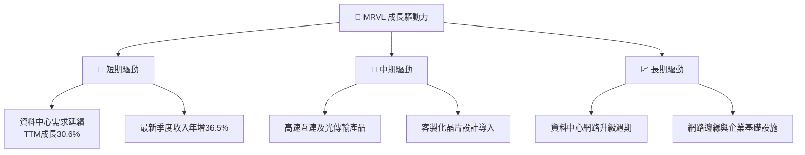

---

## 10. 風險矩陣

### 10.1 風險評分矩陣

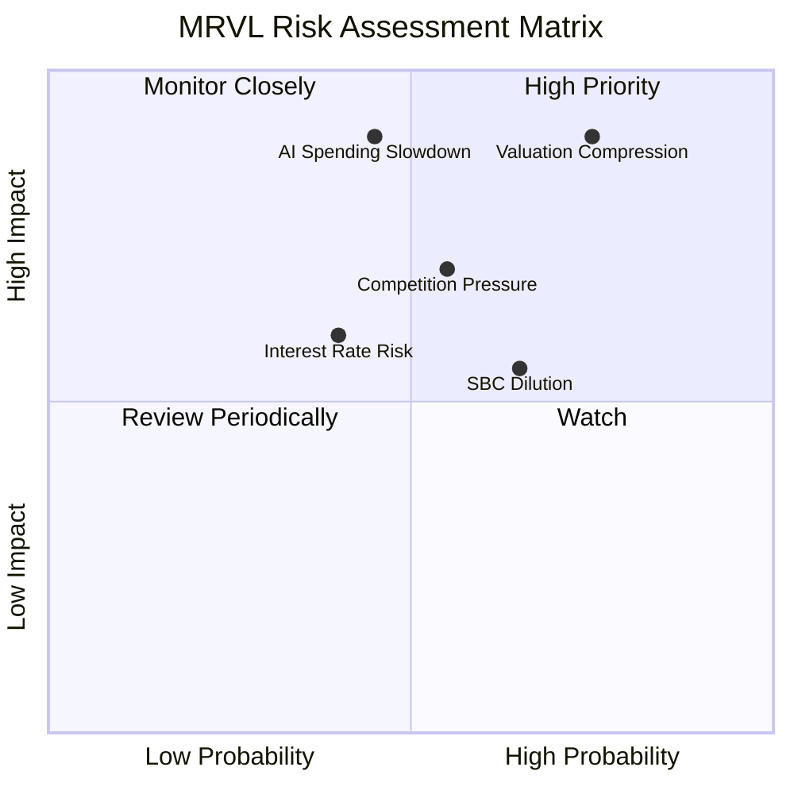

### 10.2 風險清單詳細分析

| # | 風險項目 | 發生機率 | 財務衝擊 | 風險評分 | 緩解措施 |
|---|----------|----------|----------|----------|----------|
| 1 | 🔴 估值倍數收縮 | 高（估計 60%） | 若 P/S 從 16.0x 回落至五年中位數 9.9x，估值可能大幅下修；不等同精確股價預測 | 9.0/10 | 分批減少高估值曝險；用 FCF 和 ROIC 設定持倉門檻 |
| 2 | 🔴 AI 資本支出降速 | 中（估計 40%） | 最新單季收入年增 36.5%；若降至低雙位數，模型 20% CAGR 假設可能失效 | 8.5/10 | 追蹤連續兩季收入指引與資料中心相關產品成長 |
| 3 | 🟠 競爭及價格壓力 | 中高（估計 50%） | MRVL 毛利率 52.2%，低於 AVGO 75.5%、NVDA 74.7% | 7.5/10 | 監測毛利率、訂單及新設計案轉量產比例 |
| 4 | 🟡 SBC 稀釋 | 高（估計 65%） | TTM SBC 約占營收 8.8%、OCF 37.7% | 7.0/10 | 追蹤稀釋股數及 SBC/營收是否下降 |
| 5 | 🟡 利率及 Beta | 中（估計 40%） | Beta 2.33，WACC 16.31%；風險溢酬上升會壓低 DCF | 6.5/10 | 估值採高折現率並控制單一高 Beta 持倉 |
| 6 | 🟡 併購整合與無形資產 | 中（估計 35%） | TTM 商譽 $13.874B、無形資產 $2.604B（另一來源） | 6.0/10 | 追蹤收購後收入、減損及資本回報 |

---

## 11. 投資建議

### 11.1 最終綜合評級雷達圖

```text
╔══════════════════════════════════════════════════════════════╗
║                   MRVL 綜合評分雷達                            ║
╠══════════════════════════════════════════════════════════════╣
║ 基本面        6.5/10  ▓▓▓▓▓▓▓▓▓▓▓▓▓░░░░░░░                  ║
║ 成長性        7.5/10  ▓▓▓▓▓▓▓▓▓▓▓▓▓▓▓░░░░░                  ║
║ 獲利能力      5.0/10  ▓▓▓▓▓▓▓▓▓▓░░░░░░░░░░                  ║
║ 財務健康      6.0/10  ▓▓▓▓▓▓▓▓▓▓▓▓░░░░░░░░                  ║
║ 估值合理性    2.5/10  ▓▓▓▓▓░░░░░░░░░░░░░░                  ║
║ 護城河        6.5/10  ▓▓▓▓▓▓▓▓▓▓▓▓▓░░░░░░░                  ║
║ 資本效率      3.0/10  ▓▓▓▓▓▓░░░░░░░░░░░░░░                  ║
╠══════════════════════════════════════════════════════════════╣
║ 最終評級：🔴 賣出；估值與資本效率不足以支持現價               ║
╚══════════════════════════════════════════════════════════════╝
```

### 11.2 目標價與隱含報酬率

| 情境 | 目標價 | 相對 $164.45 現價 | 假設 | 機率 |
|------|-------:|------------------:|------|-----:|
| 🔴 悲觀 | $102.90 | −37.4% | Forward EPS $7.3499 × 14x | 25% |
| 🟡 基準 | $137.45 | −16.4% | Forward EPS $7.3499 × AVGO Forward P/E 18.7x | 50% |
| 🟢 樂觀 | $220.50 | +34.1% | Forward EPS $7.3499 × 30x 假設倍數 | 25% |

依 8.8 MOS 約 −52.0%，規則門檻為賣出；不以分析師共識 $310.32 取代內在價值分析。基準目標價並非與賣出評級矛盾：前者是 12 個月相對估值情境，後者依加權合理價值及安全邊際門檻決定。

### 11.3 買入時機與觸發因素

```text
╔══════════════════════════════════════════════════════════════════╗
║                  ✅ 買入觸發因素 Checklist                      ║
╠══════════════════════════════════════════════════════════════════╣
║  目前建議：不追價；等估值與基本面風險報酬改善                   ║
║                                                                  ║
║  重新評估買入條件（多數符合）：                                  ║
║  ☐ 股價回落至加權合理價值 90% 以下：約 $97.37 以下              ║
║  ☐ TTM 收入成長仍高於 20%，且營業利益率穩定在 16% 以上          ║
║  ☐ ROIC 連續兩季改善並接近或高於 WACC                            ║
║                                                                  ║
║  加碼觸發條件：                                                  ║
║  ☐ FCF Yield 高於 2.0%，且未由營運資金短期釋放造成               ║
║  ☐ SBC/營收低於 7%，稀釋股數增幅同步下降                         ║
║                                                                  ║
║  減碼／退出觸發條件：                                            ║
║  ☐ 核心收入連續兩季年增低於 15%                                  ║
║  ☐ 營業利益率較 16.8% 收縮超過 3 個百分點                        ║
║  ☐ TTM FCF 轉負，或 ROIC 長期低於 WACC                           ║
╚══════════════════════════════════════════════════════════════════╝
```

### 11.4 投資人適配度分析

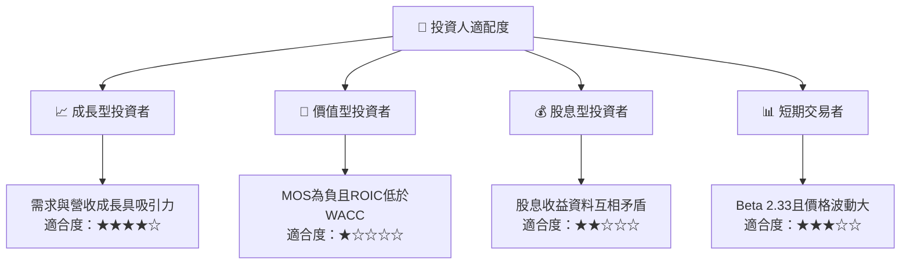

股息資料需特別審慎：市場彙整數據列示股息殖利率 15.0%，但另一來源顯示季度股息每股 $0.06，年化約 $0.24；以 $164.45 股價計算，殖利率約 0.15%。兩者明顯不一致，本文不採用 15.0% 作投資依據。

### 11.5 每季財報監控清單（Quarterly Watch List）

| 監控指標 | 最新基準 | 加碼／改善訊號 | 減碼／警訊 |
|----------|---------:|----------------|------------|
| 單季營收 YoY | 36.5% | 高於 25%，且連續兩季維持 | 連續兩季低於 15% |
| TTM 營收成長 | 30.6% | 維持 20% 以上 | 低於 15% |
| 最新季營業利益率 | 16.8% | 高於 18% 且持續擴張 | 低於 14% |
| TTM FCF | $1.73B | 同比增加且 OCF 支持 | FCF 轉負或快速下滑 |
| Capex | TTM $470.20M | 資本支出增加後營收同步變現 | Capex 上升但收入／FCF 無改善 |
| SBC/營收 | 約 8.8% 估計 | 降至 7% 以下 | 高於 10% |
| ROIC | 6.3% | 持續向 WACC 16.31% 收斂 | ROIC 進一步下滑 |
| 庫存 | TTM 表列 $1.361B | 存貨增速低於收入增速 | 存貨增速顯著高於收入 |
| 管理層財測 | 未提供 | 成長與利潤率指引上修 | 指引下修或訂單延後 |
| 稀釋股數 | 市場資料 877.99M | 淨稀釋趨緩 | 股數增幅快於收入成長 |

### 11.6 反面論證：什麼會證明論點錯誤

```text
╔══════════════════════════════════════════════════════════════════╗
║              ⚠️ 論點失效條件（Disconfirming Evidence）           ║
╠══════════════════════════════════════════════════════════════════╣
║  本報告的「估值偏高、需降低曝險」判斷，若以下情況成立應重估：   ║
║  ☐ 單季收入年增連續兩季高於 40%，且不是單一客戶拉貨             ║
║  ☐ 營業利益率升至 20% 以上，並連續兩季維持                       ║
║  ☐ TTM FCF 超過 $2.2B 且 SBC/營收降至 6% 以下                   ║
║  ☐ ROIC 上升至 16.31% 以上，證明資本投入已覆蓋資本成本          ║
║  ☐ 新產品或客製化晶片形成可查核收入，而非只停留在市場敘事       ║
║  ☐ 現價下跌至加權合理價值以下，或合理價值因實際財報持續上修     ║
╚══════════════════════════════════════════════════════════════════╝
```

> **免責聲明**：本報告為 AI 自動生成，僅供研究參考，不構成投資建議。投資有風險，入市需謹慎。