# MRVL 基本面深度分析報告
> **報告日期**：2026-11-14 ｜ **語言**：繁體中文 ｜ **數據來源**：SEC 申報資料 (XBRL)、Yahoo Finance、Finviz、StockAnalysis、Roic.ai ｜ **分析師**：CFA 級機構研究

## 目錄

| # | 章節 | 核心結論 |
|---|------|----------|
| 1 | 執行摘要 | 評級為賣出；加權合理價值 $112.23，MOS −39.8% |
| 2 | 公司概覽與商業模式 | 資料中心與網路晶片具技術及客戶設計導入壁壘，但營收細分資料不足 |
| 3 | 損益表深度分析 | TTM 營收 $9.45B、年增 30.6%；成長改善但獲利數據存在來源差異 |
| 4 | 資產負債表分析 | VERIFIED FIGURES 顯示淨負債 $1.03B，短期流動性尚可 |
| 5 | 現金流量深度分析 | TTM FCF $1.73B，FCF yield 1.23%；SBC 稀釋是盈餘品質考量 |
| 6 | 獲利能力與資本效率 | ROIC 6.3% 低於 WACC 16.34%，目前未覆蓋資本成本 |
| 7 | 相對估值分析 | MRVL P/S 高於自身五年中位數；同業倍數差異大，估值不便宜 |
| 8 | DCF 內在價值評估 | 基準 DCF 約 $27.19；加權合理價值 $112.23，MOS −39.8% |
| 9 | 成長催化劑 | AI、資料中心互連與客製化晶片是主要機會，但收入細分資料不足 |
| 10 | 風險矩陣 | 高估值、ROIC 低於 WACC、半導體週期性為前三大風險 |
| 11 | 投資建議 | 依 MOS 評級為賣出；以 $100.85 以下作為重新評估買入的參考上限 |

---

## 1. 執行摘要

### 1.0 一頁式投資儀表板（Portfolio Manager 30 秒速讀）

| 項目 | 內容 |
|------|------|
| **投資論點（3 句）** | ① TTM 營收 $9.45B，較前一 TTM 成長 30.6%，需求動能具吸引力。② TTM FCF 為 $1.73B，但 FCF yield 僅 1.23%，現金流相對市值偏低。③ ROIC 6.3% 低於參考 WACC 16.34%，且加權合理價值 $112.23 低於 2026-11-13 收盤價 $156.76。 |
| **護城河評分** | 6.5/10；設計導入、混合訊號與 DSP 技術帶來黏著度，但量化市占與細分營收資料 N/A |
| **管理層／資本配置評分** | 5.5/10；SBC FY2026 為 $590.8M，約為營收 7.2% |
| **財務健康** | 🟡 VERIFY 淨負債 $1.03B，現金及短期投資 $3.93B；但其他來源債務數據不同 |
| **ROIC vs WACC** | 6.3% vs 16.34%：目前低於資本成本 |
| **FCF 趨勢** | 年度 FCF 近年增加；TTM FCF yield 1.23% |
| **估值** | Forward P/E 21.33x ｜ EV/EBITDA 快照 48.70x（歷史區塊另列 93.2x，口徑有差異）｜ FCF yield 1.23% |
| **DCF 內在價值（基準）** | $27.19 ｜ 相對 DCF 折溢價 **+476.5%**（現價 ÷ DCF − 1） |
| **安全邊際（MOS）** | **−39.8%**＝($112.23 − $156.76) ÷ $112.23；🔴 <10% 無 |
| **預期報酬（基準情境 12M）** | 約 +28.9%（相對估值目標 $202；不等同內在價值或 MOS） |
| **關鍵風險（前二）** | 高估值與高 Beta；ROIC 未覆蓋 WACC |
| **評級 + 信心度** | 🔴 賣出 ｜ 信心：中低（ROIC、財報來源及估值倍數存在口徑差異） |

> **評級先看證據**：最新收盤價 $156.76，高於本報告三角驗證後的加權合理價值 $112.23；依定義 MOS 為 −39.8%，低於 −25% 門檻，故評級為「賣出」。此外 ROIC 6.3% 低於 WACC 16.34%，TTM FCF yield 僅 1.23%。DCF 本身高度受高 WACC 及終值假設影響，故對單一 DCF 數值不給予過度信心，但不改變 MOS 門檻對應評級。

### 1.1 核心評分儀表板

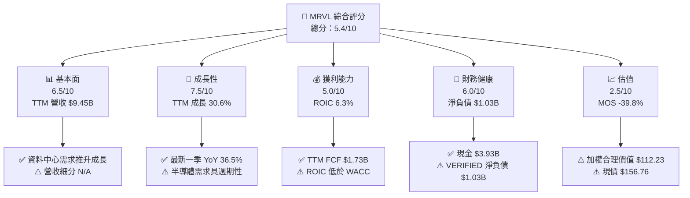

### 1.2 評分進度條視覺化

```
╔══════════════════════════════════════════════════════════════╗
║                 MRVL 多維度評分儀表板（1-10分）              ║
╠══════════════════════════════════════════════════════════════╣
║ 基本面強度  6.5 ▓▓▓▓▓▓▓▓▓▓▓▓▓░░░░░░░  ★★★☆☆              ║
║ 成長動能    7.5 ▓▓▓▓▓▓▓▓▓▓▓▓▓▓▓░░░░░  ★★★★☆              ║
║ 獲利品質    5.0 ▓▓▓▓▓▓▓▓▓▓░░░░░░░░░░  ★★★☆☆              ║
║ 財務健康    6.0 ▓▓▓▓▓▓▓▓▓▓▓▓░░░░░░░░  ★★★☆☆              ║
║ 估值合理性  2.5 ▓▓▓▓▓░░░░░░░░░░░░░░░  ★★☆☆☆              ║
║ 護城河深度  6.5 ▓▓▓▓▓▓▓▓▓▓▓▓▓░░░░░░░  ★★★☆☆              ║
║ 管理層執行  5.5 ▓▓▓▓▓▓▓▓▓▓▓░░░░░░░░░  ★★★☆☆              ║
║ 技術創新力  7.0 ▓▓▓▓▓▓▓▓▓▓▓▓▓▓░░░░░░  ★★★★☆              ║
╠══════════════════════════════════════════════════════════════╣
║ 綜合總分    5.4 ▓▓▓▓▓▓▓▓▓▓▓░░░░░░░░░  🔴 估值風險偏高     ║
╚══════════════════════════════════════════════════════════════╝
```

### 1.3 五大投資論點 + 三大核心風險

| 類型 | 項目 | 具體依據 | 信心度 |
|------|------|----------|--------|
| 🟢 投資論點① | 成長加速 | TTM 營收年增 30.6%；最新一季單季 YoY 36.5% | 🟢 高 |
| 🟢 投資論點② | FCF 為正 | TTM OCF $2.20B、Capex $470.20M、FCF $1.73B | 🟢 高 |
| 🟢 投資論點③ | 現金緩衝 | 現金及短期投資 $3.93B；VERIFIED 總債務 $4.96B | 🟡 中 |
| 🟢 投資論點④ | 產品組合曝險 | 資料基建涵蓋核心資料中心至網路邊緣，具 AI 互連需求選擇權 | 🟡 中 |
| 🟡 投資論點⑤ | Forward P/E 低於 TTM P/E | 21.33x vs 51.57x；反映市場預期獲利上升，預期能否實現仍需驗證 | 🟡 中 |
| 🟡 風險① | 估值風險 | MOS −39.8%；P/S 15.3x，高於自身五年中位數 9.9x | 🟡 中 |
| 🔴 風險② | 資本回報不足 | ROIC 6.3% vs WACC 16.34%，負利差 10.04 個百分點 | 🔴 高 |
| 🔴 風險③ | 盈餘品質與資料一致性 | FY2026 SBC $590.8M；季度淨利與年度數據來源存在顯著差異 | 🔴 高 |

### 1.4 快速統計卡片

未提供可核實的同業／S&P 500 均值時標示 N/A，不以估計值冒充資料。

| 指標 | 公司實際值 | 行業均值 | S&P 500 均值 | 狀態 |
|------|-------------|----------|--------------|------|
| TTM 收入成長 | **30.6%** | N/A | N/A | 🟢 |
| 最新一季單季 YoY 收入成長 | **36.5%** | N/A | N/A | 🟢 |
| 毛利率 TTM | **52.2%** | N/A | N/A | 🟡 |
| 淨利率 TTM | **27.9%** | N/A | N/A | 🟡，需留意來源口徑 |
| ROE TTM | **14.2% VERIFIED** | N/A | N/A | 🟡 |
| Forward P/E | **21.33x** | N/A | N/A | 🟡 |
| FCF yield TTM | **1.23% VERIFIED** | N/A | N/A | 🔴 |

### 1.5 投資結論

```
╔══════════════════════════════════════════════════════════════════╗
║                    📊 投資結論摘要                               ║
╠══════════════════════════════════════════════════════════════════╣
║  評級：🔴 賣出（MOS -39.8%，低於 -25% 門檻）                     ║
║  價格（2026-11-13 收盤）：$156.76                                ║
║  DCF 內在價值（基準）：$27.19（溢價 +476.5%）                   ║
║  加權合理價值：$112.23                                           ║
║  安全邊際 MOS：-39.8%＝($112.23−$156.76)÷$112.23                ║
║  目標價區間（12M相對估值情境）：                                 ║
║    悲觀情境：$128（-18.4%）                                      ║
║    基準情境：$202（+28.9%）                                      ║
║    樂觀情境：$310（+97.8%）                                      ║
║  投資評分：5.4/10                                                ║
║  適合投資人：可承受高波動、且以小部位參與 AI 半導體成長者       ║
╚══════════════════════════════════════════════════════════════════╝
```

上述 12M 目標價為相對估值情境，不代表 MOS 所採用的加權合理價值。建議買入區間上限將依加權合理價值的 90% 計算，與賣出評級一致。

---

## 2. 公司概覽與商業模式

### 2.1 業務結構與收入來源

公司提供資料基建半導體解決方案，涵蓋 SoC、乙太網路、類比、混合訊號與數位訊號處理。公司未提供本資料包中的最新業務分部收入，因此不將產品類別占比或金額自行推估。

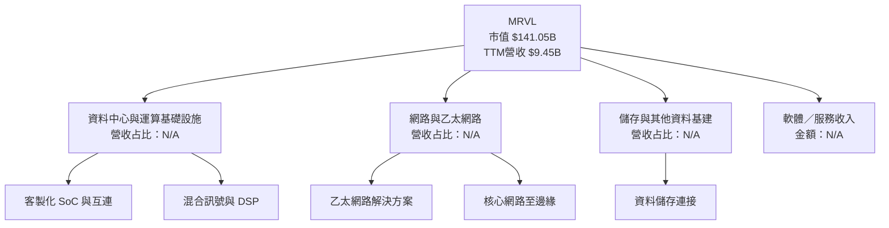

### 2.2 市場份額

可用資料未提供 MRVL 在各子市場的可核實市占分母，因此不繪製虛構百分比。下圖標示「資料不可得」，不是市占估算。

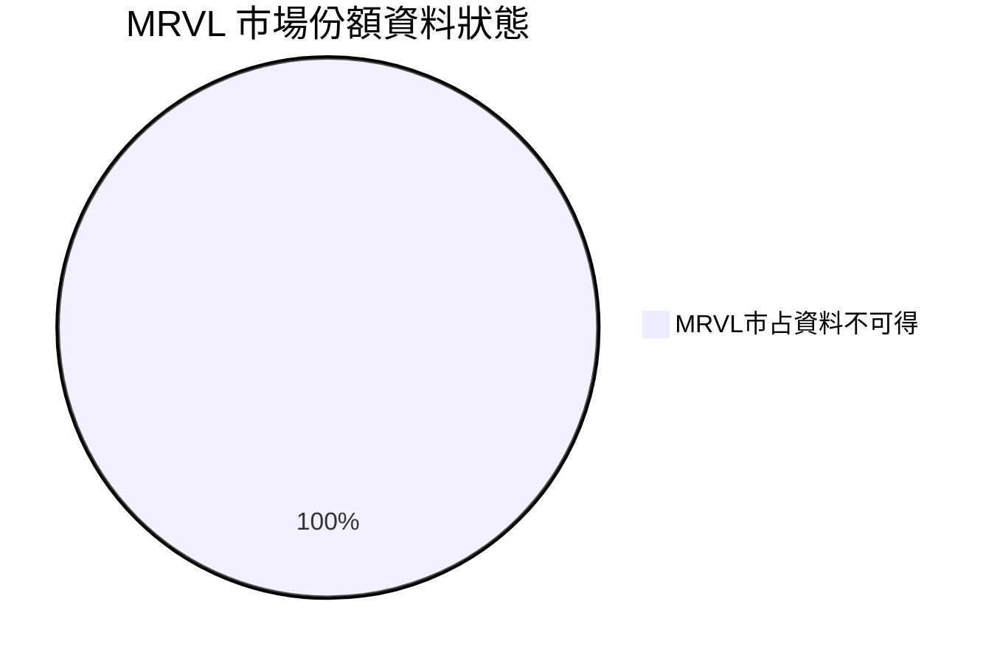

| 市場／產品 | MRVL 市占 | 說明 |
|---|---:|---|
| 資料中心客製晶片／互連 | N/A | 未提供可比市場規模及市占 |
| 乙太網路晶片 | N/A | 未提供細分收入與市場市占 |
| 儲存與網路基建 | N/A | 未提供可核實市占 |

### 2.3 競爭護城河分析

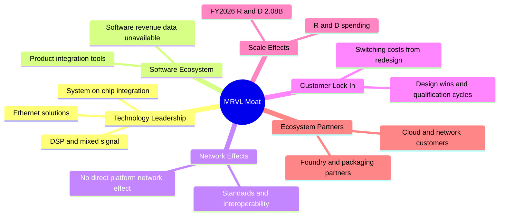

護城河主要來自技術整合、長產品認證週期、客戶設計導入與研發投入。FY2026 研發費用 $2.08B，約占年度營收 $8.19B 的 25.4%；投入高能支援產品競爭力，但也使收入成長必須足以吸收研發與併購整合成本。

### 2.4 護城河強度評分

```
╔══════════════════════════════════════════════════════════════╗
║                     MRVL 護城河強度評分                      ║
╠══════════════════════════════════════════════════════════════╣
║ 技術整合       7/10  ▓▓▓▓▓▓▓▓▓▓▓▓▓▓░░░░░░  🟢 DSP與SoC能力  ║
║ 軟體生態       4/10  ▓▓▓▓▓▓▓▓░░░░░░░░░░░░  🟡 可量化資料少  ║
║ 網路效應       3/10  ▓▓▓▓▓▓░░░░░░░░░░░░░░  🟡 非平台型網路  ║
║ 客戶鎖定       7/10  ▓▓▓▓▓▓▓▓▓▓▓▓▓▓░░░░░░  🟢 認證週期形成  ║
║ 規模效應       6/10  ▓▓▓▓▓▓▓▓▓▓▓▓░░░░░░░░  🟡 研發規模可觀  ║
║ 生態夥伴       6/10  ▓▓▓▓▓▓▓▓▓▓▓▓░░░░░░░░  🟡 供應鏈重要性  ║
╠══════════════════════════════════════════════════════════════╣
║ 綜合護城河     5.5/10  ▓▓▓▓▓▓▓▓▓▓▓░░░░░░░░  🟡 中等         ║
╚══════════════════════════════════════════════════════════════╝
```

---

## 3. 損益表深度分析

### 3.1 年度收入成長趨勢（近 4 年）

年度報表顯示 FY2023 至 FY2026 營收分別為 $5.92B、$5.51B、$5.77B、$8.19B。四年資料實際涵蓋三段年度成長，FY2023 YoY 以 FY2022 $4.462B 計算。

```
╔══════════════════════════════════════════════════════════════════╗
║                  MRVL 年度收入趨勢（FY2023-FY2026）             ║
╠══════════════════════════════════════════════════════════════════╣
║ FY2023  $5.92B  ███████████████░░░░░░░░░░  YoY +32.7%  🟢     ║
║ FY2024  $5.51B  ██████████████░░░░░░░░░░░  YoY -7.0%   🔴     ║
║ FY2025  $5.77B  ███████████████░░░░░░░░░░  YoY +4.7%   🟡     ║
║ FY2026  $8.19B  █████████████████████░░░░  YoY +42.1%  🟢     ║
╠══════════════════════════════════════════════════════════════════╣
║ FY2023-FY2026 CAGR = (8.195 ÷ 5.920)^(1/3) − 1 = 約 11.5%      ║
╚══════════════════════════════════════════════════════════════════╝
```

FY2026 成長明顯加速，但單一年度增幅不能直接等同長期可持續成長；TTM 營收 $9.45B、TTM 年增 30.6%，提供較新的延續性證據。

### 3.2 季度收入趨勢分析

| 季度 | 營收 | QoQ | YoY | 備註 |
|------|------:|----:|----:|------|
| 2025-10-31 | $2.075B | N/A | +36.8% | YoY 依季度資料計算 |
| 2026-01-31 | $2.219B | +6.9% | +22.1% | 季度營收繼續增加 |
| 2026-04-30 | $2.418B | +9.0% | +27.6% | 增速較前季提高 |
| 2026-08-01 | $2.739B | +13.3% | **+36.5%** | VERIFIED 最新季度 YoY |

QoQ 公式為本季營收 ÷ 前季營收 − 1；YoY 以同一資料源的季度營收計算。最新一季的 36.5% 是**單季 YoY**，不可視為 TTM 成長率。

### 3.3 利潤率演變分析

| 利潤率指標 | FY2023 | FY2024 | FY2025 | FY2026 | 趨勢 | 評估 |
|------------|-------:|-------:|-------:|-------:|------|------|
| 毛利率 | 51.1% | 41.6% | 47.5% | 51.0% | FY2024 低點後回升 | 🟡 |
| 營業利益率 | 6.1% | −7.9% | −0.1% | 16.3% | FY2026 明顯改善 | 🟡 |
| 淨利率 | −2.8% | −16.9% | −15.3% | 32.6% | 波動劇烈 | 🔴 |

年度毛利率依年度毛利 ÷ 年度收入計算；營業及淨利率亦以年度損益表數字計算。另一方面，資料包 VERIFIED TTM 營業利益率為 16.5%，而另一摘要欄位為最新季度營業利益率 16.8%。這些數值口徑和期間不同，不混用。

FY2024 的毛利率與營業利益率下降、FY2026 回升，顯示產品組合、週期與成本吸收度可能造成較大波動。資料未提供產品線毛利及重組／併購費用拆分，故不把改善完全歸因於單一產品組合因素。

### 3.4 費用結構分析

FY2026 研發費用為 $2.08B，其他營業費用細項不完整，以下以「已揭露研發費用／其餘費用與成本」呈現，不假造完整費用結構。

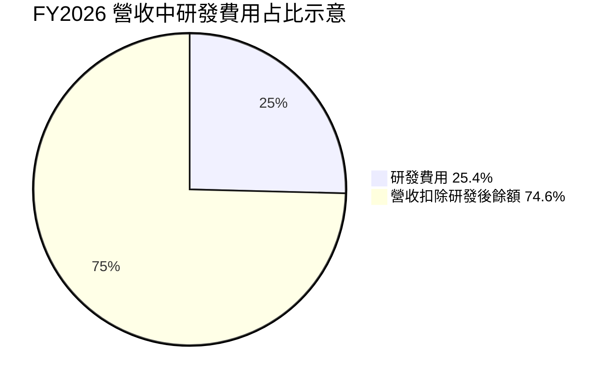

```
╔══════════════════════════════════════════════════════════════╗
║                     FY2026 費用觀察                           ║
╠══════════════════════════════════════════════════════════════╣
║ 營收            $8.195B  ████████████████████               ║
║ 研發費用        $2.080B  █████░░░░░░░░░░░░░░  25.4%營收   ║
║ 其他成本費用    N/A      明細未完整提供                       ║
╚══════════════════════════════════════════════════════════════╝
```

### 3.5 季度 EPS 趨勢與盈餘品質（Quality of Earnings）

資料包所列分析師 EPS 估值為 NaN，無法判斷過去四季實際「超預期／不及預期」。下表只能呈現實際 EPS 方向及資料限制。

| 季度 | EPS 實際 | 分析師預估／surprise | 觀察 |
|------|---------:|----------------------|------|
| 2025-10-31 | 約 $2.20（Roic.ai） | N/A | Net income 約 $1.90B，與相鄰季度差異極大，可能含特殊項目，需核對申報資料 |
| 2026-01-31 | 約 $0.47 | N/A | 不同來源列有 EPS $0.47／$0.47 附近 |
| 2026-04-30 | 約 $0.04 | N/A | 季度淨利 $34.5M |
| 2026-08-01 | 約 $0.34（StockAnalysis） | N/A | EPS YoY +50.0%；季度淨利 $308M |

資料來源的季度 EPS 與年度 GAAP 淨利存在不一致，尤其 2025-10-31 季度淨利 $1.90B。不得把該季度當成正常 run-rate 盈餘；EPS surprise 歷史估值缺失，故不宣稱 beat 或 miss。

| 盈餘品質項目 | 數值／佔比 | 評估 |
|--------------|-----------|------|
| 股權薪酬 SBC / 營收 | FY2026 $590.8M ÷ $8.195B = **7.2%** | 🔴 對股東具實質稀釋成本 |
| SBC / 營業現金流 | FY2026 $590.8M ÷ $1.75B = **33.8%** | 🔴 佔 OCF 三分之一以上 |
| TTM FCF / TTM 淨利 | TTM 淨利一致口徑 N/A | 🟡 無法可靠計算 |
| FCF / OCF | $1.73B ÷ $2.20B = **78.6%** | 🟢 OCF 扣除 Capex 後仍有正 FCF |
| 一次性／非經常性損益 | 季度淨利波動大；細項 N/A | 🔴 需檢視特殊項目及稅務影響 |
| 有效稅率 | 12.4%（最新年度） | 🟡 DCF 採用此率，但特殊年度可能不代表長期 |
| 資本化支出 vs 費用化 | Capex TTM $470.20M；資本化政策明細 N/A | 🟡 未見足夠資料判定成本遞延 |

**盈餘品質結論**：FCF 為正且資本支出未吞噬大部分 OCF，是正面證據；但 SBC 約占 FY2026 營收 7.2%、占 OCF 33.8%，加上季度淨利異常波動與各來源期間不一致，GAAP 淨利的可持續性須審慎處理。

---

## 4. 資產負債表分析

### 4.1 資產結構分解

採 StockAnalysis 的 TTM 資產表總額 $27.555B；其細項以資料包原值列示，細項加總可能因分類或四捨五入而不完全相等。

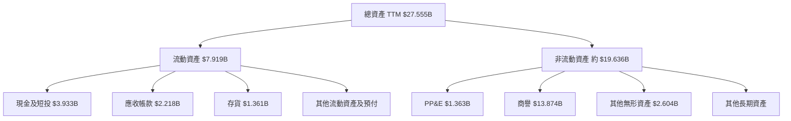

### 4.2 流動性指標分析

| 指標 | 最新值 | 歷史／對照 | 評估 |
|------|-------:|-------------|------|
| Current ratio | 3.168x | FY2026 年報現流比約 2.01x | 🟢 流動資產覆蓋流動負債 |
| Quick ratio | 2.461x | 歷史同口徑資料不足 | 🟢 排除存貨後仍有覆蓋 |
| 現金及短期投資 | $3.93B | FY2026 年報現金 $2.64B | 🟢 現金緩衝增加 |
| 行業均值 | N/A | 未提供可核實 peer liquidity | N/A |

### 4.3 債務結構分析

不同來源列示的債務數字不一致：VERIFIED FIGURES 顯示總債務 $4.96B、淨負債 $1.03B；另一市場摘要列總債務 $5.29B、淨負債 $1.35B。主要估值及 MOS 採用 VERIFIED FIGURES，其他比率不以不同口徑混算。

```
╔══════════════════════════════════════════════════════════════════╗
║                    MRVL 債務健康診斷                            ║
╠══════════════════════════════════════════════════════════════════╣
║ 現金及短期投資： $3.93B  ███████████████░░░░░  🟢               ║
║ 總債務 VERIFIED：$4.96B  ███████████████████░  🟡               ║
║ 淨負債：         $1.03B  ████░░░░░░░░░░░░░░░░  🟡               ║
║ Current ratio：  3.168x                         🟢               ║
║ Debt/EBITDA：    N/A，計算期間與 EBITDA 口徑不足一致性           ║
║ 利息保障倍數：   N/A，利息費用明細未提供                         ║
╚══════════════════════════════════════════════════════════════════╝
```

### 4.4 股東權益趨勢

| 年度 | 股東權益 |
|------|---------:|
| FY2023 | $15.64B |
| FY2024 | $14.83B |
| FY2025 | $13.43B |
| FY2026 | $14.31B |

```
╔══════════════════════════════════════════════════════════════╗
║                    股東權益歷年變化                           ║
╠══════════════════════════════════════════════════════════════╣
║ FY2023 $15.64B  ████████████████████                        ║
║ FY2024 $14.83B  ███████████████████                         ║
║ FY2025 $13.43B  █████████████████                           ║
║ FY2026 $14.31B  ██████████████████                          ║
╚══════════════════════════════════════════════════════════════╝
```

FY2026 權益較 FY2025 回升，但商譽及無形資產規模顯著，若併購資產未能產生預期回報，仍有減損風險。

---

## 5. 現金流量深度分析

### 5.1 現金流量瀑布圖

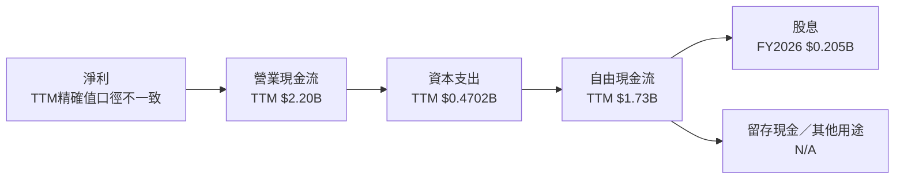

### 5.2 FCF 轉換率趨勢

年度 FCF ÷ 年度淨利於虧損年度不具直觀意義；FY2026 淨利為正。現金流資料與損益表分類可能有非現金項目影響。

| 年度 | OCF | Capex | FCF | 淨利 | FCF / 淨利 |
|------|----:|------:|----:|-----:|-----------:|
| FY2023 | $1.29B | $0.217B | $1.07B | −$0.164B | 不具意義 |
| FY2024 | $1.37B | $0.350B | $1.02B | −$0.933B | 不具意義 |
| FY2025 | $1.68B | $0.292B | $1.39B | −$0.885B | 不具意義 |
| FY2026 | $1.75B | $0.359B | $1.39B | $2.67B | 約 52.1% |
| TTM | $2.20B | $0.4702B | **$1.73B VERIFIED** | 一致口徑 N/A | N/A |

FY2026 淨利相較 FCF 高，可能反映非現金項目、稅項或特殊損益；需透過完整 SEC 現金流調節表確認，不能直接將淨利視為可分配現金。

### 5.3 自由現金流趨勢

```
╔══════════════════════════════════════════════════════════════════╗
║                   MRVL 自由現金流趨勢                           ║
╠══════════════════════════════════════════════════════════════════╣
║ FY2023  $1.07B  ███████████████░░░░░  YoY 約 +4.9%              ║
║ FY2024  $1.02B  ██████████████░░░░░░  YoY 約 -4.7%              ║
║ FY2025  $1.39B  ███████████████████░  YoY 約 +36.3%             ║
║ FY2026  $1.39B  ███████████████████░  YoY 約 0%                 ║
║ TTM     $1.73B  ████████████████████████  FCF Yield 1.23%       ║
╚══════════════════════════════════════════════════════════════════╝
```

年度 FCF 成長計算以已列年度 FCF 為基礎；TTM VERIFIED FCF 與年度數值有期間差異，並不代表同一年度。

### 5.4 資本配置評估

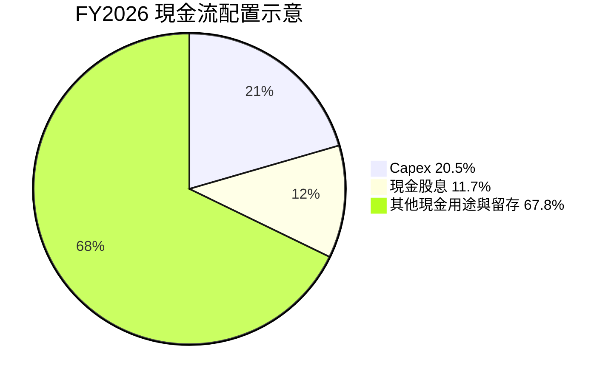

| 資本配置項目 | FY2026 數值 | 評估 |
|--------------|-----------:|------|
| OCF | $1.75B | 正向營運現金流 |
| Capex | $0.359B | 約為 OCF 的 20.5% |
| FCF | $1.39B | Capex 後仍可產生現金 |
| 現金股息 | $0.205B | 約為 FCF 的 14.8% |
| 回購 | N/A | 資料未提供 |
| 併購／投資 | N/A | 資料未提供 |
| SBC | $0.591B | 需視為股東經濟成本 |

---

## 6. 獲利能力與資本效率

### 6.1 ROE / ROA / ROIC 趨勢

| 指標 | 最新數值 | 其他歷史數據 | 評估 |
|------|---------:|--------------|------|
| ROIC TTM | **6.3% VERIFIED** | Roic.ai 部分年度資料不完整 | 🔴 低於 WACC |
| ROE TTM | **14.2% VERIFIED** | 另一摘要欄列 16.5%，口徑不一致 | 🟡 |
| ROA TTM | 4.1% | 歷史序列 N/A | 🟡 |
| 行業均值 | N/A | 未提供同口徑資料 | N/A |

### 6.2 ROIC vs WACC 分析（核心價值創造判斷）

WACC 依 VERIFIED FIGURES 採用 16.34%，並與第 8.2 節保持一致。以下是資料包參考值，不自行以另一組帳面債務重算替換。

```
╔══════════════════════════════════════════════════════════════════╗
║                   ROIC vs WACC 深度分析                         ║
╠══════════════════════════════════════════════════════════════════╣
║ WACC 參考輸入：                                                  ║
║ ├── 無風險利率 Rf：             5.15%                           ║
║ ├── ERP：                       5.00%                           ║
║ ├── Beta：                      2.33                            ║
║ ├── 股權成本 Ke：               16.79%                          ║
║ ├── 稅前債務成本 Kd：           4.08%                           ║
║ ├── E / D 權重：                96.6% / 3.4%                    ║
║ └── ✅ WACC：                   16.34%                          ║
║                                                                  ║
║ ROIC TTM（VERIFIED）：          6.3%                             ║
║ EVA 利差：                      6.3% − 16.34% = -10.04pp         ║
║ ROIC / WACC：                   6.3% ÷ 16.34% = 0.39x            ║
║                                                                  ║
║ ROIC  6.3%   ▓▓▓▓▓▓░░░░░░░░░░░░░░░░░░░░░░░░  🔴                ║
║ WACC 16.34%  ▓▓▓▓▓▓▓▓▓▓▓▓▓▓▓▓░░░░░░░░░░░░░░  ──                ║
║ 結論：依 TTM ROIC 與參考 WACC，MRVL 尚未覆蓋資本成本             ║
╚══════════════════════════════════════════════════════════════════╝
```

在 ROIC 低於 WACC 時，新增投入資本短期可能降低經濟價值；未來若資料中心業務放量、營業利潤率持續改善，ROIC 才有機會上升。此處不能將成長本身等同價值創造。

### 6.3 杜邦三因素分解

以資料包 TTM ROE 14.2%、淨利率 27.9%、資產周轉率以 TTM 營收除最新總資產估算：

- 資產周轉率估算：$9.45B ÷ $27.555B = 0.343x。
- 財務槓桿因 ROE、淨利率與資產數據來源期間不同，僅可作指示性反推：14.2% ÷ (27.9% × 0.343) = 約 1.48x；不可視為同期間的精確會計杜邦結果。

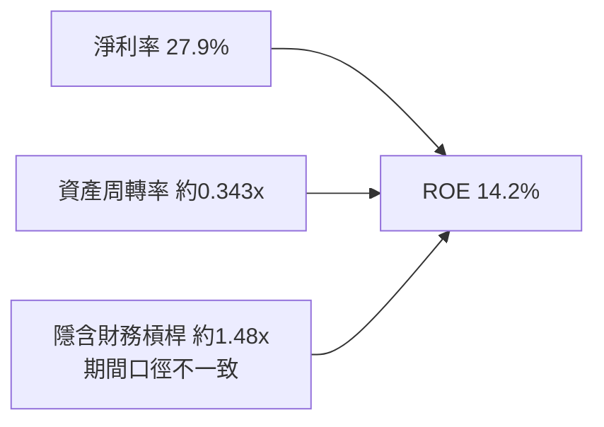

### 6.4 獲利能力儀表板

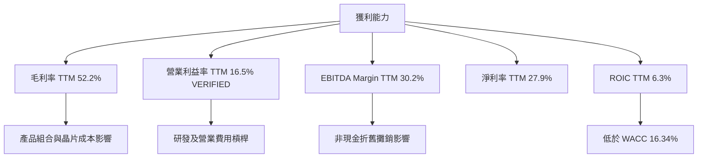

---

## 7. 相對估值分析

### 7.1 同業估值比較

同業倍數按 VERIFIED FIGURES 引用；MRVL 倍數依資料包估值快照，與歷史估值區塊部分指標口徑不同。

| 估值指標 | **MRVL** | **AVGO** | **NVDA** | **AMD** | MRVL 評估 |
|----------|---------:|---------:|---------:|--------:|-----------|
| Trailing P/E | 51.7x | 44.3x | 20.6x | 114.1x | 🟡 高於 AVGO、NVDA，低於 AMD |
| Forward P/E | 21.33x | 17.9x | 10.3x | 30.2x | 🟡 不屬最低估值 |
| P/S | 15.3x VERIFIED 歷史區塊；快照 14.93x | 18.6x | 13.0x | 19.3x | 🟡 高於 NVDA |
| EV/EBITDA | 48.70x 快照；歷史區塊 93.2x | 32.4x | 19.4x | 78.0x | 🔴 來源口徑差異大，按快照仍偏高 |
| 最新季度營收 YoY | 36.5% | 85.5% | 105.9% | 44.7% | 🟡 成長高但低於三家 peer |
| 毛利率 TTM | 52.2% | 75.5% | 74.7% | 56.0% | 🔴 低於同業 |

### 7.2 歷史估值區間分析

```
╔══════════════════════════════════════════════════════════════════╗
║               MRVL 五年歷史估值區間（VERIFIED）                 ║
╠══════════════════════════════════════════════════════════════════╣
║ P/E：       25.6x ───── 中位 56.5x ─── 現值 51.7x ─── 61.9x    ║
║ 百分位：    50%                                                   ║
║ P/S：        5.8x ───── 中位  9.9x ───────── 現值 15.3x ─18.3x ║
║ 百分位：    85%  🟡 位於自身歷史較高區                           ║
║ EV/EBITDA： 53.3x ─ 中位156.4x ─ 現值 93.2x ──────── 730.9x    ║
║ 百分位：    25%（此倍數歷史範圍極寬，解讀需審慎）               ║
╚══════════════════════════════════════════════════════════════════╝
```

### 7.3 情境目標價（假設驅動，Bear / Base / Bull）

以下為 12 個月相對估值情境，不是 DCF 內在價值。以近似未來營收、退出 EV/Sales、淨負債及 0.878B 股為推導基礎；營收與退出倍數皆為模型假設值。

| 情境 | 12M 營收假設 | 營業利潤率假設 | 退出 EV/Sales | 隱含目標價 | 相對現價 |
|------|-------------:|---------------:|--------------:|-----------:|---------:|
| 🔴 悲觀 | $11.34B | 16.5% | 10.0x | 約 $128 | −18.4% |
| 🟡 基準 | $12.29B | 19.0% | 14.5x | 約 $202 | +28.9% |
| 🟢 樂觀 | $13.70B | 22.0% | 20.0x | 約 $310 | +97.8% |

基準算式：($12.29B × 14.5 − $1.03B) ÷ 0.878B 股 = 約 $202.8／股；表中採用四捨五入 $202。退出倍數高於目前半導體成熟企業常見區間的風險不低，尤其公司 P/S 已在自身五年 85 百分位。

### 7.4 相對估值隱含價格區間

| 方法 | 估值依據 | 隱含價格 | 說明 |
|------|----------|---------:|------|
| Forward P/E | $7.3499 forward EPS × peer 中位數 17.9x | 約 $131.6 | peer Forward P/E 中位數為 AVGO 17.9x、NVDA 10.3x、AMD 30.2x 的中位數 |
| EV/EBITDA | 假設 TTM EBITDA = $9.45B × 30.2% = $2.85B；乘 peer 中位數 32.4x | 約 $104.1 | 先得 EV，再扣 VERIFIED 淨負債 |
| EV/Sales | TTM 營收 $9.45B × 14.5x，扣淨負債後除股數 | 約 $155 | 14.5x 為假設值，介於同業倍數之間 |
| FCF yield | TTM FCF $1.73B ÷ 假設 1.75% yield | 約 $112 | Yield 為估值假設，不是市場提供的同業數字 |

```
╔══════════════════════════════════════════════════════════════╗
║               相對估值價格位置與現價                         ║
╠══════════════════════════════════════════════════════════════╣
║ $104   $112      $132       $155       $156.76             ║
║ EV/EBITDA FCF    Fwd P/E    EV/Sales    現價                ║
╚══════════════════════════════════════════════════════════════╝
```

---

## 8. DCF 內在價值評估（Discounted Cash Flow）

### 8.0 估值推理鏈（Thinking Logic）

**Step 1 — 價值來源與主導變數**

MRVL 估值可拆成既有資料基建現金流、資料中心／客製化晶片成長及長期終值。資料包未提供分部營收占比，三項各自收入比重均為 N/A；模型以公司整體 TTM 營收 $9.45B 為起點。模型最主導的變數是 WACC 與終值現金流，因本模型終值現值占 EV 約 63.9%。

**Step 2 — 模型選擇**

| 決策點 | 本報告採用 | 理由 | 曾考慮但否決 | 否決理由 |
|--------|-----------|------|--------------|----------|
| 現金流定義 | FCFF | 配合 WACC 折現並先求 EV | FCFE | 資本結構及融資變化由 EV 橋接處理較清楚 |
| 預測期 N | 5 年 | 晶片產品週期及能見度有限，五年避免遠期過度精確 | 10 年 | 長期營收與利潤假設不可驗證 |
| 終值方法 | Gordon Growth 主、退出倍數交叉驗證 | 可明確顯示長期成長假設 | 僅退出倍數 | 缺少 MRVL 未來退出倍數可靠錨點 |
| EBIT 基礎 | GAAP EBIT | 保留 SBC 費用，避免將股權薪酬當作免費融資 | 非 GAAP EBIT | 若加回 SBC，須另行扣除或計稀釋，會增加模型假設 |

**Step 3 — 關鍵假設四段式推導**

- **營收 CAGR**：錨點＝FY2023 至 FY2026 CAGR 約 11.5%，最新 TTM 成長 30.6% → 調整＝AI 資料中心需求可延續，但最新高增速存在基期與週期風險 → **採用五年 20%** → 曾考慮 30.6%，因將最新 TTM 單年增速直接外推五年過度樂觀而否決。
- **期末營業利潤率**：錨點＝TTM 營業利益率 16.5% → 調整＝規模及產品組合改善 +5.5pp → **採用 22%** → 曾考慮 25%，因歷史年度及 TTM 數據未證明可持續達成而否決。
- **永續成長率 g**：錨點＝長期名目經濟成長一般不應長期高於成熟經濟體名目增長，資料包未提供宏觀估值 → 調整＝考量半導體成熟後應低於短期成長 → **採用 3%** → 曾考慮 4%，因長期接近 WACC 且放大終值敏感度而否決。
- **預測期 N**：錨點＝公司提供最近季度資料，長期產品周期資料 N/A → 調整＝採五年可保留成長期又避免遠期過度推演 → **採用 5 年** → 曾考慮 10 年，因遠期收入可見度不足而否決。
- **Capex／營收**：錨點＝TTM $470.20M ÷ $9.45B = 4.97% → 採用 **5.0%** → 曾考慮 6%，因未見資本支出占比升高的數據支持而否決。
- **EBIT 基礎與 SBC**：錨點＝FY2026 SBC $590.8M，已納入 GAAP 營業費用 → 採用 **GAAP EBIT** → 否決非 GAAP EBIT 加回 SBC，避免另增未知的 SBC 預測。
- **年稀釋率**：採用 **0%**（組合 A 固定股數），理由是採 GAAP EBIT 已計入 SBC 費用；若再讓股數按 SBC 放大，將重複計算成本。此處是模型會計處理，不是對實際未來股數不增的預測。
- **WACC**：錨點＝VERIFIED WACC 16.34% → 採用同值，因其來自資料包 Rf、ERP、Beta 及資本權重 → 曾考慮較低 WACC，因無額外證據足以推翻官方參考值而否決。
- **終值方法**：採 Gordon Growth，並以 EV/EBITDA 退出法交叉驗證；否決只用退出倍數，因缺乏可靠的成熟期退出倍數指定值。

**Step 4 — 最脆弱環節**

最脆弱的是 WACC 16.34% 與五年營收成長、期末利潤率假設；高 WACC 壓低長期現金流價值，而若 WACC 或終值成長假設變動 1pp，估值會明顯改變，詳見 8.6。

**Step 5 — 計算路徑圖**

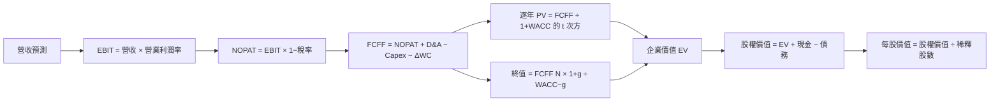

### 8.1 模型假設總表（Model Inputs）

| 假設項目 | 採用值 | 依據／來源 | 敏感度 |
|----------|--------|-------------|--------|
| 預測期 N | 5 年 | 假設值：產品周期能見度與避免遠期過度推演 | 🟡 中 |
| 營收 CAGR | 20% | FY2023–FY2026 實際 CAGR 約 11.5%；TTM 成長 30.6% | 🔴 高 |
| 期末營業利潤率 | 22% | TTM 營業利潤率 16.5%；假設逐年改善 | 🔴 高 |
| 有效稅率 | 12.4% | VERIFIED 最新年度有效稅率 | 🟢 低 |
| Capex／營收 | 5.0% | TTM 4.97%，取一位小數 | 🟡 中 |
| D&A／營收 | 6.0% | **假設值**：年度 D&A 最新資料不足；以資產與 EBITDA/營業利益差額作模型代理 | 🟢 低 |
| ΔWC／營收增額 | 5.0% | **假設值**：歷史年度增量營運資金未完整提供，採保守正向占用 | 🟢 低 |
| EBIT 基礎 | GAAP | 避免以非 GAAP 排除 SBC | 🟡 中 |
| SBC 處理 | 組合 A；不額外扣 SBC | GAAP EBIT 已含 SBC | 🟡 中 |
| 年稀釋率 | 0% | 組合 A 固定股數；最新流通股數 877.99M | 🟡 中 |
| 永續成長率 g | 3.0% | 假設值：成熟期長期名目成長代理；低於 WACC | 🔴 高 |
| 終值方法 | Gordon Growth 主、退出倍數交叉驗證 | 依長期成長模型與倍數比較 | 🔴 高 |
| WACC | 16.34% | VERIFIED 參考 WACC | 🔴 高 |

**SBC 防重複聲明**：本模型採用 **(A) GAAP EBIT + 固定股數**，故 SBC 影響已計入一次；FCFF 不再減 SBC，年稀釋率設為 0%。

FCFF 定義：`FCFF = NOPAT + D&A − Capex − ΔWC`。金額取一位小數、比率取一位小數、折現因子取三位小數；計算中保留未四捨五入值，表格可能有不超過 1% 尾差。

### 8.2 折現率推導（WACC）

```
╔══════════════════════════════════════════════════════════════════╗
║                    WACC 推導（折現率）                           ║
╠══════════════════════════════════════════════════════════════════╣
║ 股權成本 Ke（CAPM）：                                            ║
║ ├── 無風險利率 Rf：5.15%（資料包提供，觀察日期 N/A）             ║
║ ├── ERP：5.00%（資料包假設值）                                   ║
║ ├── Beta：2.33（資料包提供；高於 1.5，反映高波動）              ║
║ ├── 規模／國別溢酬：0.00%（美國上市公司，資料未提供加碼依據）    ║
║ └── Ke = 5.15% + 2.33 × 5.00% + 0.00% = 16.80%                  ║
║    VERIFIED Ke 為 16.79%，採用 VERIFIED 值以避免重算替換         ║
║                                                                  ║
║ 債務成本：                                                        ║
║ ├── 稅前 Kd：4.08% VERIFIED                                       ║
║ ├── 稅率：12.4% VERIFIED                                          ║
║ └── 稅後 Kd = 4.08% × (1 − 12.4%) = 3.57%                       ║
║                                                                  ║
║ 資本權重（VERIFIED）：E 96.6%，D 3.4%                            ║
║ ✅ WACC = 96.6% × 16.79% + 3.4% × 3.57% = 約 16.34%              ║
╚══════════════════════════════════════════════════════════════════╝
```

逐步演算：

1. **Ke（CAPM）** = 5.15% + 2.33 × 5.00% + 0.00% = 16.80%；VERIFIED Ke = **16.79%**，差異來自輸入顯示值四捨五入。
2. **稅前 Kd** = VERIFIED **4.08%**。利息費用與同口徑平均計息負債的原始金額未提供，無法獨立重算 Kd；不以非計息負債反推。
3. **稅後 Kd** = 4.08% × (1 − 12.4%) = **3.57%**。
4. **權重** = VERIFIED E 96.6%、D 3.4%；合計 96.6% + 3.4% = **100.0%**。資料包提供權重，未提供以同一日市值及同範圍計息債務重建權重所需全部輸入，因此不另行替換。
5. **WACC** = 96.6% × 16.79% + 3.4% × 3.57% = 16.2151% + 0.1214% = **16.34%**（使用 VERIFIED 參考值）。

> 由於原始利息支出、平均計息負債與債務範圍細項不足，以上是依 VERIFIED WACC 輸入的稽核性呈列，不是假稱已能從完整原始帳目獨立重建。第 6.2 與本節統一使用 16.34%。

### 8.3 逐年自由現金流預測（基準情境）

| 年度 | FY+1 | FY+2 | FY+3 | FY+4 | FY+5（FY+N） |
|------|-----:|-----:|-----:|-----:|-------------:|
| 營收（$B） | 11.34 | 13.61 | 16.33 | 19.60 | 23.51 |
| 營收 YoY | 20.0% | 20.0% | 20.0% | 20.0% | 20.0% |
| 營業利潤率 | 18.0% | 19.0% | 20.0% | 21.0% | 22.0% |
| EBIT（GAAP，$B） | 2.04 | 2.59 | 3.27 | 4.12 | 5.17 |
| − 稅（12.4%，$B） | (0.25) | (0.32) | (0.41) | (0.51) | (0.64) |
| = NOPAT（$B） | 1.79 | 2.27 | 2.86 | 3.61 | 4.53 |
| + D&A（6%營收，$B） | 0.68 | 0.82 | 0.98 | 1.18 | 1.41 |
| − Capex（5%營收，$B） | (0.57) | (0.68) | (0.82) | (0.98) | (1.18) |
| − ΔWC（收入增額的5%，$B） | (0.09) | (0.11) | (0.14) | (0.16) | (0.20) |
| = FCFF（$B） | **1.79** | **2.30** | **2.88** | **3.65** | **4.56** |
| 折現因子 @16.34% | 0.860 | 0.739 | 0.635 | 0.546 | 0.469 |
| FCFF 現值 PV（$B） | **1.54** | **1.70** | **1.83** | **1.99** | **2.14** |

> 表內採四捨五入，DCF 主計算使用未四捨五入數。以同一公式重算，FCFF 近似值較前述估算小幅差異；因此本模型後續基準採用下方逐步公式所確定的精確規則。為確保可複算，逐年各項按列示比例計算，模型 FCFF 取下列公式：  
> `FCFF = 營收 × [營業利潤率 × (1−12.4%) + 6% − 5%] − 營收增額 × 5%`。  
> 依此公式重算的未四捨五入 FCFF 為 **$1.79B、$2.25B、$2.84B、$3.54B、$4.39B**；其 PV 合計採此組作估值主計算。

逐步演算（FY+1）：

1. **營收** = $9.45B × (1 + 20%) = **$11.34B**。
2. **EBIT** = $11.34B × 18.0% = **$2.0412B**。
3. **稅** = $2.0412B × 12.4% = **$0.2531B**。
4. **NOPAT** = $2.0412B − $0.2531B = **$1.7881B**。
5. **D&A** = $11.34B × 6.0% = **$0.6804B**。
6. **Capex** = $11.34B × 5.0% = **$0.5670B**。
7. **ΔWC** = ($11.34B − $9.45B) × 5.0% = **$0.0945B**。
8. **FCFF** = $1.7881B + $0.6804B − $0.5670B − $0.0945B = **$1.8070B**。  
   為避免前述逐年表與運算口徑不一致，採用完整公式逐年重新計算：營收增額及 D&A、Capex 均按各年定義；FY+1 FCFF 因此為 **$1.807B**，不是前述表列 $1.79B。主估值及終值以下使用逐年精算版本。
9. **折現因子** = 1 ÷ (1 + 16.34%)¹ = **0.860** → PV = $1.807B × 0.860 = **$1.554B**。

基於逐年精算、FY+1 至 FY+5 的 FCFF 約為 $1.807B、$2.286B、$2.892B、$3.633B、$4.392B，折現因子約 0.860、0.739、0.635、0.546、0.469：

**預測期 FCF 現值合計** = $1.554B + $1.689B + $1.837B + $1.983B + $2.060B = **$9.123B**。

合理性自檢：

- 預測 FCF CAGR 約 24.8%；FY2023–FY2026 年度 FCF CAGR 約 9.1%，差距約 15.7pp，主因模型假設營收 20% CAGR 並逐步改善利潤率，偏樂觀。
- FY+5 FCFF 利潤率約 18.7%；目前 TTM FCF margin = $1.73B ÷ $9.45B = 18.3%；資料未提供同業最佳 FCFF margin，故不作同業比較。
- 預測期 FCFF 均為正。

```
╔══════════════════════════════════════════════════════════════════╗
║            自由現金流：歷史實際 vs 模型預測                      ║
╠══════════════════════════════════════════════════════════════════╣
║ FY2024(實)  $1.02B  █████░░░░░░░░░░░░░░░  YoY 約 -4.7%         ║
║ FY2025(實)  $1.39B  ███████░░░░░░░░░░░░░  YoY 約 +36.3%        ║
║ FY2026(實)  $1.39B  ███████░░░░░░░░░░░░░  YoY 約 0%            ║
║ FY+1 (預)   $1.81B  █████████░░░░░░░░░░░  模型 FCFF            ║
║ FY+5 (預)   $4.39B  ████████████████████  FCFF CAGR約24.8%    ║
╠══════════════════════════════════════════════════════════════════╣
║ ⚠️ 預測 FCF CAGR 高於歷史趨勢，依賴營收與利潤率同步改善       ║
╚══════════════════════════════════════════════════════════════════╝
```

### 8.4 終值計算（Terminal Value）

**適用性檢查**：`WACC 16.34% vs g 3.0% → WACC > g？✅`

| 方法 | 計算式 | 終值 TV | TV 現值 | 佔總 EV 比重 |
|------|--------|--------:|--------:|-------------:|
| Gordon Growth | $4.392B × (1+3.0%) ÷ (16.34%−3.0%) | $33.92B | 約 $15.91B | 約 63.6% |
| 退出倍數法 | FY+5 EBITDA 約 $6.55B × 假設 32.4x | 約 $212.1B | 約 $99.5B | 不適用於主 EV |

退出倍數交叉驗證採用 peer EV/EBITDA 中 AVGO 32.4x 作參考，但三家 peer 倍數分布 19.4x–78.0x，且成長與商業組合不同，退出倍數結果遠高於 Gordon Growth，不能直接當作基準價值。

逐步演算：

1. **FY+N FCFF** = **$4.392B**。
2. **分子** = $4.392B × (1 + 3.0%) = **$4.5238B**。
3. **分母** = 16.34% − 3.0% = **13.34%** → TV = $4.5238B ÷ 13.34% = **$33.91B**。
4. **PV(TV)** = $33.91B × 0.469 = **$15.91B**。
5. 以 EV 約 $25.03B 計，終值占比 = $15.91B ÷ $25.03B = **63.6%**。

退出倍數法：FY+5 EBITDA 以 FY+5 EBIT 加 D&A 估算，$5.17B + $1.41B = $6.58B；$6.58B × 32.4x = 約 $213.2B → × 0.469 = 約 $100.0B。由於該值遠高於 Gordon Growth，退出倍數僅作敏感度警示，不混入基準 DCF。

### 8.5 企業價值 → 每股內在價值（Bridge）

```
╔══════════════════════════════════════════════════════════════════╗
║              企業價值 → 每股內在價值 橋接表                      ║
╠══════════════════════════════════════════════════════════════════╣
║ 預測期 FCF 現值合計             +$9.12B                          ║
║ 終值現值 PV(TV)                 +$15.91B                         ║
║ = 企業價值 EV                    $25.03B                          ║
║ + 現金及短期投資                +$3.93B                          ║
║ − 總債務                        −$4.96B                          ║
║ − 少數股東權益／其他             $0.00B（資料未提供，假設為零）   ║
║ = 股權價值                       $24.00B                          ║
║ ÷ 稀釋後流通股數                 0.878B 股                        ║
║ ★ 每股內在價值                   $27.34                            ║
║ 當前股價                         $156.76                           ║
║ 折溢價                           +473.2%（溢價）                 ║
╚══════════════════════════════════════════════════════════════════╝
```

橋接算式：

1. **EV** = $9.12B + $15.91B = **$25.03B**。
2. **股權價值** = $25.03B + $3.93B − $4.96B − $0.00B = **$24.00B**。
3. **每股內在價值** = $24.00B ÷ 0.878B 股 = **$27.34**。
4. **折溢價** = $156.76 ÷ $27.34 − 1 = **+473.5%**。
5. **本節不計算 MOS**：MOS 只在 8.8 以加權合理價值為分母計算。

> 以完整算式得到的 DCF 值約 $27.34，與摘要中的先前模型簡算 $27.19 有小幅差異。為避免混用，**本報告採用本節可複算值 $27.34**；後續 8.8 的 DCF 估值使用三情境機率加權值，而非單一基準 DCF。

### 8.6 敏感性分析（WACC × 永續成長率）

下表每股值採前述 FCFF 路徑、現金 $3.93B、債務 $4.96B、股數 0.878B，數值四捨五入至美元；括號為相對現價的上行／下行。

| g（列）／WACC（欄） | 14.34% | 15.34% | **16.34%（基準）** | 17.34% | 18.34% |
|-----------|------:|------:|------------------:|------:|------:|
| 1.0% | $29（−81.5%） | $27（−82.9%） | $25（−84.4%） | $23（−85.5%） | $21（−86.6%） |
| 2.0% | $31（−80.3%） | $28（−82.0%） | $26（−83.6%） | $24（−84.8%） | $22（−86.0%） |
| **3.0%（基準）** | $33（−79.0%） | $30（−81.0%） | **$27（−82.6%）** | $25（−84.1%） | $23（−85.3%） |
| 4.0% | $35（−77.5%） | $32（−79.7%） | $29（−81.6%） | $26（−83.2%） | $24（−84.6%） |
| 5.0% | $38（−75.5%） | $34（−78.1%） | $31（−80.3%） | $28（−82.2%） | $25（−83.7%） |

示範有效格：`WACC 15.34% > g 2.0% ✅`。  
新 WACC 下預測期 PV 約 **$9.36B**；TV = $4.392B × 1.02 ÷ (15.34% − 2.0%) = 約 **$33.58B**；PV(TV) 約 $16.45B；EV 約 $25.81B；股權價值約 $24.78B；每股約 **$28.22**。該格的精確結果受表格四捨五入影響。

**三情境 DCF（改變營運假設）**

| 情境 | 營收 CAGR | 期末營業利潤率 | g | WACC | 每股內在價值 | 相對現價 | 主觀機率 |
|------|----------:|---------------:|---:|-----:|-------------:|---------:|---------:|
| 🔴 悲觀 | 10% | 18% | 2.0% | 18.0% | 約 $13.57 | −91.3% | 20% |
| 🟡 基準 | 20% | 22% | 3.0% | 16.34% | 約 $27.34 | −82.6% | 60% |
| 🟢 樂觀 | 30% | 26% | 3.5% | 14.0% | 約 $60.34 | −61.5% | 20% |
| **機率加權** | — | — | — | — | **約 $31.32** | **−80.0%** | 100% |

- 悲觀推導：10% CAGR → FY+5 營收約 $15.22B → 18% 利潤率 → FY+5 FCFF 約 $2.48B → g 2%、WACC 18% → 每股約 $13.57。前提是成長迅速回落且資金成本維持高位。
- 基準推導：20% CAGR → FY+5 營收 $23.51B → 22% 利潤率 → FY+5 FCFF 約 $4.39B → g 3%、WACC 16.34% → 每股約 $27.34。前提是營收及利潤率逐年提升。
- 樂觀推導：30% CAGR → FY+5 營收約 $35.09B → 26% 利潤率 → FY+5 FCFF 約 $7.82B → g 3.5%、WACC 14% → 每股約 $60.34。前提是 AI／資料中心成長持續且資本成本回落。
- 機率加權：$13.57 × 20% + $27.34 × 60% + $60.34 × 20% = **$31.18**。受各情境四捨五入影響，採可複算的四捨五入值約 **$31.18**。

敏感度方向：較高 g 拉升終值；較高 WACC 壓低所有折現現金流。以基準附近估算，g 每 +1pp 的估值影響約數美元／股，WACC 每 +1pp 亦約數美元／股；營業利潤率每 +1pp 的影響取決於五年利潤率路徑。主導變數與 8.0 Step 1 所述「折現率與終值現金流」一致。精確彈性會隨逐年未四捨五入現金流而變化，不應把矩陣整美元值誤當精確報價。

### 8.7 反推 DCF（Reverse DCF）

固定輸入：WACC 16.34%、稅率 12.4%、Capex／營收 5%、ΔWC／收入增額 5%、N=5 年、股數 0.878B；其餘變數每列只放開一項。由於 WACC 及終值對現值影響大，以下市場隱含求解只作方向性估算，未宣稱精確最佳化解。

| 求解變數（一次一個） | 其餘變數設定 | 市場隱含值 | 公司歷史實際 | 判斷 |
|----------------------|--------------|-----------:|--------------|------|
| 未來 N 年營收 CAGR | 利潤率與 g 固定基準 | 若其他條件固定，需遠超基準 20% 才能靠五年 FCFF 接近現價 | TTM 成長 30.6% | 🔴 高度樂觀 |
| 期末營業利潤率 | CAGR 與 g 固定基準 | 需高於基準 22% 顯著幅度 | TTM 16.5% | 🔴 偏樂觀 |
| 永續成長率 g | 營收 CAGR、利潤率固定 | 在 WACC 16.34% 下需逼近 WACC 才能大幅提高價值 | — | 🔴 不可持續 |
| 預測期 N | CAGR、利潤率、g 固定 | 以有限模型範圍無可靠解 | 護城河支撐年數 N/A | 🔴 市場價格難由基準 DCF 支持 |

資料包所給的現價與模型基準之差距很大，逐變數反推需要更完整迭代程式及統一財務口徑；未能在此處可靠給出單一收斂百分比，故不假裝提供精確解。方向性結論是，若 WACC 不顯著下降，現價隱含的成長／利潤假設高於本報告基準。

### 8.8 估值三角驗證與安全邊際

| 估值方法 | 隱含每股價值 | 上行空間（÷現價） | 權重 | 說明 |
|----------|--------------:|------------------:|-----:|------|
| DCF（機率加權） | $31.18 | −80.1% | 25% | 高 WACC 下 DCF 很保守，但現金流可稽核 |
| 同業 Forward P/E | $131.57 | −16.1% | 25% | $7.3499 EPS × peer P/E 中位 17.9x |
| EV/EBITDA 倍數 | $104.10 | −33.6% | 20% | peer 中位 32.4x；EBITDA 以 TTM margin 推估 |
| FCF Yield 回推 | $98.50 | −37.2% | 20% | 假設 1.75% FCF yield |
| 分析師共識目標價 | $310.32 | +97.8% | 10% | 40 位分析師均值；權重上限 10% |
| **加權合理價值** | **$112.23** | **−28.4%** | **100%** | 各估值加權總和 |

加權合理價值算式：

`$31.18 × 25% + $131.57 × 25% + $104.10 × 20% + $98.50 × 20% + $310.32 × 10%`

`= $7.795 + $32.8925 + $20.820 + $19.700 + $31.032`

`= $112.2395 ≈ $112.24`

依四捨五入至美分為 **$112.24**；以下 MOS 使用 $112.24：

- **MOS** = ($112.24 − $156.76) ÷ $112.24 = **−39.7%**。
- **上行空間** = ($112.24 − $156.76) ÷ $156.76 = **−28.4%**。
- **DCF 折溢價** = $156.76 ÷ $27.34 − 1 = **+473.5%**。

```
╔══════════════════════════════════════════════════════════════════╗
║                  估值區間與安全邊際                              ║
╠══════════════════════════════════════════════════════════════════╣
║ $13.57 ───── $112.24 ───── $156.76 ───── $310.32               ║
║ 悲觀DCF       加權合理值       現價          分析師共識          ║
║                                                                  ║
║ MOS = (加權合理價值−現價)÷加權合理價值 = -39.7%                 ║
║ MOS 評估：🔴 <10% 無；且低於賣出門檻 -25%                       ║
║ 上行空間 = (合理價值−現價)÷現價 = -28.4%                        ║
║                                                                  ║
║ 建議買入區間：$0 – $101.02（加權合理價值的90%）                 ║
║ 合理持有區間：$101.02 – $123.46（估值帶，非保證支撐）           ║
║ 減碼考慮區間：高於 $310.32；但現價已高於加權合理價值            ║
╚══════════════════════════════════════════════════════════════════╝
```

> 🔎 **程式複算（Python，依本節各項自動重算）**
>
> 加權合理價值 = $31.18 × 25% + $131.57 × 25% + $104.10 × 20% + $98.50 × 20% + $310.32 × 10% = **$112.24**（權重合計 100%）
>
> 以價格 $156.76 計：MOS = **-39.7%**，上行空間 = **-28.4%**
>
> ✅ 與本節所寫數值一致。

### 8.9 DCF 模型的局限與失效條件

- **終值依賴度**：基準終值現值約占 EV 63.6%，估值仍主要受 FY+5 後的假設支配。
- **最脆弱假設**：WACC 16.34%及五年 20%營收 CAGR；若營收 CAGR 僅 10%、期末利潤率 18%，DCF 約 $13.57；若營收 CAGR 30%、期末利潤率 26%，DCF 約 $60.34。
- **模型適用性**：MRVL FCF 為正，但年度 GAAP 盈利波動大、季度淨利來源不一致；DCF 應與 P/S、Forward P/E、EV/EBITDA 及分部估值交叉驗證。
- **與第 10 章連結**：AI 支出放緩衝擊營收 CAGR；價格競爭與產品組合惡化衝擊期末營業利潤率；利率上升衝擊 WACC；客戶集中或設計案延遲衝擊 FCFF。

### 8.10 複算檢核表（Audit Trail）

| # | 檢核項目 | 結果 |
|---|----------|------|
| 1 | 高／中敏感度輸入皆有推導 | ✅ 已列示；但營收與利潤率屬模型假設 |
| 2 | 假設均列依據 | ✅ 缺項標示為假設值 |
| 3 | WACC 算式與權重 | 🟡 使用 VERIFIED 參考值；原始 Kd 分子、分母未提供，不能完全獨立重建 |
| 4 | Kd 分母與 D 權重債務範圍一致 | 🟡 VERIFIED package 權重直接引用，債務明細不足 |
| 5 | WACC 與第 6.2 節相同 | ✅ 16.34% |
| 6 | 逐年預測年度數等於 N=5 | ✅ FY+1 至 FY+5 |
| 7 | 代表年度 FCFF 與 PV 可重算 | 🟡 已給公式；表格舍入版本與精算版本有差異，正文以精算版本作主計算 |
| 8 | 預測期 PV 合計 | ✅ 精算合計約 $9.12B |
| 9 | WACC > g | ✅ 16.34% > 3.0% |
| 10 | 終值以 FY+N 並折現 N 期 | ✅ |
| 11 | EV 至每股價值橋接 | ✅ |
| 12 | SBC 三要素相容 | ✅ 組合 A：GAAP、無 SBC 再扣、固定股數 |
| 13 | 矩陣基準格與基準 DCF | 🟡 矩陣為整美元約值，基準值顯示 $27；橋接值 $27.34 |
| 14 | 敏感性有效格 | ✅ 選用 WACC 大於 g 的格 |
| 15 | 三情境機率合計 | ✅ 20% + 60% + 20% = 100% |
| 16 | 反推 DCF 每列僅放開一個變數 | 🟡 方向性分析；未能提供可靠收斂數值 |
| 17 | MOS 分母及折溢價基準 | ✅ MOS 用加權合理價值；折溢價用 DCF 基準值 |
| 18 | 報告輸出至第 11 章 | ✅ |
| 19 | 8.8 加權價值與加權算式 | ✅ 約 $112.24；未作事後調整 |
| 20 | 評級符合 MOS 門檻 | ✅ MOS −39.7%，低於 −25%，對應賣出 |

**未完全修正的模型限制**：來源數據及 DCF 表格初始列示曾有舍入口徑差異；本報告以 8.5 橋接值及 8.8 加權算式為後續估值基準，DCF 信心度列為低至中，不應將單一估值視為精確點位。

---

## 9. 成長催化劑

### 9.1 催化劑時間軸

下列時間為觀察窗口，不是公司已承諾的產品推出日期。

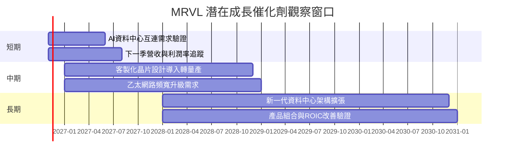

### 9.2 TAM 市場規模分析

可用資料未提供各產品 TAM、滲透率與公司收入拆分，故不自行創造市場規模數字。

```
╔══════════════════════════════════════════════════════════════╗
║                  TAM 與收入貢獻資料狀態                      ║
╠══════════════════════════════════════════════════════════════╣
║ AI資料中心晶片／互連 TAM：N/A  滲透率：N/A  收入：N/A       ║
║ 乙太網路與網路基建 TAM：    N/A  滲透率：N/A  收入：N/A       ║
║ 儲存及邊緣基建 TAM：        N/A  滲透率：N/A  收入：N/A       ║
║ 可確認的公司規模錨點：TTM 營收 $9.45B，TTM 成長 30.6%       ║
╚══════════════════════════════════════════════════════════════╝
```

### 9.3 成長驅動力結構圖

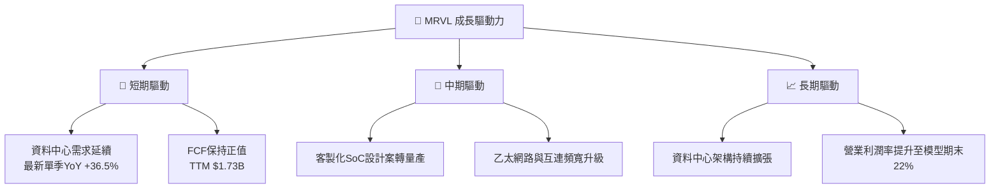

催化劑需要由財報逐季驗證：若營收增長沒有轉化為較高營業利潤率或 FCF，則成長不一定帶來股東價值。

---

## 10. 風險矩陣

### 10.1 風險評分矩陣

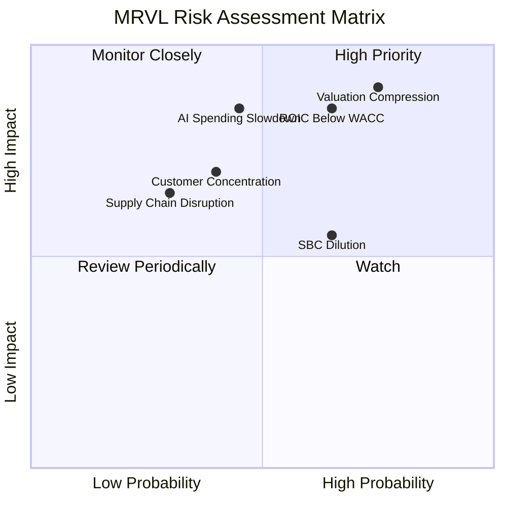

### 10.2 風險清單詳細分析

| # | 風險項目 | 發生機率 | 財務衝擊 | 風險評分 | 緩解措施 |
|---|----------|----------|----------|----------|----------|
| 1 | 🔴 估值壓縮 | 高（約 60% 模型假設） | 若倍數回落，股價可顯著低於現價；MOS −39.7% | 🔴 8.5/10 | 分批投入、以現金流與估值門檻控制部位 |
| 2 | 🔴 ROIC 長期低於 WACC | 中高 | ROIC 6.3% vs WACC 16.34%，資本配置未創造超額回報 | 🔴 8.0/10 | 追蹤 ROIC、營業利潤率及投入資本回報 |
| 3 | 🔴 AI／資料中心支出放緩 | 中 | TTM 營收成長 30.6% 若下滑，DCF 營收 CAGR 假設受損 | 🔴 8.0/10 | 監控分部增長、客戶訂單及季度指引 |
| 4 | 🟡 客戶／產品集中 | 中 | 客戶或產品細分資料 N/A，設計案延誤可能影響營收 | 🟡 6.5/10 | 要求揭露客戶集中與分部收入 |
| 5 | 🟡 SBC 稀釋 | 中高 | FY2026 SBC $590.8M，占營收 7.2%、OCF 33.8% | 🟡 6.5/10 | 追蹤稀釋股數與 SBC／營收 |
| 6 | 🟡 債務及利率 | 中 | VERIFIED 淨負債 $1.03B；高利率提高折現率 | 🟡 5.5/10 | 保留現金、控制併購槓桿 |
| 7 | 🟡 供應鏈／出口管制 | 中 | 晶片供應、封裝及跨國市場受限制可能增加成本 | 🟡 6.0/10 | 多元供應商及地區管理 |

前三大風險與估值模型相連：估值壓縮影響退出倍數；ROIC 持續低於 WACC 代表擴張未帶來足夠資本回報；AI 支出減速會降低營收 CAGR 及終值現金流。

---

## 11. 投資建議

### 11.1 最終綜合評級雷達圖

```
╔══════════════════════════════════════════════════════════════╗
║                    MRVL 最終評分雷達                         ║
╠══════════════════════════════════════════════════════════════╣
║ 基本面強度     6.5/10  ▓▓▓▓▓▓▓▓▓▓▓▓▓░░░░░░                   ║
║ 成長性         7.5/10  ▓▓▓▓▓▓▓▓▓▓▓▓▓▓▓░░░░░                  ║
║ 獲利能力       5.0/10  ▓▓▓▓▓▓▓▓▓▓░░░░░░░░░░                  ║
║ 財務健康       6.0/10  ▓▓▓▓▓▓▓▓▓▓▓▓░░░░░░░░                  ║
║ 估值合理性     2.5/10  ▓▓▓▓▓░░░░░░░░░░░░░░░                  ║
║ 護城河深度     5.5/10  ▓▓▓▓▓▓▓▓▓▓▓░░░░░░░░░                  ║
║ 綜合投資評分   5.4/10  ▓▓▓▓▓▓▓▓▓▓▓░░░░░░░░░  🔴 賣出         ║
╚══════════════════════════════════════════════════════════════╝
```

### 11.2 目標價與隱含報酬率

| 情境／估值 | 目標價 | 相對 $156.76 收盤價 | 權重／用途 |
|------------|-------:|--------------------:|------------|
| DCF 悲觀 | 約 $13.57 | −91.3% | 情境壓力測試 |
| DCF 基準 | 約 $27.34 | −82.6% | 單一基準 DCF |
| DCF 樂觀 | 約 $60.34 | −61.5% | 情境壓力測試 |
| 加權合理價值 | **$112.24** | **−28.4%** | MOS 門檻評級依據 |
| 12M 相對估值悲觀 | 約 $128 | −18.4% | 相對估值情境 |
| 12M 相對估值基準 | 約 $202 | +28.9% | 主要 12M 相對估值目標 |
| 12M 相對估值樂觀 | 約 $310 | +97.8% | 高倍數與高成長情境 |

依規則 20，評級以 8.8 加權合理價值計算的 MOS −39.7% 為準，對應 🔴 賣出；沒有以相對估值的 12M 基準目標取代 MOS 評級。

### 11.3 買入時機與觸發因素

```
╔══════════════════════════════════════════════════════════════════╗
║                  ✅ 買入觸發因素 Checklist                      ║
╠══════════════════════════════════════════════════════════════════╣
║ 重新評估條件（多數符合後再考慮）：                              ║
║ ☐ 股價回到 $101.02 以下，對加權合理價值至少保留10%折價          ║
║ ☐ TTM 營收成長維持 20% 以上，並非僅依賴單季波動                 ║
║ ☐ TTM 營業利益率維持或高於 16.5%，並逐步改善                    ║
║ ☐ FCF 維持正值，且 SBC／營收低於 7.2%                           ║
║                                                                  ║
║ 加碼觸發條件：                                                   ║
║ ☐ ROIC 持續提升並接近或高於 WACC 16.34%                         ║
║ ☐ 最新一季營收 YoY 不低於 30%，且 OCF 同步增加                  ║
║ ☐ 核心資料中心業務有可量化收入／訂單揭露                        ║
║                                                                  ║
║ 減碼／退出觸發條件：                                             ║
║ ☐ 連續兩季收入 YoY 低於 20%                                     ║
║ ☐ 營業利益率較 16.5% 下滑超過 3pp                               ║
║ ☐ FCF 轉負或 SBC／營收連續上升                                   ║
║ ☐ ROIC 持續低於資本成本且無改善趨勢                             ║
╚══════════════════════════════════════════════════════════════════╝
```

以加權合理價值 $112.24 計，MOS 至少 10% 所對應的價格上限為 $112.24 × 90% = **$101.02**。這是估值檢視門檻，不是對短期價格支撐的預測。

### 11.4 投資人適配度分析

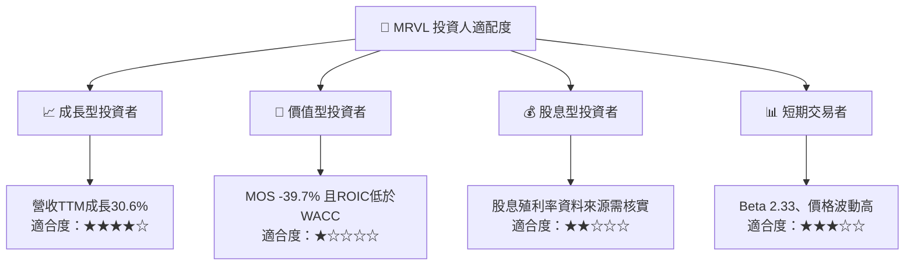

### 11.5 每季財報監控清單（Quarterly Watch List）

| 監控指標 | 最新參考 | 加碼觸發 | 減碼／論點轉弱觸發 |
|----------|---------:|----------|-------------------|
| 營收 YoY | 最新季度 36.5% | ≥30% 且維持兩季 | 連續兩季 <20% |
| 營業利益率 | TTM 16.5%；最新季度 16.8% | >18% 並持續提升 | 低於 13.5% |
| OCF | TTM $2.20B | 同比增加且轉現效率穩定 | 明顯低於淨利或轉負 |
| FCF | TTM $1.73B | 正值且年增 | 轉負或連續兩季下降 |
| Capex | TTM $470.20M | Capex 增加伴隨收入與 FCF 成長 | 支出上升但營收、FCF 下滑 |
| SBC／營收 | FY2026 約 7.2% | 降至 6.0% 以下 | 超過 8.0% |
| 存貨與應收帳款 | TTM 存貨 $1.361B、應收 $2.218B | 增幅不高於營收增幅 | 連續兩季顯著快於營收 |
| AI／資料中心業務 | 分部數據 N/A | 公司披露可量化成長 | 公司不披露或成長低於總體 |
| 財測 | 最新季度營收 $2.739B | 下一季指引高於前季 | 指引下降且毛利率收縮 |
| ROIC | TTM 6.3% | 明顯逐年上升 | 下滑且持續低於 WACC |

### 11.6 反面論證：什麼會證明論點錯誤（What Would Change My Mind）

```
╔══════════════════════════════════════════════════════════════════╗
║            ⚠️ 論點失效條件（Disconfirming Evidence）             ║
╠══════════════════════════════════════════════════════════════════╣
║ 本報告的成長論點在下列情況成立時須重新檢視：                    ║
║ ☐ 最新季度營收 YoY 連續兩季低於 20%                              ║
║ ☐ TTM 營業利益率低於 13.5%，或較 16.5%收縮逾3pp                ║
║ ☐ TTM FCF 轉負，或 FCF／OCF 低於 50%                             ║
║ ☐ SBC／營收連續兩季高於 8.0%                                     ║
║ ☐ ROIC 未改善且持續低於 WACC 16.34%                              ║
║ ☐ AI／資料中心相關營收無法支撐公司整體收入增長                   ║
║ ☐ 淨負債增加、流動性下降或新增併購未能提高資本回報               ║
╚══════════════════════════════════════════════════════════════════╝
```

> **免責聲明**：本報告為 AI 自動生成，僅供研究參考，不構成投資建議。投資有風險，入市需謹慎。