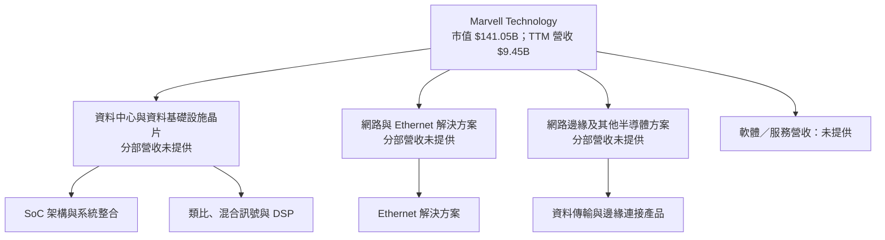
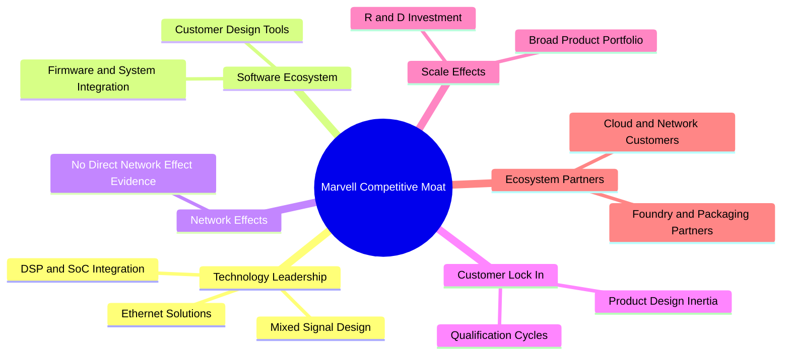
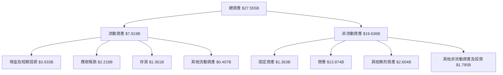
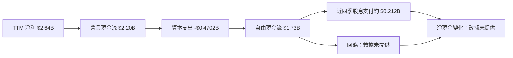
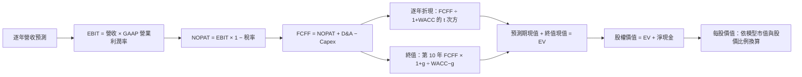
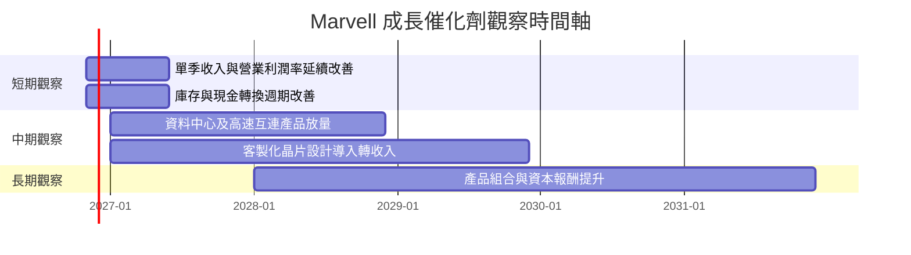
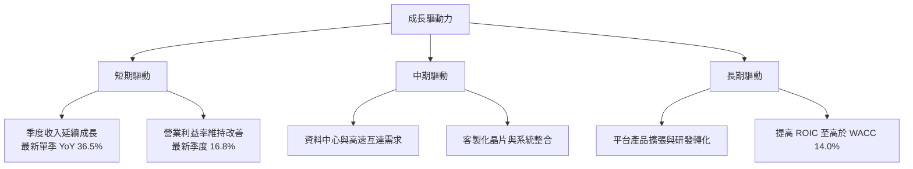
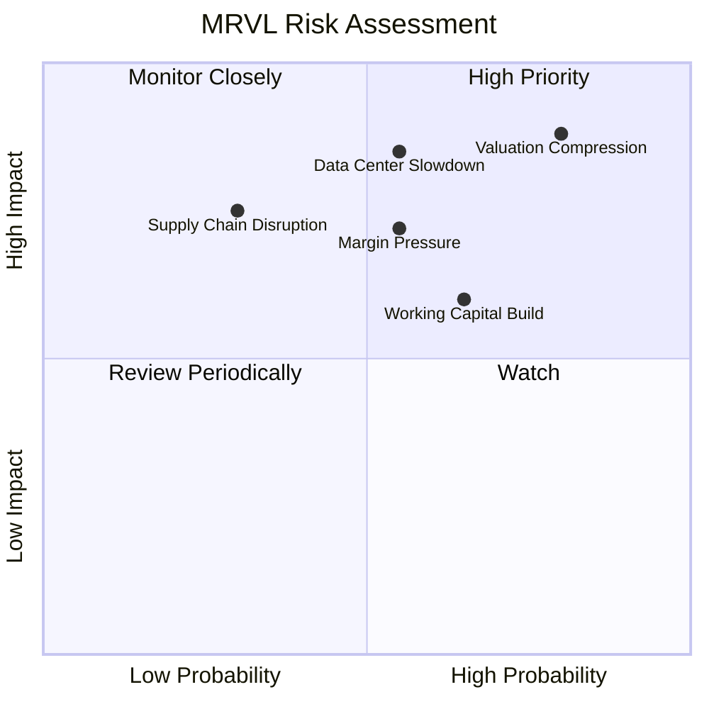
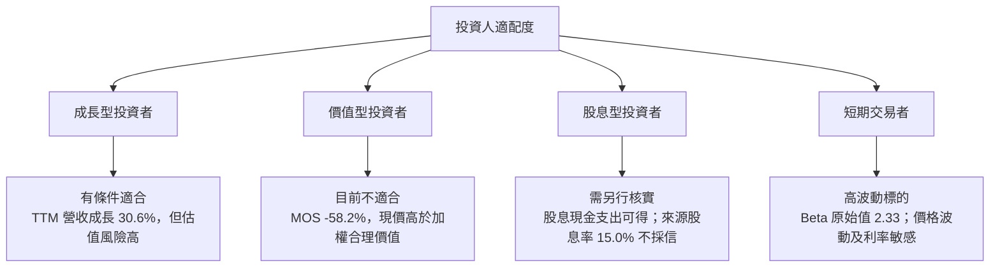

# MRVL 基本面深度分析報告
> **報告日期**：2026-11-15 ｜ **語言**：繁體中文 ｜ **數據來源**：SEC 申報資料 (XBRL)、Yahoo Finance、Finviz、StockAnalysis、Roic.ai ｜ **分析師**：CFA 級機構研究

## 目錄

| # | 章節 | 核心結論 |
|---|------|----------|
| 1 | 執行摘要 | 賣出；加權合理價值 $99.12，MOS -58.2% |
| 2 | 公司概覽與商業模式 | 資料基礎設施半導體具技術及客戶嵌入優勢，但分部營收與市場份額未提供 |
| 3 | 損益表深度分析 | TTM 營收 $9.45B、年增 30.6%；成長改善，但獲利受期間波動與一次性項目干擾 |
| 4 | 資產負債表分析 | 依 SEC 口徑淨負債 $1.03B；流動性充裕，現金轉換週期拉長 |
| 5 | 現金流量深度分析 | TTM FCF $1.73B；現金創造為正，但 FCF Yield 僅 1.23% |
| 6 | 獲利能力與資本效率 | ROIC 6.3% 低於 WACC 14.0%，目前回報未覆蓋資本成本 |
| 7 | 相對估值分析 | MRVL 估值高於部分同業、P/S 位於自身五年區間高位 |
| 8 | DCF 內在價值評估 | 基準 DCF $38.08；加權合理價值 $99.12，現價仍高於估值 |
| 9 | 成長催化劑 | 資料中心與客製化晶片需求是主要成長方向；TAM 數據未提供 |
| 10 | 風險矩陣 | 估值、成長預期落差與半導體週期為主要風險 |
| 11 | 投資建議 | 賣出；現價 $156.76 高於加權合理價值，須等待估值或基本面改善 |

## 1. 執行摘要

截至 2026-11-13 收盤，MRVL 股價為 **$156.76**。SEC 最新季度資料顯示 TTM 營收 **$9.45B、年增 30.6%**，最新單季營收年增 **36.5%**，TTM FCF **$1.73B**；但 TTM ROIC 為 **6.3%**，低於採用的 **14.0% WACC**。估值上，DCF 基準每股價值為 **$38.08**，不同方法加權後合理價值為 **$99.12**，相對現價 MOS 為 **-58.2%**。依 MOS 門檻評級為**賣出**，不作質化調整；成長前景不弱，但現價要求公司未來持續交付遠高於基準 DCF 所隱含的現金流價值。

### 1.0 一頁式投資儀表板

| 項目 | 內容 |
|------|------|
| **投資論點（3 句）** | ① TTM 營收年增 **30.6%**，最新單季年增 **36.5%**，資料中心相關需求帶動成長。② TTM FCF **$1.73B**，但 FCF Yield 僅 **1.23%**，現金回報相對市值有限。③ TTM ROIC **6.3%** 低於 WACC **14.0%**，且加權合理價值 **$99.12** 低於現價 **$156.76**。 |
| **綜合評分** | **5.8/10**（引用 1.1 評分卡） |
| **財務健康** | 🟡 現金及短期投資 $3.93B、總債務 $4.96B，淨負債 $1.03B；流動比率 3.168 |
| **ROIC vs WACC** | **6.3% vs 14.0%**；目前資本報酬低於資本成本 |
| **FCF 趨勢** | TTM FCF $1.73B，現金流為正；FCF Yield **1.23%** |
| **估值** | Forward P/E **21.33x** ｜ EV/EBITDA **48.70x**（市場資料）｜ FCF Yield **1.23%** |
| **DCF 內在價值（基準）** | **$38.08** ｜相對 DCF 折價／溢價：現價溢價 **311.6%** |
| **安全邊際（MOS）** | **-58.2%＝($99.12 − $156.76) ÷ $99.12**；🔴 負安全邊際 |
| **預期報酬（基準情境 12M）** | DCF 基準情境相對現價 **-75.7%**；模型為內在價值情境，不是 12 個月價格預測 |
| **關鍵風險（前二）** | 高估值使成長不及預期時下行放大；ROIC 低於 WACC，成長未必轉化為經濟利潤 |
| **評級 + 信心度** | 🔴 **賣出** ｜ 信心：中低（財務估值輸入明確，但資料來源間存在口徑差異） |

### 1.1 綜合評分卡（全報告唯一）

| 維度 | 評分（1–10） | 主要依據（引用數字與其來源章節） |
|------|--------------|----------------------------------|
| 成長性 | 8.5 | TTM 營收年增 30.6%、最新單季年增 36.5%（第 3 章） |
| 獲利能力 | 6.0 | 最新季度營業利益率 16.8%，但 ROIC 6.3% 低於 WACC 14.0%；F-Score 6/9（第 6 章） |
| 財務健康 | 7.0 | 淨負債 $1.03B、流動比率 3.168；CCC 131 天且同比增加 18 天（第 4 章） |
| 估值 | 1.0 | 加權合理價值 $99.12，MOS -58.2%；P/S 15.3x，高於自身五年中位數 9.9x（第 7–8 章） |
| 護城河 | 7.0 | 技術、產品整合與客戶驗證形成進入障礙；市場份額與客戶集中度數據未提供（第 2 章） |
| 管理層與資本配置 | 5.5 | FY2026 SBC $590.8M、稀釋股數測試未通過；缺乏足夠回購與投資回報細節（第 3、5 章） |
| **綜合評分** | **5.8** | 六項算術平均：35.0 ÷ 6 = 5.833，四捨五入至一位小數 |

### 1.2 五大投資論點 + 三大核心風險

| 類型 | 項目 | 具體依據 | 信心度 |
|------|------|----------|--------|
| 🟢 **投資論點①** | 營收動能加速 | TTM 營收 $9.45B、年增 30.6%；最新單季年增 36.5% | 🟢 高 |
| 🟢 **投資論點②** | FCF 持續為正 | TTM OCF $2.20B 減 Capex $470.20M，FCF $1.73B | 🟢 高 |
| 🟢 **投資論點③** | 現金緩衝尚可 | 現金及短期投資 $3.93B，流動比率 3.168 | 🟢 高 |
| 🟢 **投資論點④** | 資料中心與高速互連需求具結構性 | 公司提供資料中心核心至網路邊緣的半導體方案；公司分部營收未提供 | 🟡 中 |
| 🟢 **投資論點⑤** | 產品組合和規模有望支撐營業槓桿 | FY2026 營收 $8.195B，較 FY2025 $5.767B 增長約 42.1%；FY2026 營業利益 $1.339B | 🟡 中 |
| 🟡 **風險①** | 估值與現金流價值落差大 | 現價 $156.76，DCF 基準 $38.08、加權合理價值 $99.12 | 🔴 高衝擊 |
| 🔴 **風險②** | 資本回報不足 | ROIC 6.3% 對 WACC 14.0%，差距 -7.7 個百分點 | 🔴 高 |
| 🟡 **風險③** | 營運資金效率惡化 | CCC 由 113 天升至 131 天；DSO、DIO 均增加 | 🟡 中 |

### 1.3 快速統計卡片

| 指標 | 公司實際值（期間） | 同業中位數 | 狀態 |
|------|--------------------|------------|------|
| 營收成長（TTM） | **30.6%** | — | 🟢 |
| 營收成長（最新一季年增） | **36.5%** | 85.5%（AVGO、NVDA、AMD） | 🟡 |
| 毛利率（TTM） | **52.2%** | 74.7% | 🔴 |
| 營業利益率（TTM） | **16.5%** | — | 🟡 |
| ROIC（TTM） | **6.3%** | — | 🔴 |
| Forward P/E | **21.33x** | 17.9x（同業 Forward P/E 中位數） | 🟡 |
| FCF Yield（TTM） | **1.23%** | — | 🔴 |
| Piotroski F-Score | **6 / 9** | — | 🟡 |

### 1.4 投資結論

```text
╔══════════════════════════════════════════════════════════════════╗
║                    📊 投資結論摘要                               ║
╠══════════════════════════════════════════════════════════════════╣
║  評級：🔴 賣出（依 MOS 門檻；未作質化調整）                     ║
║  價格（2026-11-13 收盤）：$156.76                               ║
║  DCF 內在價值（基準）：$38.08（現價溢價 311.6%）                ║
║  安全邊際 MOS：-58.2%（加權合理價值為分母）                     ║
║  加權合理價值（8.8）：$99.12                                     ║
║  DCF 情境價值：                                                  ║
║    悲觀情境：$19.28（-87.7%）                                    ║
║    基準情境：$38.08（-75.7%）                                    ║
║    樂觀情境：$72.38（-53.8%）                                    ║
║  綜合評分：5.8/10（引用 1.1）                                    ║
║  適合投資人：能承受高波動、重視資料中心成長選擇權者；            ║
║              不適合以折價與資本回報為主要要求的價值型投資人      ║
╚══════════════════════════════════════════════════════════════════╝
```

## 2. 公司概覽與商業模式

### 2.1 業務結構與收入來源

Marvell Technology 提供資料基礎設施半導體，產品涉及系統單晶片架構、類比、混合訊號與數位訊號處理，服務範圍從資料中心核心延伸至網路邊緣。產品包括 Ethernet 解決方案及其他資料傳輸、儲存與網路相關晶片。財務資料沒有提供各業務板塊營收或佔比，因此不拆分營收金額、不製作虛構比例圖。



### 2.2 市場份額

市場份額數據未提供，亦沒有可引用的 TAM 或產品市占率來源，故不繪製市場份額圖。以營收與成長率觀察，MRVL TTM 營收為 $9.45B、年增 30.6%；同業最新單季營收年增率則為 AVGO 85.5%、NVDA 105.9%、AMD 44.7%，MRVL 增長高於成熟低速型公司的典型表現，但低於這些同業的最新單季增幅。

### 2.3 競爭護城河分析



### 2.4 護城河強度

| 護城河項目 | 強度（強／中／弱） | 證據（引用數字或事實） | 會削弱它的情況 |
|------------|--------------------|------------------------|----------------|
| 技術與產品整合 | 中至強 | 公司提供 SoC、類比、混合訊號與 DSP 整合；TTM 營收 $9.45B | 同業推出具成本或功耗優勢的替代方案 |
| 軟體與客戶設計嵌入 | 中 | 半導體產品需和客戶系統協同驗證；特定軟體收入及續約數據未提供 | 客戶轉向標準化或可互換元件 |
| 網路效應 | 弱／未證實 | 資料未提供網路規模帶來的直接效益證據 | 競爭者擴大互通標準與平台合作 |
| 客戶鎖定 | 中 | 產品驗證、重新設計與導入週期可能增加轉換成本；客戶集中度數據未提供 | 大型客戶自研、重新議價或供應來源多元化 |
| 規模效應 | 中 | FY2026 研發費用 $2.08B；研發可跨產品平台攤銷 | 研發投入無法轉成新產品收入，或成本增長快於收入 |
| 生態夥伴 | 中 | 公司跨多個國家營運並服務資料基礎設施市場 | 供應鏈中斷、封裝產能不足或合作夥伴改變策略 |

**護城河分數理由**：第 1.1 節的 7.0 分反映產品整合與客戶驗證的潛在轉換成本，但市場份額、客戶集中度及各產品線收入缺乏可量化證據。

## 3. 損益表深度分析

### 3.1 年度收入成長趨勢（近 4 年）

依 StockAnalysis 年度收入序列：FY2023 $5.920B、FY2024 $5.508B、FY2025 $5.767B、FY2026 $8.195B。FY2026 年增約 42.1%，顯示最新年度收入反彈明顯；但長期趨勢受 FY2024 下滑及半導體需求週期影響。

```text
╔══════════════════════════════════════════════════════════════════╗
║             Marvell 年度收入趨勢（FY2023–FY2026）                ║
╠══════════════════════════════════════════════════════════════════╣
║ FY2023  $5.920B  ██████████████░░░░░░░░░░░░░  YoY：—            ║
║ FY2024  $5.508B  █████████████░░░░░░░░░░░░░░  YoY：-7.0% 🔴     ║
║ FY2025  $5.767B  ██████████████░░░░░░░░░░░░░  YoY：+4.7% 🟡     ║
║ FY2026  $8.195B  ████████████████████░░░░░░░  YoY：+42.1% 🟢    ║
╠══════════════════════════════════════════════════════════════════╣
║ FY2023–FY2026 CAGR：約 11.5%                                      ║
║ FY2026 加速與 TTM 30.6% 增長顯示復甦；單年增長不宜線性外推       ║
╚══════════════════════════════════════════════════════════════════╝
```

CAGR 算式：\((8.195 ÷ 5.920)^{1/3} - 1 \approx 11.5\%\)。這個三年 CAGR 顯著低於最新 TTM 30.6%，表示近年增長加速，但模型應考慮週期回歸而非單純延伸最新年度增幅。

### 3.2 季度收入趨勢分析

季度數據採 StockAnalysis 最新四季及 SEC 最新申報期間；QoQ 為按相鄰季度收入計算，YoY 採財務來源中同季度年增率。

| 季度 | 營收 | QoQ | YoY | 備註 |
|------|------:|----:|----:|------|
| FY2026 Q3（2025-11-01） | $2.075B | — | 36.83% | 與前一季度 $2.219B 比較，季度順序資料存在來源日期標示差異 |
| FY2026 Q4（2026-01-31） | $2.219B | +6.9% | 22.08% | 營收延續成長 |
| FY2027 Q1（2026-05-02） | $2.418B | +9.0% | 27.57% | 年增率回升 |
| FY2027 Q2（2026-08-01） | $2.739B | +13.3% | 36.5% | SEC 最新季度；單季年增，不是 TTM 成長率 |

QoQ 算式示例：\((2.739 ÷ 2.418) - 1 = 13.3\%\)。連續季度收入增加，加上最新單季 YoY 提高至 36.5%，表示需求仍在擴張；但未提供各業務分部數據，無法分離資料中心、網路及其他產品的貢獻。

### 3.3 利潤率演變分析

| 利潤率指標 | FY2023 | FY2024 | FY2025 | FY2026 | 趨勢 | 評估 |
|------------|-------:|-------:|-------:|-------:|------|------|
| **毛利率** | 51.1% | 41.7% | 47.5% | 51.0% | 先降後回升，產品組合及營收規模可能改善 | 🟡 |
| **營業利益率** | 約 6.1% | 約 -7.9% | 約 -0.1% | 約 16.3% | FY2026 明顯回復；年度數據與 TTM GAAP 口徑需分開解讀 | 🟡 |
| **淨利率** | -2.8% | -17.0% | -15.3% | 32.6% | FY2026 大幅轉正，受淨利波動與非營業／一次性項目影響 | 🟡 |

年度毛利率依 StockAnalysis 年收入與毛利計算，與其他來源的 FY2025 毛利資料存在差異；因此以 TTM 毛利率 **52.2%** 作為當期比較錨點，不將單一歷史序列視為完全一致的 SEC 重編口徑。TTM 營業利益率採 VERIFIED FIGURES 的 **16.5%**；最新季度營業利益率為 **16.8%**，不可將單季值標為 TTM。

**利潤率演變深度解析**：FY2024 營收下降而營業利益為負，顯示半導體周期下行時固定研發與營運成本難以快速調整。FY2026 收入增加至 $8.195B，營業利益達 $1.339B，營運槓桿有助利潤率回升。若資料中心相關產品組合延續，收入增長可能繼續改善利潤率；但產品組合、價格與併購後無形資產攤銷等細節未提供，不能將 FY2026 的大幅改善全部視為可持續。

### 3.4 費用結構分析

未提供完整 TTM 研發、銷售管理、重組費用等一致期間的費用明細，無法以數據製作完整費用結構圓餅圖。可確認 FY2026 研發費用為 **$2.08B**，約占 FY2026 營收 $8.195B 的 25.4%；研發投入有助新產品與平台迭代，但也要求未來營收轉化為足夠高的營業回報。

### 3.5 季度 EPS 趨勢與盈餘品質（Quality of Earnings）

最新四季 EPS Est 與 EPS Act 資料均為缺失值，不能可靠判斷每季是否超預期或不及預期。季度實際 EPS 資料顯示：2025 年 10 月季 $2.20、2026 年 1 月季 $0.47、2026 年 4 月季 $0.04、2026 年 7 月季 $0.33；季度淨利存在大幅波動，前期 $1.901B 的季度淨利不可直接外推。

| 盈餘品質項目 | 數值/佔比 | 評估 |
|--------------|-----------|------|
| 股權薪酬 SBC / 營收 | 估算 TTM SBC $828.9M ÷ $9.45B = **8.8%** | 🟡 SBC 對股東有實質稀釋成本；年度 FY2026 SBC 為 $590.8M |
| SBC / 營業現金流 | $828.9M ÷ $2.20B = **37.7%** | 🟡 佔現金流比率高，OCF 需視為包含非現金薪酬回加後的現金流 |
| FCF / 淨利（現金轉換率） | $1.73B ÷ TTM 淨利約 $2.64B = **65.5%** | 🟡 現金轉換低於 100%；淨利含非經常性波動風險 |
| 一次性/非經常性損益 | 季度淨利曾達 $1.901B，具體項目未提供 | 🟡 可能使單季盈餘失真；不推定其來源 |
| 有效稅率異常 | 最新年度有效稅率 **12.4%** | 🟡 低於法定稅率的原因及長期可持續性未提供 |
| 資本化支出 vs 費用化 | TTM Capex $470.20M；資本化政策細節未提供 | 🟡 無法判斷是否存在重大費用遞延 |

SBC 的 TTM 估算依四個季度列示金額加總：$326.2M + $207.6M + $143.0M + $152.1M = $828.9M。該估算受來源季度標示與期間口徑影響。整體而言，GAAP 盈利有正向現金流支持，但 SBC 比重、FCF／淨利僅 65.5% 及季度淨利異常波動，降低了盈餘的可外推性。

## 4. 資產負債表分析

### 4.1 資產結構分解

以下以 StockAnalysis TTM 資產負債表所列數據呈現。非流動資產合計為總資產減流動資產，屬算術差額，不代表獨立披露科目。



### 4.2 流動性與營運資金分析

| 指標 | 最新 TTM | 一年前 TTM | 變化 | 解讀 |
|------|----------|------------|------|------|
| 流動比率 | 3.168 | N/A | N/A | 短期資產對短期負債有緩衝；歷史同口徑數據未列 |
| 速動比率 | 2.461 | N/A | N/A | 排除存貨後仍有流動性緩衝 |
| DSO 應收帳款天數 | 86 天 | 73 天 | +13 天 | 收款週期拉長，需監控應收帳款品質 |
| DIO 存貨天數 | 110 天 | 96 天 | +14 天 | 存貨週期拉長，可能反映備貨或需求與出貨節奏差異 |
| DPO 應付帳款天數 | 64 天 | 56 天 | +8 天 | 付款時間延長，緩解部分資金占用，但不抵銷 DSO、DIO 上升 |
| CCC 現金轉換週期 | 131 天 | 113 天 | +18 天 | 現金被營運資金占用時間增加，對未來 FCF 有潛在壓力 |

CCC = DSO + DIO − DPO；最新為 86 + 110 − 64 = 132 天，QUALITY FIGURES 按其未四捨五入底數計為 **131 天**，以該指標原值為準。整體變化方向顯示營運資金效率轉弱；若增長主要由應收與庫存增加推動，營收增長未必同步轉化為現金流。

### 4.3 債務結構分析

債務及現金優先採用 SEC 最新季度口徑。市場資料另列總債務 $5.29B、淨負債 $1.35B，與 SEC 指標不一致；本報告以 VERIFIED FIGURES 的總債務 $4.96B、現金與短期投資 $3.93B、淨負債 $1.03B 為主。

```text
╔══════════════════════════════════════════════════════════════════╗
║                   Marvell 債務健康診斷                           ║
╠══════════════════════════════════════════════════════════════════╣
║ 總債務：             $4.96B   ████████████████░░░░               ║
║ 現金+短期投資：      $3.93B   █████████████░░░░░░                ║
║ 淨負債：             $1.03B   ███░░░░░░░░░░░░░░░                ║
║ 流動比率：           3.168x   🟢 短期流動性充足                 ║
║ Debt/EBITDA：        N/A（未提供同口徑計算所需 EBITDA）          ║
║ 利息保障倍數：       N/A（利息費用與營業利益口徑未齊備）          ║
║ 結論：淨負債不高，但非淨現金；併購商譽及無形資產仍需關注        ║
╚══════════════════════════════════════════════════════════════════╝
```

### 4.4 股東權益趨勢

| 年度 | 股東權益 |
|------|---------:|
| FY2023 | $15.64B |
| FY2024 | $14.83B |
| FY2025 | $13.43B |
| FY2026 | $14.31B |

```text
╔══════════════════════════════════════════════════════════════════╗
║                   股東權益歷年變化                               ║
╠══════════════════════════════════════════════════════════════════╣
║ FY2023  $15.64B  ████████████████████                           ║
║ FY2024  $14.83B  ███████████████████                            ║
║ FY2025  $13.43B  █████████████████                              ║
║ FY2026  $14.31B  ██████████████████                             ║
╚══════════════════════════════════════════════════════════════════╝
```

FY2026 權益較 FY2025 增加 $0.88B，但股權薪酬與稀釋仍是每股價值的重要考量；Piotroski 測試亦顯示稀釋股數未減少，不能只看帳面權益回升。

## 5. 現金流量深度分析

### 5.1 現金流量瀑布圖

TTM 淨利約 $2.64B、營業現金流 $2.20B、Capex $470.20M、FCF $1.73B。股息支付按最近四季約 $212.3M；回購與淨現金變化的同期完整數據未提供。



### 5.2 FCF 轉換率趨勢

| 財年 | FCF | 淨利 | FCF / 淨利 | 解讀 |
|------|----:|-----:|-----------:|------|
| FY2023 | $1.07B | -$0.164B | 不具解讀性 | 淨利為負，比例失真 |
| FY2024 | $1.02B | -$0.933B | 不具解讀性 | 淨利為負，比例失真 |
| FY2025 | $1.39B | -$0.885B | 不具解讀性 | 淨利為負，比例失真 |
| FY2026 | $1.39B | $2.67B | 約 52.1% | 淨利高於 FCF，需留意非現金或一次性因素 |
| TTM 至 2026-08-01 | $1.73B | 約 $2.64B | 約 65.5% | 轉換改善但仍低於 100% |

### 5.3 自由現金流趨勢

| 期間 | FCF | FCF Yield |
|------|----:|----------:|
| FY2023 | $1.07B | N/A |
| FY2024 | $1.02B | N/A |
| FY2025 | $1.39B | N/A |
| FY2026 | $1.39B | N/A |
| TTM | $1.73B | 1.23% |

歷史年度 FCF 顯示近年回升，但 FY2026 年度 FCF 大致持平於 FY2025；TTM FCF 提升至 $1.73B。缺少各年度一致市值資料，不製作歷年 FCF Yield 圖。

```text
╔══════════════════════════════════════════════════════════════════╗
║                     自由現金流趨勢                               ║
╠══════════════════════════════════════════════════════════════════╣
║ FY2023  $1.07B  ████████████                                     ║
║ FY2024  $1.02B  ███████████                                      ║
║ FY2025  $1.39B  ███████████████                                  ║
║ FY2026  $1.39B  ███████████████                                  ║
║ TTM     $1.73B  ████████████████████  FCF Yield：1.23%           ║
╚══════════════════════════════════════════════════════════════════╝
```

### 5.4 資本配置評估

資本配置圓餅圖所需的同期間回購、投資與留存現金分項未提供，因此不以不完整資料作比例圖。

| 項目 | 可得數據 | 評估 |
|------|----------|------|
| 研發 | FY2026 $2.08B | 研發規模大，需用新產品收入與利潤率驗證回報 |
| Capex | TTM $470.20M | 占 TTM 營收約 5.0% |
| 股息 | FY2026 $205.1M；TTM 四季約 $212.3M | 相對 FCF 規模適中 |
| 回購 | N/A | 資料未提供一致期間金額 |
| SBC | FY2026 $590.8M；估算 TTM $828.9M | 是股東稀釋成本，不可忽略 |

## 6. 獲利能力與資本效率

### 6.1 ROE / ROA / ROIC 趨勢

| 指標 | FY2023 | FY2024 | FY2025 | 最新 TTM | 評估 |
|------|-------:|-------:|-------:|---------:|------|
| ROE | N/A | N/A | N/A | 14.2% | 品質受杜邦分解中的低資產週轉率與淨利波動影響 |
| ROA | N/A | N/A | N/A | 4.1% | 資產回報偏低，商譽與無形資產規模較大 |
| ROIC | N/A | N/A | N/A | 6.3% | 低於 14.0% WACC，未覆蓋資本成本 |

### 6.2 ROIC vs WACC 分析（核心價值創造判斷）

```text
╔══════════════════════════════════════════════════════════════════╗
║                ROIC vs WACC 深度分析                            ║
╠══════════════════════════════════════════════════════════════════╣
║ WACC 資料輸入：                                                  ║
║ ├── 無風險利率（10Y 美債）：5.15%（來源未附觀察日期）            ║
║ ├── ERP：5.00%（假設值，資本成本資料輸入）                        ║
║ ├── 原始 Beta：2.33；採用調整後 Beta：1.88                       ║
║ ├── 股權成本：14.58%（資本成本資料原值）                         ║
║ ├── 稅前債務成本：4.08%；稅後約 3.57%                            ║
║ ├── 股權／債務權重：96.6%／3.4%                                  ║
║ └── 計算 WACC 14.20%，受 7%–14% 區間限制，採用 14.00%            ║
║                                                                  ║
║ ROIC（TTM）：6.3%                                                ║
║ EVA 價差 = ROIC − WACC = 6.3% − 14.0% = -7.7 個百分點           ║
║ ROIC  6.3%  ▓▓▓▓▓▓░░░░░░░░░░░░░░░░░░░░░░░░░░                    ║
║ WACC 14.0%  ▓▓▓▓▓▓▓▓▓▓▓▓▓▓░░░░░░░░░░░░░░░░                      ║
║                                                                  ║
║ 結論：以目前 TTM 回報衡量，公司未覆蓋資本成本；                  ║
║       未來若 ROIC 未提升，營收成長不等同於股東價值創造。          ║
╚══════════════════════════════════════════════════════════════════╝
```

### 6.3 杜邦三因素分解

| 因素 | 數值（TTM） | 解讀 |
|------|-------------|------|
| 淨利率 | 27.9% | 受淨利和非經常性項目波動影響，需審慎外推 |
| 資產週轉率 | 0.34 | 資產基礎龐大而周轉較低 |
| 權益乘數 | 1.49 | 槓桿不是 ROE 的主要放大來源 |
| **ROE** | **14.2%** | 27.9% × 0.34 × 1.49 約為 14.1%，原始指標列示 14.2%；差異來自未四捨五入底數 |

依 QUALITY FIGURES 原值照列；資產週轉率 0.34 與權益乘數 1.49 的乘積顯示 ROE 更倚賴淨利率，而不是高槓桿。

### 6.4 財務體質：Piotroski F-Score

Piotroski F-Score 為 **6 / 9**。以下逐項照列：

| 測試 | 結果 | 解讀 |
|------|------|------|
| ROA > 0 | ✅ 通過 | 盈利能力為正 |
| 營業現金流 > 0 | ✅ 通過 | TTM OCF 為正 |
| ROA 高於一年前 | ✅ 通過 | 回報指標改善 |
| 營業現金流 > 淨利（應計品質） | ❌ 未通過 | 淨利高於營業現金流，現金轉換需留意 |
| 長期負債 ÷ 總資產低於一年前 | ✅ 通過 | 槓桿比率相對改善 |
| 流動比率高於一年前 | ✅ 通過 | 短期流動性改善 |
| 稀釋股數未增加 | ❌ 未通過 | 股數稀釋降低每股經濟利益 |
| 毛利率高於一年前 | ✅ 通過 | 毛利率趨勢改善 |
| 資產週轉率高於一年前 | ❌ 未通過 | 資產運用效率未改善 |

## 7. 相對估值分析

### 7.1 同業估值比較表格

本公司市場估值資料取自 Yahoo Finance／Finviz 整合資料；同業倍數取 Yahoo Finance 的 Peer multiples。不同資料來源的 MRVL 市值倍數存在口徑差異，Forward P/E 等應視為快照而非精確預測。

| 估值指標 | **MRVL** | **AVGO** | **NVDA** | **AMD** | 本公司評估 |
|----------|---------:|---------:|---------:|--------:|-----------|
| **Trailing P/E** | 51.7x | 44.3x | 20.6x | 114.1x | 🟡 低於 AMD、高於 AVGO 與 NVDA |
| **Forward P/E** | 21.3x | 17.9x | 10.3x | 30.2x | 🟡 高於同業中位數 17.9x |
| **P/S Ratio** | 14.9x（市場快照） | 18.6x | 13.0x | 19.3x | 🟡 落在同業區間中間；歷史口徑另為 15.3x |
| **EV/EBITDA** | 48.7x（市場快照） | 32.4x | 19.4x | 78.0x | 🔴 高於 AVGO、NVDA |
| **最新單季營收年增** | 36.5% | 85.5% | 105.9% | 44.7% | 🟡 增長為正，但低於三家同業 |
| **TTM 毛利率** | 52.2% | 75.5% | 74.7% | 56.0% | 🔴 低於三家同業 |

Peer multiples 的三家公司 Forward P/E 中位數為 **17.9x**（三值排序後中位數），而 MRVL Forward P/E 約 21.3x，反映市場已計入增長溢價。

### 7.2 歷史估值區間分析

```text
╔══════════════════════════════════════════════════════════════════╗
║                 MRVL 五年估值區間（TTM）                         ║
╠══════════════════════════════════════════════════════════════════╣
║ P/E：       25.6x ───── 中位數 56.5x ───── 61.9x                 ║
║             現值 51.7x；百分位 50%                               ║
║ P/S：        5.8x ───── 中位數 9.9x ────── 18.3x                ║
║             現值 15.3x；百分位 85% 🔴                            ║
║ EV/EBITDA： 53.3x ───── 中位數 156.4x ──── 730.9x               ║
║             現值 93.2x；百分位 25%                               ║
╚══════════════════════════════════════════════════════════════════╝
```

P/S 現值處於自身五年分布的 85 百分位，是較明確的估值警訊。P/E 為 50 百分位，EV/EBITDA 為 25 百分位，但歷史 EV/EBITDA 範圍極廣且分母受盈餘波動影響，不能單獨據此判定便宜。

### 7.3 情境價值（Bear / Base / Bull）

| 情境 | 第 1 年營收成長 | 期末營業利潤率 | WACC | 每股價值 | 相對現價 | 機率 | 會發生的條件 |
|------|----------------|----------------|------|----------:|---------:|------:|--------------|
| 🔴 悲觀 | 15.0% | 3.4% | 15.00% | $19.28 | -87.7% | 25% | 需求放緩、競爭加劇，且資本成本保持高位 |
| 🟡 基準 | 30.0% | 4.0% | 14.00% | $38.08 | -75.7% | 50% | 近期增長逐步衰退，長期利潤率收斂至模型假設 |
| 🟢 樂觀 | 45.0% | 4.4% | 13.00% | $72.38 | -53.8% | 25% | 客製晶片及資料中心產品增長高於基準，且折現率下降 |

三情境每股價值與假設依 DCF 模型原值照列。資料未提供各情境逐年營收、FCFF 與終值的完整中間路徑，故不另行推造中間數字。

### 7.4 相對估值隱含價格區間

```text
╔══════════════════════════════════════════════════════════════════╗
║               估值方法隱含每股價值                               ║
╠══════════════════════════════════════════════════════════════════╣
║ $38.08 DCF ── $80.04 EV/EBITDA ── $131.37 Forward P/E ── $310.32 ║
║                 ↑ 同業倍數區間                 分析師共識        ║
║ 現價 $156.76 高於前三項方法估值，低於分析師平均目標價            ║
╚══════════════════════════════════════════════════════════════════╝
```

- **同業 Forward P/E：$131.37**，依據同業 Forward P/E 中位數 **17.9x × Forward EPS $7.35**。
- **同業 EV/EBITDA：$80.04**，依據 AVGO、NVDA 的同業中位數 **25.9x** 乘 MRVL TTM EBITDA，再加淨現金；依照估值方法區塊原值引用。
- **DCF 基準：$38.08**，十年 FCFF、WACC 14.00%、終值成長率 3.0%。
- **分析師共識：$310.32**，40 位分析師平均目標價；此為共識參考值，不代表可由現金流驗證的內在價值。

## 8. DCF 內在價值評估（Discounted Cash Flow）

> 本節只採用 DCF MODEL 原有基準模型與輸出，不另建模型。金額以美元十億計，除每股價值外。模型輸出存在四捨五入差異，依程式提供的基準數值引用。

### 8.0 估值推理鏈（Thinking Logic）

**Step 1 — 價值由哪些變數決定？**  
模型核心為「既有資料基礎設施產品現金流底盤 + 資料中心與高速互連需求帶來的成長 + 長期現金流終值」。公司未提供各業務營收佔比，故不能把上述來源拆成具體營收份額。估值最敏感的變數是**折現率與長期現金流／利潤率假設**；基準模型終值現值佔 EV 36.0%。

**Step 2 — 模型選擇**

| 決策點 | 本報告採用 | 理由（含數字） | 曾考慮但否決 | 否決理由 |
|--------|-----------|----------------|--------------|----------|
| 現金流定義 | FCFF | 與 WACC 折現並先估 EV，模型明定 FCFF = NOPAT + D&A − Capex | FCFE | 模型未提供股東自由現金流及融資現金流預測 |
| 預測期 N | 10 年 | DCF 模型固定十年，收入成長由 30% 緩降至 3% | 5 年 | 無法照抄既有程式模型；不得自行縮短 |
| 終值方法 | Gordon Growth | 模型提供 g=3.0% 與終值數值 | 退出倍數 | DCF 模型未提供退出倍數假設及結果 |
| EBIT 基礎 | GAAP EBIT | 基準年 TTM 營業利益率 16.5%；模型說明 GAAP EBIT | 非 GAAP EBIT | 避免將 SBC 加回後又漏計稀釋成本 |

**Step 3 — 關鍵假設推導鏈**

- **營收成長路徑**：錨點＝TTM 成長 30.6% → 調整＝十年期間需由當前高成長逐步正常化 → **第 1 年 30.0%，線性降至第 10 年 3.0%** → 曾考慮長期維持 30%，因會忽略成熟與基期效應而不採用。
- **營業利益率**：錨點＝TTM 16.5% → 調整＝模型將利潤率逐年下滑至近五財年中位數 → **第 1 年 16.5% 至第 10 年 4.0%** → 曾考慮維持現有 16.5%，但模型採歷史中位數收斂。
- **有效稅率**：錨點＝最新年度 12.4% → 採用 **12.4%**；稅率可持續性未提供，依模型原值。
- **D&A／營收**：錨點＝TTM **13.3%** → 模型固定使用 **13.3%**；採用值不偏離錨點。
- **Capex／營收**：錨點＝TTM 約 **5.0%** → 模型以 **5.0%** 固定至第十年 → 不採用額外提高 Capex 比率，因程式模型未設定。
- **ΔWC／營收增額**：營運資金變動**未納入模型**，資料亦未提供可用的增量比例；不以假設值補入。
- **SBC 與稀釋**：採用 **組合 (A)**：GAAP EBIT 已將 SBC 當作費用，FCFF 不再扣 SBC，並使用固定股數、不另設稀釋率。模型明定 SBC 影響已計入一次；未提供獨立稀釋股數預測。
- **永續成長率 g**：錨點＝成熟企業長期名目成長需低於折現率；採用模型 **3.0%**，低於 WACC 14.0% → 不採用高於 3.0% 的終值成長，避免終值佔比過度依賴高 g。
- **預測期 N**：依模型固定 **10 年**；未另改為更長期間，因十年後另由終值承接。
- **WACC**：資本成本資料計算值 14.20%，受到 7%–14% 區間限制，模型採用上限 **14.00%**；不採用未受限的 14.20%，以遵循程式定義。

**Step 4 — 最脆弱環節**  
最脆弱的是未來營收成長及利潤率路徑；若需求放緩或 GAAP 利潤率低於模型，DCF 基準價值將進一步下降，而不是靠估值倍數自動補足。

**Step 5 — 計算路徑圖**



### 8.1 模型假設總表（Model Inputs）

| 假設項目 | 採用值 | 依據 / 來源 | 敏感度 |
|----------|--------|-------------|--------|
| 預測期長度 N | 10 年 | DCF MODEL 固定預測期 | 🟡 中 |
| 營收成長 | 第 1 年 30.0%，第 10 年 3.0% | TTM 成長 30.6%；十年線性衰退 | 🔴 高 |
| 營業利潤率 | 第 1 年 16.5% → 第 10 年 4.0% | TTM 利潤率及近五財年中位數模型假設 | 🔴 高 |
| 有效稅率 | 12.4% | 最新年度有效稅率 | 🟢 低 |
| Capex／營收 | 第 1–10 年 5.0% | TTM Capex 約占營收 5.0%；模型固定 | 🟡 中 |
| D&A／營收 | 13.3% | TTM 比率，模型固定 | 🟢 低 |
| 營運資金變動 | 未建模 | DCF MODEL 明示 working capital is not modelled | 🟢 低 |
| EBIT 基礎 | GAAP | DCF MODEL 明示 GAAP EBIT | 🟡 中 |
| SBC 處理 | 組合 (A)：GAAP EBIT，不再扣 SBC | SBC 已含於 GAAP 費用；固定股數 | 🟡 中 |
| 年稀釋率 | 0%（模型設定） | 組合 A；不另行擴大股數 | 🟡 中 |
| 永續成長率 g | 3.0% | DCF MODEL 原值，且小於 WACC | 🔴 高 |
| 終值方法 | Gordon Growth | DCF MODEL 原值；退出倍數未提供 | 🔴 高 |
| WACC | 14.00% | 計算值 14.20%，受 7%–14% 限制 | 🔴 高 |

### 8.2 折現率推導（WACC）

```text
╔══════════════════════════════════════════════════════════════════╗
║                    WACC 推導（折現率）                           ║
╠══════════════════════════════════════════════════════════════════╣
║ 股權成本 Ke（CAPM）：                                             ║
║ ├── 無風險利率 Rf：5.15%（資料未附觀察日期）                      ║
║ ├── ERP：5.00%（資本成本輸入假設）                                ║
║ ├── 原始 Beta：2.33；調整 Beta：1.88                              ║
║ ├── 調整方式：⅔ × 2.33 + ⅓ × 1 = 1.887，顯示為 1.88              ║
║ ├── 規模／國別溢酬：未另加計                                      ║
║ └── 資料列示 Ke：14.58%                                           ║
║                                                                  ║
║ 債務成本：                                                        ║
║ ├── 稅前 Kd：4.08%（資料列示）                                    ║
║ ├── 有效稅率：12.4%                                               ║
║ └── 稅後 Kd = 4.08% × (1 − 12.4%) = 3.57%                       ║
║                                                                  ║
║ 資本權重：股權 96.6%；債務 3.4%                                   ║
║ 未受限計算 WACC：14.20%；採用值：14.00%（受 7%–14% 區間限制）   ║
╚══════════════════════════════════════════════════════════════════╝
```

逐步演算與來源限制：

1. **Ke（CAPM）**：原始輸入列示為 Rf 5.15%、調整 Beta 1.88、ERP 5.00%、Ke 14.58%。以顯示的已四捨五入輸入計算，\(5.15\% + 1.88 × 5.00\% = 14.55\%\)；與列示 Ke 相差 0.03 個百分點，應為底層未四捨五入 Beta 所致，依指定優先採用 **14.58%**。
2. **稅前 Kd**：利息費用金額及平均計息負債明細未提供，故只引用資料列示 **4.08%**，不反推利息金額或另估計負債範圍。
3. **稅後 Kd**：\(4.08\% × (1 - 12.4\%) = 4.08\% × 87.6\% = 3.57408\% \approx 3.57\%\)。
4. **權重**：資料列示 E/D = **96.6% / 3.4%**，相加為 100.0%。資本成本輸入未列出可逐項重建的市值與計息負債餘額，故依原權重引用。
5. **未受限 WACC**：按已四捨五入的 Ke、稅後 Kd 與權重計算，\(96.6\% × 14.58\% + 3.4\% × 3.57\% \approx 14.21\%\)，程式列示計算值 **14.20%**；模型依 7%–14% 區間採用 **14.00%**。第 6.2 節亦採用 14.00%。

### 8.3 逐年自由現金流預測（基準情境）

FCFF 使用模型定義 **NOPAT + D&A − Capex**；ΔWC 不建模，依模板不另列。SBC 採組合 (A)，不再扣減。金額為 $B，折現因子三位小數。

| 年度 | FY+1 | FY+2 | FY+3 | FY+4 | FY+5 | FY+6 | FY+7 | FY+8 | FY+9 | FY+10 |
|------|-----:|-----:|-----:|-----:|-----:|-----:|-----:|-----:|-----:|------:|
| 營收 | 12.29 | 15.60 | 19.35 | 23.41 | 27.62 | 31.77 | 35.58 | 38.78 | 41.11 | 42.34 |
| 營收 YoY | 30.0% | 27.0% | 24.0% | 21.0% | 18.0% | 15.0% | 12.0% | 9.0% | 6.0% | 3.0% |
| 營業利潤率 | 16.5% | 15.1% | 13.7% | 12.4% | 11.0% | 9.6% | 8.2% | 6.8% | 5.4% | 4.0% |
| EBIT（GAAP） | 2.03 | 2.36 | 2.66 | 2.89 | 3.03 | 3.04 | 2.91 | 2.64 | 2.22 | 1.70 |
| − 稅 | (0.25) | (0.29) | (0.33) | (0.36) | (0.37) | (0.38) | (0.36) | (0.33) | (0.27) | (0.21) |
| NOPAT | 1.78 | 2.07 | 2.33 | 2.53 | 2.65 | 2.67 | 2.55 | 2.31 | 1.95 | 1.49 |
| + D&A | 1.64 | 2.08 | 2.58 | 3.12 | 3.69 | 4.24 | 4.75 | 5.18 | 5.49 | 5.65 |
| − Capex | (0.61) | (0.78) | (0.96) | (1.16) | (1.37) | (1.58) | (1.77) | (1.93) | (2.05) | (2.11) |
| **FCFF** | **2.81** | **3.38** | **3.95** | **4.49** | **4.97** | **5.33** | **5.53** | **5.56** | **5.39** | **5.04** |
| 折現因子 @14.00% | 0.877 | 0.769 | 0.675 | 0.592 | 0.519 | 0.456 | 0.400 | 0.351 | 0.308 | 0.270 |
| **FCFF 現值 PV** | **2.46** | **2.60** | **2.67** | **2.66** | **2.58** | **2.43** | **2.21** | **1.95** | **1.66** | **1.36** |

**預測期 PV 合計**：  
$2.46 + $2.60 + $2.67 + $2.66 + $2.58 + $2.43 + $2.21 + $1.95 + $1.66 + $1.36 = **$22.58B**。  
模型原列總計為 **$22.57B**；$0.01B 差異來自表格逐年四捨五入，低於 1%，企業價值橋接採模型原值 $22.57B。

**FY+1 逐步演算**：

1. **營收** = $9.45B × (1 + 30.0%) = $12.285B，模型列示 **$12.29B**。
2. **EBIT** = $12.29B × 16.5% = $2.028B，模型列示 **$2.03B**。
3. **稅** = $2.03B × 12.4% = $0.252B，列示 **$0.25B**。
4. **NOPAT** = $2.03B − $0.25B = **$1.78B**。
5. **D&A** = $12.29B × 13.3% = $1.635B，列示 **$1.64B**。
6. **Capex** = $12.29B × 5.0% = $0.615B，列示 **$0.61B**。
7. **ΔWC** = 未建模；不作為數值列或假設值加入 FCFF。
8. **FCFF** = $1.78B + $1.64B − $0.61B = **$2.81B**。
9. **折現及 PV**：\(1 ÷ (1+14.00\%)^1 = 0.877\)；$2.81B × 0.877 = **$2.46B**。

**合理性自檢**：
- 預測期 FCFF 由 FY+1 $2.81B 增至 FY+10 $5.04B，九年間 CAGR 約 \((5.04 ÷ 2.81)^{1/9}-1 = 6.7\%\)。FY2023–FY2026 年度 FCF $1.07B 至 $1.39B 的三年 CAGR 約 9.1%；預測增幅低於近期歷史 CAGR。
- FY+10 FCFF 利潤率 = $5.04B ÷ $42.34B = **11.9%**；TTM FCF 利潤率 = $1.73B ÷ $9.45B = **18.3%**。模型末期比當期低 6.4 個百分點；同業最佳 FCF 利潤率未提供，不作比較。
- 模型各年 FCFF 均為正；但未建模營運資金變動，營運資金週期延長可能令實際 FCFF 低於模型。

```text
╔══════════════════════════════════════════════════════════════════╗
║            自由現金流：歷史實際 vs 模型預測                      ║
╠══════════════════════════════════════════════════════════════════╣
║ FY2024(實)  $1.02B  ████████░░░░░░░░░░░░  YoY：-4.7%            ║
║ FY2025(實)  $1.39B  ███████████░░░░░░░░░  YoY：+36.3%           ║
║ FY2026(實)  $1.39B  ███████████░░░░░░░░░  YoY：約持平           ║
║ FY+1 (預)   $2.81B  ███████████████████░  模型預測              ║
║ FY+10(預)   $5.04B  ██████████████████████████████  期間 CAGR 6.7%║
╠══════════════════════════════════════════════════════════════════╣
║ 預測期增幅低於 FY2023–FY2026 歷史 FCF CAGR 約 9.1%；             ║
║ 但未納入 ΔWC，對營運資金占用較大的情況仍可能偏樂觀。            ║
╚══════════════════════════════════════════════════════════════════╝
```

### 8.4 終值計算（Terminal Value）

**適用性檢查**：WACC 14.00% vs g 3.00% → **WACC > g ✅**

| 方法 | 計算式 | 終值 TV | TV 現值 | 佔總 EV 比重 |
|------|--------|---------:|--------:|-------------:|
| Gordon Growth | $5.04B × (1 + 3.0%) ÷ (14.0% − 3.0%) | $47.17B（模型原值） | $12.72B | 36.0% |
| 退出倍數法 | N/A | N/A | N/A | N/A |

逐步演算：

1. FY+N FCFF = **$5.04B**。
2. 分子 = $5.04B × (1 + 3.0%) = **$5.1912B**。
3. 分母 = 14.00% − 3.00% = **11.00%**；以顯示數字計算 $5.1912B ÷ 11.00% 約為 $47.19B。模型原始終值為 **$47.17B**，差異來自內部未四捨五入數字。
4. PV(TV) = $47.17B × 0.270 = **$12.72B**（按模型未四捨五入折現因子）。
5. 終值佔比 = $12.72B ÷ $35.29B = **36.0%**。

退出倍數與 FY+10 EBITDA 未由 DCF MODEL 提供，故依規則不另造假設、不做退出倍數交叉驗證。

### 8.5 企業價值 → 每股內在價值（Bridge）

```text
╔══════════════════════════════════════════════════════════════════╗
║              企業價值 → 每股內在價值 橋接表                      ║
╠══════════════════════════════════════════════════════════════════╣
║ 預測期 FCF 現值合計              +$22.57B                        ║
║ 終值現值 PV(TV)                  +$12.72B                        ║
║ = 企業價值 EV                     $35.29B                        ║
║ + 淨現金（負值代表淨負債）        -$1.03B                        ║
║ = 股權價值                        $34.26B                        ║
║ 每股價值（模型市值比例換算）      $38.08                         ║
║ 當前股價（2026-11-13 收盤）       $156.76                        ║
║ 折溢價：現價 ÷ DCF 價值 − 1       +311.6%（現價溢價）             ║
╚══════════════════════════════════════════════════════════════════╝
```

逐步演算：

1. **EV** = $22.57B + $12.72B = **$35.29B**。
2. **股權價值** = $35.29B − $1.03B 淨負債 = **$34.26B**。
3. **每股內在價值**：DCF MODEL 指定換算為 equity value × price ÷ market cap，故 \(34.26 × 156.76 ÷ 141.05 = 38.08\) 美元（模型原值）。
4. **折溢價** = $156.76 ÷ $38.08 − 1 = **+311.6%**。
5. 本節不計算 MOS；全報告 MOS 只採第 8.8 節加權合理價值作分母。

股數與橋接限制：模型每股換算採模型提供的「股權價值 × 價格 ÷ 市值」方法；市場資料列流通股數 877.99M，但與市值、價格快照不完全一致，因此不以另行推導股數替代模型每股價值。

### 8.6 敏感性分析（WACC × 永續成長率）

下表數值照 DCF MODEL；括號為相對 $156.76 現價的上行空間（以現價為分母），基準格加粗。

| g（列）／WACC（欄） | 12.00% | 13.00% | **14.00%（基準）** | 15.00% | 16.00% |
|-----------|------:|------:|------------------:|------:|------:|
| 2.0% | $44.69（-71.5%） | $40.38（-74.2%） | $36.78（-76.5%） | $33.73（-78.5%） | $31.11（-80.2%） |
| 2.5% | $45.75（-70.8%） | $41.18（-73.7%） | $37.40（-76.1%） | $34.22（-78.2%） | $31.50（-79.9%） |
| **3.0%（基準）** | $46.93（-70.1%） | $42.07（-73.2%） | **$38.08（-75.7%）** | $34.75（-77.8%） | $31.92（-79.6%） |
| 3.5% | $48.25（-69.2%） | $43.05（-72.5%） | $38.83（-75.2%） | $35.33（-77.5%） | $32.38（-79.3%） |
| 4.0% | $49.74（-68.3%） | $44.14（-71.8%） | $39.65（-74.7%） | $35.95（-77.1%） | $32.87（-79.0%） |

**矩陣演算示例**：選格 WACC 13.00% > g 2.5% ✅。模型矩陣給出的每股價值為 **$41.18**；完整重算該格所需的逐年折現因子與中間未四捨五入 FCFF 未提供，因此不另推造中間數字。基準格與 DCF 每股價值均為 **$38.08**。

**三情境 DCF（改變營運假設）**

| 情境 | 營收成長假設 | 期末營業利潤率 | 永續成長 g | WACC | 每股內在價值 | 相對現價 | 機率 |
|------|--------------|----------------|------------|------|--------------:|---------:|------:|
| 🔴 悲觀 | 第 1 年 15.0% | 3.4% | 3.0%（模型情境未另列） | 15.00% | $19.28 | -87.7% | 25% |
| 🟡 基準 | 第 1 年 30.0% | 4.0% | 3.0% | 14.00% | $38.08 | -75.7% | 50% |
| 🟢 樂觀 | 第 1 年 45.0% | 4.4% | 3.0%（模型情境未另列） | 13.00% | $72.38 | -53.8% | 25% |
| **機率加權** | — | — | — | — | **$41.95** | **-73.2%** | **100%** |

情境輸出未提供 FY+N 營收、FCFF 與終值等中間值，因此不能在不重建模型的情況下補寫完整算式。機率加權按原情境輸出：$19.28 × 25% + $38.08 × 50% + $72.38 × 25% = **$41.96**；模型列示 **$41.95**，$0.01 差異為原始未四捨五入數值與表格顯示值造成，依規則 19 引用模型原值。第 8.8 節仍依要求使用基準 DCF $38.08，而非機率加權值。

**敏感度結論**：
- g 每上升 1 個百分點（3.0% 至 4.0%，WACC 14.0%），每股價值由 $38.08 升至 $39.65：增加 **$1.57、約 4.1%**。
- WACC 每上升 1 個百分點（14.0% 至 15.0%，g 3.0%），價值由 $38.08 降至 $34.75：減少 **$3.33、約 8.7%**。
- 期末營業利潤率每上升 1 個百分點的獨立敏感度矩陣未提供，不能計算；三情境同時改變成長、利潤率與 WACC，不能單獨歸因於利潤率。
- 在已提供的矩陣範圍內，WACC 每 1 個百分點的影響大於 g 每 1 個百分點；這與折現率為重要估值驅動因素的判斷一致。

### 8.7 反推 DCF（Reverse DCF：市場在預期什麼）

反推 DCF 僅引用程式已解出的兩個單變數結果，其他變數未計算。固定基準條件包括 WACC 14.00%、稅率 12.4%、Capex／營收 5.0%、N=10 年及模型固定股數處理。

| 求解的變數（一次一個） | 其餘變數設定 | 市場隱含值（令 DCF = 現價） | 公司歷史實際 | 判斷 |
|------------------------|--------------|------------------------------|--------------|------|
| 第 1 年營收成長率 | 其餘採基準模型 | 75.0% | TTM 成長 30.6% | 🔴 顯著高於當期成長 |
| 固定營業利潤率 | 其餘採基準模型 | 58.7% | 最新 TTM 16.5% | 🔴 遠高於當期利潤率 |
| 永續成長率 g | 未解出 | 未計算 | — | N/A |
| 預測期長度 N | 未解出 | 未計算 | — | N/A |

反推解的數值照模型引用。程式未提供迭代軌跡與試算表，也未提供固定營業利潤率解的完整收斂過程，因此不能虛構逐次試算值。依現有反推結果，要讓 $156.76 現價由 DCF 支持，單變數情境需年 1 營收成長達 75.0%，或固定營業利潤率達 58.7%；兩者均遠高於當期 TTM 30.6% 成長與 16.5% 利潤率，市場價格包含顯著的長期成長預期。

### 8.8 估值三角驗證與安全邊際

| 估值方法 | 隱含每股價值 | 上行空間（÷現價） | 權重 | 說明 |
|----------|--------------:|-------------------:|------:|------|
| DCF（基準） | $38.08 | -75.7% | 40% | 十年 FCFF、WACC 14.00%、g 3.0% |
| 同業 Forward P/E | $131.37 | -16.2% | 25% | 同業中位數 17.9x × Forward EPS $7.35 |
| 同業 EV/EBITDA | $80.04 | -48.9% | 25% | 同業中位數 25.9x，按模型原值加淨現金 |
| 分析師共識目標價 | $310.32 | +98.0% | 10% | 40 位分析師平均目標價 |
| **加權合理價值** | **$99.12** | **-36.8%** | **100%** | 盈利公司固定權重組合 |

加權算式：  
$38.08 × 40% + $131.37 × 25% + $80.04 × 25% + $310.32 × 10%  
= $15.232 + $32.8425 + $20.010 + $31.032  
= **$99.1165 ≈ $99.12**。

- **MOS** = ($99.12 − $156.76) ÷ $99.12 = **-58.2%**。
- **上行空間** = ($99.12 − $156.76) ÷ $156.76 = **-36.8%**。
- **折溢價**（相對 DCF 基準）= $156.76 ÷ $38.08 − 1 = **+311.6%**。
- 評級依 MOS 門檻為 **賣出**，無質化調整。

```text
╔══════════════════════════════════════════════════════════════════╗
║                  估值區間與安全邊際                              ║
╠══════════════════════════════════════════════════════════════════╣
║ $19.28 ─── $38.08 ─── $99.12 ─── [$156.76] ─── $310.32         ║
║ 悲觀DCF     基準DCF    加權合理值    現價          分析師共識      ║
║                                                                  ║
║ MOS = ($99.12 − $156.76) ÷ $99.12 = -58.2%                     ║
║ 上行空間 = ($99.12 − $156.76) ÷ $156.76 = -36.8%               ║
║ DCF 折溢價 = $156.76 ÷ $38.08 − 1 = +311.6%                    ║
║ 建議買入區間：MOS 至少 10% 對應價格約 $89.21 以下                ║
║ 合理持有區間：$89.21–$99.12（依估值基準與 MOS 定義觀察）         ║
║ 減碼考慮區間：高於加權合理價值 $99.12；現價已超出                ║
╚══════════════════════════════════════════════════════════════════╝
```

MOS 10% 的價格上限依 $99.12 × (1 − 10%) = **$89.21**。此價格是估值門檻推導，不代表保證可成交或短期支撐位。

> 🔎 **程式複算（Python，依本節各項自動重算）**
>
> 加權合理價值 = $38.08 × 40% + $131.37 × 25% + $80.04 × 25% + $310.32 × 10% = **$99.12**（權重合計 100%）
>
> 以價格 $156.76 計：MOS = **-58.2%**，上行空間 = **-36.8%**
>
> ✅ 與本節所寫數值一致。

### 8.9 DCF 模型的局限與失效條件

- **終值依賴度**：終值現值佔 EV **36.0%**，即三分之一以上企業價值取決於第十年後的現金流假設。
- **最脆弱假設**：第一，預測期未建模營運資金變動，而 CCC 已達 131 天；若應收與存貨繼續上升，實際 FCF 將低於模型。第二，利潤率從 16.5% 降至 4.0% 的模型假設並非單純線性延續，實際競爭或產品組合可能令結果偏離。
- **估值模型可靠度**：公司 TTM FCF 為正，DCF 可作參考；但季度淨利大幅波動、SBC 高、營運資金未建模及併購後商譽較大，降低單一 DCF 價值的精確度。應同時追蹤同業倍數、營收／毛利與現金流品質。
- **與第 10 章風險的連結**：資料中心需求放緩會壓低營收成長；價格競爭會壓低營業利潤率；利率維持高位會抬高 WACC；庫存或應收帳款累積會增加 ΔWC，以上均令 DCF 下修。

### 8.10 複算檢核表（Audit Trail）

| # | 檢核項目 | 檢查方式 | 結果 |
|---|----------|----------|------|
| 1 | 所有 🔴高 / 🟡中敏感度輸入都有推導 | 對照 8.0、8.1；有些替代值及逐項量化分解在原模型未提供 | ⚠️ 部分資料未提供，未自行補造 |
| 2 | 每個假設都有來歷 | 8.1 依據欄逐項列出來源或原模型設定 | ✅ |
| 3 | WACC 算式及權重 | 權重 96.6% + 3.4% = 100%；Ke 顯示精度與原值差 0.03pp，程式計算值採 14.20% | ⚠️ 顯示輸入四捨五入差異 |
| 4 | Kd 分母與權重 D 同範圍 | 原始資料未給利息費用及計息負債明細，無法核驗範圍一致 | ⚠️ 原始明細缺失 |
| 5 | WACC 與第 6.2 節同值 | 兩節均採 14.00% | ✅ |
| 6 | 年度數等於 N、無省略 | FY+1 至 FY+10 共 10 年 | ✅ |
| 7 | FY+1 FCFF 與 PV 可複算 | $1.78 + $1.64 − $0.61 = $2.81；×0.877 ≈ $2.46 | ✅ |
| 8 | 預測期 PV 合計 | 表格四捨五入加總 $22.58B，模型原值 $22.57B，差 $0.01B | ✅（差異低於 1%） |
| 9 | WACC > g | 14.00% > 3.00% | ✅ |
| 10 | 終值基期與折現期 | FY+10 FCFF $5.04B；折現因子 0.270 | ✅ |
| 11 | 橋接可複算 | $22.57B + $12.72B = $35.29B；減淨負債得 $34.26B | ✅ |
| 12 | SBC 組合相容 | GAAP EBIT、無 −SBC 列、稀釋率 0%，組合 A | ✅ |
| 13 | 矩陣基準格與 8.5 一致 | 14%／3% 格 $38.08 | ✅ |
| 14 | 矩陣示範格有效 | 13% > 2.5%；模型輸出 $41.18，未提供可獨立複算的未四捨五入路徑 | ⚠️ 中間數據缺失 |
| 15 | 三情境機率及加權 | 25% + 50% + 25% = 100%；顯示值加權 $41.96，模型原值 $41.95 | ⚠️ $0.01 四捨五入差異 |
| 16 | 反推每列只放開一變數 | 只列程式有解出的年 1 成長與固定利潤率；迭代軌跡未提供 | ⚠️ 原始軌跡缺失 |
| 17 | MOS 與折溢價分母 | MOS 用 $99.12；折溢價用 DCF $38.08 | ✅ |
| 18 | 報告輸出至第 11 章 | 章節完整 | ✅ |
| 19 | 加權價值等於方法加權和 | 原始數值加權得 $99.1165，四捨五入 $99.12 | ✅ |
| 20 | 評級符合 MOS 門檻 | MOS -58.2% < -25%，評級賣出 | ✅ |

## 9. 成長催化劑

### 9.1 催化劑時間軸

財務資料未提供公司正式催化劑時間表或產品上市日期，以下按業務特性與近期財務表現區分，非公司指引。



### 9.2 TAM 市場規模分析

**N/A（TAM 數據未提供）**。MRVL TTM 營收 $9.45B、年增 30.6%，反映其所服務市場目前具成長性；但沒有可引用的市場規模、滲透率及公司市占率數字，因此不估算 TAM 或市場份額。

### 9.3 成長驅動力結構圖



## 10. 風險矩陣

### 10.1 風險評分矩陣

下列機率與衝擊座標為研究判斷而非財務報表數字；具體量化門檻見風險表。



### 10.2 風險清單詳細分析

| # | 風險項目 | 發生機率 | 財務衝擊 | 風險評分 | 緩解措施 |
|---|----------|----------|----------|----------|----------|
| 1 | 🔴 估值壓縮 | 高（質化估計） | 現價相對加權合理價值溢價 58.2%；DCF 基準價低 75.7% | 🔴 高 | 分批降低曝險；以估值與實際營收、FCF 同步驗證 |
| 2 | 🔴 資料中心需求放緩 | 中高（質化估計） | TTM 成長 30.6%，若降至低雙位數或更低，模型年 1 成長假設 30% 難以維持 | 🔴 高 | 監控單季營收年增率及管理層指引，不以單一季度外推 |
| 3 | 🟠 毛利與營業利潤率下滑 | 中（質化估計） | TTM 毛利率 52.2%、營業利益率 16.5%；價格競爭可能壓低營運槓桿 | 🟠 中高 | 檢查毛利率、GAAP 營業利益率及產品組合趨勢 |
| 4 | 🟡 營運資金占用上升 | 中高（質化估計） | CCC 同比增加 18 天至 131 天 | 🟡 中 | 監控 DSO、DIO；若連續兩季再升且 FCF 下降，重新評估 |
| 5 | 🟡 SBC 與股數稀釋 | 中（質化估計） | FY2026 SBC $590.8M；稀釋股數測試未通過 | 🟡 中 | 追蹤 SBC／營收及稀釋股數；要求營收與每股現金流同步成長 |
| 6 | 🟡 利率與資本成本 | 中（質化估計） | 10Y 無風險利率輸入 5.15%，WACC 採 14.0% | 🟡 中 | 若市場利率使 WACC 上升，依 DCF 敏感度下修合理價值 |
| 7 | 🟡 供應鏈與地緣政治 | 中（質化估計） | 公司跨多國營運；各地營收與供應集中度未提供 | 🟡 中 | 追蹤供應鏈、交付週期及客戶認證／替代來源進展 |

## 11. 投資建議

### 11.1 最終評級與評分

依加權合理價值 $99.12 與現價 $156.76 計算，MOS 為 **-58.2%**，符合規則 20 的**賣出**門檻，沒有作一級質化調整。公司品質綜合評分為 **5.8/10**；六項分數依序為成長性 8.5、獲利能力 6.0、財務健康 7.0、估值 1.0、護城河 7.0、管理層與資本配置 5.5。

### 11.2 合理價值與隱含報酬率

| 估值指標 | 每股價值 | 相對現價 | 機率／權重 |
|----------|---------:|---------:|----------:|
| 加權合理價值 | $99.12 | -36.8% | 權重 100% |
| DCF 悲觀情境 | $19.28 | -87.7% | 25% |
| DCF 基準情境 | $38.08 | -75.7% | 50% |
| DCF 樂觀情境 | $72.38 | -53.8% | 25% |
| 分析師共識目標價 | $310.32 | +98.0% | 40 位分析師平均值，非 DCF 情境 |

### 11.3 買入時機與觸發因素

```text
╔══════════════════════════════════════════════════════════════════╗
║                  ✅ 買入觸發因素 Checklist                      ║
╠══════════════════════════════════════════════════════════════════╣
║  重新評估買入（多數符合）：                                      ║
║  ☐ 股價回到加權合理價值 $99.12 附近或以下                        ║
║  ☐ ROIC 連續提升，並接近或高於 WACC 14.0%                       ║
║  ☐ TTM FCF 高於 $1.73B，且 FCF Yield 有實質改善                 ║
║  ☐ CCC 由 131 天回落，DSO、DIO 不再同步上升                     ║
║                                                                  ║
║  加碼觸發條件（須同時確認估值與基本面）：                        ║
║  ☐ 最新單季營收年增維持 30% 以上，營業利益率不低於 16.5%        ║
║  ☐ FCF 持續為正且 SBC／營收下降                                 ║
║                                                                  ║
║  減碼／退出觸發條件：                                            ║
║  ☐ 單季營收年增連續兩季低於 15%                                 ║
║  ☐ TTM FCF 轉負，或營業利益率低於 12%                           ║
║  ☐ ROIC 持續低於 WACC，且 CCC 繼續延長                          ║
╚══════════════════════════════════════════════════════════════════╝
```

以估值門檻計算，MOS 至少 10% 的價格上限約為 **$89.21**。由於目前評級為賣出，該價位是重新研究的估值門檻，不代表自動買入；仍需確認營收、現金流與資本回報沒有惡化。

### 11.4 投資人適配度分析



### 11.5 每季財報監控清單（Quarterly Watch List）

| 監控項目 | 最新基準 | 加碼觀察門檻 | 減碼／重估門檻 |
|----------|---------|--------------|----------------|
| 營收年增 | 最新單季 36.5% | 維持 30% 以上且連續增長 | 連續兩季低於 15% |
| GAAP 營業利益率 | TTM 16.5%；最新季 16.8% | 維持或改善至 16.5% 以上 | 低於 12% 或連續兩季收縮 |
| OCF | TTM $2.20B | 同比增長且不低於淨利的現金轉換趨勢改善 | 連續兩季下滑或轉負 |
| FCF | TTM $1.73B | 年增且 FCF Yield 改善 | TTM 轉負 |
| Capex | TTM $470.20M | Capex 增幅低於營收增幅且產能支援成長 | Capex 上升但收入與 FCF 未跟上 |
| SBC | FY2026 $590.8M；估算 TTM $828.9M | SBC／營收下降、股數稀釋減緩 | SBC／營收持續上升或稀釋加快 |
| 營運資金 | DSO 86 天、DIO 110 天、CCC 131 天 | CCC 連續下降 | CCC 再增加 10 天以上或 FCF 明顯轉弱 |
| 庫存 | DIO 110 天 | DIO 回落且收入仍增長 | DIO 上升同時收入增速減緩 |
| ROIC | TTM 6.3% | 持續朝 14.0% WACC 靠近並最終超越 | 長期維持低於 WACC 且無改善 |
| 財測 | 最新季度營收 $2.739B | 後續季度指引支持年增 30% 左右 | 管理層下修營收或利潤率預期 |

### 11.6 反面論證：什麼會證明論點錯誤（What Would Change My Mind）

```text
╔══════════════════════════════════════════════════════════════════╗
║              ⚠️ 論點失效條件（Disconfirming Evidence）           ║
╠══════════════════════════════════════════════════════════════════╣
║ 本報告的成長論點應在下列情況發生時重新檢視：                    ║
║ ☐ 最新單季營收年增連續兩季低於 15%                              ║
║ ☐ TTM GAAP 營業利益率低於 12%，且連續兩季未改善                ║
║ ☐ TTM FCF 轉負，或 FCF／淨利低於 50%                            ║
║ ☐ ROIC 長期低於 WACC 14.0%，且差距未收斂                       ║
║ ☐ CCC 較 131 天再增加 10 天以上，並伴隨應收或庫存加速            ║
║ ☐ SBC／營收維持約 8.8% 或進一步上升，稀釋股數持續增加            ║
║ ☐ 市場需求轉弱，使目前 30.6% TTM 營收成長無法持續                ║
╚══════════════════════════════════════════════════════════════════╝
```

> **免責聲明**：本報告為 AI 自動生成，僅供研究參考，不構成投資建議。投資有風險，入市需謹慎。

---

## 資料與來源

| 項目 | 內容 |
|------|------|
| 價格 | 156.76 USD，2026-11-13 收盤（Yahoo Finance 日線） |
| 財務報表 | SEC 10-Q filed 2026-08-28，最新季度 2026-08-01（FY2027 Q2） |
| 有回應的資料來源 | SEC 申報資料 (XBRL)、Yahoo Finance、Finviz、StockAnalysis、Roic.ai |
| 由程式計算 | TTM 數字、WACC、DCF 模型、估值方法與權重、加權合理價值、MOS、評級門檻、F-Score、杜邦分解、營運資金天數、綜合評分 |
| 撰寫模型 | openai / gpt-6-luna |

> 本區塊由產生報告的程式依實際取得的資料填寫，非模型撰寫。「由程式計算」的數字不是模型的估計；其餘判斷（評分、情境、策略）是模型的分析。
