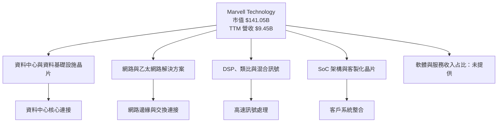
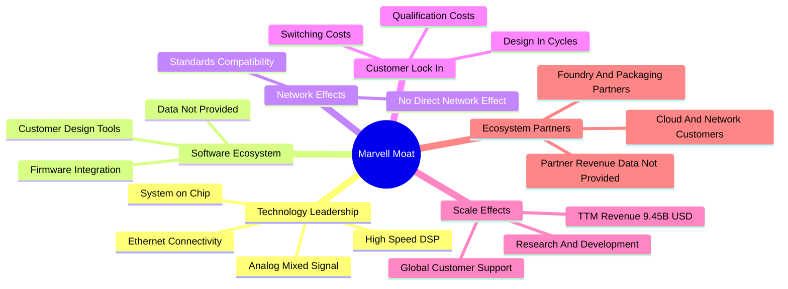
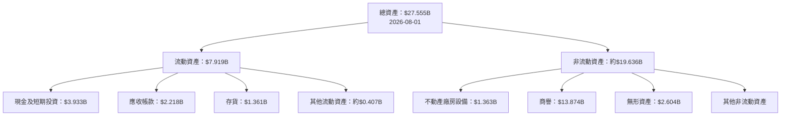
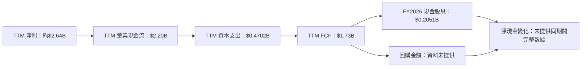
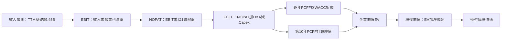
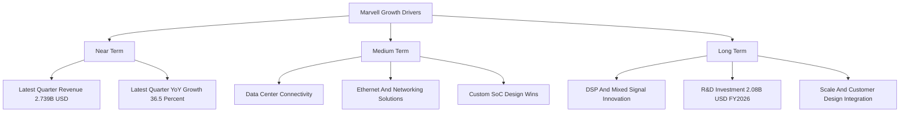
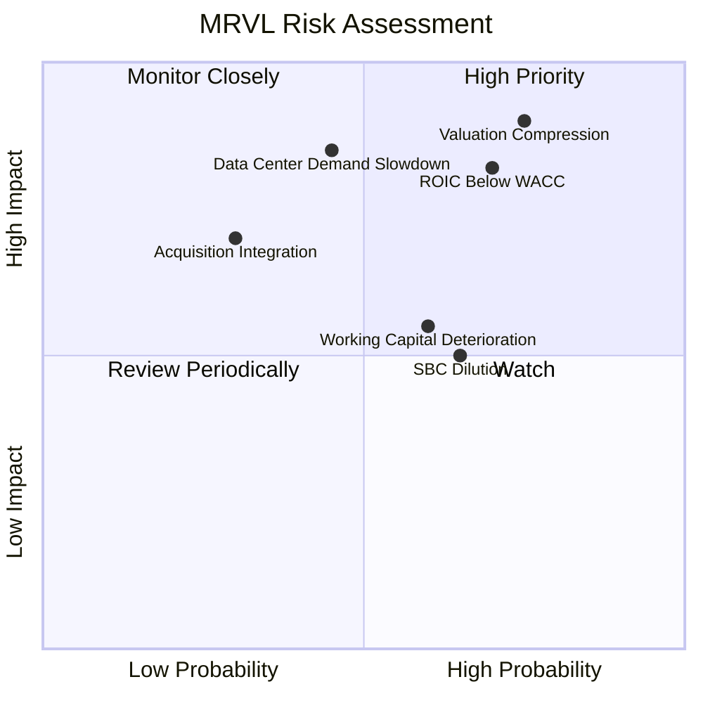
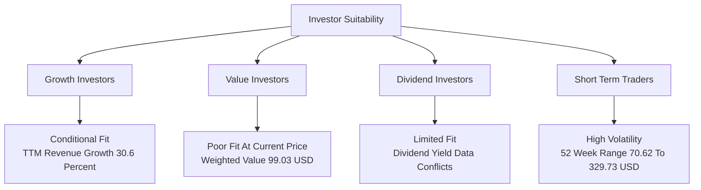

# MRVL 基本面深度分析報告
> **報告日期**：2026-11-16 ｜ **語言**：繁體中文 ｜ **數據來源**：SEC 申報資料 (XBRL)、Yahoo Finance、Finviz、StockAnalysis、Roic.ai ｜ **分析師**：CFA 級機構研究

## 目錄

| # | 章節 | 核心結論 |
|---|------|----------|
| 1 | 執行摘要 | 賣出；加權合理價值 $99.03，MOS -58.3% |
| 2 | 公司概覽與商業模式 | 資料中心與資料基礎設施晶片為核心；市場份額與分部營收未提供 |
| 3 | 損益表深度分析 | TTM 營收 $9.45B，TTM 成長 30.6%；最新一季年增 36.5% |
| 4 | 資產負債表分析 | 淨負債 $1.03B；流動性指標尚可，但現金轉換週期延長 |
| 5 | 現金流量深度分析 | TTM FCF $1.73B，FCF Yield 1.23%；SBC 對股東回報有稀釋 |
| 6 | 獲利能力與資本效率 | ROIC 6.3% 低於 WACC 14.0%，目前未達經濟價值創造門檻 |
| 7 | 相對估值分析 | Forward P/E 21.3x；多數估值方法低於現價 |
| 8 | DCF 內在價值評估 | DCF 基準值 $38.08；加權合理價值 $99.03，低於現價 |
| 9 | 成長催化劑 | 資料中心與客製化晶片需求是重要方向，但 TAM 數據未提供 |
| 10 | 風險矩陣 | 估值、需求週期、競爭與執行風險為主要風險 |
| 11 | 投資建議 | 依 MOS 評級為賣出；以營收成長、利潤率與 FCF 作為監控主軸 |

---

## 1. 執行摘要

### 1.0 一頁式投資儀表板

| 項目 | 內容 |
|------|------|
| **投資論點（3 句）** | ① TTM 營收 $9.45B、TTM 成長 30.6%，最新一季營收年增 36.5%，顯示需求仍在擴張。② TTM FCF 為 $1.73B，但 FCF Yield 僅 1.23%，相對 $156.76 股價的現金收益率有限。③ ROIC 6.3% 低於 WACC 14.0%，而加權合理價值 $99.03 低於現價，估值要求高於當前資本回報能力。 |
| **綜合評分** | **5.8/10**（引用 1.1 六項評分的算術平均） |
| **財務健康** | 🟡 現金及短期投資 $3.93B、總債務 $4.96B，淨負債 $1.03B；流動比率 3.168，但 CCC 由 113 天升至 131 天。 |
| **ROIC vs WACC** | **6.3% vs 14.0%**：目前低於資本成本，資本報酬尚未覆蓋風險要求。 |
| **FCF 趨勢** | TTM FCF $1.73B；FCF Yield **1.23%**。年度 FCF 近年約 $1.02B–$1.39B，現金產生能力正向但收益率不高。 |
| **估值** | Forward P/E **21.328x** ｜ EV/EBITDA（TTM）**48.702x** ｜ FCF Yield **1.23%** |
| **DCF 內在價值（基準）** | **$38.08**；現價相對 DCF 折溢價 **+311.8%**（溢價基準為 DCF 基準值）。 |
| **安全邊際（MOS）** | **-58.3%＝($99.03 − $156.76) ÷ $99.03**；🔴 負安全邊際。基準為第 8.8 節加權合理價值。 |
| **預期報酬（基準估值）** | **-36.8%**＝($99.03 − $156.76) ÷ $156.76；此為加權合理價值相對現價的隱含上行空間，非保證 12 個月報酬。 |
| **關鍵風險（前二）** | ① 現價高於估值方法加權值；② ROIC 低於 WACC，營收成長未充分轉化為資本回報。 |
| **評級 + 信心度** | 🔴 **賣出** ｜ 信心：中。估值輸入含十年營運假設，且資料源存在個別財務欄位差異。 |

### 1.1 綜合評分卡

| 維度 | 評分（1–10） | 主要依據（引用數字與其來源章節） |
|------|--------------|----------------------------------|
| 成長性 | 8.0 | TTM 營收年增 30.6%、最新一季年增 36.5%（第 3 章）；但營收成長仍受半導體週期影響。 |
| 獲利能力 | 6.0 | TTM 營業利益率 16.5%、ROIC 6.3% 低於 WACC 14.0%；Piotroski F-Score 6/9（第 3、6 章）。 |
| 財務健康 | 7.0 | 淨負債 $1.03B、流動比率 3.168；CCC 131 天，高於一年前 113 天（第 4 章）。 |
| 估值 | 2.0 | 加權合理價值 $99.03、MOS -58.3%；P/S 15.3x，高於自身五年中位數 9.9x（第 7、8 章）。 |
| 護城河 | 7.0 | 高速傳輸、DSP、乙太網路與客製化晶片的設計及客戶整合能力具優勢；但市場份額、客戶集中度數據未提供（第 2 章）。 |
| 管理層與資本配置 | 5.0 | FY2026 SBC $590.8M，近四季 SBC 合計約 $828.9M；Piotroski 稀釋股數測試未通過，股東稀釋需留意。 |
| **綜合評分** | **5.8** | 六項算術平均：$(8.0+6.0+7.0+2.0+7.0+5.0)÷6=5.833$，四捨五入至一位小數。 |

### 1.2 五大投資論點 + 三大核心風險

| 類型 | 項目 | 具體依據 | 信心度 |
|------|------|----------|--------|
| 🟢 **投資論點①** | 營收動能仍正向 | TTM 營收 $9.45B、TTM 成長 30.6%；最新一季年增 36.5%。若資料中心及網路基礎設施需求延續，收入增長可能支撐規模效益。 | 🟢 高 |
| 🟢 **投資論點②** | 現金流為正且可觀 | TTM OCF $2.20B、資本支出 $470.20M，形成 TTM FCF $1.73B；具備內部資金支持研發與營運的能力。 | 🟢 高 |
| 🟢 **投資論點③** | 產品技術組合具專業門檻 | 公司提供乙太網路、類比、混合訊號及 DSP 等資料基礎設施解決方案；設計導入及系統整合通常帶來客戶切換成本。 | 🟡 中 |
| 🟡 **投資論點④** | 流動性緩衝足以應付近期營運 | 現金及短期投資 $3.93B，流動比率 3.168；但公司仍有 $1.03B 淨負債。 | 🟡 中 |
| 🟡 **投資論點⑤** | 營業利潤率具正值基礎 | TTM 營業利益率 16.5%，最新一季 16.8%；收入增長若持續且費用不同比例增加，營業槓桿可能改善。 | 🟡 中 |
| 🟡 **風險①** | 估值高於內在價值估計 | 加權合理價值 $99.03，較現價 $156.76 低 36.8%；DCF 基準值 $38.08，模型對長期假設敏感。 | 🔴 高衝擊 |
| 🔴 **風險②** | 資本回報低於資本成本 | ROIC 6.3% vs WACC 14.0%，差距 -7.7 個百分點；若此差距未收斂，增長不一定等於股東價值增加。 | 🔴 高衝擊 |
| 🟡 **風險③** | 營運資金效率下滑及稀釋 | CCC 由 113 天增至 131 天；稀釋股數未通過 F-Score 測試，FY2026 SBC 為 $590.8M。 | 🟡 中高 |

### 1.3 快速統計卡片

| 指標 | 公司實際值（期間） | 同業中位數 | 狀態 |
|------|--------------------|------------|------|
| 營收成長（TTM） | **30.6%** | — | 🟢 |
| 營收成長（最新一季年增） | **36.5%** | **44.7%** | 🟡 |
| 毛利率（TTM） | **52.2%** | **74.7%** | 🔴 |
| 營業利益率（TTM） | **16.5%** | — | 🟡 |
| ROIC（TTM） | **6.3%** | — | 🔴 |
| Forward P/E | **21.328x** | **17.8x** | 🟡 |
| FCF Yield（TTM） | **1.23%** | — | 🔴 |
| Piotroski F-Score | **6 / 9** | — | 🟡 |

> 同業中位數依 AVGO、NVDA、AMD 的已提供倍數或最新一季營收成長計算；毛利率中位數為 74.7%。

### 1.4 投資結論

```text
╔══════════════════════════════════════════════════════════════════╗
║                    📊 投資結論摘要                               ║
╠══════════════════════════════════════════════════════════════════╣
║  評級：🔴 賣出（依 MOS 門檻；未作質化上調或下調）               ║
║  價格（2026-11-13 收盤）：$156.76                                ║
║  DCF 內在價值（基準）：$38.08（現價相對 DCF 溢價 +311.8%）       ║
║  安全邊際 MOS：-58.3%（($99.03−$156.76)÷$99.03）                ║
║  加權合理價值（8.8）：$99.03                                     ║
║  DCF 情境價值：                                                   ║
║    悲觀情境：$19.28（-87.7%）                                    ║
║    基準情境：$38.08（-75.7%）                                    ║
║    樂觀情境：$72.38（-53.8%）                                    ║
║  綜合評分：5.8/10（引用 1.1）                                    ║
║  適合投資人：能承受高波動、重視半導體成長的長線投資人；           ║
║              不適合以現金殖利率或低估值為主要篩選條件者。         ║
╚══════════════════════════════════════════════════════════════════╝
```

---

## 2. 公司概覽與商業模式

### 2.1 業務結構與收入來源

公司資料顯示 Marvell 提供從資料中心核心到網路邊緣的資料基礎設施半導體，並具備 SoC、類比、混合訊號及數位訊號處理能力。財務資料沒有分部營收或各業務占比，因此不將收入拆分為未經披露的比例。



營收絕大部分為半導體解決方案，但各子業務收入、軟體與服務收入占比未提供，故無法計算細項營收占比。

### 2.2 市場份額

市場份額數據未提供，因此不繪製份額圖或填寫比例。Marvell TTM 營收為 $9.45B、TTM 成長 30.6%，規模低於大型平台型半導體公司，但最新一季營收年增 36.5%，高於 AMD 的 44.7% 之前值？實際比較顯示低於 AMD 44.7%、遠低於 AVGO 85.5% 與 NVDA 105.9%；成長仍快，但同業間差異明顯。

### 2.3 競爭護城河分析



### 2.4 護城河強度

| 護城河項目 | 強度（強／中／弱） | 證據（引用數字或事實） | 會削弱它的情況 |
|------------|--------------------|------------------------|----------------|
| 技術與產品組合 | 中至強 | 涵蓋乙太網路、DSP、類比、混合訊號及 SoC；TTM 營收 $9.45B。 | 競爭者在功耗、頻寬、成本或上市速度上超越。 |
| 客戶鎖定 | 中 | 客戶系統設計、驗證和量產導入可能形成切換成本；客戶留存與設計案數據未提供。 | 大客戶改用內部設計或替代供應商。 |
| 軟體生態系 | 中偏弱 | 財務資料未提供軟體或服務收入占比，尚無法驗證其獨立變現能力。 | 軟體支持不足，或新平台生態轉向其他方案。 |
| 網路效應 | 弱 | 晶片使用量本身不必然形成直接網路效應；產業標準可帶來相容性優勢，但不是典型平台網路效應。 | 競爭產品達到相同互通性與性能。 |
| 規模效應 | 中 | FY2026 研發費用 $2.08B，TTM 營收 $9.45B，具備持續研發投入規模。 | 收入放緩而研發及支援成本仍高。 |
| 生態夥伴 | 中 | 公司在多國經營並參與資料基礎設施供應鏈；夥伴收入及份額未提供。 | 供應鏈限制、客戶集中或合作夥伴轉向競爭方案。 |

1.1「護城河」評分為 7.0/10，理由是產品與客戶設計導入有技術和切換成本基礎，但缺少市場份額、客戶留存及分部營收數據驗證。

---

## 3. 損益表深度分析

### 3.1 年度收入成長趨勢（近 4 年）

以年度財務表列示收入，YoY 依年度收入計算。FY2025 財務欄位與另一來源的毛利資料有差異，營收採年度損益表披露值。

```text
╔══════════════════════════════════════════════════════════════════╗
║          Marvell 年度收入趨勢（FY2023–FY2026）                   ║
╠══════════════════════════════════════════════════════════════════╣
║  FY2023  $5.92B  ██████████████░░░░░░░░░░  YoY: +7.5%  🟡       ║
║  FY2024  $5.51B  █████████████░░░░░░░░░░░  YoY: -7.0%  🔴       ║
║  FY2025  $5.77B  ██████████████░░░░░░░░░░  YoY: +4.7%  🟡       ║
║  FY2026  $8.19B  ████████████████████░░░░  YoY: +42.1% 🟢       ║
╠══════════════════════════════════════════════════════════════════╣
║  FY2023–FY2026 CAGR：((8.19÷5.92)^(1/3)−1) = 約 11.4%           ║
╚══════════════════════════════════════════════════════════════════╝
```

FY2026 收入增長明顯加速，年度收入由 $5.77B 增至 $8.19B，年增 42.1%。這與資料中心、網路及客製化晶片需求擴大相符，但單一年度增長不能直接外推為長期增長率；TTM 成長 30.6% 低於 FY2026 年增率，顯示增速需持續觀察。

### 3.2 季度收入趨勢分析

| 季度 | 營收（$B） | QoQ | YoY | 備註 |
|------|------------:|----:|----:|------|
| 2025-11-01 | 2.075 | — | 36.8% | 以 2025-08-02 季營收 $2.006B 為基礎計算 QoQ，約 +3.4%。 |
| 2026-01-31 | 2.219 | +6.9% | 22.1% | YoY 對比 2025-02-01 的 $1.817B。 |
| 2026-05-02 | 2.418 | +9.0% | 27.6% | YoY 對比 2025-05-03 的 $1.895B。 |
| 2026-08-01 | 2.739 | +13.3% | 36.5% | 最新一季；QoQ 按 $2.739B ÷ $2.418B − 1 計算。 |

最新一季營收 QoQ 由此前 9.0% 加快至 13.3%，YoY 為 36.5%。這代表近期收入動能加速，但若後續比較基期提高，年增率可能自然回落，需同時觀察絕對收入與訂單能見度。

### 3.3 利潤率演變分析

| 利潤率指標 | FY2023 | FY2024 | FY2025 | FY2026 | 趨勢 | 評估 |
|------------|--------|--------|--------|--------|------|------|
| 毛利率 | 50.8% | 41.6% | 41.2%* | 51.0% | FY2026 回升 | 🟡 |
| 營業利益率 | 6.1% | -7.9% | -6.4% | 16.4% | FY2026 轉正 | 🟡 |
| 淨利率 | -2.8% | -16.9% | -15.3% | 32.6% | FY2026 顯著改善 | 🟡 |

\* FY2025 毛利來源存在差異：年度損益表列毛利 $2.38B，StockAnalysis 列 $2.74B。表中毛利率採年度損益表列值；FY2026 毛利 $4.18B、收入 $8.19B。年度淨利及營業利益亦採年度損益表列值。FY2026 淨利率受非營業及稅務因素影響，不能視為穩態營運利潤率；因此估值與營運分析較重視 GAAP 營業利益率及現金流。

TTM 營業利益率為 16.5%，最新一季為 16.8%。相較 FY2024–FY2025 的年度營業虧損，改善可能來自收入回升、產品組合變化及營運費用吸收效果；但資料未提供分部毛利及費用拆分，無法將改善精確分解為價格、產品組合或成本控制的各自貢獻。

### 3.4 費用結構分析

費用項目中有明確年度數字的包括研發與資本支出，但公司完整營業費用拆分未在資料中提供；因此不繪製會暗示費用總額占比的圓餅圖。

FY2026 研發費用為 $2.08B，相當於年度營收 $8.19B 的約 25.4%。研發投入支持產品更新與客戶設計導入，但其回報取決於新產品持續量產、收入增長及毛利率維持。

```text
╔══════════════════════════════════════════════════════════════════╗
║              FY2026 已提供費用項目（非完整費用表）               ║
╠══════════════════════════════════════════════════════════════════╣
║  研發費用：$2.08B  |  年度營收：$8.19B  |  研發/營收：約25.4%   ║
║  其他營業費用細項與分部費用：數據未提供                           ║
╚══════════════════════════════════════════════════════════════════╝
```

### 3.5 季度 EPS 趨勢與盈餘品質（Quality of Earnings）

| 季度 | EPS 實際值 | EPS 預期值 | 超預期／不及預期 | 說明 |
|------|-----------:|-----------:|------------------|------|
| 2025-10-31 | $2.20 | N/A | 無法判定 | EPS 估值資料為缺失值；季度淨利與 EPS 來源間可能存在特殊項目差異。 |
| 2026-01-31 | $0.47 | N/A | 無法判定 | 估值一致性資料未提供。 |
| 2026-04-30 | $0.04 | N/A | 無法判定 | EPS 年增資料列為 -80.44%；估值缺失，不能判定是否 beat/miss。 |
| 2026-08-01 | $0.33 | N/A | 無法判定 | EPS 年增 50.0%；估值缺失，不能判定是否 beat/miss。 |

> EPS 估計值欄位為缺失，故不能將四季結果誤稱為超預期或不及預期。最近四季實際 EPS 顯示波動，尤其 2025-10-31 數值與後續季度差距大，盈餘品質分析應避免只看單季 EPS。

| 盈餘品質項目 | 數值／佔比 | 評估 |
|--------------|-----------|------|
| 股權薪酬 SBC / 營收 | 近四季 SBC $828.9M ÷ TTM 營收 $9.45B＝約 **8.8%** | 🟡 佔比不低，長期以股權支付仍會稀釋股東持有比例。 |
| SBC / 營業現金流 | $828.9M ÷ $2.20B＝約 **37.7%** | 🟡 SBC 是非現金費用，但代表經濟稀釋成本；OCF 的一部分須以股東稀釋方式支付。 |
| FCF / 淨利（現金轉換率） | TTM FCF $1.73B；TTM 淨利約 $2.64B，換算約 **65.5%** | 🟡 現金轉換低於 100%；淨利有非現金及營運資金成分，需看跨期表現。 |
| 一次性／非經常性損益 | 季度淨利波動明顯；細項 N/A | 🟡 年度及季度資料顯示獲利波動，無法確認一次性損益的具體金額。 |
| 有效稅率異常 | 12.4%（估值模型採用的最新年度有效稅率） | 🟡 低於一般法定稅率，但資料沒有稅務調節表，不能斷定是否由一次性稅務利益推動。 |
| 資本化支出 vs 費用化 | TTM Capex $470.20M；資本化研發金額 N/A | 🟡 資本支出有提供；研發資本化細項未提供，不能量化潛在遞延成本。 |

**盈餘品質結論**：TTM OCF $2.20B、FCF $1.73B，說明公司有實質現金產生能力；但 FCF/淨利約 65.5%，且 SBC 約為營收 8.8%、OCF 37.7%，GAAP 淨利不能不經調整就等同股東可分配盈餘。估值以 GAAP EBIT 作為 DCF 基礎，已將 SBC 作為費用反映，避免將股權薪酬完全視為免費資金。

---

## 4. 資產負債表分析

### 4.1 資產結構分解



商譽及無形資產合計約 $16.478B，約占總資產 59.8%（依 StockAnalysis 資產明細計算）。這與歷史併購形成的資產基礎相符，但也提高未來若收購資產現金流不如預期時的減損風險。

### 4.2 流動性與營運資金分析

| 流動性指標 | 最新值 | 歷史／比較 | 評估 |
|------------|-------:|-------------|------|
| 流動比率 | 3.168 | 年度表列 2026-01 為流動資產 $6.46B、流動負債 $3.22B | 🟢 短期流動資產覆蓋流動負債充足。 |
| 速動比率 | 2.461 | 來源未提供多期完整序列 | 🟢 排除存貨後仍有流動性緩衝。 |
| 現金及短期投資 | $3.93B | 2026-08-01 | 🟢 可支持營運及投資需求。 |
| 淨負債 | $1.03B | VERIFIED 淨現金／淨負債口徑 | 🟡 淨負債規模不高，但並非淨現金。 |

| 指標 | 最新 TTM | 一年前 TTM | 變化 | 解讀 |
|------|----------|------------|------|------|
| DSO 應收帳款天數 | 86 天 | 73 天 | +13 天 | 🟡 收款週期延長；可能與營收組合、客戶付款條件或期末應收款變化有關。 |
| DIO 存貨天數 | 110 天 | 96 天 | +14 天 | 🟡 存貨占用增加；若需求不及預期，可能帶來存貨調整風險。 |
| DPO 應付帳款天數 | 64 天 | 56 天 | +8 天 | 🟡 付款週期延長有助短期資金，但不宜單獨視為供應商議價能力改善。 |
| CCC 現金轉換週期 | 131 天 | 113 天 | +18 天 | 🟡 資金從採購到回收所需時間增加，對營運資金需求不利。 |

數字採用 QUALITY FIGURES 的程式計算值，未自行重算。CCC 延長主要反映 DSO、DIO 上升幅度大於 DPO 延長，對現金轉換效率形成壓力。

### 4.3 債務結構分析

不同來源的總債務口徑有差異：VERIFIED 財務數據為 $4.96B、其他市場資料列 $5.29B；本報告涉及淨負債及估值時採用 VERIFIED 口徑 $4.96B，避免混用。Debt/EBITDA 與利息保障倍數的同口徑計算資料未完整提供，不自行推算。

```text
╔══════════════════════════════════════════════════════════════════╗
║                    Marvell 債務健康診斷                           ║
╠══════════════════════════════════════════════════════════════════╣
║  總債務（VERIFIED）： $4.96B                                      ║
║  現金+短期投資：     $3.93B                                      ║
║  淨負債：            $1.03B  🟡                                  ║
║  流動比率：          3.168x  🟢                                  ║
║  速動比率：          2.461x  🟢                                  ║
║  Debt/EBITDA：       N/A（同一負債口徑所需 EBITDA 資料未提供）     ║
║  Interest Coverage：N/A（利息費用與同口徑 EBIT 未提供）           ║
║  注意：其他來源總債務 $5.29B，與 VERIFIED 口徑不同。              ║
╚══════════════════════════════════════════════════════════════════╝
```

### 4.4 股東權益趨勢

| 財年 | 股東權益 | YoY 變化 | 解讀 |
|------|---------:|---------:|------|
| FY2023 | $15.64B | — | 財務資料起點。 |
| FY2024 | $14.83B | -5.2% | 權益下降。 |
| FY2025 | $13.43B | -9.4% | 連續下降，受虧損、資本配置及其他權益變動影響。 |
| FY2026 | $14.31B | +6.6% | 權益回升，與年度轉盈一致。 |

```text
╔══════════════════════════════════════════════════════════════════╗
║                 歷年股東權益（年度財務資料）                       ║
╠══════════════════════════════════════════════════════════════════╣
║  FY2023  $15.64B  ████████████████████                           ║
║  FY2024  $14.83B  ███████████████████                            ║
║  FY2025  $13.43B  █████████████████                              ║
║  FY2026  $14.31B  ██████████████████                             ║
╚══════════════════════════════════════════════════════════════════╝
```

---

## 5. 現金流量深度分析

### 5.1 現金流量瀑布圖

淨利與回購金額的 TTM 同期間資料未提供；因此圖表只呈現可確認的 OCF、Capex、FCF 及已知股息支付，不把缺失數字填入流程。



### 5.2 FCF 轉換率趨勢

| 財年 | FCF | 淨利 | FCF / 淨利 | 解讀 |
|------|----:|----:|-----------:|------|
| FY2023 | $1.07B | -$0.164B | 比率不具經濟意義 | 淨利為負，不能以正 FCF 除負淨利作一般轉換率解讀。 |
| FY2024 | $1.02B | -$0.933B | 比率不具經濟意義 | 現金流與淨利方向相反，顯示非現金項目及營運資金可能重要。 |
| FY2025 | $1.39B | -$0.885B | 比率不具經濟意義 | 淨利仍為負，現金流維持正值。 |
| FY2026 | $1.39B | $2.67B | 約 52.1% | 現金流低於會計淨利，盈利需以現金轉換持續驗證。 |

年度數據採現金流量表與損益表列值；TTM FCF 與淨利的轉換率詳見第 3.5 節。

### 5.3 自由現金流趨勢

| 財年 | FCF | YoY | FCF Yield |
|------|----:|----:|---------:|
| FY2023 | $1.07B | — | N/A |
| FY2024 | $1.02B | -4.7% | N/A |
| FY2025 | $1.39B | +36.3% | N/A |
| FY2026 | $1.39B | 約 0.0% | N/A |
| 最新 TTM | **$1.73B** | — | **1.23%** |

```text
╔══════════════════════════════════════════════════════════════════╗
║                    自由現金流趨勢                                ║
╠══════════════════════════════════════════════════════════════════╣
║  FY2023  $1.07B  ████████████░░░░░░░░░                           ║
║  FY2024  $1.02B  ███████████░░░░░░░░░░                           ║
║  FY2025  $1.39B  ███████████████░░░░░                            ║
║  FY2026  $1.39B  ███████████████░░░░░                            ║
║  TTM     $1.73B  ████████████████████                           ║
╠══════════════════════════════════════════════════════════════════╣
║  最新 TTM FCF Yield：1.23%                                       ║
╚══════════════════════════════════════════════════════════════════╝
```

### 5.4 資本配置評估

資本配置總額及回購支出數據未完整提供，故不以推算方式製作占比圓餅圖。

| 資本配置項目 | 可用數據 | 評估 |
|--------------|----------|------|
| 研發 | FY2026 $2.08B | 支持新產品開發；回報取決於設計案轉量產。 |
| 資本支出 | TTM $470.20M | 約占 TTM 營收 5.0%，投入製造、設備及營運能力。 |
| 現金股息 | FY2026 $205.1M | 對比 FY2026 FCF $1.39B，股息支出規模可控。 |
| 股份回購 | 金額未提供 | 無法判定回購是否抵銷 SBC 稀釋。 |
| SBC | FY2026 $590.8M | 金額大於 FY2026 現金股息，構成需關注的股東稀釋成本。 |

---

## 6. 獲利能力與資本效率

### 6.1 ROE / ROA / ROIC 趨勢

| 指標 | FY2026／TTM 可用值 | 歷史趨勢 | 評估 |
|------|-------------------:|----------|------|
| ROE | TTM 14.2%（QUALITY FIGURES） | 市場數據另列 16.5%，口徑存在差異；杜邦核對採 14.2% | 🟡 |
| ROA | TTM 4.1% | FY2026 為正；長期歷史序列未提供 | 🟡 |
| ROIC | TTM 6.3% | 歷史可比序列未提供 | 🔴 相較 14.0% WACC 偏低 |
| 行業均值 | 未提供 | 不列示 | — |

### 6.2 ROIC vs WACC 分析（核心價值創造判斷）

WACC 採用 VERIFIED 成本資本數據的**14.00%**。該區塊列示原始 Beta 2.33、調整後 Beta 1.88，股權成本 14.58%、稅前債務成本 4.08%、權重 E/D 為 96.6%/3.4%；未調整計算值 14.20% 被設定在 7%–14% 區間上限，故採用 14.00%。

```text
╔══════════════════════════════════════════════════════════════════╗
║                   ROIC vs WACC 深度分析                           ║
╠══════════════════════════════════════════════════════════════════╣
║  WACC（採用值）：14.00%                                          ║
║  ├── 無風險利率（10Y美債）：5.15%                                ║
║  ├── ERP：5.00%                                                   ║
║  ├── 原始 Beta：2.33；調整後 Beta：1.88                          ║
║  ├── 股權成本（資料區塊）：14.58%                                ║
║  ├── 稅前債務成本：4.08%；有效稅率：12.4%                        ║
║  ├── 股權／債務權重：96.6%／3.4%                                ║
║  └── 未限制計算 WACC：14.20%；區間限制後採用 14.00%              ║
║                                                                  ║
║  ROIC（TTM）：6.3%                                                ║
║  ROIC − WACC = 6.3% − 14.0% = -7.7 個百分點                    ║
║                                                                  ║
║  ROIC  6.3%   ▓▓▓▓▓▓░░░░░░░░░░░░░░░░░░░░░░                     ║
║  WACC 14.0%   ▓▓▓▓▓▓▓▓▓▓▓▓▓▓░░░░░░░░░░░░                       ║
║  EVA  -7.7pp  🔴 目前未覆蓋資本成本                              ║
╚══════════════════════════════════════════════════════════════════╝
```

ROIC 6.3% 低於 WACC 14.0%，表示依該口徑目前投入資本回報不足以補償資金成本。若收入成長帶動的新增資本回報提升、且 ROIC 持續高於 WACC，才可視為成長轉化為經濟價值；單純營收擴張尚不足以證明價值創造。

### 6.3 杜邦三因素分解

| 因素 | 數值（TTM） | 解讀 |
|------|-------------|------|
| 淨利率 | 27.9% | 淨利率高，但受非營業及稅務項目影響的可能性較大，不應直接等同營業利潤能力。 |
| 資產週轉率 | 0.34 | 資產轉換成收入效率有限，商譽及無形資產規模較大是背景之一。 |
| 權益乘數 | 1.49 | 槓桿不算極端；ROE 主要不是由高財務槓桿推升。 |
| **ROE** | **14.2%** | QUALITY FIGURES 列示：27.9% × 0.34 × 1.49＝14.2%。 |

### 6.4 財務體質：Piotroski F-Score

**Piotroski F-Score：6 / 9**（照抄 QUALITY FIGURES；缺項測試分母依來源計算）。

| 測試 | 結果 | 解讀 |
|------|------|------|
| ROA > 0 | ✅ 通過 | 資產報酬為正。 |
| 營業現金流 > 0 | ✅ 通過 | TTM OCF 為 $2.20B。 |
| ROA 高於一年前 | ✅ 通過 | 資產獲利能力改善。 |
| 營業現金流 > 淨利（應計品質） | ❌ 未通過 | 現金流未高於淨利，需留意會計盈餘與現金盈餘差異。 |
| 長期負債 ÷ 總資產低於一年前 | ✅ 通過 | 槓桿相對改善。 |
| 流動比率高於一年前 | ✅ 通過 | 短期流動性改善。 |
| 稀釋股數未增加 | ❌ 未通過 | 股數增加，SBC 可能稀釋現有股東。 |
| 毛利率高於一年前 | ✅ 通過 | 毛利率改善。 |
| 資產週轉率高於一年前 | ❌ 未通過 | 資產使用效率未改善。 |

6/9 表示基本面訊號混合：現金流、流動性和毛利方向較好，但應計品質、股數稀釋與資產週轉率仍是弱項。

---

## 7. 相對估值分析

### 7.1 同業估值比較表格

公司倍數採市場資料；同業倍數採 Yahoo Finance Peer multiples。MRVL P/E 在不同來源欄位略有差異：本表採市場估值區的 P/E，歷史估值章節則採 VERIFIED 歷史區間中的 P/E。

| 估值指標 | **MRVL** | **AVGO** | **NVDA** | **AMD** | 本公司評估 |
|----------|---------:|---------:|---------:|--------:|-----------|
| **Trailing P/E** | 51.6x | 44.3x | 20.6x | 114.1x | 🟡 介於 NVDA、AMD 之間，略高於 AVGO。 |
| **Forward P/E** | 21.3x | 17.8x | 10.3x | 30.2x | 🟡 高於 AVGO、NVDA，低於 AMD。 |
| **P/S Ratio** | 14.9x | 18.6x | 13.0x | 19.3x | 🟡 接近 NVDA，低於 AVGO、AMD。 |
| **EV/EBITDA（TTM）** | 48.7x | 32.4x | 19.4x | 78.0x | 🔴 高於 AVGO、NVDA，低於 AMD。 |
| **最新一季營收年增** | 36.5% | 85.5% | 105.9% | 44.7% | 🟡 成長低於三家同業。 |
| **毛利率（TTM）** | 52.2% | 75.5% | 74.7% | 56.0% | 🔴 低於全部三家同業。 |

MRVL 的估值不算同業最高，但相對於 36.5% 最新一季營收成長、52.2% 毛利率及 6.3% ROIC，估值仍反映明顯的未來成長預期。由於公司利潤率與同業差異較大，單看 P/E 不足以判斷便宜程度。

### 7.2 歷史估值區間分析

```text
╔══════════════════════════════════════════════════════════════════╗
║                MRVL 五年估值區間（TTM 倍數）                     ║
╠══════════════════════════════════════════════════════════════════╣
║  P/E：        25.6x ───── 中位數 56.5x ───── 現值 51.7x ─ 61.9x ║
║               現值百分位：50%                                    ║
║  P/S：         5.8x ───── 中位數 9.9x ─────── 現值 15.3x ─ 18.3x║
║               現值百分位：85%  🟡偏高                            ║
║  EV/EBITDA：  53.3x ─ 現值 93.2x ─ 中位數 156.4x ───── 730.9x  ║
║               現值百分位：25%                                    ║
╚══════════════════════════════════════════════════════════════════╝
```

P/S 位於自身五年歷史第 85 百分位，反映營收倍數偏高；P/E 百分位 50%，而 EV/EBITDA 百分位 25%。但 EV/EBITDA 歷史區間極寬，且可能受到歷史 EBITDA 低基期影響，不能單獨據此認定便宜。

### 7.3 情境價值（Bear / Base / Bull）

| 情境 | 第 1 年營收成長 | 期末營業利潤率 | WACC | 每股價值 | 相對現價 | 機率 | 會發生的條件 |
|------|----------------|----------------|------|----------:|----------:|-----:|--------------|
| 🔴 悲觀 | 15.0% | 3.4% | 15.00% | $19.28 | -87.7% | 25% | 資料中心及網路晶片成長降速，競爭或產品組合令長期利潤率下滑，風險溢酬偏高。 |
| 🟡 基準 | 30.0% | 4.0% | 14.00% | $38.08 | -75.7% | 50% | 近期成長延續一段時間後逐步衰減，長期營業利潤率向模型所採歷史中位數收斂。 |
| 🟢 樂觀 | 45.0% | 4.4% | 13.00% | $72.38 | -53.8% | 25% | 資料中心與客製化晶片需求加速、成長期延長，市場風險折現率降低。 |

即使樂觀情境，模型價值仍低於 2026-11-13 收盤價 $156.76。此情境結果反映現價需要高於模型基準的成長、利潤率或更低折現率，才能由 DCF 支持。

### 7.4 相對估值隱含價格區間

```text
╔══════════════════════════════════════════════════════════════════╗
║          估值方法回推每股價值與現價（$156.76）                    ║
╠══════════════════════════════════════════════════════════════════╣
║  $38.08 ───── $80.04 ───── $99.03 ───────── $131.03 ── $156.76  ║
║   DCF       EV/EBITDA      加權值          Forward P/E   現價    ║
║  $310.32：分析師共識均值，位於圖示價格區間上方                   ║
╚══════════════════════════════════════════════════════════════════╝
```

- **同業 Forward P/E：$131.03**＝同業中位數 **17.8x** × 公司 Forward EPS **$7.35**。
- **同業 EV/EBITDA：$80.04**＝AVGO、NVDA 同業中位數 **25.9x** × 公司 TTM EBITDA，再加回淨現金／扣除淨負債。
- 上述方法使用同業倍數，而不是 MRVL 自身目前倍數。分析師共識 $310.32 為 40 位分析師平均目標價，與內部現金流模型差距很大，需視為市場情緒及預測分歧的參考，而非獨立現金流證據。

---

## 8. DCF 內在價值評估（Discounted Cash Flow）

### 8.0 估值推理鏈（Thinking Logic）

#### Step 1 — 價值由哪些變數決定？

本模型的核心是：**現有半導體產品現金流 + 資料中心及網路相關產品的後續收入 + 長期利潤率與折現率**。目前可量化的錨點只有 TTM 營收 $9.45B；分部營收占比未提供，因此不能把「資料中心」或「客製化晶片」拆成具體營收百分比。模型敏感度顯示，WACC 與終端成長率會改變價值，但更深層的脆弱環節是十年間收入及利潤率的衰減路徑。

#### Step 2 — 模型選擇

| 決策點 | 本報告採用 | 理由（含數字） | 曾考慮但否決 | 否決理由 |
|--------|-----------|----------------|--------------|----------|
| 現金流定義 | FCFF | 與 WACC 折現並推導 EV 一致。 | FCFE | 資本結構可能改變，且模型指定以 FCFF 為基礎。 |
| 預測期 N | 10 年 | DCF 模型明確列示 FY+1 至 FY+10。 | 5 年 | 不能替換模型既定假設；資料中心產品週期也可能超過單一短期週期。 |
| 終值方法 | Gordon Growth | 模型列示永續成長率 3.0%，且 WACC 14.0% > g。 | 只用退出倍數 | DCF 模型已採 Gordon Growth，且沒有提供 DCF 退出倍數終值值。 |
| EBIT 基礎 | GAAP EBIT | 模型明確採 GAAP 營業利益率。 | 非 GAAP EBIT | 會與指定模型不一致，且 SBC 調整可能重複處理。 |

#### Step 3 — 關鍵假設推導鏈

- **營收成長路徑**：錨點＝TTM 成長 30.6% → 模型把第 1 年成長限制在 30.0%，較 TTM 低 0.6 個百分點，之後線性降至第 10 年 3.0% → **採用第 1 年 30.0%、第 10 年 3.0%** → 曾考慮第 1 年直接採 30.6%，但模型已依規則限制上限為 30.0%，故不替換。
- **營業利潤率**：錨點＝TTM 營業利益率 16.5% → 模型逐年下降至第 10 年 4.0%，反映公司不能永久維持當前利潤率的保守收斂假設 → **採用 16.5% 降至 4.0%** → 曾考慮維持 16.5%，但缺少長期分部利潤率及可持續性證據，否決持平假設。
- **永續成長率 g**：錨點＝模型設定 3.0%，與長期名目經濟成長常見假設區間相近，但不是公司已公布指引 → **採用 3.0%** → 不採用高於 3.0% 的值，因終值會進一步放大且永續增長需低於 WACC。
- **預測期 N**：錨點＝模型設定 10 年；公司有多年研發及客戶設計導入特性 → **採用 10 年** → 不採用 5 年或更長期，避免偏離既定模型且目前缺少足以支持更長可見度的訂單資料。
- **Capex／營收**：錨點＝TTM Capex $470.20M ÷ TTM 營收 $9.45B，約 5.0% → 模型將比率維持在 5.0% → **採用 5.0%** → 不採用更低資本支出率，因公司需維持設備與營運能力，且模型已固定此路徑。
- **D&A／營收**：錨點＝模型採 TTM 比率 13.3% → **採用 13.3% 並維持**；未另調整，因缺少更細資產折舊資料。
- **稅率**：錨點＝最新年度有效稅率 12.4% → **採用 12.4%**；資料未提供完整稅務調節，故不能假設稅率快速回歸更高水準。
- **營運資金變動**：模型明確說明不建模營運資金，故 **未納入 ΔWC**；這可能高估 CCC 延長時的可分配現金流。
- **EBIT 與 SBC**：採用 GAAP EBIT；GAAP EBIT 已將 SBC 列為費用。模型不再另扣 SBC，股數不另行稀釋。**本模型採用 (A)，故 SBC 影響已計入一次。**
- **WACC**：錨點＝成本資本區塊未限制值 14.20%，但因明確限制在 7%–14% 區間內 → **採用 14.00%** → 不採用 14.20%，因區塊指示需遵守區間上限。
- **終值方法**：採 Gordon Growth，因模型已提供第 10 年 FCFF 與 g；不另以未提供的退出倍數替代。

#### Step 4 — 最脆弱環節

最脆弱的環節是長期 GAAP 營業利潤率從 16.5% 降至 4.0% 同時收入仍增至 $42.34B 的路徑；若收入增長較模型低，或利潤率無法按假設演變，DCF 價值會向下偏離，需與 8.6 情境及敏感度矩陣共同檢視。

#### Step 5 — 計算路徑圖



### 8.1 模型假設總表（Model Inputs）

| 假設項目 | 採用值 | 依據／來源 | 敏感度 |
|----------|--------|-------------|--------|
| 預測期長度 N | 10 年 | DCF 模型列示 FY+1 至 FY+10 | 🟡 中 |
| 營收成長 | 第 1 年 30.0%，第 10 年 3.0%，逐年線性下降 | TTM 成長 30.6%，模型第 1 年上限 30.0% | 🔴 高 |
| 營業利潤率（GAAP EBIT） | 第 1 年 16.5% → 第 10 年 4.0% | TTM 營業利益率 16.5%；模型向歷史中位數收斂 | 🔴 高 |
| 有效稅率 | 12.4% | 最新年度有效稅率 | 🟢 低 |
| Capex / 營收 | 5.0% | 模型固定值；TTM Capex $470.20M、TTM 營收 $9.45B，約 5.0% | 🟡 中 |
| D&A / 營收 | 13.3% | 模型採 TTM 比率並固定 | 🟢 低 |
| 營運資金變動 | 不建模 | DCF MODEL 明確排除 working capital | 🟡 中 |
| EBIT 基礎 | GAAP EBIT | 模型明確指定 GAAP | 🟡 中 |
| SBC 處理 | 已包含於 GAAP EBIT，不再扣除 | 模型指定組合 A | 🟡 中 |
| 年稀釋率 | 0%（模型固定股數） | 組合 A 規則，模型不另加股數稀釋 | 🟡 中 |
| 永續成長率 g | 3.0% | 模型指定；低於 14.0% WACC | 🔴 高 |
| 終值方法 | Gordon Growth | DCF 模型提供終值公式 | 🔴 高 |
| WACC | 14.00% | 成本資本區塊採用值，計算值 14.20% 受上限限制 | 🔴 高 |

模型使用 FCFF：**FCFF = NOPAT + D&A − Capex**；營運資金變動未建模，不含 ΔWC 列。SBC 處理採 (A)：GAAP EBIT 已含 SBC 費用，FCFF 不再減 SBC，股數不再額外稀釋。

### 8.2 折現率推導（WACC）

```text
╔══════════════════════════════════════════════════════════════════╗
║                    WACC 推導（折現率）                           ║
╠══════════════════════════════════════════════════════════════════╣
║  股權成本 Ke（CAPM，採用資料區塊數值）：                         ║
║  ├── 無風險利率 Rf（10Y 美債）：5.15%                            ║
║  ├── 市場風險溢酬 ERP：5.00%                                     ║
║  ├── 原始 Beta：2.33；調整後 Beta：1.88                          ║
║  ├── 規模／國別溢酬：0.00%（未另加）                             ║
║  └── Ke（資料區塊）：14.58%                                      ║
║                                                                  ║
║  債務成本 Kd：                                                   ║
║  ├── 稅前 Kd：4.08%                                              ║
║  ├── 有效稅率：12.4%                                             ║
║  └── 稅後 Kd：4.08% × (1−12.4%) = 3.575%                        ║
║                                                                  ║
║  資本結構：                                                      ║
║  ├── 股權權重 E：96.6%                                           ║
║  ├── 債務權重 D：3.4%                                            ║
║  ├── 成本資本區塊未限制計算值：14.20%                            ║
║  └── 區間限制後採用 WACC：14.00%                                 ║
╚══════════════════════════════════════════════════════════════════╝
```

原始 Beta 2.33 高於 1.5，故採用調整後 Beta **1.88**，其調整方式為三分之二原始 Beta 加三分之一。資料沒有提供無風險利率觀測日期、利息費用及平均計息負債明細，因此依指示直接採用成本資本區塊提供的股權成本、債務成本及權重，不另建一套 WACC。該區塊的組成值以四捨五入呈現時，可能與未四捨五入後的 14.20% 計算值略有差異；最終折現率固定採用 14.00%，與第 6.2 節相同。

### 8.3 逐年自由現金流預測（基準情境）

金額單位為 $B；折現因子照抄 DCF 模型。模型不包含 ΔWC，因此不另列該項。表中數字照抄模型輸出，受顯示精度影響，各列以已公布模型值呈現。

| 年度 | FY+1 | FY+2 | FY+3 | FY+4 | FY+5 | FY+6 | FY+7 | FY+8 | FY+9 | FY+10 |
|------|-----:|-----:|-----:|-----:|-----:|-----:|-----:|-----:|-----:|------:|
| 營收 | 12.29 | 15.60 | 19.35 | 23.41 | 27.62 | 31.77 | 35.58 | 38.78 | 41.11 | 42.34 |
| 營收 YoY | 30.0% | 27.0% | 24.0% | 21.0% | 18.0% | 15.0% | 12.0% | 9.0% | 6.0% | 3.0% |
| 營業利潤率 | 16.5% | 15.1% | 13.7% | 12.4% | 11.0% | 9.6% | 8.2% | 6.8% | 5.4% | 4.0% |
| EBIT（GAAP） | 2.03 | 2.36 | 2.66 | 2.89 | 3.03 | 3.04 | 2.91 | 2.64 | 2.22 | 1.70 |
| − 稅 | (0.25) | (0.29) | (0.33) | (0.36) | (0.37) | (0.38) | (0.36) | (0.33) | (0.27) | (0.21) |
| = NOPAT | 1.78 | 2.07 | 2.33 | 2.53 | 2.65 | 2.67 | 2.55 | 2.31 | 1.95 | 1.49 |
| + D&A | 1.64 | 2.08 | 2.58 | 3.12 | 3.69 | 4.24 | 4.75 | 5.18 | 5.49 | 5.65 |
| − Capex | (0.61) | (0.78) | (0.96) | (1.16) | (1.37) | (1.58) | (1.77) | (1.93) | (2.05) | (2.11) |
| − SBC | 不另扣 | 不另扣 | 不另扣 | 不另扣 | 不另扣 | 不另扣 | 不另扣 | 不另扣 | 不另扣 | 不另扣 |
| **= FCFF** | **2.81** | **3.38** | **3.95** | **4.49** | **4.97** | **5.33** | **5.53** | **5.56** | **5.39** | **5.04** |
| 折現因子 @14.00% | 0.877 | 0.769 | 0.675 | 0.592 | 0.519 | 0.456 | 0.400 | 0.351 | 0.308 | 0.270 |
| **FCFF 現值 PV** | **2.46** | **2.60** | **2.67** | **2.66** | **2.58** | **2.43** | **2.21** | **1.95** | **1.66** | **1.36** |

預測期現值合計按 DCF 模型輸出為 **$22.57B**。表格顯示的各年 PV 以兩位小數相加為 $22.58B，與模型未四捨五入的合計相差 $0.01B，屬顯示精度差異；估值橋接依模型合計 $22.57B。

**逐步演算（FY+1，使用模型顯示精度）**

1. 營收＝TTM 營收 $9.45B × (1 + 30.0%)＝**$12.29B**（模型採未四捨五入中間值）。
2. EBIT＝$12.29B × 16.5%＝**$2.03B**。
3. 稅＝$2.03B × 12.4%＝**$0.25B**。
4. NOPAT＝$2.03B − $0.25B＝**$1.78B**。
5. D&A＝$12.29B × 13.3%＝**$1.64B**。
6. Capex＝$12.29B × 5.0%＝**$0.61B**。
7. ΔWC＝模型未納入；SBC 不再扣除。
8. FCFF＝$1.78B + $1.64B − $0.61B＝**$2.81B**。
9. 折現因子＝1 ÷ (1 + 14.00%)¹＝**0.877**；PV＝$2.81B × 0.877＝**$2.46B**。

> 上述等式使用模型列示的四捨五入數字；未四捨五入中間值由模型生成，故個別乘法在兩位小數下可能有 $0.01B 尾差。模型表中列示值與合計以 DCF MODEL 為準。

**合理性自檢**

- 預測 FCFF 由 FY+1 的 $2.81B 增至 FY+10 的 $5.04B；由首末值計算的九年年化增長約 6.7%。資料未提供可直接比較的同口徑歷史多年 FCF CAGR，故歷史 CAGR 對照為 N/A。
- FY+10 FCF 利潤率＝$5.04B ÷ $42.34B＝約 **11.9%**；目前 TTM FCF 利潤率＝$1.73B ÷ $9.45B＝約 **18.3%**。同業最佳 FCFF 利潤率未提供，不能進行同業最佳比較。
- 模型各年 FCFF 均為正；但 FY+6 至 FY+10 的 EBIT 下降，是利潤率下滑速度快於收入增長所致。

```text
╔══════════════════════════════════════════════════════════════════╗
║              自由現金流：歷史實際 vs 模型預測                    ║
╠══════════════════════════════════════════════════════════════════╣
║  FY2024(實)  $1.02B  ████░░░░░░░░░░░░░░░░                       ║
║  FY2025(實)  $1.39B  █████░░░░░░░░░░░░░░░                       ║
║  FY2026(實)  $1.39B  █████░░░░░░░░░░░░░░░                       ║
║  FY+1 (預)   $2.81B  ██████████░░░░░░░░░░                       ║
║  FY+10(預)   $5.04B  ████████████████████                       ║
╠══════════════════════════════════════════════════════════════════╣
║  預測 FCF 上升依賴 D&A 高於 Capex 的模型假設；                   ║
║  需留意高 D&A/營收比率是否能長期維持。                            ║
╚══════════════════════════════════════════════════════════════════╝
```

### 8.4 終值計算（Terminal Value）

**適用性檢查**：`WACC 14.00% vs g 3.00% → WACC > g？✅`

| 方法 | 計算式 | 終值 TV | TV 現值 | 佔總 EV 比重 |
|------|--------|---------|---------|--------------|
| Gordon Growth | $5.04B × (1+3.0%) ÷ (14.0%−3.0%) | $47.17B | $12.72B | 36.0% |
| 退出倍數法 | DCF 模型未提供退出倍數終值 | N/A | N/A | N/A |

**逐步演算（採 DCF 模型列示值）**

1. FY+10 FCFF＝**$5.04B**。
2. 分子＝$5.04B × (1 + 3.0%)＝模型列示結果約 **$5.19B**。
3. 分母＝14.00% − 3.00%＝**11.00%**；模型列示 TV＝**$47.17B**。
4. PV(TV)＝模型列示 **$12.72B**。
5. 終值占 EV＝$12.72B ÷ $35.29B＝**36.0%**（模型列示）。

模型未提供另一種退出倍數終值，依 VERIFIED FIGURES 規則不另建模型。以表格顯示數字重算時，因中間值四捨五入可能與模型原始精度有尾差；後續橋接採 DCF 模型的 $47.17B、$12.72B 與 $35.29B。

### 8.5 企業價值 → 每股內在價值（Bridge）

```text
╔══════════════════════════════════════════════════════════════════╗
║              企業價值 → 每股內在價值 橋接表                      ║
╠══════════════════════════════════════════════════════════════════╣
║  預測期 FCF 現值合計              +$22.57B                       ║
║  終值現值 PV(TV)                  +$12.72B                       ║
║  ─────────────────────────────────────────────                  ║
║  = 企業價值 EV                     $35.29B                       ║
║  + 淨現金（負值代表淨負債）       −$1.03B                        ║
║  = 股權價值                        $34.26B                       ║
║  每股價值：模型使用股權價值 × 價格 ÷ 市值                         ║
║  ★ DCF 基準每股內在價值            $38.08                         ║
║    當前股價（2026-11-13 收盤）     $156.76                        ║
║    折溢價（現價÷DCF內在價值−1）    +311.8%（溢價）               ║
╚══════════════════════════════════════════════════════════════════╝
```

逐步橋接（採模型數值）：

1. **EV**＝$22.57B + $12.72B＝**$35.29B**。
2. **股權價值**＝$35.29B − $1.03B 淨負債＝**$34.26B**。
3. **每股內在價值**＝依 DCF 模型所列公式「股權價值 × 價格 ÷ 市值」＝**$38.08**。模型內含稀釋股數口徑；DCF 輸出使用此每股值，不以其他來源股數重算。
4. **折溢價**＝$156.76 ÷ $38.08 − 1＝**+311.8%**。
5. **本節不計算 MOS**；MOS 僅以 8.8 加權合理價值為分母，避免混淆。

**股數與資產負債表口徑**：模型按指定「股權價值 × 價格 ÷ 市值」公式將股權價值換算為每股價值。財報最新期間為 2026-08-01；現金及短期投資 $3.93B、總債務 $4.96B，模型淨現金口徑列為 -$1.03B。DCF 固定股數、零額外稀釋，與組合 (A) 一致。

### 8.6 敏感性分析（WACC × 永續成長率）

以下每股價值照抄 DCF 模型；括號為相對現價 $156.76 的上行空間。基準格為 WACC 14.0%、g 3.0%。

| g（列）／WACC（欄） | 12.00% | 13.00% | **14.00%（基準）** | 15.00% | 16.00% |
|-----------|------:|------:|-------------------:|------:|------:|
| 2.0% | $44.69 (-71.5%) | $40.38 (-74.2%) | $36.78 (-76.5%) | $33.73 (-78.5%) | $31.11 (-80.2%) |
| 2.5% | $45.75 (-70.8%) | $41.18 (-73.7%) | $37.40 (-76.1%) | $34.22 (-78.2%) | $31.50 (-79.9%) |
| **3.0%（基準）** | $46.93 (-70.1%) | $42.07 (-73.2%) | **$38.08 (-75.7%)** | $34.75 (-77.8%) | $31.92 (-79.6%) |
| 3.5% | $48.25 (-69.2%) | $43.05 (-72.5%) | $38.83 (-75.2%) | $35.33 (-77.5%) | $32.38 (-79.3%) |
| 4.0% | $49.74 (-68.3%) | $44.14 (-71.8%) | $39.65 (-74.7%) | $35.95 (-77.1%) | $32.87 (-79.0%) |

矩陣是程式提供的 5×5 價格結果。本節不自行重建模型現金流或重算敏感度格；其表中所有格子均為 WACC 高於 g 的有效格。

**三情境 DCF（照抄模型輸出）**

| 情境 | 第 1 年營收成長 | 期末營業利潤率 | WACC | 每股內在價值 | 相對現價 | 機率 |
|------|----------------:|----------------:|-----:|--------------:|---------:|-----:|
| 🔴 悲觀 | 15.0% | 3.4% | 15.00% | $19.28 | -87.7% | 25% |
| 🟡 基準 | 30.0% | 4.0% | 14.00% | $38.08 | -75.7% | 50% |
| 🟢 樂觀 | 45.0% | 4.4% | 13.00% | $72.38 | -53.8% | 25% |
| **機率加權** | — | — | — | **$41.95** | **-73.2%** | **100%** |

DCF MODEL 僅提供情境假設與每股價值，沒有提供每個情境的逐年營收、FY+N FCFF 與終值拆解；依規則不自行重建或補造各情境中間值。情境成立條件分別是需求低於基準、基準路徑延續，或收入成長與資本成本同時向有利方向變化。

**敏感度結論（直接對照已提供矩陣）**

- g 每增加 1 個百分點，於 WACC 14% 時：$36.78 → $38.83，增加 **$2.05**，約 **5.6%**（以 $36.78 為基準）。
- WACC 每增加 1 個百分點，於 g 3% 時：$38.08 → $34.75，減少 **$3.33**，約 **8.7%**（以 $38.08 為基準）。
- 期末營業利潤率每增加 1 個百分點的獨立彈性：DCF MODEL 未提供，不自行另算。
- 在已提供矩陣中，WACC 每 1 個百分點變動造成的價格差異大於 g 每 1 個百分點變動；而模型中營收與利潤率路徑也可能是主要營運變數，這與 8.0 指出的「長期收入／利潤率路徑」一致，但缺少其單變量敏感度數值。

### 8.7 反推 DCF（Reverse DCF：市場在預期什麼）

反推模型固定基準輸入時，只能逐次解一個變數。DCF 模型已提供兩個單變數反推結果；未提供營收 CAGR 試算軌跡或其他變數的完整反推解，故不補造。

| 求解的變數（一次一個） | 其餘變數設定 | 市場隱含值（令 DCF = 現價） | 公司歷史實際 | 判斷 |
|------------------------|--------------|------------------------------:|--------------|------|
| 第 1 年營收成長 | 其餘基準假設固定 | 75.0% | TTM 成長 30.6%；基準模型第 1 年 30.0% | 🔴 顯著高於當前增長速度 |
| 固定營業利潤率 | 其餘基準假設固定 | 58.7% | TTM 營業利益率 16.5% | 🔴 遠高於目前水準 |
| 永續成長率 g | 模型未提供解 | 未計算 | — | N/A |
| 預測期 N | 模型未提供解 | 未計算 | 模型基準 10 年 | N/A |

模型已列出的兩個反推解說明：若其他輸入保持基準，單靠收入增長或固定營業利潤率來支撐現價，需要遠高於目前財務數據的假設。模型未提供求解軌跡，因此不宣稱其為可獨立複現的試算結果。

### 8.8 估值三角驗證與安全邊際

| 估值方法 | 隱含每股價值 | 上行空間（÷現價） | 權重 | 說明 |
|----------|--------------:|------------------:|-----:|------|
| DCF（基準） | $38.08 | -75.7% | 40% | 10 年 FCFF、WACC 14.00%、永續成長率 3.0%。 |
| 同業 Forward P/E | $131.03 | -16.4% | 25% | 同業中位數 17.8x × 公司 Forward EPS $7.35。 |
| 同業 EV/EBITDA | $80.04 | -48.9% | 25% | AVGO、NVDA 同業中位數 25.9x × TTM EBITDA，並調整淨負債。 |
| 分析師共識目標價 | $310.32 | +98.0% | 10% | 40 位分析師平均目標價；作為參考，不主導內在價值。 |
| **加權合理價值** | **$99.03** | **-36.8%** | **100%** | 估值方法權重依公司類型 profitable 固定。 |

**加權計算：**

$38.08×40% + $131.03×25% + $80.04×25% + $310.32×10%  
$=15.232+32.7575+20.010+31.032=\mathbf{99.0315}$，四捨五入至美分為 **$99.03**。

公司類型為 profitable，故採用既定四種方法及權重；沒有方法因缺值被剔除。價值加總後不作額外折讓或調整。

```text
╔══════════════════════════════════════════════════════════════════╗
║                  估值區間與安全邊際                              ║
╠══════════════════════════════════════════════════════════════════╣
║  $19.28 ── $38.08 ── $99.03 ─────────── $156.76 ── $310.32     ║
║  悲觀DCF    基準DCF   加權合理值          現價      分析師共識    ║
║                                                                  ║
║  MOS = ($99.03−$156.76)÷$99.03 = -58.3%                         ║
║  上行空間 = ($99.03−$156.76)÷$156.76 = -36.8%                  ║
║  折溢價（相對 DCF $38.08）= $156.76÷$38.08−1 = +311.8%          ║
║                                                                  ║
║  建議買入區間：不建議現價追買；若以 MOS ≥10% 為門檻，            ║
║  價格需 ≤ $99.03×(1−10%) = $89.13。                              ║
╚══════════════════════════════════════════════════════════════════╝
```

> 🔎 **程式複算（Python，依本節各項自動重算）**
>
> 加權合理價值 = $38.08 × 40% + $131.03 × 25% + $80.04 × 25% + $310.32 × 10% = **$99.03**（權重合計 100%）
>
> 以價格 $156.76 計：MOS = **-58.3%**，上行空間 = **-36.8%**
>
> ✅ 與本節所寫數值一致。

### 8.9 DCF 模型的局限與失效條件

- **終值依賴度**：PV(TV) 占 EV **36.0%**，約三分之一企業價值來自預測期後現金流；雖非極端高占比，仍受 g 與 WACC 影響。
- **最脆弱假設**：第一，營收從第 1 年 30.0% 線性降至第 10 年 3.0%；第二，營業利潤率從 16.5% 降至 4.0%，而 D&A／營收維持 13.3%。若這些路徑不成立，估值方向將隨收入、現金流與利潤率偏離而改變。
- **模型局限**：未建模營運資金變化，而 CCC 已升至 131 天；若營運資金占用增加，FCFF 可能低於模型。另 SBC 以 GAAP EBIT 處理，但股數固定，沒有預測未來稀釋。
- **資料口徑限制**：總債務在不同來源分別列 $4.96B 與 $5.29B；年度毛利、季度 EPS 也存在來源差異。估值依 VERIFIED 數據口徑，但資料品質仍降低信心。
- **替代方法**：若 DCF 因獲利波動或高再投資而失真，可交叉參照 EV/Sales、同業 Forward P/E、EV/EBITDA，並以分部估值（SOTP）處理各產品線；目前沒有足夠分部數據完成 SOTP。
- **與第 10 章風險連結**：資料中心需求低於預期會壓低營收成長；競爭或產品組合惡化會壓低 GAAP 營業利潤率；高利率或風險溢酬上升會推高 WACC；CCC 延長會使未建模的營運資金需求增加。

### 8.10 複算檢核表（Audit Trail）

| # | 檢核項目 | 檢查方式 | 結果 |
|---|----------|----------|------|
| 1 | 所有 🔴 高／🟡 中敏感度輸入有推導 | 對照 8.0 Step 3 與 8.1；WACC 組成於 8.2 說明，模型以 GAAP 與固定股數處理 | ✅ |
| 2 | 每個假設有來歷 | 8.1 依據欄逐項列示；未提供項目標明未建模或 N/A | ✅ |
| 3 | WACC 五步算式及乘加檢查 | WACC 採區塊指定值 14.00%；底層組成數值受四捨五入與上限限制 | ⚠️ 採用值已依指定上限處理 |
| 4 | Kd 分母與債務權重 D 同範圍 | 平均計息負債明細未提供，依指定成本資本區塊直接採用 | ⚠️ 原始明細未提供 |
| 5 | WACC 與第 6.2 節同值 | 兩處均為 14.00% | ✅ |
| 6 | 逐年欄位數等於 N、無省略 | FY+1 至 FY+10 共 10 欄 | ✅ |
| 7 | FY+1 代表年度算式 | 以模型顯示值示範；中間值未四捨五入可能產生尾差 | ⚠️ 保留模型原始輸出 |
| 8 | 預測期 PV 加總 | 表列兩位小數相加 $22.58B；模型原始精度合計 $22.57B | ⚠️ $0.01B 顯示精度差異，橋接採模型值 |
| 9 | WACC > g | 14.00% > 3.00% | ✅ |
| 10 | 終值以 FY+N FCFF 為基礎並折現 N 期 | 第 10 年 FCFF $5.04B、折現因子 0.270 | ✅ |
| 11 | 橋接 EV 至每股價值 | $22.57B + $12.72B = $35.29B；扣淨負債得 $34.26B；每股值照模型 | ✅ |
| 12 | SBC 三要素相容 | GAAP EBIT、不另扣 SBC、固定股數 | ✅ 組合 A |
| 13 | 敏感矩陣基準格與 DCF 基準值一致 | g 3.0%、WACC 14.0% 為 $38.08 | ✅ |
| 14 | 矩陣有效格 | 所有矩陣格 WACC 均大於 g | ✅ |
| 15 | 三情境機率加總 | 25% + 50% + 25% = 100% | ✅ |
| 16 | 反推每列只放開一個變數 | 採模型已提供的單變數結果；未補造試算軌跡 | ⚠️ 軌跡未提供 |
| 17 | MOS 基準、折溢價基準 | MOS 用 $99.03；折溢價用 DCF $38.08 | ✅ |
| 18 | 報告完整至第 11 章 | 章節 1–11 全部列示 | ✅ |
| 19 | 加權合理價值等於加權加總 | 算式合計 $99.0315，列示 $99.03 | ✅ |
| 20 | 評級符合 MOS 門檻 | MOS -58.3% < -25%，評級賣出 | ✅ |

差異說明：DCF 表格使用已四捨五入的年度現值加總為 $22.58B，但模型總和列 $22.57B；依 VERIFIED 數值優先原則，保留模型 $22.57B，不用已四捨五入數字替換模型值。部分未提供的原始模型中間值及反推試算軌跡，已標示而未自行補造。

---

## 9. 成長催化劑

### 9.1 催化劑時間軸

資料提供營收與季度期間，但沒有公司訂單、產品出貨時程或管理層財測日期，故不繪製帶有推測日期的 Gantt 圖。可追蹤的時間框架如下：

| 時間框架 | 可追蹤催化劑 | 可量化依據 |
|----------|--------------|------------|
| 近期：未來數季 | 最新季度收入增長能否延續、產品需求能否轉化為現金流 | 最新一季營收 $2.739B、YoY +36.5%、QoQ +13.3%。 |
| 中期：未來 1–3 年 | 資料中心、網路與客製化晶片產品能否擴大量產及改善產品組合 | 公司未提供各業務分部營收，需觀察總收入與毛利率。 |
| 長期：3 年以上 | 研發投入能否形成穩定設計導入及高附加價值產品 | FY2026 研發費用 $2.08B；分部研發回報未提供。 |

### 9.2 TAM 市場規模分析

**N/A（TAM 數據未提供）**。MRVL TTM 營收 $9.45B、TTM 成長 30.6%，表明目前業務已有一定規模且仍在擴張；但沒有可引用的市場規模與滲透率資料，不能估算市場占有率或 TAM。

### 9.3 成長驅動力結構圖



---

## 10. 風險矩陣

### 10.1 風險評分矩陣

以下機率與衝擊座標為分析師主觀排序，不是公司披露的財務預測；圖表使用英文標籤以符合 quadrantChart 語法要求。



### 10.2 風險清單詳細分析

| # | 風險項目 | 發生機率 | 財務衝擊 | 風險評分 | 緩解措施 |
|---|----------|----------|----------|----------|----------|
| 1 | 🔴 **估值壓縮** | 中高（主觀） | 若估值向加權合理價值 $99.03 收斂，較現價低 36.8%；DCF 基準值更低 | 🔴 9/10 | 分批建倉；以收入、營業利益率與 FCF 驗證估值，不單靠分析師目標價。 |
| 2 | 🔴 **ROIC 持續低於 WACC** | 中高（主觀） | ROIC 6.3% 對比 WACC 14.0%，差距 -7.7 個百分點 | 🔴 8/10 | 追蹤 ROIC、營業利益率和新增投資回報是否改善。 |
| 3 | 🔴 **資料中心及網路需求放緩** | 中（主觀） | TTM 成長 30.6%、最新一季年增 36.5%；若需求減速，收入基礎及倍數都可能承壓 | 🔴 8/10 | 監測季度營收、管理層財測及毛利率；不以單季年增率外推長期成長。 |
| 4 | 🟡 **營運資金惡化** | 中（主觀） | CCC 由 113 天升至 131 天；模型未納入 ΔWC，現金流可能低於 DCF | 🟡 6/10 | 追蹤 DSO、DIO、CCC 及應收帳款和存貨變化。 |
| 5 | 🟡 **SBC 與股數稀釋** | 中（主觀） | 近四季 SBC 約 $828.9M，約占 TTM 營收 8.8%；F-Score 稀釋股數測試未通過 | 🟡 6/10 | 比較 SBC、回購與稀釋後股數變化，避免只看 GAAP 每股盈餘。 |
| 6 | 🟡 **供應鏈／地緣政治風險** | 中（主觀） | 公司跨多國營運；特定地區收入及供應鏈依賴數據未提供 | 🟡 7/10 | 追蹤出口限制、供應商集中及產品替代安排。 |

---

## 11. 投資建議

### 11.1 最終評級與評分

依 8.8 加權合理價值 $99.03 計算，MOS 為 -58.3%，低於賣出門檻 -25%，因此最終評級為 **🔴 賣出**，未依質化因素調整一級。公司綜合評分為 **5.8/10**，六項分數依序為成長性 8.0、獲利能力 6.0、財務健康 7.0、估值 2.0、護城河 7.0、管理層與資本配置 5.0。

### 11.2 合理價值與隱含報酬率

| 方法／情境 | 每股價值 | 相對 2026-11-13 收盤價 $156.76 | 機率 |
|------------|---------:|--------------------------------:|-----:|
| 加權合理價值 | **$99.03** | **-36.8%** | — |
| 🔴 悲觀 DCF | $19.28 | -87.7% | 25% |
| 🟡 基準 DCF | $38.08 | -75.7% | 50% |
| 🟢 樂觀 DCF | $72.38 | -53.8% | 25% |
| DCF 機率加權值（參考） | $41.95 | -73.2% | 100% |

加權合理價值混合 DCF、同業 Forward P/E、同業 EV/EBITDA 及分析師共識。三種 DCF 情境均低於現價，表示以目前模型假設，現價包含相當高的成長預期。

### 11.3 買入時機與觸發因素

```text
╔══════════════════════════════════════════════════════════════════╗
║                  ✅ 投資觸發因素 Checklist                        ║
╠══════════════════════════════════════════════════════════════════╣
║  目前策略：不建議在 $156.76 追買；評級為賣出。                    ║
║                                                                  ║
║  轉為重新評估的條件（須綜合觀察）：                              ║
║  ☐ 股價回落至 $89.13 或以下，對應加權價值下至少 10% MOS。          ║
║  ☐ 營收維持正成長，且成長不只由單一季度或基期效應推動。           ║
║  ☐ 營業利益率改善，ROIC 與 WACC 差距逐步收斂。                    ║
║  ☐ FCF 持續為正，且 CCC、DSO、DIO 不再持續惡化。                 ║
║                                                                  ║
║  加碼觸發條件：                                                    ║
║  ☐ 價格進入 MOS ≥10% 的估值範圍，且營運指標未惡化。               ║
║  ☐ 最新季度營收與營業利益率同時支持管理層的成長敘事。              ║
║                                                                  ║
║  減碼／停損觸發條件：                                              ║
║  ☐ 連續兩季營收年增轉為負值。                                     ║
║  ☐ TTM FCF 轉負，或 CCC 進一步明顯延長。                           ║
║  ☐ ROIC 長期低於 14.0% WACC，且營業利潤率無改善跡象。              ║
╚══════════════════════════════════════════════════════════════════╝
```

$89.13 為按加權合理價值 $99.03 反推 MOS 10% 的價格門檻：$99.03 × (1−10%)＝$89.127，四捨五入為 $89.13；這是估值門檻，不代表保證的價格支撐。

### 11.4 投資人適配度分析



- **成長型投資人**：有條件適合，TTM 營收成長 30.6%，但估值及資本回報風險高。
- **價值型投資人**：現價不符合加權估值；MOS -58.3%。
- **股息型投資人**：資料中的股息殖利率欄位與股息、派息率資料不一致，且可靠股息殖利率無法確認，不宜僅憑單一欄位判斷。
- **短期交易者**：52 週高低價 $329.73／$70.62，波動幅度大；須控制部位及風險。

### 11.5 每季財報監控清單（Quarterly Watch List）

| 監控指標 | 最新基準 | 觸發加碼的觀察方向 | 觸發減碼的警訊 |
|----------|----------|--------------------|----------------|
| 營收及年增率 | 最新一季 $2.739B；YoY 36.5% | 季度收入延續增長，並非僅靠一次性基期效應。 | 連續兩季 YoY 轉負，或明顯低於目前趨勢且指引下修。 |
| 營業利益率 | TTM 16.5%；最新一季 16.8% | 穩定或改善，且收入成長轉化為營業利益。 | 連續兩季下滑、或較 TTM 水準收縮逾 3 個百分點。 |
| 毛利率 | TTM 52.2% | 毛利率持穩或上升，支持產品組合與定價。 | 明顯低於目前水準，並伴隨營收放緩。 |
| OCF 與 FCF | TTM OCF $2.20B；FCF $1.73B | FCF 持續為正，現金轉換率改善。 | FCF 轉負，或 OCF 持續低於淨利且差距擴大。 |
| Capex | TTM $470.20M | Capex 增長與產能、產品需求相匹配。 | Capex 上升但收入與現金流未跟上。 |
| SBC／股數稀釋 | FY2026 SBC $590.8M；F-Score 稀釋測試未通過 | SBC 占營收下降，或回購足以抵銷稀釋。 | 稀釋股數增加且 SBC 持續高於現金股東回報。 |
| 營運資金 | DSO 86 天、DIO 110 天、CCC 131 天 | DSO、DIO、CCC 持平或下降。 | CCC 繼續上升，且應收與存貨增長快於收入。 |
| ROIC vs WACC | 6.3% vs 14.0% | ROIC 持續提高並向 WACC 收斂。 | ROIC 下滑或長期維持遠低於 14.0%。 |
| 財測與產品需求 | 公司詳細財測未提供 | 後續財測與營收、利潤率數據相互印證。 | 財測下修、產品設計案未轉成量產收入。 |

### 11.6 反面論證：什麼會證明論點錯誤（What Would Change My Mind）

```text
╔══════════════════════════════════════════════════════════════════╗
║              ⚠️ 論點失效條件（Disconfirming Evidence）           ║
╠══════════════════════════════════════════════════════════════════╣
║  本報告的成長論點若出現以下情況，應重新檢視或退出：               ║
║                                                                  ║
║  ☐ 最新季度營收年增連續兩季低於 10%，或轉為負成長。              ║
║  ☐ TTM 營業利益率由目前 16.5% 下滑超過 3 個百分點且無恢復跡象。   ║
║  ☐ TTM FCF 轉負，或營業現金流連續兩季低於資本支出。               ║
║  ☐ ROIC 持續低於 14.0% WACC，且未見改善方向。                     ║
║  ☐ CCC 高於目前 131 天並持續上升，顯示營運資金占用惡化。          ║
║  ☐ SBC 占營收長期維持或高於約 8.8%，且稀釋股數持續增加。          ║
║  ☐ 資料中心、網路或客製化晶片需求沒有轉化為可持續的營收與 FCF。   ║
╚══════════════════════════════════════════════════════════════════╝
```

> **免責聲明**：本報告為 AI 自動生成，僅供研究參考，不構成投資建議。投資有風險，入市需謹慎。

---

## 資料與來源

| 項目 | 內容 |
|------|------|
| 價格 | 156.76 USD，2026-11-13 收盤（Yahoo Finance 日線） |
| 財務報表 | SEC 10-Q filed 2026-08-28，最新季度 2026-08-01（FY2027 Q2） |
| 有回應的資料來源 | SEC 申報資料 (XBRL)、Yahoo Finance、Finviz、StockAnalysis、Roic.ai |
| 由程式計算 | TTM 數字、WACC、DCF 模型、估值方法與權重、加權合理價值、MOS、評級門檻、F-Score、杜邦分解、營運資金天數、綜合評分 |
| 撰寫模型 | openai / gpt-6-luna |

> 本區塊由產生報告的程式依實際取得的資料填寫，非模型撰寫。「由程式計算」的數字不是模型的估計；其餘判斷（評分、情境、策略）是模型的分析。
