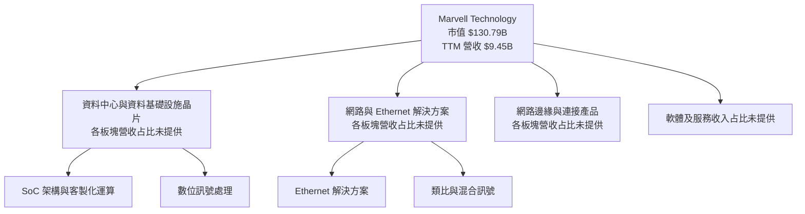
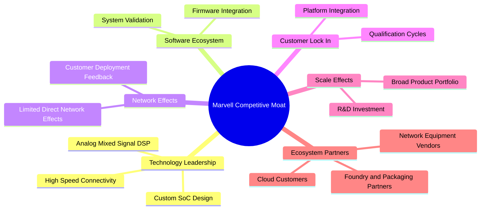
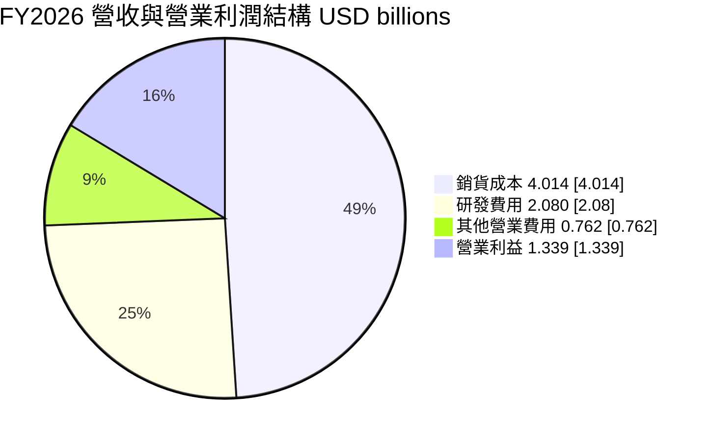
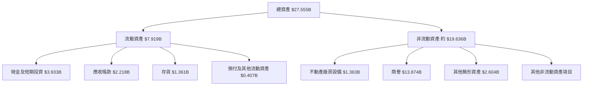
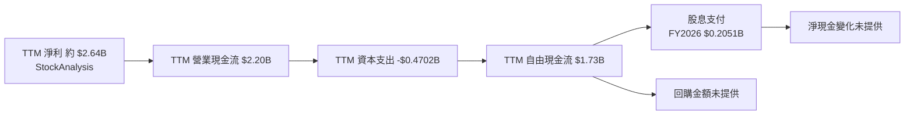
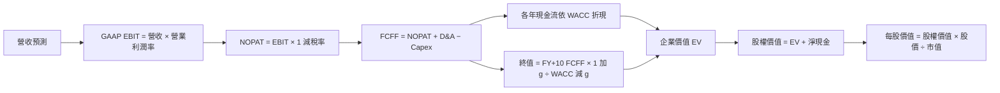
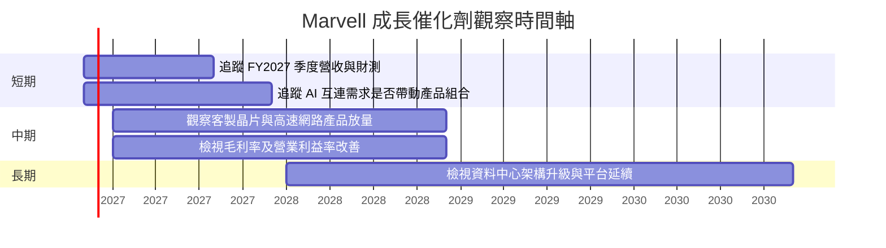
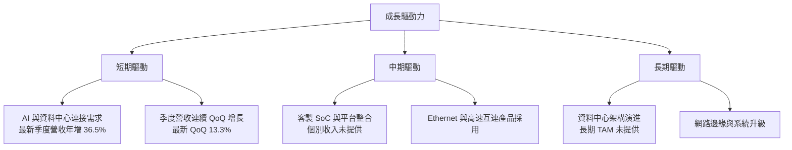
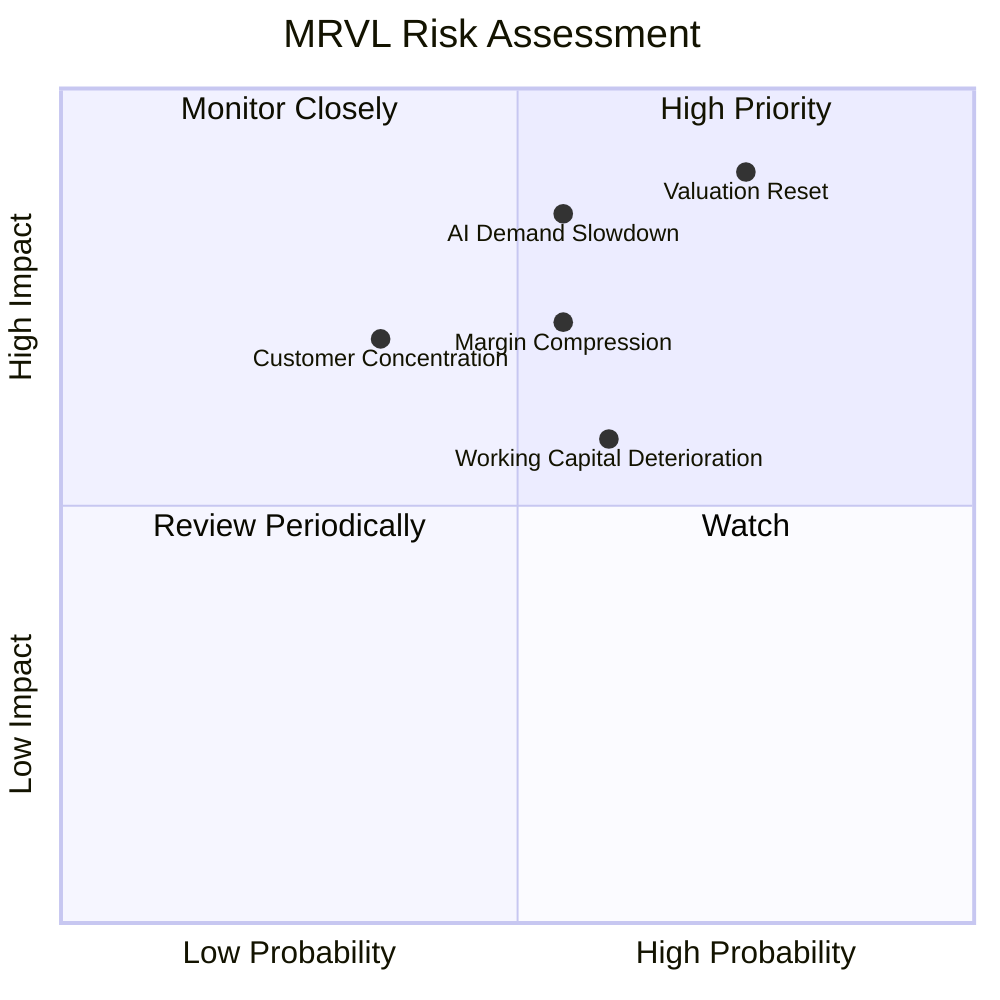
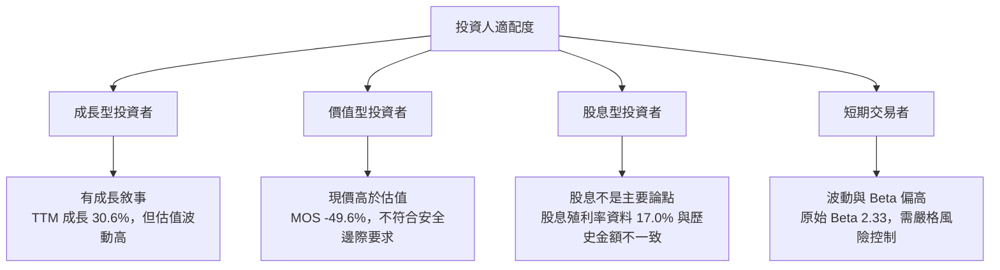

# MRVL 基本面深度分析報告
> **報告日期**：2026-11-17 ｜ **語言**：繁體中文 ｜ **數據來源**：SEC 申報資料 (XBRL)、Yahoo Finance、Finviz、StockAnalysis、Roic.ai ｜ **分析師**：CFA 級機構研究

## 目錄

| # | 章節 | 核心結論 |
|---|------|----------|
| 1 | 執行摘要 | 賣出；加權合理價值 $97.17，MOS -49.6% |
| 2 | 公司概覽與商業模式 | 數據基礎設施晶片業者；技術與客戶導入構成護城河，但市場份額資料未提供 |
| 3 | 損益表深度分析 | TTM 營收 $9.45B、年增 30.6%；最新一季年增 36.5% |
| 4 | 資產負債表分析 | 淨負債；流動比率 3.168，營運資金天數走高 |
| 5 | 現金流量深度分析 | TTM FCF $1.73B、FCF Yield 1.32%；SBC 對現金流含金量有折減 |
| 6 | 獲利能力與資本效率 | ROIC 6.3% 低於 WACC 14.00%，目前摧毀經濟價值 |
| 7 | 相對估值分析 | Forward P/E 高於同業中位數；相對自身歷史 P/S 偏高 |
| 8 | DCF 內在價值評估 | 基準 DCF $38.08；加權合理價值 $97.17，均低於現價 |
| 9 | 成長催化劑 | AI、資料中心與高速互連需求可能支撐成長；TAM 數據未提供 |
| 10 | 風險矩陣 | 估值、成長預期與執行風險為主要下行因素 |
| 11 | 投資建議 | 依 MOS 評級為賣出；監控成長、利潤率、FCF 與資本回報 |

## 1. 執行摘要

### 1.0 一頁式投資儀表板（Portfolio Manager 30 秒速讀）

| 項目 | 內容 |
|------|------|
| **投資論點（3 句）** | ① TTM 營收 $9.45B、年增 30.6%，最新一季年增 36.5%，顯示資料中心及網路需求仍在擴張。② TTM FCF 為 $1.73B，但 FCF Yield 僅 1.32%，且 ROIC 6.3% 低於 14.00% WACC，成長尚未轉化為足夠資本回報。③ 2026-11-16 收盤價 $145.36，對應加權合理價值 $97.17 的 MOS 為 -49.6%，估值風險高於基本面成長提供的緩衝。 |
| **綜合評分** | **5.5/10**（引用 1.1 評分卡） |
| **財務健康** | 🟡 現金及短期投資 $3.93B，總債務 $4.96B、淨負債 $1.03B；流動比率 3.168，但現金轉換週期由 113 天升至 131 天。 |
| **ROIC vs WACC** | 6.3% vs 14.00%：目前資本回報低於資本成本，經濟價值為負。 |
| **FCF 趨勢** | 年度 FCF 近年維持正值；TTM FCF $1.73B，FCF Yield 1.32%。 |
| **估值** | Forward P/E 19.72x ｜ EV/EBITDA 45.20x（市場數據）｜ FCF Yield 1.32%。同業及歷史估值口徑詳見第 7 章。 |
| **DCF 內在價值（基準）** | $38.08 ｜ 現價相對 DCF 溢價 **281.7%**（$145.36 ÷ $38.08 − 1）。 |
| **安全邊際（MOS）** | **-49.6%**＝($97.17 − $145.36) ÷ $97.17（基準為 8.8 加權合理價值）｜ 🔴 無安全邊際。 |
| **預期報酬（基準情境 12M）** | 12 個月目標價未提供，N/A；以基準 DCF 情境價值衡量，價值相對現價為 -73.8%，但這不是 12 個月價格預測。 |
| **關鍵風險（前二）** | ① 加權合理價值遠低於現價；② ROIC 低於 WACC，且 DSO、DIO、CCC 均較一年前升高。 |
| **評級 + 信心度** | 🔴 **賣出** ｜ 信心：中。主要依據為 MOS -49.6%、ROIC 6.3% 低於 WACC 14.00%；模型長期假設仍有不確定性。 |

### 1.1 綜合評分卡（全報告唯一）

| 維度 | 評分（1–10） | 主要依據（引用數字與其來源章節） |
|------|--------------|----------------------------------|
| 成長性 | 8.0 | TTM 營收年增 30.6%，最新一季單季年增 36.5%（第 3 章）；成長速度高，但季度波動仍需觀察。 |
| 獲利能力 | 5.0 | TTM 營業利益率 16.5%、ROIC 6.3% 對比 WACC 14.00%，Piotroski F-Score 6/9（第 6 章）。 |
| 財務健康 | 6.5 | 現金及短期投資 $3.93B，淨負債 $1.03B，流動比率 3.168；CCC 131 天，高於一年前 113 天（第 4 章）。 |
| 估值 | 1.0 | 加權合理價值 $97.17，MOS -49.6%；P/S 當前 14.2x，高於五年中位數 9.9x（第 7–8 章）。 |
| 護城河 | 7.0 | 高速資料互連、客製晶片與客戶驗證形成技術及導入門檻；但未提供市場份額或客戶集中度數據（第 2 章）。 |
| 管理層與資本配置 | 5.5 | FY2026 SBC $590.8M，季度資料中稀釋股數測試未通過；FY2026 股息支付 $205.1M，但回購資料未提供。 |
| **綜合評分** | **5.5** | 六項算術平均：(8.0 + 5.0 + 6.5 + 1.0 + 7.0 + 5.5) ÷ 6 = **5.5**。 |

### 1.2 五大投資論點 + 三大核心風險

| 類型 | 項目 | 具體依據 | 信心度 |
|------|------|----------|--------|
| 🟢 **投資論點①** | 資料中心需求帶動營收擴張 | TTM 營收 $9.45B、年增 30.6%；最新一季營收年增 36.5%。若主要產品持續被客戶採用，營收成長可提升固定成本吸收能力。 | 🟢 高 |
| 🟢 **投資論點②** | 現金流持續為正 | TTM OCF $2.20B、資本支出 $470.20M，FCF $1.73B；代表公司有能力資助研發及維持股東分配。 | 🟢 高 |
| 🟢 **投資論點③** | 最近季度毛利額擴大 | FY2027 Q2 毛利 $1.456B、營收 $2.739B，單季毛利率約 53.2%；較前一季毛利 $1.261B 增加。 | 🟡 中 |
| 🟢 **投資論點④** | 資產負債表有流動性緩衝 | 現金及短期投資 $3.93B、流動比率 3.168；短期償付能力尚可。 | 🟢 高 |
| 🟢 **投資論點⑤** | 高速互連與客製晶片具技術門檻 | 公司業務涵蓋 Ethernet、類比／混合訊號與數位訊號處理；產品需經客戶驗證及系統整合，轉換成本較一般標準零件高。 | 🟡 中 |
| 🟡 **風險①** | 估值對預期落差敏感 | 現價 $145.36，DCF 基準 $38.08；加權合理價值 $97.17。若 AI 資本支出預期降溫，估值可能快速重設。 | 🔴 高衝擊 |
| 🔴 **風險②** | 資本回報低於資本成本 | ROIC 6.3% 對比 WACC 14.00%，差距 -7.7 個百分點；增長若需大量投入但回報不升，可能加劇價值稀釋。 | 🔴 高 |
| 🟡 **風險③** | 營運資金效率惡化 | DSO 86 天、DIO 110 天、CCC 131 天，分別高於一年前 73、96、113 天；營收成長伴隨更多資金占用。 | 🟡 中 |

### 1.3 快速統計卡片

| 指標 | 公司實際值（期間） | 同業中位數 | 狀態 |
|------|--------------------|------------|------|
| 營收成長（TTM） | **30.6%** | — | 🟢 |
| 營收成長（最新一季年增） | **36.5%** | 85.5%（AVGO）、105.9%（NVDA）、44.7%（AMD），中位數 85.5% | 🟡 |
| 毛利率（TTM） | **52.2%** | 74.7%（Peer median） | 🟡 |
| 營業利益率（TTM） | **16.5%** | — | 🟡 |
| ROIC（TTM） | **6.3%** | — | 🔴 |
| Forward P/E | **19.72x** | 17.2x（同業中位數） | 🟡 |
| FCF Yield（TTM） | **1.32%** | — | 🔴 |
| Piotroski F-Score | **6 / 9** | — | 🟡 |

### 1.4 投資結論

```text
╔══════════════════════════════════════════════════════════════════╗
║                    📊 投資結論摘要                               ║
╠══════════════════════════════════════════════════════════════════╣
║  評級：🔴 賣出（MOS -49.6%，ROIC 低於 WACC）                     ║
║  價格（2026-11-16 收盤）：$145.36                               ║
║  DCF 內在價值（基準）：$38.08（溢價 281.7%）                    ║
║  安全邊際 MOS：-49.6%（＝(加權合理價值−現價)÷加權合理價值）     ║
║  加權合理價值（8.8）：$97.17                                     ║
║  DCF 情境價值：                                                   ║
║    悲觀情境：$19.28（-86.7%）                                   ║
║    基準情境：$38.08（-73.8%）                                   ║
║    樂觀情境：$72.38（-50.2%）                                   ║
║  綜合評分：5.5/10（引用 1.1）                                    ║
║  適合投資人：能承受高波動、重視資料中心與互連成長的投資人；       ║
║  但現價不適合以基本面價值安全邊際為首要考量的投資人。            ║
╚══════════════════════════════════════════════════════════════════╝
```

## 2. 公司概覽與商業模式

### 2.1 業務結構與收入來源

公司簡介指出 Marvell 提供從資料中心核心到網路邊緣的資料基礎設施半導體解決方案，涵蓋 Ethernet、SoC、類比、混合訊號及數位訊號處理。財務資料未提供各業務板塊收入及占比，因此不將整體營收拆成未經證實的比例。



### 2.2 市場份額

市場份額數據未提供，故不估算比例。以營收規模及近期成長觀察，MRVL TTM 營收為 $9.45B、TTM 年增 30.6%，最新一季年增 36.5%；同一 Peer multiples 資料中的 AVGO、NVDA、AMD 最新季度年增率分別為 85.5%、105.9%、44.7%。MRVL 成長為正且具規模，但低於上述三家同業的近期成長率。

### 2.3 競爭護城河分析



### 2.4 護城河強度

| 護城河項目 | 強度（強／中／弱） | 證據（引用數字或事實） | 會削弱它的情況 |
|------------|--------------------|------------------------|----------------|
| 技術與產品整合 | 中至強 | 公司將類比、混合訊號與 DSP 整合於 SoC，並提供 Ethernet 及資料基礎設施產品；TTM 營收 $9.45B。 | 客戶自行設計晶片、競品效能／功耗優勢擴大或產品迭代落後。 |
| 客戶導入與轉換成本 | 中 | 晶片需進入客戶系統並完成驗證，替換涉及設計、軟體及可靠度測試；客戶留存率未提供。 | 大型客戶縮減供應商數量、轉用內部晶片或多來源採購。 |
| 軟體／生態系統 | 中 | 公司產品需要韌體及平台整合；軟體收入與生態系統量化指標未提供。 | 軟硬體接口標準化，使客戶更容易替換供應商。 |
| 規模與研發 | 中 | FY2026 研發支出 $2.08B，反映持續投入；但費用與營收的長期回報需由 ROIC 改善驗證。 | 研發支出增加而產品營收、毛利與現金回報未同步增加。 |
| 網路效應 | 弱至中 | 產品有跨系統相容性與客戶部署回饋，但沒有直接網路效應的量化證據。 | 市場採用單一標準或平台集中，令產品差異化減弱。 |
| 生態夥伴 | 中 | 業務涉及雲端、網路設備、晶圓製造及封裝合作；合作營收依賴度未提供。 | 關鍵供應商中斷、客戶平台遷移或夥伴轉向競品。 |

第 1.1 節「護城河」評分為 7.0/10，理由是技術整合及客戶驗證提供一定防禦性，但市場份額、客戶留存與軟體收入等量化證據不足。

## 3. 損益表深度分析

### 3.1 年度收入成長趨勢（近 4 年）

年度營收採 StockAnalysis 的年度列示；成長率依年度營收計算。跨來源年度列示存在日期與財年口徑差異，故以所列營收為基礎比較，不與 TTM 增長率混用。

```text
╔══════════════════════════════════════════════════════════════════╗
║             Marvell 年度收入趨勢（FY2023–FY2026）                ║
╠══════════════════════════════════════════════════════════════════╣
║  FY2023  $5.920B  ██████████████░░░░░░░░░░░░░░  YoY: +7.5% 🟡 ║
║  FY2024  $5.508B  █████████████░░░░░░░░░░░░░░░  YoY: -7.0% 🔴 ║
║  FY2025  $5.767B  ██████████████░░░░░░░░░░░░░░  YoY: +4.7% 🟡 ║
║  FY2026  $8.195B  ████████████████████░░░░░░░░  YoY: +42.1% 🟢║
╠══════════════════════════════════════════════════════════════════╣
║  FY2023–FY2026 CAGR：(8.195 ÷ 5.920)^(1/3) − 1 = 約 11.5%      ║
║  註：StockAnalysis 財年標示與其他來源年度日期存在差異。          ║
╚══════════════════════════════════════════════════════════════════╝
```

FY2026 的 42.1% 成長高於前三年的波動區間，顯示需求回升及產品組合變化對營收的影響顯著；但 FY2024 曾年減 7.0%，說明半導體需求仍具週期性。

### 3.2 季度收入趨勢分析

最新季度採 SEC 10-Q 截至 2026-08-01 的 FY2027 Q2；季度歷史列示的單季營收如下。

| 季度 | 營收 | QoQ 成長 | YoY 成長 | 備註 |
|------|------:|---------:|---------:|------|
| FY2026 Q3（2025-11-01） | $2.075B | N/A（前一季未列入最近四季表格） | 36.8% | 季度年增仍高，但基期差異可能影響比較。 |
| FY2026 Q4（2026-01-31） | $2.219B | 6.9% | 22.1% | 計算：2.219 ÷ 2.075 − 1。 |
| FY2027 Q1（2026-05-02） | $2.418B | 9.0% | 27.6% | 計算：2.418 ÷ 2.219 − 1。 |
| FY2027 Q2（2026-08-01） | $2.739B | 13.3% | 36.5% | 計算：2.739 ÷ 2.418 − 1；YoY 為單季年增，非 TTM。 |

最近三個可計算 QoQ 期間均為正，且最新季度 QoQ 加速至 13.3%。這種加速若由雲端與 AI 互連需求支持，可能延續營收槓桿；但單季增速不能直接外推為全年成長率。

### 3.3 利潤率演變分析

| 利潤率指標 | FY2023 | FY2024 | FY2025 | FY2026 | 趨勢 | 評估 |
|------------|--------|--------|--------|--------|------|------|
| **毛利率** | 50.7% | 41.6% | 47.5% | 51.0% | FY2024 下滑後回升 | 🟡 |
| **營業利益率** | 6.1% | -7.9% | -0.1% | 16.3% | 從虧損轉正並改善 | 🟡 |
| **淨利率** | -2.8% | -16.9% | -15.3% | 32.6% | 年度數據受非營業／一次性項目影響，波動極大 | 🟡 |

計算依據為年度損益表所列營收、毛利、營業利益及淨利。年度資料不同來源間存在差異，TTM 官方參照值採用 TTM 營業利益率 16.5% 及 TTM 淨利率 27.9%。

**利潤率演變深度解析：**毛利率自 FY2024 的 41.6% 回升至 FY2026 的 51.0%，可能反映產品組合、產能利用率或成本吸收改善，但現有資料無法分拆各因素貢獻。營業利益率回升幅度更大，除毛利改善外，費用槓桿及前期低基期亦可能是原因。年度淨利率受非營業項目影響明顯，FY2026 的高淨利率不宜簡單視為可持續經營利潤率。

### 3.4 費用結構分析

以下採 FY2026 年度營收、毛利、研發費用及營業利益，其他營業費用以年度損益表差額計算；這是年度費用結構拆分，並非現金流拆分。



FY2026 研發支出 $2.08B 約占營收 25.4%（2.08 ÷ 8.195），反映公司需持續投入產品開發；研發投資是否創造股東價值，仍需透過 ROIC 由目前 6.3% 提升來驗證。

### 3.5 季度 EPS 趨勢與盈餘品質（Quality of Earnings）

EPS 預估值在 Earnings History 中為缺漏，因此無法判定最近四季實際盈餘是否超預期或不及預期。季度實際 EPS 可參考 StockAnalysis，但該資料中的單季數字波動顯著。

| 季度 | EPS 實際值 | 預估值／超預期狀況 | EPS 年增 | 解讀 |
|------|-----------:|------------------|---------:|------|
| 2025-11-01 | $2.20 | N/A（EPS Est 缺漏） | N/A | 單季獲利異常偏高，與相鄰季度差距大；應留意一次性項目。 |
| 2026-01-31 | $0.47 | N/A（EPS Est 缺漏） | 106.27% | 年增率容易受低基期及前期項目影響。 |
| 2026-05-02 | $0.04 | N/A（EPS Est 缺漏） | -80.44% | EPS 大幅下降，與季度營收增長並不完全同步。 |
| 2026-08-01 | $0.34 | N/A（EPS Est 缺漏） | 50.00% | 年增改善，但無法依此判定 beat/miss。 |

| 盈餘品質項目 | 數值／佔比 | 評估 |
|--------------|-----------|------|
| 股權薪酬 SBC / 營收 | 約 **8.8%**：近四季 SBC 合計 $828.9M ÷ TTM 營收 $9.45B | 🔴 SBC 規模偏高，會稀釋既有股東；季度 SBC 資料四季合計與 TTM 營收期間存在口徑差異，僅作近似比率。 |
| SBC / 營業現金流 | 約 **37.7%**：$828.9M ÷ $2.20B | 🔴 代表 OCF 有相當部分來自非現金薪酬加回；SBC 雖非現金支出，仍是股東經濟成本。 |
| FCF / 淨利（現金轉換率） | 約 **65.5%**：TTM FCF $1.73B ÷ StockAnalysis TTM 淨利 $2.64B | 🟡 現金轉換低於 100%；淨利資料與 TTM FCF 期間口徑未完全一致。 |
| 一次性／非經常性損益 | 年度與季度淨利波動大：2025-10-31 季淨利 $1.90B，與其他季度差異顯著 | 🔴 有非經常性項目或稅務／會計因素影響的可能；未提供明細，無法確定項目與金額。 |
| 有效稅率異常 | 12.4%（Cost of capital 區塊所列最近年度有效稅率） | 🟡 低於一般名目稅率，但未提供稅務調節表，無法判斷是否具持續性。 |
| 資本化支出 vs 費用化 | TTM Capex $470.20M；資本化政策及資本化軟體等細節未提供 | 🟡 無法量化資本化與費用化差異，需查閱 10-K／10-Q 會計政策。 |

**盈餘品質結論：**公司有正向 FCF，但 TTM FCF 約為淨利的 65.5%，且 SBC 相對營收及 OCF 的比例均不低，反映 GAAP 淨利並非全部可直接視為股東可取得的現金回報。估值時應同時考慮 SBC 對稀釋與經濟成本的影響；DCF 模型採 GAAP EBIT，已將 SBC 作為費用反映，並不另外扣一次。

## 4. 資產負債表分析

### 4.1 資產結構分解

資產結構採 StockAnalysis 2026-08-01 TTM 資產負債表。總資產 $27.555B、流動資產 $7.919B；其餘非流動資產以總資產減流動資產計算。



### 4.2 流動性與營運資金分析

| 指標 | 最新值 | 歷史值 | 評估 |
|------|--------|--------|------|
| 流動比率 | 3.168 | FY2026 年度約 2.01（$6.46B ÷ $3.22B） | 🟢 短期資產覆蓋流動負債能力較充足；日期不同，僅作方向參考。 |
| 速動比率 | 2.461 | N/A（同口徑歷史值未提供） | 🟢 即使排除存貨，流動性仍高於 1。 |
| 現金及短期投資 | $3.93B | FY2026 年度現金 $2.64B | 🟢 資金餘額增加，但公司仍有淨負債。 |

| 指標 | 最新 TTM | 一年前 TTM | 變化 | 解讀 |
|------|----------|------------|------|------|
| DSO 應收帳款天數 | 86 天 | 73 天 | +13 天 | 收款週期變長，可能與營收組合或客戶付款條件有關；需追蹤應收帳款是否快於營收增長。 |
| DIO 存貨天數 | 110 天 | 96 天 | +14 天 | 存貨占用資金增加；若為備貨支援成長可合理，但需求轉弱時會提高庫存減值風險。 |
| DPO 應付帳款天數 | 64 天 | 56 天 | +8 天 | 付款天數增加，可能代表供應商信用融資提高；不能單獨視為議價力改善。 |
| CCC 現金轉換週期 | 131 天 | 113 天 | +18 天 | 現金回收週期拉長，部分抵銷營收成長帶來的現金流效益。 |

### 4.3 債務結構分析

資本成本計算使用的總債務為 $4.96B；市場資料其他表格列有 $5.29B。為避免混用，淨負債採 VERIFIED FIGURES 的同口徑數字，即 $1.03B。

```text
╔══════════════════════════════════════════════════════════════════╗
║                 Marvell 債務健康診斷                             ║
╠══════════════════════════════════════════════════════════════════╣
║  總債務（資本成本口徑）：   $4.96B                              ║
║  現金及短期投資：           $3.93B                              ║
║  淨負債：                   $1.03B  🟡                          ║
║                                                                  ║
║  流動比率：                 3.168x  🟢                          ║
║  Debt/EBITDA：              N/A（口徑未提供同一期間 EBITDA）    ║
║  利息保障倍數：             N/A（利息費用及一致口徑 EBIT 未提供）║
║                                                                  ║
║  判讀：淨負債規模相對現金流可管理，但並非淨現金公司；           ║
║        營運資金天數上升，若需求減速，現金回收可能受壓。          ║
╚══════════════════════════════════════════════════════════════════╝
```

### 4.4 股東權益趨勢

| 財年 | 股東權益 | YoY 變化 | 說明 |
|------|---------:|---------:|------|
| FY2023 | $15.64B | N/A | 歷史基期。 |
| FY2024 | $14.83B | -5.2% | 權益下降。 |
| FY2025 | $13.43B | -9.4% | 下降可能受虧損、資本配置及股東分配影響。 |
| FY2026 | $14.31B | +6.6% | 回升，但仍低於 FY2023。 |

```text
╔══════════════════════════════════════════════════════════════════╗
║               股東權益趨勢（年度）                               ║
╠══════════════════════════════════════════════════════════════════╣
║  FY2023  $15.64B  ████████████████████                         ║
║  FY2024  $14.83B  ███████████████████                          ║
║  FY2025  $13.43B  █████████████████                            ║
║  FY2026  $14.31B  ██████████████████                           ║
╚══════════════════════════════════════════════════════════════════╝
```

## 5. 現金流量深度分析

### 5.1 現金流量瀑布圖

TTM 淨利與現金流的期間及資料來源略有差異；以下瀑布以 TTM OCF、Capex、FCF VERIFIED FIGURES 為主。回購金額與淨現金變化資料未提供。



### 5.2 FCF 轉換率趨勢

| 財年 | OCF | Capex | FCF | 淨利 | FCF／淨利 |
|------|----:|------:|----:|-----:|----------:|
| FY2023 | $1.29B | $0.217B | $1.07B | -$0.164B | 比率不具經濟意義（淨利為負） |
| FY2024 | $1.37B | $0.350B | $1.02B | -$0.933B | 比率不具經濟意義（淨利為負） |
| FY2025 | $1.68B | $0.292B | $1.39B | -$0.885B | 比率不具經濟意義（淨利為負） |
| FY2026 | $1.75B | $0.359B | $1.39B | $2.67B | 約 52.1% |
| TTM 至 2026-08-01 | $2.20B | $0.470B | $1.73B | $2.64B | 約 65.5% |

FY2026 起淨利轉正，但 FCF 低於淨利；部分差異可能來自非現金項目、營運資金變動及 SBC，現有資料不足以完整拆解。

### 5.3 自由現金流趨勢

| 期間 | FCF | YoY／變化 | FCF Yield |
|------|----:|-----------|----------|
| FY2023 | $1.07B | — | N/A |
| FY2024 | $1.02B | -4.7% | N/A |
| FY2025 | $1.39B | +36.3% | N/A |
| FY2026 | $1.39B | 約持平 | N/A |
| TTM 至 2026-08-01 | $1.73B | TTM FCF Yield 1.32% | 1.32% |

```text
╔══════════════════════════════════════════════════════════════════╗
║                 自由現金流趨勢（美元）                           ║
╠══════════════════════════════════════════════════════════════════╣
║  FY2023  $1.07B  ████████████░░░░░░░░                           ║
║  FY2024  $1.02B  ███████████░░░░░░░░░                           ║
║  FY2025  $1.39B  ███████████████░░░░░                           ║
║  FY2026  $1.39B  ███████████████░░░░░                           ║
║  TTM     $1.73B  ████████████████████  FCF Yield 1.32%          ║
╚══════════════════════════════════════════════════════════════════╝
```

### 5.4 資本配置評估

FY2026 股息支付為 $205.1M，Capex 為 $358.6M，SBC 為 $590.8M；公司回購、併購及現金留存的同年度完整拆分未提供，因此不畫資本配置比例圖，以免將不同期間數字混為一談。

| 資本配置項目 | 金額／狀況 | 評估 |
|--------------|-----------|------|
| 資本支出 | FY2026 $358.6M；TTM $470.20M | 支援營運及技術基礎設施，TTM 資本支出高於 FY2026 年度值，可能反映投資增加。 |
| 股息 | FY2026 $205.1M | 相對 TTM FCF 不高，但分析資料中的「Dividend Yield 17.0%」與每季每股 $0.06 的歷史資料明顯不一致，不能採信 17.0% 作常態殖利率。 |
| 股票回購 | 金額未提供 | 無法判斷淨回購是否抵銷 SBC 稀釋。 |
| 股權薪酬 | FY2026 $590.8M | 占年度營收約 7.2%；為非現金費用，但具有稀釋與股東經濟成本。 |
| 留存／併購 | N/A | 未提供完整資金用途拆分。 |

## 6. 獲利能力與資本效率

### 6.1 ROE / ROA / ROIC 趨勢

| 指標 | FY2023 | FY2024 | FY2025 | 最新 TTM | 評估 |
|------|-------:|-------:|-------:|---------:|------|
| ROE | N/A | N/A | N/A | **14.2%** | 採 QUALITY FIGURES 的 TTM 杜邦口徑；其他資料源列示 16.5%，口徑不同不混用。 |
| ROA | N/A | N/A | N/A | 4.1% | 資產回報偏低於 ROE，反映資產基礎較大。 |
| ROIC | N/A | N/A | N/A | **6.3%** | 低於 WACC 14.00%，目前經濟利潤為負。 |

未提供一致口徑的歷年 ROIC 與同業 ROIC 數據，故不填入行業均值或推估歷史值。

### 6.2 ROIC vs WACC 分析（核心價值創造判斷）

Cost of capital 的資本成本資料給出 10 年期美債利率 5.12%、ERP 5.00%、原始 Beta 2.33、調整後 Beta 1.88、股權成本 14.54%、稅前債務成本 4.08%、有效稅率 12.4%、股權／債務權重 96.3%／3.7%。程式計算 WACC 為 14.14%，因模型設定上限 14%，採用 WACC 14.00%。

```text
╔══════════════════════════════════════════════════════════════════╗
║                ROIC vs WACC 深度分析                             ║
╠══════════════════════════════════════════════════════════════════╣
║  WACC 資本成本輸入：                                             ║
║  ├── 無風險利率（10Y 美債）：       5.12%                       ║
║  ├── ERP：                          5.00%                       ║
║  ├── 原始 Beta：                    2.33                        ║
║  ├── 調整後 Beta：                  1.88                        ║
║  ├── 股權成本：                     5.12% + 1.88×5.00% = 14.54%║
║  ├── 稅前債務成本：                 4.08%                       ║
║  ├── 稅後債務成本：                 4.08%×(1−12.4%) = 3.57%    ║
║  ├── 股權／債務權重：               96.3%／3.7%                 ║
║  ├── 未限制 WACC：                  14.14%                      ║
║  └── 採用 WACC：                    14.00%（受 7%–14% 區間限制）║
║                                                                  ║
║  ROIC：                            6.3%                         ║
║  EVA 利差：                        6.3% − 14.00% = -7.7pp      ║
║                                                                  ║
║  ROIC  6.3%   ▓▓▓▓▓▓░░░░░░░░░░░░░░░░░░░░░░░░                  ║
║  WACC 14.00%  ▓▓▓▓▓▓▓▓▓▓▓▓▓▓░░░░░░░░░░░░░░                    ║
║                                                                  ║
║  結論：ROIC / WACC = 6.3% ÷ 14.00% = 0.45x；目前未覆蓋資本成本。║
╚══════════════════════════════════════════════════════════════════╝
```

程式提供的 14.14% 未限制 WACC 是資本成本計算值；模型折現採用 14.00% 上限值。以採用值計算，ROIC 低於 WACC 7.7 個百分點，代表目前投入資本的經濟回報不足。未來成長若伴隨 ROIC 提升至 WACC 以上，價值創造判斷才可能反轉。

### 6.3 杜邦三因素分解

| 因素 | 數值（TTM） | 解讀 |
|------|-------------|------|
| 淨利率 | 27.9% | 獲利率對 ROE 有正向貢獻，但季度及年度淨利波動大。 |
| 資產週轉率 | 0.34 | 每單位資產產生的營收有限；公司資產包含較大商譽與無形資產。 |
| 權益乘數 | 1.49 | 財務槓桿不是 ROE 的主要來源。 |
| **ROE** | **14.2%** | **27.9% × 0.34 × 1.49 = 14.2%**（依 QUALITY FIGURES 照錄）。 |

ROE 主要由淨利率支撐，而非高槓桿；但 ROIC 只有 6.3%，表示帳面股東報酬與新增投入資本的經濟效率並不等同。

### 6.4 財務體質：Piotroski F-Score

Piotroski F-Score 為 **6/9**。

| 測試 | 結果 | 解讀 |
|------|------|------|
| ROA > 0 | ✅ 通過 | 最新 TTM 為正。 |
| 營業現金流 > 0 | ✅ 通過 | TTM OCF $2.20B。 |
| ROA 高於一年前 | ✅ 通過 | 盈利狀況較前一年改善。 |
| 營業現金流 > 淨利（應計品質） | ❌ 未通過 | 淨利高於現金流，需關注應計項目與現金轉換。 |
| 長期負債 ÷ 總資產低於一年前 | ✅ 通過 | 相對負債指標改善。 |
| 流動比率高於一年前 | ✅ 通過 | 短期流動性改善。 |
| 稀釋股數未增加 | ❌ 未通過 | 稀釋股數增加，與 SBC 造成的股東稀釋相符。 |
| 毛利率高於一年前 | ✅ 通過 | 毛利率較一年前改善。 |
| 資產週轉率高於一年前 | ❌ 未通過 | 資產效率改善未能確認。 |

F-Score 6/9 表示財務面有改善訊號，但應計品質、股數稀釋及資產週轉率未通過，均需持續追蹤。

## 7. 相對估值分析

### 7.1 同業估值比較表格

下表同業倍數採 Yahoo Finance Peer multiples；MRVL 的估值採市場資料。兩者來源與計算口徑可能不同，解讀時應視為相對參照，而非完全同口徑的精確比較。

| 估值指標 | **MRVL** | **AVGO** | **NVDA** | **AMD** | MRVL 評估 |
|----------|---------:|--------:|--------:|-------:|-----------|
| **Trailing P/E** | 48.0x | 42.6x | 19.7x | 107.8x | 🟡 高於 AVGO、NVDA，低於 AMD；MRVL 自身歷史中位數為 56.5x。 |
| **Forward P/E** | 19.72x | 17.2x | 9.8x | 28.6x | 🟡 高於同業中位數 17.2x；價格已反映一定成長預期。 |
| **P/S Ratio（TTM）** | 14.2x | 17.9x | 12.4x | 18.2x | 🟡 高於 NVDA、低於 AVGO 與 AMD；高於 MRVL 自身五年中位數 9.9x。 |
| **EV/EBITDA（TTM）** | 86.4x（自身歷史估值口徑） | 31.1x | 18.6x | 73.6x | 🔴 顯著高於 AVGO、NVDA；不同資料來源呈現的 MRVL EV/EBITDA 另有 45.20x，存在口徑差異。 |
| **最新一季營收年增** | 36.5% | 85.5% | 105.9% | 44.7% | 🟡 成長良好，但低於三家同業列示值。 |
| **毛利率（TTM）** | 52.2% | 75.5% | 74.7% | 56.0% | 🟡 低於三家同業，產品組合與毛利擴張是估值能否支撐的重要條件。 |

同業 Forward P/E 中位數為 17.2x（排序 9.8x、17.2x、28.6x），同業 EV/EBITDA 參照方法使用 AVGO 與 NVDA 中位數 24.9x，依固定估值方法表採用。

### 7.2 歷史估值區間分析

以下倍數與位置採 MRVL 自身五年估值歷史。

```text
╔══════════════════════════════════════════════════════════════════╗
║             MRVL 五年估值位置（TTM 倍數）                        ║
╠══════════════════════════════════════════════════════════════════╣
║  P/E        25.6x ├──────────●──────────┤ 61.9x                 ║
║                         現值 48.0x；中位數 56.5x；百分位 50%     ║
║                                                                  ║
║  P/S         5.8x ├────────────────●───┤ 18.3x                 ║
║                         現值 14.2x；中位數 9.9x；百分位 80%      ║
║                                                                  ║
║  EV/EBITDA  53.3x ├─●──────────────────┤ 730.9x                ║
║                         現值 86.4x；中位數 156.4x；百分位 25%   ║
╚══════════════════════════════════════════════════════════════════╝
```

P/E 低於自身五年中位數但仍處於歷史中段；P/S 位於自身歷史第 80 百分位，顯示營收估值偏高。EV/EBITDA 的歷史區間極寬，受獲利波動及低基期影響，單獨用它推斷便宜與否的可靠度有限。

### 7.3 情境價值（Bear / Base / Bull，照抄 DCF MODEL 的 Scenarios）

| 情境 | 第 1 年營收成長 | 期末營業利潤率 | WACC | 每股價值 | 相對現價 | 機率 | 會發生的條件 |
|------|----------------|----------------|------|----------|----------|------|--------------|
| 🔴 悲觀 | 15.0% | 3.4% | 15.00% | $19.28 | -86.7% | 25% | 資料中心需求放緩、競爭造成長期毛利／營業利潤率下降，資本成本維持高位。 |
| 🟡 基準 | 30.0% | 4.0% | 14.00% | $38.08 | -73.8% | 50% | 近期高成長逐步放緩，營業利潤率依模型向歷史中位數收斂。 |
| 🟢 樂觀 | 45.0% | 4.4% | 13.00% | $72.38 | -50.2% | 25% | AI／互連需求高於基準、營收增長延續，且市場要求報酬率下降。 |

注意：三個 DCF 情境的每股價值均低於 2026-11-16 收盤價。情境機率加權值在 DCF 模型資料中為 $41.95，該值僅作背景資訊；第 8.8 節仍以基準 DCF 值參與固定權重計算。

### 7.4 相對估值隱含價格區間

```text
╔══════════════════════════════════════════════════════════════════╗
║             估值方法隱含每股價值與現價位置                       ║
╠══════════════════════════════════════════════════════════════════╣
║  $38.08      $76.83       $97.17       $126.58       $145.36    ║
║  基準 DCF    EV/EBITDA    加權合理值    Forward P/E    現價      ║
║                                                                  ║
║  Analyst consensus：$310.89（40 位分析師平均目標價）             ║
╚══════════════════════════════════════════════════════════════════╝
```

| 方法 | 每股價值 | 依據 |
|------|---------:|------|
| DCF（基準） | $38.08 | 10 年 FCFF，WACC 14.00%、永續成長率 3.0%。 |
| 同業 Forward P/E | $126.58 | 同業中位數 17.2x × MRVL Forward EPS $7.37。 |
| 同業 EV/EBITDA | $76.83 | AVGO、NVDA 中位數 24.9x × TTM EBITDA，再加回淨現金；依固定估值方法計算。 |
| 分析師共識目標價 | $310.89 | 40 位分析師目標價平均值；屬市場預期參照，不是基本面估值。 |

## 8. DCF 內在價值評估（Discounted Cash Flow）

### 8.0 估值推理鏈（Thinking Logic：在算之前先想清楚）

**Step 1 — 價值由哪些變數決定？**  
模型將價值拆為目前 $9.45B TTM 營收基礎、未來營收擴張，以及營業利潤率、Capex 和終值假設。公司未提供各業務營收占比，因此不能把資料中心、互連或其他產品的營收貢獻分開量化。對此模型而言，營收成長、期末營業利潤率及 WACC 是影響價值的主要變數；敏感度矩陣顯示 WACC／永續成長率變化也會明顯改變估值。

**Step 2 — 模型選擇**

| 決策點 | 本報告採用 | 理由（含數字） | 曾考慮但否決 | 否決理由 |
|--------|-----------|----------------|--------------|----------|
| 現金流定義 | FCFF | 使用 GAAP EBIT、公司有債務，對應 WACC 折現後得到 EV。 | FCFE | FCFE 會受融資結構及利息影響，與提供模型不一致。 |
| 預測期 N | 10 年 | DCF 模型固定 10 年，收入成長由 30.0% 線性降至 3.0%。 | 5 年 | 不能替換已提供模型的預測期；且對高成長晶片公司，五年不足以呈現模型設定的成長淡化。 |
| 終值方法 | Gordon Growth | WACC 14.00% 高於 g 3.0%，公式有效；終值現值占 EV 36.0%。 | 僅退出倍數 | 模型未提供退出倍數法的終值及橋接數字，不能自行補造。 |
| EBIT 基礎 | GAAP EBIT | 模型明列 GAAP EBIT，TTM 營業利益率 16.5%。 | 非 GAAP EBIT | 會加回 SBC，與模型口徑不同且可能漏計股東成本。 |

**Step 3 — 關鍵假設推導鏈**

- **營收成長**：錨點＝TTM 營收年增 30.6% → 調整＝模型將第 1 年成長率限制在 0%–30%，並假設高成長逐年淡化 → **採用第 1 年 30.0%、第 10 年 3.0%，線性遞減** → 曾考慮將 30.6% 原樣延續，但因模型限制及高基期風險，不採用。
- **期末營業利潤率**：錨點＝TTM 營業利益率 16.5% → 調整＝模型按近五年中位數（含 TTM）逐步收斂 → **第 1 年 16.5%、第 10 年 4.0%** → 曾考慮固定在 16.5%，但未納入週期反轉與產品競爭，故否決。
- **預測期 N**：錨點＝模型明定 10 年 → 調整＝不另調整，完整反映成長淡化期間 → **採用 10 年** → 曾考慮較短期限，但那會改變模型本身及終值起算年度。
- **Capex／營收**：錨點＝TTM 資本支出 $470.20M，相對 TTM 營收 $9.45B 約 5.0% → 調整＝模型採 5.0% 並持平 → **採用 5.0%** → 曾考慮因收入擴張提高資本支出，但模型未提供此調整依據，不自行改動。
- **永續成長率 g**：錨點＝長期名目經濟成長的常見參考約 3%–4%（假設值）→ 調整＝考量半導體週期與技術替代風險，取較低端 → **採用 3.0%** → 不採用高於 3.0% 的長期成長假設，以避免終值過度膨脹。
- **D&A／營收**：錨點＝模型所列 TTM 13.3% → **採用 13.3% 並固定**；資料未提供其逐項形成因素，不另推估。
- **有效稅率**：錨點＝最近年度有效稅率 12.4% → **採用 12.4%**；長期稅率可能變化，但模型未提供其他假設。
- **WACC**：錨點＝程式計算 14.14%，使用成本資本輸入並受 7%–14% 區間限制 → **採用 14.00%** → 不使用未限制的 14.14%，因模型明確設定上限為 14%。
- **SBC 與股數**：錨點＝模型採 GAAP EBIT，SBC 已為費用 → **採用組合 (A)：GAAP EBIT、不另扣 SBC、年稀釋率 0%** → 不再對現金流重複扣 SBC，亦不再逐年放大股數。
- **營運資金**：錨點＝營運資金天數有可觀察到 CCC 131 天，但模型明定不建模 ΔWC → **採用不納入 ΔWC** → 不以未提供的 ΔWC 金額自建模型。

**Step 4 — 最脆弱的一環**  
最脆弱的假設是將 TTM D&A／營收 13.3% 固定十年、同時不建模營運資金；若實際 D&A 比率下降或 CCC 持續拉長，FCFF 將與模型路徑不同，估值方向可能下修，幅度無法在現有模型中單獨量化，需以敏感度及情境表作參照。

**Step 5 — 計算路徑圖**



### 8.1 模型假設總表（Model Inputs）

金額以美元十億計；除模型已提供的數字外，不另建或修正模型假設。

| 假設項目 | 採用值 | 依據／來源 | 敏感度 |
|----------|--------|-------------|--------|
| 預測期長度 N | 10 年 | DCF MODEL 明列預測期 10 年。 | 🟡 中 |
| 營收成長 | FY+1 30.0%，線性降至 FY+10 3.0% | TTM 年增 30.6%；模型將首年成長限制在 30.0%。 | 🔴 高 |
| 營業利潤率 | FY+1 16.5% 至 FY+10 4.0% | 以 TTM 16.5% 起始，逐年收斂至模型所採近五年中位數。 | 🔴 高 |
| 有效稅率 | 12.4% | 最近年度有效稅率。 | 🟢 低 |
| Capex／營收 | 5.0% | TTM Capex $470.20M ÷ TTM 營收 $9.45B 約 5.0%；模型維持 5.0%。 | 🟡 中 |
| D&A／營收 | 13.3% | 模型採 TTM 比率並固定。 | 🟢 低 |
| 營運資金變動 | 未建模 | DCF MODEL 明確不建模營運資金；不以未提供數字反推。 | 🟢 低 |
| EBIT 基礎 | GAAP | DCF MODEL 明列 GAAP EBIT。 | 🟡 中 |
| SBC 處理 | 組合 (A)：不另扣 SBC | GAAP EBIT 已含 SBC 費用，避免重複扣除。 | 🟡 中 |
| 年稀釋率 | 0% | 組合 (A) 固定股數；模型不再另計稀釋。 | 🟡 中 |
| 永續成長率 g | 3.0% | 模型明列；低於 WACC 14.00%。 | 🔴 高 |
| 終值方法 | Gordon Growth | 模型提供 Gordon Growth 計算；未提供可複算的退出倍數終值。 | 🔴 高 |
| WACC | 14.00% | 成本資本資料計算 14.14%，受 7%–14% 區間限制後採用 14.00%。 | 🔴 高 |

FCFF 定義為 **FCFF = NOPAT + D&A − Capex**；營運資金不納入本模型。**本模型採用 (A)，故 SBC 影響已計入一次。**

### 8.2 折現率推導（WACC）

```text
╔══════════════════════════════════════════════════════════════════╗
║                    WACC 推導（折現率）                           ║
╠══════════════════════════════════════════════════════════════════╣
║  股權成本 Ke（CAPM）：                                           ║
║  ├── 無風險利率 Rf（10Y 美債）：      5.12%                     ║
║  ├── 市場風險溢酬 ERP：               5.00%                     ║
║  ├── 原始 Beta（Yahoo）：              2.33                      ║
║  ├── 調整後 Beta：                    1.88                      ║
║  ├── 規模／國別溢酬：                 0.00%（未提供，不另加）   ║
║  └── Ke = 5.12% + 1.88×5.00% = 14.52%；資料列示 Ke 為 14.54%   ║
║                                                                  ║
║  債務成本 Kd：                                                    ║
║  ├── 稅前 Kd：                        4.08%                     ║
║  ├── 有效稅率：                       12.4%                     ║
║  └── 稅後 Kd = 4.08%×(1−12.4%) = 3.574%                        ║
║                                                                  ║
║  資本結構（成本資本資料所列權重）：                               ║
║  ├── 股權權重 E：                     96.3%                     ║
║  ├── 債務權重 D：                     3.7%                      ║
║  ├── 未限制 WACC：                    14.14%                    ║
║  └── 採用 WACC：                      14.00%（7%–14% 上限）     ║
╚══════════════════════════════════════════════════════════════════╝
```

Beta 原始值 2.33 經調整採用 `⅔ × 2.33 + ⅓ = 1.8867`，依成本資本資料列示的調整後 Beta 為 1.88。美債日期未在成本資本資料中列明，因此不補造日期；ERP 5.00% 為成本資本資料所列假設值。

**逐步演算（WACC）**

1. **Ke（CAPM）**：資料列示 `5.12% + 1.88 × 5.00% = 14.54%`。以顯示至兩位小數的 Beta 計算為 14.52%；14.54% 是成本資本資料直接列示的數值，差異源自內部未四捨五入 Beta。後續採其列示 Ke 與 WACC。
2. **稅前 Kd**：成本資本資料直接列示稅前債務成本 **4.08%**；利息費用與平均計息負債明細未提供，無法獨立重建分子及分母。
3. **稅後 Kd**：`4.08% × (1 − 12.4%) = 4.08% × 87.6% = 3.57408% ≈ 3.57%`。
4. **權重**：採用資料列示股權 96.3%、債務 3.7%；`96.3% + 3.7% = 100.0%`。市值按 2026-11-16 收盤價 $145.36 與價格資料庫市值 $130.79B；債務採成本資本資料所列口徑。
5. **WACC**：以顯示數值計算 `96.3% × 14.54% + 3.7% × 3.57408% = 14.00%（約）`；成本資本資料列出的未限制值為 14.14%，受上限限制後採用 **14.00%**。

由於利息費用、平均計息負債及未四捨五入的內部輸入未完整提供，WACC 的細項算式無法完全從顯示數字重建；本報告依要求採用成本資本資料所列 WACC 14.00%，並與第 6.2 節一致。

### 8.3 逐年自由現金流預測（基準情境）

以下年度、假設及逐年金額均照錄 DCF MODEL。金額單位為 $B；折現因子保留三位小數。模型不納入 ΔWC，也不另列 SBC 扣除。

| 年度 | FY+1 | FY+2 | FY+3 | FY+4 | FY+5 | FY+6 | FY+7 | FY+8 | FY+9 | FY+10 |
|------|------:|------:|------:|------:|------:|------:|------:|------:|------:|------:|
| 營收 | 12.29 | 15.60 | 19.35 | 23.41 | 27.62 | 31.77 | 35.58 | 38.78 | 41.11 | 42.34 |
| 營收 YoY | 30.0% | 27.0% | 24.0% | 21.0% | 18.0% | 15.0% | 12.0% | 9.0% | 6.0% | 3.0% |
| 營業利潤率 | 16.5% | 15.1% | 13.7% | 12.4% | 11.0% | 9.6% | 8.2% | 6.8% | 5.4% | 4.0% |
| EBIT（GAAP） | 2.03 | 2.36 | 2.66 | 2.89 | 3.03 | 3.04 | 2.91 | 2.64 | 2.22 | 1.70 |
| − 稅 | (0.25) | (0.29) | (0.33) | (0.36) | (0.37) | (0.38) | (0.36) | (0.33) | (0.27) | (0.21) |
| NOPAT | 1.78 | 2.07 | 2.33 | 2.53 | 2.65 | 2.67 | 2.55 | 2.31 | 1.95 | 1.49 |
| + D&A | 1.64 | 2.08 | 2.58 | 3.12 | 3.69 | 4.24 | 4.75 | 5.18 | 5.49 | 5.65 |
| − Capex | (0.61) | (0.78) | (0.96) | (1.16) | (1.37) | (1.58) | (1.77) | (1.93) | (2.05) | (2.11) |
| **= FCFF** | **2.81** | **3.38** | **3.95** | **4.49** | **4.97** | **5.33** | **5.53** | **5.56** | **5.39** | **5.04** |
| 折現因子 @14.00% | 0.877 | 0.769 | 0.675 | 0.592 | 0.519 | 0.456 | 0.400 | 0.351 | 0.308 | 0.270 |
| **FCFF 現值 PV** | **2.46** | **2.60** | **2.67** | **2.66** | **2.58** | **2.43** | **2.21** | **1.95** | **1.66** | **1.36** |

模型列示的預測期現值合計為 **$22.57B**。以表格顯示的各項加總為：
`$2.46 + $2.60 + $2.67 + $2.66 + $2.58 + $2.43 + $2.21 + $1.95 + $1.66 + $1.36 = $22.58B`。
差異為 $0.01B（約 0.04%），符合模型金額四捨五入造成的尾差；後續沿用模型列示合計 $22.57B。

**FY+1 逐步演算（依模型顯示精度）：**

1. **營收**：`$9.45B × (1 + 30.0%) = $12.285B ≈ $12.29B`。
2. **EBIT**：`$12.29B × 16.5% ≈ $2.03B`。
3. **稅**：`$2.03B × 12.4% ≈ $0.25B`。
4. **NOPAT**：`$2.03B − $0.25B = $1.78B`。
5. **D&A**：`$12.29B × 13.3% ≈ $1.64B`。
6. **Capex**：`$12.29B × 5.0% ≈ $0.61B`。
7. **ΔWC**：模型未建模，不納入。
8. **FCFF**：`$1.78B + $1.64B − $0.61B = $2.81B`。
9. **折現與 PV**：`1 ÷ (1 + 14.00%)^1 = 0.877`；`$2.81B × 0.877 = $2.464B ≈ $2.46B`。

**合理性自檢**

- 預測期 FCF CAGR：`(5.04 ÷ 2.81)^(1/9) − 1 ≈ 6.7%`；歷史 FY2023–FY2026 FCF CAGR：`(1.39 ÷ 1.07)^(1/3) − 1 ≈ 9.1%`；預測期低約 2.4 個百分點，主要因模型營業利潤率在後期大幅收斂。
- FY+10 FCFF 利潤率：`5.04 ÷ 42.34 ≈ 11.9%`；TTM FCFF 利潤率：`1.73 ÷ 9.45 ≈ 18.3%`。同業最佳 FCF 利潤率未提供，不作比較。
- 模型各年 FCFF 均為正；FY+10 的 FCFF 低於 FY+8 峰值 $5.56B，反映營業利潤率下降抵銷收入成長。

```text
╔══════════════════════════════════════════════════════════════════╗
║             自由現金流：歷史實際 vs 模型預測                      ║
╠══════════════════════════════════════════════════════════════════╣
║  FY2024(實)  $1.02B  ████░░░░░░░░░░░░░░░░                      ║
║  FY2025(實)  $1.39B  █████░░░░░░░░░░░░░░░                     ║
║  FY2026(實)  $1.39B  █████░░░░░░░░░░░░░░░                     ║
║  FY+1 (預)   $2.81B  ██████████░░░░░░░░░░                     ║
║  FY+10(預)   $5.04B  ██████████████████░░  FCFF margin 11.9%  ║
╠══════════════════════════════════════════════════════════════════╣
║  FY+1 至 FY+10 FCFF CAGR 約 6.7%；歷史 FY2023–FY2026 約 9.1%。 ║
║  ⚠️ 模型假設營收增長，但營業利潤率逐步降至 4.0%。               ║
╚══════════════════════════════════════════════════════════════════╝
```

### 8.4 終值計算（Terminal Value）

**適用性檢查：**`WACC 14.00% vs g 3.0% → WACC > g？✅`

模型提供 Gordon Growth 終值，但未提供退出倍數法的倍數與終值金額；因此不自行補造退出倍數值。

| 方法 | 計算式 | 終值 TV | TV 現值 | 佔總 EV 比重 |
|------|--------|---------|---------|--------------|
| Gordon Growth | FY+10 FCFF × (1 + g) ÷ (WACC − g) | $47.17B（模型列示） | $12.72B | 36.0% |
| 退出倍數法 | N/A（模型未提供終值倍數及相關計算） | N/A | N/A | N/A |

**逐步演算：**

1. FY+10 FCFF：**$5.04B**。
2. 分子：`$5.04B × (1 + 3.0%) = $5.1912B`。
3. 分母：`14.00% − 3.0% = 11.00%`。以顯示值計算，`$5.1912B ÷ 11.00% = $47.19B`；DCF MODEL 列示終值 **$47.17B**，差異來自模型底層未四捨五入的 FY+10 FCFF。後續依規則沿用模型列示 $47.17B。
4. PV(TV)：`$47.17B × 0.270 = $12.74B`（使用已四捨五入因子）；模型以未四捨五入折現因子列示 **$12.72B**。
5. 終值占比：`$12.72B ÷ $35.29B = 36.0%`。

終值現值占 EV 36.0%，低於 75% 警戒線，但仍代表超過三分之一 EV 由終值假設決定。

### 8.5 企業價值 → 每股內在價值（Bridge）

```text
╔══════════════════════════════════════════════════════════════════╗
║              企業價值 → 每股內在價值 橋接表                      ║
╠══════════════════════════════════════════════════════════════════╣
║  預測期 FCF 現值合計             +$22.57B                        ║
║  終值現值 PV(TV)                 +$12.72B                        ║
║  ─────────────────────────────────────────────                  ║
║  = 企業價值 EV                    $35.29B                        ║
║  + 淨現金（負值代表淨負債）        -$1.03B                        ║
║  = 股權價值                       $34.26B                        ║
║  每股換算因子：價格 ÷ 市值         $145.36 ÷ $130.79B             ║
║  ★ 每股內在價值                   $38.08                         ║
║    當前股價                       $145.36                        ║
║    折溢價（現價÷DCF價值−1）       +281.7% 溢價                   ║
╚══════════════════════════════════════════════════════════════════╝
```

**逐步演算（橋接）：**

1. **EV**：`$22.57B + $12.72B = $35.29B`。
2. **股權價值**：`$35.29B + (−$1.03B) = $34.26B`。
3. **每股內在價值**：模型公式為 `股權價值 × 價格 ÷ 市值`；`$34.26B × $145.36 ÷ $130.79B = $38.08`。
4. **折溢價**：`$145.36 ÷ $38.08 − 1 = 281.7%`。正值代表現價相對 DCF 基準價溢價。
5. **本節不計算 MOS**：MOS 僅於 8.8 以加權合理價值作分母計算。

股數換算採 DCF MODEL 指定的 `價格 ÷ 市值` 方法；與當日收盤價 $145.36、價格資料庫市值 $130.79B 對應。淨負債使用模型橋接列示的 -$1.03B；財務資料的資產負債表日期為 2026-08-01。DCF 模型採固定股數及組合 (A)，不使用年稀釋率放大股數。

### 8.6 敏感性分析（WACC × 永續成長率）

矩陣值照錄 DCF MODEL。括號為以現價 $145.36 計算的上行空間 `(每股價值 ÷ $145.36) − 1`；結果均為負值。

| g（列）／WACC（欄） | 12.00% | 13.00% | **14.00%（基準）** | 15.00% | 16.00% |
|-----------|--------:|--------:|------------------:|--------:|--------:|
| 2.0% | $44.69（-69.3%） | $40.38（-72.2%） | $36.78（-74.7%） | $33.73（-76.8%） | $31.11（-78.6%） |
| 2.5% | $45.75（-68.5%） | $41.18（-71.7%） | $37.40（-74.3%） | $34.22（-76.5%） | $31.50（-78.3%） |
| 3.0% | $46.93（-67.7%） | $42.07（-71.1%） | **$38.08（-73.8%）** | $34.75（-76.1%） | $31.92（-78.0%） |
| 3.5% | $48.25（-66.8%） | $43.05（-70.4%） | $38.83（-73.3%） | $35.33（-75.7%） | $32.38（-77.7%） |
| 4.0% | $49.74（-65.8%） | $44.14（-69.6%） | $39.65（-72.7%） | $35.95（-75.3%） | $32.87（-77.4%） |

**矩陣格示範：**選取 WACC 13.00%、g 2.5%，`13.00% > 2.5% ✅`。DCF MODEL 對此格直接列示 **$41.18/股**。重新計算該格所需的 13% 下逐年折現 PV 總和及未四捨五入 FY+10 FCFF 未在模型資料中提供，依要求不自行建模或臆測中間值；該格及其餘矩陣數字均照錄模型。

**三情境 DCF：**

| 情境 | 營收成長假設 | 期末營業利潤率 | 永續成長 g | WACC | 每股內在價值 | 相對現價 | 主觀機率 |
|------|------------|----------------|------------|------|--------------|----------|----------|
| 🔴 悲觀 | 第 1 年 15.0% | 3.4% | 未另列；照模型情境 | 15.00% | $19.28 | -86.7% | 25% |
| 🟡 基準 | 第 1 年 30.0% | 4.0% | 3.0%（基準模型） | 14.00% | $38.08 | -73.8% | 50% |
| 🟢 樂觀 | 第 1 年 45.0% | 4.4% | 未另列；照模型情境 | 13.00% | $72.38 | -50.2% | 25% |
| **機率加權** | — | — | — | — | **$41.95** | **-71.1%** | 100% |

DCF MODEL 僅提供三情境的起始成長率、期末利潤率、WACC、每股價值及機率，未提供各情境逐年營收、FY+10 FCFF 與 TV，因此不能在不重建模型的情況下列出完整情境算式鏈。依模型列示值計算機率加權：`$19.28 × 25% + $38.08 × 50% + $72.38 × 25% = $41.955 ≈ $41.95`；差異來自四捨五入。

**敏感度結論：**

- **g 上升 1.0 個百分點**（基準 WACC 14.00%）：`$38.08 → $39.65`，即 `+$1.57／+4.1%`。
- **WACC 上升 1.0 個百分點**（g 3.0%）：`$38.08 → $34.75`，即 `−$3.33／−8.7%`。
- **期末營業利潤率每 +1pp**：DCF MODEL 未提供該變數的獨立敏感度，不能可靠量化。
- 在已提供的 WACC／g 矩陣中，WACC 變化對價值影響較大；這與第 8.0 節所述 WACC 是重要估值驅動因素一致。營收與利潤率敏感度不能從該矩陣單獨拆解。

### 8.7 反推 DCF（Reverse DCF：市場在預期什麼）

當前市場價格 $145.36。反推結果直接照錄 DCF MODEL；模型只解出年 1 營收成長及固定營業利潤率兩個變數，其餘變數未提供解，不補造。

| 求解的變數（一次一個） | 其餘變數設定 | 市場隱含值（令 DCF = 現價） | 公司歷史實際 | 判斷 |
|------------------------|--------------|------------------------------|--------------|------|
| 第 1 年營收成長率 | 其他基準輸入固定 | 72.4% | TTM 營收年增 30.6% | 🔴 遠高於目前增速；市場價要求極高成長。 |
| 固定營業利潤率 | 其他基準輸入固定 | 53.8% | TTM 營業利益率 16.5% | 🔴 遠高於現有利潤率；不宜視為合理基準。 |
| 永續成長率 g | 未提供反推結果 | 未計算 | — | N/A（DCF MODEL 未解出）。 |
| 預測期長度 N | 未提供反推結果 | 未計算 | — | N/A（DCF MODEL 未解出）。 |

DCF MODEL 未提供營收 CAGR 反推的試算軌跡，且嚴格指定不得另建模型，因此不能列造收斂試算表。可查核的核心結論是：若沿用基準模型其他設定，價格需依賴 72.4% 的第 1 年營收增長，或 53.8% 的固定營業利潤率才能被模型支持，兩者均大幅高於目前 30.6% TTM 營收成長及 16.5% TTM 營業利益率。

### 8.8 估值三角驗證與安全邊際

| 估值方法 | 隱含每股價值 | 上行空間（÷現價） | 權重 | 說明 |
|----------|--------------|-------------------|------|------|
| DCF（基準） | $38.08 | -73.8% | 40% | 10 年 FCFF，WACC 14.00%、g 3.0%。 |
| 同業 Forward P/E | $126.58 | -12.9% | 25% | 同業中位數 17.2x × Forward EPS $7.37。 |
| 同業 EV/EBITDA | $76.83 | -47.1% | 25% | AVGO、NVDA 中位數 24.9x × TTM EBITDA，加回淨現金。 |
| 分析師共識目標價 | $310.89 | +113.9% | 10% | 40 位分析師平均目標價；作為參考而非主導估值。 |
| **加權合理價值** | **$97.17** | **-33.2%** | **100%** | — |

**逐步演算（權重外顯）：**

`$38.08 × 40% + $126.58 × 25% + $76.83 × 25% + $310.89 × 10%`  
`= $15.232 + $31.645 + $19.2075 + $31.089`  
`= $97.1735 ≈ $97.17`。

權重對應估值方法表列出的 profitable 公司類型固定權重；沒有方法被剔除。模型列示加權合理價值 $97.17，依照固定數字照錄。

安全邊際與上行空間計算如下：

- **MOS**：`($97.17 − $145.36) ÷ $97.17 = −$48.19 ÷ $97.17 = -49.6%`。
- **上行空間**：`($97.17 − $145.36) ÷ $145.36 = −$48.19 ÷ $145.36 = -33.2%`。
- **折溢價（對 DCF 基準值）**：`$145.36 ÷ $38.08 − 1 = 281.7%`。

```text
╔══════════════════════════════════════════════════════════════════╗
║                  估值區間與安全邊際                              ║
╠══════════════════════════════════════════════════════════════════╣
║  $19.28 ───── $97.17 ───── [$145.36] ───── $310.89              ║
║  悲觀 DCF     加權合理值     現價             分析師共識目標價     ║
║                                                                  ║
║  安全邊際 MOS = ($97.17 − $145.36) ÷ $97.17 = -49.6%           ║
║  MOS 評估：🔴 無安全邊際                                         ║
║  上行空間 = ($97.17 − $145.36) ÷ $145.36 = -33.2%              ║
║                                                                  ║
║  DCF 基準值：$38.08；現價相對 DCF 溢價 281.7%                   ║
╚══════════════════════════════════════════════════════════════════╝
```

評級依 MOS -49.6% 落在 MOS < -25% 的 **賣出**區間。估值方法的分布很寬，分析師共識 $310.89 顯著高於其他方法；共識僅占 10% 權重，降低單一市場預期對加權價值的支配。

> 🔎 **程式複算（Python，依本節各項自動重算）**
>
> 加權合理價值 = $38.08 × 40% + $126.58 × 25% + $76.83 × 25% + $310.89 × 10% = **$97.17**（權重合計 100%）
>
> 以價格 $145.36 計：MOS = **-49.6%**，上行空間 = **-33.2%**
>
> ✅ 與本節所寫數值一致。

### 8.9 DCF 模型的局限與失效條件

- **終值依賴度**：PV(TV) 占 EV 36.0%；終值仍高度依賴 FY+10 FCFF、WACC 及 g。
- **最脆弱假設**：營收成長與營業利潤率路徑。模型起始營收成長 30.0%，第十年降至 3.0%；利潤率由 16.5% 降至 4.0%。若成長較慢但利潤率下滑更快，價值可能低於基準 $38.08；已提供悲觀情境 $19.28。
- **D&A 比率**：模型將 D&A／營收 13.3% 固定十年，且高於 Capex／營收 5.0%。若實際 D&A 結構改變，FCFF 可能偏離模型。
- **營運資金**：模型不納入 ΔWC，但 CCC 已由 113 天上升至 131 天；若營運資金繼續占用現金，模型可能高估 FCFF。
- **適用性**：公司 TTM FCF 為正、FY2023–FY2026 年度 FCF 亦為正，DCF 有可用基礎；但年度淨利與單季 EPS 波動顯著，且股權薪酬比例不低，需以相對估值及營運里程碑交叉驗證。
- **與第 10 章連結**：AI 需求放緩會壓低營收增長；價格競爭及產品組合變差會降低 EBIT margin；利率上升會推高 WACC；庫存及應收帳款惡化會增加模型未納入的營運資金需求。

### 8.10 複算檢核表（Audit Trail：輸出前自我驗算）

| # | 檢核項目 | 檢查方式 | 結果 |
|---|----------|----------|------|
| 1 | 所有 🔴高／🟡中敏感度輸入均有推導理由 | 逐項對照 8.1 及 8.0 | ✅（缺乏資料者已明確標示未提供） |
| 2 | 每個假設都有來歷 | 8.1 依據欄 | ✅ |
| 3 | WACC 算式與權重檢查 | 權重 96.3% + 3.7% = 100%；採用 WACC 14.00% | ✅（明示 14.14% 上限限制及輸入四捨五入差異） |
| 4 | Kd 分母與債務權重範圍一致 | 資料未提供計息負債明細及平均餘額 | ❌（無法獨立核對；沿用成本資本資料的 Kd、權重及 WACC） |
| 5 | WACC 與第 6.2 節同值 | 兩處均採用 14.00% | ✅ |
| 6 | 逐年表格年度數等於 N，無省略 | FY+1 至 FY+10 共 10 年 | ✅ |
| 7 | FY+1 FCFF 與 PV 可複算 | 1.78 + 1.64 − 0.61 = 2.81；2.81 × 0.877 ≈ 2.46 | ✅（表內四捨五入） |
| 8 | 預測期 PV 加總 | 表列年度 PV 加總 $22.58B，模型列示 $22.57B | ✅（尾差 $0.01B，約 0.04%） |
| 9 | WACC > g | 14.00% > 3.0% | ✅ |
| 10 | 終值以 FY+10 FCFF 為基礎、折現十期 | 模型列示 FY+10 FCFF $5.04B、折現因子 0.270 | ✅（模型未四捨五入值造成 TV 尾差） |
| 11 | EV、股權價值、每股價值橋接 | $22.57B + $12.72B = $35.29B；−$1.03B = $34.26B；模型每股 $38.08 | ✅ |
| 12 | SBC 三要素相容 | GAAP EBIT；無 −SBC 列；年稀釋率 0% | ✅ |
| 13 | 敏感性基準格等於 DCF 基準價 | g 3.0%、WACC 14.00% 為 $38.08 | ✅ |
| 14 | 矩陣有效格 WACC > g | 所有矩陣 WACC 均大於最高 g 4.0% | ✅ |
| 15 | 情境機率總和與加權值 | 25% + 50% + 25% = 100%；加權約 $41.95 | ✅（四捨五入） |
| 16 | 反推 DCF 只列模型已解變數 | 只列 72.4% 與 53.8%，其餘標未計算 | ✅ |
| 17 | MOS 分母及折溢價基準一致 | MOS 用 $97.17；折溢價用 DCF $38.08 | ✅ |
| 18 | 報告完整輸出至第 11 章 | 已包含 11 章 | ✅ |
| 19 | 加權合理價值為各方法價值乘權重之和 | 合計 $97.1735，四捨五入 $97.17 | ✅ |
| 20 | 評級符合 MOS 門檻 | MOS -49.6% < -25%，賣出 | ✅ |

**未能完全核對項目：**利息費用、平均計息負債及部分模型未四捨五入中間值未提供；本報告已標明限制並沿用程式列示的 WACC、DCF 終值、EV 與每股價值，未自行替換模型輸出。

## 9. 成長催化劑

### 9.1 催化劑時間軸

財務資料未提供產品發表、客戶量產或訂單轉換的具體日期；下列時間軸以可持續觀察的業務事件表示，不代表公司已公布的交付承諾。



### 9.2 TAM 市場規模分析

**N/A（TAM 數據未提供）。**公司 TTM 營收為 $9.45B，TTM 成長 30.6%，最新一季年增 36.5%，顯示近期需求擴張。由於沒有可引用的市場規模、年份及來源，無法量化市場滲透率或推估長期 TAM。

### 9.3 成長驅動力結構圖



## 10. 風險矩陣

### 10.1 風險評分矩陣

以下機率及衝擊位置為定性分析，不代表公司或市場統計機率。



### 10.2 風險清單詳細分析

| # | 風險項目 | 發生機率 | 財務衝擊 | 風險評分 | 緩解措施 |
|---|----------|----------|----------|----------|----------|
| 1 | 🔴 **估值回調** | 高（定性） | 高；加權合理價值 $97.17，相對現價下行 -33.2% | 🔴 9.0/10（風險順位，不是公司評分卡） | 分批進場、限定部位上限，避免以分析師共識目標價替代內在價值。 |
| 2 | 🔴 **AI／資料中心需求低於預期** | 中高（定性） | 高；最新季度營收年增 36.5%，若減速會直接影響模型首年 30.0% 成長假設 | 🔴 8.5/10 | 追蹤季度營收、訂單與管理層財測；若連續兩季成長跌破門檻，重估模型。 |
| 3 | 🟠 **利潤率收縮及價格競爭** | 中（定性） | 高；ROIC 6.3% 已低於 WACC 14.00%，利潤率下滑會降低資本回報 | 🟠 7.5/10 | 追蹤毛利率、GAAP 營業利益率及費用增幅，要求新增收入轉化為更高回報。 |
| 4 | 🟡 **營運資金惡化** | 中（定性） | 中；CCC 131 天，比一年前多 18 天 | 🟡 6.5/10 | 追蹤 DSO、DIO、DPO 及應收帳款、存貨增速；若 CCC 持續升高，調降 FCF 預期。 |
| 5 | 🟡 **SBC 與稀釋** | 中（定性） | 中；FY2026 SBC $590.8M，Piotroski 稀釋股數測試未通過 | 🟡 6.5/10 | 追蹤稀釋股數、SBC／營收及回購是否真正抵銷稀釋。 |

## 11. 投資建議

### 11.1 最終評級與評分

MOS 為 -49.6%，低於 -25% 門檻，規則 20 對應 **賣出**；未作質化上調或下調。綜合評分為 **5.5/10**，引用第 1.1 節六項分數：成長性 8.0、獲利能力 5.0、財務健康 6.5、估值 1.0、護城河 7.0、管理層與資本配置 5.5。

### 11.2 合理價值與隱含報酬率

| 方法／情境 | 每股價值 | 相對現價 $145.36 | 機率／權重 | 解讀 |
|------------|---------:|-----------------:|-----------:|------|
| 加權合理價值 | $97.17 | -33.2% 上行空間 | 方法權重合計 100% | 估值方法加權值；MOS 為 -49.6%。 |
| 悲觀 DCF | $19.28 | -86.7% | 25% | 低成長、低期末利潤率及較高 WACC 組合。 |
| 基準 DCF | $38.08 | -73.8% | 50% | 10 年基準模型。 |
| 樂觀 DCF | $72.38 | -50.2% | 25% | 較高起始成長與期末利潤率、較低 WACC。 |
| 分析師共識目標價 | $310.89 | +113.9% | 10% 權重納入 | 40 位分析師平均目標價；與 DCF 及相對估值差距大。 |

### 11.3 買入時機與觸發因素

本報告評級為賣出，不建議僅因股價下跌而機械式加碼。依加權合理價值計算，MOS 達 10% 時的價格上限為 `$97.17 × (1 − 10%) = $87.45`；該價格低於現價。此價格門檻僅是價值安全邊際參考，不代表保證支撐價。

```text
╔══════════════════════════════════════════════════════════════════╗
║                 ✅ 買入觸發因素 Checklist                         ║
╠══════════════════════════════════════════════════════════════════╣
║  重新評估買入條件（需同時檢視）：                                 ║
║  ☐ 股價降至約 $87.45 或以下，對應加權合理價值的 MOS 約 10%      ║
║  ☐ 最新季度營收年增維持在 30% 以上，且需求不是單季拉貨造成      ║
║  ☐ TTM 營業利益率維持或高於 16.5%，ROIC 開始向 WACC 靠攏        ║
║  ☐ FCF 維持正值，且 FCF Yield 相對現值 1.32% 有改善             ║
║                                                                  ║
║  加碼觸發條件（以下任一出現仍須估值確認）：                       ║
║  ☐ ROIC 升至 14.00% WACC 以上並持續至少兩季                     ║
║  ☐ CCC 由 131 天回落，且 DSO、DIO 不再同步惡化                   ║
║                                                                  ║
║  減碼／退出觸發條件：                                             ║
║  ☐ 連續兩季營收年增低於 20%                                      ║
║  ☐ TTM 營業利益率低於 12%，或季度毛利率連續兩季下降             ║
║  ☐ TTM FCF 轉負，或稀釋股數增速持續高於營收增速                 ║
║  ☐ AI／資料中心需求轉弱並導致公司下修財測                         ║
╚══════════════════════════════════════════════════════════════════╝
```

### 11.4 投資人適配度分析



### 11.5 每季財報監控清單（Quarterly Watch List）

| 監控指標 | 目前基準 | 觸發加碼／正向條件 | 觸發減碼／負向條件 |
|----------|----------|--------------------|--------------------|
| 營收年增 | 最新一季 36.5% | 連續季度維持 30% 以上，且財測未下修 | 連續兩季低於 20% |
| 毛利率 | TTM 52.2%；最新一季毛利率約 53.2% | 毛利率持續改善，顯示產品組合或定價改善 | 連續兩季下降，且公司指出價格壓力 |
| 營業利益率 | TTM 16.5%；最新一季 16.8% | 維持至少 16.5%，費用增速低於營收增速 | 低於 12% 或連續兩季收縮 |
| ROIC 對 WACC | 6.3% vs 14.00% | ROIC 持續提升並接近／超越 14.00% | ROIC 進一步下降，且投入資本擴張 |
| FCF | TTM $1.73B | FCF 持續為正、FCF Yield 高於 1.32% | FCF 轉負或兩季連續下降 |
| Capex | TTM $470.20M | 資本支出伴隨收入及現金回報增長 | Capex 上升而營收、毛利與 FCF 停滯 |
| 應收帳款及 DSO | DSO 86 天 | DSO 下降或增幅低於營收增幅 | DSO 持續超過 90 天且應收增速高於營收 |
| 存貨及 DIO | DIO 110 天 | DIO 回落，庫存增長與銷售相稱 | DIO 持續高於 110 天且營收減速 |
| CCC | 131 天 | 回到 120 天以下並持續改善 | 再上升 10 天以上 |
| SBC／稀釋股數 | FY2026 SBC $590.8M；稀釋股數測試未通過 | SBC／營收下降、回購足以抵銷稀釋 | SBC／營收繼續上升或股數增速高於營收 |
| 管理層財測 | 最新財測細節未提供 | 財測確認需求與利潤率穩定 | 財測下修或訂單能見度縮短 |

### 11.6 反面論證：什麼會證明論點錯誤（What Would Change My Mind）

```text
╔══════════════════════════════════════════════════════════════════╗
║              ⚠️ 論點失效條件（Disconfirming Evidence）           ║
╠══════════════════════════════════════════════════════════════════╣
║  即使目前基本面成長為正，出現下列任一狀況都應重估投資論點：     ║
║  ☐ 最新一季營收年增連續兩季低於 20%                              ║
║  ☐ TTM 營業利益率由 16.5% 下滑至 12% 以下                        ║
║  ☐ TTM FCF 轉負，或 FCF／淨利持續低於 50%                        ║
║  ☐ ROIC 持續低於 WACC 14.00%，且未呈改善趨勢                    ║
║  ☐ CCC 高於 150 天，或 DSO、DIO 同時繼續上升                     ║
║  ☐ 稀釋股數增速持續高於營收增速，且 SBC／營收高於目前約 8.8%    ║
║  ☐ 關鍵資料中心／AI 需求轉弱，導致公司下修收入或利潤率展望       ║
╚══════════════════════════════════════════════════════════════════╝
```

> **免責聲明**：本報告為 AI 自動生成，僅供研究參考，不構成投資建議。投資有風險，入市需謹慎。

---

## 資料與來源

| 項目 | 內容 |
|------|------|
| 價格 | 145.36 USD，2026-11-16 收盤（Yahoo Finance 日線） |
| 財務報表 | SEC 10-Q filed 2026-08-28，最新季度 2026-08-01（FY2027 Q2） |
| 有回應的資料來源 | SEC 申報資料 (XBRL)、Yahoo Finance、Finviz、StockAnalysis、Roic.ai |
| 由程式計算 | TTM 數字、WACC、DCF 模型、估值方法與權重、加權合理價值、MOS、評級門檻、F-Score、杜邦分解、營運資金天數、綜合評分 |
| 撰寫模型 | openai / gpt-6-luna |

> 本區塊由產生報告的程式依實際取得的資料填寫，非模型撰寫。「由程式計算」的數字不是模型的估計；其餘判斷（評分、情境、策略）是模型的分析。
