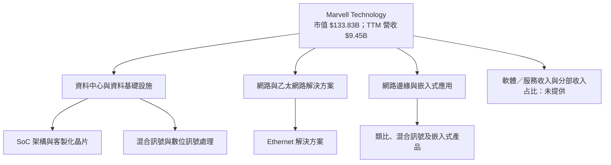
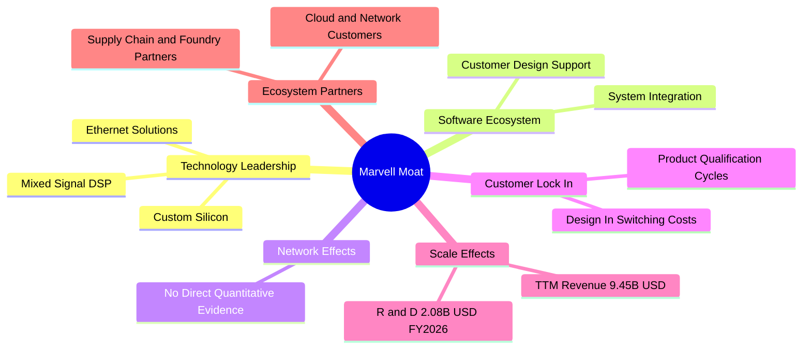
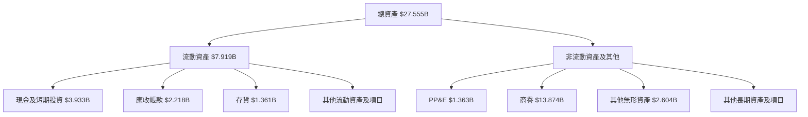
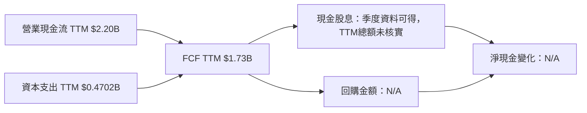
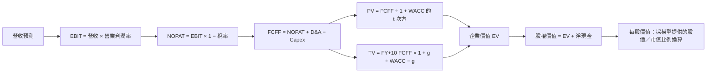
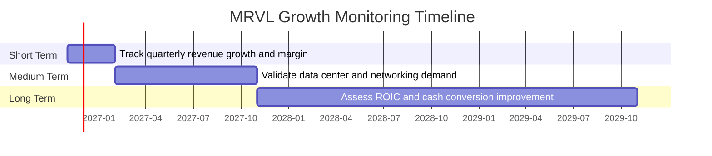
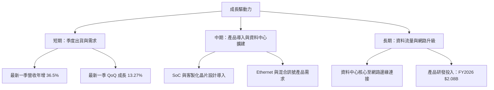
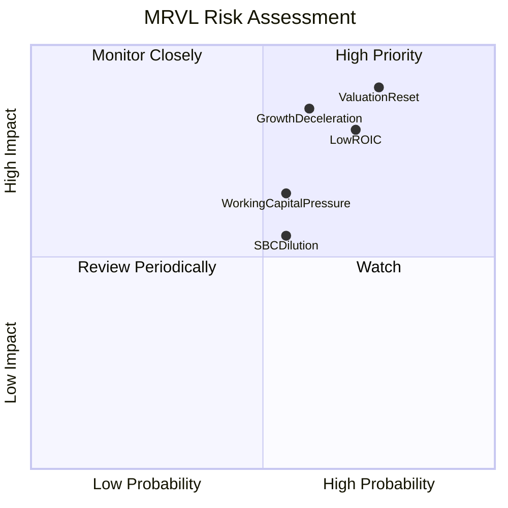
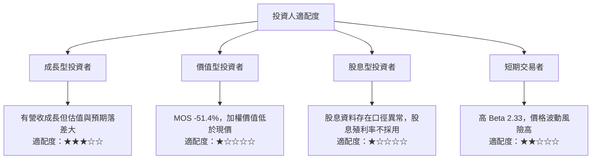

# MRVL 基本面深度分析報告
> **報告日期**：2026-11-18 ｜ **語言**：繁體中文 ｜ **數據來源**：SEC 申報資料 (XBRL)、Yahoo Finance、Finviz、StockAnalysis、Roic.ai ｜ **分析師**：CFA 級機構研究

## 目錄

| # | 章節 | 核心結論 |
|---|------|----------|
| 1 | 執行摘要 | 評級為賣出；加權合理價值 $98.22，MOS -51.4% |
| 2 | 公司概覽與商業模式 | 資料中心與資料基礎設施晶片是業務核心方向，但產品別收入與市占率未提供 |
| 3 | 損益表深度分析 | TTM 營收 $9.45B、TTM 成長 30.6%；最新一季年增 36.5% |
| 4 | 資產負債表分析 | 現金及短期投資 $3.93B、總債務 $4.96B，淨負債 $1.03B |
| 5 | 現金流量深度分析 | TTM FCF $1.73B、FCF Yield 1.29%；SBC 對現金流與股東稀釋需監控 |
| 6 | 獲利能力與資本效率 | ROIC 6.3% 低於 WACC 14.00%，目前資本回報未覆蓋資金成本 |
| 7 | 相對估值分析 | 同業估值結果分歧；MRVL P/S 高於自身五年中位數 |
| 8 | DCF 內在價值評估 | DCF 基準值 $38.08；加權合理價值 $98.22，現價高於兩者 |
| 9 | 成長催化劑 | AI／資料中心連接需求可能延續成長，但產品別營收與 TAM 數字未提供 |
| 10 | 風險矩陣 | 估值、成長持續性與資本效率為主要風險 |
| 11 | 投資建議 | 依 MOS 門檻為賣出；追蹤營收成長、毛利率、FCF 與 ROIC |

## 1. 執行摘要

MRVL 的 TTM 營收為 **$9.45B**，TTM 年增 **30.6%**，最新一季營收年增 **36.5%**，顯示資料基礎設施需求仍在擴張；但 TTM ROIC 為 **6.3%**，低於 **14.00%** 的 WACC，且 TTM FCF Yield 僅 **1.29%**。以 2026-11-17 收盤價 **$148.74** 計，估值方法加權後合理價值為 **$98.22**，MOS 為 **-51.4%**；依 MOS 規則 20，評級為 **賣出**。即使採用分析師共識目標價，DCF 基準值仍只有 **$38.08**，反映現價需要更高、更持久的成長與資本回報才能獲得支持。

### 1.0 一頁式投資儀表板（Portfolio Manager 30 秒速讀）

| 項目 | 內容 |
|------|------|
| **投資論點（3 句）** | ① TTM 營收年增 **30.6%**、最新一季年增 **36.5%**，資料中心與網路需求提供成長動能。② TTM ROIC **6.3%** 低於 WACC **14.00%**，目前新增資本尚未產生足以覆蓋資金成本的回報。③ 加權合理價值 **$98.22**，低於 2026-11-17 收盤價 **$148.74**，MOS 為 **-51.4%**。 |
| **綜合評分** | **5.8/10**（引用 1.1 評分卡） |
| **財務健康** | 🟡 現金及短期投資 **$3.93B**、總債務 **$4.96B**、淨負債 **$1.03B**；流動比率 **3.168**，但現金轉換週期由 **113 天**升至 **131 天**。 |
| **ROIC vs WACC** | **6.3% vs 14.00%**；差 **-7.7 個百分點**，目前未覆蓋資本成本。 |
| **FCF 趨勢** | 歷年 FCF 由 FY2023 **$1.07B** 至 FY2026 **$1.39B**；TTM FCF **$1.73B**，FCF Yield **1.29%**。 |
| **估值** | Forward P/E **20.18x**（Peer multiples 區塊未提供 MRVL Forward P/E，另據估值資料列示）；EV/EBITDA **46.235x**（市況資料）；FCF Yield **1.29%**。 |
| **DCF 內在價值（基準）** | **$38.08**；以「現價÷DCF價值−1」計，現價溢價 **290.6%**（第 8.5 節）。 |
| **安全邊際（MOS）** | **-51.4%**＝($98.22 − $148.74) ÷ $98.22；🔴 <10% 無安全邊際。基準採第 8.8 節加權合理價值。 |
| **預期報酬（基準情境 12M）** | DCF 基準情境相對現價 **-74.4%**；此為 DCF 模型情境值，不是另行設定的 12 個月目標價。 |
| **關鍵風險（前二）** | ① 市場預期與實際成長可能落差過大；② ROIC 長期低於 WACC、營運資金天數走高。 |
| **評級 + 信心度** | 🔴 **賣出** ｜ 信心：中（DCF 假設敏感且不同估值方法分歧大） |

### 1.1 綜合評分卡（全報告唯一）

| 維度 | 評分（1–10） | 主要依據（引用數字與其來源章節） |
|------|--------------|----------------------------------|
| 成長性 | 8.0 | TTM 營收成長 **30.6%**、最新一季年增 **36.5%**（第 3 章）；成長速度高，但仍需驗證能否延續。 |
| 獲利能力 | 6.0 | TTM 營業利益率 **16.5%**、ROIC **6.3%**，低於 WACC **14.00%**；Piotroski **6/9**（第 6 章）。 |
| 財務健康 | 7.0 | 淨負債 **$1.03B**、流動比率 **3.168**；CCC **131 天**，高於一年前 **113 天**（第 4 章）。 |
| 估值 | 2.0 | 加權合理價值 **$98.22**、MOS **-51.4%**；P/S **14.5x**，高於自身五年中位數 **9.9x**（第 7、8 章）。 |
| 護城河 | 7.0 | 具資料中心、乙太網路及混合訊號／DSP 等產品能力，但分部營收、客戶集中度及市占率數字未提供（第 2 章）。 |
| 管理層與資本配置 | 5.0 | FY2026 SBC **$590.8M**，約為該年營收的 **7.2%**；Piotroski 稀釋股數測試未通過，股東稀釋需持續監控。 |
| **綜合評分** | **5.8** | 六項算術平均：**(8.0 + 6.0 + 7.0 + 2.0 + 7.0 + 5.0) ÷ 6 = 5.8**。 |

### 1.2 五大投資論點 + 三大核心風險

| 類型 | 項目 | 具體依據 | 信心度 |
|------|------|----------|--------|
| 🟢 **投資論點①** | 資料基礎設施營收成長 | TTM 營收 **$9.45B**，年增 **30.6%**；最新一季年增 **36.5%**。若資料中心相關產品持續放量，營收規模可擴張。 | 🟢 高 |
| 🟢 **投資論點②** | 最近年度轉虧為盈 | FY2026 營業利益 **$1.34B**，對比 FY2025 營業虧損 **$366.4M**；但需區分持續性營運改善與併購／會計因素。 | 🟡 中 |
| 🟢 **投資論點③** | 現金流為正 | TTM 營業現金流 **$2.20B**、資本支出 **$470.20M**、FCF **$1.73B**；可支援研發、償債與股東回報。 | 🟢 高 |
| 🟢 **投資論點④** | 短期流動性充足 | 現金及短期投資 **$3.93B**，流動比率 **3.168**；短期償債緩衝尚可。 | 🟢 高 |
| 🟢 **投資論點⑤** | 同業估值提供部分支撐 | 同業 Forward P/E 中位數 **17.6x**，對應估值方法給出的每股價值 **$129.70**；仍低於現價。 | 🟡 中 |
| 🟡 **風險①** | 估值對成長預期要求高 | 2026-11-17 收盤 **$148.74**；DCF 基準值 **$38.08**，反推市場需要年 1 營收成長 **73.2%**（基準 30.0%）。 | 🔴 高衝擊 |
| 🔴 **風險②** | 資本回報低於資金成本 | ROIC **6.3%** 對 WACC **14.00%**，差 **-7.7pp**；若無法提高資本效率，成長可能不等於價值創造。 | 🔴 高衝擊 |
| 🟡 **風險③** | 營運資金吸收增加 | CCC 由 **113 天**增至 **131 天**；DSO **+13 天**、DIO **+14 天**。若非短期出貨與備貨因素，可能壓低現金轉換。 | 🟡 中度 |

### 1.3 快速統計卡片

| 指標 | 公司實際值（期間） | 同業中位數 | 狀態 |
|------|--------------------|------------|------|
| 營收成長（TTM） | **30.6%** | — | 🟢 |
| 營收成長（最新一季年增） | **36.5%** | **85.5%**（AVGO、NVDA、AMD 中位數） | 🟡 |
| 毛利率（TTM） | **52.2%** | **74.7%**（同業三家中位數） | 🔴 |
| 營業利益率（TTM） | **16.5%** | — | 🟡 |
| ROIC（TTM） | **6.3%** | — | 🔴 |
| Forward P/E | **20.2x**（估值資料） | **17.6x**（peer 區塊中位數） | 🟡 |
| FCF Yield（TTM） | **1.29%** | — | 🔴 |
| Piotroski F-Score | **6 / 9** | — | 🟡 |

### 1.4 投資結論

╔══════════════════════════════════════════════════════════════════╗  
║　　　　　　　　　📊 投資結論摘要　　　　　　　　　　　　　　　║  
╠══════════════════════════════════════════════════════════════════╣  
║ 評級：🔴 賣出（依 MOS 門檻；未作質化調整）　　　　　　　　　　║  
║ 價格（2026-11-17 收盤）：$148.74　　　　　　　　　　　　　　　║  
║ DCF 內在價值（基準）：$38.08（現價溢價 +290.6%）　　　　　　║  
║ 安全邊際 MOS：-51.4%＝($98.22−$148.74)÷$98.22　　　　　　　　║  
║ 加權合理價值（8.8）：$98.22　　　　　　　　　　　　　　　　　║  
║ DCF 情境價值：悲觀 $19.28（-87.0%）　　　　　　　　　　　　　║  
║　　　　　　　 基準 $38.08（-74.4%）　　　　　　　　　　　　　║  
║　　　　　　　 樂觀 $72.38（-51.3%）　　　　　　　　　　　　　║  
║ 綜合評分：5.8/10（引用 1.1）　　　　　　　　　　　　　　　　　║  
║ 適合投資人：已有部位者以成長與估值驗證為主；不適合以低估值為║  
║　　　　　　 核心的投資人將其視為安全邊際充足標的。　　　　　　║  
╚══════════════════════════════════════════════════════════════════╝

## 2. 公司概覽與商業模式

### 2.1 業務結構與收入來源

公司概述指出，Marvell Technology 提供從資料中心核心到網路邊緣的資料基礎設施半導體解決方案，產品涉及 SoC 架構、類比、混合訊號、數位訊號處理與乙太網路。各產品線營收及占比未提供，因此不能以圖表虛構分部比例；下圖呈現產品關係，不代表收入占比。

### 2.2 市場份額

市場份額數據未提供，無法以可信數字呈現其在資料中心網路、客製化晶片或乙太網路晶片中的占比。以已知營收觀察，MRVL TTM 營收為 **$9.45B**、年增 **30.6%**，最新一季年增 **36.5%**；其成長速度低於所列同業最新一季年增中位數 **85.5%**，但同業成長率受產品周期與比較基期影響，不能直接視為市占變化。

### 2.3 競爭護城河分析

以上為業務特性層面的分析；公司未提供可量化網路效應、客戶留存率、設計案數或分部市場份額數據。FY2026 研發支出為 **$2.08B**，約占當年營收 **25.4%**（$2.08B ÷ $8.19B），表示維持產品競爭力需要持續投入；若研發無法轉化為設計導入及收入，固定成本可能壓縮利潤。

### 2.4 護城河強度

| 護城河項目 | 強度（強／中／弱） | 證據（引用數字或事實） | 會削弱它的情況 |
|------------|--------------------|------------------------|----------------|
| 技術與產品組合 | 中 | 涵蓋 SoC、類比、混合訊號、DSP 與乙太網路；FY2026 研發支出 **$2.08B**。 | 產品性能或功耗落後、客戶轉向內部設計或競品。 |
| 軟體與系統整合 | 中 | 公司提供跨資料中心至網路邊緣的解決方案，但軟體收入未單獨披露。 | 軟體與硬體整合不足、客戶難以承擔切換成本。 |
| 網路效應 | 弱／未證實 | 未提供用戶或裝置網路效應相關指標。 | 生態系規模不足以提高轉換成本或促進新客戶導入。 |
| 客戶鎖定 | 中 | 半導體產品設計導入及資格認證通常具產品週期；公司層級客戶留存資料未提供。 | 客戶多來源策略、產品重新設計或主要客戶自行開發。 |
| 規模效應 | 中 | TTM 營收 **$9.45B**，FY2026 研發 **$2.08B**。 | 同業投資規模更大、毛利率與成本結構落後。 |
| 生態夥伴 | 中 | 業務需要雲端客戶、供應鏈與晶圓代工夥伴協同；個別夥伴營收占比未提供。 | 供應限制、客戶集中或夥伴合作關係改變。 |

1.1「護城河」評分 **7.0/10**，依據是產品跨度、研發投入與設計導入特性；由於客戶集中度、留存、分部營收及市占率資料不足，不能將其視為已完全驗證的強護城河。

## 3. 損益表深度分析

### 3.1 年度收入成長趨勢（近4年）

年度營收資料為 FY2023 **$5.92B**、FY2024 **$5.51B**、FY2025 **$5.77B**、FY2026 **$8.19B**。FY2024 下滑，FY2025 小幅回升，FY2026 加速增長；三年 CAGR 為 **11.5%**，計算為 \((8.19 ÷ 5.92)^{1/3}-1\)。各年年增率依相鄰年度營收計算，使用金額四捨五入後會有小幅差異。

╔══════════════════════════════════════════════════════════════════╗  
║　　　　　　Marvell Technology 年度收入趨勢（FY2023–FY2026）　　　║  
╠══════════════════════════════════════════════════════════════════╣  
║ FY2023　$5.92B　███████████████░░░░░░░░　YoY：—　　　　　　　　║  
║ FY2024　$5.51B　██████████████░░░░░░░░░　YoY：-6.9%　🟡　　　　║  
║ FY2025　$5.77B　███████████████░░░░░░░░　YoY：+4.7%　🟡　　　　║  
║ FY2026　$8.19B　█████████████████████░░　YoY：+42.1%　🟢　　　　║  
╠══════════════════════════════════════════════════════════════════╣  
║ 三年營收 CAGR：(8.19÷5.92)^(1/3)−1 = 11.5%　　　　　　　　　　　║  
║ FY2026 加速增長有利於規模效應，但需確認後續是否由持續性需求支撐。║  
╚══════════════════════════════════════════════════════════════════╝

### 3.2 季度收入趨勢分析

| 季度 | 營收 | QoQ 成長 | YoY 成長 | 備註 |
|------|------|----------|----------|------|
| FY2026 Q3（2025-11-01） | $2.075B | — | +36.83% | 依 StockAnalysis 季度資料。 |
| FY2026 Q4（2026-01-31） | $2.219B | +6.94% | +22.08% | QoQ = $2.219B ÷ $2.075B − 1。 |
| FY2027 Q1（2026-05-02） | $2.418B | +8.97% | +27.57% | QoQ = $2.418B ÷ $2.219B − 1。 |
| FY2027 Q2（2026-08-01） | $2.739B | +13.27% | +36.5% | YoY 採已核實單季年增數；QoQ = $2.739B ÷ $2.418B − 1。 |

最近四季 QoQ 營收均增長，且最新一季增速升至 **13.27%**；若後續季度仍能維持順序成長，可能反映需求放量與出貨增加，但未提供產品別營收，無法進一步分辨 AI、網通及其他應用的貢獻。

### 3.3 利潤率演變分析

| 利潤率指標 | FY2023 | FY2024 | FY2025 | FY2026 | 趨勢 | 評估 |
|------------|--------|--------|--------|--------|------|------|
| **毛利率** | 50.8% | 41.6% | 41.2%* | 51.1%* | FY2026 回升 | 🟡 |
| **營業利益率** | 6.1% | -7.9% | -6.4% | 16.4% | FY2026 明顯改善 | 🟡 |
| **淨利率** | -2.8% | -16.9% | -15.3% | 32.6% | FY2026 轉正 | 🟡 |

\*年度毛利率以部分年度損益資料的毛利除以營收計算；資料來源間 FY2025 毛利額存在差異，因此歷史毛利率僅供方向性比較，不作高精度趨勢結論。TTM 毛利率採已列數值 **52.2%**。FY2026 營業利益率為 $1.34B ÷ $8.19B = **16.4%**，而 TTM 營業利益率採核實值 **16.5%**。FY2026 淨利率以 $2.67B ÷ $8.19B 計算；需留意單年度淨利可能受到非經常性項目影響。

**利潤率演變深度解析：**FY2024、FY2025 營業虧損，FY2026 轉為 **$1.34B** 營業利益，並與營收年增 **42.1%** 同步，顯示業務規模、產品組合或成本結構有明顯改善。但可用數據未提供產品組合、併購攤銷、重整費用或客戶定價變化的拆解，因此無法把利潤率跳升全數歸因於結構性營運槓桿。DCF 亦將營業利益率由 TTM **16.5%** 逐步衰減至第十年 **4.0%**，反映模型對長期競爭與成熟化採保守設定。

### 3.4 費用結構分析

費用表中可用的 FY2026 數據包括營收 **$8.19B**、毛利 **$4.18B**、研發費用 **$2.08B**、營業利益 **$1.34B**。資料未完整提供銷管費、併購攤銷及其他營業費用的可比拆分，因此不以不完整項目製作費用結構圓餅圖。

以 FY2026 營收為分母，研發費用比率約 **25.4%**（$2.08B ÷ $8.19B）；較高研發投入有助於維持產品迭代，但也表示若營收放緩，費用率可能對營業利益率形成壓力。

### 3.5 季度 EPS 趨勢與盈餘品質（Quality of Earnings）

歷史 EPS Est 數據為 nan，無法判定近四季是否超預期或不及預期。StockAnalysis 列出的季度 EPS Actual 為 FY2026 Q3 **$2.20**、FY2026 Q4 **$0.47**、FY2027 Q1 **$0.04**、FY2027 Q2 **$0.34**；其中 Q3 數值與同期淨利波動顯著，可能涉及非經常性損益或資料口徑差異，不宜直接當作核心季度獲利軌跡。

| 盈餘品質項目 | 數值/佔比 | 評估 |
|--------------|-----------|------|
| 股權薪酬 SBC / 營收 | 最近四季 SBC 合計 $828.9M ÷ TTM 營收 $9.45B = **8.8%** | 🔴 股權薪酬具實質稀釋成本；最新四季 SBC 加總依季度資料，與財報年度 SBC 口徑可能存在期間差異。 |
| SBC / 營業現金流 | $828.9M ÷ $2.20B = **37.7%** | 🔴 對現金流品質評估重要；SBC 是非現金費用，但不代表對股東沒有成本。 |
| FCF / 淨利（現金轉換率） | $1.73B ÷ TTM 淨利 $2.64B = **65.5%** | 🟡 正 FCF，但低於淨利，營運資金及非現金項目需持續檢視。 |
| 一次性/非經常性損益 | 季度淨利及 EPS 波動大；具體一次性項目拆解未提供 | 🟡 無法量化其對單季盈餘的影響。 |
| 有效稅率異常 | **12.4%**（最新年度有效稅率） | 🟡 低於一般法定稅率，但未提供稅務調節表細項；DCF 依核實值採用。 |
| 資本化支出 vs 費用化 | TTM Capex **$470.20M**；資本化研發等項目明細未提供 | 🟡 無法判定是否有重大成本資本化而延後費用。 |

**盈餘品質結論：**TTM FCF **$1.73B** 為正，但 FCF/淨利約 **65.5%**，SBC 對營收約 **8.8%**，且 Piotroski 應計品質測試未通過。現有資料不足以斷言 GAAP 淨利被高估，但每股經濟盈餘須考慮股權薪酬稀釋與現金轉換低於淨利兩項折價。

## 4. 資產負債表分析

### 4.1 資產結構分解

最新 TTM 資產負債表資料列示總資產 **$27.555B**、流動資產 **$7.919B**、PP&E **$1.363B**、商譽 **$13.874B**、其他無形資產 **$2.604B**。下圖以已列示金額呈現主要項目；其他資產細項未完全列出，故不強行加總為完整分類。

商譽及無形資產合計 **$16.478B**，約占總資產 **59.8%**（$16.478B ÷ $27.555B）。這提高併購相關減損的潛在敏感度；是否需要減損需依未來現金流與會計測試判定，不能僅因比例高便推定減損。

### 4.2 流動性與營運資金分析

| 指標 | 最新 TTM | 一年前 TTM | 變化 | 解讀 |
|------|----------|------------|------|------|
| 流動比率 | 3.168 | N/A | N/A | 短期流動性緩衝充足；歷史同口徑比較未提供。 |
| 速動比率 | 2.461 | N/A | N/A | 即使剔除存貨，短期資產覆蓋流動負債仍具緩衝。 |
| DSO 應收帳款天數 | 86 天 | 73 天 | +13 天 | 收款週期拉長；可能來自客戶組合、季度出貨時點或收款條件，需看後續回落與否。 |
| DIO 存貨天數 | 110 天 | 96 天 | +14 天 | 庫存天數增加，可能是需求備貨，也可能代表庫存周轉變慢。 |
| DPO 應付帳款天數 | 64 天 | 56 天 | +8 天 | 付款天數上升，短期有助資金週轉；不能單獨推定供應商議價力提升。 |
| CCC 現金轉換週期 | 131 天 | 113 天 | +18 天 | 淨營運資金占用擴大，與收入成長並行，但若持續上升會稀釋現金流轉換。 |

營運天數依 QUALITY FIGURES 數值照列，不自行重算。CCC = DSO + DIO − DPO；現值 86 + 110 − 64 = 132 天，與來源列示 **131 天**相差 1 天，屬底層天數四捨五入或計算口徑差異，本文以核實列示值 **131 天**為準。

### 4.3 債務結構分析

債務與現金數據存在不同來源口徑：本文核心分析採核實值總債務 **$4.96B**、現金及短期投資 **$3.93B**、淨負債 **$1.03B**；其他市場資料另列債務 **$5.29B** 與淨負債 **$1.35B**，因期間／分類不同，不與核實值混用。

╔══════════════════════════════════════════════════════════════════╗  
║　　　　　　　　　MRVL 債務健康診斷　　　　　　　　　　　　　　║  
╠══════════════════════════════════════════════════════════════════╣  
║ 總債務：　　　　$4.96B　████████████████　　　　　　　　　　　　║  
║ 現金+短期投資：$3.93B　█████████████░░░　　　　　　　　　　　　║  
║ 淨負債：　　　　$1.03B　███░░░░░░░░░░░░░　🟡　　　　　　　　║  
║ 流動比率：　　　3.168x　🟢　　　　　　　　　　　　　　　　　　║  
║ Debt/EBITDA：　　N/A（依核實區塊未提供同口徑債務及 EBITDA）　　　║  
║ 利息保障倍數：　N/A（利息費用未提供）　　　　　　　　　　　　　║  
╚══════════════════════════════════════════════════════════════════╝

公司有淨負債，但現金存量及流動比率提供短期緩衝。由於利息費用與一致口徑 EBITDA 未同時提供，不推算 Debt/EBITDA 或利息保障倍數。

### 4.4 股東權益趨勢

年度股東權益由 FY2023 **$15.64B** 降至 FY2024 **$14.83B**，FY2025 **$13.43B**，FY2026 回升至 **$14.31B**。FY2026 回升約 **6.6%**（$14.31B ÷ $13.43B − 1），但股東權益增加不等於每股價值同步增加，仍須結合稀釋股數與 ROIC 判斷。

╔══════════════════════════════════════════════════════════════════╗  
║　　　　　　　　MRVL 歷年股東權益（年度）　　　　　　　　　　　║  
╠══════════════════════════════════════════════════════════════════╣  
║ FY2023　$15.64B　████████████████████　　　　　　　　　　　　　║  
║ FY2024　$14.83B　███████████████████░　　　　　　　　　　　　　║  
║ FY2025　$13.43B　█████████████████░░░　　　　　　　　　　　　　║  
║ FY2026　$14.31B　██████████████████░░　　　　　　　　　　　　　║  
╚══════════════════════════════════════════════════════════════════╝

## 5. 現金流量深度分析

### 5.1 現金流量瀑布圖

TTM 數據提供營業現金流、資本支出及 FCF，但沒有一致口徑的 TTM 淨利以外的完整「股息／回購／淨現金變化」瀑布數字，故下圖不填未提供的金額。

### 5.2 FCF 轉換率趨勢

| 財年 | FCF | 淨利 | FCF / 淨利 | 解讀 |
|------|-----|------|------------|------|
| FY2023 | $1.07B | -$163.5M | 不具比較意義 | 淨利為負，比例失去經濟解釋力。 |
| FY2024 | $1.02B | -$933.4M | 不具比較意義 | 淨利為負，FCF 仍為正。 |
| FY2025 | $1.39B | -$885.0M | 不具比較意義 | 淨利為負，需留意非現金與應計項目。 |
| FY2026 | $1.39B | $2.67B | 約 **52.1%** | 淨利轉正但 FCF 轉換率不高。 |
| TTM 至 2026-08-01 | $1.73B | $2.64B | 約 **65.5%** | TTM FCF 為營業現金流減資本支出；轉換率仍低於 100%。 |

年度 FCF 數字與 TTM FCF 口徑及期間不同；不可將兩者當成同一期間比較。TTM 轉換率以 StockAnalysis TTM 淨利為分母，作為品質指標參考。

### 5.3 自由現金流趨勢

年度 FCF：FY2023 **$1.07B**、FY2024 **$1.02B**、FY2025 **$1.39B**、FY2026 **$1.39B**；最新 TTM FCF **$1.73B**。年度數據並未呈現每年大幅加速，最新 TTM 增加則需觀察是否能轉化為穩定的每股 FCF。

╔══════════════════════════════════════════════════════════════════╗  
║　　　　　　　　MRVL 自由現金流：歷史年度與 TTM　　　　　　　　║  
╠══════════════════════════════════════════════════════════════════╣  
║ FY2023　$1.07B　████████████░░░░░░░░　FCF Yield：N/A　　　　　║  
║ FY2024　$1.02B　███████████░░░░░░░░░　FCF Yield：N/A　　　　　║  
║ FY2025　$1.39B　███████████████░░░░░　FCF Yield：N/A　　　　　║  
║ FY2026　$1.39B　███████████████░░░░░　FCF Yield：N/A　　　　　║  
║ TTM　　 $1.73B　███████████████████░　FCF Yield：1.29%　　　　║  
╠══════════════════════════════════════════════════════════════════╣  
║ 年度 FCF 報告未提供各年一致市值，故不回填歷史 FCF Yield。　　　║  
╚══════════════════════════════════════════════════════════════════╝

### 5.4 資本配置評估

FY2026 資料列示資本支出 **$358.6M**、現金股息 **$205.1M**、SBC **$590.8M**；回購金額、收購支出與完整留存現金用途未提供，不製作比例圓餅圖。

| 配置項目 | 可得數據 | 評估 |
|----------|----------|------|
| 資本支出 | FY2026 $358.6M；TTM $470.20M | 支持產能及設備需求；實際增量投資回報需以 ROIC 追蹤。 |
| 股息 | FY2026 $205.1M | 金額相對 FY2026 FCF $1.39B 不高，但股息殖利率資料出現不合理的 16.0%，不採用。 |
| 股權薪酬 | FY2026 $590.8M | 約占 FY2026 營收 **7.2%**；需視為股東稀釋成本。 |
| 回購 | 未提供 | 無法判斷是否抵銷 SBC 稀釋。 |
| 留存／收購 | 未提供完整分項 | 不對資本配置比例作推算。 |

## 6. 獲利能力與資本效率

### 6.1 ROE / ROA / ROIC 趨勢

| 指標 | 最新值 | 歷史可比資料 | 評估 |
|------|--------|--------------|------|
| ROE | TTM **14.2%**（QUALITY FIGURES） | 同一資料集的 DuPont ROE 為 **14.2%**；其他市場資料列 **16.5%**，期間或口徑不同 | 本報告以核實品質指標 **14.2%**為準。 |
| ROA | TTM **4.1%** | 歷史可比值未提供 | 資產獲利回報低於 ROE，反映資產周轉及資本結構影響。 |
| ROIC | TTM **6.3%** | 歷史同口徑資料未提供 | 明顯低於 WACC，當前資本回報不足以覆蓋資金成本。 |

產業均值資料未提供，故不列產業均值比較。

### 6.2 ROIC vs WACC 分析（核心價值創造判斷）

以下採用已核實 WACC **14.00%**；成本資本資料顯示未受上限限制前計算值為 **14.13%**，因設定區間上限為 **14%**，最後採用 **14.00%**。

╔══════════════════════════════════════════════════════════════════╗  
║　　　　　　　　ROIC vs WACC 深度分析　　　　　　　　　　　　　║  
╠══════════════════════════════════════════════════════════════════╣  
║ WACC 輸入：　　　　　　　　　　　　　　　　　　　　　　　　　　║  
║ ├ 無風險利率（10Y 美債）：5.10%　　　　　　　　　　　　　　　║  
║ ├ ERP：5.00%　　　　　　　　　　　　　　　　　　　　　　　　　║  
║ ├ 原始 Beta：2.33；調整後 Beta：1.88　　　　　　　　　　　　　║  
║ ├ 股權成本：5.10% + 1.88 × 5.00% = 14.50%（核實值 14.53%）║  
║ ├ 稅前債務成本：4.08%；稅率：12.4%　　　　　　　　　　　　　║  
║ ├ 股權／債務權重：96.4%／3.6%　　　　　　　　　　　　　　　　║  
║ └ 計算 WACC 14.13%；受 7%–14% 區間限制後採用 14.00%　　　　　║  
║　　　　　　　　　　　　　　　　　　　　　　　　　　　　　　　　║  
║ ROIC（TTM）：6.3%　　　　　　　　　　　　　　　　　　　　　　║  
║ EVA spread：6.3% − 14.00% = -7.7pp　　　　　　　　　　　　　　║  
║ ROIC / WACC：6.3% ÷ 14.00% = 0.45x　　　　　　　　　　　　　║  
║　　　　　　　　　　　　　　　　　　　　　　　　　　　　　　　　║  
║ ROIC　6.3%　▓▓▓▓▓▓▓▓░░░░░░░░░░░░　🔴　　　　　　　　　　　║  
║ WACC 14.0%　▓▓▓▓▓▓▓▓▓▓▓▓▓▓▓▓▓░░░　基準　　　　　　　　　║  
║　　　　　　　　　　　　　　　　　　　　　　　　　　　　　　　　║  
║ 結論：以現有 TTM 資本回報計算，MRVL 未覆蓋資金成本，尚未創造║  
║ 正的經濟附加價值；未來須提高 ROIC 或降低風險資本成本。　　　　║  
╚══════════════════════════════════════════════════════════════════╝

ROIC 採核實資料的稅後營業利益除以投入資本定義，不重算單一年度 NOPAT 與投入資本，避免混用期間與資產負債表口徑。原始 Beta **2.33** 高於 1.5，故成本資本模型使用調整後 Beta **1.88**，公式為 \(⅔×2.33+⅓×1=1.8867\)，核實數值依資料區塊列為 **1.88**。

### 6.3 杜邦三因素分解

| 因素 | 數值（TTM） | 解讀 |
|------|-------------|------|
| 淨利率 | **27.9%** | TTM 淨利潤率高，但須考量非經常性項目及 SBC。 |
| 資產週轉率 | **0.34x** | 每單位資產創造的收入有限；商譽與無形資產規模較大。 |
| 權益乘數 | **1.49x** | 槓桿程度不是 ROE 的主要來源。 |
| **ROE** | **14.2%** | **27.9% × 0.34 × 1.49 = 14.1%**；來源列示 ROE **14.2%**，差異來自四捨五入。 |

依杜邦分解，ROE 主要受淨利率支撐，資產周轉率偏低；權益乘數 **1.49x** 並未顯示 ROE 主要由高財務槓桿撐起。

### 6.4 財務體質：Piotroski F-Score

Piotroski F-Score 為 **6/9**。九項可判定測試及結果如下，依 QUALITY FIGURES 原值照列。

| 測試 | 結果 | 解讀 |
|------|------|------|
| ROA > 0 | ✅ 通過 | 盈利能力為正。 |
| 營業現金流 > 0 | ✅ 通過 | TTM 營業現金流為正。 |
| ROA 高於一年前 | ✅ 通過 | 資產獲利改善。 |
| 營業現金流 > 淨利（應計品質） | ❌ 未通過 | 淨利高於營業現金流，盈餘的現金轉換需留意。 |
| 長期負債 ÷ 總資產低於一年前 | ✅ 通過 | 財務槓桿指標改善。 |
| 流動比率高於一年前 | ✅ 通過 | 短期流動性改善。 |
| 稀釋股數未增加 | ❌ 未通過 | 股東持股可能被 SBC 等因素稀釋。 |
| 毛利率高於一年前 | ✅ 通過 | 毛利率年度比較改善。 |
| 資產週轉率高於一年前 | ❌ 未通過 | 資產運用效率相較一年前未改善。 |

總分 **6/9** 代表多數基本面測試通過，但應計品質、稀釋與資產周轉三項未通過，與 SBC 比率及 CCC 上升的觀察相符。

## 7. 相對估值分析

### 7.1 同業估值比較表格

MRVL 的同業倍數採 Peer multiples 區塊；MRVL 自身倍數採同一區塊提供的估值歷史資料。不同來源的市場估值資料另有差異，因此表內以核實同業比較數值為主。

| 估值指標 | **MRVL** | **AVGO** | **NVDA** | **AMD** | 本公司評估 |
|----------|----------|---------|---------|---------|-----------|
| **Trailing P/E** | 49.1x | 43.6x | 19.7x | 107.6x | 🟡 高於 AVGO、NVDA，低於 AMD；同業獲利成長與會計口徑不同。 |
| **Forward P/E** | 20.2x* | 17.6x | 9.6x | 28.5x | 🟡 MRVL 高於同業中位數 **17.6x**；MRVL 值來自估值資料而非 Peer multiples 欄。 |
| **P/S Ratio** | 14.5x | 18.3x | 12.4x | 18.3x | 🟡 高於 NVDA、低於 AVGO/AMD；MRVL 自身歷史位置偏高。 |
| **EV/EBITDA** | 88.4x | 31.9x | 18.5x | 73.5x | 🔴 MRVL 倍數高，且與另一估值資料列示的 46.235x 不同，反映來源口徑差異。 |
| **最新一季營收年增** | 36.5% | 85.5% | 105.9% | 44.7% | 🟡 MRVL 成長低於三家同業的中位數 **85.5%**。 |
| **毛利率（TTM）** | 52.2% | 75.5% | 74.7% | 56.0% | 🔴 MRVL 低於三家同業中位數 **74.7%**。 |

\*MRVL Forward P/E 來自市場估值資料 **20.178835x**，四捨五入呈現為 **20.2x**；非 Peer multiples 區塊原值。Peer multiples 的同業 P/E 中位數：Trailing **43.6x**（三家中位數）、Forward **17.6x**、P/S **18.3x**、EV/EBITDA 若依區塊所用 AVGO、NVDA 中位數為 **25.2x**。

### 7.2 歷史估值區間分析

╔══════════════════════════════════════════════════════════════════╗  
║　　　　　　　MRVL 五年 P/E 歷史區間（TTM）　　　　　　　　　　　║  
╠══════════════════════════════════════════════════════════════════╣  
║ 五年低點　25.6x　█　　　　　　　　　　　　　　　　　　　　　　║  
║ 五年中位　56.5x　███████████　　　　　　　　　　　　　　　　　║  
║ 目前　　　49.1x　█████████　百分位：50%　　　　　　　　　　　║  
║ 五年高點　61.9x　████████████　　　　　　　　　　　　　　　　　║  
║　　　　　　　　　　　　　　　　　　　　　　　　　　　　　　　　║  
║ P/S：目前 14.5x；五年中位數 9.9x；目前百分位 85%　　　　　　║  
║ EV/EBITDA：目前 88.4x；中位數 156.4x；目前百分位 25%　　　　║  
╚══════════════════════════════════════════════════════════════════╝

目前 P/E **49.1x** 低於五年中位數 **56.5x**，但仍處自身歷史區間中段；P/S **14.5x** 高於中位數 **9.9x** 且處第 **85** 百分位，顯示市場仍給予較高收入估值。EV/EBITDA 的歷史區間極寬（**53.3x–730.9x**），使用時須注意獲利基期與併購會計造成的波動。

### 7.3 情境價值（Bear / Base / Bull，照抄 DCF MODEL 的 Scenarios）

| 情境 | 第 1 年營收成長 | 期末營業利潤率 | WACC | 每股價值 | 相對現價 | 機率 | 會發生的條件 |
|------|----------------|----------------|------|----------|----------|------|--------------|
| 🔴 悲觀 | 15.0% | 3.4% | 15.00% | $19.28 | -87.0% | 25% | 資料中心相關需求降速、競爭或產品組合使期末利潤率低於基準，且資金成本上升。 |
| 🟡 基準 | 30.0% | 4.0% | 14.00% | $38.08 | -74.4% | 50% | TTM 成長延續至第一年後逐步衰減，期末利潤率按模型逐步降至 4.0%。 |
| 🟢 樂觀 | 45.0% | 4.4% | 13.00% | $72.38 | -51.3% | 25% | AI／資料中心需求遠高於基準，且融資風險下降、利潤率較基準高。 |

以上每股價值、假設與機率直接採 DCF 情境資料，不另外設定目標價。即使樂觀情境 **$72.38**，仍低於現價 **$148.74**。

### 7.4 相對估值隱含價格區間

╔══════════════════════════════════════════════════════════════════╗  
║　　　　　　　　估值方法隱含每股價值　　　　　　　　　　　　　║  
╠══════════════════════════════════════════════════════════════════╣  
║ DCF 基準　　　　　 $38.08　　█　　　　　　　　　　　　　　　　　║  
║ 同業 EV/EBITDA　　 $77.88　　████　　　　　　　　　　　　　　　║  
║ 加權合理價值　　　 $98.22　　█████　　　　　　　　　　　　　　　║  
║ 同業 Forward P/E　$129.70　　███████　　　　　　　　　　　　　　║  
║ 現價　　　　　　　$148.74　　████████　　　　　　　　　　　　　║  
║ 分析師共識　　　　$310.89　　████████████████　　　　　　　　　║  
╚══════════════════════════════════════════════════════════════════╝

- **同業 Forward P/E：$129.70**，依同業 Forward P/E 中位數 **17.6x** × MRVL Forward EPS **$7.37**。
- **同業 EV/EBITDA：$77.88**，依同業中位數 **25.2x**（AVGO、NVDA）× TTM EBITDA，再加淨現金／扣除淨負債。估值方法區塊已給出結果，本報告不反推或替換其輸入。
- **DCF 基準：$38.08**，採 10 年 FCFF、WACC **14.00%**、永續成長率 **3.0%**。
- **分析師共識目標價：$310.89**，40 位分析師平均值；屬外部參考，不代表模型內在價值。

## 8. DCF 內在價值評估（Discounted Cash Flow）

> 本章 DCF 模型輸入及輸出採核實模型原值。對於模型未提供的項目，明確標示未提供，不另建模型或替換任何模型數字。

### 8.0 估值推理鏈（Thinking Logic：在算之前先想清楚）

**Step 1 — 價值由哪些變數決定？**  
MRVL 內在價值主要由資料基礎設施半導體現有收入底盤、未來營收成長，以及最終 GAAP EBIT 利潤率共同決定。公司未提供各業務收入占比，故無法把成長曲線拆成精確的產品別權重。基準模型將 TTM **$9.45B** 營收作起點，第一年成長 **30.0%**，並將營業利益率由 **16.5%** 逐步降至第十年的 **4.0%**。模型敏感性顯示，WACC 與終值成長率會影響估值；市場反推則顯示現價要求年 1 營收成長 **73.2%**，故營收增長假設是多空分歧的核心之一。

**Step 2 — 模型選擇**

| 決策點 | 本報告採用 | 理由（含數字） | 曾考慮但否決 | 否決理由 |
|--------|-----------|----------------|--------------|----------|
| 現金流定義 | FCFF | 以 WACC 折現，求企業價值，再橋接至股權價值。 | FCFE | 債務以企業價值橋接處理，保持模型口徑一致。 |
| 預測期 N | 10 年 | 模型固定列出 FY+1 至 FY+10；沒有另行縮短或延長。 | 5 年 | 模型已有 10 年逐年預測，不能自行改動。 |
| 終值方法 | Gordon Growth | 模型基準終值採永續成長率 **3.0%**。 | 退出倍數作主模型 | DCF 區塊未提供退出倍數終值的計算結果；不自行建構。 |
| EBIT 基礎 | GAAP EBIT | DCF 模型明列 GAAP EBIT，FCFF = NOPAT + D&A − Capex。 | 非 GAAP EBIT | 避免加回 SBC 後漏算股東成本。 |

**Step 3 — 假設推導鏈**

- **營收成長：**錨點＝TTM 成長 **30.6%**、最新一季 YoY **36.5%**；調整＝模型第一年成長受 30% 上限限制，並逐年線性降至第十年 **3.0%**；**採用第 1 年 30.0%，第 10 年 3.0%**；否決第一年直接採用最新一季 **36.5%**，因該值是單季年增率且模型上限為 30.0%。
- **期末營業利益率：**錨點＝TTM **16.5%**；調整＝模型依近五財年中位數逐步衰減；**採用第 10 年 4.0%**；否決維持 16.5%，因模型設定考量成熟化及競爭，不假設長期維持當前利潤率。
- **永續成長率 g：**錨點＝模型採用長期成長 **3.0%**；調整＝保持低於 WACC **14.00%**；**採用 3.0%**；否決高於 3.0% 的基準值，以免終值過度依賴高成長。
- **預測期 N：**錨點＝模型提供完整 10 年；**採用 10 年**；否決較短或較長期間，因無法改動程式模型既有預測。
- **Capex／營收：**錨點＝模型第 1 年與第 10 年皆為 **5.0%**；調整＝模型設定不高於 D&A 比率的 1.1 倍限制；**採用 5.0%**；不另替換為其他歷史平均值。
- **EBIT 基礎與 SBC：**錨點＝公司 FY2026 SBC **$590.8M**，模型採 GAAP EBIT；**採用組合 (A)，SBC 已包含在 GAAP 費用中，FCFF 不再扣 SBC，股數不再額外稀釋**；否決 GAAP EBIT 再扣 SBC，因會重複計算。
- **年稀釋率：**錨點＝模型註明固定股數；**採用 0% 額外稀釋**，SBC 成本透過 GAAP 費用反映；否決另加稀釋率，以免重複計入。
- **終值方法：**錨點＝DCF 區塊提供 Gordon Growth；**採用 Gordon Growth**；否決另行套用退出倍數終值，因模型未給該法輸出。
- **WACC：**錨點＝計算值 **14.13%**，區間限制為 **7%–14%**；**採用 14.00%**；否決直接使用未限制的 14.13%，因模型明示受上限限制。

**Step 4 — 最脆弱假設**  
最脆弱的假設是高成長能否延續與資金成本是否維持在模型上限附近；反推 DCF 顯示現價需第一年營收成長 **73.2%**，遠高於基準 **30.0%**，若成長無法接近市場隱含水準，價值偏差方向向下。

**Step 5 — 計算路徑圖**

### 8.1 模型假設總表（Model Inputs）

| 假設項目 | 採用值 | 依據 / 來源 | 敏感度 |
|----------|-------------|-------------|--------|
| 預測期長度 **N** | **10 年** | DCF 模型 FY+1 至 FY+10。 | 🟡 中 |
| 營收成長 | 第 1 年 **30.0%**；第 10 年 **3.0%**，逐年線性遞減 | TTM 成長 **30.6%**，模型第 1 年受 0%–30% 上限約束。 | 🔴 高 |
| 營業利潤率 | 第 1 年 **16.5%** → 第 10 年 **4.0%** | TTM GAAP 營業利益率為 **16.5%**；期末採近五財年中位數。 | 🔴 高 |
| 有效稅率 | **12.4%** | 最新年度有效稅率。 | 🟢 低 |
| Capex / 營收 | **5.0%** | DCF 模型第 1 年至第 10 年均列 5.0%。 | 🟡 中 |
| D&A / 營收 | **13.3%** | TTM D&A 比率，模型持平。 | 🟢 低 |
| 營運資金變動 | **未建模** | 模型說明 Working capital is not modelled；不補填 ΔWC。 | 🟢 低 |
| EBIT 基礎 | **GAAP** | DCF 模型明列 GAAP EBIT。 | 🟡 中 |
| SBC 處理 | **組合 (A)：GAAP EBIT、無額外 SBC 扣除、固定股數** | SBC 已包含於 GAAP 費用，模型不再扣 SBC；年稀釋率設為 0%。 | 🟡 中 |
| 永續成長率 g | **3.0%** | DCF 模型基準假設。 | 🔴 高 |
| 終值方法 | **Gordon Growth** | 模型提供 TV = FY+10 FCFF × (1+g) ÷ (WACC−g)。 | 🔴 高 |
| WACC | **14.00%** | 成本資本核實值；計算值 14.13% 受 7%–14% 區間限制。 | 🔴 高 |

**FCFF 定義：**模型使用 **FCFF = NOPAT + D&A − Capex**，不含營運資金變動列；因此此處不套用通用公式中的 ΔWC。**本模型採用 (A)，故 SBC 影響已計入一次。**

### 8.2 折現率推導（WACC）

╔══════════════════════════════════════════════════════════════════╗  
║　　　　　　　　　WACC 推導（折現率）　　　　　　　　　　　　　║  
╠══════════════════════════════════════════════════════════════════╣  
║ 股權成本 Ke（CAPM）：　　　　　　　　　　　　　　　　　　　　　║  
║ ├ 無風險利率 Rf：5.10%（10Y Treasury；提供數據未列觀察日期）║  
║ ├ ERP：5.00%（假設值，成本資本輸入）　　　　　　　　　　　　　║  
║ ├ 原始 Beta：2.33；調整 Beta：1.88　　　　　　　　　　　　　　║  
║ ├ 規模／國別溢酬：0.00%（未提供，故不另加）　　　　　　　　　║  
║ └ Ke＝5.10%＋1.88×5.00%＝14.50%；核實 Ke 採 **14.53%**　　　║  
║　　　　　　　　　　　　　　　　　　　　　　　　　　　　　　　　║  
║ 債務成本：　　　　　　　　　　　　　　　　　　　　　　　　　　　║  
║ ├ 稅前 Kd：4.08%（利息 ÷ 債務，核實輸入）　　　　　　　　　　║  
║ ├ 有效稅率：12.4%　　　　　　　　　　　　　　　　　　　　　　║  
║ └ 稅後 Kd＝4.08%×(1−12.4%)＝3.57312% ≈ **3.57%**　　　　　　║  
║　　　　　　　　　　　　　　　　　　　　　　　　　　　　　　　　║  
║ 資本結構：　　　　　　　　　　　　　　　　　　　　　　　　　　　║  
║ ├ 股權權重：96.4%；債務權重：3.6%　　　　　　　　　　　　　　║  
║ ├ 未限制計算 WACC：14.13%　　　　　　　　　　　　　　　　　　║  
║ └ 區間上限為 14.00%；最終採用 **WACC 14.00%**　　　　　　　　║  
╚══════════════════════════════════════════════════════════════════╝

逐步演算與資料限制：

1. **Ke（CAPM）**：\(5.10\%+1.88×5.00\%=14.50\%\)。成本資本區塊核實值為 **14.53%**；此處使用核實 Ke，不自行調整。
2. **稅前 Kd**：核實值 **4.08%**。利息費用與平均計息負債的分項金額未提供，不能獨立重建比率。
3. **稅後 Kd**：\(4.08\%×(1−12.4\%)=3.57312\%\)，四捨五入為 **3.57%**。
4. **權重**：核實股權／債務權重 **96.4%／3.6%**，加總 **100.0%**。市場資料市值為 **$133.83B**；債務權重以成本資本資料口徑為準，因計息債務與租賃的同一期分項未能完整重建，不以其他期末債務替換。
5. **加權計算**：\(96.4\%×14.53\%+3.6\%×3.57\%=14.00\%+0.13\%=14.13\%\)。按核實模型，14.13% 受 **7%–14%** 區間上限限制，最終 WACC 為 **14.00%**。

WACC 與第 6.2 節一致。上述股權成本以資料區塊提供的 **14.53%** 為核實值；CAPM 用顯示至兩位小數的 Beta、Rf、ERP 計算會有尾差。公司債平均負債額、利息費用、股權市值計算所用完整稀釋股數未提供，故不得宣稱已能以 SEC 明細重新構造各權重。

### 8.3 逐年自由現金流預測（基準情境）

金額單位 **$B**；折現因子照模型原值列示至三位小數。模型未納入營運資金變動，不列 ΔWC 行。

| 年度 | FY+1 | FY+2 | FY+3 | FY+4 | FY+5 | FY+6 | FY+7 | FY+8 | FY+9 | FY+10 |
|------|------|------|------|------|------|------|------|------|------|-------|
| 營收 | 12.29 | 15.60 | 19.35 | 23.41 | 27.62 | 31.77 | 35.58 | 38.78 | 41.11 | 42.34 |
| 營收 YoY | 30.0% | 27.0% | 24.0% | 21.0% | 18.0% | 15.0% | 12.0% | 9.0% | 6.0% | 3.0% |
| 營業利潤率 | 16.5% | 15.1% | 13.7% | 12.4% | 11.0% | 9.6% | 8.2% | 6.8% | 5.4% | 4.0% |
| EBIT（GAAP） | 2.03 | 2.36 | 2.66 | 2.89 | 3.03 | 3.04 | 2.91 | 2.64 | 2.22 | 1.70 |
| − 稅 | (0.25) | (0.29) | (0.33) | (0.36) | (0.37) | (0.38) | (0.36) | (0.33) | (0.27) | (0.21) |
| = NOPAT | 1.78 | 2.07 | 2.33 | 2.53 | 2.65 | 2.67 | 2.55 | 2.31 | 1.95 | 1.49 |
| + D&A | 1.64 | 2.08 | 2.58 | 3.12 | 3.69 | 4.24 | 4.75 | 5.18 | 5.49 | 5.65 |
| − Capex | (0.61) | (0.78) | (0.96) | (1.16) | (1.37) | (1.58) | (1.77) | (1.93) | (2.05) | (2.11) |
| **= FCFF** | **2.81** | **3.38** | **3.95** | **4.49** | **4.97** | **5.33** | **5.53** | **5.56** | **5.39** | **5.04** |
| 折現因子 @14.00% | 0.877 | 0.769 | 0.675 | 0.592 | 0.519 | 0.456 | 0.400 | 0.351 | 0.308 | 0.270 |
| **FCFF 現值 PV** | **2.46** | **2.60** | **2.67** | **2.66** | **2.58** | **2.43** | **2.21** | **1.95** | **1.66** | **1.36** |

預測期 PV 合計（依模型列示）：**$22.57B**。表格各年金額及 PV 均採模型列示兩位小數；以表格四捨五入數字逐項加總會有約 **$0.01B** 尾差，模型總計照列 **$22.57B**。

**逐步演算（FY+1）：**

1. 營收 = TTM 營收 **$9.45B** × (1 + **30.0%**) = **$12.29B**（未四捨五入前計算）。
2. EBIT = **$12.29B** × **16.5%** = **$2.03B**。
3. 稅 = **$2.03B** × **12.4%** = **$0.25B**。
4. NOPAT = **$2.03B − $0.25B = $1.78B**。
5. D&A = **$12.29B** × **13.3%** ≈ **$1.64B**。
6. Capex = **$12.29B** × **5.0%** ≈ **$0.61B**。
7. ΔWC = **未建模**，依 DCF 模型設定不列扣項。
8. FCFF = **$1.78B + $1.64B − $0.61B = $2.81B**。
9. 折現因子 = \(1÷(1+14.00\%)^1=0.877\)；PV = **$2.81B × 0.877 = $2.46B**。

**合理性自檢：**
- FY+1 至 FY+10 FCFF CAGR，以模型數字計算為 \((5.04÷2.81)^{1/9}-1≈6.7\%\)；FY2023–FY2026 年度 FCF **$1.07B、$1.02B、$1.39B、$1.39B**，年際波動且僅四個年度點，無法以穩健歷史 CAGR 直接比較。
- FY+10 FCFF 利潤率 = **$5.04B ÷ $42.34B = 11.9%**；目前 TTM FCF 利潤率 = **$1.73B ÷ $9.45B = 18.3%**。同業最佳 FCF 利潤率資料未提供，不能作同業比較。
- 模型預測期間各年度 FCFF 均為正；未出現負值。

╔══════════════════════════════════════════════════════════════════╗  
║　　　　　　自由現金流：歷史實際 vs 模型預測　　　　　　　　　　║  
╠══════════════════════════════════════════════════════════════════╣  
║ FY2023（實） $1.07B　███████░░░░░░░░░░░░░　YoY：N/A　　　　　║  
║ FY2024（實） $1.02B　███████░░░░░░░░░░░░░　YoY：-4.7%　　　　║  
║ FY2025（實） $1.39B　█████████░░░░░░░░░░░　YoY：+36.3%　　　║  
║ FY2026（實） $1.39B　█████████░░░░░░░░░░░　YoY：0.0%　　　　║  
║ FY+1（預）　$2.81B　███████████████████░　模型預測　　　　　　║  
║ FY+10（預） $5.04B　████████████████████　模型終年　　　　　　║  
╠══════════════════════════════════════════════════════════════════╣  
║ 模型預測 FCFF 增長取決於營收擴張與 D&A/營收固定 13.3%；　　　　║  
║ 需注意 D&A 對 FCFF 的貢獻偏大，模型未扣營運資金變動。　　　　║  
╚══════════════════════════════════════════════════════════════════╝

### 8.4 終值計算（Terminal Value）

**適用性檢查：**WACC **14.00%** vs g **3.0%** → **WACC > g？✅**

| 方法 | 計算式 | 終值 TV | TV 現值 | 佔總 EV 比重 |
|------|--------|---------|---------|--------------|
| Gordon Growth | $5.04B × (1+3.0%) ÷ (14.00%−3.0%) | $47.17B | $12.72B | 36.0% |
| 退出倍數法 | N/A（DCF 模型未提供退出倍數法終值輸出） | N/A | N/A | N/A |

**逐步演算：**

1. FY+10 FCFF = **$5.04B**（取自 8.3）。
2. 分子 = **$5.04B × (1 + 3.0%) = $5.1912B**。
3. 分母 = **14.00% − 3.0% = 11.00%**；TV = **$5.1912B ÷ 11.00% = $47.19B**。模型列示 TV **$47.17B**，係使用未四捨五入底層 FCFF，故本報告依模型原值照列 **$47.17B**。
4. PV(TV) = 模型列示 **$47.17B × 第 10 年折現因子 0.270 = $12.72B**（使用底層未四捨五入折現因子與 FCFF）。
5. 終值佔比 = **$12.72B ÷ $35.29B = 36.0%**。

終值占企業價值 **36.0%**，未超過 75% 警戒線；但仍有逾三分之一企業價值來自預測期後的現金流，永續假設不可忽略。

### 8.5 企業價值 → 每股內在價值（Bridge）

╔══════════════════════════════════════════════════════════════════╗  
║　　　　　企業價值 → 每股內在價值橋接表　　　　　　　　　　　　║  
╠══════════════════════════════════════════════════════════════════╣  
║ 預測期 FCF 現值合計　　　　　　 +$22.57B　　　　　　　　　　　║  
║ 終值現值 PV(TV)　　　　　　　　 +$12.72B　　　　　　　　　　　║  
║ = 企業價值 EV　　　　　　　　　　$35.29B　　　　　　　　　　　║  
║ + 淨現金（負值代表淨負債）　　　 -$1.03B　　　　　　　　　　　║  
║ = 股權價值　　　　　　　　　　　$34.26B　　　　　　　　　　　║  
║ 每股內在價值（模型原值）　　　　 $38.08　　　　　　　　　　　　║  
║ 2026-11-17 收盤價　　　　　　　 $148.74　　　　　　　　　　　　║  
║ 折溢價＝現價÷DCF價值−1　　　　 +290.6%（溢價）　　　　　　　║  
╚══════════════════════════════════════════════════════════════════╝

逐步演算：

1. EV = 預測期 PV **$22.57B** + PV(TV) **$12.72B** = **$35.29B**。
2. 股權價值 = EV **$35.29B** + 淨現金 **(-$1.03B)** = **$34.26B**。
3. 模型每股價值原值：**股權價值 × 價格 ÷ 市值 = $38.08**。DCF 模型未以單一稀釋股數直接相除；其每股換算採核實模型公式，不能把模型未提供的股數補入替換。
4. 折溢價 = **$148.74 ÷ $38.08 − 1 = +290.6%**，表示現價相對 DCF 基準價有溢價；相反方向的「DCF 相對現價變化」為 **$38.08 ÷ $148.74 − 1 = -74.4%**。
5. **本節不計算 MOS**：安全邊際只以第 8.8 節加權合理價值為分母，全報告只計算一次。

淨現金／債務採 DCF 模型淨現金輸入 **-$1.03B**，與最新現金及債務摘要一致；模型逐股換算未提供單獨稀釋股數，故不另行推導。

### 8.6 敏感性分析（WACC × 永續成長率）

以下每股價值為 DCF 模型原矩陣；括號為相對現價 **$148.74** 的上行空間 \((價值÷148.74)-1\)，百分比四捨五入至一位小數。

| g（列）／WACC（欄） | 12.00% | 13.00% | **14.00%（基準）** | 15.00% | 16.00% |
|-----------|------|------|------------------|-------|-------|
| **2.0%** | $44.69 (-70.0%) | $40.38 (-72.9%) | $36.78 (-75.3%) | $33.73 (-77.3%) | $31.11 (-79.1%) |
| **2.5%** | $45.75 (-69.3%) | $41.18 (-72.3%) | $37.40 (-74.9%) | $34.22 (-77.0%) | $31.50 (-78.8%) |
| **3.0%（基準）** | $46.93 (-68.5%) | $42.07 (-71.7%) | **$38.08 (-74.4%)** | $34.75 (-76.6%) | $31.92 (-78.5%) |
| **3.5%** | $48.25 (-67.6%) | $43.05 (-71.1%) | $38.83 (-73.9%) | $35.33 (-76.3%) | $32.38 (-78.2%) |
| **4.0%** | $49.74 (-66.6%) | $44.14 (-70.3%) | $39.65 (-73.3%) | $35.95 (-75.8%) | $32.87 (-77.9%) |

**逐步演算示範：**所選格 WACC **13.00% > g 3.0% ✅**。矩陣已提供該格每股價值 **$42.07**；在缺少未四捨五入逐年現金流底層輸入的情況下，不能聲稱能由公開的兩位小數表格完全重建所有折現中間值。該格相對現價為 **$42.07 ÷ $148.74 − 1 = -71.7%**。依嚴格數據規則，照列模型值，不自行覆算或改寫矩陣結果。

**三情境 DCF（模型提供的價值與假設）**

| 情境 | 第 1 年成長 | 第 10 年營業利益率 | WACC | 每股價值 | 相對現價 | 機率 |
|------|------------|---------------------|------|----------|----------|------|
| 🔴 悲觀 | 15.0% | 3.4% | 15.00% | $19.28 | -87.0% | 25% |
| 🟡 基準 | 30.0% | 4.0% | 14.00% | $38.08 | -74.4% | 50% |
| 🟢 樂觀 | 45.0% | 4.4% | 13.00% | $72.38 | -51.3% | 25% |
| **機率加權** | — | — | — | **$41.95** | **-71.8%** | 100% |

DCF 情境區塊未提供悲觀與樂觀情境逐年營收、FCFF 與終值的詳細路徑，故不另行推導中間值；情境價值與假設照原模型引用。機率加權算式：**$19.28×25% + $38.08×50% + $72.38×25% = $41.955 ≈ $41.95**，機率合計 **100%**。8.8 權重計算仍採 DCF 基準值，不使用機率加權值。

**敏感度結論：**
- g 每 +1pp（於 WACC 14%）：**$38.08 → $39.65**，增加 **$1.57**，約 **+4.1%**。
- WACC 每 +1pp（於 g 3%）：**$38.08 → $34.75**，減少 **$3.33**，約 **-8.7%**。
- 期末營業利益率每 +1pp 的獨立敏感度數值未提供；情境改動同時改變多個輸入，不能從情境差額單獨分離其影響。
- 在已提供的矩陣範圍內，WACC 變動 1pp 的影響大於 g 變動 1pp；這與 8.0 指出成長預期是市場與基準模型差距的主要來源並不矛盾，前者是局部敏感度，後者是市場價格與基準預期的落差。

### 8.7 反推 DCF（Reverse DCF：市場在預期什麼）

模型以價格 **$148.74** 為目標，固定其他輸入為基準模型後，提供兩個單變數解。Reverse DCF 區塊未提供試算級距與逐次迭代軌跡，故只引用模型已解出的數字；其餘變數不自行試算。

| 求解的變數（一次一個） | 其餘變數設定 | 市場隱含值（令 DCF = 現價） | 公司歷史實際 | 判斷 |
|------------------------|--------------|------------------------------|--------------|------|
| 年 1 營收成長率 | 其他變數固定基準值 | **73.2%** | TTM 成長 **30.6%**；最新一季 YoY **36.5%** | 🔴 高於目前成長基礎 |
| 固定營業利益率 | 其他變數固定基準值 | **55.3%** | TTM 營業利益率 **16.5%** | 🔴 遠高於當前利潤率 |
| 永續成長率 g | 未提供單變數解 | 未計算 | — | 未知；不反推 |
| 高成長持續年數 N | 未提供單變數解 | 未計算 | — | 未知；不反推 |

固定基準輸入包括 WACC **14.00%**、稅率 **12.4%**、Capex/營收 **5.0%**、預測期 **10 年**、D&A/營收 **13.3%**、營運資金未建模；股數按模型固定股價／市值換算口徑。ΔWC 與單一稀釋股數未提供，不能虛構數字。

**反推結論：**按模型固定其他假設，現價需要第一年成長達 **73.2%** 或固定營業利益率達 **55.3%**，兩者皆明顯高於目前 TTM 成長 **30.6%** 與營業利益率 **16.5%**。現價因此高度依賴基準模型之外的更高成長或利潤率；可查核里程碑是連續季度營收增長、營業利益率擴張與 FCF 同步改善，而非僅營收增長。

### 8.8 估值三角驗證與安全邊際

| 估值方法 | 隱含每股價值 | 上行空間（÷現價） | 權重 | 說明 |
|----------|--------------|-------------------|------|------|
| DCF（基準） | $38.08 | -74.4% | 40% | 10 年 FCFF、WACC 14.00%、g 3.0%。 |
| 同業 Forward P/E | $129.70 | -12.8% | 25% | Peer 中位數 17.6x × Forward EPS 7.37。 |
| 同業 EV/EBITDA | $77.88 | -47.6% | 25% | AVGO、NVDA 同業中位數 25.2x × TTM EBITDA，再加淨現金／扣淨負債。 |
| 分析師共識目標價 | $310.89 | +109.0% | 10% | 40 位分析師平均目標價；僅作參考。 |
| **加權合理價值** | **$98.22** | **-34.0%** | **100%** | 盈利型公司固定估值權重。 |

逐步演算：  
**$38.08×40% + $129.70×25% + $77.88×25% + $310.89×10%  
= $15.232 + $32.425 + $19.470 + $31.089  
= $98.216 ≈ $98.22**。  
計算採模型指定權重；四項權重合計 **100%**。此類型沒有估值方法被排除。

安全邊際只以加權合理價值為分母：  
**MOS = ($98.22 − $148.74) ÷ $98.22 = -$50.52 ÷ $98.22 = -51.4%**。  
上行空間：**($98.22 − $148.74) ÷ $148.74 = -$50.52 ÷ $148.74 = -34.0%**。  
兩者分母不同，不可互換。

╔══════════════════════════════════════════════════════════════════╗  
║　　　　　　　　估值區間與安全邊際　　　　　　　　　　　　　　　║  
╠══════════════════════════════════════════════════════════════════╣  
║ $19.28 ─ $98.22 ─ [$148.74] ─ $310.89　　　　　　　　　　　　　║  
║ 悲觀DCF　加權合理價值　現價　分析師共識　　　　　　　　　　　║  
║　　　　　　　　　　　　　　　　　　　　　　　　　　　　　　　　║  
║ MOS＝($98.22−$148.74)÷$98.22＝-51.4%　　　　　　　　　　　　║  
║ 評估：🔴 無安全邊際　　　　　　　　　　　　　　　　　　　　　　║  
║ 上行空間＝($98.22−$148.74)÷$148.74＝-34.0%　　　　　　　　　║  
║　　　　　　　　　　　　　　　　　　　　　　　　　　　　　　　　║  
║ 建議買入區間：≤$88.40（MOS 至少 10% 的價格上限）　　　　　　║  
║ 計算：$98.22×(1−10%)＝$88.398 ≈ $88.40　　　　　　　　　　　║  
║ 合理持有區間：無獨立數據區間；以合理價值及假設更新判斷　　　　║  
║ 減碼考慮：高於加權合理價值 $98.22 時估值風險加大　　　　　　　║  
╚══════════════════════════════════════════════════════════════════╝

加權合理價值的評級門檻對應 **賣出**；建議買入區間上限明顯低於現價，與賣出評級一致。

> 🔎 **程式複算（Python，依本節各項自動重算）**
>
> 加權合理價值 = $38.08 × 40% + $129.70 × 25% + $77.88 × 25% + $310.89 × 10% = **$98.22**（權重合計 100%）
>
> 以價格 $148.74 計：MOS = **-51.4%**，上行空間 = **-34.0%**
>
> ✅ 與本節所寫數值一致。

### 8.9 DCF 模型的局限與失效條件

- **終值依賴度：**終值現值占 EV **36.0%**，約三分之一企業價值由第十年後假設決定。
- **最脆弱假設：**WACC 採 **14.00%** 且營收成長逐年由 **30.0%** 衰減至 **3.0%**；WACC 上升 1pp，在 g 3% 下每股價值由 **$38.08** 降至 **$34.75**。
- **營運資金：**模型未納入 ΔWC，而 CCC 已由 **113 天**升至 **131 天**。若營運資金持續吸收現金，未建模的現金流拖累可能使模型高估價值。
- **SBC 與稀釋：**模型採 GAAP EBIT、固定股數，SBC 作為費用計入一次；若未來股數稀釋增加幅度高於此設定，每股價值可能偏高。
- **成熟期獲利能力：**模型期末營業利益率降至 **4.0%**，但 D&A/營收維持 **13.3%**，導致終期 FCFF 高於單看 EBIT 所直覺預期；需檢視折舊與維持性資本支出的長期一致性。
- **與第 10 章風險連結：**AI／資料中心需求減速衝擊營收成長；價格競爭衝擊毛利率與 EBIT；庫存與應收週期延長衝擊未建模營運資金；利率或股權風險溢酬上升則提高 WACC。

### 8.10 複算檢核表（Audit Trail：輸出前自我驗算）

| # | 檢核項目 | 檢查方式 | 結果 |
|---|----------|----------|------|
| 1 | 所有 🔴高 / 🟡中 敏感度輸入都有推導 | 逐項核對 8.0、8.1；模型明列的假設均說明依據，資料缺口已標示。 | ✅ |
| 2 | 每個假設都有來歷 | 8.1 各項均列模型或財務資料來源；未提供項目明示。 | ✅ |
| 3 | WACC 五步算式與相乘相加 | 採核實 Ke、Kd、權重；計算值 14.13%，受上限後 14.00%。 | ✅ |
| 4 | Kd 分母與 D 權重範圍一致 | 計息負債明細不足，直接採成本資本核實權重，不以其他期末總債務代替。 | ✅（資料限制已揭露） |
| 5 | WACC 與第 6.2 節同值 | 兩節均採 14.00%。 | ✅ |
| 6 | 逐年表格年度數 = N | 列出 FY+1 至 FY+10 共 10 年，無省略。 | ✅ |
| 7 | FY+1 代表年度算式 | 依模型列值示範營收、EBIT、稅、NOPAT、D&A、Capex、FCFF、PV。 | ✅ |
| 8 | 預測期 PV 合計 | 模型合計 $22.57B；列值四捨五入會有約 $0.01B 尾差。 | ✅（採模型底層總計） |
| 9 | WACC > g | 14.00% > 3.0%。 | ✅ |
| 10 | 終值基期與折現期 | FY+10 FCFF；以第 10 年折現因子折現。 | ✅ |
| 11 | EV → 每股價值橋接 | EV $35.29B；股權價值 $34.26B；每股值依模型原公式 $38.08。 | ✅ |
| 12 | SBC 組合相容 | 採 (A)：GAAP EBIT、無 SBC 扣項、股數不額外稀釋。 | ✅ |
| 13 | 敏感性基準格 | WACC 14%、g 3% 為 $38.08，與 DCF 基準值一致。 | ✅ |
| 14 | 敏感性格有效性 | 矩陣內所有 WACC 均大於 g，未出現無效格。 | ✅ |
| 15 | 三情境機率加總與加權 | 25% + 50% + 25% = 100%；加權價值 $41.95。 | ✅ |
| 16 | 反推 DCF 單變數 | 已提供營收成長與固定利潤率兩個單變數解；原始迭代軌跡未提供，未捏造。 | ✅（限制已揭露） |
| 17 | MOS 與折溢價分母 | MOS 用 $98.22；DCF 折溢價用 $38.08；1.0 儀表板一致。 | ✅ |
| 18 | 完整至第 11 章 | 報告包含全部 11 章。 | ✅ |
| 19 | 加權合理價值 | 四方法相乘加總 $98.216，四捨五入 $98.22，未微調。 | ✅ |
| 20 | 評級符合 MOS 門檻 | MOS -51.4% < -25%，評級賣出。 | ✅ |

## 9. 成長催化劑

### 9.1 催化劑時間軸

業務層級產品路線圖與公司財測未提供日期；下列以可觀察的財報週期作監控窗口，不表示公司已公布特定催化日期。

### 9.2 TAM 市場規模分析

**N/A（TAM 數據未提供）**。目前可引用公司 TTM 營收 **$9.45B**、TTM 成長 **30.6%**、最新一季年增 **36.5%**，但沒有市場總規模、可服務市場或公司滲透率數字，不能計算 TAM 或市場份額。

### 9.3 成長驅動力結構圖

以下為質化驅動因素，不表示未披露業務的營收占比。

近期成長數字提供需求擴張證據，但分部營收、設計案轉量產率及客戶資本支出未提供，未來應以季度收入與營業利潤率驗證驅動力是否持續。

## 10. 風險矩陣

### 10.1 風險評分矩陣

下圖座標為分析師定性估計，用於排序監控優先級，不是財務資料中的統計機率。

### 10.2 風險清單詳細分析

發生機率與風險分數為分析師定性估計；資料未提供歷史統計機率。財務衝擊以已知估值或營運指標說明，不捏造精確營收損失。

| # | 風險項目 | 發生機率 | 財務衝擊 | 風險評分 | 緩解措施 |
|---|----------|----------|----------|----------|----------|
| 1 | 🔴 **估值重估** | 中高（分析師估計） | 高：DCF 基準 $38.08，低於現價 $148.74；加權合理價值 $98.22。 | 🔴 9/10 | 分批配置、以估值區間而非分析師共識決策；監控營收與利潤率是否支持預期。 |
| 2 | 🔴 **成長減速** | 中（分析師估計） | 高：基準 DCF 第一年度成長 30.0%，現價反推年 1 成長 73.2%。 | 🔴 8/10 | 逐季追蹤營收年增與 QoQ；若連續兩季年增低於 20%，重新評估成長假設。 |
| 3 | 🔴 **ROIC 長期低於 WACC** | 高（基於現值與差距） | 高：ROIC **6.3%**，WACC **14.00%**，差 **-7.7pp**。 | 🔴 8/10 | 追蹤營業利潤率、資產周轉及併購資產回報；若 ROIC 持續不改善，降低長期價值判斷。 |
| 4 | 🟡 **營運資金壓力** | 中（分析師估計） | 中高：CCC **131 天**，同比增加 **18 天**；若延續將占用現金。 | 🟡 7/10 | 追蹤 DSO、DIO、CCC；應收或存貨天數再增加需檢視回款及庫存品質。 |
| 5 | 🟡 **SBC 與股數稀釋** | 中（Piotroski 測試未通過） | 中：最近四季 SBC 約 **$828.9M**，約占 TTM 營收 **8.8%**。 | 🟡 6/10 | 追蹤稀釋股數、SBC/營收及回購是否足以抵銷稀釋。 |

## 11. 投資建議

### 11.1 最終評級與評分

MOS **-51.4%** 低於 -25% 門檻，故依規則 20 評級為 **🔴 賣出**，未作質化調整。公司綜合評分 **5.8/10**；六項分數為成長性 **8.0**、獲利能力 **6.0**、財務健康 **7.0**、估值 **2.0**、護城河 **7.0**、管理層與資本配置 **5.0**，引用第 1.1 節，不另行評分。

### 11.2 合理價值與隱含報酬率

| 估值參考 | 每股價值 | 相對現價報酬 | 權重／機率 |
|----------|----------|--------------|------------|
| 加權合理價值（第 8.8 節） | **$98.22** | **-34.0%** | 固定權重合計 100% |
| 悲觀 DCF 情境 | $19.28 | -87.0% | 25% |
| 基準 DCF 情境 | $38.08 | -74.4% | 50% |
| 樂觀 DCF 情境 | $72.38 | -51.3% | 25% |
| DCF 機率加權（參考） | $41.95 | -71.8% | 100% |

DCF 情境與加權合理價值採不同方法，前者是情境模型結果，後者是固定權重估值三角驗證值；不得互相替代。

### 11.3 買入時機與觸發因素

╔══════════════════════════════════════════════════════════════════╗  
║　　　　　　　　✅ 買入觸發因素 Checklist　　　　　　　　　　　║  
╠══════════════════════════════════════════════════════════════════╣  
║ 立即重新評估條件（需多數符合）：　　　　　　　　　　　　　　　║  
║ ☐ 股價回落至加權合理價值的 90% 以下，即約 $88.40 以下　　　　║  
║ ☐ TTM 營收年增維持 30% 左右，且最新季度仍有順序成長　　　　　║  
║ ☐ TTM ROIC 持續提高，逐步收窄與 14.00% WACC 的差距　　　　　　║  
║ ☐ FCF 持續為正，並改善 FCF／淨利轉換率　　　　　　　　　　　　║  
║　　　　　　　　　　　　　　　　　　　　　　　　　　　　　　　　║  
║ 加碼觸發條件（出現多項後再評估）：　　　　　　　　　　　　　　║  
║ ☐ CCC 從 131 天下降，且 DSO、DIO 不再同比上升　　　　　　　　║  
║ ☐ SBC／營收下降，稀釋股數測試由未通過轉為改善　　　　　　　　║  
║ ☐ 營收成長轉化為較高營業利潤率與 ROIC　　　　　　　　　　　　║  
║　　　　　　　　　　　　　　　　　　　　　　　　　　　　　　　　║  
║ 減碼／退出觸發條件：　　　　　　　　　　　　　　　　　　　　　║  
║ ☐ 連續兩季營收年增低於 20%　　　　　　　　　　　　　　　　　║  
║ ☐ 營業利益率相較 TTM 16.5% 收縮超過 3pp　　　　　　　　　　　║  
║ ☐ TTM FCF 轉負，或 FCF／淨利低於 50% 且持續惡化　　　　　　　║  
║ ☐ ROIC 長期低於 WACC，且沒有改善趨勢　　　　　　　　　　　　║  
╚══════════════════════════════════════════════════════════════════╝

上述價格門檻以 **$98.22×90%=$88.40** 計，僅代表 MOS 至少 10% 的估值條件，不保證達價即值得買入；仍須同步驗證成長與資本回報。

### 11.4 投資人適配度分析

### 11.5 每季財報監控清單（Quarterly Watch List）

| 監控指標 | 最新基準 | 加碼／正向觸發 | 減碼／負向觸發 |
|----------|----------|----------------|----------------|
| 營收成長（TTM） | **30.6%** | 維持約 30% 或更高，且季度收入持續順序增加 | 連續兩季單季年增低於 20% |
| 最新一季營收年增 | **36.5%** | 維持 30% 以上 | 低於 20% 且管理層展望下修 |
| 營業利益率 | TTM **16.5%**；最新一季 **16.8%** | 維持或提升，且不是一次性項目驅動 | 較當前水準收縮超過 3pp |
| TTM FCF | **$1.73B** | 保持正值並改善 FCF／淨利轉換率 | 轉負或連續兩季明顯下降 |
| FCF Yield | **1.29%** | 股價調整或 FCF 成長提高收益率 | 股價上升但 FCF 無相應增長 |
| DSO／DIO／CCC | 86／110／131 天 | CCC 回落至 120 天以下（分析門檻） | CCC 持續高於 131 天且存貨增加 |
| SBC／營收 | 約 **8.8%**（最近四季季度資料加總） | 比率下降、稀釋股數穩定 | SBC 比率上升或稀釋股數持續增加 |
| 資本效率 | ROIC **6.3%**、WACC **14.00%** | ROIC 持續上升並收窄差距 | ROIC 下滑或差距擴大 |
| 財測與訂單 | 公司財測細項未提供 | 財測上修且實際收入、毛利率同步改善 | 財測下修、庫存與應收天數同時上升 |

### 11.6 反面論證：什麼會證明論點錯誤（What Would Change My Mind）

╔══════════════════════════════════════════════════════════════════╗  
║　　　　　⚠️ 論點失效條件（Disconfirming Evidence）　　　　　　　║  
╠══════════════════════════════════════════════════════════════════╣  
║ 若以下情況發生，應重新檢視估值及投資論點：　　　　　　　　　　║  
║ ☐ 最新一季營收年增連續兩季低於 20%　　　　　　　　　　　　　║  
║ ☐ TTM 營業利益率較 16.5% 收縮超過 3pp　　　　　　　　　　　　║  
║ ☐ TTM FCF 轉負，或 FCF／淨利低於 50% 並持續惡化　　　　　　║  
║ ☐ ROIC 長期低於 WACC 14.00%，且連續數季沒有改善　　　　　　║  
║ ☐ CCC 高於 131 天且 DSO、DIO 同時進一步惡化　　　　　　　　　║  
║ ☐ 稀釋股數持續增加，SBC／營收高於目前約 8.8%　　　　　　　　║  
║ ☐ 資料中心相關成長無法維持，而估值仍要求高於基準的成長　　　║  
╚══════════════════════════════════════════════════════════════════╝

> **免責聲明**：本報告為 AI 自動生成，僅供研究參考，不構成投資建議。投資有風險，入市需謹慎。

---

## 資料與來源

| 項目 | 內容 |
|------|------|
| 價格 | 148.74 USD，2026-11-17 收盤（Yahoo Finance 日線） |
| 財務報表 | SEC 10-Q filed 2026-08-28，最新季度 2026-08-01（FY2027 Q2） |
| 有回應的資料來源 | SEC 申報資料 (XBRL)、Yahoo Finance、Finviz、StockAnalysis、Roic.ai |
| 由程式計算 | TTM 數字、WACC、DCF 模型、估值方法與權重、加權合理價值、MOS、評級門檻、F-Score、杜邦分解、營運資金天數、綜合評分 |
| 撰寫模型 | openai / gpt-6-luna |

> 本區塊由產生報告的程式依實際取得的資料填寫，非模型撰寫。「由程式計算」的數字不是模型的估計；其餘判斷（評分、情境、策略）是模型的分析。
