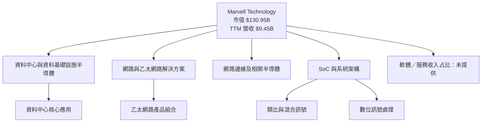
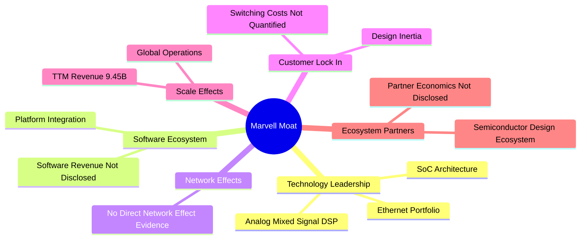
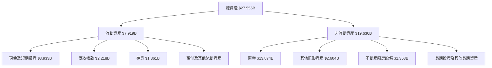
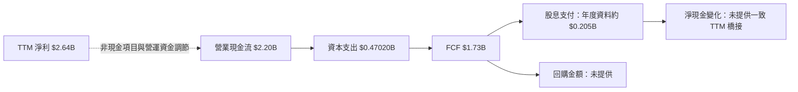
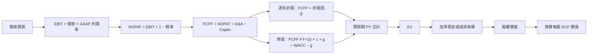
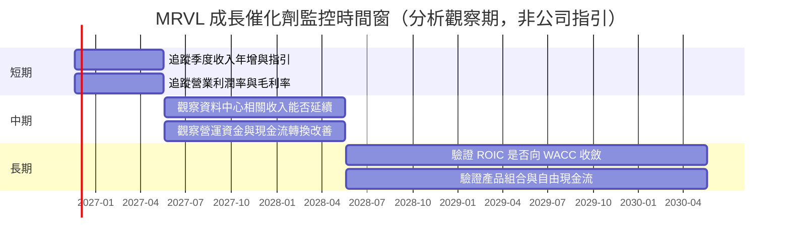
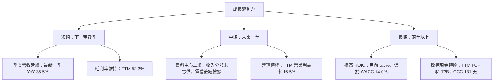
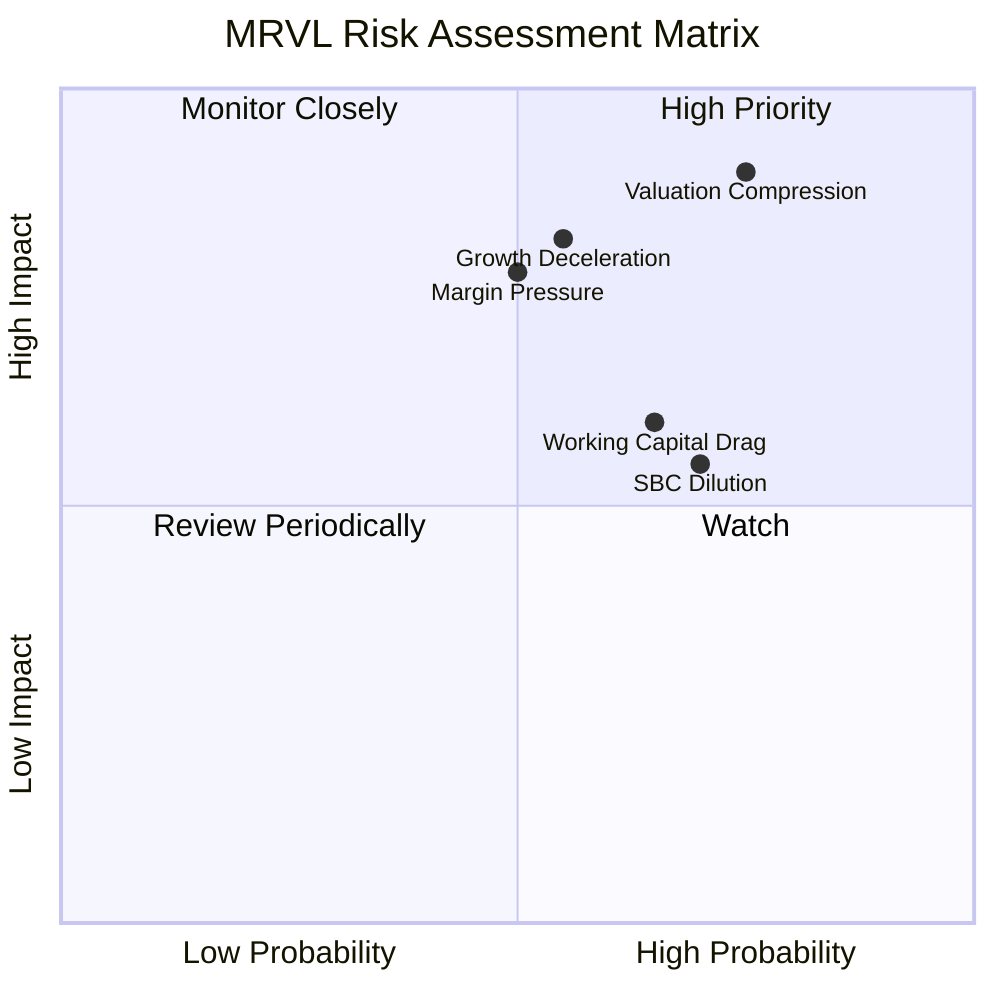
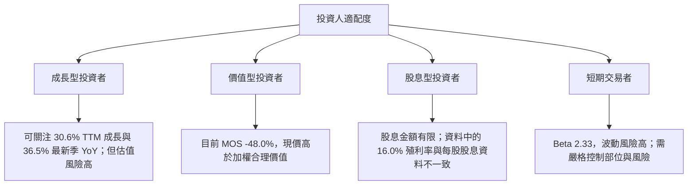

# MRVL 基本面深度分析報告
> **報告日期**：2026-11-19 ｜ **語言**：繁體中文 ｜ **數據來源**：SEC 申報資料 (XBRL)、Yahoo Finance、Finviz、StockAnalysis、Roic.ai ｜ **分析師**：CFA 級機構研究

## 目錄

| # | 章節 | 核心結論 |
|---|------|----------|
| 1 | 執行摘要 | 賣出；加權合理價值 $98.36，MOS -48.0% |
| 2 | 公司概覽與商業模式 | 資料中心與資料基礎設施需求支撐成長；細分營收及市占率未提供 |
| 3 | 損益表深度分析 | TTM 營收 $9.45B、TTM 成長 30.6%；最新一季年增 36.5% |
| 4 | 資產負債表分析 | 淨負債 $1.03B；流動性充足，但營運資金週期拉長 |
| 5 | 現金流量深度分析 | TTM FCF $1.73B、FCF Yield 1.32%；SBC 明顯稀釋股東報酬 |
| 6 | 獲利能力與資本效率 | ROIC 6.3% 低於 WACC 14.0%，目前未創造足夠經濟價值 |
| 7 | 相對估值分析 | 相對自身歷史部分倍數偏高；同業倍數分布差異大 |
| 8 | DCF 內在價值評估 | 基準 DCF $38.08；加權合理價值 $98.36，遠低於現價 |
| 9 | 成長催化劑 | 資料中心需求與產品組合是成長機會，TAM 與收入分部數據未提供 |
| 10 | 風險矩陣 | 高估值、成長預期與資本效率是主要風險 |
| 11 | 投資建議 | 依 MOS 評級為賣出；等待估值與營運數據改善後重新評估 |

---

## 1. 執行摘要

MRVL 的最新 TTM 營收為 **$9.45B**，相較前一 TTM 成長 **30.6%**；最新一季營收年增 **36.5%**，反映資料基礎設施半導體需求和產品組合仍在擴張。然而，TTM ROIC 僅 **6.3%**，低於採用的 WACC **14.0%**；TTM FCF 為 **$1.73B**，但 FCF Yield 只有 **1.32%**。在此基礎上，DCF 基準價值為 **$38.08**，估值方法加權後合理價值為 **$98.36**，相對 2026-11-18 收盤價 **$145.54** 的 MOS 為 **-48.0%**，依規則 20 評級為 **賣出**，未作質化調整。

> 估值風險特別高：市場資料顯示 MRVL 過去 24 個月股價曾升至 $297.75，最新收盤價較該價低約 51.1%；但股價波動不能抵銷當前加權合理價值低於現價的估值缺口。

### 1.0 一頁式投資儀表板（Portfolio Manager 30 秒速讀）

| 項目 | 內容 |
|------|------|
| **投資論點（3 句）** | ① TTM 營收 $9.45B、成長 30.6%，最新一季年增 36.5%，需求動能尚在。② TTM FCF $1.73B，但 FCF Yield 僅 1.32%，現金流相對市值不高。③ ROIC 6.3% 低於 WACC 14.0%，加權合理價值 $98.36 低於現價 $145.54。 |
| **綜合評分** | **5.7/10**（引用 1.1 評分卡） |
| **財務健康** | 🟡 現金及短期投資 $3.93B、債務 $4.96B，淨負債 $1.03B；流動比率 3.168。 |
| **ROIC vs WACC** | **6.3% vs 14.0%**；差距 -7.7 個百分點，現階段未達資本成本。 |
| **FCF 趨勢** | 最新 TTM FCF $1.73B；FCF Yield **1.32%**。年度 FCF 近年約 $1.02B–$1.39B，但 TTM 口徑不可與單一財年直接混用。 |
| **估值** | Forward P/E **19.74x**（Yahoo Finance 估值欄）；EV/EBITDA **45.25x**；FCF Yield **1.32%**。 |
| **DCF 內在價值（基準）** | **$38.08**；現價相對 DCF 溢價 **+282.1%**，計算為 $145.54 ÷ $38.08 − 1。 |
| **安全邊際（MOS）** | **-48.0%**＝($98.36 − $145.54) ÷ $98.36；基準為 8.8 加權合理價值，屬負安全邊際。 |
| **預期報酬（基準情境 12M）** | DCF 基準情境相對現價 **-73.8%**；此為模型價值與現價差距，不代表精準的 12 個月報酬預測。 |
| **關鍵風險（前二）** | ROIC 持續低於 WACC；現價遠高於 DCF 基準及加權合理價值。 |
| **評級 + 信心度** | 🔴 **賣出** ｜ 信心：中（估值差距清楚，但 DCF 對利潤率、終值和資本成本敏感） |

### 1.1 綜合評分卡（全報告唯一）

| 維度 | 評分（1–10） | 主要依據（引用數字與其來源章節） |
|------|--------------|----------------------------------|
| 成長性 | 8.0 | TTM 營收成長 30.6%、最新一季年增 36.5%（第 3 章）。 |
| 獲利能力 | 6.0 | TTM 營業利益率 16.5%，但 ROIC 6.3% 低於 WACC 14.0%；F-Score 6/9（第 3、6 章）。 |
| 財務健康 | 7.0 | 淨負債 $1.03B、流動比率 3.168；CCC 由 113 天升至 131 天（第 4 章）。 |
| 估值 | 1.0 | MOS -48.0%，DCF 基準 $38.08，低於現價 $145.54（第 7、8 章）。 |
| 護城河 | 7.0 | 公司具資料基礎設施半導體、SoC、類比與數位訊號處理產品組合；營收成長具體，但客戶集中度、分部營收及市占率未提供（第 2 章）。 |
| 管理層與資本配置 | 5.0 | 年度 SBC 約 $0.59B，且 Piotroski 測試顯示稀釋股數未通過；回購明細未提供（第 3、5 章）。 |
| **綜合評分** | **5.7** | 六項算術平均：(8.0 + 6.0 + 7.0 + 1.0 + 7.0 + 5.0) ÷ 6 = 5.666…，四捨五入為 5.7。 |

### 1.2 五大投資論點 + 三大核心風險

| 類型 | 項目 | 具體依據 | 信心度 |
|------|------|----------|--------|
| 🟢 **投資論點①** | 成長動能延續 | TTM 營收 $9.45B，TTM 成長 30.6%；最新一季年增 36.5%。若需求與產品組合維持，收入規模可支撐後續營運槓桿。 | 🟢 高 |
| 🟢 **投資論點②** | 現金流為正 | TTM 營業現金流 $2.20B、資本支出 $470.20M、FCF $1.73B，具備內部資金供應能力。 | 🟢 高 |
| 🟢 **投資論點③** | 毛利與營運改善 | TTM 毛利率 52.2%、營業利益率 16.5%；年度營收自 FY2025 $5.77B 升至 FY2026 $8.19B。 | 🟡 中 |
| 🟢 **投資論點④** | 流動性有緩衝 | 現金及短期投資 $3.93B、總債務 $4.96B；流動比率 3.168。 | 🟢 高 |
| 🟢 **投資論點⑤** | 產品組合具技術深度 | 公司提供資料基礎設施半導體解決方案，涵蓋 SoC、類比、混合訊號及數位訊號處理；有助提高設計導入門檻，但具體市占率未提供。 | 🟡 中 |
| 🟡 **風險①** | 估值與現金收益不匹配 | FCF Yield 僅 1.32%，加權合理價值 $98.36，現價 $145.54，MOS -48.0%。 | 🔴 高衝擊 |
| 🔴 **風險②** | 資本回報低於資本成本 | ROIC 6.3% 對 WACC 14.0%，差距 -7.7 個百分點；若長期不改善，成長未必轉化為股東價值。 | 🔴 高衝擊 |
| 🟡 **風險③** | 稀釋與盈餘品質 | 年度 SBC $590.80M，TTM SBC 約 $828.90M；Piotroski 的應計品質及稀釋股數測試未通過。 | 🟡 中高 |

### 1.3 快速統計卡片

| 指標 | 公司實際值（期間） | 同業中位數 | 狀態 |
|------|--------------------|------------|------|
| 營收成長（TTM） | **30.6%** | — | 🟢 |
| 營收成長（最新一季年增） | **36.5%** | **85.5%**（AVGO、NVDA、AMD 中位數） | 🟡 |
| 毛利率（TTM） | **52.2%** | **74.9%** | 🔴 |
| 營業利益率（TTM） | **16.5%** | — | 🟡 |
| ROIC（TTM） | **6.3%** | — | 🔴 |
| Forward P/E | **19.744705x** | **18.2x** | 🟡 |
| FCF Yield（TTM） | **1.32%** | — | 🔴 |
| Piotroski F-Score | **6 / 9** | — | 🟡 |

> 同業毛利率中位數為 AVGO 75.5%、NVDA 74.9%、AMD 56.0% 的中位數 **74.9%**；同業最新季度營收成長中位數為 AVGO 85.5%、NVDA 103.2%、AMD 44.7% 的中位數 **85.5%**。

### 1.4 投資結論

```text
╔══════════════════════════════════════════════════════════════════╗
║                    📊 投資結論摘要                               ║
╠══════════════════════════════════════════════════════════════════╣
║  評級：賣出（依加權合理價值計算的 MOS 門檻，未作質化調整）       ║
║  價格（2026-11-18 收盤）：$145.54                                ║
║  DCF 內在價值（基準）：$38.08（現價溢價 +282.1%）                ║
║  安全邊際 MOS：-48.0%（＝(加權合理價值−現價)÷加權合理價值）     ║
║  加權合理價值（8.8）：$98.36                                     ║
║  DCF 情境價值：                                                  ║
║    悲觀情境：$19.28（-86.8%）                                    ║
║    基準情境：$38.08（-73.8%）                                    ║
║    樂觀情境：$72.38（-50.3%）                                    ║
║  綜合評分：5.7/10（引用 1.1）                                    ║
║  適合投資人：能承受高波動、並以基本面數據驗證成長的長線投資人； ║
║              不適合要求低估值與高現金收益的投資人。             ║
╚══════════════════════════════════════════════════════════════════╝
```

---

## 2. 公司概覽與商業模式

### 2.1 業務結構與收入來源

公司簡介顯示，Marvell Technology 提供資料基礎設施半導體解決方案，從資料中心核心延伸至網路邊緣，並開發 SoC 架構，整合類比、混合訊號及數位訊號處理功能。資料未提供各業務分部收入及占比，因此以下圖示只呈現業務關係，不將營收拆成未經披露的數字。



營收分部金額、分部毛利率、軟體或服務收入占比均未提供；因此不能據此推算各板塊對總營收的貢獻。公司在 2026-08-01 結束的最新季度營收為 $2.739B，提供了規模與成長證據，但未能單獨驗證某一細分業務的貢獻。

### 2.2 市場份額

市場份額數據未提供，也沒有可引用的來源與年份，因此不製作市場份額圖表。相較同業最新季度營收成長，MRVL 為 36.5%，低於 AVGO 的 85.5%、NVDA 的 103.2% 與 AMD 的 44.7%；但這些公司所處細分市場與產品組合並不完全相同，不能僅以增速推論市占率。

### 2.3 競爭護城河分析



### 2.4 護城河強度

| 護城河項目 | 強度（強／中／弱） | 證據（引用數字或事實） | 會削弱它的情況 |
|------------|--------------------|------------------------|----------------|
| 技術與產品整合 | 中 | 公司結合 SoC 架構、類比、混合訊號及數位訊號處理，並提供乙太網路解決方案；TTM 營收 $9.45B。 | 競爭者提供效能、功耗或總成本更佳的替代方案。 |
| 軟體生態系統 | 弱至中 | 提供資料未列軟體收入、使用者數或平台黏著度，暫無法量化。 | 客戶改採標準化平台或自研方案，降低軟硬體整合價值。 |
| 網路效應 | 弱 | 未提供使用者或互通網路帶來的直接網路效應證據。 | 產業標準轉移，或互通性不再帶來客戶選擇優勢。 |
| 客戶鎖定 | 中 | 半導體設計導入與系統整合可能造成轉換成本，但設計案數、客戶集中度和合約週期未提供。 | 主要客戶轉向第二供應商、自研或競爭產品。 |
| 規模效應 | 中 | TTM 營收 $9.45B、員工 7,480 人，具一定研發與全球營運規模。 | 營收規模增加但毛利率或 ROIC 不改善。 |
| 生態夥伴 | 中 | 公司跨美洲、亞洲及以色列營運，產品面向資料中心至網路邊緣；具體合作夥伴及貢獻未提供。 | 夥伴關係中斷，或客戶採購策略改變。 |

**護城河分數理由：**1.1 的「護城河」評分為 **7.0/10**，依據是技術整合與 $9.45B TTM 營收規模，但因市占率、客戶集中度、分部營收及軟體收入均未提供，不能將質化優勢等同於已驗證的定價權。

---

## 3. 損益表深度分析

### 3.1 年度收入成長趨勢（近 4 年）

年度營收採 StockAnalysis 年度口徑。FY2023 至 FY2026 的收入 CAGR 約為 **11.5%**；其間 FY2025 近乎持平，FY2026 則加速，表示近期成長並非均勻發生。

```text
╔══════════════════════════════════════════════════════════════════╗
║           Marvell Technology 年度收入趨勢（FY2023-FY2026）      ║
╠══════════════════════════════════════════════════════════════════╣
║ FY2023  $5.920B  ███████████████░░░░░░░░░  YoY：基期            ║
║ FY2024  $5.508B  ██████████████░░░░░░░░░░  YoY：-7.0%  🔴       ║
║ FY2025  $5.767B  ███████████████░░░░░░░░░  YoY：+4.7%  🟡       ║
║ FY2026  $8.195B  █████████████████████░░░  YoY：+42.1% 🟢       ║
║                                                                  ║
║ 近三年 CAGR：(8.195 ÷ 5.920)^(1/3) − 1 ≈ 11.5%                 ║
╚══════════════════════════════════════════════════════════════════╝
```

FY2026 營收相較 FY2025 增加，與季度收入逐季走高及最新季度年增 36.5% 一致；但資料未提供各產品線收入，無法將 FY2026 的反彈精確歸因於單一終端市場。

### 3.2 季度收入趨勢分析

| 季度（財季） | 營收 | QoQ 成長 | YoY 成長 | 備註 |
|------|------:|------:|------:|------|
| Q3 FY2026（2025-11-01） | $2.075B | +3.4% | +36.8% | 年增仍高，季度環比增幅較小。 |
| Q4 FY2026（2026-01-31） | $2.219B | +6.9% | +22.1% | 環比加速，但年增率受到比較基期影響。 |
| Q1 FY2027（2026-05-02） | $2.418B | +8.9% | +27.6% | 收入繼續擴大。 |
| Q2 FY2027（2026-08-01） | $2.739B | +13.3% | +36.5% | 最新季度年增率使用 VERIFIED FIGURES 單季口徑；QoQ 為依季度營收計算。 |

最新季度營收為 $2.739B，QoQ 成長約 13.3%，且 YoY 成長 36.5%。季度環比動能回升，若後續能維持，營收規模可支撐固定研發支出的吸收；但單季增長不能直接外推為長期趨勢。

### 3.3 利潤率演變分析

以下年度毛利率及營業利益率按年度損益表金額計算；TTM 利潤率另依 SEC／程式計算的 TTM 口徑列示。年度毛利資料與其他來源對 FY2025 的呈現不同，因此年度趨勢作方向性分析，TTM 以 VERIFIED FIGURES 為準。

| 利潤率指標 | FY2023 | FY2024 | FY2025 | FY2026／TTM | 趨勢 | 評估 |
|------------|--------:|--------:|--------:|-------------:|------|------|
| **毛利率（年度表列值）** | 50.5% | 41.6% | 41.2% | 51.0%（FY2026）／52.2%（TTM） | FY2026 回升 | 🟡 |
| **營業利益率（年度表列值）** | 6.1% | -7.9% | -6.4% | 16.4%（FY2026）／16.5%（TTM） | 由虧損轉為正值 | 🟢 |
| **淨利率（TTM）** | — | — | — | 27.9% | TTM 正獲利，但年度淨利歷史波動大 | 🟡 |

年度毛利率是年度表中毛利除以營收所得；FY2025 的另一資料來源列出毛利 $2.740B，與財務數據年度表的 $2.38B 不一致。若以另一來源計算，FY2025 毛利率將不同，故不混用兩種數字。TTM 毛利率 52.2% 及營業利益率 16.5% 則依 TTM 指標引用。

**利潤率演變深度解析：**FY2024 至 FY2025 年度營業利益為負，FY2026 回升至 $1.34B；收入同期從 FY2025 的 $5.77B 升至 FY2026 的 $8.19B。收入擴大有助固定研發與營運成本的吸收，符合營運槓桿改善方向。不過，年度淨利受非經常性項目與稅務影響的可能性較高，且單一來源列示的 FY2026 淨利 $2.67B 高於營業利益，分析時應優先看 TTM FCF、GAAP 營業利益率及稅率口徑，而不單靠淨利增幅判斷經常性獲利。

### 3.4 費用結構分析

費用結構的完整科目及總額未提供，故不製作比例圓餅圖。可觀察的 FY2026 研發費用為 **$2.08B**，約為 FY2026 營收 $8.19B 的 **25.4%**（$2.08B ÷ $8.19B）；研發投入支持產品迭代，但對當期營業利潤率形成成本負擔。由於其他營業費用細項及合併口徑未完整提供，不能把餘額自行分配為銷售、管理或其他費用。

### 3.5 季度 EPS 趨勢與盈餘品質（Quality of Earnings）

EPS 實際值採 StockAnalysis 季度資料；提供的 EPS 預期值均為 NaN，無法確認過去四季是超預期或不及預期。

| 季度 | EPS 實際 | EPS 預期／驚喜 | 解讀 |
|------|---------:|-----------------|------|
| 2025-10-31（Q3 FY2026） | $2.20 | N/A | 淨利 $1.901B，與相鄰季度相比異常偏高；沒有估值資料，不能將其視為持續性 EPS。 |
| 2026-01-31（Q4 FY2026） | $0.47 | N/A | EPS 下降，與前一季度異常高值不具可比性。 |
| 2026-05-02（Q1 FY2027） | $0.04 | N/A | 當季 EPS 低於前季，資料顯示淨利 $34.5M；可能受非營運項目、稅項或股份口徑影響，缺少明細無法歸因。 |
| 2026-08-01（Q2 FY2027） | $0.34 | N/A | EPS 年增率 50.0%（財務數據列示），但實際是否超越分析師預期無法判定。 |

> 過去四季 EPS 預期欄沒有有效數值，因此**不宣稱任何一季超預期或不及預期**。季度 EPS 序列的 2025-10-31 $2.20 與其他季度明顯不連續，應視為可能含一次性或口徑異常的觀察值；沒有 SEC 調節明細時不自行指定原因。

| 盈餘品質項目 | 數值／佔比 | 評估 |
|--------------|-----------|------|
| 股權薪酬 SBC / 營收 | 約 **8.8%**：TTM 季度 SBC 合計約 $828.9M ÷ TTM 營收 $9.45B | 🔴 SBC 比例顯著；即使非現金，仍透過股數稀釋轉移經濟價值。 |
| SBC / 營業現金流 | 約 **37.7%**：$828.9M ÷ $2.20B | 🔴 相對營運現金流占比偏高。 |
| FCF / 淨利（現金轉換率） | 約 **65.5%**：TTM FCF $1.73B ÷ TTM 淨利 $2.64B | 🟡 正向現金流，但低於淨利；需留意應收與存貨吸收現金。 |
| 一次性／非經常性損益 | 季度 EPS 與淨利波動明顯；無法由現有資料逐項拆分 | 🟡 FY2025–FY2026 年度淨利亦由虧損轉大幅獲利，評估時不宜單靠報導淨利外推。 |
| 有效稅率異常 | 12.4%（最新年度有效稅率） | 🟡 低於一般長期成熟企業可能承擔的稅負，但缺少多年可比稅率及調節表，採用時視為模型假設。 |
| 資本化支出 vs 費用化 | TTM Capex $470.20M；研發列為費用，資本化政策細節未提供 | 🟡 無法判斷是否有重大成本遞延；不推定存在盈餘美化。 |

**盈餘品質結論：**GAAP 營業利益已反映股權薪酬費用，但 SBC 對現金流量表的非現金加回，仍代表股東承受稀釋成本。TTM FCF 約為淨利的 65.5%，且 Piotroski 的「營業現金流高於淨利」測試未通過。因此，獲利並非沒有現金支撐，但淨利轉現金及 SBC 稀釋均須持續監察。

---

## 4. 資產負債表分析

### 4.1 資產結構分解

以下採 StockAnalysis 的 2026-08-01 TTM 資產負債表數值。流動資產 $7.919B、總資產 $27.555B；非流動資產以總資產減流動資產計算為 $19.636B。細項不一定因四捨五入或分類而恰好相加。



商譽 $13.874B 約占總資產的一半，反映併購後形成的無形資產與商譽規模較大；未提供商譽分部測試敏感度，需追蹤減損風險。流動資產中，現金及短期投資 $3.933B、應收帳款 $2.218B、存貨 $1.361B，與現金轉換週期拉長相呼應。

### 4.2 流動性與營運資金分析

| 指標 | 最新 TTM | 一年前 TTM | 變化 | 解讀 |
|------|----------|------------|------|------|
| DSO 應收帳款天數 | 86 天 | 73 天 | +13 天 | 收款時間變長；應收帳款需與營收成長及客戶付款條件一併檢視。 |
| DIO 存貨天數 | 110 天 | 96 天 | +14 天 | 存貨占用時間上升，可能反映備貨或需求預測風險；需看後續銷售與存貨跌價。 |
| DPO 應付帳款天數 | 64 天 | 56 天 | +8 天 | 付款週期延長，暫時緩衝現金需求，但不能單獨推論供應商議價能力改善。 |
| CCC 現金轉換週期 | 131 天 | 113 天 | +18 天 | 資金被營運週期占用時間拉長；若營收快速成長，可能需要更多營運資金。 |

流動比率為 **3.168**、速動比率 **2.461**，代表短期償債緩衝充足；但 CCC 增加 18 天，是營運資金品質的警訊。後續需看應收與存貨增幅是否高於營收增幅，以及經營現金流是否持續跟上利潤成長。

### 4.3 債務結構分析

以 VERIFIED FIGURES 的債務口徑為準：現金及短期投資 $3.93B、總債務 $4.96B、淨負債 $1.03B。其他市場數據來源列示的債務與淨負債口徑不同，不混入本報告主表。

```text
╔══════════════════════════════════════════════════════════════════╗
║                 Marvell Technology 債務健康診斷                 ║
╠══════════════════════════════════════════════════════════════════╣
║  總債務：             $4.96B   ████████████████████             ║
║  現金及短期投資：     $3.93B   ████████████████░░░░             ║
║  淨負債：             $1.03B   🟡 淨負債但規模可控              ║
║                                                                  ║
║  流動比率：           3.168    🟢                                ║
║  速動比率：           2.461    🟢                                ║
║  Debt/EBITDA：        N/A（本口徑未提供可直接配對的 EBITDA）     ║
║  利息保障倍數：       N/A（利息費用及一致口徑 EBIT 未提供）      ║
╚══════════════════════════════════════════════════════════════════╝
```

### 4.4 股東權益趨勢

| 財年 | 股東權益 |
|------|---------:|
| FY2023 | $15.64B |
| FY2024 | $14.83B |
| FY2025 | $13.43B |
| FY2026 | $14.31B |

```text
╔══════════════════════════════════════════════════════════════════╗
║                    股東權益歷年變化                              ║
╠══════════════════════════════════════════════════════════════════╣
║ FY2023  $15.64B  ████████████████████                            ║
║ FY2024  $14.83B  ███████████████████                             ║
║ FY2025  $13.43B  █████████████████                               ║
║ FY2026  $14.31B  ██████████████████                              ║
╚══════════════════════════════════════════════════════════════════╝
```

FY2025 至 FY2026 股東權益增加 $0.88B；其中留存盈餘、股權薪酬、其他綜合損益與股份交易的各自貢獻未完整提供，不能將變動全歸因於單一項目。

---

## 5. 現金流量深度分析

### 5.1 現金流量瀑布圖

可配對的 TTM 淨利、股息及回購的完整現金流瀑布資料未提供，故圖中只呈現可直接引用的營業現金流、資本支出與 FCF；不以無資料的回購或淨現金變化補數。



### 5.2 FCF 轉換率趨勢

| 財年 | 營業現金流 | 資本支出 | FCF | 淨利 | FCF／淨利 |
|------|-----------:|---------:|----:|-----:|----------:|
| FY2023 | $1.29B | $0.217B | $1.07B | -$0.164B | 不適用於負淨利；比率約 -654% 但不具經濟解讀力 |
| FY2024 | $1.37B | $0.350B | $1.02B | -$0.933B | 不適用於負淨利；比率約 -109% 但不具經濟解讀力 |
| FY2025 | $1.68B | $0.292B | $1.39B | -$0.885B | 不適用於負淨利；比率約 -157% 但不具經濟解讀力 |
| FY2026 | $1.75B | $0.359B | $1.39B | $2.67B | 約 52.1% |
| 最新 TTM | $2.20B | $0.47020B | $1.73B | 約 $2.64B | 約 65.5% |

年度 FCF 介於 $1.02B–$1.39B，最新 TTM 提升至 $1.73B。由於過去三個財年淨利為負，FCF／淨利比率在該期間失去常規解讀意義；FY2026 與 TTM 的現金轉換率約 52.1% 和 65.5%，仍低於 100%。

### 5.3 自由現金流趨勢

```text
╔══════════════════════════════════════════════════════════════════╗
║                自由現金流趨勢（年度與 TTM）                     ║
╠══════════════════════════════════════════════════════════════════╣
║ FY2023  $1.07B  █████████████░░░░░░░  FCF Yield：N/A（歷史市值）║
║ FY2024  $1.02B  ████████████░░░░░░░░  FCF Yield：N/A（歷史市值）║
║ FY2025  $1.39B  █████████████████░░░  FCF Yield：N/A（歷史市值）║
║ FY2026  $1.39B  █████████████████░░░  FCF Yield：N/A（歷史市值）║
║ TTM      $1.73B  █████████████████████  FCF Yield：1.32%         ║
╚══════════════════════════════════════════════════════════════════╝
```

### 5.4 資本配置評估

現有年度資料列示 FY2026 資本支出 $358.60M、現金股息 $205.10M、SBC $590.80M。回購、收購及各項投資的完整資本配置金額未提供，因此不製作比例圓餅圖。

| 資本配置項目 | 已知數據 | 評估 |
|--------------|----------|------|
| 資本支出 | FY2026 $358.60M；TTM $470.20M | TTM Capex 約占 TTM 營收 5.0%，有助產品與營運投入；模型以 TTM 口徑預測。 |
| 股息 | FY2026 支付 $205.10M | 規模相較 TTM FCF 不大；股息率資料出現異常的 16.0%，與季度每股股息 $0.06 不一致，故不引用該殖利率。 |
| 回購 | N/A（回購金額未提供） | 無法判斷淨回購是否抵銷 SBC 稀釋。 |
| SBC | FY2026 $590.80M | 對員工激勵有用，但提高股份稀釋與股東經濟成本。 |
| 留存及其他投資 | N/A（細項未提供） | 無法量化留存資金的投資報酬。 |

---

## 6. 獲利能力與資本效率

### 6.1 ROE / ROA / ROIC 趨勢

| 指標 | 最新值 | 歷史趨勢資料 | 評估 |
|------|-------:|---------------|------|
| ROE（Quality Figures） | 14.2% | 同口徑歷史值未提供 | 中等；依杜邦分解，並非單靠高槓桿推動。 |
| ROA | 4.1% | 同口徑歷史值未提供 | 🟡 資產回報低於 ROE，與商譽及無形資產規模較大相符。 |
| ROIC（TTM） | 6.3% | 同口徑多年序列未提供 | 🔴 低於 14.0% WACC。 |
| WACC | 14.0% | 採用資本成本區塊數值 | ROIC-WACC 差距為負，需改善資本效率。 |

> 財務資料另一區塊列示 ROE 16.5%，但 Quality Figures 的杜邦分解結果為 **14.2%**。本節為符合統一口徑，採用 QUALITY FIGURES 的 ROE 14.2%；不同來源及期間計算可能造成差異。

### 6.2 ROIC vs WACC 分析（核心價值創造判斷）

```text
╔══════════════════════════════════════════════════════════════════╗
║                  ROIC vs WACC 深度分析                           ║
╠══════════════════════════════════════════════════════════════════╣
║  資本成本輸入（程式計算，並沿用於 DCF）：                       ║
║  ├── 無風險利率（10Y 美債）：       5.07%                       ║
║  ├── 市場風險溢酬 ERP：             5.00%                       ║
║  ├── 原始 Beta：                    2.33                        ║
║  ├── 調整後 Beta：                  1.88                        ║
║  ├── 股權成本：                     14.49%                      ║
║  ├── 稅前債務成本：                 4.08%                       ║
║  ├── 資本權重 E／D：                96.3%／3.7%                  ║
║  ├── 計算 WACC：                    14.09%                      ║
║  └── 採用 WACC：                    14.00%（受 7%–14% 上限限制）║
║                                                                  ║
║  ROIC：                            6.30%                       ║
║  EVA 利差：ROIC − WACC =            -7.70 個百分點               ║
║  ROIC/WACC：                        0.45x                       ║
║                                                                  ║
║  ROIC  6.3%  ▓▓▓▓▓▓▓░░░░░░░░░░░░░░░░░░░░░░░                   ║
║  WACC 14.0%  ▓▓▓▓▓▓▓▓▓▓▓▓▓▓▓▓░░░░░░░░░░░░░░                   ║
║                                                                  ║
║  📊 結論：目前 ROIC 低於資本成本，尚未創造足夠經濟價值。       ║
╚══════════════════════════════════════════════════════════════════╝
```

資本成本計算的核心算式為：股權成本 = 5.07% + 1.88 × 5.00% = 14.47%，資料列示股權成本為 14.49%；在提供的權重及稅後債務成本下，程式算出 WACC 14.09%，並依 7%–14% 上限採用 **14.00%**。ROIC 6.3% 與 WACC 相差 **-7.7 個百分點**，表示增長投資若不能提高投資資本回報，可能擴大而非縮小價值缺口。

### 6.3 杜邦三因素分解

| 因素 | 數值（TTM） | 解讀 |
|------|-------------|------|
| 淨利率 | 27.9% | TTM 淨利率較高，但須結合淨利與營業現金流差異解讀。 |
| 資產週轉率 | 0.34 | 資產每年產生的收入相對有限，與商譽及無形資產規模有關。 |
| 權益乘數 | 1.49 | 槓桿程度不高，ROE 並非主要靠高財務槓桿推動。 |
| **ROE** | **14.2%** | 27.9% × 0.34 × 1.49 = 14.1%，資料列示 ROE 為 14.2%；差異來自組成值四捨五入。 |

### 6.4 財務體質：Piotroski F-Score

Piotroski F-Score 為 **6 / 9**，逐項依 QUALITY FIGURES 引用：

| 測試 | 結果 | 解讀 |
|------|------|------|
| ROA > 0 | ✅ 通過 | TTM 資產報酬為正。 |
| 營業現金流 > 0 | ✅ 通過 | TTM 營業現金流 $2.20B。 |
| ROA 高於一年前 | ✅ 通過 | 資產獲利較一年前改善。 |
| 營業現金流 > 淨利（應計品質） | ❌ 未通過 | 現金流低於淨利，須留意非現金項目及營運資金。 |
| 長期負債 ÷ 總資產低於一年前 | ✅ 通過 | 依該項測試口徑，槓桿相對資產改善。 |
| 流動比率高於一年前 | ✅ 通過 | 流動性指標改善。 |
| 稀釋股數未增加 | ❌ 未通過 | 股數稀釋侵蝕每股盈餘及股東權益。 |
| 毛利率高於一年前 | ✅ 通過 | 毛利率改善。 |
| 資產週轉率高於一年前 | ❌ 未通過 | 資產利用效率未改善。 |

F-Score 6/9 顯示盈利與流動性指標多數改善，但應計品質、股份稀釋及資產週轉率三項未通過。對高成長半導體公司而言，這些項目直接關係到收入能否轉化為每股現金流。

---

## 7. 相對估值分析

### 7.1 同業估值比較表格

同業倍數採 Yahoo Finance Peer multiples；MRVL 倍數採市場估值欄位。由於不同來源的 EV/EBITDA 數據與 TTM 口徑可能不同，不將公司自身歷史估值數字替代同業倍數。

| 估值指標 | **MRVL** | **AVGO** | **NVDA** | **AMD** | MRVL 評估 |
|----------|---------:|---------:|---------:|---------:|-----------|
| **Trailing P/E** | 47.875x | 45.2x | 16.2x | 113.3x | 🟡 位於同業廣泛區間中；AMD 高倍數反映自身盈利基期不同。 |
| **Forward P/E** | 19.744705x | 18.2x | 9.1x | 30.1x | 🟡 高於 AVGO、NVDA，低於 AMD；以同業中位數 18.2x 估值，程式回推 $134.43。 |
| **P/S（TTM）** | 13.856906x | 19.0x | 10.1x | 19.3x | 🟡 高於 NVDA、低於 AVGO 與 AMD。 |
| **EV/EBITDA（TTM）** | 45.25x | 33.0x | 14.7x | 77.4x | 🔴 明顯高於 AVGO 與 NVDA；此公司估值來源口徑與自身歷史統計資料有差異。 |
| **最新季度營收 YoY** | 36.5% | 85.5% | 103.2% | 44.7% | 🟡 MRVL 低於三家同業，接近但低於 AMD。 |
| **毛利率（TTM）** | 52.2% | 75.5% | 74.9% | 56.0% | 🔴 低於所有列示同業。 |

### 7.2 歷史估值區間分析

```text
╔══════════════════════════════════════════════════════════════════╗
║                 MRVL 過去五年估值區間                            ║
╠══════════════════════════════════════════════════════════════════╣
║ P/E：       25.6x ├──────── 中位數 56.5x ────────┤ 61.9x        ║
║             現值 48.0x；歷史百分位 50%                           ║
║ P/S：        5.8x ├──── 中位數 9.9x ────────────┤ 18.3x         ║
║             現值 14.2x；歷史百分位 80%                           ║
║ EV/EBITDA： 53.3x ├── 中位數 156.4x ─────────────────┤ 730.9x   ║
║             現值 86.5x；歷史百分位 25%                           ║
╚══════════════════════════════════════════════════════════════════╝
```

P/E 48.0x 位於自身五年區間中位數 56.5x 以下，並處於 50 百分位；P/S 14.2x 高於中位數 9.9x、位於 80 百分位。EV/EBITDA 86.5x 低於五年中位數 156.4x，但歷史區間高達 730.9x，該指標受獲利基期及極端值影響，不能因此直接判定便宜。

### 7.3 情境價值（Bear / Base / Bull，照抄 DCF MODEL 的 Scenarios）

| 情境 | 第 1 年營收成長 | 期末營業利潤率 | WACC | 每股價值 | 相對現價 | 機率 | 會發生的條件 |
|------|----------------:|----------------:|------:|----------:|----------:|-----:|--------------|
| 🔴 悲觀 | 15.0% | 3.4% | 15.00% | $19.28 | -86.8% | 25% | 資料中心及相關半導體需求降溫、成長減速，且競爭壓抑長期利潤率。 |
| 🟡 基準 | 30.0% | 4.0% | 14.00% | $38.08 | -73.8% | 50% | 短期成長接近 TTM 成長，之後逐步減速，長期利潤率回到模型設定的較低水平。 |
| 🟢 樂觀 | 45.0% | 4.4% | 13.00% | $72.38 | -50.3% | 25% | 收入成長高於目前 TTM 增速且折現率下降，產品組合與經營環境配合。 |

以上情境的數值及機率依程式計算；提供資料未列各情境逐年營收及 FCFF 表，故不自行補造完整情境現金流。

### 7.4 相對估值隱含價格區間

```text
╔══════════════════════════════════════════════════════════════════╗
║          估值方法隱含每股價值（相對現價 $145.54）                ║
╠══════════════════════════════════════════════════════════════════╣
║ DCF 基準          $38.08  ├─────────● 現價 $145.54              ║
║ 同業 EV/EBITDA    $73.73  ├──────────────●                      ║
║ 同業 Forward P/E $134.43  ├────────────────────●                 ║
║ 分析師共識       $310.89  ├───────────────────────────────────  ║
╚══════════════════════════════════════════════════════════════════╝
```

- **同業 Forward P/E：$134.43**；採同業中位數 **18.2x**（AVGO、NVDA、AMD）乘以 MRVL Forward EPS **$7.37**。
- **同業 EV/EBITDA：$73.73**；採 AVGO 與 NVDA 中位數倍數 **23.9x**，乘以 TTM EBITDA 並加回淨現金；各底層項目依程式估值方法提供。
- **分析師共識：$310.89**；40 位分析師平均目標價。該值顯著高於相對估值與 DCF 結果，應視為外部參考而非現金流證據。

---

## 8. DCF 內在價值評估（Discounted Cash Flow）

### 8.0 估值推理鏈（Thinking Logic：在算之前先想清楚）

**Step 1 — 價值由哪些變數決定？**  
MRVL 的 DCF 價值由營收路徑、GAAP EBIT 利潤率及折現率共同決定。現有資料只提供公司 TTM 營收 $9.45B，未提供分部營收占比，故不能把資料中心或網路業務拆成獨立收入項。程式模型採第 1 年營收成長 30.0%、第 10 年 3.0%，並把營業利益率由 16.5% 線性降至 4.0%。由於 DCF 對 WACC、長期利潤率與營收軌跡敏感，任何一項執行落差都會大幅改變估值。

**Step 2 — 模型選擇**

| 決策點 | 本報告採用 | 理由（含數字） | 曾考慮但否決 | 否決理由 |
|--------|-----------|----------------|--------------|----------|
| 現金流定義 | FCFF | 對應 WACC 折現並得出 EV；TTM 營業現金流 $2.20B、Capex $470.20M | FCFE | 資本結構可能變化，且程式 DCF 已採 FCFF |
| 預測期 N | 10 年 | DCF MODEL 固定預測十年，營收由 $9.45B 起算 | 5 年 | 不符合模型已提供的預測期，且需重新建模 |
| 終值方法 | Gordon Growth | 模型以第 10 年 FCFF $5.04B、g=3.0%、WACC=14.0%計算 | 退出倍數 | DCF MODEL 未提供退出倍數終值作為基準，不能自行替換 |
| EBIT 基礎 | GAAP | 模型明列 GAAP EBIT；FY+1 利潤率 16.5% | 非 GAAP | 會與程式模型的 FCFF 及 SBC 處理不一致 |

**Step 3 — 關鍵假設推導鏈**

- **營收成長路徑：**錨點＝TTM 營收成長 30.6%；調整＝模型將第 1 年成長限制在 0%–30%，之後逐年線性降至第 10 年 3.0%；**採用第 1 年 30.0%、第 10 年 3.0%**；曾考慮將 30.6% 直接作為第 1 年值，但模型上限為 30.0%，故不採用。
- **期末營業利潤率：**錨點＝TTM 營業利益率 16.5%；調整＝模型按過去五個財年中位數（含 TTM）逐步淡化；**採用 FY+1 16.5%、FY+10 4.0%**；沒有資料支持長期保持 16.5%，因此不採用固定高利潤率。
- **預測期 N：**錨點＝程式 DCF 預測期 10 年；調整＝不自行變更預測期限；**採用 10 年**；5 年或其他年數需要另建模型，故否決。
- **永續成長率 g：**錨點＝模型採用 3.0%；**採用 3.0%**，且小於 WACC 14.0%；4.0% 雖在敏感度表中測試，但不作基準，因長期終值會更依賴高成長延續。
- **Capex／營收：**錨點＝TTM Capex 與營收比約 5.0%；模型由 FY+1 至 FY+10 固定 5.0%；**採用 5.0%**；未用更低比率，以避免假設資本支出自然減少但缺少根據。
- **EBIT 與 SBC：**錨點＝DCF MODEL 明列 GAAP EBIT；**採用 GAAP EBIT**，不另加回或扣除 SBC；採固定股數、不另計年稀釋率。曾考慮採用非 GAAP EBIT，但沒有一致的 SBC 扣回模型且會改變程式輸出，故否決。
- **年稀釋率：**模型採組合 A，股數不再逐年稀釋；**採用 0% 額外稀釋率**，理由是 GAAP EBIT 已將 SBC 作費用處理。須注意此模型處理不代表實際股份稀釋不存在。
- **WACC：**錨點＝資本成本計算值 14.09%；調整＝程式限制於 7%–14% 區間；**採用 14.00%**；不採 14.09%，因資本成本區塊明確設定上限。
- **稅率、D&A：**稅率採 12.4%；D&A／營收採 13.3%，均依 DCF MODEL 所列 TTM／有效稅率輸入。營運資金不建模，不能以零值暗示營運資金沒有現金影響。
- **終值方法：**採 Gordon Growth，以 WACC 14.0% 和 g 3.0%計算；沒有退出倍數的基準終值輸出，故不自行加建第二方法。

**Step 4 — 最脆弱一環**  
最脆弱的假設是 GAAP 營業利益率由 16.5% 線性下降至 4.0%，同時 D&A／營收維持 13.3%；如果營業利潤率不能按模型落至長期假設，或 D&A 不能持續高於 Capex，FCFF 與終值可能顯著偏離基準值，且模型未計營運資金變動。

**Step 5 — 計算路徑圖**



### 8.1 模型假設總表（Model Inputs）

| 假設項目 | 採用值 | 依據／來源 | 敏感度 |
|----------|--------|-------------|--------|
| 預測期長度 **N** | 10 年 | DCF MODEL 固定預測長度；FY+1 至 FY+10 | 🟡 中 |
| 營收成長路徑 | FY+1 30.0% 線性降至 FY+10 3.0% | TTM 成長 30.6%，模型上限 30.0%；終年設定 3.0% | 🔴 高 |
| 營業利潤率 | FY+1 16.5% 線性降至 FY+10 4.0% | TTM 營業利益率及過去五個財年中位數（含 TTM） | 🔴 高 |
| 有效稅率 | 12.4% | 最新年度有效稅率 | 🟢 低 |
| Capex／營收 | FY+1 至 FY+10 均 5.0% | TTM Capex／營收約 5.0%；模型保持該比率 | 🟡 中 |
| D&A／營收 | 13.3% | DCF MODEL 所列 TTM 比率，保持固定 | 🟢 低 |
| 營運資金變動 | 未建模 | DCF MODEL 明確標示 working capital is not modelled；不可假稱計入 | 🟡 中 |
| EBIT 基礎 | GAAP | DCF MODEL 明列 GAAP EBIT | 🟡 中 |
| SBC 處理 | 組合 A：不另扣 SBC | GAAP EBIT 已列 SBC 費用；固定股數、不另作年稀釋 | 🟡 中 |
| 年稀釋率 | 0%（模型處理） | 組合 A；不是對未來實際稀釋的預測 | 🟡 中 |
| 永續成長率 g | 3.0% | DCF MODEL 基準輸入；低於 WACC | 🔴 高 |
| 終值方法 | Gordon Growth | DCF MODEL 基準終值方法 | 🔴 高 |
| WACC | 14.00% | 程式計算 14.09%，受 7%–14% 區間限制後採 14.00% | 🔴 高 |

本模型使用 **FCFF**，依 FCFF = NOPAT + D&A − Capex 計算；工作資金變動不建模。股權薪酬處理為：**本模型採用 (A)，故 SBC 影響已計入一次**；GAAP EBIT 已含 SBC 費用，沒有額外 SBC 扣除列，股數亦不再逐年放大。

### 8.2 折現率推導（WACC）

```text
╔══════════════════════════════════════════════════════════════════╗
║                    WACC 推導（折現率）                           ║
╠══════════════════════════════════════════════════════════════════╣
║  股權成本 Ke（CAPM）：                                           ║
║  ├── 無風險利率 Rf（10Y 美債）：      5.07%                      ║
║  ├── 市場風險溢酬 ERP：               5.00%                      ║
║  ├── 原始 Beta（Yahoo）：              2.33                       ║
║  ├── 調整後 Beta：                    1.88                       ║
║  │   調整方式：⅔ × 2.33 + ⅓ = 1.8867 ≈ 1.88                    ║
║  ├── 規模／國別額外溢酬：             0.00%（未另行加計）        ║
║  └── Ke：5.07% + 1.88 × 5.00% = 14.47%；資料列示 14.49%         ║
║                                                                  ║
║  債務成本 Kd：                                                    ║
║  ├── 稅前 Kd：                       4.08%                      ║
║  ├── 有效稅率：                      12.4%                      ║
║  └── 稅後 Kd：4.08% × (1 − 12.4%) = 3.57408% ≈ 3.57%            ║
║                                                                  ║
║  資本結構權重：                                                  ║
║  ├── 股權 E 權重：                   96.3%                      ║
║  ├── 債務 D 權重：                    3.7%                      ║
║  ├── 權重合計：                       100.0%                    ║
║  ├── 加權成本計算值：                 14.09%                    ║
║  └── 採用 WACC：                      14.00%（受 7%–14% 上限限制）║
╚══════════════════════════════════════════════════════════════════╝
```

**逐步演算（使用資本成本資料區塊的既定輸入）：**

1. **Ke（CAPM）**：依資料列示的股權成本 **14.49%**；若使用展示後的兩位小數輸入，5.07% + 1.88 × 5.00% = 14.47%，差異來自底層 Beta／成本計算的精度。
2. **稅前 Kd**：採用程式列示 **4.08%**。利息費用及平均計息負債的原始餘額沒有提供，不能另行重算。
3. **稅後 Kd**：4.08% × (1 − 12.4%) = 4.08% × 0.876 = **3.57408%**。
4. **資本權重**：股權 **96.3%**、債務 **3.7%**，合計 96.3% + 3.7% = **100.0%**。資本成本資料直接提供權重，原始市值與計息負債範圍細項未提供，故不反推。
5. **WACC**：程式列示計算值 **14.09%**，依設定 7%–14% 區間採用上限 **14.00%**。該值與第 6.2 章一致。

### 8.3 逐年自由現金流預測（基準情境）

下表逐年照錄 DCF MODEL，金額單位為 **$B**。模型沒有營運資金變動列；不可把未建模誤解為實際 ΔWC 必然為零。

| 年度 | FY+1 | FY+2 | FY+3 | FY+4 | FY+5 | FY+6 | FY+7 | FY+8 | FY+9 | FY+10 |
|------|-----:|-----:|-----:|-----:|-----:|-----:|-----:|-----:|-----:|------:|
| 營收 | 12.29 | 15.60 | 19.35 | 23.41 | 27.62 | 31.77 | 35.58 | 38.78 | 41.11 | 42.34 |
| 營收 YoY | 30.0% | 27.0% | 24.0% | 21.0% | 18.0% | 15.0% | 12.0% | 9.0% | 6.0% | 3.0% |
| 營業利潤率 | 16.5% | 15.1% | 13.7% | 12.4% | 11.0% | 9.6% | 8.2% | 6.8% | 5.4% | 4.0% |
| EBIT（GAAP） | 2.03 | 2.36 | 2.66 | 2.89 | 3.03 | 3.04 | 2.91 | 2.64 | 2.22 | 1.70 |
| − 稅 | (0.25) | (0.29) | (0.33) | (0.36) | (0.37) | (0.38) | (0.36) | (0.33) | (0.27) | (0.21) |
| NOPAT | 1.78 | 2.07 | 2.33 | 2.53 | 2.65 | 2.67 | 2.55 | 2.31 | 1.95 | 1.49 |
| + D&A | 1.64 | 2.08 | 2.58 | 3.12 | 3.69 | 4.24 | 4.75 | 5.18 | 5.49 | 5.65 |
| − Capex | (0.61) | (0.78) | (0.96) | (1.16) | (1.37) | (1.58) | (1.77) | (1.93) | (2.05) | (2.11) |
| **= FCFF** | **2.81** | **3.38** | **3.95** | **4.49** | **4.97** | **5.33** | **5.53** | **5.56** | **5.39** | **5.04** |
| 折現因子 @14.00% | 0.877 | 0.769 | 0.675 | 0.592 | 0.519 | 0.456 | 0.400 | 0.351 | 0.308 | 0.270 |
| **FCFF 現值 PV** | **2.46** | **2.60** | **2.67** | **2.66** | **2.58** | **2.43** | **2.21** | **1.95** | **1.66** | **1.36** |

**預測期 FCF 現值加總：**  
$2.46 + $2.60 + $2.67 + $2.66 + $2.58 + $2.43 + $2.21 + $1.95 + $1.66 + $1.36 = **$22.58B**（逐年表列數字加總）。DCF MODEL 的合計列為 **$22.57B**；差額 $0.01B 來自逐年項目四捨五入，模型橋接沿用其原始合計 $22.57B。

**逐步演算（FY+1，金額依模型顯示精度）：**

1. **營收** = $9.45B × (1 + 30.0%) = $12.285B，顯示 **$12.29B**。
2. **EBIT** = $12.29B × 16.5% ≈ **$2.03B**。
3. **稅** = $2.03B × 12.4% ≈ **$0.25B**。
4. **NOPAT** = $2.03B − $0.25B = **$1.78B**。
5. **D&A** = $12.29B × 13.3% ≈ **$1.64B**。
6. **Capex** = $12.29B × 5.0% ≈ **$0.61B**。
7. **ΔWC** = **未建模**；DCF MODEL 不含營運資金變動，故不另列推算數字。
8. **FCFF** = $1.78B + $1.64B − $0.61B = **$2.81B**。
9. **折現因子與 PV** = 1 ÷ (1 + 14.00%)¹ = 0.877；$2.81B × 0.877 ≈ **$2.46B**。

**合理性自檢：**

- FY+1 至 FY+10 FCFF 由 $2.81B 升至 $5.04B；端點 CAGR = ($5.04 ÷ $2.81)^(1/9) − 1 ≈ **6.7%**。歷史 FCF CAGR 因起始年份淨利為負、且各年度現金流口徑及期間不同，不宜用單一 CAGR 直接對比；年度 FCF 約由 FY2023 $1.07B 至 FY2026 $1.39B。
- FY+10 FCFF 利潤率 = $5.04B ÷ $42.34B ≈ **11.9%**；目前 TTM FCF 利潤率 = $1.73B ÷ $9.45B ≈ **18.3%**。同業最佳 FCF 利潤率未提供，不能判定模型是否超越產業最佳水準。
- 所有預測年度 FCFF 均為正；不代表實際營運資金需求不會拖累現金流。

```text
╔══════════════════════════════════════════════════════════════════╗
║            自由現金流：歷史實際 vs 模型預測                      ║
╠══════════════════════════════════════════════════════════════════╣
║ FY2023（實）  $1.07B  █████░░░░░░░░░░░░░░░  FCF                ║
║ FY2025（實）  $1.39B  ███████░░░░░░░░░░░░░  FCF                ║
║ FY2026（實）  $1.39B  ███████░░░░░░░░░░░░░  FCF                ║
║ FY+1（預）    $2.81B  ██████████████░░░░░░  模型 FCFF           ║
║ FY+10（預）   $5.04B  █████████████████████████  模型 FCFF      ║
╠══════════════════════════════════════════════════════════════════╣
║ ⚠️ 模型 FCFF 含高 D&A 假設，且未扣營運資金；與歷史 FCF 定義不同。║
╚══════════════════════════════════════════════════════════════════╝
```

### 8.4 終值計算（Terminal Value）

**適用性檢查：**WACC **14.00%** vs g **3.00%** → WACC > g？✅

| 方法 | 計算式 | 終值 TV | TV 現值 | 佔總 EV 比重 |
|------|--------|---------:|--------:|-------------:|
| Gordon Growth | FCFF(FY+10) × (1+g) ÷ (WACC − g) | $47.17B | $12.72B | 36.0% |
| 退出倍數法 | N/A（DCF MODEL 未提供退出倍數終值） | N/A | N/A | N/A |

**逐步演算（依 DCF MODEL 顯示值）：**

1. **FY+10 FCFF** = **$5.04B**。
2. **分子** = $5.04B × (1 + 3.0%) = $5.04B × 1.03 = **$5.1912B**（未四捨五入）。
3. **分母** = 14.00% − 3.00% = **11.00%**；使用程式底層未四捨五入的現金流計算，模型 TV 為 **$47.17B**。以表列兩位小數數字直接重算會有少量四捨五入差異。
4. **PV(TV)** = DCF MODEL 列示 **$47.17B × 0.270 = $12.72B**（使用未四捨五入折現因子）。
5. **終值佔比** = $12.72B ÷ $35.29B = **36.0%**（按模型列示比例；表面兩位小數輸入有四捨五入尾差）。

終值現值佔 EV 36.0%，低於 75%警戒值，但終值仍占企業價值逾三分之一。DCF MODEL 未提供退出倍數及其可比公司依據，故不另造交叉驗證終值。

### 8.5 企業價值 → 每股內在價值（Bridge）

```text
╔══════════════════════════════════════════════════════════════════╗
║              企業價值 → 每股內在價值 橋接表                      ║
╠══════════════════════════════════════════════════════════════════╣
║  預測期 FCF 現值合計            +$22.57B                         ║
║  終值現值 PV(TV)                +$12.72B                         ║
║  ─────────────────────────────────────────────                  ║
║  = 企業價值 EV                    $35.29B                        ║
║  + 淨現金／（淨負債）            -$1.03B                         ║
║  = 股權價值                       $34.26B                        ║
║  每股價值換算：股權價值 × 價格 ÷ 市值                             ║
║  ★ 每股 DCF 基準價值              $38.08                          ║
║    2026-11-18 收盤價              $145.54                         ║
║    折溢價（現價÷DCF價值−1）       +282.1%（溢價）                 ║
╚══════════════════════════════════════════════════════════════════╝
```

**逐步演算（依程式模型橋接輸出）：**

1. **EV** = 預測期 PV $22.57B + PV(TV) $12.72B = **$35.29B**。
2. **股權價值** = EV $35.29B + 淨現金／（淨負債）-$1.03B = **$34.26B**。
3. **每股內在價值** = DCF MODEL 指定公式：股權價值 × 價格 ÷ 市值 = $34.26B × $145.54 ÷ $130.95B = **$38.08**（使用模型底層精度）。
4. **折溢價** = $145.54 ÷ $38.08 − 1 = **+282.1%**，即現價較 DCF 基準溢價。
5. **本節不計算 MOS**；MOS 僅以 8.8 的加權合理價值為分母。

DCF MODEL 以市場市值換算每股價值，未提供明確稀釋後股數作為 DCF 除數；因此本節依其指定的「股權價值 × 價格 ÷ 市值」算式引用，不另用不同股數重算。淨現金口徑為資料列示淨負債 $1.03B，對應最新 TTM 現金及短期投資 $3.93B 與總債務 $4.96B。

### 8.6 敏感性分析（WACC × 永續成長率）

矩陣數值照錄 DCF MODEL；括號為相對現價 $145.54 的上行空間。

| g（列）／WACC（欄） | 12.00% | 13.00% | **14.00%（基準）** | 15.00% | 16.00% |
|-----------|------:|------:|-------------------:|------:|------:|
| **2.0%** | $44.69（-69.3%） | $40.38（-72.3%） | $36.78（-74.7%） | $33.73（-76.8%） | $31.11（-78.6%） |
| **2.5%** | $45.75（-68.6%） | $41.18（-71.7%） | $37.40（-74.3%） | $34.22（-76.5%） | $31.50（-78.4%） |
| **3.0%** | $46.93（-67.8%） | $42.07（-71.1%） | **$38.08（-73.8%）** | $34.75（-76.1%） | $31.92（-78.1%） |
| **3.5%** | $48.25（-66.9%） | $43.05（-70.4%） | $38.83（-73.3%） | $35.33（-75.7%） | $32.38（-77.8%） |
| **4.0%** | $49.74（-65.8%） | $44.14（-69.7%） | $39.65（-72.8%） | $35.95（-75.3%） | $32.87（-77.4%） |

**代表格複算限制：**程式只提供敏感度結果矩陣，沒有每一個 WACC 情境下的逐年折現 PV，因此不能完整重建非基準格的 EV。以基準格驗證可確認：WACC 14.00% > g 3.00% ✅；基準每股值 **$38.08**，與 DCF 基準一致。非基準格沿用程式矩陣，不另行重建或調整。

**三情境 DCF（程式情境值照錄）**

| 情境 | 營收成長假設 | 期末營業利潤率 | 永續成長 g | WACC | 每股內在價值 | 相對現價 | 主觀機率 |
|------|--------------|----------------|------------|------|--------------|----------|----------|
| 🔴 悲觀 | 第 1 年 15.0% | 3.4% | 模型情境值未列 | 15.00% | $19.28 | -86.8% | 25% |
| 🟡 基準 | 第 1 年 30.0% | 4.0% | 3.0% | 14.00% | $38.08 | -73.8% | 50% |
| 🟢 樂觀 | 第 1 年 45.0% | 4.4% | 模型情境值未列 | 13.00% | $72.38 | -50.3% | 25% |
| **機率加權** | — | — | — | — | **$41.95** | **-71.2%** | **100%** |

程式未提供悲觀與樂觀情境的 g、逐年營收、FCFF 和 TV 明細，故不補造「營收 CAGR → FY+10 營收 → FCFF → TV」算式。機率加權計算可驗算：$19.28 × 25% + $38.08 × 50% + $72.38 × 25% = **$41.955 ≈ $41.95**（使用程式底層未四捨五入情境值）。

**敏感度結論：**

- **g +1pp（基準附近由 3.0% 至 4.0%）**：基準 WACC 14.0% 下，$38.08 → $39.65，增加 **$1.57**，即約 **+4.1%**。
- **WACC +1pp（14.0% 至 15.0%，g=3.0%）**：$38.08 → $34.75，下降 **$3.33**，即約 **-8.7%**。
- **期末營業利潤率每 +1pp**：DCF MODEL 未提供逐步調整利潤率的敏感度表，數值 **N/A（缺少利潤率敏感度輸出）**。
- 在已提供的敏感度點中，WACC 變動對估值影響大於 g；這與 8.0 所述估值對資本成本敏感的判斷一致。

### 8.7 反推 DCF（Reverse DCF：市場在預期什麼）

固定其他基準輸入的詳細求解表及逐年反推軌跡未提供；以下僅列 DCF MODEL 已解出的兩個單變數結果。不得把未提供的收斂軌跡補成假數據。

| 求解的變數（一次一個） | 其餘變數設定 | 市場隱含值（令 DCF = 現價） | 對照基準／歷史 | 判斷 |
|------------------------|--------------|------------------------------:|----------------|------|
| 第 1 年營收成長率 | 其他變數固定基準值 | **72.4%** | 基準 30.0%；TTM 成長 30.6% | 🔴 市場價格要求的單年起始成長遠高於目前 TTM 成長。 |
| 固定營業利潤率 | 其他變數固定基準值 | **53.9%** | 基準利潤率路徑為 16.5% 降至 4.0% | 🔴 遠高於目前 TTM 營業利益率 16.5%。 |
| 永續成長率 g | 未提供單變數反推結果 | N/A | — | N/A（程式未解出）。 |
| 高成長持續年數 N | 未提供單變數反推結果 | N/A | 基準預測期 10 年 | N/A（程式未解出）。 |

DCF MODEL 未提供要求的 CAGR 逐級試算軌跡，故不另列試算值。方向性結論是：在其他基準假設不變下，現價要求首年成長達 72.4% 或固定營業利潤率達 53.9%，均顯著高於模型基準與目前數據，顯示市場估值包含很高的成長與獲利預期。

### 8.8 估值三角驗證與安全邊際

| 估值方法 | 隱含每股價值 | 上行空間（÷現價） | 權重 | 說明 |
|----------|--------------:|-------------------:|------|------|
| DCF（基準） | $38.08 | -73.8% | 40% | 十年 FCFF、WACC 14.00%、終值成長率 3.0%。 |
| 同業 Forward P/E | $134.43 | -7.6% | 25% | 同業中位數 18.2x × Forward EPS $7.37。 |
| 同業 EV/EBITDA | $73.73 | -49.3% | 25% | AVGO、NVDA 同業中位數 23.9x × TTM EBITDA，加回淨現金。 |
| 分析師共識目標價 | $310.89 | +113.6% | 10% | 40 位分析師平均目標價，作參考而非主要內在價值依據。 |
| **加權合理價值** | **$98.36** | **-32.4%** | **100%** | 四種估值方法依獲利型公司固定權重加權。 |

**逐步演算（權重外顯）：**  
$38.08 × 40% + $134.43 × 25% + $73.73 × 25% + $310.89 × 10%  
= $15.232 + $33.6075 + $18.4325 + $31.089  
= **$98.361 ≈ $98.36**。  
權重合計：40% + 25% + 25% + 10% = **100%**。公司類型為獲利公司；四項方法皆有數值，沒有剔除方法。

- **MOS** = ($98.36 − $145.54) ÷ $98.36 = -$47.18 ÷ $98.36 = **-48.0%**。
- **上行空間** = ($98.36 − $145.54) ÷ $145.54 = -$47.18 ÷ $145.54 = **-32.4%**。
- **安全邊際不足**：依 MOS 評級門檻，MOS < -25% 對應賣出。
- **建議重新評估區間**：按 MOS 至少 10% 對應的價格，上限為 $98.36 × (1 − 10%) = **$88.52**；按 MOS 25% 對應價為 $98.36 × (1 − 25%) = **$73.77**。這是估值門檻區間，不代表目前建議立即買進。

```text
╔══════════════════════════════════════════════════════════════════╗
║                  估值區間與安全邊際                              ║
╠══════════════════════════════════════════════════════════════════╣
║ $19.28 ───── $38.08 ───── $98.36 ───── $145.54 ───── $310.89   ║
║ 悲觀DCF       基準DCF       加權合理值      現價       分析師共識 ║
║                                                                  ║
║ MOS = ($98.36 − $145.54) ÷ $98.36 = -48.0%                    ║
║ 上行空間 = ($98.36 − $145.54) ÷ $145.54 = -32.4%              ║
║ 建議重新評估區間：$73.77–$88.52（對應 MOS 約 25%–10%）         ║
╚══════════════════════════════════════════════════════════════════╝
```

> 🔎 **程式複算（Python，依本節各項自動重算）**
>
> 加權合理價值 = $38.08 × 40% + $134.43 × 25% + $73.73 × 25% + $310.89 × 10% = **$98.36**（權重合計 100%）
>
> 以價格 $145.54 計：MOS = **-48.0%**，上行空間 = **-32.4%**
>
> ✅ 與本節所寫數值一致。

### 8.9 DCF 模型的局限與失效條件

- **終值依賴度：**PV(TV) 占企業價值 **36.0%**，即估值三分之一以上取決於第 10 年之後的假設。
- **最脆弱假設：**① WACC 14.0% 對應每股基準 $38.08；敏感度表中 WACC 升至 15.0%、g 維持 3.0% 時降至 $34.75。② D&A／營收 13.3% 高於 Capex／營收 5.0%，顯著支撐 FCFF；如未來維持不了該差距，FCFF 將低於模型。
- **模型限制：**工作資金未建模，但 CCC 已由 113 天升至 131 天，代表營運資金現金需求可能增加。模型亦沒有逐年股數稀釋，儘管歷史 Piotroski 稀釋股數測試未通過。
- **估值可靠度：**公司目前 FCF 為正，但近年淨利與 EPS 波動、資產含 $13.874B 商譽，令簡化 DCF 對終值與利潤率假設敏感；可用同業倍數及收入倍數作交叉檢驗，但不能以未提供的分部資料建 SOTP。
- **與第 10 章風險連結：**需求放緩會打擊收入成長假設；競爭或產品組合逆轉會打擊 EBIT 利潤率；利率上升會推高 WACC；收款與庫存週期拉長會增加模型未反映的營運資金需求。

### 8.10 複算檢核表（Audit Trail：輸出前自我驗算）

| # | 檢核項目 | 檢查方式 | 結果 |
|---|----------|----------|------|
| 1 | 所有 🔴高／🟡中敏感度輸入有推導 | 8.0 Step 3 逐項列出錨點、採用值與替代值考量 | ✅ |
| 2 | 每個假設有來歷 | 8.1 依據欄逐項說明 | ✅ |
| 3 | WACC 算式與上限處理 | 計算值 14.09%，採用值 14.00%；程式所列 Beta、ERP、權重引用 | ✅（依程式輸出；底層精度造成股權成本顯示差異） |
| 4 | Kd 與債務權重範圍一致 | 原始平均計息負債及債務權重計算明細未提供 | ⚠️ 不可獨立重算，沿用程式輸出 |
| 5 | WACC 與第 6.2 節一致 | 兩處均採 14.00% | ✅ |
| 6 | 逐年表格年度數等於 N | FY+1 至 FY+10，共 10 年 | ✅ |
| 7 | FY+1 代表年度算式 | 營收、EBIT、稅、NOPAT、D&A、Capex、FCFF 與 PV 已逐步列示 | ✅（依模型顯示精度） |
| 8 | 預測期 PV 合計 | 表列年度 PV 加總 $22.58B；模型合計 $22.57B | ⚠️ $0.01B 顯示精度尾差，橋接照錄模型合計 |
| 9 | WACC > g | 14.00% > 3.00% | ✅ |
| 10 | 終值以 FY+10 FCFF 折現 10 期 | FY+10 FCFF $5.04B；折現因子 0.270 | ✅ |
| 11 | EV → 每股價值橋接 | EV $35.29B、股權價值 $34.26B、每股 $38.08 | ✅（依程式指定換算式） |
| 12 | SBC 三要素相容 | GAAP EBIT、無 SBC 扣除列、年稀釋率 0% | ✅（組合 A） |
| 13 | 敏感度基準格與 8.5 一致 | 14.0%／3.0% 格為 $38.08 | ✅ |
| 14 | 敏感度矩陣有效性 | 所有列示 g 均低於最低 WACC 12.0% | ✅ |
| 15 | 三情境機率合計與加權 | 25% + 50% + 25% = 100%；加權約 $41.95 | ✅（底層數字有四捨五入） |
| 16 | 反推每列只放開一個變數 | 程式只提供首年成長與固定利潤率兩個反推值，未提供迭代軌跡 | ⚠️ 不補造缺失軌跡 |
| 17 | MOS／折溢價定義一致 | MOS 用 $98.36；折溢價用 DCF $38.08 | ✅ |
| 18 | 報告完整輸出至第 11 章 | 章節 1 至 11 均列出 | ✅ |
| 19 | 加權合理價值 | 四方法加權總和 $98.361 ≈ $98.36 | ✅ |
| 20 | 評級符合 MOS 門檻 | MOS -48.0% < -25%，評級賣出 | ✅ |

---

## 9. 成長催化劑

### 9.1 催化劑時間軸

公司財務資料未提供管理層明確的產品量產時間表或業務指引日期。下列時間窗僅供投資追蹤，不代表公司正式承諾。



### 9.2 TAM 市場規模分析

N/A（TAM 數據未提供）。可引用的營收指標為 TTM $9.45B、TTM 成長 30.6%、最新一季年增 36.5%，顯示公司在成長市場中有擴大收入的可能；但沒有可核查的市場規模、公司滲透率及年份資料，不能估算 TAM 或市占率。

### 9.3 成長驅動力結構圖



---

## 10. 風險矩陣

### 10.1 風險評分矩陣

風險座標為研究判斷，用於排序而非公司財務數據；風險名稱使用英文，以符合 quadrantChart 語法要求。



### 10.2 風險清單詳細分析

| # | 風險項目 | 發生機率 | 財務衝擊 | 風險評分 | 緩解措施 |
|---|----------|----------|----------|----------|----------|
| 1 | 🔴 **估值收縮** | 高（質化判斷） | DCF 基準 $38.08，較現價低 73.8%；加權合理價值 $98.36，較現價低 32.4% | 🔴 高 | 嚴格以收入、現金流及 ROIC 門檻分批投資；避免以分析師共識取代內在價值分析。 |
| 2 | 🔴 **營收成長放緩** | 中高（質化判斷） | 最新一季營收 YoY 36.5%，若回落並接近低個位數，會使 30.0% 的首年 DCF 假設失效 | 🔴 高 | 按季度檢查營收年增及公司指引；若連續兩季低於 15%，重新評估基準模型。 |
| 3 | 🔴 **利潤率與競爭壓力** | 中（質化判斷） | TTM 營業利益率 16.5%；同業毛利率約 56.0%–75.5%，MRVL TTM 毛利率 52.2% | 🔴 高 | 追蹤毛利率、營業利益率與產品組合，並要求 ROIC 逐步向 WACC 收斂。 |
| 4 | 🟡 **營運資金占用增加** | 中高（質化判斷） | CCC 由 113 天升至 131 天；DSO +13 天、DIO +14 天 | 🟠 中高 | 檢查應收與存貨是否快於營收增長；若 FCF 轉負，降低持倉風險。 |
| 5 | 🟡 **SBC 稀釋** | 高（已有歷史證據） | TTM SBC 約 $828.9M，約占 TTM 營收 8.8%、OCF 37.7%；Piotroski 稀釋測試未通過 | 🟠 中高 | 持續監控稀釋股數及回購；若 SBC／營收持續高於 8.8% 且淨稀釋加速，降低每股價值假設。 |
| 6 | 🟡 **利率與折現率風險** | 中（質化判斷） | WACC 從 14.0% 升至 15.0%、g=3.0% 時，DCF 每股價值由 $38.08 降至 $34.75 | 🟠 中 | 使用 WACC 敏感度範圍，避免依賴單一折現率。 |

---

## 11. 投資建議

### 11.1 最終評級與評分

依加權合理價值 $98.36、現價 $145.54 計算，MOS 為 -48.0%，落在規則 20 的賣出區間，因此評級為 **賣出**；未作一級質化調整。1.1 綜合評分為 **5.7/10**，六項分數依序為成長性 8.0、獲利能力 6.0、財務健康 7.0、估值 1.0、護城河 7.0、管理層與資本配置 5.0。

### 11.2 合理價值與隱含報酬率

| 估值 | 每股價值 | 相對現價 | 機率／權重 | 說明 |
|------|---------:|---------:|-----------:|------|
| 加權合理價值 | $98.36 | -32.4% | 估值權重 100% | 四種估值方法加權結果，MOS -48.0%。 |
| 悲觀 DCF | $19.28 | -86.8% | 25% | 第 1 年營收成長 15.0%、期末營業利潤率 3.4%、WACC 15.00%。 |
| 基準 DCF | $38.08 | -73.8% | 50% | 第 1 年營收成長 30.0%、期末營業利潤率 4.0%、WACC 14.00%。 |
| 樂觀 DCF | $72.38 | -50.3% | 25% | 第 1 年營收成長 45.0%、期末營業利潤率 4.4%、WACC 13.00%。 |
| DCF 情境機率加權 | $41.95 | -71.2% | 100% | DCF 情境參考值；不替代 8.8 加權合理價值。 |

### 11.3 買入時機與觸發因素

```text
╔══════════════════════════════════════════════════════════════════╗
║                  ✅ 買入觸發因素 Checklist                      ║
╠══════════════════════════════════════════════════════════════════╣
║  目前評級為賣出，不建議僅因股價回落而買入。                      ║
║                                                                  ║
║  重新評估條件（多數符合後）：                                    ║
║  ☐ 股價進入 $73.77–$88.52 的估值觀察區間                       ║
║  ☐ 營收成長保持雙位數，且連續季度沒有明顯減速                    ║
║  ☐ TTM 營業利益率維持或提升至 16.5% 附近                         ║
║  ☐ ROIC 持續上升，並有證據縮小與 WACC 14.0% 的差距              ║
║                                                                  ║
║  加碼觸發條件（出現以下任一且估值仍合理）：                      ║
║  ☐ FCF 持續高於 $1.73B，且 FCF Yield 改善                       ║
║  ☐ CCC 從 131 天回落，DSO 或 DIO 不再持續惡化                    ║
║  ☐ 稀釋股數增速放緩，SBC／營收低於目前約 8.8%                   ║
║                                                                  ║
║  減碼／停損觸發條件（出現以下任一）：                             ║
║  ☐ 連續兩季營收 YoY 低於 15%                                    ║
║  ☐ TTM 營業利益率低於 12% 或 FCF 轉負                            ║
║  ☐ CCC 繼續上升且營運現金流低於淨利                              ║
║  ☐ 股價大幅高於加權合理價值，且基本面未同步上修                  ║
╚══════════════════════════════════════════════════════════════════╝
```

### 11.4 投資人適配度分析



### 11.5 每季財報監控清單（Quarterly Watch List）

| 監控指標 | 最新基準 | 加碼觀察門檻 | 減碼／重估門檻 |
|----------|---------:|--------------|----------------|
| 營收年增率 | 最新一季 36.5%；TTM 30.6% | 維持雙位數，且季度營收延續增長 | 連續兩季低於 15% |
| 營業利益率 | TTM 16.5%；最新季度 16.8% | 維持 16.5% 附近或改善 | 低於 12%，或連續兩季下滑 |
| 毛利率 | TTM 52.2% | 維持或提升 | 跌破 50% 且無產品組合解釋 |
| 營業現金流 | TTM $2.20B | 持續增長並接近或高於淨利 | 低於 $1.5B 且營運資金繼續惡化 |
| FCF | TTM $1.73B | 持續高於目前水準 | FCF 轉負或明顯低於資本支出需求 |
| Capex | TTM $470.20M | 與收入成長一致、FCF仍為正 | Capex 增長但營收或 FCF 未跟上 |
| DSO／DIO／CCC | 86／110／131 天 | CCC 回落 | CCC 進一步高於 131 天且應收、存貨增加 |
| SBC／營收 | 約 8.8% | 比例下降、稀釋股數放緩 | SBC 比例持續高於約 8.8% 且每股指標惡化 |
| ROIC | 6.3% | 逐步向 14.0% WACC 收斂 | ROIC 進一步下降或長期無改善 |
| 管理層指引 | 未提供可量化指引 | 營收與利潤率指引高於實際基準 | 指引下修或成長來源無法驗證 |

### 11.6 反面論證：什麼會證明論點錯誤（What Would Change My Mind）

```text
╔══════════════════════════════════════════════════════════════════╗
║              ⚠️ 論點失效條件（Disconfirming Evidence）           ║
╠══════════════════════════════════════════════════════════════════╣
║  本報告的估值與風險判斷應在以下條件出現時重新檢視：              ║
║  ☐ 營收連續兩季年增低於 15%，代表基準成長假設不成立              ║
║  ☐ TTM 營業利益率跌破 12%，或由 16.5% 持續收縮                  ║
║  ☐ TTM FCF 轉負，或 FCF／淨利持續低於目前約 65.5%               ║
║  ☐ CCC 高於 131 天且 DSO、DIO 同時惡化                           ║
║  ☐ SBC／營收持續高於約 8.8%，且稀釋股數增速加快                 ║
║  ☐ ROIC 長期維持低於 WACC 14.0%，未能縮小 7.7 個百分點缺口      ║
║  ☐ 資料中心及相關產品成長不能轉化為營業利益與 FCF                ║
╚══════════════════════════════════════════════════════════════════╝
```

---

> **免責聲明**：本報告為 AI 自動生成，僅供研究參考，不構成投資建議。投資有風險，入市需謹慎。

---

## 資料與來源

| 項目 | 內容 |
|------|------|
| 價格 | 145.54 USD，2026-11-18 收盤（Yahoo Finance 日線） |
| 財務報表 | SEC 10-Q filed 2026-08-28，最新季度 2026-08-01（FY2027 Q2） |
| 有回應的資料來源 | SEC 申報資料 (XBRL)、Yahoo Finance、Finviz、StockAnalysis、Roic.ai |
| 由程式計算 | TTM 數字、WACC、DCF 模型、估值方法與權重、加權合理價值、MOS、評級門檻、F-Score、杜邦分解、營運資金天數、綜合評分 |
| 撰寫模型 | openai / gpt-6-luna |

> 本區塊由產生報告的程式依實際取得的資料填寫，非模型撰寫。「由程式計算」的數字不是模型的估計；其餘判斷（評分、情境、策略）是模型的分析。
