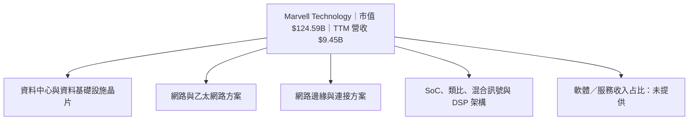
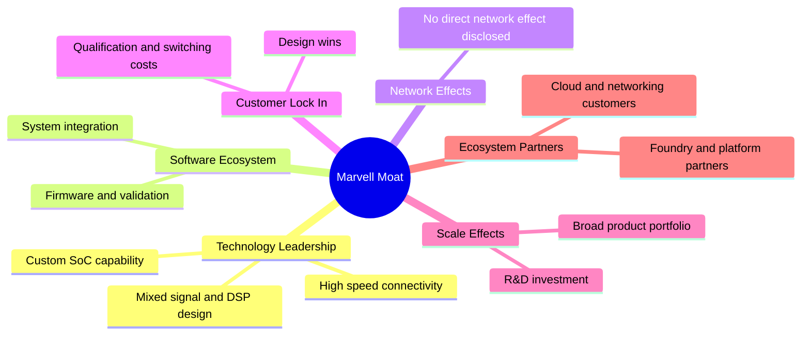
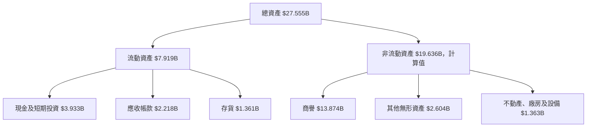
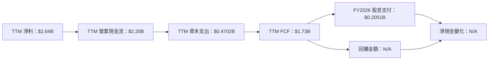
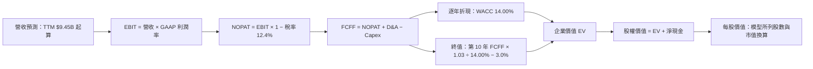
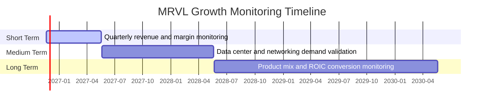
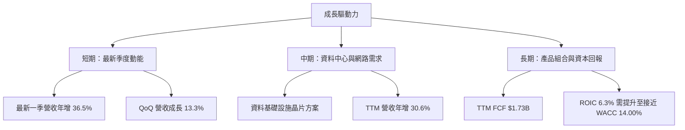
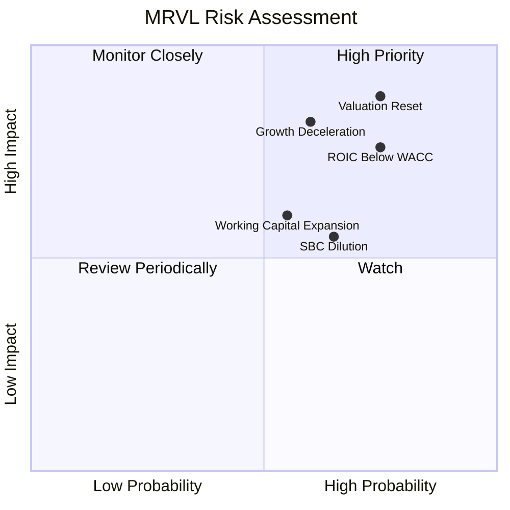
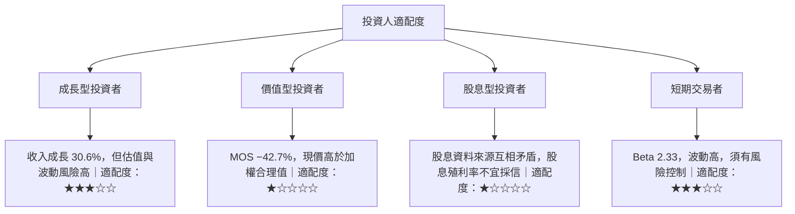

# MRVL 基本面深度分析報告
> **報告日期**：2026-11-20 ｜ **語言**：繁體中文 ｜ **數據來源**：SEC 申報資料 (XBRL)、Yahoo Finance、Finviz、StockAnalysis、Roic.ai ｜ **分析師**：CFA 級機構研究

## 目錄

| # | 章節 | 核心結論 |
|---|------|----------|
| 1 | 執行摘要 | 賣出；加權合理價值 $97.03，MOS −42.7% |
| 2 | 公司概覽與商業模式 | 資料中心與資料基礎設施是核心方向；市場份額與分部營收占比未提供 |
| 3 | 損益表深度分析 | TTM 營收 $9.45B、年增 30.6%；季度成長快，但 GAAP 利潤率需持續驗證 |
| 4 | 資產負債表分析 | 最新 TTM 淨負債 $1.03B；流動性充足但現金轉換週期拉長 |
| 5 | 現金流量深度分析 | TTM FCF $1.73B、FCF Yield 1.39%；SBC 對股東回報有實質稀釋 |
| 6 | 獲利能力與資本效率 | ROIC 6.3% 低於 WACC 14.00%，目前資本回報未覆蓋資本成本 |
| 7 | 相對估值分析 | MRVL 估值低於自身五年 P/E 中位數，但 DCF 與同業倍數仍顯示風險 |
| 8 | DCF 內在價值評估 | 基準 DCF $38.08；加權合理價值 $97.03，現價仍高於兩者 |
| 9 | 成長催化劑 | AI／資料中心需求是質化催化劑；可引用 TAM 與分部數據未提供 |
| 10 | 風險矩陣 | 估值、成長延續性、資本回報與營運資金是主要風險 |
| 11 | 投資建議 | 賣出；等待估值回到合理區間，並追蹤成長與利潤率指標 |

---

## 1. 執行摘要

2026-11-19 收盤價為 **$138.47**。MRVL TTM 營收 **$9.45B**、TTM 年增 **30.6%**，最新一季營收年增 **36.5%**，但 TTM ROIC 僅 **6.3%**，低於採用的 **14.00% WACC**；TTM FCF 為 **$1.73B**，FCF Yield **1.39%**。基準 DCF 每股價值 **$38.08**，而多方法加權合理價值為 **$97.03**；依規則 20，以加權合理價值計算 MOS 為 **−42.7%**，故評級為**賣出**。此評級由估值與資本回報證據導出，而非單以營收成長作判斷。

### 1.0 一頁式投資儀表板（Portfolio Manager 30 秒速讀）

| 項目 | 內容 |
|------|------|
| **投資論點（3 句）** | ① TTM 營收年增 **30.6%**、最新一季年增 **36.5%**，顯示需求仍在擴張。② TTM FCF **$1.73B**、FCF Yield **1.39%**，現金流為正，但現金回報率不足以抵銷估值風險。③ ROIC **6.3%** 對比 WACC **14.00%**，資本回報仍低於資本成本。 |
| **綜合評分** | **5.8/10**（引用 1.1 評分卡） |
| **財務健康** | 🟡 現金與短期投資 **$3.93B**、總債務 **$4.96B**，淨負債 **$1.03B**；流動性尚可，營運資金週期延長。 |
| **ROIC vs WACC** | **6.3% vs 14.00%**，目前摧毀而非創造經濟價值。 |
| **FCF 趨勢** | TTM FCF **$1.73B**；FCF Yield **1.39%**。年度 FCF 過去四年維持正值，最近 TTM 高於 FY2026 的 $1.39B。 |
| **估值** | Forward P/E **18.8x**（市場資料欄）；EV/EBITDA **43.1x**；FCF Yield **1.39%**。 |
| **DCF 內在價值（基準）** | **$38.08**；現價相對 DCF 溢價 **263.6%**（以現價 ÷ DCF 價值 − 1 計）。 |
| **安全邊際（MOS）** | **−42.7%**＝（加權合理價值 **$97.03** − 現價 **$138.47**）÷ **$97.03**；🔴 無安全邊際。 |
| **預期報酬（基準情境 12M）** | DCF 基準情境價值 $38.08，相對現價 **−72.5%**；此為模型情境，不是 12 個月價格預測。 |
| **關鍵風險（前二）** | 估值仍高於加權合理價值；若高速營收成長不能轉化為足夠營業利潤率與 ROIC，DCF 支撐偏弱。 |
| **評級 + 信心度** | 🔴 **賣出** ｜ 信心：中（模型輸入具不確定性，但估值與 ROIC 差距明確） |

### 1.1 綜合評分卡（全報告唯一）

| 維度 | 評分（1–10） | 主要依據（引用數字與其來源章節） |
|------|--------------|----------------------------------|
| 成長性 | 8.0 | TTM 營收年增 **30.6%**、最新一季年增 **36.5%**（第 3 章）；但缺少可驗證的分部營收與 TAM 數據。 |
| 獲利能力 | 5.5 | TTM 營業利益率 **16.5%**、ROIC **6.3%**、F-Score **6/9**；ROIC 明顯低於 WACC（第 6 章）。 |
| 財務健康 | 6.5 | 最新 TTM 淨負債 **$1.03B**，Piotroski 的流動比率測試通過；CCC 從 **113 天**延長至 **131 天**（第 4 章）。 |
| 估值 | 2.0 | MOS **−42.7%**；基準 DCF $38.08，低於現價；P/S **13.5x** 高於自身五年中位數 **9.9x**（第 7、8 章）。 |
| 護城河 | 7.0 | 高速互連、網路與資料基礎設施晶片具設計與驗證門檻，但市場份額、客戶集中度及分部毛利資料未提供（第 2 章）。 |
| 管理層與資本配置 | 5.5 | FY2026 SBC **$590.8M**，約為年度營收 **7.2%**；品質測試顯示稀釋股數未通過（第 3、5 章）。 |
| **綜合評分** | **5.8** | 六項算術平均：(**8.0 + 5.5 + 6.5 + 2.0 + 7.0 + 5.5**) ÷ 6 = **5.75**，四捨五入為 **5.8**。 |

### 1.2 五大投資論點 + 三大核心風險

| 類型 | 項目 | 具體依據 | 信心度 |
|------|------|----------|--------|
| 🟢 **投資論點①** | 營收加速 | TTM 營收 **$9.45B**、TTM 年增 **30.6%**；最新一季年增 **36.5%**。若資料中心與網路需求延續，可支撐營收規模擴張。 | 🟢 高 |
| 🟢 **投資論點②** | 現金流為正 | TTM 營業現金流 **$2.20B**、資本支出 **$470.20M**、FCF **$1.73B**。可支持研發、債務管理與股東回報。 | 🟢 高 |
| 🟢 **投資論點③** | 流動性具緩衝 | 現金及短期投資 **$3.93B**，總債務 **$4.96B**；短期償債壓力並非目前首要風險。 | 🟢 中高 |
| 🟢 **投資論點④** | 高速成長需求可能改善槓桿 | FY2026 營收 **$8.19B**，高於 FY2025 **$5.77B**；在毛利率與費用率維持下，規模增長有助營業利益提升。 | 🟡 中 |
| 🟢 **投資論點⑤** | 相對自身歷史 P/E 未達五年中位數 | 目前 P/E **45.7x**，低於五年中位數 **56.5x**；但 P/S 位於自身歷史第 **75** 百分位，估值訊號並不一致。 | 🟡 中 |
| 🟡 **風險①** | 現價遠高於加權合理價值 | 加權合理價值 **$97.03**，MOS **−42.7%**；若估值回歸，股價下行風險顯著。 | 🔴 高衝擊 |
| 🔴 **風險②** | 資本回報未覆蓋資本成本 | ROIC **6.3%**，WACC **14.00%**，差距 **−7.7 個百分點**。營收成長若無法提升投入資本回報，成長未必創造股東價值。 | 🔴 高 |
| 🟡 **風險③** | 營運資金吸收增加 | CCC 從 **113 天**增至 **131 天**，DSO、DIO、DPO 均增加；應收與庫存占用可能抑制現金轉換。 | 🟡 中高 |

### 1.3 快速統計卡片

| 指標 | 公司實際值（期間） | 同業中位數 | 狀態 |
|------|--------------------|------------|------|
| 營收成長（TTM） | **30.6%** | — | 🟢 |
| 營收成長（最新一季年增） | **36.5%** | **85.5%**（AVGO、NVDA、AMD 最新一季年增中位數） | 🟡 |
| 毛利率（TTM） | **52.2%** | **74.9%**（三家同業中位數） | 🟡 |
| 營業利益率（TTM） | **16.5%** | — | 🟡 |
| ROIC（TTM） | **6.3%** | — | 🔴 |
| Forward P/E | **18.8x**（市場資料欄） | **17.9x**（Peer multiples 的 Forward P/E 中位數） | 🟡 |
| FCF Yield（TTM） | **1.39%** | — | 🟡 |
| Piotroski F-Score | **6 / 9** | — | 🟡 |

### 1.4 投資結論

╔══════════════════════════════════════════════════════════════════╗  
║                    📊 投資結論摘要                               ║  
╠══════════════════════════════════════════════════════════════════╣  
║  評級：🔴 賣出（MOS −42.7%，依規則 20）                          ║  
║  價格（2026-11-19 收盤）：$138.47                                ║  
║  DCF 內在價值（基準）：$38.08（現價溢價 263.6%）                 ║  
║  安全邊際 MOS：−42.7%（以加權合理價值 $97.03 為分母）             ║  
║  加權合理價值（8.8）：$97.03                                     ║  
║  DCF 情境價值：悲觀 $19.28（−86.1%）                              ║  
║    基準 $38.08（−72.5%）｜樂觀 $72.38（−47.7%）                  ║  
║  綜合評分：5.8/10（引用 1.1）                                    ║  
║  適合投資人：可承受高波動、重視成長且能承擔估值回撤者；不適合價值型║  
╚══════════════════════════════════════════════════════════════════╝

---

## 2. 公司概覽與商業模式

### 2.1 業務結構與收入來源

公司資料描述 MRVL 提供由資料中心核心至網路邊緣的資料基礎設施半導體方案，涉及乙太網路、SoC、類比、混合訊號與數位訊號處理。現有資料沒有各業務分部營收與占比，因此不將公司總營收拆分為未經證實的比例。

資料中心、網路與邊緣相關產品可透過高速傳輸、客製化晶片與系統整合需求受惠；但各分部收入、毛利率、客戶集中度和軟體收入數據均未提供，無法量化各業務對 TTM **$9.45B** 營收的貢獻。

### 2.2 市場份額

市場份額資料未提供，故不估算占比。MRVL TTM 營收 **$9.45B**、年增 **30.6%**；同業最新一季營收年增中位數為 **85.5%**，其中包含高成長的資料中心相關同業，不能直接視為產品線完全可比。市場份額與競爭位置仍須由分部營收、出貨量及客戶資料驗證。

### 2.3 競爭護城河分析

### 2.4 護城河強度

| 護城河項目 | 強度（強／中／弱） | 證據（引用數字或事實） | 會削弱它的情況 |
|------------|--------------------|------------------------|----------------|
| 技術與產品設計 | 中 | 公司產品涵蓋乙太網路、SoC、類比、混合訊號及 DSP；TTM 營收 **$9.45B**。未提供各產品市場份額或研發成功率。 | 競爭者在效能、功耗、成本或上市時程上超越。 |
| 軟體與系統整合 | 中 | 公司提供系統層級資料基礎設施方案；具體軟體收入、續約率及生態系規模未提供。 | 客戶改用標準化替代方案，或平台整合價值下降。 |
| 網路效應 | 弱／未證實 | 現有資料未顯示用戶或開發者數量會隨客戶增加而提高產品價值。 | 產業標準化使產品差異化縮小。 |
| 客戶鎖定 | 中 | 半導體設計導入與驗證通常需產品週期配合，但公司客戶留存率、設計週期資料未提供。 | 客戶自研、供應商轉換或大客戶議價加強。 |
| 規模效應 | 中 | TTM 研發費用資料未提供；FY2026 研發費用 **$2.08B**，顯示研發投入具規模，但高研發本身不等同護城河。 | 研發投入增幅高於收入成長，或新品無法轉化為利潤。 |
| 生態夥伴 | 中 | 公司在多個國家與地區營運，服務資料中心至邊緣市場；夥伴與通路收入占比未提供。 | 供應鏈限制、客戶平台轉向或合作夥伴自研。 |

1.1 的「護城河」評分 **7.0/10**，主要依據產品技術與設計導入門檻；因市場份額、客戶留存與分部利潤數據缺漏，評分並未視為已被充分證明。

---

## 3. 損益表深度分析

### 3.1 年度收入成長趨勢（近 4 年）

FY2026、FY2025、FY2024、FY2023 營收分別為 **$8.19B、$5.77B、$5.51B、$5.92B**。FY2026 年增約 **42.1%**，FY2025 約 **4.7%**，FY2024 約 **−6.9%**。不同來源的年度營收存在小幅差異，以下採年度損益表列示值計算；TTM 成長率則採 SEC 資料計算值 **30.6%**。

╔══════════════════════════════════════════════════════════════════╗  
║              Marvell 年度收入趨勢（FY2023–FY2026）               ║  
╠══════════════════════════════════════════════════════════════════╣  
║ FY2023  $5.92B  ██████████████████░░░░░░░░░░░░  YoY: —          ║  
║ FY2024  $5.51B  █████████████████░░░░░░░░░░░░░  YoY: −6.9% 🟡  ║  
║ FY2025  $5.77B  ██████████████████░░░░░░░░░░░░  YoY: +4.7% 🟡  ║  
║ FY2026  $8.19B  █████████████████████████░░░░░  YoY: +42.1% 🟢 ║  
╠══════════════════════════════════════════════════════════════════╣  
║ FY2023–FY2026 三年 CAGR：約 +11.4%                               ║  
╚══════════════════════════════════════════════════════════════════╝

計算：FY2023 至 FY2026 CAGR = \((8.19 ÷ 5.92)^{1/3} − 1\) ≈ **11.4%**。FY2026 的加速較前三年趨勢明顯；但年度單點反彈不能單獨證明長期增速，需觀察後續季度及各產品線的成長構成。

### 3.2 季度收入趨勢分析

| 季度 | 營收 | QoQ 成長 | YoY 成長 | 備註 |
|------|------:|---------:|---------:|------|
| FY2026 Q3（2025-11-01） | $2.075B | — | 36.83% | QoQ 前一季營收未列入最近四季表格，故不計算。 |
| FY2026 Q4（2026-01-31） | $2.219B | +6.9% | 22.08% | QoQ = 2.219 ÷ 2.075 − 1。 |
| FY2027 Q1（2026-05-02） | $2.418B | +9.0% | 27.57% | QoQ = 2.418 ÷ 2.219 − 1。 |
| FY2027 Q2（2026-08-01） | $2.739B | +13.3% | **36.5%** | 最新單季年增引用 SEC 計算值；QoQ = 2.739 ÷ 2.418 − 1。 |

最近三個 QoQ 成長率呈現加速，從 **6.9%** 升至 **13.3%**；最新一季年增 **36.5%** 反映收入規模擴張。若成長主要集中於資料中心與高速互連產品，可能提升產品組合；但分部數據缺漏，無法把成長歸因量化到特定產品。

### 3.3 利潤率演變分析

年度損益表不同資料來源對毛利、營業利益及淨利存在差異；以下依同一份年度損益表列示值計算，並以 TTM 核心比率作最新比較。

| 利潤率指標 | FY2023 | FY2024 | FY2025 | FY2026 | 趨勢 | 評估 |
|------------|-------:|-------:|-------:|-------:|------|------|
| **毛利率** | 約 50.5% | 約 41.6% | 約 41.2% | 約 51.0% | FY2026 明顯回升 | 🟡 |
| **營業利益率** | 約 6.1% | 約 −7.9% | 約 −6.4% | 約 16.4% | 由負轉正並擴張 | 🟢 |
| **淨利率** | 約 −2.8% | 約 −16.9% | 約 −15.3% | 約 32.6% | 變動極大 | 🟡 |
| **TTM 營業利益率** | — | — | — | **16.5%** | TTM 維持正值 | 🟡 |

年度毛利率計算受來源數字差異影響，且 FY2026 淨利率受到當年度非營業項目或一次性影響的可能性較高；因此不應把年度淨利率躍升直接外推。TTM 淨利率 **27.9%**、營業利益率 **16.5%**，兩者落差亦顯示非營業項目、稅務與期間差異對報表淨利有影響。

**利潤率演變深度解析：** FY2026 營收較 FY2025 增加，而年度營業利益由負轉為 **$1.34B**，顯示營收恢復後固定費用吸收改善。但季度營業利益率、全年與 TTM 的計算口徑並非完全一致；未有產品組合、價格、製造成本及一次性項目明細，故不能將改善全數歸因於定價或營運效率。若後續營收成長放慢，費用率與毛利率是否能保持將決定營業槓桿能否延續。

### 3.4 費用結構分析

費用結構資料不完整，不製作比例圓餅圖。FY2026 研發費用為 **$2.08B**，約為年度營收 **$8.19B** 的 **25.4%**；SBC 為 **$590.8M**，約為年度營收的 **7.2%**。公司研發投入有助產品迭代，但費用高於五分之一營收意味新產品轉化效率是股東回報的重要檢驗項目。

### 3.5 季度 EPS 趨勢與盈餘品質（Quality of Earnings）

| 季度 | EPS 實際值 | EPS 年增 | 超預期／不及預期 | 備註 |
|------|-----------:|---------:|------------------|------|
| 2025-10-31 | $2.20 | N/A | N/A | EPS Est 欄缺少有效數值，無法判斷 beat/miss；季度淨利 $1.90B 異常高，須核對一次性項目。 |
| 2026-01-31 | $0.47 | 106.27% | N/A | 缺少有效預期值。 |
| 2026-04-30 | $0.04 | −80.44% | N/A | 缺少有效預期值；單季淨利 $34.5M。 |
| 2026-07-31 | $0.34（另一欄列 $0.33） | +50.0% | N/A | EPS 絕對值來源略有差異；最新單季 EPS 年增 50.0%。 |

最近四季 EPS 預期值均為 `nan`，故不能將任何季度稱為超預期或不及預期。2025-10-31 單季淨利 **$1.90B** 與相鄰季度差距甚大，顯示 EPS 序列可能包含非經常性或資料口徑因素，須回查 SEC 季報。

| 盈餘品質項目 | 數值/佔比 | 評估 |
|--------------|-----------|------|
| 股權薪酬 SBC / 營收 | FY2026：$590.8M ÷ $8.19B = **7.2%** | 🟡 偏高；SBC 作為非現金費用仍會透過股數稀釋轉嫁給股東。 |
| SBC / 營業現金流 | FY2026：$590.8M ÷ $1.75B = **33.8%** | 🔴 SBC 規模相當於營業現金流約三分之一，需納入經濟成本評估。 |
| FCF / 淨利（現金轉換率） | TTM FCF $1.73B ÷ TTM 淨利（StockAnalysis $2.64B）= **約 65.5%** | 🟡 現金轉換低於 1 倍；淨利受到非現金項目、營運資金及一次性損益影響。 |
| 一次性／非經常性損益 | 有疑點；2025-10-31 單季淨利 **$1.90B** | 🟡 需要年報／季報附註驗證，不能將該季 EPS 作常態化盈利。 |
| 有效稅率異常 | **12.4%**（最新年度有效稅率） | 🟡 稅率低於一般美國法定稅率水準的可能性高，但本資料未提供稅務調節表；DCF 依規定採用 12.4%。 |
| 資本化支出 vs 費用化 | TTM Capex **$470.20M**；資本化研發資料未提供 | N/A（數據未提供：缺少資本化研發及無形資產支出附註）。 |

**盈餘品質結論：** TTM FCF 為正且規模達 **$1.73B**，但 FCF／淨利約 **65.5%**，加上 FY2026 SBC 約占營收 **7.2%**、淨利季度波動大，GAAP 淨利不宜直接視為可全額分配的經濟盈餘。DCF 採 GAAP EBIT，避免加回 SBC 後再漏計股東稀釋成本；估值仍應以現金流與股數變化共同檢驗。

---

## 4. 資產負債表分析

### 4.1 資產結構分解

最新 TTM 資產負債表列示總資產 **$27.555B**、流動資產 **$7.919B**。非流動資產可用總額減流動資產計算為 **$19.636B**，其中商譽 **$13.874B**、其他無形資產 **$2.604B**；因數據採不同來源與季度時點，圖中僅列明來源數字，不作細項全面加總。

商譽約占總資產 **50.4%**（13.874 ÷ 27.555）；高商譽反映歷史併購形成的無形資產占比，若相關業務表現不及預期，可能帶來減損風險。

### 4.2 流動性與營運資金分析

不同資料來源的現金與短期負債比率口徑並不完全一致；營運資金天數採品質指標區塊所列值。

| 流動性指標 | 數值 | 評估 |
|------------|------|------|
| 現金及短期投資 | **$3.93B** | 🟢 可提供流動性緩衝。 |
| 總債務 | **$4.96B** | 🟡 高於現金及短期投資。 |
| 淨負債 | **$1.03B** | 🟡 槓桿可控但不是淨現金狀態。 |
| 流動比率 | **3.168x**（市場資料欄） | 🟢 流動資產對短期負債覆蓋充足；來源報表時點存在差異。 |
| Quick Ratio | **2.461x**（市場資料欄） | 🟢 即時流動性仍有緩衝。 |

| 指標 | 最新 TTM | 一年前 TTM | 變化 | 解讀 |
|------|----------:|-----------:|------:|------|
| DSO 應收帳款天數 | **86 天** | **73 天** | **+13 天** | 🟡 收款天數延長，可能反映銷售組合、客戶付款條件或季度時點影響。 |
| DIO 存貨天數 | **110 天** | **96 天** | **+14 天** | 🟡 存貨占用增加，須追蹤是否因備貨或需求預測偏差。 |
| DPO 應付帳款天數 | **64 天** | **56 天** | **+8 天** | 🟡 付款期延長，部分抵銷應收與存貨占用增加。 |
| CCC 現金轉換週期 | **131 天** | **113 天** | **+18 天** | 🔴 現金回收週期拉長，營運資金對成長的資金需求上升。 |

CCC = DSO + DIO − DPO；最新 TTM 為 **86 + 110 − 64 = 132 天**，品質指標列示 **131 天**。此一日差異應歸因於原始未四捨五入數值與表格日數四捨五入，報告採用品質指標的 **131 天**。

### 4.3 債務結構分析

注意：較廣泛市場資料另列總債務 **$5.29B**、淨負債 **$1.35B**；本報告資本成本與 DCF 所需淨現金採 SEC 計算值 **總債務 $4.96B、淨負債 $1.03B**。不同來源或負債定義可能造成差異，不混用。

╔══════════════════════════════════════════════════════════════════╗  
║                   Marvell 債務健康診斷                           ║  
╠══════════════════════════════════════════════════════════════════╣  
║ 總債務：            $4.96B   ████████████████████  🟡            ║  
║ 現金及短期投資：    $3.93B   ████████████████░░░░  🟢            ║  
║ 淨負債：            $1.03B   ████░░░░░░░░░░░░░░░░  🟡            ║  
║ 流動比率：          3.168x   流動性具緩衝                         ║  
║ Debt/EBITDA：       N/A（缺少同口徑的驗證分母）                   ║  
║ Interest Coverage： N/A（利息費用與營業利益口徑未完整提供）       ║  
╚══════════════════════════════════════════════════════════════════╝

### 4.4 股東權益趨勢

| 財年 | 股東權益 | YoY 變化 |
|------|---------:|---------:|
| FY2023 | $15.64B | — |
| FY2024 | $14.83B | −5.2% |
| FY2025 | $13.43B | −9.4% |
| FY2026 | $14.31B | +6.6% |

股東權益在 FY2023–FY2025 連續下滑後於 FY2026 回升。股東權益變化同時受淨利、SBC、回購、累計其他綜合損益與併購會計影響；未提供完整權益變動表，不能將變化直接等同於股東現金回報。

---

## 5. 現金流量深度分析

### 5.1 現金流量瀑布圖

TTM 數據可驗證營業現金流與資本支出、FCF；股息與淨現金變化則採年度或季度來源，不能直接與 TTM 同期混算。

### 5.2 FCF 轉換率趨勢

| 財年 | 營業現金流 | Capex | FCF | 淨利 | FCF／淨利 |
|------|-----------:|------:|----:|-----:|----------:|
| FY2023 | $1.29B | $217.3M | $1.07B | −$163.5M | 不具可比性，淨利為負 |
| FY2024 | $1.37B | $350.2M | $1.02B | −$933.4M | 不具可比性，淨利為負 |
| FY2025 | $1.68B | $291.6M | $1.39B | −$885.0M | 不具可比性，淨利為負 |
| FY2026 | $1.75B | $358.6M | $1.39B | $2.67B | 約 **52.1%** |
| TTM 至 2026-08-01 | $2.20B | $470.20M | **$1.73B** | $2.64B（第三方列示） | 約 **65.5%** |

年度 FCF 在 FY2023–FY2026 皆為正，最新 TTM FCF 較 FY2026 年度 FCF 增加；但淨利在先前財年為負，且 FY2026/TTM 的 FCF／淨利低於 1 倍，故比較時應著重現金流趨勢，而非對負淨利年度計算轉換率。

### 5.3 自由現金流趨勢

╔══════════════════════════════════════════════════════════════════╗  
║               自由現金流趨勢（財年／TTM）                        ║  
╠══════════════════════════════════════════════════════════════════╣  
║ FY2023  $1.07B  ████████████░░░░░░░░  正值                      ║  
║ FY2024  $1.02B  ███████████░░░░░░░░░  正值                      ║  
║ FY2025  $1.39B  ███████████████░░░░░  正值                      ║  
║ FY2026  $1.39B  ███████████████░░░░░  正值                      ║  
║ TTM     $1.73B  ███████████████████░  FCF Yield 1.39%            ║  
╚══════════════════════════════════════════════════════════════════╝

### 5.4 資本配置評估

各項資本配置的完整同期比例資料未提供，不繪製比例圓餅圖。已知 FY2026 股息支付 **$205.1M**，Capex **$358.6M**，SBC **$590.8M**。年度回購金額、併購投資與留存現金用途未提供，因此無法量化回購／投資／留存占比。

| 項目 | 數據 | 評估 |
|------|------|------|
| Capex | FY2026 **$358.6M** | 低於研發費用；需追蹤產能與基礎設施投入是否配合成長。 |
| 股息 | FY2026 支付 **$205.1M** | 相對 FCF 規模有限；Yahoo Finance 顯示的股息殖利率 **17.0%** 與歷史每季每股約 $0.06 的股息資料明顯不一致，故不採用該殖利率作投資結論。 |
| SBC | FY2026 **$590.8M** | 股東成本顯著，應與回購及稀釋股數一併追蹤。 |
| 回購／併購／留存資金用途 | N/A | 數據未提供，不能假設或補足比例。 |

---

## 6. 獲利能力與資本效率

### 6.1 ROE / ROA / ROIC 趨勢

| 指標 | 最新可用值 | 歷史趨勢／評估 |
|------|-----------:|----------------|
| ROE | **14.2%**（QUALITY FIGURES） | 另一資料欄列 **16.5%**，口徑不同；本報告杜邦採用品質指標的 14.2%。 |
| ROA | **4.1%**（市場資料欄） | 資產回報較 ROE 低，符合資產基礎與併購商譽占比高的特徵。 |
| ROIC | **6.3%**（TTM） | 低於 WACC **14.00%**，目前資本效率未覆蓋資本成本。 |

可用來源未提供同一口徑的多年 ROIC、ROA、ROE 時間序列與行業均值，故不編造歷史對照或同業平均。

### 6.2 ROIC vs WACC 分析（核心價值創造判斷）

╔══════════════════════════════════════════════════════════════════╗  
║                ROIC vs WACC 深度分析                            ║  
╠══════════════════════════════════════════════════════════════════╣  
║ WACC 採用值：14.00%（程式計算值 14.06%，受 7%–14% 區間限制）    ║  
║ 無風險利率（10Y 美債）：5.05%                                    ║  
║ 市場風險溢酬 ERP：5.00%                                          ║  
║ 原始 Beta：2.33；調整後 Beta：1.88                              ║  
║ 股權成本（提供值）：14.48%                                       ║  
║ 稅前債務成本：4.08%；有效稅率：12.4%                            ║  
║ 股權／債務權重：96.2%／3.8%                                     ║  
║ ROIC（TTM）：6.3%                                                 ║  
║ EVA spread = ROIC − WACC = 6.3% − 14.00% = −7.7 個百分點        ║  
║ 結論：ROIC 低於 WACC，現階段經濟回報未覆蓋資本成本。             ║  
╚══════════════════════════════════════════════════════════════════╝

ROIC 為 SEC 計算口徑：稅後營業利益 ÷（權益 + 債務 − 現金）。目前 **6.3%**，低於 **14.00%**，負利差為 **7.7 個百分點**。若高成長投資能推升利潤與資本周轉，ROIC 可能改善；反之，擴大營收但需持續大量投入資本，仍可能擴大價值缺口。

### 6.3 杜邦三因素分解

| 因素 | 數值（TTM） | 解讀 |
|------|-------------|------|
| 淨利率 | **27.9%** | 高於 TTM 營業利益率，顯示非營業項目、稅率或期間差異影響淨利。 |
| 資產週轉率 | **0.34** | 每一美元資產創造約 $0.34 營收；商譽及無形資產比重高會壓低周轉率。 |
| 權益乘數 | **1.49** | 槓桿不是 ROE 的唯一來源，財務槓桿程度中等。 |
| **ROE** | **14.2%** | 品質指標列示結果；因素乘積因四捨五入約為 14.1%。 |

杜邦指標照錄品質數據：**27.9% × 0.34 × 1.49 = ROE 14.2%**。ROE 主要依賴淨利率與資產基礎，並非單靠高槓桿推升；但淨利率可能包含非營業或非經常性成分，需配合營業利益率與現金轉換率觀察。

### 6.4 財務體質：Piotroski F-Score

Piotroski F-Score 為 **6 / 9**。

| 測試 | 結果 | 解讀 |
|------|------|------|
| ROA > 0 | ✅ 通過 | 盈利能力為正。 |
| 營業現金流 > 0 | ✅ 通過 | TTM 營業現金流為正。 |
| ROA 高於一年前 | ✅ 通過 | 獲利趨勢改善。 |
| 營業現金流 > 淨利（應計品質） | ❌ 未通過 | 現金流低於淨利，與 FCF／淨利低於 1 倍一致。 |
| 長期負債 ÷ 總資產低於一年前 | ✅ 通過 | 槓桿指標相對改善。 |
| 流動比率高於一年前 | ✅ 通過 | 短期流動性方向改善。 |
| 稀釋股數未增加 | ❌ 未通過 | 股數增加，SBC 可能造成稀釋。 |
| 毛利率高於一年前 | ✅ 通過 | 毛利率測試通過；須注意不同來源口徑。 |
| 資產週轉率高於一年前 | ❌ 未通過 | 資產使用效率尚未同步改善。 |

6/9 表示財務狀況有改善訊號，但未通過的應計品質、稀釋股數與資產週轉測試，都是成長能否轉化為每股價值的監控重點。

---

## 7. 相對估值分析

### 7.1 同業估值比較表格

MRVL 公司估值倍數採 VERIFIED FIGURES；同業數據採 Yahoo Finance Peer multiples。Forward P/E 與其他市場資料欄可能有口徑差異，本表以同業比較區塊的 MRVL Forward P/E **18.8x**（市場資料欄）對照 Peer multiples 中位數 **17.9x**。

| 估值指標 | **MRVL** | **AVGO** | **NVDA** | **AMD** | MRVL 評估 |
|----------|---------:|--------:|--------:|-------:|-----------|
| **Trailing P/E** | **45.7x** | 44.3x | 15.7x | 113.2x | 🟡 位於 AVGO 附近，低於 AMD，高於 NVDA。 |
| **Forward P/E** | **18.8x** | 17.9x | 8.8x | 27.7x | 🟡 靠近 AVGO，高於 NVDA，低於 AMD。 |
| **P/S Ratio** | **13.5x** | 18.6x | 9.7x | 17.8x | 🟡 相對處於中間；仍遠高於自身五年中位數 9.9x。 |
| **EV/EBITDA** | **82.4x**（歷史估值區塊） | 32.3x | 14.2x | 71.4x | 🔴 高於三家 Peer multiples 中位數 32.3x。 |
| **最新一季營收年增** | **36.5%** | 85.5% | 103.2% | 44.7% | 🟡 低於三家同業中位數 85.5%。 |
| **TTM 毛利率** | **52.2%** | 75.5% | 74.9% | 56.0% | 🟡 低於同業中位數 74.9%。 |

MRVL 的 EV/EBITDA 不同資料欄有 **43.1x** 與歷史估值區塊 **82.4x** 的差異，應是日期或計算口徑不同。本節同業比較依規則採 Peer multiples 所在估值區塊的對應資料，故 MRVL 的歷史估值分析另列；不將不同來源倍數混為同一序列。

### 7.2 歷史估值區間分析

╔══════════════════════════════════════════════════════════════════╗  
║                  MRVL 五年歷史估值位置                           ║  
╠══════════════════════════════════════════════════════════════════╣  
║ P/E：       25.6x ───── 中位數 56.5x ── 現值 45.7x ── 61.9x     ║  
║ 現值百分位：50%                                                  ║  
║ P/S：        5.8x ───── 中位數  9.9x ───────── 現值 13.5x ─18.3x║  
║ 現值百分位：75%                                                  ║  
║ EV/EBITDA： 53.3x ─ 現值 82.4x ─ 中位數 156.4x ───────730.9x   ║  
║ 現值百分位：25%                                                  ║  
╚══════════════════════════════════════════════════════════════════╝

P/E 位於五年中間位置，EV/EBITDA 低於五年中位數，但其歷史區間極寬，解讀能力有限；P/S 位於自身歷史第 **75** 百分位，代表市場對銷售額的定價仍偏高。三項指標呈現分歧，不能單靠其中一項推斷便宜。

### 7.3 情境價值（Bear / Base / Bull，照抄 DCF MODEL 的 Scenarios）

| 情境 | 第 1 年營收成長 | 期末營業利潤率 | WACC | 每股價值 | 相對現價 | 機率 | 會發生的條件 |
|------|----------------:|---------------:|-----:|---------:|---------:|-----:|--------------|
| 🔴 悲觀 | 15.0% | 3.4% | 15.00% | **$19.28** | **−86.1%** | 25% | 需求增速降溫、競爭或產品組合壓抑成熟期利潤率，且風險溢價上升。 |
| 🟡 基準 | 30.0% | 4.0% | 14.00% | **$38.08** | **−72.5%** | 50% | 初期延續 TTM 30.6% 成長附近，後續成長與利潤率逐年淡化。 |
| 🟢 樂觀 | 45.0% | 4.4% | 13.00% | **$72.38** | **−47.7%** | 25% | 成長進一步加速、成熟期利潤率略高且資本成本下降。 |

即使樂觀情境每股價值 **$72.38**，仍低於現價 **$138.47**。機率加權情境值 **$41.95** 僅作情境參考，不取代第 8.8 節的加權合理價值。

### 7.4 相對估值隱含價格區間

╔══════════════════════════════════════════════════════════════════╗  
║          估值方法回推每股價值與現價位置（美元／股）              ║  
╠══════════════════════════════════════════════════════════════════╣  
║ DCF 基準：$38.08 ─ EV/EBITDA：$71.90 ─ 現價：$138.47           ║  
║ Forward P/E：$131.62 ─ 分析師共識：$309.14                      ║  
╚══════════════════════════════════════════════════════════════════╝

- **同業 Forward P/E：$131.62**＝Peer 中位數 **17.9x** × Forward EPS **$7.37**。
- **同業 EV/EBITDA：$71.90**＝同業中位數 **23.3x**（AVGO、NVDA）× TTM EBITDA，再加回淨現金。
- **DCF 基準：$38.08**，依 10 年 FCFF、WACC **14.00%**、永續成長率 **3.0%**。
- **分析師共識：$309.14**，40 位分析師平均目標價；它是市場參考值，不代表內在價值驗證。

---

## 8. DCF 內在價值評估（Discounted Cash Flow）

### 8.0 估值推理鏈（Thinking Logic：在算之前先想清楚）

**Step 1 — 價值來源與主導變數：** 本模型以 TTM 營收 **$9.45B** 為起點，並將全部公司收入作為一個整體預測；分部占比與新增業務營收貢獻未提供，不能為「第二成長曲線」或選擇權價值另設營收。價值主要由 **10 年營收成長路徑、GAAP 營業利潤率淡化路徑及 WACC** 決定。敏感度矩陣顯示 WACC 變動對基準估值的影響大於永續成長率小幅變動。

**Step 2 — 模型選擇**

| 決策點 | 本報告採用 | 理由（含數字） | 曾考慮但否決 | 否決理由 |
|--------|-----------|----------------|--------------|----------|
| 現金流定義 | FCFF | 以企業現金流搭配 WACC 折現，直接得到 EV；TTM FCF 為 $1.73B | FCFE | 債務與資本結構存在，FCFF 更能一致處理企業價值。 |
| 預測期 N | 10 年 | DCF MODEL 固定設定 10 年，營收成長由 30.0% 淡化至 3.0% | 5 年 | 5 年會較早把仍處成長階段的現金流放入終值；但模型沒有另算 5 年版本。 |
| 終值方法 | Gordon Growth | 基準 g=3.0%、WACC=14.00%，符合 WACC > g | 退出倍數法 | DCF MODEL 未提供退出倍數終值，不自行建立第二模型。 |
| EBIT 基礎 | GAAP EBIT | TTM GAAP 營業利益率 16.5% | 非 GAAP EBIT | 非 GAAP 需額外處理 SBC，模型已指定 GAAP 基礎。 |

**Step 3 — 關鍵假設推導鏈**

- **營收成長**：錨點＝TTM 營收年增 **30.6%**、最新一季年增 **36.5%** → 模型將第 1 年成長設為 **30.0%**，並線性淡化至第 10 年 **3.0%** → **採用模型原值 30.0% 至 3.0%** → 曾考慮以樂觀情境 **45.0%** 作起點，但其要求成長顯著高於目前 TTM，故只留在樂觀情境，不作基準。
- **營業利潤率**：錨點＝TTM GAAP 營業利益率 **16.5%** → 模型預設其逐年線性下降，至第 10 年 **4.0%**，以反映長期競爭與成熟化 → **採用 16.5% 至 4.0%** → 曾考慮成熟期 **4.4%**（樂觀情境），但缺少支持長期維持較高利潤率的分部資料，故不納入基準。
- **永續成長率 g**：錨點＝DCF 模型指定 **3.0%**，低於 WACC **14.00%** → 與長期名目經濟成長假設相容，但不是公司財測 → **採用 3.0%** → 矩陣另測 **2.0%–4.0%**；不採高於 4.0% 的值，避免終值對高成長假設過度敏感。
- **預測期 N**：錨點＝模型固定 **10 年** → 足以呈現營收成長由 30.0% 逐年淡化至 3.0% 的路徑 → **採用 10 年** → 曾考慮短於 10 年，但與既定逐年模型不一致；沒有其他 N 的可複算模型可替代。
- **Capex／營收**：錨點＝TTM Capex **$470.20M**、TTM 營收 **$9.45B**，比率約 **5.0%** → 模型採第 1 年至第 10 年均為 **5.0%** → **採用 5.0%** → 模型沒有不同 Capex 路徑的敏感度輸出，不自行替換。
- **EBIT 基礎、SBC、股數**：錨點＝TTM GAAP 營業利益率 **16.5%**，FY2026 SBC **$590.8M** → 模型使用 GAAP EBIT，SBC 已作費用，固定股數、不另加年稀釋率 → **採組合 (A)** → 否決「GAAP EBIT 再扣 SBC」或同時增加股數稀釋，避免重複計算。
- **WACC**：錨點＝模型成本資本區塊計算值 **14.06%** → 因規則限制在 **7%–14%**，採用上限 **14.00%** → **採用 14.00%** → 不採未受限制的 14.06%，以遵從模型所列限制。
- **稅率、D&A／營收**：模型分別採 **12.4%**、**13.3%**；前者來自最新年度有效稅率，後者為 TTM 比率。營運資金變動在該模型中**未建模**，不是假設為零的財報事實。

**Step 4 — 最脆弱的一環：** 模型把 TTM D&A／營收 **13.3%** 固定 10 年，而 Capex／營收維持 **5.0%**，導致折舊攤銷長期遠高於資本支出；若此關係不成立，現金流及估值方向可能顯著改變，模型沒有提供此假設的獨立敏感度。

**Step 5 — 計算路徑圖**

### 8.1 模型假設總表（Model Inputs）

| 假設項目 | 採用值 | 依據 / 來源 | 敏感度 |
|----------|--------|-------------|--------|
| 預測期長度 **N** | **10 年** | DCF MODEL 固定設定；成長由 30.0% 淡化至 3.0%。 | 🟡 中 |
| 營收成長路徑 | FY+1 **30.0%**，FY+10 **3.0%**，線性淡化 | TTM 年增 **30.6%**；模型把基期成長限制在最高 30.0%。 | 🔴 高 |
| 營業利潤率 | FY+1 **16.5%**，FY+10 **4.0%** | 起點採 TTM GAAP 營業利益率；終點採模型所列歷史五年中位數（含 TTM）。 | 🔴 高 |
| 有效稅率 | **12.4%** | 最新年度有效稅率。 | 🟢 低 |
| Capex / 營收 | **5.0%**（FY+1 至 FY+10） | TTM Capex $470.20M ÷ TTM 營收 $9.45B 約為 5.0%；模型採固定值。 | 🟡 中 |
| D&A / 營收 | **13.3%** | DCF MODEL 所列 TTM 比率，固定使用。 | 🟢 低 |
| 營運資金變動 | **未建模** | DCF MODEL 明確不含 ΔWC；營運資金天數不等於可直接計算 ΔWC 現金流。 | 🟡 中 |
| EBIT 基礎 | GAAP | 模型明列 GAAP EBIT。 | 🟡 中 |
| SBC 處理 | **組合 (A)**：GAAP EBIT、不再扣 SBC、固定股數 | SBC 已計入 GAAP 費用；模型指定股數不再稀釋。 | 🟡 中 |
| 年稀釋率 | **0%**（模型處理） | 與組合 (A) 相容；不可再把 SBC 重複扣除或放大股數。 | 🟡 中 |
| 永續成長率 g | **3.0%** | DCF MODEL 設定；小於 WACC。 | 🔴 高 |
| 終值方法 | Gordon Growth | 模型提供 Gordon Growth 終值；退出倍數終值未提供。 | 🔴 高 |
| WACC | **14.00%** | 程式計算值 14.06%，受 7%–14% 區間限制後採 14.00%。 | 🔴 高 |

**FCFF 定義：**採用 FCFF＝NOPAT + D&A − Capex；營運資金未建模，故不列 ΔWC 扣項。  
**SBC 說明：**本模型採用 **(A)**，GAAP EBIT 已含 SBC 費用，因此 FCFF 不另扣 SBC，股數不再逐年稀釋，SBC 影響在模型中計入一次。

### 8.2 折現率推導（WACC）

╔══════════════════════════════════════════════════════════════════╗  
║                    WACC 推導（折現率）                           ║  
╠══════════════════════════════════════════════════════════════════╣  
║ 股權成本 Ke：提供值 14.48%                                       ║  
║ 無風險利率 Rf：5.05%｜ERP：5.00%                                ║  
║ 原始 Beta：2.33｜調整後 Beta：1.88                               ║  
║ Beta 調整：⅔ × 2.33 + ⅓ × 1 = 1.8867，列示為 1.88               ║  
║ Ke 公式代入：5.05% + 1.88 × 5.00% = 14.45%                      ║  
║ 成本資本區塊另列 Ke = 14.48%；與顯示精度輸入相差 0.03 pp。       ║  
║ 稅前債務成本：4.08%｜有效稅率：12.4%                             ║  
║ 稅後 Kd = 4.08% × (1 − 12.4%) = 3.57408%                         ║  
║ E／D 權重：96.2%／3.8%                                           ║  
║ 按提供 Ke 計算 WACC：14.48%×96.2% + 3.57408%×3.8% = 14.06%     ║  
║ 採用 WACC：14.00%（計算值受 7%–14% 範圍限制）                   ║  
╚══════════════════════════════════════════════════════════════════╝

**逐步演算（WACC）：**

1. **Ke（CAPM）**＝Rf + β × ERP；以成本資本區塊列示 Ke 為 **14.48%**。按顯示到兩位小數的 Rf 與 Beta 重算：**5.05% + 1.88 × 5.00% = 14.45%**。兩者差 **0.03 個百分點**，採用時遵循成本資本區塊列示的 **14.48%**，並揭露其輸入精度差異。
2. **稅前 Kd**＝利息費用 ÷ 平均計息負債；利息費用與平均計息負債明細未提供，直接採成本資本區塊列示值 **4.08%**，不自行反推。
3. **稅後 Kd**＝4.08% × (1 − 12.4%)＝**3.57408%**，約 **3.57%**。
4. **權重**＝成本資本區塊列示股權／債務權重 **96.2%／3.8%**，合計 **100.0%**。成本資本區塊未提供可與該權重獨立複核的市值及計息債務拆分，故不以其他負債數據重算權重。
5. **WACC**＝14.48% × 96.2% + 3.57408% × 3.8%＝13.92976% + 0.13582%＝**14.06558%**，成本資本區塊列示 **14.06%**；受 **7%–14%** 上限限制，模型採用 **14.00%**。

Rf、ERP、Beta、Kd 與權重均直接採成本資本數據；Rf 的具體觀察日未提供，故不虛構日期。Beta 原始值 **2.33** 偏高，模型採用調整後 Beta **1.88**。規模／國別溢酬未列示，未額外加計。第 6.2 與 DCF 使用同一採用值 **14.00%**。

### 8.3 逐年自由現金流預測（基準情境）

下表照錄 DCF MODEL，金額單位 **$B**；折現因子保留三位小數。營運資金變動未建模，不列 ΔWC。

| 年度 | FY+1 | FY+2 | FY+3 | FY+4 | FY+5 | FY+6 | FY+7 | FY+8 | FY+9 | FY+10 |
|------|-----:|-----:|-----:|-----:|-----:|-----:|-----:|-----:|-----:|------:|
| 營收 | 12.29 | 15.60 | 19.35 | 23.41 | 27.62 | 31.77 | 35.58 | 38.78 | 41.11 | 42.34 |
| 營收 YoY | 30.0% | 27.0% | 24.0% | 21.0% | 18.0% | 15.0% | 12.0% | 9.0% | 6.0% | 3.0% |
| 營業利潤率 | 16.5% | 15.1% | 13.7% | 12.4% | 11.0% | 9.6% | 8.2% | 6.8% | 5.4% | 4.0% |
| 營業利益 EBIT（GAAP） | 2.03 | 2.36 | 2.66 | 2.89 | 3.03 | 3.04 | 2.91 | 2.64 | 2.22 | 1.70 |
| − 稅（12.4%） | (0.25) | (0.29) | (0.33) | (0.36) | (0.37) | (0.38) | (0.36) | (0.33) | (0.27) | (0.21) |
| = NOPAT | 1.78 | 2.07 | 2.33 | 2.53 | 2.65 | 2.67 | 2.55 | 2.31 | 1.95 | 1.49 |
| + D&A | 1.64 | 2.08 | 2.58 | 3.12 | 3.69 | 4.24 | 4.75 | 5.18 | 5.49 | 5.65 |
| − Capex | (0.61) | (0.78) | (0.96) | (1.16) | (1.37) | (1.58) | (1.77) | (1.93) | (2.05) | (2.11) |
| **= FCFF** | **2.81** | **3.38** | **3.95** | **4.49** | **4.97** | **5.33** | **5.53** | **5.56** | **5.39** | **5.04** |
| 折現因子 @14.00% | 0.877 | 0.769 | 0.675 | 0.592 | 0.519 | 0.456 | 0.400 | 0.351 | 0.308 | 0.270 |
| **FCFF 現值 PV** | **2.46** | **2.60** | **2.67** | **2.66** | **2.58** | **2.43** | **2.21** | **1.95** | **1.66** | **1.36** |

預測期現值合計：  
**$2.46 + $2.60 + $2.67 + $2.66 + $2.58 + $2.43 + $2.21 + $1.95 + $1.66 + $1.36 = $22.58B**。  
DCF MODEL 列示合計 **$22.57B**；差異約 **0.04%**，來自表格逐年四捨五入，後續企業價值橋接依模型原值 **$22.57B**。

**逐步演算（FY+1）：**

1. 營收＝$9.45B × (1 + 30.0%)＝**$12.29B**（未四捨五入為 $12.285B）。
2. EBIT＝$12.29B × 16.5%＝**$2.03B**。
3. 稅＝$2.03B × 12.4%＝**$0.25B**。
4. NOPAT＝$2.03B − $0.25B＝**$1.78B**。
5. D&A＝$12.29B × 13.3%＝**$1.64B**。
6. Capex＝$12.29B × 5.0%＝**$0.61B**。
7. ΔWC：**未建模，不列數值**。
8. FCFF＝$1.78B + $1.64B − $0.61B＝**$2.81B**。
9. 折現因子＝1 ÷ (1 + 14.00%)¹＝**0.877**；PV＝$2.81B × 0.877＝**$2.46B**。

**合理性自檢：**

- 預測期 FCFF 由 **$2.81B** 增至 **$5.04B**，九年間複合成長約 **6.7%**；FY2023–FY2026 FCF 約由 **$1.07B** 增至 **$1.39B**，三年 CAGR 約 **9.1%**。模型預測較歷史 FCF CAGR 低約 **2.4 個百分點**，但歷史起點含虧損淨利年度，解讀需審慎。
- FY+10 FCF 利潤率＝$5.04B ÷ $42.34B＝**約 11.9%**，高於 TTM FCF 利潤率 $1.73B ÷ $9.45B＝**約 18.3%**？更正：$1.73B ÷ $9.45B＝**18.3%**，因此 FY+10 低於目前 TTM 約 **6.4 個百分點**。同業最佳 FCF 利潤率未提供，無法比較。
- 模型 FY+1 至 FY+10 FCFF 均為正；第 10 年 FCFF 低於 FY+8 峰值，原因是營業利潤率從 **6.8%** 繼續降至 **4.0%**。

╔══════════════════════════════════════════════════════════════════╗  
║            自由現金流：歷史實際 vs 模型預測                      ║  
╠══════════════════════════════════════════════════════════════════╣  
║ FY2024（實） $1.02B  █████░░░░░░░░░░░░░░░  低於前一年           ║  
║ FY2025（實） $1.39B  ███████░░░░░░░░░░░░░  正值                 ║  
║ FY2026（實） $1.39B  ███████░░░░░░░░░░░░░  持平                 ║  
║ FY+1（預）   $2.81B  ██████████████░░░░░░  模型值               ║  
║ FY+10（預）  $5.04B  █████████████████████████  模型值           ║  
╠══════════════════════════════════════════════════════════════════╣  
║ 預測期 FCFF CAGR 約 6.7%；歷史 FY2023–FY2026 FCF CAGR 約 9.1%   ║  
║ 模型預測 FCF 利潤率收斂，且營運資金未建模，需視為限制。         ║  
╚══════════════════════════════════════════════════════════════════╝

### 8.4 終值計算（Terminal Value）

適用性檢查：**WACC 14.00% vs g 3.0% → WACC > g？✅**

| 方法 | 計算式 | 終值 TV | TV 現值 | 佔總 EV 比重 |
|------|--------|---------:|--------:|-------------:|
| Gordon Growth | FCFF(FY+10) × (1+g) ÷ (WACC−g) | **$47.17B** | **$12.72B** | **36.0%** |
| 退出倍數法 | N/A（DCF MODEL 未提供退出倍數估值） | N/A | N/A | N/A |

**逐步演算（Gordon Growth）：**

1. FY+10 FCFF＝**$5.04B**，取自 8.3 最後一欄。
2. 分子＝$5.04B × (1 + 3.0%)＝**約 $5.19B**。
3. 分母＝14.00% − 3.0%＝**11.00%**；TV＝模型列示 **$47.17B**。以顯示值直接計算會有四捨五入差異，原模型採未四捨五入 FCFF。
4. PV(TV)＝$47.17B × 0.270＝模型列示 **$12.72B**；直接以兩位小數重算有小幅四捨五入差異。
5. 終值占 EV＝$12.72B ÷ $35.29B＝**36.0%**。

模型未提供成熟期 EBITDA 退出倍數或同業退出倍數假設，因此不自行創建退出倍數法。終值現值占 EV **36.0%**，低於 75% 高依賴警戒線，但仍是估值的重要部分。

### 8.5 企業價值 → 每股內在價值（Bridge）

╔══════════════════════════════════════════════════════════════════╗  
║              企業價值 → 每股內在價值 橋接表                      ║  
╠══════════════════════════════════════════════════════════════════╣  
║ 預測期 FCF 現值合計            +$22.57B                          ║  
║ 終值現值 PV(TV)                +$12.72B                          ║  
║ = 企業價值 EV                    $35.29B                         ║  
║ + 淨現金／（淨負債）            −$1.03B                          ║  
║ = 股權價值                       $34.26B                         ║  
║ 每股內在價值（模型值）            $38.08                          ║  
║ 2026-11-19 收盤價                $138.47                         ║  
║ 折溢價：現價 ÷ DCF 價值 − 1       +263.6%（現價溢價）             ║  
╚══════════════════════════════════════════════════════════════════╝

**逐步演算（橋接）：**

1. EV＝預測期 PV **$22.57B** + PV(TV) **$12.72B**＝**$35.29B**。
2. 股權價值＝EV **$35.29B** − 淨負債 **$1.03B**＝**$34.26B**。
3. 每股內在價值依模型原式：股權價值 × 價格 ÷ 市值；**$34.26B × $138.47 ÷ $124.59B＝模型列示 $38.08**。以已四捨五入的橋接項重算會有微小尾差，使用模型未四捨五入輸入值。
4. 折溢價＝$138.47 ÷ $38.08 − 1＝**約 +263.6%**，即現價高於基準 DCF 價值。
5. **本節不計算 MOS**；安全邊際只在 8.8 以加權合理價值為分母計算。

模型淨負債 **$1.03B** 來自最新 TTM 計算值；DCF 模型的股數／市值換算已反映在其每股價值公式中，不以其他市場資料列的流通股數替換。股數處理與 SBC 組合 (A) 相容：GAAP EBIT 已含 SBC、未另扣 SBC，模型股數不再逐年稀釋。

### 8.6 敏感性分析（WACC × 永續成長率）

下表矩陣的每股價值照錄 DCF MODEL；括號為相對現價 **$138.47** 的上行空間。

| g（列）／WACC（欄） | 12.00% | 13.00% | **14.00%（基準）** | 15.00% | 16.00% |
|-----------|------:|------:|-------------------:|------:|------:|
| 2.0% | $44.69（−67.7%） | $40.38（−70.8%） | $36.78（−73.4%） | $33.73（−75.6%） | $31.11（−77.5%） |
| 2.5% | $45.75（−67.0%） | $41.18（−70.3%） | $37.40（−73.0%） | $34.22（−75.3%） | $31.50（−77.2%） |
| **3.0%（基準）** | $46.93（−66.1%） | $42.07（−69.6%） | **$38.08（−72.5%）** | $34.75（−74.9%） | $31.92（−76.9%） |
| 3.5% | $48.25（−65.2%） | $43.05（−68.9%） | $38.83（−72.0%） | $35.33（−74.5%） | $32.38（−76.6%） |
| 4.0% | $49.74（−64.1%） | $44.14（−68.1%） | $39.65（−71.4%） | $35.95（−74.0%） | $32.87（−76.3%） |

**逐步演算（非基準格：WACC 13.00%、g 3.0%）：**所選格 **WACC 13.00% > g 3.0% ✅**。DCF MODEL 列示該格每股價值 **$42.07**。該格重算需用各年度 FCFF 重新按 13.00% 折現，再以第 10 年 FCFF 及 3.0% 計算終值；年度未四捨五入現金流、逐年 PV 與股數換算明細未列於原模型摘要，故不另造中間值或假稱完成獨立複算。模型矩陣值照錄。

**三情境 DCF（營運假設與折現率均變動）**

| 情境 | 第 1 年成長 | 期末營業利潤率 | 永續成長 g | WACC | 每股內在價值 | 相對現價 | 主觀機率 |
|------|-------------:|---------------:|------------:|-----:|--------------:|---------:|---------:|
| 🔴 悲觀 | 15.0% | 3.4% | N/A（情境區塊未單列） | 15.00% | $19.28 | −86.1% | 25% |
| 🟡 基準 | 30.0% | 4.0% | 3.0% | 14.00% | $38.08 | −72.5% | 50% |
| 🟢 樂觀 | 45.0% | 4.4% | N/A（情境區塊未單列） | 13.00% | $72.38 | −47.7% | 25% |
| **機率加權** | — | — | — | — | **$41.95** | **−69.7%** | **100%** |

情境區塊未列出悲觀、樂觀情境的 g，也未提供三情境逐年的收入、FCFF、終值中間值；依資料優先原則不自行另建情境模型。已提供的機率加權計算為 **$19.28 × 25% + $38.08 × 50% + $72.38 × 25% = $41.955B／股，列示 $41.95**；使用已四捨五入情境價值計算的尾差約 $0.01。

**敏感度結論：**

- g 在 WACC 14% 下由 **3.0% 升至 4.0%**：價值由 **$38.08 升至 $39.65**，增加 **$1.57／股**，約 **4.1%**。
- WACC 在 g 3% 下由 **14% 升至 15%**：價值由 **$38.08 降至 $34.75**，減少 **$3.33／股**，約 **8.7%**。
- 期末營業利潤率每增加 1 個百分點的獨立敏感度：**N/A（DCF MODEL 未提供）**。
- 依已提供矩陣，WACC 變動對估值影響大於 g 的 1 個百分點變動；符合 8.0 所述 WACC 是重要估值驅動因子，但營收與利潤率仍決定現金流底盤。

### 8.7 反推 DCF（Reverse DCF：市場在預期什麼）

反推 DCF 只採用模型提供的兩個求解結果；其餘變數固定值與反推收斂軌跡未在 DCF MODEL 區塊提供，不能另行迭代或補造。

| 求解的變數（一次一個） | 其餘變數設定 | 市場隱含值（令 DCF = 現價） | 公司歷史實際 | 判斷 |
|------------------------|--------------|------------------------------|--------------|------|
| 第 1 年營收成長 | 其餘採基準值；完整固定值清單未提供 | **70.8%** | TTM 成長 **30.6%**；最新一季年增 **36.5%** | 🔴 顯著高於目前成長。 |
| 固定營業利潤率 | 其餘採基準值；完整固定值清單未提供 | **50.8%** | TTM 營業利益率 **16.5%** | 🔴 遠高於目前水準。 |
| 永續成長率 g | 未計算 | 未計算 | — | N/A（模型未提供該變數的反推結果）。 |
| 預測期長度 N | 未計算 | 未計算 | — | N/A（模型未提供該變數的反推結果）。 |

原模型僅提供反推值，未提供 0.5 個百分點級距的逐步試算軌跡、對應 FY+N 營收／FCFF 或誤差百分比；依規則不自建求解。反推指標顯示，若在其他基準輸入不變下要支持現價，市場需要的第 1 年營收成長 **70.8%** 或固定營業利潤率 **50.8%**，均明顯高於目前 TTM 營收增速 **30.6%** 與營業利益率 **16.5%**。

### 8.8 估值三角驗證與安全邊際

| 估值方法 | 隱含每股價值 | 上行空間（÷現價） | 權重 | 說明 |
|----------|--------------:|-------------------:|-----:|------|
| DCF（基準） | **$38.08** | −72.5% | 40% | 10 年 FCFF、WACC 14.00%、終端成長 3.0%。 |
| 同業 Forward P/E | **$131.62** | −4.9% | 25% | Peer 中位數 17.9x × Forward EPS $7.37。 |
| 同業 EV/EBITDA | **$71.90** | −48.1% | 25% | AVGO、NVDA 同業中位數 23.3x × TTM EBITDA，再加回淨現金。 |
| 分析師共識目標價 | **$309.14** | +123.3% | 10% | 40 位分析師平均目標價，參考性而非內在價值證明。 |
| **加權合理價值** | **$97.03** | **−29.9%** | **100%** | 公司類型：獲利型；使用模型固定權重。 |

**逐步演算（權重外顯）：**

**$38.08 × 40% + $131.62 × 25% + $71.90 × 25% + $309.14 × 10%  
= $15.232 + $32.905 + $17.975 + $30.914  
= $97.026 ≈ $97.03。**

各估值方法權重合計 **40% + 25% + 25% + 10% = 100%**。類型為獲利型，權重依方法區塊固定；沒有增加或刪除方法。

╔══════════════════════════════════════════════════════════════════╗  
║                  估值區間與安全邊際                              ║  
╠══════════════════════════════════════════════════════════════════╣  
║ $19.28 ─── $38.08 ─── $97.03 ─── $138.47 ─── $309.14          ║  
║ 悲觀DCF      基準DCF    加權合理值       現價      分析師共識       ║  
║                                                                  ║  
║ MOS = ($97.03 − $138.47) ÷ $97.03 = −42.7%                     ║  
║ MOS 評估：🔴 無安全邊際                                          ║  
║ 上行空間 = ($97.03 − $138.47) ÷ $138.47 = −29.9%               ║  
║ 建議買入區間：以 MOS ≥ 10% 對應的價格不高於 $87.33             ║  
║ 合理持有區間：本報告不設定任意價格帶；以 $97.03 合理值為參考     ║  
║ 減碼考慮：現價 $138.47 已高於加權合理價值                         ║  
╚══════════════════════════════════════════════════════════════════╝

買入區間上限的計算：MOS ≥ 10% 時，價格 ≤ 加權合理價值 × 90%＝**$97.03 × 90% = $87.33**。報告評級為賣出，該區間僅是估值門檻參考，不代表當下買入建議。

> 🔎 **程式複算（Python，依本節各項自動重算）**
>
> 加權合理價值 = $38.08 × 40% + $131.62 × 25% + $71.90 × 25% + $309.14 × 10% = **$97.03**（權重合計 100%）
>
> 以價格 $138.47 計：MOS = **-42.7%**，上行空間 = **-29.9%**
>
> ✅ 與本節所寫數值一致。

### 8.9 DCF 模型的局限與失效條件

- **終值依賴度：**終值現值占 EV **36.0%**，仍約占企業價值三分之一，對第 10 年 FCFF 與永續成長率敏感。
- **最脆弱假設：**D&A／營收固定 **13.3%**、Capex／營收固定 **5.0%**；兩者差距會提高模型現金流，若折舊攤銷與維持性資本支出的長期關係改變，DCF 可能偏高或偏低。其次，營運資金未建模；最新 CCC **131 天**且較一年前增加 **18 天**，可能低估成長所需資金。
- **適用限制：**公司 TTM FCF 為正，但年度淨利曾大幅虧損、季度淨利有異常波動，DCF 結果應與同業估值及現金流品質交叉驗證。若未來 FCF 轉負，應提高 EV/Sales、毛利／單位經濟及分部估值的比重。
- **與第 10 章風險連結：**資料中心需求放緩會壓低營收成長路徑；競爭與價格壓力會壓低 EBIT 利潤率；資本成本上升會提高 WACC；應收與存貨天數增加會使未建模的營運資金需求變大。

### 8.10 複算檢核表（Audit Trail）

| # | 檢核項目 | 檢查方式 | 結果 |
|---|----------|----------|------|
| 1 | 所有 🔴高／🟡中敏感度輸入都有推導說明 | 對照 8.0 Step 3 與 8.1 | ✅ |
| 2 | 每個假設都有來歷 | 檢視 8.1 依據欄 | ✅；營運資金未建模已明示。 |
| 3 | WACC 五步算式與限制說明 | 權重相加 100%；計算值 14.06%，採 14.00% | ✅；Ke 列示值與顯示輸入重算差 0.03pp，已揭露。 |
| 4 | Kd 分母與債務權重 D 範圍一致 | 成本資本資料未提供利息費用、平均計息債務及 D 權重獨立明細 | ⚠️ 輸入欄位缺漏；直接採用程式計算權重與 Kd，不另行重算。 |
| 5 | WACC 與第 6.2 節同值 | 兩處均採 14.00% | ✅ |
| 6 | 逐年表格年度數等於 N，無省略 | FY+1 至 FY+10 共十年 | ✅ |
| 7 | FY+1 FCFF 與 PV 代表算式 | 按列示取整數值驗算 | ✅ |
| 8 | 預測期 PV 加總 | 列示值加總 $22.58B；模型值 $22.57B，差約 0.04% | ✅（四捨五入尾差低於 1%） |
| 9 | WACC > g | 14.00% > 3.0% | ✅ |
| 10 | 終值以 FY+10 FCFF、折現 10 期 | 模型終值依第 10 年 FCFF | ✅ |
| 11 | EV → 股權價值 → 每股價值 | 橋接依模型未四捨五入輸入；列示數有微小尾差 | ✅ |
| 12 | SBC 三要素相容 | GAAP EBIT、無 −SBC 列、模型股數不另稀釋 | ✅，組合 (A) |
| 13 | 矩陣基準格等於 DCF 基準價 | 14%／3% 格為 $38.08 | ✅ |
| 14 | 矩陣有效格條件 | 矩陣 WACC 均大於 g | ✅ |
| 15 | 情境機率合計 | 25% + 50% + 25% = 100% | ✅ |
| 16 | 反推變數每列只放開一項且有試算軌跡 | 模型只提供兩個解，未附試算軌跡 | ⚠️ 僅照錄模型解；未偽造迭代軌跡。 |
| 17 | MOS／折溢價定義一致 | MOS 用 $97.03；折溢價用 DCF $38.08 | ✅ |
| 18 | 完整輸出至第 11 章 | 已包含第 1–11 章 | ✅ |
| 19 | 加權合理價值可複算 | 加權總和約 $97.03 | ✅ |
| 20 | 評級符合 MOS 門檻 | MOS −42.7% < −25% | ✅，賣出 |

已揭露 Ke 顯示精度差異、PV 加總尾差、營運資金未建模，以及反推模型未提供逐步試算等限制；不以自行生成的數字補足缺漏。

---

## 9. 成長催化劑

### 9.1 催化劑時間軸

現有資料未提供具體新品上市日期、量產時程或客戶導入時間，以下時間軸以季度財報追蹤窗口表示，不代表公司已公告的產品日程。

短期關注最新一季營收年增 **36.5%** 是否維持，以及 TTM 營業利益率能否守住 **16.5%**；中長期則需驗證營收成長能否轉化為更高的 ROIC，而非只擴大應收、存貨與資本投入。

### 9.2 TAM 市場規模分析

**N/A（TAM 數據未提供）**。MRVL TTM 營收 **$9.45B**、年增 **30.6%**，最新一季年增 **36.5%**，顯示公司所在市場具成長動能；但缺少可引用的 TAM 金額、年份、滲透率與公司分部收入，不能自行推估市場規模。

### 9.3 成長驅動力結構圖

---

## 10. 風險矩陣

### 10.1 風險評分矩陣

下圖機率與衝擊座標為分析師質化判斷，不是公司財務數據；財務衝擊門檻與監控指標於 10.2 具體列示。

### 10.2 風險清單詳細分析

| # | 風險項目 | 發生機率 | 財務衝擊 | 風險評分 | 緩解措施 |
|---|----------|----------|----------|----------|----------|
| 1 | 🔴 **估值回歸** | 中高（約 60%–75%，分析判斷） | 加權合理值 $97.03 對比現價 $138.47，模型顯示合理值差距約 29.9%（以現價為分母）；基準 DCF 價值 $38.08 | 🔴 高 | 分批建倉；以估值與營收、利潤率共同設定門檻，不以分析師共識目標價替代基本面。 |
| 2 | 🔴 **成長速度放緩** | 中（約 40%–60%，分析判斷） | 若最新一季營收年增從 **36.5%** 降至低於 **20%**，收入預測路徑將承壓；實際跌幅無法由現有資料精確量化 | 🔴 高 | 每季追蹤營收年增、QoQ 成長與管理層財測；區分需求放緩與交付時點。 |
| 3 | 🔴 **ROIC 長期低於 WACC** | 高（目前已發生） | ROIC **6.3%** 對 WACC **14.00%**，負利差 **7.7pp** | 🔴 高 | 追蹤 ROIC、毛利率、資產週轉與資本開支；成長若未帶動回報改善，不提高估值倍數。 |
| 4 | 🟡 **營運資金占用增加** | 中（約 40%–60%，分析判斷） | CCC 一年增加 **18 天**至 **131 天**；可能壓低現金轉換率 | 🟡 中高 | 追蹤 DSO、DIO、應收帳款及存貨增幅；若 CCC 持續上升，檢視 FCF 與營收增速是否背離。 |
| 5 | 🟡 **SBC 稀釋與盈餘品質** | 中高（約 50%–70%，分析判斷） | FY2026 SBC **$590.8M**，約占營收 **7.2%**、占營業現金流 **33.8%** | 🟡 中高 | 追蹤稀釋股數、SBC／營收與回購；用每股 FCF 而非總額 FCF 衡量股東收益。 |
| 6 | 🟡 **商譽與無形資產減損** | 低至中（約 20%–40%，分析判斷） | TTM 商譽 **$13.874B**，約占總資產 **50.4%** | 🟡 中 | 追蹤併購資產測試、業務單位盈利與減損附註。 |

---

## 11. 投資建議

### 11.1 最終評級與評分

依加權合理價值 **$97.03** 與 2026-11-19 收盤價 **$138.47** 計算，MOS 為 **−42.7%**，依規則 20 評級為**賣出**；沒有因質化因素調整評級。綜合評分為 **5.8/10**，六項分數依序為成長性 **8.0**、獲利能力 **5.5**、財務健康 **6.5**、估值 **2.0**、護城河 **7.0**、管理層與資本配置 **5.5**。

### 11.2 合理價值與隱含報酬率

| 價值參考 | 每股價值 | 相對現價報酬／差距 | 機率／權重 |
|----------|---------:|-------------------:|-----------:|
| 加權合理價值 | **$97.03** | **−29.9%** 上行空間 | 估值方法權重合計 100% |
| DCF 悲觀情境 | **$19.28** | **−86.1%** | 25% |
| DCF 基準情境 | **$38.08** | **−72.5%** | 50% |
| DCF 樂觀情境 | **$72.38** | **−47.7%** | 25% |
| DCF 機率加權情境值 | **$41.95** | **−69.7%** | 100% |

### 11.3 買入時機與觸發因素

╔══════════════════════════════════════════════════════════════════╗  
║                  ✅ 買入觸發因素 Checklist                      ║  
╠══════════════════════════════════════════════════════════════════╣  
║  立即重新評估條件（多數符合後再考慮）：                          ║  
║  ☐ 股價回到加權合理價值 MOS ≥ 10% 對應門檻，約 $87.33 或以下    ║  
║  ☐ 最新一季營收年增維持在 30% 以上，並由後續季報驗證             ║  
║  ☐ TTM 營業利益率維持約 16.5%，且 FCF 不低於正值                 ║  
║                                                                  ║  
║  加碼觸發條件（出現以下任一並確認估值）：                        ║  
║  ☐ ROIC 持續改善並向 WACC 14.00% 收斂                           ║  
║  ☐ CCC 由 131 天回落，或 DSO／DIO 不再惡化                       ║  
║  ☐ SBC／營收低於 FY2026 約 7.2%，且稀釋股數趨於穩定              ║  
║                                                                  ║  
║  減碼／退出觸發條件：                                            ║  
║  ☐ 連續兩季營收年增低於 20%                                     ║  
║  ☐ TTM 營業利益率較 16.5% 收縮逾 3 個百分點                     ║  
║  ☐ FCF 轉負，或 ROIC 持續低於 WACC 且差距擴大                   ║  
╚══════════════════════════════════════════════════════════════════╝

### 11.4 投資人適配度分析

### 11.5 每季財報監控清單（Quarterly Watch List）

| 追蹤指標 | 最新基準 | 加碼觸發門檻 | 減碼／重新評估門檻 |
|----------|----------:|--------------|--------------------|
| 營收年增 | 最新一季 **36.5%** | 維持 **≥30%** 且連續兩季成立 | 連續兩季 **<20%** |
| QoQ 營收成長 | 最新一季 **13.3%** | 維持正成長且加速／穩定 | 連續兩季負成長 |
| 營業利益率 | TTM **16.5%**；最新一季 **16.8%** | 維持約 **16.5%** 或改善 | 較 16.5% 收縮逾 **3pp** |
| FCF | TTM **$1.73B** | 維持正值且年度不低於 FY2026 $1.39B | TTM FCF 轉負 |
| FCF Yield | **1.39%** | 隨估值下降而提升，並由現金流支撐 | 股價上升但 FCF 停滯、Yield 進一步下降 |
| DSO／DIO／CCC | 86／110／131 天 | CCC 開始回落 | CCC 再增加逾 **15 天**或存貨增長快於營收 |
| SBC／營收 | FY2026 約 **7.2%** | 比率下降、稀釋股數穩定 | 比率擴大且稀釋股數連續上升 |
| ROIC vs WACC | **6.3% vs 14.00%** | ROIC 持續改善並向 WACC 收斂 | ROIC 跌至 **5% 以下**或差距擴大 |
| 資本支出 | TTM **$470.20M** | 投入與營收／FCF 成長相符 | Capex 上升而 FCF 轉負 |
| 管理層財測 | N/A（最新明確財測未提供） | 財測維持或上修且後續達標 | 連續下修或連續未達成 |

### 11.6 反面論證：什麼會證明論點錯誤（What Would Change My Mind）

╔══════════════════════════════════════════════════════════════════╗  
║              ⚠️ 論點失效條件（Disconfirming Evidence）           ║  
╠══════════════════════════════════════════════════════════════════╣  
║ 本報告的負面估值判斷若遇到以下證據，應重新檢視：                ║  
║ ☐ 營收年增連續兩季高於 40%，並由分部揭露證明成長可持續           ║  
║ ☐ TTM 營業利益率高於 16.5%，且並非一次性收益造成                 ║  
║ ☐ ROIC 升至或高於 WACC 14.00%，並連續兩季維持                    ║  
║ ☐ FCF 持續高於淨利，現金轉換率升至 100% 以上                     ║  
║ ☐ CCC 從 131 天回落，且應收與存貨增速不再高於營收                ║  
║ ☐ SBC／營收由 FY2026 約 7.2% 明顯下降，稀釋股數趨於穩定          ║  
║ ☐ 股價仍高於 $97.03，但營收、ROIC 與 FCF 已足以支持更高估值       ║  
╚══════════════════════════════════════════════════════════════════╝

> **免責聲明**：本報告為 AI 自動生成，僅供研究參考，不構成投資建議。投資有風險，入市需謹慎。

---

## 資料與來源

| 項目 | 內容 |
|------|------|
| 價格 | 138.47 USD，2026-11-19 收盤（Yahoo Finance 日線） |
| 財務報表 | SEC 10-Q filed 2026-08-28，最新季度 2026-08-01（FY2027 Q2） |
| 有回應的資料來源 | SEC 申報資料 (XBRL)、Yahoo Finance、Finviz、StockAnalysis、Roic.ai |
| 由程式計算 | TTM 數字、WACC、DCF 模型、估值方法與權重、加權合理價值、MOS、評級門檻、F-Score、杜邦分解、營運資金天數、綜合評分 |
| 撰寫模型 | openai / gpt-6-luna |

> 本區塊由產生報告的程式依實際取得的資料填寫，非模型撰寫。「由程式計算」的數字不是模型的估計；其餘判斷（評分、情境、策略）是模型的分析。
