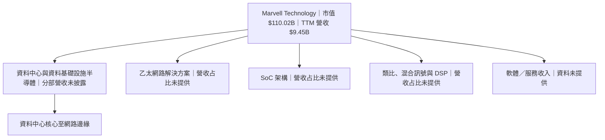
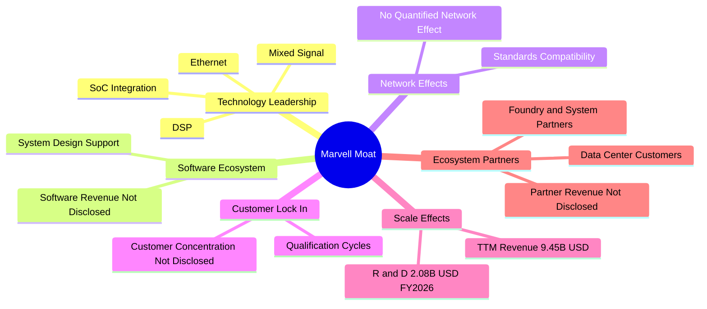
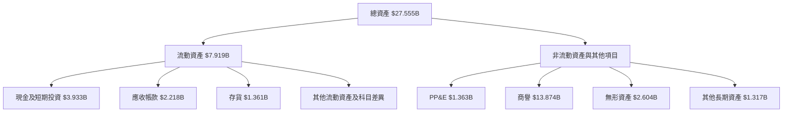
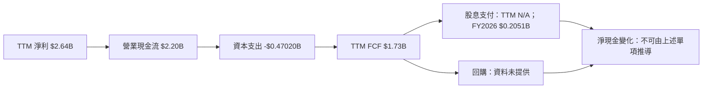
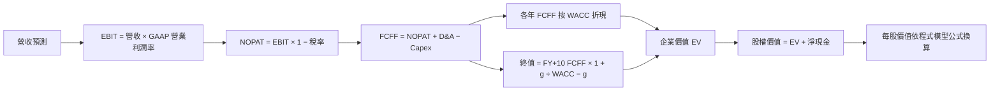
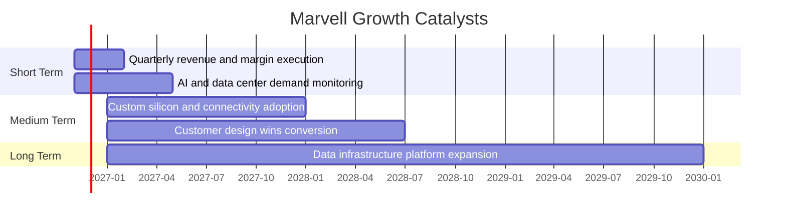
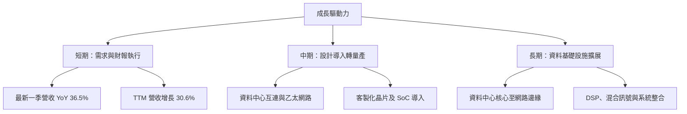
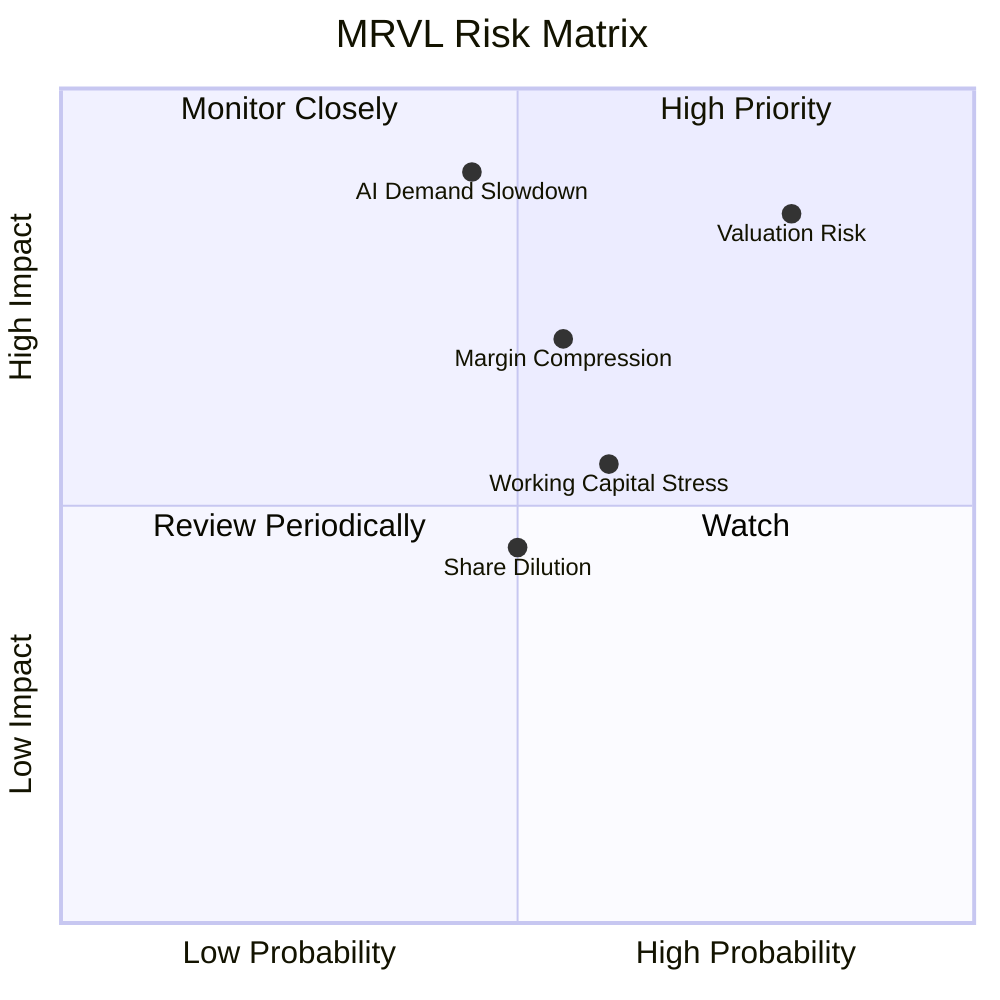
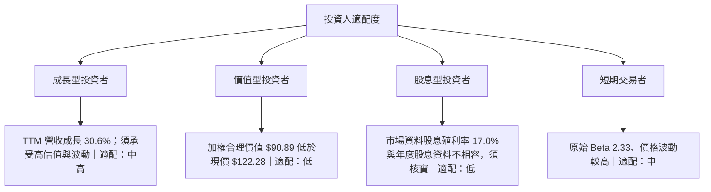

# MRVL 基本面深度分析報告
> **報告日期**：2026-11-21 ｜ **語言**：繁體中文 ｜ **數據來源**：SEC 申報資料 (XBRL)、Yahoo Finance、Finviz、StockAnalysis、Roic.ai ｜ **分析師**：CFA 級機構研究

## 目錄

| # | 章節 | 核心結論 |
|---|---|---|
| 1 | 執行摘要 | 賣出；加權合理價值 $90.89，MOS -34.5% |
| 2 | 公司概覽與商業模式 | 資料中心與網路基礎設施晶片具專業黏著性；部門占比未提供 |
| 3 | 損益表深度分析 | TTM 營收 $9.45B、年增 30.6%；獲利恢復但來源口徑存在差異 |
| 4 | 資產負債表分析 | 淨負債 $1.03B；流動性充足，CCC 延長至 131 天 |
| 5 | 現金流量深度分析 | TTM FCF $1.73B、殖利率 1.57%；SBC 仍是顯著股東成本 |
| 6 | 獲利能力與資本效率 | ROIC 6.3%低於 WACC 13.87%，目前未創造經濟利潤 |
| 7 | 相對估值分析 | MRVL 的 Forward P/E 略高於同業中位數，P/S 高於自身五年中位數 |
| 8 | DCF 內在價值評估 | 基準 DCF $38.55；加權合理價值 $90.89，均低於現價 $122.28 |
| 9 | 成長催化劑 | AI 資料中心、互連與客製化晶片需求是主要催化劑；TAM 數字未提供 |
| 10 | 風險矩陣 | 估值、需求與執行、營運資金及稀釋為核心風險 |
| 11 | 投資建議 | 依 MOS 評級為賣出；等待估值或基本面改善 |

## 1. 執行摘要

MRVL 的營收增長與近期營業動能有數字支持：TTM 營收 $9.45B、較前一 TTM 增長 30.6%，最新一季年增 36.5%，TTM FCF $1.73B；但 TTM ROIC 僅 6.3%，低於 13.87% WACC。以 2026-11-20 收盤價 $122.28 計，DCF 基準每股價值 $38.55、方法加權合理價值 $90.89，MOS 為 -34.5%；依規則 20 評級為**賣出**。需求增長尚未證明能轉化為高於資本成本的回報，現價亦高於多數估值方法的結果。

### 1.0 一頁式投資儀表板

| 項目 | 內容 |
|---|---|
| **投資論點（3 句）** | ① TTM 營收年增 30.6%，反映資料中心及網路晶片需求仍在擴張。② TTM FCF $1.73B，但 FCF Yield 僅 1.57%，現價對現金流要求偏高。③ ROIC 6.3%低於 WACC 13.87%，增長尚未證明能創造超額回報。 |
| **綜合評分** | **5.9/10**（引用 1.1） |
| **財務健康** | 🟡 現金及短期投資 $3.93B，總債務 $4.96B，淨負債 $1.03B；流動比率 3.168。 |
| **ROIC vs WACC** | 6.3% vs 13.87%；🔴 ROIC 低於資本成本 |
| **FCF 趨勢** | 正向；TTM FCF $1.73B，FCF Yield 1.57% |
| **估值** | Forward P/E 16.589x（Yahoo Finance／Finviz 合併資料）｜EV/EBITDA 38.094x（合併資料）｜FCF Yield 1.57% |
| **DCF 內在價值（基準）** | $38.55；相對 DCF 折溢價 = $122.28 ÷ $38.55 − 1 = **+217.2% 溢價** |
| **安全邊際（MOS）** | **-34.5%**＝($90.89 − $122.28) ÷ $90.89；🔴 無安全邊際 |
| **預期報酬（基準情境 12M）** | DCF 基準情境相對現價 **-68.5%**；並非保證的一年報酬預測 |
| **關鍵風險（前二）** | ① 成長預期與估值落差；② AI／資料中心需求放緩或競爭加劇 |
| **評級 + 信心度** | 🔴 **賣出**｜信心：中（多數估值低於現價，但模型假設及資料口徑存在限制） |

### 1.1 綜合評分卡

| 維度 | 評分（1–10） | 主要依據（引用數字與其來源章節） |
|---|---:|---|
| 成長性 | 8.0 | TTM 營收成長 30.6%、最新一季 YoY 36.5%（第 3 章） |
| 獲利能力 | 5.0 | TTM 營業利益率 16.5%、ROIC 6.3%低於 WACC 13.87%，F-Score 6/9（第 6 章） |
| 財務健康 | 6.5 | 淨負債 $1.03B；CCC 131 天，較一年前增加 18 天（第 4 章） |
| 估值 | 2.5 | 加權合理價值 $90.89、MOS -34.5%；P/S 11.9x，高於五年中位數 9.9x（第 7–8 章） |
| 護城河 | 6.5 | 具乙太網路、DSP、SoC 等專業產品組合；但市場份額、客戶集中度及分部資料未提供（第 2 章） |
| 管理層與資本配置 | 7.0 | FY2026 SBC $590.8M、現金股利 $205.1M；稀釋股數測試未通過（第 3、5、6 章） |
| **綜合評分** | **5.9** | 六項算術平均：(8.0 + 5.0 + 6.5 + 2.5 + 6.5 + 7.0) ÷ 6 = 5.9167，四捨五入至一位小數 |

### 1.2 五大投資論點 + 三大核心風險

| 類型 | 項目 | 具體依據 | 信心度 |
|---|---|---|---|
| 🟢 **投資論點①** | 近期成長明確 | TTM 營收 $9.45B、年增 30.6%；最新一季年增 36.5% | 🟢 高 |
| 🟢 **投資論點②** | 現金流為正 | TTM OCF $2.20B、資本支出 $470.20M、FCF $1.73B | 🟢 高 |
| 🟢 **投資論點③** | 資料中心與網路產品組合 | 提供乙太網路、SoC、類比／混合訊號及 DSP 方案，覆蓋資料中心核心至網路邊緣 | 🟡 中 |
| 🟢 **投資論點④** | 流動性有緩衝 | 現金及短期投資 $3.93B，流動比率 3.168 | 🟢 高 |
| 🟢 **投資論點⑤** | P/E 低於自身歷史中位數 | 現行 P/E 40.4x，低於五年中位數 56.5x；仍須考慮增長及獲利品質 | 🟡 中 |
| 🟡 **風險①** | 價格高於估值基準 | 現價 $122.28，高於加權合理價值 $90.89；MOS -34.5% | 🔴 高衝擊 |
| 🔴 **風險②** | 資本效率不足 | ROIC 6.3% vs WACC 13.87%，負利差 7.57 個百分點 | 🔴 高 |
| 🟡 **風險③** | 營運資金與稀釋 | CCC 由 113 天升至 131 天；Piotroski 稀釋股數測試未通過 | 🟡 中 |

### 1.3 快速統計卡片

| 指標 | 公司實際值（期間） | 同業中位數 | 狀態 |
|---|---:|---:|---|
| 營收成長（TTM） | **30.6%** | — | 🟢 |
| 營收成長（最新一季年增） | **36.5%** | 85.5% | 🟡 |
| 毛利率（TTM） | **52.2%** | 74.9% | 🔴 |
| 營業利益率（TTM） | **16.5%** | — | 🟡 |
| ROIC（TTM） | **6.3%** | — | 🔴 |
| Forward P/E | **16.589x** | 15.7x | 🟡 |
| FCF Yield（TTM） | **1.57%** | — | 🔴 |
| Piotroski F-Score | **6 / 9** | — | 🟡 |

同業中位數依 AVGO、NVDA、AMD 的 Peer multiples 計算；最新一季營收增長中位數 85.5%，毛利率中位數 74.9%。

### 1.4 投資結論

```text
╔══════════════════════════════════════════════════════════════════╗
║                    📊 投資結論摘要                               ║
╠══════════════════════════════════════════════════════════════════╣
║  評級：🔴 賣出（MOS -34.5%，依規則 20）                           ║
║  價格（2026-11-20 收盤）：$122.28                               ║
║  DCF 內在價值（基準）：$38.55（現價溢價 +217.2%）                ║
║  安全邊際 MOS：-34.5%（以加權合理價值 $90.89 為分母）            ║
║  加權合理價值（8.8）：$90.89                                    ║
║  DCF 情境價值：                                                  ║
║    悲觀情境：$19.48（-84.1%）                                   ║
║    基準情境：$38.55（-68.5%）                                   ║
║    樂觀情境：$73.42（-40.0%）                                   ║
║  綜合評分：5.9/10（引用 1.1）                                    ║
║  適合投資人：能承受高波動、看好資料中心半導體長期需求者；        ║
║              不適合以估值折價或穩定股息為主要目標者              ║
╚══════════════════════════════════════════════════════════════════╝
```

## 2. 公司概覽與商業模式

### 2.1 業務結構與收入來源

MRVL 開發資料基礎設施半導體，產品涉及 SoC、乙太網路、類比與混合訊號、數位訊號處理等。公司總市值 $110.02B、TTM 營收 $9.45B；各產品板塊營收與占比未提供，因此不拆分或估算。



### 2.2 市場份額

市場份額及可引用的 TAM 數據未提供，因此不呈現占比圖。MRVL TTM 營收 $9.45B、增長 30.6%；相較 AVGO、NVDA、AMD 的最新季度營收增長中位數 85.5%，MRVL 仍有增長，但不是同業中增速最快者。

### 2.3 競爭護城河分析



### 2.4 護城河強度

| 護城河項目 | 強度 | 證據 | 會削弱它的情況 |
|---|---|---|---|
| 技術與整合能力 | 中至強 | SoC、乙太網路、DSP、混合訊號產品組合；FY2026 研發費用 $2.08B | 產品性能落後、客戶改採內部自研或競品方案 |
| 軟體／系統生態 | 中 | 公司定位為資料基礎設施方案商，但軟體收入與生態規模未披露 | 軟硬體整合優勢不足，客戶以多供應商替代 |
| 網路效應 | 弱至中 | 產品需符合互通標準，但無量化網路效應數據 | 標準化降低差異化，價格競爭加劇 |
| 客戶鎖定 | 中 | 半導體設計導入及驗證通常有工程切換成本；客戶集中度未披露 | 大客戶轉移採購或自行設計晶片 |
| 規模效應 | 中 | TTM 營收 $9.45B，研發支出具一定規模 | 大型同業更高研發投入或產品線交叉補貼 |
| 生態夥伴 | 中 | 業務跨資料中心核心至網路邊緣，涉及系統與供應鏈協作 | 供應鏈限制或夥伴策略改變 |

1.1 的護城河評分為 **6.5/10**：研發投入與產品技術組合提供差異化，但缺少市占率、客戶黏著量化指標及分部經濟數據，不能據此認定護城河不可複製。

## 3. 損益表深度分析

### 3.1 年度收入成長趨勢（近 4 年）

FY2023 至 FY2026 營收分別為 $5.92B、$5.51B、$5.77B、$8.19B。FY2023 年增率以 FY2022 營收 $4.462B 作比較；各年收入取自年度損益表資料。

```text
╔══════════════════════════════════════════════════════════════════╗
║              Marvell 年度收入趨勢（FY2023–FY2026）               ║
╠══════════════════════════════════════════════════════════════════╣
║  FY2023  $5.92B  ███████████████░░░░░░░░░░░░░  YoY: +32.7% 🟢 ║
║  FY2024  $5.51B  ██████████████░░░░░░░░░░░░░░  YoY: -7.0%  🔴 ║
║  FY2025  $5.77B  ███████████████░░░░░░░░░░░░░  YoY: +4.7%  🟡 ║
║  FY2026  $8.19B  █████████████████████░░░░░░░  YoY: +42.1% 🟢 ║
║                                                                  ║
║  FY2023–FY2026 CAGR = (8.19 ÷ 5.92)^(1/3) − 1 ≈ 11.4%          ║
║  FY2026 成長反映需求回升與產品組合變化；不可直接線性外推。      ║
╚══════════════════════════════════════════════════════════════════╝
```

FY2023 至 FY2026 CAGR 以 $5.92B 和 $8.19B 計算。最新 TTM 營收增長 30.6%，高於三年歷史 CAGR，顯示近期需求加速；但基期、產品組合及半導體週期可能影響增長持續性。

### 3.2 季度收入趨勢分析

| 季度 | 營收（$B） | QoQ | YoY | 備註 |
|---|---:|---:|---:|---|
| 2025-10-31 | 2.075 | 由前季 2.006 增長 3.4% | 36.8% | YoY 依 StockAnalysis |
| 2026-01-31 | 2.219 | 6.9% | 22.1% | 按季度收入計算 |
| 2026-04-30 | 2.418 | 9.0% | 27.6% | 按季度收入計算 |
| 2026-08-01 | 2.739 | 13.3% | 36.5% | 最新一季，SEC 10-Q 期間 |

QoQ = 本季營收 ÷ 前季營收 − 1。營收連續季度上升，最新一季增速加快，與資料中心相關需求擴張一致；產品別營收未提供，不能精確歸因至單一終端市場。

### 3.3 利潤率演變分析

歷史年度毛利額存在來源差異：FY2025 一處列 $2.38B，StockAnalysis 另列 $2.74B；FY2024 亦有資料口徑差異。下表年度毛利率採年度損益表列示數計算，TTM 指標採程式計算值。

| 利潤率指標 | FY2023 | FY2024 | FY2025 | FY2026／TTM | 趨勢 | 評估 |
|---|---:|---:|---:|---:|---|---|
| 毛利率（年度表列值） | 50.5% | 41.6% | 41.2% | FY2026 51.0%；TTM 52.2% | FY2026 回升 | 🟢 |
| 營業利益率（年度） | 6.1% | -7.9% | -6.4% | FY2026 16.4%；TTM 16.5% | 明顯改善 | 🟢 |
| 淨利率（TTM） | — | — | — | 27.9% | 正向但高於營業利率 | 🟡 |

年度營業利益率由 FY2024、FY2025 虧損轉為 FY2026 16.4%，可能反映收入恢復、營業槓桿及併購相關會計項目共同作用。TTM 毛利率 52.2%仍低於同業中位數 74.9%。TTM 淨利率 27.9%高於營業利益率 16.5%，應核對非營業項目、稅務或一次性因素，不宜直接外推。

### 3.4 費用結構分析

費用資料未提供完整且一致的銷貨成本、銷管費與其他費用拆分，不製作比例圓餅圖。

```text
╔══════════════════════════════════════════════════════════════════╗
║                  可量化費用資料（FY2026）                        ║
╠══════════════════════════════════════════════════════════════════╣
║  研發費用       $2.08B   ｜收入 $8.19B 的約 25.4%               ║
║  股權薪酬 SBC   $590.8M  ｜收入占比見 3.5 節                    ║
║  資本支出       $358.6M  ｜現金流項目，不等同損益費用            ║
║  其他費用細分   未提供                                           ║
╚══════════════════════════════════════════════════════════════════╝
```

### 3.5 季度 EPS 趨勢與盈餘品質（Quality of Earnings）

| 季度 | EPS（StockAnalysis） | EPS 年增 | 超預期／不及預期 |
|---|---:|---:|---|
| 2025-10-31 | $2.20 | N/A | 預估值缺失，無法判定 |
| 2026-01-31 | $0.47 | 106.27% | 預估值缺失，無法判定 |
| 2026-04-30 | $0.04 | -80.44% | 預估值缺失，無法判定 |
| 2026-08-01 | $0.34（另一市場資料列 $0.33） | 50.0% | 預估值缺失，無法判定 |

EPS 歷史資料存在口徑／期間異常，且 EPS Est 與 EPS Act 欄位為 NaN，不能據此標記超預期或不及預期。應在後續財報以公司公布的 GAAP、非 GAAP EPS 與一致預期逐季核驗。

| 盈餘品質項目 | 數值／佔比 | 評估 |
|---|---:|---|
| 股權薪酬 SBC / 營收 | FY2026 $590.8M ÷ $8.195B = **7.2%** | 🔴 對股東報酬有實質稀釋成本 |
| SBC / 營業現金流 | FY2026 $590.8M ÷ $1.75B = **33.8%** | 🔴 OCF 含非現金 SBC 加回，需留意含金量 |
| TTM FCF / 淨利 | $1.73B ÷ TTM 淨利 $2.64B = **約 65.5%** | 🟡 現金轉換低於 100%；來源口徑不同，僅作參考 |
| 一次性／非經常性損益 | FY2026 淨利 $2.67B、營業利益 $1.34B；項目明細 N/A | 🟡 淨利高於營業獲利，需核對 10-K 調節 |
| 有效稅率 | 12.4%（最新年度） | 🟡 不高，但不保證是長期常態 |
| 資本化支出 vs 費用化 | 資本支出 FY2026 $358.6M；資本化研發明細 N/A | 🟡 資料不足，無法判斷成本是否延遲費用化 |

**盈餘品質結論：**FCF 為正，但約為 TTM 淨利的 65.5%；SBC 約占 FY2026 營收 7.2%、OCF 33.8%，且稀釋股數未通過 Piotroski 測試。評估獲利應同時追蹤稀釋後每股 FCF、SBC 及非營業損益調節，而非只看淨利率。

## 4. 資產負債表分析

### 4.1 資產結構分解

以下為 TTM 資產負債表資料，金額以 $B 計；因部分明細未列出或口徑不完整，不反推其他資產餘額。



商譽與無形資產規模較大，反映併購型資產負債表特徵。若收購資產未能產生預期現金流，需留意減損風險。

### 4.2 流動性與營運資金分析

| 指標 | 最新 TTM | 一年前 TTM | 變化 | 解讀 |
|---|---:|---:|---:|---|
| DSO 應收帳款天數 | 86 天 | 73 天 | +13 天 | 收款週期拉長，應收增速需與營收比較 |
| DIO 存貨天數 | 110 天 | 96 天 | +14 天 | 存貨占用增加，可能是備貨或需求轉換風險 |
| DPO 應付帳款天數 | 64 天 | 56 天 | +8 天 | 付款週期延長，部分抵銷應收與庫存增加 |
| CCC 現金轉換週期 | 131 天 | 113 天 | +18 天 | 營運資金被占用時間增加 |

流動比率 3.168、速動比率 2.461，顯示短期償債緩衝充足；但 CCC 增加 18 天，代表成長吸收更多營運資金，需追蹤應收與存貨增幅是否持續快於營收。

### 4.3 債務結構分析

ROIC、WACC、DCF 採用的指定債務數字為總債務 $4.96B、現金及短期投資 $3.93B、淨負債 $1.03B。其他市場資料列總債務 $5.29B、淨負債 $1.35B，存在時點或口徑差異；涉及指定估值計算時沿用 $4.96B 與 -$1.03B。

```text
╔══════════════════════════════════════════════════════════════════╗
║                   Marvell 債務健康診斷                           ║
╠══════════════════════════════════════════════════════════════════╣
║  總債務：        $4.96B   ████████████████████  🟡              ║
║  現金及短期投資：$3.93B   ████████████████░░░░  🟢              ║
║  淨負債：        $1.03B   🟡                                     ║
║  流動比率：      3.168x   🟢                                      ║
║  Debt/EBITDA：   N/A（缺少同口徑債務及 EBITDA 配對）             ║
║  利息保障倍數：  N/A（利息費用資料未提供）                       ║
╚══════════════════════════════════════════════════════════════════╝
```

### 4.4 股東權益趨勢

| 財年 | 股東權益（$B） | YoY |
|---|---:|---:|
| FY2023 | 15.64 | — |
| FY2024 | 14.83 | -5.2% |
| FY2025 | 13.43 | -9.4% |
| FY2026 | 14.31 | +6.5% |

```text
╔══════════════════════════════════════════════════════════════════╗
║                  股東權益趨勢（年度）                            ║
╠══════════════════════════════════════════════════════════════════╣
║  FY2023  $15.64B  ████████████████████                          ║
║  FY2024  $14.83B  ███████████████████                           ║
║  FY2025  $13.43B  █████████████████                             ║
║  FY2026  $14.31B  ██████████████████                            ║
╚══════════════════════════════════════════════════════════════════╝
```

FY2026 權益回升，但仍低於 FY2023；年度變化需結合併購會計、累積其他綜合損益及股權薪酬檢視，資料不足以歸因於單一項目。

## 5. 現金流量深度分析

### 5.1 現金流量瀑布圖



### 5.2 FCF 轉換率趨勢

| 財年 | OCF（$B） | Capex（$B） | FCF（$B） | 淨利（$B） | FCF／淨利 |
|---|---:|---:|---:|---:|---:|
| FY2023 | 1.29 | 0.217 | 1.07 | -0.164 | 不具解讀性 |
| FY2024 | 1.37 | 0.350 | 1.02 | -0.933 | 不具解讀性 |
| FY2025 | 1.68 | 0.292 | 1.39 | -0.885 | 不具解讀性 |
| FY2026 | 1.75 | 0.359 | 1.39 | 2.67 | 52.1% |
| TTM 至 2026-08-01 | 2.20 | 0.47020 | 1.73 | StockAnalysis $2.64B | 約 65.5% |

虧損年份不適合用 FCF／淨利比率作比較。FY2026 與 TTM 現金轉換率低於 100%，需留意應收、存貨與 SBC 對現金流的影響。

### 5.3 自由現金流趨勢

| 期間 | FCF（$B） | 備註 |
|---|---:|---|
| FY2023 | 1.07 | 年度現金流資料 |
| FY2024 | 1.02 | 年度現金流資料 |
| FY2025 | 1.39 | 年度現金流資料 |
| FY2026 | 1.39 | 年度現金流資料 |
| TTM | 1.73 | 指定 TTM：OCF $2.20B − Capex $470.20M |

```text
╔══════════════════════════════════════════════════════════════════╗
║                自由現金流：歷史實際                              ║
╠══════════════════════════════════════════════════════════════════╣
║  FY2023  $1.07B  ████████████░░░░░░░░                           ║
║  FY2024  $1.02B  ███████████░░░░░░░░░                           ║
║  FY2025  $1.39B  ███████████████░░░░░                           ║
║  FY2026  $1.39B  ███████████████░░░░░                           ║
║  TTM     $1.73B  ███████████████████░                           ║
║  TTM FCF Yield：1.57%（程式計算）                               ║
╚══════════════════════════════════════════════════════════════════╝
```

### 5.4 資本配置評估

完整資本配置比例無法由現有資料還原，因此不製作比例圓餅圖。

| 配置項目 | 金額 | 評估 |
|---|---:|---|
| FY2026 股息支付 | $205.1M | 約為 FY2026 FCF $1.39B 的 14.8% |
| FY2026 資本支出 | $358.6M | 支持營運及設備投資；與 DCF 的 TTM capex 口徑不同 |
| FY2026 SBC | $590.8M | 顯著非現金費用及潛在稀釋來源 |
| 股票回購 | N/A | 未提供 |
| 併購／其他投資配置 | N/A | 缺少足夠現金流明細 |

## 6. 獲利能力與資本效率

### 6.1 ROE / ROA / ROIC 趨勢

| 指標 | FY2026／TTM | 歷史趨勢 | 評估 |
|---|---:|---|---|
| ROE | 14.2%（QUALITY FIGURES）；另有市場欄位 16.5% | 來源口徑不一 | 中性；杜邦分析採 14.2% |
| ROA | 4.1%（市場資料） | 可比年度序列未提供 | 🟡 |
| ROIC | 6.3%（TTM） | 可比歷史序列未提供 | 🔴 |
| WACC | 13.87% | 成本資本輸入值 | — |

### 6.2 ROIC vs WACC 分析（核心價值創造判斷）

```text
╔══════════════════════════════════════════════════════════════════╗
║                ROIC vs WACC 深度分析                            ║
╠══════════════════════════════════════════════════════════════════╣
║  WACC（成本資本資料；全報告沿用）：13.87%                        ║
║  ├── 無風險利率（10Y 美債）：4.91%                               ║
║  ├── ERP：5.00%                                                  ║
║  ├── 原始 Beta：2.33；調整 Beta：1.88                            ║
║  ├── Ke（提供值）：14.34%                                       ║
║  ├── 稅前債務成本：4.08%；稅率：12.4%                            ║
║  ├── 權重：股權 95.7%／債務 4.3%                                ║
║  └── ✅ 採用 WACC：13.87%                                        ║
║                                                                  ║
║  ROIC（TTM）：6.3%                                               ║
║  ROIC − WACC = 6.3% − 13.87% = -7.57 個百分點                  ║
║  ROIC/WACC = 6.3% ÷ 13.87% ≈ 0.45x                             ║
║                                                                  ║
║  結論：TTM 回報低於資本成本，尚未創造經濟價值                    ║
╚══════════════════════════════════════════════════════════════════╝
```

ROIC 對應的 EBIT 與投入資本分項未提供，故不另行重算。WACC 採用指定的 13.87%；以列示無風險利率、調整 Beta 及 ERP 計算，4.91% + 1.88 × 5.00% = 14.31%，與提供 Ke 14.34%相差 0.03 個百分點。本文保留提供的 Ke 與 WACC 原值，並將差異視為輸入四捨五入或計算口徑限制。

### 6.3 杜邦三因素分解

| 因素 | 數值（TTM） | 解讀 |
|---|---:|---|
| 淨利率 | 27.9% | 高於營業利益率，需關注非營業／稅務因素 |
| 資產週轉率 | 0.34x | 每單位資產創造營收的效率有限 |
| 權益乘數 | 1.49x | 槓桿不是 ROE 的主要來源 |
| **ROE** | **14.2%** | 27.9% × 0.34 × 1.49 ≈ 14.2% |

按杜邦分解，ROE 主要由淨利率與資產週轉率共同決定，槓桿倍數 1.49x 並非主要支撐。市場資料另列 ROE 16.5%，存在口徑差異；本節依 QUALITY FIGURES 採用 14.2%。

### 6.4 財務體質：Piotroski F-Score

Piotroski F-Score 為 **6/9**。

| 測試 | 結果 | 解讀 |
|---|---|---|
| ROA > 0 | ✅ 通過 | 獲利為正 |
| 營業現金流 > 0 | ✅ 通過 | TTM OCF 為 $2.20B |
| ROA 高於一年前 | ✅ 通過 | 資產報酬改善 |
| 營業現金流 > 淨利 | ❌ 未通過 | 應計品質測試不通過，淨利高於現金流 |
| 長期負債 ÷ 總資產低於一年前 | ✅ 通過 | 槓桿相對改善 |
| 流動比率高於一年前 | ✅ 通過 | 短期流動性改善 |
| 稀釋股數未增加 | ❌ 未通過 | SBC 等因素可能增加每股稀釋 |
| 毛利率高於一年前 | ✅ 通過 | 毛利率改善 |
| 資產週轉率高於一年前 | ❌ 未通過 | 資產運用效率未改善 |

整體訊號偏中性：營運與流動性改善，但應計品質、股數稀釋及資產週轉仍是弱點。

## 7. 相對估值分析

### 7.1 同業估值比較

同業倍數採 Yahoo Finance Peer multiples。MRVL 的歷史估值區間資料與其他市場資料部分口徑不同，表中 EV/EBITDA 依估值歷史資料列示。

| 估值指標 | **MRVL** | **AVGO** | **NVDA** | **AMD** | 本公司評估 |
|---|---:|---:|---:|---:|---|
| **Trailing P/E** | 40.4x | 38.9x | 13.5x | 98.2x | 🟡 位於同業分布中段 |
| **Forward P/E** | 16.589x | 15.7x | 7.6x | 24.1x | 🟡 略高於同業中位數 15.7x |
| **P/S（TTM）** | 11.9x | 16.3x | 8.4x | 15.5x | 🟡 低於 AVGO、AMD，高於 NVDA |
| **EV/EBITDA（TTM）** | 72.8x* | 28.5x | 12.2x | 61.9x | 🔴 高於 AVGO／NVDA 中位數 20.3x |
| **最新一季營收 YoY** | 36.5% | 85.5% | 103.2% | 44.7% | 🟡 增速低於三家同業 |
| **毛利率（TTM）** | 52.2% | 75.5% | 74.9% | 56.0% | 🔴 低於三家同業 |

\* VERIFIED 歷史估值序列列示 MRVL EV/EBITDA 72.8x；市場資料另列 38.094x，存在口徑差異。本列採前者。

### 7.2 歷史估值區間分析

```text
╔══════════════════════════════════════════════════════════════════╗
║                MRVL 五年估值區間（TTM）                         ║
╠══════════════════════════════════════════════════════════════════╣
║  P/E：       25.6x ├────── 現值 40.4x ──────┤ 61.9x             ║
║              五年中位數 56.5x｜目前百分位 50%                    ║
║  P/S：        5.8x ├──────── 現值 11.9x ────────┤ 18.3x         ║
║              五年中位數 9.9x｜目前百分位 75%                     ║
║  EV/EBITDA： 53.3x ├─ 現值 72.8x ───────────────────┤ 730.9x   ║
║              五年中位數 156.4x｜目前百分位 25%                   ║
╚══════════════════════════════════════════════════════════════════╝
```

P/E 低於自身五年中位數，但 P/S 高於五年中位數且位於第 75 百分位。EV/EBITDA 歷史區間極寬，盈利週期與分母變化使其參考性較弱。

### 7.3 情境價值（Bear / Base / Bull）

| 情境 | 第 1 年營收成長 | 期末營業利潤率 | WACC | 每股價值 | 相對現價 | 機率 | 會發生的條件 |
|---|---:|---:|---:|---:|---:|---:|---|
| 🔴 悲觀 | 15.0% | 3.4% | 14.87% | $19.48 | -84.1% | 25% | 資料中心需求降溫、競爭加劇，利潤率向低位回落 |
| 🟡 基準 | 30.0% | 4.0% | 13.87% | $38.55 | -68.5% | 50% | 首年增長接近目前 TTM 增長，長期利潤率依模型收斂 |
| 🟢 樂觀 | 45.0% | 4.4% | 12.87% | $73.42 | -40.0% | 25% | AI／資料中心需求持續超預期，且資本成本下降 |

以上情境價值及假設採 DCF 模型原值。即使樂觀情境價值仍低於現價，反映現價包含高於模型基準的市場預期。

### 7.4 相對估值隱含價格區間

```text
╔══════════════════════════════════════════════════════════════════╗
║              相對估值與其他方法隱含每股價值                      ║
╠══════════════════════════════════════════════════════════════════╣
║  $38.55       $62.66       $90.89       $115.58   $122.28       ║
║  DCF基準      EV/EBITDA    加權合理值   Forward P/E  現價        ║
║                                                                  ║
║  DCF：10年 FCFF、WACC 13.87%、終值成長 3.0%                      ║
║  Forward P/E：同業中位數 15.7x × MRVL Forward EPS $7.37 = $115.58║
║  EV/EBITDA：AVGO、NVDA 中位數 20.3x × TTM EBITDA，加淨現金 = $62.66║
║  分析師共識：40 位分析師平均目標價 $309.14                       ║
╚══════════════════════════════════════════════════════════════════╝
```

估值方法分散明顯。分析師共識 $309.14 遠高於 DCF 與相對倍數結果，應視為參考而非現金流與資本回報分析的替代品。

## 8. DCF 內在價值評估（Discounted Cash Flow）

> DCF 輸入、年度現金流、敏感度及每股價值採程式計算值，不另建模型。金額以美元計；模型表格顯示至小數點後兩位，底層未四捨五入數據未提供，故可能出現小額四捨五入差異。

### 8.0 估值推理鏈（Thinking Logic）

**Step 1 — 價值來源。** MRVL 價值主要取決於資料基礎設施半導體收入（TTM $9.45B）、資料中心等需求能否延續，以及增長能否轉化為 GAAP 營業利益與 FCFF。分部收入占比未提供，不能把 AI 另拆為可量化收入項目。模型估值由收入與利潤率共同推動；WACC 與終值成長則影響折現及終值。

**Step 2 — 模型選擇**

| 決策點 | 本報告採用 | 理由 | 曾考慮但否決 | 否決理由 |
|---|---|---|---|---|
| 現金流定義 | FCFF | 以 WACC 折現先得 EV，再橋接至股權價值 | FCFE | 債務與資本結構會影響股權現金流 |
| 預測期 N | 10 年 | DCF 模型固定提供 10 年預測 | 5 年 | 對產品週期的顯性預測期較短 |
| 終值方法 | Gordon Growth | 模型列示永續成長率 3.0% | 僅退出倍數 | 指定模型未提供退出倍數終值結果 |
| EBIT 基礎 | GAAP EBIT | 模型使用 GAAP EBIT，已含 SBC 費用 | 非 GAAP EBIT | 加回 SBC 可能漏計股東成本 |

**Step 3 — 假設推導鏈**

- **營收成長**：錨點＝TTM 增長 30.6% → 模型首年增長設上限 30%，再線性降至 3.0% → 採用 FY+1 30.0%、FY+10 3.0% → 不把 45%設為基準，因 45%僅為樂觀情境，不能將短期高增長直接視為常態。
- **營業利潤率**：錨點＝TTM 16.5% → 按模型設定逐步收斂 → FY+1 16.5%、FY+10 4.0% → 不將 16.5%延伸至終值，因成熟期假設採近五年財年中位數。
- **預測期 N**：錨點＝模型固定 10 年 → 保留完整顯性預測期 → 採用 10 年 → 不改成 5 年，因指定模型固定 N=10，不另建模型。
- **永續成長率 g**：錨點＝模型 3.0% → 低於 WACC 13.87%，避免終值發散 → 採用 3.0% → 不採用 4.0%作基準，以免提高長期現金流終值。
- **Capex／營收**：模型值由 FY+1 至 FY+10 固定 5.0% → 採用 5.0% → 不另上調或下調，因模型輸入已固定。
- **GAAP EBIT 與 SBC**：GAAP EBIT 已將 SBC 列為費用 → FCFF 不再扣 SBC，股數不再額外稀釋 → 採組合 (A) → 不再扣 SBC或另加稀釋率，以避免重複計算。
- **D&A／營收**：錨點及採用值為 TTM 13.3%；模型固定。
- **稅率**：錨點及採用值為最新年度有效稅率 12.4%。
- **WACC**：依成本資本資料固定採用 13.87%，推導限制見 8.2。
- **ΔWC**：模型明確不建模；CCC 已從 113 天增加至 131 天，故省略營運資金可能高估 FCFF，不能視為營運資金需求為零。
- **最脆弱環節**：營收增長與 GAAP 利潤率能否轉化為模型預期現金流；若不成立，模型情境價值可低至悲觀情境 $19.48。

**Step 4 — 計算路徑**



### 8.1 模型假設總表（Model Inputs）

| 假設項目 | 採用值 | 依據／來源 | 敏感度 |
|---|---:|---|---|
| 預測期 N | 10 年 | DCF 模型固定值 | 🟡 中 |
| 營收增長 | FY+1 30.0% → FY+10 3.0% | TTM 增長 30.6%；模型線性淡化 | 🔴 高 |
| 營業利潤率 | 16.5% → 4.0% | 起點為 TTM 營業利潤率；終點依模型五年財年中位數設定 | 🔴 高 |
| 有效稅率 | 12.4% | 最新年度有效稅率 | 🟢 低 |
| Capex／營收 | FY+1 至 FY+10 5.0% | DCF 模型列示值 | 🟡 中 |
| D&A／營收 | 13.3% | TTM 比率，模型固定 | 🟢 低 |
| 營運資金變動 | 未建模 | DCF 模型明示不納入；不代表需求為零 | 🟡 中 |
| EBIT 基礎 | GAAP | DCF 模型明示 | 🟡 中 |
| SBC 處理 | 組合 (A)：GAAP EBIT 已含 SBC，不再扣除 | 模型指定 | 🟡 中 |
| 年稀釋率 | 模型不再稀釋 | 與組合 (A)相容 | 🟡 中 |
| 永續成長率 g | 3.0% | DCF 模型設定，低於 WACC | 🔴 高 |
| 終值方法 | Gordon Growth | 程式模型列示 | 🔴 高 |
| WACC | 13.87% | Cost of capital 資料 | 🔴 高 |

模型採用組合 **(A)**：GAAP EBIT 已包含 SBC 費用，FCFF 不再減 SBC，股數不再另行稀釋。

### 8.2 折現率推導（WACC）

```text
╔══════════════════════════════════════════════════════════════════╗
║                    WACC 推導（折現率）                           ║
╠══════════════════════════════════════════════════════════════════╣
║  股權成本 Ke（提供值）：14.34%                                   ║
║  ├── 無風險利率 Rf：4.91%                                        ║
║  ├── ERP：5.00%                                                  ║
║  ├── 原始 Beta：2.33；調整 Beta：1.88                            ║
║  ├── 調整方式：⅔ × 2.33 + ⅓ × 1 = 1.8867 ≈ 1.88              ║
║  ├── CAPM 直接代入：4.91% + 1.88 × 5.00% = 14.31%               ║
║  └── 提供 Ke：14.34%；差異 0.03 個百分點                        ║
║                                                                  ║
║  債務成本 Kd：稅前 4.08%                                         ║
║  ├── 有效稅率：12.4%                                             ║
║  └── 稅後 Kd = 4.08% × (1 − 12.4%) = 3.574%                    ║
║                                                                  ║
║  資本權重：股權 95.7%／債務 4.3%                                ║
║  WACC 採用值：13.87%                                             ║
╚══════════════════════════════════════════════════════════════════╝
```

1. **Ke（CAPM）**：以提供值採用 Ke=14.34%；以列示輸入計算為 4.91% + 1.88 × 5.00% = 14.31%，差異 0.03 個百分點。原始 Beta 2.33，調整後 Beta 依 ⅔ × 2.33 + ⅓ × 1 = 1.8867，列示為 1.88。
2. **稅前 Kd**：採用提供值 4.08%；利息費用及平均計息負債明細未提供，無法獨立反推。
3. **稅後 Kd**：4.08% × (1 − 12.4%) = 3.57408% ≈ **3.574%**。
4. **權重**：股權 95.7% + 債務 4.3% = **100.0%**。權重採成本資本資料原值；計息負債與市值的完整底層計算未提供。
5. **WACC**：指定值為 **13.87%**。按顯示輸入重算，95.7% × 14.34% + 4.3% × 3.574% = 13.8776% ≈ 13.88%；本報告仍按要求沿用提供的 13.87%。

10 年期公債殖利率列示為 4.91%，但未提供觀測日期。規模／國別溢酬未列示，故不另加。第 6.2 節及 DCF 均使用同一 WACC 13.87%。

### 8.3 逐年自由現金流預測（基準情境）

FCFF = NOPAT + D&A − Capex；模型不含營運資金變動列。金額單位為 $B，折現因子保留三位小數。

| 年度 | FY+1 | FY+2 | FY+3 | FY+4 | FY+5 | FY+6 | FY+7 | FY+8 | FY+9 | FY+10 |
|---|---:|---:|---:|---:|---:|---:|---:|---:|---:|---:|
| 營收 | 12.29 | 15.60 | 19.35 | 23.41 | 27.62 | 31.77 | 35.58 | 38.78 | 41.11 | 42.34 |
| 營收 YoY | 30.0% | 27.0% | 24.0% | 21.0% | 18.0% | 15.0% | 12.0% | 9.0% | 6.0% | 3.0% |
| 營業利潤率 | 16.5% | 15.1% | 13.7% | 12.4% | 11.0% | 9.6% | 8.2% | 6.8% | 5.4% | 4.0% |
| EBIT（GAAP） | 2.03 | 2.36 | 2.66 | 2.89 | 3.03 | 3.04 | 2.91 | 2.64 | 2.22 | 1.70 |
| −稅 | (0.25) | (0.29) | (0.33) | (0.36) | (0.37) | (0.38) | (0.36) | (0.33) | (0.27) | (0.21) |
| NOPAT | 1.78 | 2.07 | 2.33 | 2.53 | 2.65 | 2.67 | 2.55 | 2.31 | 1.95 | 1.49 |
| +D&A | 1.64 | 2.08 | 2.58 | 3.12 | 3.69 | 4.24 | 4.75 | 5.18 | 5.49 | 5.65 |
| −Capex | (0.61) | (0.78) | (0.96) | (1.16) | (1.37) | (1.58) | (1.77) | (1.93) | (2.05) | (2.11) |
| **FCFF** | **2.81** | **3.38** | **3.95** | **4.49** | **4.97** | **5.33** | **5.53** | **5.56** | **5.39** | **5.04** |
| 折現因子 | 0.878 | 0.771 | 0.677 | 0.595 | 0.522 | 0.459 | 0.403 | 0.354 | 0.311 | 0.273 |
| **FCFF 現值 PV** | **2.47** | **2.60** | **2.68** | **2.67** | **2.59** | **2.44** | **2.23** | **1.97** | **1.67** | **1.37** |

模型預測期 PV 合計為 **$22.70B**。表列 PV 加總為 2.47 + 2.60 + 2.68 + 2.67 + 2.59 + 2.44 + 2.23 + 1.97 + 1.67 + 1.37 = **$22.72B**，與模型合計差 $0.02B（約 0.09%），屬年度顯示數字四捨五入累積差異；後續橋接採模型原值 $22.70B。

**FY+1 逐步演算：**

1. 營收 = $9.45B × (1 + 30.0%) = $12.285B ≈ **$12.29B**。
2. EBIT = $12.29B × 16.5% = $2.028B ≈ **$2.03B**。
3. 稅 = $2.03B × 12.4% = $0.252B ≈ **$0.25B**。
4. NOPAT = $2.03B − $0.25B = **$1.78B**。
5. D&A = 模型列示 **$1.64B**；比例假設 13.3%，未四捨五入底層數未提供。
6. Capex = 模型列示 **$0.61B**；比例假設 5.0%，未四捨五入底層數未提供。
7. ΔWC = **未納入模型**。
8. FCFF = 模型表列 **$2.81B**。列示數字相加為 $1.78 + $1.64 − $0.61 = $2.81B；底層精度未提供，無法由顯示值完全還原。
9. 折現因子 = 1 ÷ (1 + 13.87%)¹ = 0.878（模型列示）；$2.81B × 0.878 ≈ **$2.47B**。

**合理性自檢：**

- 模型 FCFF 由 FY+1 $2.81B 增至 FY+10 $5.04B，九年間 CAGR = (5.04 ÷ 2.81)^(1/9) − 1 ≈ **6.7%**。歷史 FY2023 至 FY2026 FCF 由 $1.07B 增至 $1.39B，三年 CAGR 約 **9.1%**；模型較低，反映利潤率逐年下滑。
- FY+10 FCFF 利潤率 = $5.04B ÷ $42.34B = **11.9%**；目前 TTM FCF 利潤率 = $1.73B ÷ $9.45B = **18.3%**。同業最佳 FCF 利潤率未提供。
- 模型各年度 FCFF 均為正；但不建模營運資金可能高估現金流，尤其 CCC 已由 113 天升至 131 天。

```text
╔══════════════════════════════════════════════════════════════════╗
║            自由現金流：歷史實際 vs 模型預測                      ║
╠══════════════════════════════════════════════════════════════════╣
║  FY2024(實) $1.02B  █████░░░░░░░░░░░░░░░                         ║
║  FY2025(實) $1.39B  ███████░░░░░░░░░░░░░░                         ║
║  FY2026(實) $1.39B  ███████░░░░░░░░░░░░░░                         ║
║  FY+1 (預)  $2.81B  ██████████████░░░░░░                         ║
║  FY+10(預)  $5.04B  █████████████████████████                    ║
║  預測增長同時受 D&A 增至 $5.65B、營業利潤率降至 4.0%影響。       ║
╚══════════════════════════════════════════════════════════════════╝
```

### 8.4 終值計算（Terminal Value）

**適用性檢查：**WACC 13.87% vs g 3.0% → **WACC > g ✅**

| 方法 | 計算式 | 終值 TV | TV 現值 | 佔總 EV 比重 |
|---|---|---:|---:|---:|
| Gordon Growth | 5.04 × (1 + 3.0%) ÷ (13.87% − 3.0%) | $47.73B | $13.02B | 36.5% |
| 退出倍數法 | N/A | N/A | N/A | N/A |

依模型列示值逐步計算：

1. FY+N FCFF = FY+10 FCFF = **$5.04B**。
2. 分子（使用表列四捨五入值）= $5.04B × 1.03 = **$5.1912B**。
3. 分母 = 13.87% − 3.0% = **10.87%**。以顯示值直接相除為 $5.1912B ÷ 10.87% ≈ $47.76B；模型以未四捨五入底層值計算，列示 TV 為 **$47.73B**。
4. PV(TV) = 模型終值 $47.73B × 模型折現因子 0.273 = **$13.02B**（模型列示值）。
5. 終值佔比 = $13.02B ÷ $35.72B = **36.5%**。

模型未提供退出倍數終值的 EBITDA 倍數與結果，故不另建第二種終值法。

### 8.5 企業價值 → 每股內在價值（Bridge）

```text
╔══════════════════════════════════════════════════════════════════╗
║              企業價值 → 每股內在價值 橋接表                      ║
╠══════════════════════════════════════════════════════════════════╣
║  預測期 FCF 現值合計            +$22.70B                         ║
║  終值現值 PV(TV)                +$13.02B                         ║
║  = 企業價值 EV                   $35.72B                         ║
║  + 淨現金（現金減債務）          -$1.03B                         ║
║  = 股權價值                      $34.69B                         ║
║  每股換算：股權價值 × 價格 ÷ 市值                              ║
║  ★ DCF 基準每股價值              $38.55                          ║
║  現價（2026-11-20 收盤）         $122.28                         ║
║  現價相對 DCF 溢價               +217.2%                         ║
╚══════════════════════════════════════════════════════════════════╝
```

1. EV = $22.70B + $13.02B = **$35.72B**。
2. 股權價值 = $35.72B + 淨現金（−$1.03B）= **$34.69B**。
3. 每股價值依模型原式：股權價值 × 價格 ÷ 市值 = $34.69B × $122.28 ÷ $110.02B = **$38.55**（模型列示值；底層未四捨五入數未提供）。
4. 折溢價 = $122.28 ÷ $38.55 − 1 = **+217.2%**。
5. 本節不計算 MOS；MOS 僅在 8.8 以加權合理價值作分母。

股數換算沿用 DCF 模型列示公式，不另以另一套股數重算。現金及債務採 2026-08-01 最新 TTM 資料的淨負債 $1.03B。

### 8.6 敏感性分析（WACC × 永續成長率）

下表照錄 DCF 模型每股價值；括號為相對現價 $122.28 的上行空間。

| g／WACC | 11.87% | 12.87% | **13.87% 基準** | 14.87% | 15.87% |
|---|---:|---:|---:|---:|---:|
| 2.0% | $45.31 (-62.9%) | $40.89 (-66.6%) | $37.21 (-69.6%) | $34.09 (-72.1%) | $31.43 (-74.3%) |
| 2.5% | $46.41 (-62.1%) | $41.72 (-65.9%) | $37.85 (-69.0%) | $34.60 (-71.7%) | $31.83 (-74.0%) |
| 3.0% | $47.64 (-61.0%) | $42.64 (-65.1%) | **$38.55 (-68.5%)** | $35.15 (-71.3%) | $32.26 (-73.6%) |
| 3.5% | $49.01 (-59.9%) | $43.66 (-64.3%) | $39.33 (-67.8%) | $35.74 (-70.8%) | $32.73 (-73.2%) |
| 4.0% | $50.56 (-58.7%) | $44.79 (-63.4%) | $40.18 (-67.1%) | $36.39 (-70.2%) | $33.24 (-72.8%) |

代表性非基準格：**WACC 12.87% > g 2.5% ✅**；模型該格價值為 **$41.72**。程式資料未提供該格重折現後逐年 PV 分項，因此不另造中間數字。矩陣基準格 $38.55 與 8.5 DCF 基準值一致。

**DCF 三情境（模型原值）**

| 情境 | 第 1 年營收增長 | 期末營業利潤率 | WACC | 每股價值 | 相對現價 | 機率 |
|---|---:|---:|---:|---:|---:|---:|
| 🔴 悲觀 | 15.0% | 3.4% | 14.87% | $19.48 | -84.1% | 25% |
| 🟡 基準 | 30.0% | 4.0% | 13.87% | $38.55 | -68.5% | 50% |
| 🟢 樂觀 | 45.0% | 4.4% | 12.87% | $73.42 | -40.0% | 25% |
| **機率加權** | — | — | — | **$42.50** | **-65.2%** | **100%** |

情境模型沒有提供各自完整逐年營收、FY+10 FCFF 與終值中間表，依資料優先原則不另建情境模型。機率加權複核：$19.48 × 25% + $38.55 × 50% + $73.42 × 25% = **$42.50**。此值僅作背景參考，8.8 仍使用基準 DCF 值。

**敏感度讀法：**

- g 從 2.0%升至 3.0%，在基準 WACC 下價值由 $37.21 升至 $38.55：+$1.34，約 +3.6%。
- WACC 從 12.87%升至 13.87%，在 g=3.0%時價值由 $42.64 降至 $38.55：−$4.09，約 −9.6%。
- 期末營業利潤率每 +1pp 的單獨價值彈性未提供，不另行估算。
- 在已列敏感度範圍內，WACC 變化對估值影響高於 g 的 1pp 變化；這與 Step 1 所稱營運現金流是核心價值來源並不衝突，兩者分別是營運驅動與折現敏感度。

### 8.7 反推 DCF（Reverse DCF：市場在預期什麼）

僅列模型已解出的變數，其餘採基準假設。模型未提供反推逐輪試算紀錄與逐年中間表，故不虛構疊代表格。

| 求解變數（一次一個） | 其餘變數設定 | 市場隱含值 | 對照基準 | 判斷 |
|---|---|---:|---:|---|
| 第 1 年營收增長 | 其餘基準假設固定 | 66.1% | 基準 30.0%；TTM 增長 30.6% | 🔴 遠高於近期實際及基準 |
| 固定營業利潤率 | 其餘基準假設固定 | 43.1% | 基準由 16.5%降至 4.0% | 🔴 對營業獲利要求極高 |
| 永續成長率 g | 未提供解 | 未計算 | 基準 3.0% | 未計算 |
| 預測期 N | 未提供解 | 未計算 | 基準 10 年 | 未計算 |

固定基準輸入包括 WACC 13.87%、稅率 12.4%、Capex／營收模型值、D&A／營收 13.3%、g 3.0%、預測期 10 年及組合 (A)。模型提供的反推結果表示：若其他輸入不變，單靠收入增長或固定營業利潤率解釋現價，所需假設分別達 66.1%或 43.1%，遠高於基準假設。

### 8.8 估值三角驗證與安全邊際

| 估值方法 | 隱含每股價值 | 上行空間（÷現價） | 權重 | 說明 |
|---|---:|---:|---:|---|
| DCF（基準） | $38.55 | -68.5% | 40% | 10 年 FCFF、WACC 13.87%、g 3.0% |
| 同業 Forward P/E | $115.58 | -5.5% | 25% | 同業中位數 15.7x × Forward EPS $7.37 |
| 同業 EV/EBITDA | $62.66 | -48.8% | 25% | AVGO、NVDA 中位倍數 20.3x × TTM EBITDA，加淨現金 |
| 分析師共識目標價 | $309.14 | +152.8% | 10% | 40 位分析師平均目標價 |
| **加權合理價值** | **$90.89** | **-25.7%** | **100%** | 盈利公司固定方法權重 |

加權算式：$38.55 × 40% + $115.58 × 25% + $62.66 × 25% + $309.14 × 10% = $15.42 + $28.895 + $15.665 + $30.914 = $90.894 ≈ **$90.89**。公司類型為 profitable，權重依固定類型規則；沒有其他因無法計算而剔除的方法。

```text
╔══════════════════════════════════════════════════════════════════╗
║                  估值區間與安全邊際                              ║
╠══════════════════════════════════════════════════════════════════╣
║  $19.48 ───── $90.89 ───── $122.28 ───── $309.14               ║
║ 悲觀DCF       加權合理值    現價        分析師共識                 ║
║                                                                  ║
║  安全邊際 MOS = (90.89 − 122.28) ÷ 90.89 = -34.5%               ║
║  MOS 評估：🔴 無安全邊際                                         ║
║  上行空間 = (90.89 − 122.28) ÷ 122.28 = -25.7%                 ║
║  DCF 基準 $38.55；現價相對 DCF 溢價 +217.2%                     ║
║  建議買入區間：不設買入建議；$90.89 作為價值檢視基準             ║
║  合理持有區間／減碼價位：現價已高於加權合理價值                  ║
╚══════════════════════════════════════════════════════════════════╝
```

> 🔎 **程式複算（Python，依本節各項自動重算）**
>
> 加權合理價值 = $38.55 × 40% + $115.58 × 25% + $62.66 × 25% + $309.14 × 10% = **$90.89**（權重合計 100%）
>
> 以價格 $122.28 計：MOS = **-34.5%**，上行空間 = **-25.7%**
>
> ✅ 與本節所寫數值一致。

### 8.9 DCF 模型的局限與失效條件

- **終值依賴度：**PV(TV) $13.02B，占 EV $35.72B 的 36.5%；估值仍受長期假設影響，但終值未占企業價值多數。
- **最脆弱假設：**收入由首年 30.0%逐步降至第十年 3.0%，以及 GAAP 營業利潤率由 16.5%降至 4.0%。情境估值範圍為悲觀 $19.48、基準 $38.55、樂觀 $73.42。
- **營運資金缺項：**CCC 延長至 131 天，模型不納入 ΔWC 可能高估增長期現金流。
- **SBC 與稀釋：**模型採組合 (A)，但 F-Score 稀釋股數測試未通過；若股數持續增加，固定股數處理可能高估每股價值。
- **適用性：**TTM FCF 為正，DCF 可作參考；然而年度 GAAP 營業損益波動，部分季度 EPS、債務與 EBITDA 倍數口徑不一致，須與相對估值交叉檢驗。
- **第 10 章連結：**AI 資料中心需求逆轉會壓低收入增長；價格競爭會壓低 EBIT 利潤率；營運資金惡化會降低 FCFF；利率上升則提高折現率。

### 8.10 複算檢核表（Audit Trail）

| # | 檢核項目 | 結果 |
|---|---|---|
| 1 | 高／中敏感度輸入均有推導鏈 | ⚠️ 核心項目已列；ΔWC 及稀釋率受模型資料限制 |
| 2 | 假設均有來源或限制說明 | ✅ |
| 3 | WACC 算式及權重 | ⚠️ Ke 顯示輸入相差 0.03pp；重算 WACC 為 13.88%，指定值為 13.87% |
| 4 | Kd 分母與債務權重同一負債範圍 | ⚠️ 平均計息負債與利息費用分項未提供，無法獨立核驗 |
| 5 | WACC 與第 6.2 節相同 | ✅ 13.87% |
| 6 | 預測年度數等於 N=10、無省略 | ✅ |
| 7 | FY+1 算式可依模型顯示精度複核 | ⚠️ 底層未四捨五入輸入未提供 |
| 8 | 預測 PV 加總誤差 ≤1% | ✅ 表列加總 $22.72B vs 模型 $22.70B，差 0.09% |
| 9 | WACC > g | ✅ 13.87% > 3.0% |
| 10 | 終值以 FY+10 現金流並折現 10 期 | ✅ 依模型值 |
| 11 | EV 至每股橋接 | ✅ 依模型公式及原值 |
| 12 | SBC 組合合法且無重複計算 | ✅ GAAP、不扣 SBC、不額外稀釋，組合 (A) |
| 13 | 敏感度基準格等於 DCF 基準值 | ✅ $38.55 |
| 14 | 敏感度示範格有效 | ✅ 12.87% > 2.5%；矩陣各格皆滿足 WACC > g |
| 15 | 情境機率與加權 | ✅ 機率合計 100%；加權 $42.50 |
| 16 | 反推每列只放開一個變數且有試算軌跡 | ⚠️ 已列模型提供的兩個解；逐輪試算資料未提供 |
| 17 | MOS 與折溢價基準一致 | ✅ MOS 用 $90.89；DCF 溢價用 $38.55 |
| 18 | 報告完整至第 11 章 | ✅ |
| 19 | 加權合理價值等於方法加權總和 | ✅ $90.894，列示 $90.89 |
| 20 | 評級符合 MOS 門檻 | ✅ MOS -34.5% 對應賣出 |

未能完全複核的項目源自利息費用、平均計息債務、DCF 未四捨五入底層數據、敏感度逐年 PV 及反推疊代紀錄未提供。處理方式為保留程式模型原值、揭露差異，不以自行估值替代。

## 9. 成長催化劑

### 9.1 催化劑時間軸

以下為投資研究監控時間窗，不代表公司已提供正式產品量產承諾或時間表。



近期新聞提及 AI 資料中心晶片及 Lumentum 交易，但交易細節、價格及整合財務影響未提供，故不納入定量估值。

### 9.2 TAM 市場規模分析

**N/A（TAM 數據未提供）**。MRVL TTM 營收 $9.45B、增長 30.6%，顯示公司已有一定營收規模且仍在擴張；但沒有可引用的 TAM、滲透率與分部收入資料，不估算市場空間或市占率。

### 9.3 成長驅動力結構圖



## 10. 風險矩陣

### 10.1 風險評分矩陣

以下機率與衝擊座標是分析師定性判斷，不是歷史統計或財務模型計算結果。



### 10.2 風險清單詳細分析

| # | 風險項目 | 發生機率 | 財務衝擊 | 風險評分 | 緩解措施 |
|---|---|---|---|---:|---|
| 1 | 🔴 **估值與預期落差** | 高（定性） | DCF 基準較現價低 68.5%；加權合理價值較現價低 25.7% | 🔴 9/10 | 以分批建倉替代追價；追蹤營收與 FCF 兌現程度 |
| 2 | 🔴 **AI／資料中心需求放緩** | 中高（定性） | TTM 增長 30.6%、最新季 36.5%；若減速，將削弱模型收入假設 | 🔴 8/10 | 每季檢視相關收入或管理層展望 |
| 3 | 🟠 **利潤率與競爭壓力** | 中（定性） | TTM 毛利率 52.2%，低於同業中位數 74.9%；ROIC 低於 WACC | 🟠 7/10 | 追蹤 GAAP 營業利益率、毛利率與價格競爭 |
| 4 | 🟡 **營運資金占用增加** | 中（定性） | CCC 131 天，較一年前多 18 天 | 🟡 6/10 | 監控 DSO、DIO、庫存增幅及收款品質 |
| 5 | 🟡 **SBC 與股數稀釋** | 中（定性） | FY2026 SBC $590.8M，占收入 7.2%；F-Score 稀釋測試未過 | 🟡 6/10 | 跟蹤稀釋股數、SBC／收入與每股 FCF |
| 6 | 🟡 **利率／折現率上行** | 中（定性） | WACC 13.87%；敏感度表顯示 WACC 上升會壓低估值 | 🟡 6/10 | 持續檢視資本成本與風險溢酬 |

## 11. 投資建議

### 11.1 最終評級與評分

依 8.8 MOS -34.5%，規則 20 對應**賣出**，不作質化上調或下調。公司品質綜合評分引用 1.1 的 **5.9/10**；六項分數為成長性 8.0、獲利能力 5.0、財務健康 6.5、估值 2.5、護城河 6.5、管理層與資本配置 7.0。

### 11.2 合理價值與隱含報酬率

| 方法／情境 | 每股價值 | 相對現價 $122.28 | 機率 |
|---|---:|---:|---:|
| 加權合理價值 | $90.89 | -25.7% | — |
| DCF 悲觀 | $19.48 | -84.1% | 25% |
| DCF 基準 | $38.55 | -68.5% | 50% |
| DCF 樂觀 | $73.42 | -40.0% | 25% |
| DCF 情境機率加權（參考） | $42.50 | -65.2% | 100% |

### 11.3 買入時機與觸發因素

```text
╔══════════════════════════════════════════════════════════════════╗
║                  ✅ 交易與監控 Checklist                          ║
╠══════════════════════════════════════════════════════════════════╣
║  依現有 MOS 評級為賣出，不建議因短期題材立即追價。               ║
║                                                                  ║
║  重新評估條件（多數符合）：                                      ║
║  ☐ 價格接近或低於加權合理價值 $90.89，且基本面未惡化             ║
║  ☐ TTM 營收成長維持約 30.6%或更高，且毛利率不再下滑              ║
║  ☐ ROIC 朝 WACC 13.87%收斂，FCF 轉換率改善                       ║
║                                                                  ║
║  加碼觸發條件：                                                  ║
║  ☐ FCF Yield 高於目前 1.57%，且營收增長未明顯放緩                ║
║  ☐ CCC 由 131 天回落，DSO／DIO 不再同比增加                       ║
║  ☐ 稀釋股數增長減緩，SBC／收入低於 FY2026 約 7.2%                ║
║                                                                  ║
║  減碼／退出觸發條件：                                            ║
║  ☐ 最新季營收年增率低於 20%並連續兩季未恢復                      ║
║  ☐ TTM FCF 轉負，或 ROIC 持續低於 6.3%                           ║
║  ☐ 毛利率低於 TTM 52.2%，且營業利益率低於 TTM 16.5%             ║
║  ☐ CCC 高於 131 天且存貨、應收增速持續超越營收                   ║
╚══════════════════════════════════════════════════════════════════╝
```

以上為投資監控門檻，不是公司指引或未來數字預測。

### 11.4 投資人適配度分析



### 11.5 每季財報監控清單（Quarterly Watch List）

| 監控指標 | 基準值 | 觸發加碼／改善訊號 | 觸發減碼／惡化訊號 |
|---|---:|---|---|
| 營收年增 | 最新季 36.5%；TTM 30.6% | 維持約 30%或更高，並有訂單／產品導入佐證 | 連續兩季低於 20% |
| 毛利率 | TTM 52.2% | 穩定或改善，且產品組合支持 | 低於 52.2%並連續下滑 |
| GAAP 營業利益率 | TTM 16.5%；最新季 16.8% | 穩定於 16.5%附近或以上 | 低於 14%且收入增長放緩 |
| OCF／FCF | TTM OCF $2.20B；FCF $1.73B | FCF 持續為正、FCF Yield 高於 1.57% | FCF 轉負或現金轉換率進一步下降 |
| Capex | TTM $470.20M | 資本投入帶來可驗證的營收及 FCF 增長 | Capex 上升但收入、FCF 未跟上 |
| 應收／存貨／CCC | CCC 131 天；DSO 86、DIO 110 | CCC 回落且應收、存貨增幅低於營收 | CCC 高於 131 天並持續上升 |
| SBC／稀釋股數 | FY2026 SBC $590.8M；稀釋股數測試未過 | SBC／收入下降、稀釋股數穩定 | SBC／收入高於約 7.2%或股數加速增加 |
| 財測與資料中心需求 | 最新季營收 $2.739B | 公司展望支持增長延續 | 財測下修或主要客戶需求延後 |

### 11.6 反面論證：什麼會證明論點錯誤（What Would Change My Mind）

```text
╔══════════════════════════════════════════════════════════════════╗
║              ⚠️ 論點失效條件（Disconfirming Evidence）           ║
╠══════════════════════════════════════════════════════════════════╣
║  下列任一條件成立，均應重新檢視投資假設：                        ║
║  ☐ 最新季營收年增低於 20%，且連續兩季未回升                      ║
║  ☐ 毛利率低於 TTM 52.2%，同時 GAAP 營業利益率低於 14%           ║
║  ☐ TTM FCF 轉負，或 OCF 低於資本支出                             ║
║  ☐ ROIC 持續低於 6.3%，且與 WACC 13.87%的差距未收窄             ║
║  ☐ CCC 高於 131 天並連續兩季增加，應收或存貨快於收入增長         ║
║  ☐ SBC／收入高於 FY2026 約 7.2%，且稀釋股數繼續上升              ║
║  ☐ 資料中心需求減速，無法支持模型首年 30.0%成長假設              ║
╚══════════════════════════════════════════════════════════════════╝
```

> **免責聲明**：本報告為 AI 自動生成，僅供研究參考，不構成投資建議。投資有風險，入市需謹慎。

---

## 資料與來源

| 項目 | 內容 |
|------|------|
| 價格 | 122.28 USD，2026-11-20 收盤（Yahoo Finance 日線） |
| 財務報表 | SEC 10-Q filed 2026-08-28，最新季度 2026-08-01（FY2027 Q2） |
| 有回應的資料來源 | SEC 申報資料 (XBRL)、Yahoo Finance、Finviz、StockAnalysis、Roic.ai |
| 由程式計算 | TTM 數字、WACC、DCF 模型、估值方法與權重、加權合理價值、MOS、評級門檻、F-Score、杜邦分解、營運資金天數、綜合評分 |
| 撰寫模型 | openai / gpt-6-luna |

> 本區塊由產生報告的程式依實際取得的資料填寫，非模型撰寫。「由程式計算」的數字不是模型的估計；其餘判斷（評分、情境、策略）是模型的分析。
