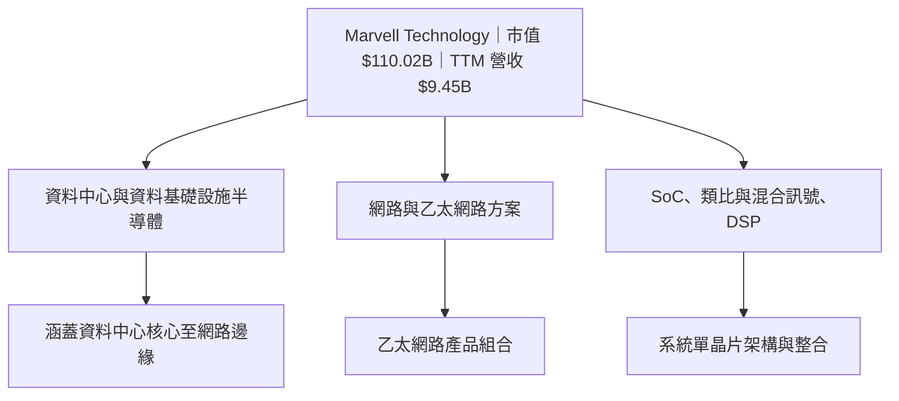
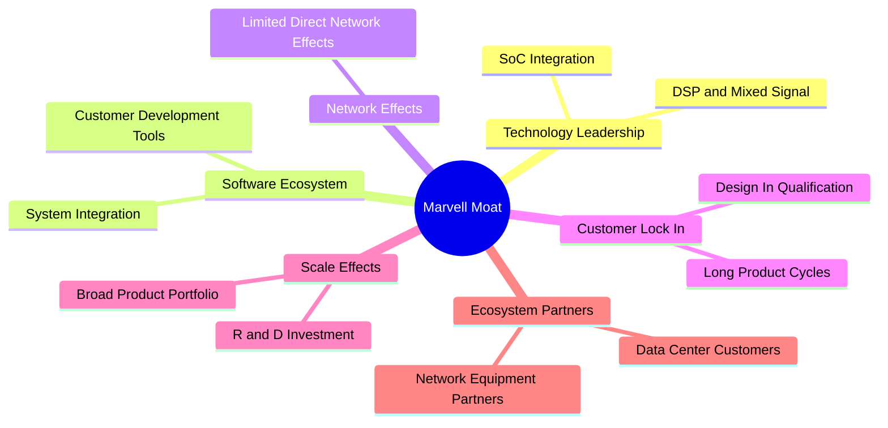
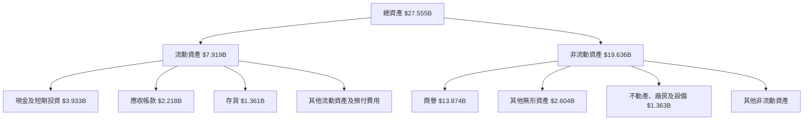
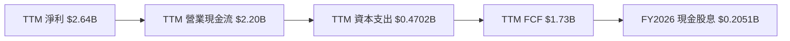
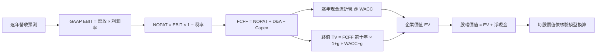
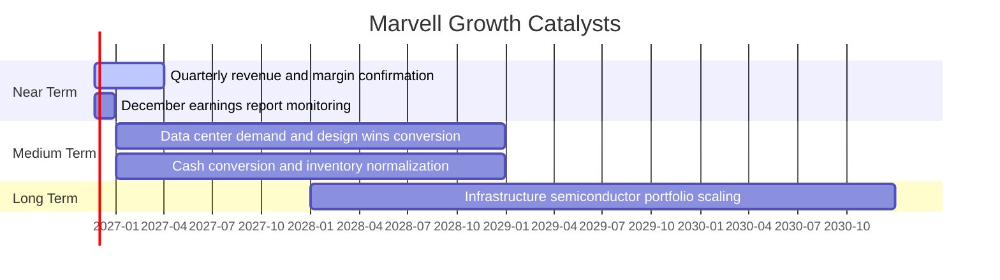
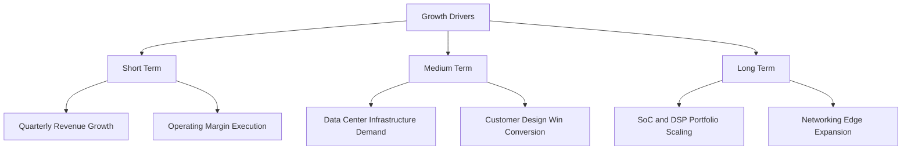
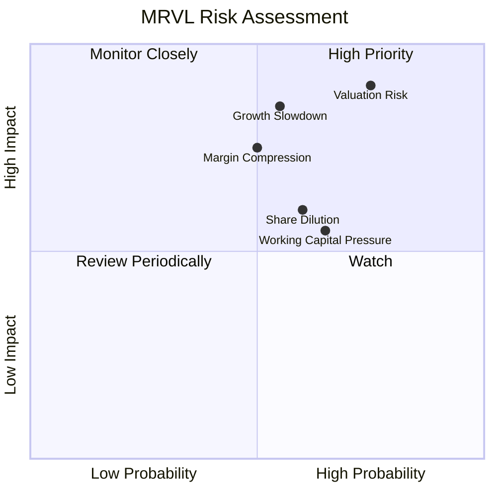
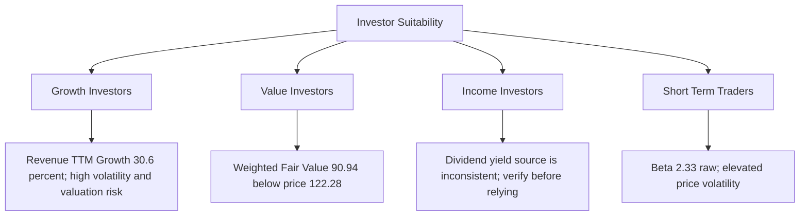

# MRVL 基本面深度分析報告
> **報告日期**：2026-11-22 ｜ **語言**：繁體中文 ｜ **數據來源**：SEC 申報資料 (XBRL)、Yahoo Finance、Finviz、StockAnalysis、Roic.ai ｜ **分析師**：CFA 級機構研究

## 目錄

| # | 章節 | 核心結論 |
|---|------|----------|
| 1 | 執行摘要 | 加權合理價值 $90.94；MOS -34.5%；賣出 |
| 2 | 公司概覽與商業模式 | 資料中心與資料基礎設施晶片具技術黏著性；分部營收占比未提供 |
| 3 | 損益表深度分析 | TTM 營收 $9.45B、年增 30.6%；最新單季年增 36.5% |
| 4 | 資產負債表分析 | 淨負債 $1.03B；流動比率充足，但 CCC 延長 |
| 5 | 現金流量深度分析 | TTM FCF $1.73B、FCF Yield 1.57%；SBC 是重要股東成本 |
| 6 | 獲利能力與資本效率 | ROIC 6.3% 低於 WACC 13.87%，目前未創造經濟利潤 |
| 7 | 相對估值分析 | Forward P/E 低於若干同業，但 DCF 與 EV/EBITDA 顯示估值風險 |
| 8 | DCF 內在價值評估 | 基準 DCF 每股 $38.55；加權合理價值 $90.94 |
| 9 | 成長催化劑 | AI／資料中心需求可支持成長，但 TAM 與分部數字未提供 |
| 10 | 風險矩陣 | 估值、成長持續性與營運資金是主要風險 |
| 11 | 投資建議 | 依規則評級為賣出；現價高於加權合理價值及三種 DCF 情境 |

---

## 1. 執行摘要

MRVL 的 TTM 營收為 **$9.45B**，TTM 年增 **30.6%**，最新一季年增 **36.5%**；TTM FCF 為 **$1.73B**，但 FCF Yield 僅 **1.57%**，且 ROIC **6.3%** 低於 WACC **13.87%**。估值交叉驗證後，加權合理價值為 **$90.94**，低於 2026-11-20 收盤價 **$122.28**；MOS 為 **-34.5%**。因此，依 MOS 門檻評級為 **🔴賣出**，並非因為營收成長缺乏吸引力，而是現價已要求公司持續交付高成長，而資本回報目前尚未覆蓋資本成本。

### 1.0 一頁式投資儀表板

| 項目 | 內容 |
|------|------|
| **投資論點（3 句）** | ① TTM 營收年增 30.6%、最新單季年增 36.5%，顯示資料基礎設施需求仍在擴張。② TTM FCF $1.73B，但 ROIC 6.3% 低於 WACC 13.87%，成長尚未轉化為足夠資本回報。③ 加權合理價值 $90.94 對照現價 $122.28，MOS -34.5%，估值容錯不足。 |
| **綜合評分** | **5.5/10**（引用 1.1 六項算術平均） |
| **財務健康** | 🟡 現金及短期投資 $3.93B、總債務 $4.96B，淨負債 $1.03B；流動比率 3.168。 |
| **ROIC vs WACC** | **6.3% vs 13.87%**：目前低於資本成本，經濟價值為負。 |
| **FCF 趨勢** | FY2026 FCF 為 $1.39B，TTM FCF $1.73B；TTM FCF Yield **1.57%**。 |
| **估值** | Forward P/E **16.589x** ｜ EV/EBITDA（TTM）**38.094x** ｜ FCF Yield **1.57%** |
| **DCF 內在價值（基準）** | **$38.55** ｜現價相對 DCF 溢價 **217.2%**（依 DCF 基準值計算） |
| **安全邊際（MOS）** | **-34.5%**＝($90.94 − $122.28) ÷ $90.94（基準：8.8 加權合理價值）｜🔴 <10% 無 |
| **預期報酬（基準情境 12M）** | **-68.5%**（DCF 基準情境 $38.55 相對現價；非時間保證） |
| **關鍵風險（前二）** | 高估值與高 WACC；資料中心成長或產品組合轉弱。 |
| **評級 + 信心度** | 🔴 **賣出** ｜ 信心：中（估值結論明確，但分部與 EPS 預期資料不足） |

### 1.1 綜合評分卡

| 維度 | 評分（1–10） | 主要依據（引用數字與其來源章節） |
|------|--------------|----------------------------------|
| 成長性 | 8.0 | TTM 營收年增 30.6%、最新單季年增 36.5%（第 3 章） |
| 獲利能力 | 5.0 | TTM 營業利益率 16.5%，但 ROIC 6.3% 低於 WACC 13.87%；F-Score 6/9（第 6 章） |
| 財務健康 | 6.0 | 淨負債 $1.03B、流動比率 3.168、CCC 由 113 天升至 131 天（第 4 章） |
| 估值 | 2.0 | MOS -34.5%；DCF $38.55、加權價值 $90.94 均低於 $122.28（第 8 章） |
| 護城河 | 6.0 | 複雜訊號處理及客戶設計導入形成黏著性；分部與市場份額數據未提供（第 2 章） |
| 管理層與資本配置 | 6.0 | FY2026 SBC $590.8M，稀釋股數測試未通過；股息支出約 $205.1M（第 3、5 章） |
| **綜合評分** | **5.5** | 六項算術平均：$(8+5+6+2+6+6)÷6=5.5$ |

### 1.2 五大投資論點 + 三大核心風險

| 類型 | 項目 | 具體依據 | 信心度 |
|------|------|----------|--------|
| 🟢 **投資論點①** | 營收仍在加速擴張 | TTM 營收 $9.45B、年增 30.6%；最新一季年增 36.5%。 | 🟢 高 |
| 🟢 **投資論點②** | 現金流規模已具實質性 | TTM 營業現金流 $2.20B，扣資本支出後 FCF $1.73B。 | 🟢 高 |
| 🟢 **投資論點③** | 資料中心相關需求提供長期成長機會 | 公司提供資料中心至網路邊緣的資料基礎設施半導體方案；公司級營收成長支持需求擴張，但分部占比未提供。 | 🟡 中 |
| 🟢 **投資論點④** | 流動性可支持營運與投資 | 現金及短期投資 $3.93B，流動比率 3.168。 | 🟢 高 |
| 🟢 **投資論點⑤** | Forward P/E 不高於部分同業 | MRVL Forward P/E 16.589x，低於 AMD 24.1x、AVGO 15.7x附近（公司來源口徑與同業區塊略有差異，見第 7 章）。 | 🟡 中 |
| 🟡 **風險①** | 價格已高於估值交叉驗證 | 現價 $122.28，高於加權合理價值 $90.94；MOS -34.5%。 | 🔴 高衝擊 |
| 🔴 **風險②** | 投入資本回報低於資本成本 | ROIC 6.3% vs WACC 13.87%，差距 -7.57 個百分點。 | 🔴 高衝擊 |
| 🟡 **風險③** | 營運資金效率惡化 | CCC 一年增加 18 天至 131 天，DSO、DIO 均上升。 | 🟡 中度 |

### 1.3 快速統計卡片

| 指標 | 公司實際值（期間） | 同業中位數 | 狀態 |
|------|--------------------|------------|------|
| 營收成長（TTM） | **30.6%** | — | 🟢 |
| 營收成長（最新一季年增） | **36.5%** | **85.5%**（AVGO、NVDA、AMD 中位數） | 🟡 |
| 毛利率（TTM） | **52.2%** | **74.9%** | 🔴 |
| 營業利益率（TTM） | **16.5%** | — | 🟡 |
| ROIC（TTM） | **6.3%** | — | 🔴 |
| Forward P/E | **16.589x** | **15.7x** | 🟡 |
| FCF Yield（TTM） | **1.57%** | — | 🔴 |
| Piotroski F-Score | **6 / 9** | — | 🟡 |

### 1.4 投資結論

```
╔══════════════════════════════════════════════════════════════════╗
║                    📊 投資結論摘要                               ║
╠══════════════════════════════════════════════════════════════════╣
║  評級：🔴 賣出（MOS -34.5%，按規則 20）                           ║
║  價格（2026-11-20 收盤）：$122.28                                 ║
║  DCF 內在價值（基準）：$38.55（相對現價溢價 217.2%）              ║
║  安全邊際 MOS：-34.5%（以加權合理價值 $90.94 為分母）             ║
║  加權合理價值（8.8）：$90.94                                      ║
║  DCF 情境價值：                                                    ║
║    悲觀情境：$19.48（-84.1%）                                     ║
║    基準情境：$38.55（-68.5%）                                     ║
║    樂觀情境：$73.42（-40.0%）                                     ║
║  綜合評分：5.5/10（引用 1.1）                                     ║
║  適合投資人：能承受高波動、願意追蹤財報的成長型投資人；不適合     ║
║              以折價與資本回報為主要條件的價值型投資人             ║
╚══════════════════════════════════════════════════════════════════╝
```

---

## 2. 公司概覽與商業模式

### 2.1 業務結構與收入來源

公司提供涵蓋資料中心核心至網路邊緣的資料基礎設施半導體方案，包括乙太網路、系統單晶片、類比／混合訊號與數位訊號處理等。最新市值為 **$110.02B**，TTM 營收 **$9.45B**。財務資料未提供各業務板塊營收與占比，因此不拆分或推估板塊比例。



### 2.2 市場份額

市場份額數據未提供，因此不呈現份額比例或圓餅圖。公司 TTM 營收年增 30.6%、最新一季年增 36.5%；同業最新一季營收年增中位數為 85.5%，但三家同業中包含處於不同成長階段的公司，不能單憑該中位數推論 MRVL 失去份額。

### 2.3 競爭護城河分析



### 2.4 護城河強度

| 護城河項目 | 強度（強／中／弱） | 證據（引用數字或事實） | 會削弱它的情況 |
|------------|--------------------|------------------------|----------------|
| 技術與整合能力 | 中 | 公司整合類比、混合訊號、DSP 與 SoC；TTM 營收 $9.45B。 | 同業推出性能、功耗或成本更具競爭力的替代方案。 |
| 軟體生態系統 | 中 | 半導體產品需配合系統設計與客戶驗證；可量化軟體收入未提供。 | 軟體支持不足、客戶轉向更完整平台方案。 |
| 網路效應 | 弱 | 未提供可量化網路效應或平台使用者資料。 | 競爭者建立更廣泛互通標準或開發者生態。 |
| 客戶鎖定 | 中 | 系統級晶片及資料基礎設施設計導入通常涉及驗證與產品週期；客戶集中度資料未提供。 | 客戶雙供應、重新設計或自研晶片加速。 |
| 規模效應 | 中 | FY2026 研發費用 $2.08B，反映研發投入規模；規模優勢是否轉為較高 ROIC 尚待驗證。 | 研發支出上升但營收與利潤未同步成長。 |
| 生態夥伴 | 中 | 產品覆蓋多個地區與資料基礎設施領域；合作夥伴營收貢獻未提供。 | 供應鏈、客戶或平台夥伴轉向競品。 |

**1.1「護城河」6.0 分的理由**：技術整合、研發投入與產品設計導入支持一定黏著性，但市場份額、客戶集中度及分部成長資料不足，且 ROIC 仍低於 WACC。

---

## 3. 損益表深度分析

### 3.1 年度收入成長趨勢（近 4 年）

年度營收資料為 FY2023–FY2026。FY2026 相較 FY2023 的三年 CAGR 約為 **11.4%**：$(8.19÷5.92)^{1/3}-1$。

```
╔══════════════════════════════════════════════════════════════════╗
║             Marvell 年度收入趨勢（FY2023-FY2026）                ║
╠══════════════════════════════════════════════════════════════════╣
║  FY2023  $5.92B  ██████████████░░░░░░░░░░  YoY: -6.96% 🔴      ║
║  FY2024  $5.51B  █████████████░░░░░░░░░░░  YoY: -6.96% 🔴      ║
║  FY2025  $5.77B  ██████████████░░░░░░░░░░  YoY: +4.71% 🟡      ║
║  FY2026  $8.19B  ████████████████████░░░░  YoY: +42.09% 🟢     ║
╠══════════════════════════════════════════════════════════════════╣
║  FY2023–FY2026 三年營收 CAGR：約 +11.4%                          ║
║  註：年度表內個別來源值與 StockAnalysis 所列 FY2025 數字略有差異。║
╚══════════════════════════════════════════════════════════════════╝
```

FY2026 營收較 FY2025 增加，並與最新 TTM 30.6% 成長及最新單季 36.5% 年增方向一致，顯示近年成長轉強；但 FY2023、FY2024 曾收縮，週期性與產品組合仍需納入評價。

### 3.2 季度收入趨勢分析

以 StockAnalysis 季度營收系列計算 QoQ；YoY 採同季對比。季度資料日期與 SEC 最新季度標示略有差異，故按資料表所列季度比較。

| 季度 | 營收（$B） | QoQ | YoY | 備註 |
|------|-----------:|----:|----:|------|
| 2025 Q3 | 2.075 | +3.5% | +36.8% | 前一季為 2025 Q2 $2.006B |
| 2025 Q4 | 2.219 | +6.9% | +22.1% | 延續季增 |
| 2026 Q1 | 2.418 | +9.0% | +27.6% | 成長幅度回升 |
| 2026 Q2 | 2.739 | +13.3% | +36.5% | 單季營收加速；不是 TTM 增幅 |

QoQ 算式例：$(2.739÷2.418)-1=13.3\%$。營收逐季上升可帶來固定研發與營運成本的槓桿，但若成長來自少數客戶或短期供應拉貨，後續季度仍可能波動。

### 3.3 利潤率演變分析

| 利潤率指標 | FY2023 | FY2024 | FY2025 | FY2026 | 趨勢 | 評估 |
|------------|--------|--------|--------|--------|------|------|
| **毛利率** | 50.5% | 41.6% | 41.2%* | 51.0% | FY2026 回升 | 🟡 |
| **營業利益率** | 6.1% | -7.9% | -6.4% | 16.4% | FY2026 明顯轉正 | 🟡 |
| **淨利率** | -2.8% | -16.9% | -15.3% | 32.6% | FY2026 大幅改善 | 🟡 |

\*年度損益表來源對 FY2025 毛利數據有差異；此處按年度收入表所列毛利 $2.38B 計算，與 StockAnalysis 顯示的毛利 $2.74B 不一致。FY2026 毛利率以 $4.18B ÷ $8.19B 計算。

**利潤率演變深度解析**：FY2026 毛利與營業利益同步回升，可能反映營收規模及產品組合改善、前期成本調整效益；但資料未提供分部毛利率，不能把改善單獨歸因於 AI 或某一產品線。TTM 營業利益率為 **16.5%**，最新季度為 **16.8%**，略高於 TTM，顯示近期營業槓桿未見明顯反轉。FY2026 淨利 $2.67B 與單季淨利波動大，應避免把淨利率高點直接當作可持續水平。

### 3.4 費用結構分析

財務數據沒有提供完整且同一期間的成本與營業費用分項，故不製作費用結構圓餅圖，以免以不完整數字拼湊比例。可確認 FY2026 研發費用為 **$2.08B**；公司仍需保持較高研發投入以維持產品競爭力。

### 3.5 季度 EPS 趨勢與盈餘品質（Quality of Earnings）

近四季 EPS 實際值有資料，但分析師預期 EPS 為 nan，無法判斷超預期或不及預期。

| 季度 | EPS 實際 | EPS 年增／變化 | 超預期判斷 |
|------|---------:|----------------:|------------|
| 2025 Q3 | $2.20 | 無可比預期 | 預期值缺漏，不能判斷 |
| 2025 Q4 | $0.47 | 季度來源標示不完整 | 預期值缺漏，不能判斷 |
| 2026 Q1 | $0.04 | -80.44%（資料源季度口徑） | 預期值缺漏，不能判斷 |
| 2026 Q2 | $0.34 | +50.00% | 預期值缺漏，不能判斷 |

| 盈餘品質項目 | 數值/佔比 | 評估 |
|--------------|-----------|------|
| 股權薪酬 SBC / 營收 | 約 **8.8%**（近四季 SBC $828.9M ÷ TTM 營收 $9.45B） | 🔴 對股東回報有實質稀釋成本；使用季度 SBC 加總估算。 |
| SBC / 營業現金流 | 約 **37.7%**（$828.9M ÷ $2.20B） | 🔴 佔營業現金流比例偏高，OCF 未扣除非現金 SBC 的股東經濟成本。 |
| FCF / 淨利（現金轉換率） | 約 **65.5%**（$1.73B ÷ TTM 淨利 $2.64B） | 🟡 有現金流支持，但現金轉換低於 100%。 |
| 一次性/非經常性損益 | 季度淨利波動明顯；2025-10 季度淨利 $1.90B，其他季度差距大 | 🟡 應核對稅務、處分、估值或其他非營運項目；明細未提供。 |
| 有效稅率異常 | 估值及資本成本採用最新年度有效稅率 **12.4%** | 🟡 缺少逐季稅務明細，不能確認 2025-10 季度高淨利是否由稅務項目帶動。 |
| 資本化支出 vs 費用化 | 資本支出 TTM $470.20M；資本化與費用化明細未提供 | 🟡 無法判斷是否有成本遞延或資本化政策變動。 |

**盈餘品質結論**：TTM FCF 為正，提供獲利現金支撐；但 SBC 約占營收 8.8%、營業現金流 37.7%，且現金轉換率約 65.5%。因此 GAAP 利潤不能只看名目增長，應同時監控股數稀釋與 SBC 對股東的實際成本。EPS 預期數缺漏，過去四季「超預期／不及預期」無法可靠分類。

---

## 4. 資產負債表分析

### 4.1 資產結構分解

以下以最新 TTM 資產負債資料呈現主要項目；細項採 StockAnalysis，總資產為 $27.555B。不同來源及季度日期存在口徑差異，現金、債務等核心估值輸入以 SEC／程式核驗數字為準。



### 4.2 流動性與營運資金分析

| 指標 | 最新 TTM | 一年前 TTM | 變化 | 解讀 |
|------|----------|------------|------|------|
| DSO 應收帳款天數 | 86 天 | 73 天 | +13 天 | 收款週期變長；需留意收入確認與回款節奏。 |
| DIO 存貨天數 | 110 天 | 96 天 | +14 天 | 庫存持有時間增加，可能反映備貨或需求與供應錯配。 |
| DPO 應付帳款天數 | 64 天 | 56 天 | +8 天 | 延長付款時間有助現金，但不足以抵銷 DSO、DIO 上升。 |
| CCC 現金轉換週期 | 131 天 | 113 天 | +18 天 | 營運資金占用增加，可能壓制營業現金流轉換。 |

流動比率為 **3.168**、速動比率 **2.461**，短期償債緩衝尚可。天數數字依 SEC 流量及季度資產負債表計算結果引用，不另行重算。

### 4.3 債務結構分析

依資本成本與 DCF 核驗數據，現金及短期投資 $3.93B、總債務 $4.96B、淨負債 $1.03B。其他彙整資料列示債務 $5.29B、淨負債 $1.35B，與 SEC 核驗口徑不同；本報告估值統一使用前者。

```
╔══════════════════════════════════════════════════════════════════╗
║                   MRVL 債務健康診斷                              ║
╠══════════════════════════════════════════════════════════════════╣
║  總債務：          $4.96B  ████████████████████  🟡              ║
║  現金及短期投資：  $3.93B  ████████████████░░░░  🟢              ║
║  淨負債：          $1.03B  ████░░░░░░░░░░░░░░░░  🟡              ║
║  Debt/EBITDA：     N/A（核驗資料未提供一致口徑）                  ║
║  利息保障倍數：    N/A（利息費用及 EBITDA 口徑不足以核算）        ║
║  流動比率：        3.168   🟢                                     ║
╚══════════════════════════════════════════════════════════════════╝
```

### 4.4 股東權益趨勢

年度股東權益依年度資產負債表，單位 $B：

```
╔══════════════════════════════════════════════════════════════════╗
║                  MRVL 股東權益趨勢                               ║
╠══════════════════════════════════════════════════════════════════╣
║  FY2023  $15.64B  ████████████████████                          ║
║  FY2024  $14.83B  ███████████████████                           ║
║  FY2025  $13.43B  █████████████████                             ║
║  FY2026  $14.31B  ██████████████████                            ║
╚══════════════════════════════════════════════════════════════════╝
```

FY2026 權益較 FY2025 回升約 6.6%，但四年整體低於 FY2023。若要辨識回升來源，仍需拆解淨利、SBC、回購及收購會計影響；目前可見 SBC 水平顯著，且 F-Score 的稀釋股數測試未通過。

---

## 5. 現金流量深度分析

### 5.1 現金流量瀑布圖

可用資料未提供同一 TTM 期間的淨利至股息／回購完整橋接數據，故不填造現金流瀑布金額；已知 TTM OCF、Capex 與 FCF 如下。



### 5.2 FCF 轉換率趨勢

| 財年 | FCF（$B） | 淨利（$B） | FCF / 淨利 | 解讀 |
|------|----------:|-----------:|-----------:|------|
| FY2023 | 1.07 | -0.16 | 不具解讀性 | 淨利為負，比例失去意義。 |
| FY2024 | 1.02 | -0.93 | 不具解讀性 | 淨利為負，但 FCF 為正。 |
| FY2025 | 1.39 | -0.89 | 不具解讀性 | 同上；現金流與 GAAP 淨利差異需核查。 |
| FY2026 | 1.39 | 2.67 | 52.1% | 淨利明顯轉正，但現金轉換未達 100%。 |
| TTM | 1.73 | 2.64 | 65.5% | 現金流改善，但 SBC 仍是重要非現金薪酬。 |

### 5.3 自由現金流趨勢

| 期間 | FCF（$B） | 資料說明 |
|------|----------:|----------|
| FY2023 | 1.07 | 年度現金流表 |
| FY2024 | 1.02 | 年度現金流表 |
| FY2025 | 1.39 | 年度現金流表 |
| FY2026 | 1.39 | 年度現金流表 |
| TTM | 1.73 | OCF $2.20B − Capex $0.47020B；核驗值 |

```
╔══════════════════════════════════════════════════════════════════╗
║                 MRVL 自由現金流趨勢（$B）                        ║
╠══════════════════════════════════════════════════════════════════╣
║  FY2023  1.07  ████████████░░░░░░░░░░░░                          ║
║  FY2024  1.02  ███████████░░░░░░░░░░░░░                          ║
║  FY2025  1.39  ███████████████░░░░░░░░░                          ║
║  FY2026  1.39  ███████████████░░░░░░░░░                          ║
║  TTM     1.73  ███████████████████░░░░░                          ║
║  TTM FCF Yield：1.57%                                             ║
╚══════════════════════════════════════════════════════════════════╝
```

### 5.4 資本配置評估

回購金額未提供，不能畫出資本配置比例圖。FY2026 現金股息支付為 **$205.1M**，SBC 為 **$590.8M**，Capex 為 **$358.6M**；年度數據顯示 SBC 高於現金股息與資本支出，稀釋是不可忽略的資本配置成本。

| 項目 | 金額 | 評估 |
|------|------:|------|
| 資本支出（FY2026） | $358.6M | 支持產品與營運資產需求；TTM Capex $470.20M。 |
| 現金股息（FY2026） | $205.1M | 有規律派息，但報價資料中的 20.0% 股息殖利率與年度股息及股價不一致，不採用該異常數值。 |
| 股權薪酬（FY2026） | $590.8M | 顯著高於現金股息，增加股東稀釋風險。 |
| 回購 | N/A | 回購資料未提供，不推估。 |
| 留存及其他投資 | N/A | 分項資料未提供。 |

---

## 6. 獲利能力與資本效率

### 6.1 ROE / ROA / ROIC 趨勢

| 指標 | FY2026／TTM 最新值 | 歷史比較 | 評估 |
|------|-------------------:|----------|------|
| ROE | TTM 14.2%（品質指標口徑） | Yahoo 整併資料另列 16.5%，來源口徑不同 | 🟡 使用核驗品質口徑 14.2%。 |
| ROA | 4.1% | 歷史逐年可比序列未完整提供 | 🟡 低於 ROE，資產基礎較大。 |
| ROIC | 6.3% | TTM 核驗值 | 🔴 顯著低於 WACC 13.87%。 |

行業均值未提供，不作虛構比較。ROE/ROA 等數字來源口徑有差異，因此本報告在 ROIC vs WACC 判斷中以核驗 ROIC 為準。

### 6.2 ROIC vs WACC 分析（核心價值創造判斷）

```text
╔══════════════════════════════════════════════════════════════════╗
║                ROIC vs WACC 深度分析                            ║
╠══════════════════════════════════════════════════════════════════╣
║  WACC（核驗資本成本）：13.87%                                    ║
║  ├── 無風險利率（10Y 美債）：4.91%                               ║
║  ├── 市場風險溢酬（假設）：5.00%                                ║
║  ├── 原始 Beta：2.33；採用調整後 Beta：1.88                     ║
║  ├── 股權成本（核驗值）：14.34%                                 ║
║  ├── 稅前債務成本：4.08%；稅率：12.4%                           ║
║  ├── 股權／債務權重：95.7%／4.3%                                ║
║  └── WACC：13.87%                                               ║
║                                                                  ║
║  ROIC（TTM）：6.3%                                               ║
║  經濟利潤差：ROIC − WACC = 6.3% − 13.87% = -7.57 個百分點       ║
║  ROIC  6.3%   ▓▓▓▓▓▓░░░░░░░░░░░░░░░░░░░░░░░░░░░░               ║
║  WACC 13.87%  ▓▓▓▓▓▓▓▓▓▓▓▓▓▓░░░░░░░░░░░░░░░░░░░                ║
║                                                                  ║
║  結論：目前 ROIC 低於資本成本，現階段資本投入未產生正 EVA。     ║
╚══════════════════════════════════════════════════════════════════╝
```

**解讀**：按核驗資本成本，MRVL 每投入一元資本的回報尚未覆蓋資本成本。若 AI／資料中心相關投資帶來的收入成長能提高營業利潤率及資產周轉，ROIC 有提升空間；但在 ROIC 未回升前，單純營收增長並不足以證明價值創造。

### 6.3 杜邦三因素分解

| 因素 | 數值（TTM） | 解讀 |
|------|-------------|------|
| 淨利率 | 27.9% | 依核驗品質指標；高淨利率受淨利波動影響，應結合現金轉換判讀。 |
| 資產週轉率 | 0.34 | 每一元資產產生的營收有限，資產效率是 ROE 的約束因素。 |
| 權益乘數 | 1.49 | 財務槓桿不是 ROE 的主要來源。 |
| **ROE** | **14.2%** | $27.9\%×0.34×1.49≈14.2\%$；算術顯示主要由淨利率支撐。 |

### 6.4 財務體質：Piotroski F-Score

Piotroski F-Score 為 **6/9**。以下逐項照列核驗測試結果：

| 測試 | 結果 | 解讀 |
|------|------|------|
| ROA > 0 | ✅ 通過 | 獲利資產報酬為正。 |
| 營業現金流 > 0 | ✅ 通過 | 營運產生現金。 |
| ROA 高於一年前 | ✅ 通過 | 資產獲利能力改善。 |
| 營業現金流 > 淨利（應計品質） | ❌ 未通過 | 淨利未充分轉成營業現金流。 |
| 長期負債 ÷ 總資產低於一年前 | ✅ 通過 | 槓桿比率相對改善。 |
| 流動比率高於一年前 | ✅ 通過 | 短期流動性改善。 |
| 稀釋股數未增加 | ❌ 未通過 | 股數增加，稀釋對每股價值不利。 |
| 毛利率高於一年前 | ✅ 通過 | 毛利率較前期改善。 |
| 資產週轉率高於一年前 | ❌ 未通過 | 資產使用效率未改善。 |

總分支持財務狀況較前期有改善，但應計品質、股數稀釋及資產週轉率是明確弱項。

---

## 7. 相對估值分析

### 7.1 同業估值比較表格

下表同業倍數採 Yahoo Finance 同業倍數區塊；MRVL 的表內目前 P/E 等資料採市場估值區塊。由於來源口徑可能不同，不把此表當作精確同日套利比較。

| 估值指標 | **MRVL** | **AVGO** | **NVDA** | **AMD** | 本公司評估 |
|----------|---------:|---------:|---------:|--------:|-----------|
| **Trailing P/E** | 40.4x | 38.9x | 13.5x | 90.7x | 🟡 位於同業範圍中段偏高。 |
| **Forward P/E** | 16.589x | 15.7x | 7.6x | 24.1x | 🟡 接近 AVGO、低於 AMD；對預測 EPS 依賴高。 |
| **P/S Ratio（TTM）** | 11.9x | 16.3x | 8.4x | 15.5x | 🟡 高於 NVDA，低於 AVGO、AMD。 |
| **EV/EBITDA（TTM）** | 72.8x* | 28.5x | 12.2x | 61.9x | 🔴 核驗估值表列 72.8x，明顯高於三家同業。 |
| **最新單季營收年增** | 36.5% | 85.5% | 103.2% | 44.7% | 🟡 MRVL 正成長，但低於同業中位數 85.5%。 |
| **毛利率（TTM）** | 52.2% | 75.5% | 74.9% | 56.0% | 🔴 低於同業三家。 |

\*MRVL 自身歷史估值區塊列 EV/EBITDA 72.8x；市場整併估值欄另列 38.094x，口徑並不一致。歷史估值定位使用核驗區塊數字，避免混用。

### 7.2 歷史估值區間分析

| 倍數 | 現值 | 五年中位數 | 五年區間 | 現值百分位 |
|------|-----:|-----------:|----------|-----------:|
| P/E | 40.4x | 56.5x | 25.6x–61.9x | 50% |
| P/S | 11.9x | 9.9x | 5.8x–18.3x | 75% |
| EV/EBITDA | 72.8x | 156.4x | 53.3x–730.9x | 25% |

```
╔══════════════════════════════════════════════════════════════════╗
║             MRVL 五年估值區間與目前位置                          ║
╠══════════════════════════════════════════════════════════════════╣
║  P/E       25.6x ├─────────● 40.4x──────────────┤ 61.9x         ║
║  中位數 56.5x；目前百分位 50%                                     ║
║  P/S        5.8x ├────────────────● 11.9x───────┤ 18.3x         ║
║  中位數 9.9x；目前百分位 75%                                      ║
║  EV/EBITDA 53.3x ├──● 72.8x─────────────────────┤ 730.9x        ║
║  中位數 156.4x；目前百分位 25%                                    ║
╚══════════════════════════════════════════════════════════════════╝
```

P/E 低於自身五年中位數，但 P/S 高於中位數且百分位 75%；EV/EBITDA 的區間極寬，單看百分位容易受 EBITDA 波動影響，應與 FCF Yield 1.57% 及 DCF 一併判斷。

### 7.3 情境價值（Bear / Base / Bull，照抄 DCF MODEL 的 Scenarios）

| 情境 | 第 1 年營收成長 | 期末營業利潤率 | WACC | 每股價值 | 相對現價 | 機率 | 會發生的條件 |
|------|----------------:|---------------:|-----:|----------:|----------:|-----:|--------------|
| 🔴 悲觀 | 15.0% | 3.4% | 14.87% | $19.48 | -84.1% | 25% | 需求成長放慢、產品組合或競爭壓低利潤率，資本成本維持高位。 |
| 🟡 基準 | 30.0% | 4.0% | 13.87% | $38.55 | -68.5% | 50% | 按基準模型成長逐步淡出，利潤率回落至長期假設。 |
| 🟢 樂觀 | 45.0% | 4.4% | 12.87% | $73.42 | -40.0% | 25% | AI／資料中心相關需求高於基準、利潤率韌性較好、折現率下降。 |

即使樂觀情境，模型價值仍低於現價，反映估值對成長與資本成本十分敏感。

### 7.4 相對估值隱含價格區間

```
╔══════════════════════════════════════════════════════════════════╗
║           估值方法隱含每股價值（USD）                            ║
╠══════════════════════════════════════════════════════════════════╣
║  DCF（基準）             $38.55  ├──────●                       ║
║  同業 EV/EBITDA           $62.66  ├──────────────●               ║
║  同業 Forward P/E        $115.75  ├────────────────────────●     ║
║  現價                    $122.28  ├──────────────────────────●   ║
║  分析師共識目標價        $309.14  ├─────────────────────────────║
╚══════════════════════════════════════════════════════════════════╝
```

| 方法 | 每股價值 | 依據 |
|------|---------:|------|
| 同業 Forward P/E | $115.75 | 同業中位數 15.7x × MRVL Forward EPS $7.37。 |
| 同業 EV/EBITDA | $62.66 | AVGO、NVDA 中位數 20.3x × TTM EBITDA，再加淨現金／扣除淨負債。 |
| 分析師共識目標價 | $309.14 | 40 位分析師平均目標價；與 DCF、相對估值差距大，僅作參考。 |

---

## 8. DCF 內在價值評估（Discounted Cash Flow）

### 8.0 估值推理鏈（Thinking Logic）

**Step 1 — 價值來源與主導變數**  
MRVL 價值主要由既有資料基礎設施半導體現金流、AI／資料中心需求帶來的增量營收，以及成熟期利潤率共同決定；公司未提供分部營收占比，故不能量化「第二成長曲線」所占比例。模型中收入增長由第 1 年 30.0% 線性降至第 10 年 3.0%，而營業利潤率由 16.5% 降至 4.0%。因此，終端利潤率及資本成本對現值的影響最直接，敏感度矩陣顯示 WACC、g 均可造成大幅估值變動。

**Step 2 — 模型選擇**

| 決策點 | 本報告採用 | 理由（含數字） | 曾考慮但否決 | 否決理由 |
|--------|-----------|----------------|--------------|----------|
| 現金流定義 | FCFF | 與 WACC 13.87% 折現並先求 EV，再橋接股權價值。 | FCFE | 資本結構變化不應直接混入企業現金流。 |
| 預測期 N | 10 年 | DCF 程式模型固定列出 FY+1 至 FY+10。 | 5 年 | 會與核驗模型不一致。 |
| 終值方法 | Gordon Growth | 終值成長率 3.0%，小於 WACC 13.87%。 | 單獨使用退出倍數 | 核驗模型沒有提供退出倍數終值計算結果，不自行重建。 |
| EBIT 基礎 | GAAP EBIT | 模型明確採 GAAP EBIT。 | 非 GAAP EBIT | 會加回 SBC 並造成模型口徑偏離。 |

**Step 3 — 關鍵假設推導鏈**

- **營收成長**：錨點＝TTM 成長 30.6% → 調整＝模型把高成長逐年淡出至第 10 年 3.0%，以反映成熟化 → **第 1 年採用 30.0%，第 10 年 3.0%** → 曾考慮長期維持 30.6%，否決理由是十年高成長延續缺乏支持且與模型淡出架構不符。
- **營業利潤率**：錨點＝TTM 16.5% → 調整＝模型把長期利潤率降至過去五財年含 TTM 的中位數 4.0% → **FY+1 16.5% 線性降至 FY+10 4.0%** → 曾考慮永久維持 16.5%，否決理由是模型已採成熟期回歸假設。
- **終端成長率 g**：錨點＝模型採用 3.0%；宏觀長期成長率與通膨的具體依據在資料中未提供 → 調整＝選定低於 WACC 的 3.0% → **採用 3.0%** → 不採用高於 3.0% 的值，避免終值公式失效或假設長期超常增長。
- **預測期 N**：錨點＝核驗模型指定 10 年 → 調整＝不自行縮短或延長，以維持可比與可複算 → **採用 10 年** → 否決另選 5 年，因會改變既定模型。
- **Capex／營收**：錨點＝模型首年與第十年均為 5.0% → 調整＝保持模型既定比例 → **採用 5.0%** → 不用較低資本支出率，因資料未提供支持其下降的依據。
- **EBIT 與 SBC**：錨點＝核驗模型明確以 GAAP EBIT 計算，FY2026 SBC $590.8M → **採組合 (A)：GAAP EBIT + 固定股數，不另扣 SBC，年稀釋率 0%** → 否決非 GAAP 加回 SBC，因需另行扣除或稀釋，且模型未提供相應序列。
- **WACC**：錨點＝資本成本資料 WACC 13.87% → 調整＝不調整程式核驗值 → **採用 13.87%** → 否決自建另一 WACC，因會偏離核驗模型與估值口徑。

**Step 4 — 最脆弱假設**  
最脆弱環節是終值期的成長與利潤率／WACC 組合；基準終值現值占 EV 36.5%，若 WACC 上升或長期利潤率低於模型假設，價值將下修，敏感度矩陣及情境已顯示可低至每股 $19.48。

**Step 5 — 計算路徑圖**



### 8.1 模型假設總表（Model Inputs）

| 假設項目 | 採用值 | 依據 / 來源 | 敏感度 |
|----------|--------|-------------|--------|
| 預測期長度 N | 10 年 | DCF 模型預測 FY+1 至 FY+10。 | 🟡 中 |
| 營收成長 | 第 1 年 30.0% → 第 10 年 3.0% | TTM 成長 30.6%；逐年線性淡出，核驗模型原值。 | 🔴 高 |
| 營業利潤率 | 第 1 年 16.5% → 第 10 年 4.0% | TTM 16.5%；成熟期採過去五財年含 TTM 中位數。 | 🔴 高 |
| 有效稅率 | 12.4% | 最新年度有效稅率。 | 🟢 低 |
| Capex / 營收 | 5.0% | 模型首尾均為 5.0%，模型原值。 | 🟡 中 |
| D&A / 營收 | 13.3% | TTM 口徑，模型固定。 | 🟢 低 |
| 營運資金變動 | 未建模 | 模型明確不包含 ΔWC。 | 🟢 低 |
| EBIT 基礎 | GAAP EBIT | DCF 模型明確標示 GAAP。 | 🟡 中 |
| SBC 處理 | GAAP EBIT 已費用化；FCFF 不再減 SBC | 採組合 (A)，固定股數、稀釋率 0%。 | 🟡 中 |
| 年稀釋率 | 0% | 與 GAAP EBIT + SBC 費用化組合一致；不是對實際未來稀釋的預測。 | 🟡 中 |
| 永續成長率 g | 3.0% | 核驗模型設定；低於 WACC。 | 🔴 高 |
| 終值方法 | Gordon Growth | 核驗模型使用永續成長法。 | 🔴 高 |
| WACC | 13.87% | 資本成本核驗值。 | 🔴 高 |

本模型使用 **FCFF = NOPAT + D&A − Capex**，並未納入營運資金變動。採用組合 (A)，故 SBC 影響已計入一次：GAAP EBIT 已含 SBC 費用，現金流不再減 SBC，股數亦不再放大。

### 8.2 折現率推導（WACC）

```text
╔══════════════════════════════════════════════════════════════════╗
║                    WACC 推導（折現率）                           ║
╠══════════════════════════════════════════════════════════════════╣
║  無風險利率 Rf（10Y 美債）：4.91%                                ║
║  ERP（假設值）：5.00%；來源為資本成本模型設定                     ║
║  原始 Beta：2.33；採用調整後 Beta：1.88                          ║
║  調整方式：⅔ × 2.33 + ⅓ × 1 = 1.8867，模型列示 1.88            ║
║  核驗股權成本 Ke：14.34%                                         ║
║  稅前債務成本 Kd：4.08%；有效稅率 12.4%                         ║
║  股權／債務權重：95.7%／4.3%                                    ║
║  核驗 WACC：13.87%                                               ║
╚══════════════════════════════════════════════════════════════════╝
```

Rf 日期未另行提供，故不宣稱特定日殖利率。調整後 Beta 算式約為 1.8867；若依一般四捨五入至兩位小數會是 1.89，而核驗資料指定採用 **1.88**，本報告依規則照用。另按 CAPM 的已列入數字計算，$4.91\%+1.88×5.00\%=14.31\%$，與核驗股權成本 **14.34%** 相差 0.03 個百分點；此處保留核驗 Ke 和 WACC，不改寫為自算值。

WACC 加權覆核：稅後債務成本 $4.08\%×(1−12.4\%)=3.57408\%$；按已列權重計算，$95.7\%×14.34\%+4.3\%×3.57408\%=13.8768\%\approx13.87\%$。細項的四捨五入尾差約 0.01 個百分點；採用值仍依核驗資料為 **13.87%**。

### 8.3 逐年自由現金流預測（基準情境）

金額單位：$B；金額取兩位小數，折現因子三位小數。ΔWC 未建模，依模型規則不列該行。表內年度數值及折現值照抄 DCF 模型。

| 年度 | FY+1 | FY+2 | FY+3 | FY+4 | FY+5 | FY+6 | FY+7 | FY+8 | FY+9 | FY+10 |
|------|------:|------:|------:|------:|------:|------:|------:|------:|------:|-------:|
| 營收 | 12.29 | 15.60 | 19.35 | 23.41 | 27.62 | 31.77 | 35.58 | 38.78 | 41.11 | 42.34 |
| 營收 YoY | 30.0% | 27.0% | 24.0% | 21.0% | 18.0% | 15.0% | 12.0% | 9.0% | 6.0% | 3.0% |
| 營業利潤率 | 16.5% | 15.1% | 13.7% | 12.4% | 11.0% | 9.6% | 8.2% | 6.8% | 5.4% | 4.0% |
| 營業利益 EBIT（GAAP） | 2.03 | 2.36 | 2.66 | 2.89 | 3.03 | 3.04 | 2.91 | 2.64 | 2.22 | 1.70 |
| − 稅（12.4%） | (0.25) | (0.29) | (0.33) | (0.36) | (0.37) | (0.38) | (0.36) | (0.33) | (0.27) | (0.21) |
| = NOPAT | 1.78 | 2.07 | 2.33 | 2.53 | 2.65 | 2.67 | 2.55 | 2.31 | 1.95 | 1.49 |
| + D&A | 1.64 | 2.08 | 2.58 | 3.12 | 3.69 | 4.24 | 4.75 | 5.18 | 5.49 | 5.65 |
| − Capex | (0.61) | (0.78) | (0.96) | (1.16) | (1.37) | (1.58) | (1.77) | (1.93) | (2.05) | (2.11) |
| **= FCFF** | **2.81** | **3.38** | **3.95** | **4.49** | **4.97** | **5.33** | **5.53** | **5.56** | **5.39** | **5.04** |
| 折現因子 @13.87% | 0.878 | 0.771 | 0.677 | 0.595 | 0.522 | 0.459 | 0.403 | 0.354 | 0.311 | 0.273 |
| **FCFF 現值 PV** | **2.47** | **2.60** | **2.68** | **2.67** | **2.59** | **2.44** | **2.23** | **1.97** | **1.67** | **1.37** |

**預測期 FCF 現值合計**：  
$2.47+2.60+2.68+2.67+2.59+2.44+2.23+1.97+1.67+1.37=22.69$；模型列示合計 **$22.70B**，差異為逐年取兩位小數造成的尾差，低於 1%。

**逐步演算（FY+1）**：

1. **營收**：$9.45B×(1+30.0\%)=12.285B≈$12.29B$。
2. **EBIT**：$12.29B×16.5\%=2.028B≈$2.03B$。
3. **稅**：$2.03B×12.4\%=0.2517B≈$0.25B$。
4. **NOPAT**：$2.03B−0.25B=$1.78B$。
5. **D&A**：模型採 13.3% 營收比率，$12.29B×13.3\%=1.635B≈$1.64B$。
6. **Capex**：模型表列 $0.61B$；以未四捨五入營收計算約 $12.285B×5.0\%=0.614B$。
7. **ΔWC**：未建模，數值不扣除。
8. **FCFF**：以模型未四捨五入數值計算後列示 **$2.81B**；用表面四捨五入值相加為 $1.78+1.64−0.61=$2.81B$。
9. **折現及 PV**：$1÷(1+13.87\%)^1=0.878$；$2.81B×0.878=$2.47B$。

**合理性自檢**：
- 模型預測 FCFF 由 FY+1 $2.81B 增至 FY+10 $5.04B；九年間 CAGR 約 $(5.04÷2.81)^{1/9}-1=6.7\%$。歷史年度 FCF FY2023 $1.07B 至 FY2026 $1.39B，三年 CAGR 約 9.1%；模型增速低於該區間，但起點與 TTM FCF $1.73B 的口徑不同。
- FY+10 FCFF 利潤率 $5.04÷42.34=11.9\%$；目前 TTM FCF 利潤率約 $1.73÷9.45=18.3\%$。同業最佳可比 FCF 利潤率資料未提供，不能判斷是否超越同業。
- 預測 FCFF 各年皆為正，無負值年份。

```
╔══════════════════════════════════════════════════════════════════╗
║            自由現金流：歷史實際 vs 模型預測（$B）                ║
╠══════════════════════════════════════════════════════════════════╣
║  FY2024(實)  $1.02B  ████░░░░░░░░░░░░░░░░░░                    ║
║  FY2025(實)  $1.39B  ██████░░░░░░░░░░░░░░░░                    ║
║  FY2026(實)  $1.39B  ██████░░░░░░░░░░░░░░░░                    ║
║  FY+1 (預)   $2.81B  ████████████░░░░░░░░░░                    ║
║  FY+10(預)   $5.04B  ██████████████████████░░                  ║
╠══════════════════════════════════════════════════════════════════╣
║  預測由 FY+1 至 FY+10 的 FCFF CAGR 約 6.7%；模型以收入增長      ║
║  抵銷營業利潤率由 16.5% 下滑至 4.0%。                            ║
╚══════════════════════════════════════════════════════════════════╝
```

### 8.4 終值計算（Terminal Value）

**適用性檢查**：`WACC 13.87% vs g 3.0% → WACC > g？✅`

| 方法 | 計算式 | 終值 TV | TV 現值 | 佔總 EV 比重 |
|------|--------|---------|---------|--------------|
| Gordon Growth | $5.04×(1+3.0\%)÷(13.87\%-3.0\%)$ | $47.73B | $13.02B | 36.5% |
| 退出倍數法 | N/A（核驗 DCF 模型未提供退出倍數終值） | N/A | N/A | N/A |

逐步計算：
1. **FY+10 FCFF**：$5.04B$。
2. **分子**：$5.04×(1+3.0\%)=$5.1912B$。
3. **分母**：$13.87\%-3.0\%=10.87\%$；$5.1912÷10.87\%=47.73B$。
4. **PV(TV)**：$47.73×0.273=$13.02B$。
5. **終值占比**：$13.02÷35.72=36.45\%\approx36.5\%$。

### 8.5 企業價值 → 每股內在價值（Bridge）

```text
╔══════════════════════════════════════════════════════════════════╗
║              企業價值 → 每股內在價值 橋接表                      ║
╠══════════════════════════════════════════════════════════════════╣
║  預測期 FCF 現值合計            +$22.70B                         ║
║  終值現值 PV(TV)                +$13.02B                         ║
║  = 企業價值 EV                   $35.72B                         ║
║  + 現金及短期投資               +$3.93B                          ║
║  − 總債務                       −$4.96B                          ║
║  = 股權價值                      $34.69B                         ║
║  每股價值：核驗模型換算           $38.55                          ║
║  當前股價（2026-11-20 收盤）      $122.28                         ║
║  折溢價（現價÷DCF內在價值−1）     +217.2% 溢價                    ║
╚══════════════════════════════════════════════════════════════════╝
```

逐步演算：
1. **EV**：$22.70B+$13.02B=$35.72B$。
2. **股權價值**：$35.72B+$3.93B−$4.96B=$34.69B$。
3. **每股內在價值**：依核驗模型公式「股權價值 × 價格 ÷ 市值」換算為 **$38.55**；模型未提供可獨立核對的稀釋股數欄位，因此不另換算或反推股數。
4. **折溢價**：$(122.28÷38.55)-1=2.172=+217.2\%$。
5. **本節不計算 MOS**；MOS 僅於 8.8 以加權合理價值為分母計算。

**股數與資產負債表口徑**：DCF 模型採組合 (A)，不逐年稀釋；現金 $3.93B、債務 $4.96B，採核驗最新季度數字。每股價值換算採用模型指定公式，與市場資料流通股數可能存在日期／口徑差異。

### 8.6 敏感性分析（WACC × 永續成長率）

以下每格先照抄 DCF 模型每股值，再以現價 $122.28 計算上行／下行幅度；四捨五入至 1 位百分點。

| g（列）／WACC（欄） | 11.87% | 12.87% | **13.87%（基準）** | 14.87% | 15.87% |
|-----------|------:|------:|--------------------:|------:|------:|
| 2.0% | $45.31 (-62.9%) | $40.89 (-66.6%) | $37.21 (-69.6%) | $34.09 (-72.1%) | $31.43 (-74.3%) |
| 2.5% | $46.41 (-62.0%) | $41.72 (-65.9%) | $37.85 (-69.0%) | $34.60 (-71.7%) | $31.83 (-74.0%) |
| **3.0%（基準）** | $47.64 (-61.0%) | $42.64 (-65.1%) | **$38.55 (-68.5%)** | $35.15 (-71.2%) | $32.26 (-73.6%) |
| 3.5% | $49.01 (-59.9%) | $43.66 (-64.3%) | $39.33 (-67.8%) | $35.74 (-70.8%) | $32.73 (-73.2%) |
| 4.0% | $50.56 (-58.7%) | $44.79 (-63.4%) | $40.18 (-67.1%) | $36.39 (-70.2%) | $33.24 (-72.8%) |

**矩陣重算示範**：核驗模型只提供矩陣結果，依規則不自建另一套逐格模型。選取非基準格 **WACC 12.87% > g 3.0% ✅**；該格的模型值為 **$42.64**，直接照抄核驗敏感度矩陣。若以現價換算，相對現價為 $(42.64÷122.28)-1=-65.1\%$。未提供該格重折現的年度現金流與終值中間表，故不聲稱能獨立逐步重算該格。

**三情境 DCF**（依模型原值；完整逐年營運假設僅提供情境摘要，未提供各情境年度 FCFF 序列，因此不補造中間值）：

| 情境 | 營收成長假設 | 期末營業利潤率 | g | WACC | 每股內在價值 | 相對現價 | 機率 |
|------|-------------|---------------:|---:|-----:|--------------:|---------:|-----:|
| 🔴 悲觀 | 第 1 年 15.0% | 3.4% | 3.0%（模型基準） | 14.87% | $19.48 | -84.1% | 25% |
| 🟡 基準 | 第 1 年 30.0% | 4.0% | 3.0% | 13.87% | $38.55 | -68.5% | 50% |
| 🟢 樂觀 | 第 1 年 45.0% | 4.4% | 3.0%（模型基準） | 12.87% | $73.42 | -40.0% | 25% |
| **機率加權** | — | — | — | — | **$42.50** | **-65.2%** | **100%** |

機率加權覆核：$19.48×25\%+$38.55×50\%+$73.42×25\%=$4.87+$19.275+$18.355=$42.50$。三種情境中，悲觀反映需求及利潤率承壓，樂觀要求成長高於目前 TTM 成長並伴隨較低 WACC；逐年 FCFF／TV 明細未提供，不另行製造算式鏈。

**敏感度結論**：
- **g +1 個百分點**（基準 WACC 13.87%）：每股價值由 $38.55 升至 $40.18，增加 **$1.63／4.2%**。
- **WACC +1 個百分點**（g 3.0%）：由 $38.55 降至 $35.15，減少 **$3.40／8.8%**。
- **期末營業利潤率每 +1 個百分點**：核驗敏感度矩陣未提供此單變量結果，**N/A**，不自行重建。
- 在已提供敏感度內，WACC 變動的每股影響大於 g 變動；這與 8.0 所指出折現率及長期盈利能力是主要估值約束一致。

### 8.7 反推 DCF（Reverse DCF：市場在預期什麼）

市場現價 $122.28 對照基準 DCF $38.55。核驗模型只解出兩個變數；其他變數因未提供解而標示未計算。

| 求解的變數（一次一個） | 其餘變數設定 | 市場隱含值 | 公司歷史實際 | 判斷 |
|------------------------|--------------|-------------:|--------------|------|
| 第 1 年營收成長 | 其他參數固定於基準 | 66.1% | TTM 30.6% | 🔴 顯著高於目前成長。 |
| 固定營業利潤率 | 其他參數固定於基準 | 43.1% | TTM 16.5% | 🔴 遠高於目前營業利益率。 |
| 永續成長率 g | 未提供解 | 未計算 | — | N/A |
| 高成長持續年數 N | 未提供解 | 未計算 | 基準 N=10 年 | N/A |

固定輸入按模型基準：WACC 13.87%、稅率 12.4%、Capex／營收依模型設定、ΔWC 不建模、預測期 10 年；股數按模型固定股數處理。模型未提供 CAGR 試算軌跡，故不虛構迭代數列。反推結果表示，要讓現價由此 DCF 支持，必須達到遠高於目前的成長率或營業利潤率。

### 8.8 估值三角驗證與安全邊際

| 估值方法 | 隱含每股價值 | 上行空間（÷現價） | 權重 | 說明 |
|----------|--------------:|-------------------:|-----:|------|
| DCF（基準） | $38.55 | -68.5% | 40% | 十年 FCFF、WACC 13.87%、g 3.0%。 |
| 同業 Forward P/E | $115.75 | -5.3% | 25% | 同業中位數 15.7x × Forward EPS $7.37。 |
| 同業 EV/EBITDA | $62.66 | -48.8% | 25% | AVGO、NVDA 中位數 20.3x × TTM EBITDA，加淨現金／扣淨負債。 |
| 分析師共識目標價 | $309.14 | +152.8% | 10% | 40 位分析師平均目標價，作參考性輸入。 |
| **加權合理價值** | **$90.94** | **-25.6%** | **100%** | 公司類型：獲利公司；方法權重依類型固定。 |

加權價值完整算式：  
$38.55×40\%+$115.75×25\%+$62.66×25\%+$309.14×10\%$  
$=15.42+28.9375+15.665+30.914=90.9365\approx\mathbf{\$90.94}$。  
權重合計 $40\%+25\%+25\%+10\%=100\%$；方法均已計算，沒有剔除項目。

安全邊際與上行空間：
- **MOS**：$(90.94−122.28)÷90.94=-34.46\%\approx\mathbf{-34.5\%}$。
- **上行空間**：$(90.94−122.28)÷122.28=-25.63\%\approx\mathbf{-25.6\%}$。
- **折溢價（相對 DCF 基準）**：$122.28÷38.55−1=+217.2\%$。

```
╔══════════════════════════════════════════════════════════════════╗
║                  估值區間與安全邊際                              ║
╠══════════════════════════════════════════════════════════════════╣
║  $19.48 ─── $38.55 ─── $90.94 ─── $122.28 ─── $309.14           ║
║ 悲觀DCF       基準DCF   加權合理值     現價       分析師共識       ║
║                                                                  ║
║  MOS = ($90.94 − $122.28) ÷ $90.94 = -34.5%                     ║
║  MOS 評估：🔴 <10% 無；現價高於加權合理價值                      ║
║  上行空間 = ($90.94 − $122.28) ÷ $122.28 = -25.6%               ║
║                                                                  ║
║  建議買入區間：本評級為賣出，不建議以現價作買入依據。            ║
║  若以加權合理價值計算 10% MOS，對應價格上限約 $81.85。            ║
╚══════════════════════════════════════════════════════════════════╝
```

> 🔎 **程式複算（Python，依本節各項自動重算）**
>
> 加權合理價值 = $38.55 × 40% + $115.75 × 25% + $62.66 × 25% + $309.14 × 10% = **$90.94**（權重合計 100%）
>
> 以價格 $122.28 計：MOS = **-34.5%**，上行空間 = **-25.6%**
>
> ✅ 與本節所寫數值一致。

### 8.9 DCF 模型的局限與失效條件

- **終值依賴度**：終值 PV 占 EV **36.5%**，仍有超過三分之一價值取決於第十年之後假設。
- **最脆弱假設**：WACC 13.87%、g 3.0%、營業利潤率由 16.5% 降至 4.0%。基準值 $38.55；核驗悲觀情境為 $19.48。
- **營運資金缺口**：模型不納入 ΔWC，但 CCC 已由 113 天升至 131 天；若現金轉換週期持續惡化，DCF 可能高估現金流。
- **SBC 與稀釋**：模型使用 GAAP EBIT、固定股數。實際股數測試未通過且近四季 SBC 約 $828.9M；若未來稀釋持續，固定股數假設可能高估每股價值。
- **適用性**：公司目前 FCF 為正，DCF 可用作框架；但 FY2023–FY2025 曾有負 GAAP 淨利、單季淨利波動大，估值應同時參照 Forward P/E 與 EV/EBITDA，而非只信單一 DCF。
- **第 10 章連結**：AI／資料中心訂單減速影響營收增長；價格競爭影響營業利潤率；營運資金惡化影響未建模的 ΔWC；市場利率上升提高 WACC。

### 8.10 複算檢核表（Audit Trail）

| # | 檢核項目 | 檢查方式 | 結果 |
|---|----------|----------|------|
| 1 | 高／中敏感度輸入均有推導 | 對照 8.0 與 8.1 | ✅ 已列主要推導；少數模型未提供的細項不補造。 |
| 2 | 每個假設有來歷 | 檢查依據欄 | ✅ 有來源；g 的宏觀錨點資料不足已明示。 |
| 3 | WACC 算式與加權 | 核對組成與權重 | 🟡 權重計算約 13.88%，核驗值 13.87%；Ke CAPM 直接計算 14.31%，核驗列示 14.34%，均已披露差異並採用核驗值。 |
| 4 | Kd 分母與債務權重範圍一致 | 同期計息債務明細未提供 | ⚠️ 核驗模型提供稅前債務成本與資本權重，但未提供可獨立核對的利息費用、平均計息債務與租賃負債範圍。 |
| 5 | WACC 與第 6.2 節相同 | 比較 | ✅ 均採 13.87%。 |
| 6 | 逐年表格年度數 = N | 數 FY+1 至 FY+10 | ✅ 10 年，無省略年度。 |
| 7 | FY+1 算式可複算 | 逐步核對 | 🟡 四捨五入值可近似核對；模型底層未四捨五入輸入未提供。 |
| 8 | 預測期 PV 合計 | 表格已列 PV 加總 | ✅ 展示值合計 $22.69B，模型合計 $22.70B，尾差低於 1%。 |
| 9 | WACC > g | 13.87% > 3.0% | ✅ |
| 10 | 終值基於 FY+10 並折現十期 | 對照模型 | ✅ 模型 TV 與 PV(TV) 照列。 |
| 11 | EV、股權價值橋接 | $22.70+$13.02；加現金減債務 | ✅ $35.72B EV、$34.69B 股權價值。 |
| 12 | SBC 組合相容 | GAAP、無 SBC 再扣、固定股數 | ✅ 組合 (A)。 |
| 13 | 敏感度基準格 = DCF | 比較 | ✅ $38.55。 |
| 14 | 矩陣有效性 | 所列 WACC 均高於 g | ✅ |
| 15 | 情境機率加總與加權 | 25%+50%+25% | ✅ 100%；加權值 $42.50。 |
| 16 | 反推每列只解一個變數 | 核對所提供結果 | 🟡 只引用已提供的兩個反推值；未提供迭代軌跡，未自行編造。 |
| 17 | MOS、折溢價基準一致 | 8.8 與 1.0、8.5 | ✅ MOS 以 $90.94 為分母；折溢價以 $38.55 為基準。 |
| 18 | 報告完整至第 11 章 | 檢查章節 | ✅ |
| 19 | 加權合理價值等於加權總和 | 逐項乘權重 | ✅ $90.9365，四捨五入 $90.94。 |
| 20 | 評級符合 MOS 門檻 | MOS -34.5% | ✅ 規則評級為賣出，未作質化調整。 |

**未能完全獨立複算的原因**：資本成本組成的細項精度、DCF 未四捨五入底層數字、敏感度矩陣逐年重折現資料及反推迭代軌跡未提供；因此保留核驗模型原值，並標示可審計限制，未以自行估算替代。

---

## 9. 成長催化劑

### 9.1 催化劑時間軸

公司新聞與財務資料未提供可驗證的具體產品上市日期或分部路線圖，以下時間軸以財報監控週期及質化催化因素表示，不把未確認日期當成管理層承諾。



近期催化在於後續財報能否延續最新單季 **36.5%** 營收年增及 **16.8%** 營業利益率；中期需觀察營運資金與庫存是否正常化，長期則取決於平台與客戶設計導入的持續性。

### 9.2 TAM 市場規模分析

**N/A（TAM 數據未提供）**。公司 TTM 營收 $9.45B、年增 30.6%，說明現有業務仍有擴張，但沒有市場規模及分部收入資料，不能計算市場滲透率或 TAM 占比。

### 9.3 成長驅動力結構圖



財務上的短期驗證點是營收增長、營業利潤率與 FCF 是否同步；若營收快增但 CCC 繼續延長，成長品質可能低於表面增幅。

---

## 10. 風險矩陣

### 10.1 風險評分矩陣

機率與衝擊座標為分析判斷，不是公司揭露的統計機率；圖中不以財務數據冒充風險概率。



### 10.2 風險清單詳細分析

| # | 風險項目 | 發生機率 | 財務衝擊 | 風險評分 | 緩解措施 |
|---|----------|----------|----------|----------|----------|
| 1 | 🔴 **估值及折現率風險** | 高（分析判斷） | 高：MOS -34.5%；WACC +1pp 時基準敏感度值由 $38.55 降至 $35.15 | 🔴 9.0/10 | 分批觀察、以估值和現金流確認而非單靠市場敘事。 |
| 2 | 🔴 **成長放緩或預期落差** | 中高 | 高：基準 DCF $38.55；樂觀情境 $73.42 仍低於現價 | 🔴 8.5/10 | 追蹤單季營收年增；連續兩季低於 20% 時重新評估需求假設。 |
| 3 | 🟠 **營業利潤率下滑** | 中 | 高：模型營業利潤率從 16.5% 降至 4.0%；若實際下滑更快，內在價值降低 | 🟠 7.5/10 | 追蹤 GAAP 營業利益率、產品組合及研發費用率。 |
| 4 | 🟡 **營運資金占用增加** | 中高 | 中：CCC 由 113 天增至 131 天，可能侵蝕 FCF | 🟡 6.5/10 | 監控 DSO、DIO、應收帳款及存貨增幅是否快於營收。 |
| 5 | 🟡 **SBC 與股數稀釋** | 中 | 中：FY2026 SBC $590.8M；F-Score 稀釋股數項未通過 | 🟡 6.5/10 | 追蹤完全稀釋股數、SBC／營收及回購是否能抵銷稀釋。 |

**前三大風險**為估值、成長預期落差及營業利潤率；它們分別直接衝擊 WACC、營收路徑和 DCF 的 EBIT 假設。

---

## 11. 投資建議

### 11.1 最終評級與評分

MRVL 的加權合理價值為 $90.94，對照 2026-11-20 收盤價 $122.28，MOS 為 -34.5%，依規則 20 評級為 **🔴賣出**，未作一級質化調整。公司品質綜合評分為 **5.5/10**，引用 1.1 六項分數：成長性 8.0、獲利能力 5.0、財務健康 6.0、估值 2.0、護城河 6.0、管理層與資本配置 6.0。

### 11.2 合理價值與隱含報酬率

| 估值項目 | 每股價值 | 相對現價 | 機率／權重 |
|----------|---------:|---------:|-----------:|
| 加權合理價值 | $90.94 | -25.6% | — |
| 🔴 悲觀 DCF | $19.48 | -84.1% | 25% |
| 🟡 基準 DCF | $38.55 | -68.5% | 50% |
| 🟢 樂觀 DCF | $73.42 | -40.0% | 25% |
| 機率加權 DCF（背景參考） | $42.50 | -65.2% | 100% |

### 11.3 買入時機與觸發因素

```
╔══════════════════════════════════════════════════════════════════╗
║                  ✅ 買入觸發因素 Checklist                       ║
╠══════════════════════════════════════════════════════════════════╣
║  重新考慮買入前，優先等待：                                       ║
║  ☐ 股價回落至加權合理價值附近或更低，並重新核查估值假設           ║
║  ☐ 最新季度營收年增維持 30% 左右或更高，且營業利益率不降          ║
║  ☐ FCF 維持正值，且 CCC 不再由 131 天持續惡化                    ║
║                                                                  ║
║  加碼觸發條件：                                                   ║
║  ☐ ROIC 向 WACC 13.87% 收斂，並有連續季度改善證據                 ║
║  ☐ FCF Yield 較目前 1.57% 上升，且不是由營收下滑造成             ║
║  ☐ 稀釋股數增幅受控，SBC／營收低於目前約 8.8%                     ║
║                                                                  ║
║  減碼／退出觸發條件：                                             ║
║  ☐ 連續兩季營收年增低於 20%                                      ║
║  ☐ GAAP 營業利益率較目前 TTM 16.5% 下滑超過 3 個百分點           ║
║  ☐ TTM FCF 轉負，或 CCC 超過 150 天且持續擴大                    ║
║  ☐ ROIC 維持低於 WACC，且營運改善未能縮小差距                    ║
╚══════════════════════════════════════════════════════════════════╝
```

### 11.4 投資人適配度分析



成長型投資人可因營收成長持續追蹤，但需接受高波動與估值風險；以折價為核心的價值型投資人目前缺乏安全邊際。股息型投資人應先核實股息殖利率資料，市場資料所列 20.0% 與股價及年度股息不一致。短期交易者需留意 Beta 原始值 2.33 所代表的高敏感度。

### 11.5 每季財報監控清單（Quarterly Watch List）

| 指標 | 最新基準 | 觸發加碼／正向訊號 | 觸發減碼／負向訊號 |
|------|---------:|------------------|------------------|
| 營收年增 | 最新單季 36.5% | 維持 ≥30%，且不依賴單一季度拉貨 | 連續兩季 <20% |
| 營業利益率 | TTM 16.5%；最新季度 16.8% | 維持 ≥16%，並伴隨 FCF 增長 | 較 TTM 下滑 >3pp |
| FCF | TTM $1.73B | 維持正值且高於前期 | TTM 轉負 |
| FCF Yield | 1.57% | 隨 FCF 增長而改善 | 股價上漲但 FCF 不增、殖利率進一步下降 |
| DSO | 86 天 | 回落或穩定 | >100 天並持續上升 |
| DIO | 110 天 | 回落或庫存增速低於營收 | >125 天且營收成長減速 |
| CCC | 131 天 | 逐季下降 | >150 天且持續惡化 |
| SBC／營收 | 約 8.8% | 比率下降、稀釋股數穩定 | 比率上升或稀釋加速 |
| ROIC vs WACC | 6.3% vs 13.87% | ROIC 持續上升並收斂至 WACC | ROIC 進一步下滑 |
| 管理層財測與 EPS | EPS 預期資料缺漏 | 財測上修且實際交付同步 | 財測下修或營收／利潤率不達標 |

### 11.6 反面論證：什麼會證明論點錯誤（What Would Change My Mind）

```
╔══════════════════════════════════════════════════════════════════╗
║              ⚠️ 論點失效條件（Disconfirming Evidence）           ║
╠══════════════════════════════════════════════════════════════════╣
║  下列情況成立時，需重新檢視成長論點與估值：                       ║
║  ☐ 最新單季營收年增連續兩季低於 20%                               ║
║  ☐ TTM 營業利益率低於 13.5%（較目前 16.5% 收縮逾 3pp）            ║
║  ☐ TTM FCF 轉負，或 FCF／淨利長期低於 50%                         ║
║  ☐ ROIC 持續低於 WACC 13.87%，且差距沒有連續縮小                 ║
║  ☐ CCC 超過 150 天，或 DSO／DIO 持續上升而營收增速放緩            ║
║  ☐ SBC／營收高於目前約 8.8%，且稀釋股數仍增加                     ║
║  ☐ 重大客戶或設計案延遲，導致資料中心相關需求未能轉成營收          ║
╚══════════════════════════════════════════════════════════════════╝
```

> **免責聲明**：本報告為 AI 自動生成，僅供研究參考，不構成投資建議。投資有風險，入市需謹慎。

---

## 資料與來源

| 項目 | 內容 |
|------|------|
| 價格 | 122.28 USD，2026-11-20 收盤（Yahoo Finance 日線） |
| 財務報表 | SEC 10-Q filed 2026-08-28，最新季度 2026-08-01（FY2027 Q2） |
| 有回應的資料來源 | SEC 申報資料 (XBRL)、Yahoo Finance、Finviz、StockAnalysis、Roic.ai |
| 由程式計算 | TTM 數字、WACC、DCF 模型、估值方法與權重、加權合理價值、MOS、評級門檻、F-Score、杜邦分解、營運資金天數、綜合評分 |
| 撰寫模型 | openai / gpt-6-luna |

> 本區塊由產生報告的程式依實際取得的資料填寫，非模型撰寫。「由程式計算」的數字不是模型的估計；其餘判斷（評分、情境、策略）是模型的分析。
