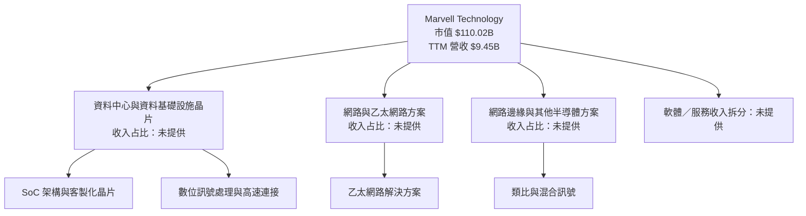
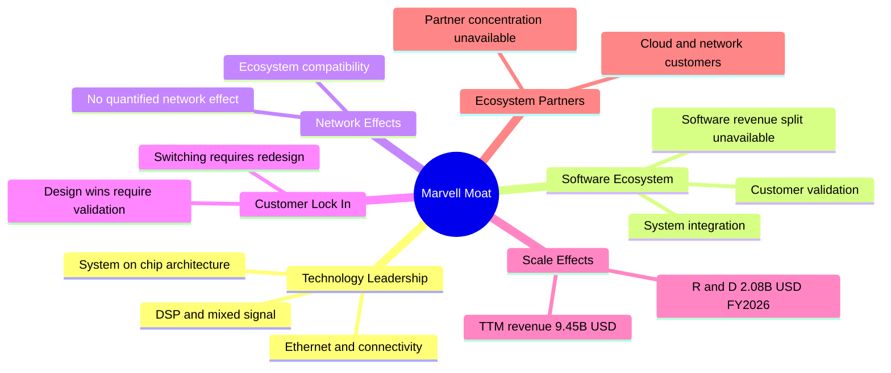
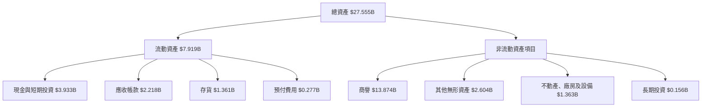
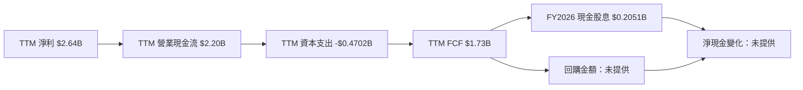
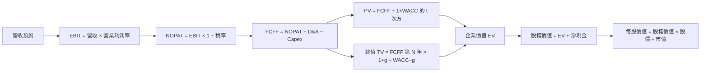
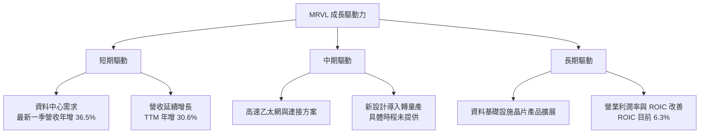
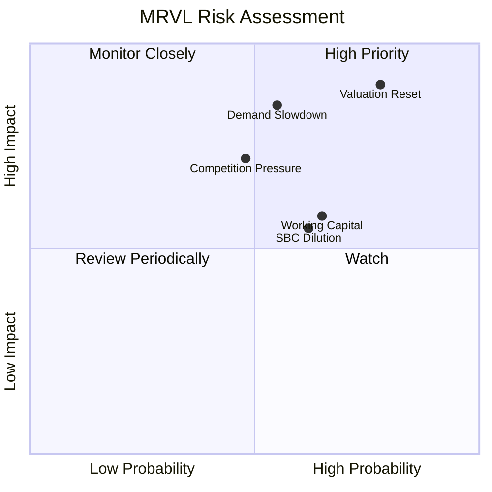
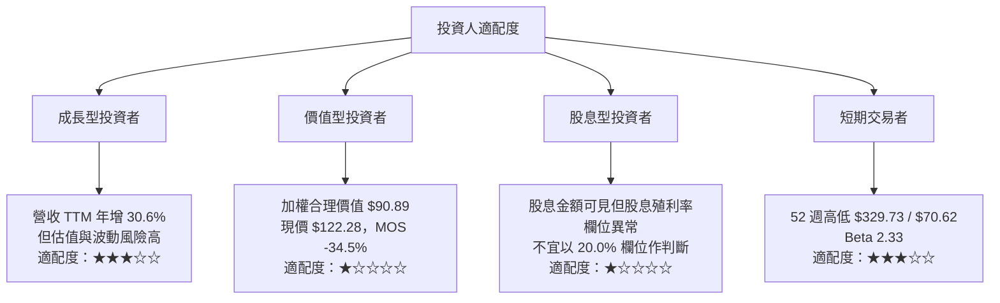

# MRVL 基本面深度分析報告
> **報告日期**：2026-11-23 ｜ **語言**：繁體中文 ｜ **數據來源**：SEC 申報資料 (XBRL)、Yahoo Finance、Finviz、StockAnalysis、Roic.ai ｜ **分析師**：CFA 級機構研究

## 目錄

| # | 章節 | 核心結論 |
|---|------|----------|
| 1 | 執行摘要 | 賣出；加權合理價值 $90.89；MOS -34.5% |
| 2 | 公司概覽與商業模式 | 資料基礎設施晶片供應商；具客戶認證與設計導入優勢，但市場份額數據未提供 |
| 3 | 損益表深度分析 | TTM 營收 $9.45B、年增 30.6%；最新一季年增 36.5% |
| 4 | 資產負債表分析 | 淨負債 $1.03B；流動比率 3.168，營運資金週期較一年前拉長 |
| 5 | 現金流量深度分析 | TTM FCF $1.73B，FCF Yield 1.57%；SBC 對股東的經濟成本不可忽略 |
| 6 | 獲利能力與資本效率 | ROIC 6.3% 低於 WACC 13.87%，目前未覆蓋資本成本 |
| 7 | 相對估值分析 | MRVL 估值高於部分同業；歷史 P/S 位於 75 百分位 |
| 8 | DCF 內在價值評估 | 基準 DCF 每股 $38.55；估值對高 WACC 及終值假設敏感 |
| 9 | 成長催化劑 | AI／資料中心需求是潛在驅動力；TAM 與產品收入拆分未提供 |
| 10 | 風險矩陣 | 主要風險為估值回落、競爭與需求／庫存循環 |
| 11 | 投資建議 | 賣出；現價高於加權合理價值，需監控成長、毛利、FCF 與估值 |

---

## 1. 執行摘要

MRVL 的 TTM 營收為 **$9.45B**，TTM 年增 **30.6%**，最新一季年增 **36.5%**；TTM FCF 為 **$1.73B**，但 FCF Yield 僅 **1.57%**，而 ROIC **6.3%** 低於 WACC **13.87%**。以估值三角驗證所得加權合理價值 **$90.89** 對比 **2026-11-20 收盤價 $122.28**，MOS 為 **-34.5%**，依規則 20 評級為 **賣出**。DCF 基準值為 $38.55，較現價低 68.5%；相對估值及分析師共識雖然較高，但仍不足以抵消加權價值所反映的估值風險。

### 1.0 一頁式投資儀表板（Portfolio Manager 30 秒速讀）

| 項目 | 內容 |
|------|------|
| **投資論點（3 句）** | ① TTM 營收年增 30.6%、最新一季年增 36.5%，反映當前營收動能仍快。② TTM FCF $1.73B、FCF Yield 1.57%，現金流為正但相對 $110.02B 市值的現金回報有限。③ ROIC 6.3% 低於 WACC 13.87%，目前資本報酬尚未覆蓋資本成本。 |
| **綜合評分** | **5.8/10**（引用 1.1 評分卡） |
| **財務健康** | 🟡 現金與短期投資 $3.93B、債務 $4.96B，淨負債 $1.03B；流動比率 3.168。 |
| **ROIC vs WACC** | 6.3% vs 13.87%；目前低於資本成本，呈現價值侵蝕。 |
| **FCF 趨勢** | TTM FCF $1.73B；FCF Yield 1.57%。年度 FCF 近年回升，但 SBC 及營運資金佔用降低現金流品質。 |
| **估值** | Forward P/E 16.589x（同業區塊的同業中位數 15.7x）｜EV/EBITDA 38.094x｜FCF Yield 1.57%。 |
| **DCF 內在價值（基準）** | $38.55；現價相對 DCF 溢價 **217.2%**（折溢價定義：現價 ÷ DCF 價值 − 1）。 |
| **安全邊際（MOS）** | **-34.5%＝($90.89 − $122.28) ÷ $90.89**；🔴 低於 10%，無正安全邊際。 |
| **預期報酬（基準情境 12M）** | N/A（未提供 12 個月模型目標）；10 年 DCF 基準值相對現價為 -68.5%，不等同 12M 預測。 |
| **關鍵風險（前二）** | 高折現率下估值承壓；資料中心需求放緩或競爭加劇造成成長及利潤率不及模型假設。 |
| **評級 + 信心度** | 🔴 **賣出**｜信心：中（財務數據較完整，但同業倍數、估值方法與資料來源存在局限）。 |

### 1.1 綜合評分卡（全報告唯一）

| 維度 | 評分（1–10） | 主要依據（引用數字與其來源章節） |
|------|--------------|----------------------------------|
| 成長性 | 8.0 | TTM 營收年增 30.6%、最新一季年增 36.5%（第 3 章）；成長速度高，但尚未提供各業務拆分。 |
| 獲利能力 | 6.0 | TTM 營業利益率 16.5%、ROIC 6.3% 低於 WACC 13.87%、F-Score 6/9（第 3、6 章）。 |
| 財務健康 | 7.0 | 淨負債 $1.03B、流動比率 3.168；CCC 由 113 天升至 131 天（第 4 章）。 |
| 估值 | 2.0 | MOS -34.5%；MRVL P/S 現為 11.9x，高於自身五年中位數 9.9x（第 7、8 章）。 |
| 護城河 | 7.0 | 高速連接、DSP、混合訊號等技術與客戶設計導入形成切換成本；市場份額及客戶集中度數據未提供（第 2 章）。 |
| 管理層與資本配置 | 5.0 | FY2026 SBC $590.8M；稀釋股數測試未通過，股息支出約 $205.1M（第 3、5 章）。 |
| **綜合評分** | **5.8** | 六項算術平均：(8.0 + 6.0 + 7.0 + 2.0 + 7.0 + 5.0) ÷ 6 = 5.833，四捨五入至一位小數。 |

### 1.2 五大投資論點 + 三大核心風險

| 類型 | 項目 | 具體依據 | 信心度 |
|------|------|----------|--------|
| 🟢 **投資論點①** | 營收動能加速 | TTM 營收 $9.45B、年增 30.6%；最新一季年增 36.5%。若由資料中心及高速互連需求帶動，能支撐短中期成長。 | 🟢 高 |
| 🟢 **投資論點②** | 正向自由現金流 | TTM 營業現金流 $2.20B、資本支出 $470.20M，FCF $1.73B。公司可用內部現金支持研發及股東回報。 | 🟢 高 |
| 🟢 **投資論點③** | 短期償債緩衝充足 | 現金及短期投資 $3.93B，總債務 $4.96B；流動比率 3.168，近期流動性壓力有限。 | 🟢 中 |
| 🟢 **投資論點④** | 最新一季獲利成長快於營收 | 最新一季淨利年增 58.1%、EPS 年增 50.0%，高於單季營收年增 36.5%；但季度淨利波動及一次性因素需核實。 | 🟡 中 |
| 🟢 **投資論點⑤** | 估值低於自身五年 P/E 中位數 | P/E 40.4x，低於五年中位數 56.5x；但 P/S 11.9x 高於中位數 9.9x，估值並非全面便宜。 | 🟡 中 |
| 🟡 **風險①** | 估值與折現率風險 | DCF 基準價 $38.55；WACC 13.87% 對高成長公司的遠期現金流折現影響大。 | 🔴 高衝擊 |
| 🔴 **風險②** | 成長與利潤率回落 | DCF 假設營收成長由第 1 年 30.0% 線性降至第 10 年 3.0%，營業利潤率由 16.5% 降至 4.0%；實際組合或競爭變化可能造成更差結果。 | 🔴 高 |
| 🟡 **風險③** | SBC 與營運資金消耗 | FY2026 SBC $590.8M；最新 TTM CCC 131 天，高於一年前 113 天；股數未增加測試未通過。 | 🟡 中高 |

### 1.3 快速統計卡片

| 指標 | 公司實際值（期間） | 同業中位數 | 狀態 |
|------|--------------------|------------|------|
| 營收成長（TTM） | **30.6%** | — | 🟢 |
| 營收成長（最新一季年增） | **36.5%** | **85.5%**（AVGO、NVDA、AMD 最新一季年增中位數） | 🟡 |
| 毛利率（TTM） | **52.2%** | **74.9%**（同業中位數） | 🔴 |
| 營業利益率（TTM） | **16.5%** | — | 🟡 |
| ROIC（TTM） | **6.3%** | — | 🔴 |
| Forward P/E | **16.589x** | **15.7x** | 🟡 |
| FCF Yield（TTM） | **1.57%** | — | 🔴 |
| Piotroski F-Score | **6 / 9** | — | 🟡 |

### 1.4 投資結論

```
╔══════════════════════════════════════════════════════════════════╗
║                    📊 投資結論摘要                               ║
╠══════════════════════════════════════════════════════════════════╣
║  評級：🔴 賣出（依加權合理價值的 MOS 門檻）                      ║
║  價格（2026-11-20 收盤）：$122.28                                ║
║  DCF 內在價值（基準）：$38.55（現價溢價 217.2%）                ║
║  安全邊際 MOS：-34.5%（＝($90.89−$122.28)÷$90.89）              ║
║  加權合理價值（8.8）：$90.89                                     ║
║  DCF 情境價值：                                                   ║
║    悲觀情境：$19.48（-84.1%）                                    ║
║    基準情境：$38.55（-68.5%）                                    ║
║    樂觀情境：$73.42（-40.0%）                                    ║
║  綜合評分：5.8/10（引用 1.1）                                    ║
║  適合投資人：可承受高波動、重視半導體成長的投資人；不適合以估值   ║
║  安全邊際或穩定股息為首要目標的投資人。                          ║
╚══════════════════════════════════════════════════════════════════╝
```

---

## 2. 公司概覽與商業模式

### 2.1 業務結構與收入來源

公司提供從資料中心核心到網路邊緣的資料基礎設施半導體，涉及 SoC 架構、類比、混合訊號及數位訊號處理。最新 TTM 營收為 $9.45B；產品板塊營收占比及各子業務金額未提供，因此圖中不臆造比例。



業務質量重點在於晶片設計導入後通常需要客戶驗證、系統整合與產品週期配合；成功設計導入可形成一定切換成本，但資料未提供各業務營收占比、客戶集中度或產品生命周期，無法定量拆分單一板塊貢獻。

### 2.2 市場份額

市場份額數據未提供，故不繪製市場份額圖、不推估占比。MRVL TTM 營收 $9.45B、TTM 年增 30.6%，規模與增長均顯示其為大型資料基礎設施半導體供應商；但同業最新一季成長中位數高於 MRVL，表示其成長並非在同業中最快。

### 2.3 競爭護城河分析



### 2.4 護城河強度

| 護城河項目 | 強度（強／中／弱） | 證據（引用數字或事實） | 會削弱它的情況 |
|------------|--------------------|------------------------|----------------|
| 技術與研發 | 中至強 | FY2026 研發費用 $2.08B；產品涉及 DSP、混合訊號與 SoC。 | 競爭者達到相近效能、功耗或成本，或客戶改採內製晶片。 |
| 軟體生態系統 | 中 | 公司產品需整合於客戶資料基礎設施，但軟體收入與裝機量未提供。 | 軟體支援不足，或競爭方案降低客戶轉換成本。 |
| 網路效應 | 弱至中 | 資料未提供直接網路效應或用戶數。 | 開放標準與多來源供應削弱平台依賴。 |
| 客戶鎖定 | 中 | 設計導入需客戶驗證與系統調校，切換通常涉及重新設計；客戶留存率未提供。 | 客戶多源供應、產品迭代失敗或自研替代。 |
| 規模效應 | 中 | TTM 營收 $9.45B，FY2026 研發 $2.08B，可支持多產品線研發。 | 營收回落而研發固定成本維持，造成營業槓桿反轉。 |
| 生態夥伴 | 中 | 公司服務全球資料中心、網路與邊緣市場；具體合作夥伴收入未提供。 | 客戶集中、供應鏈限制或合作夥伴轉向競品。 |

護城河評分引用 1.1 的 **7.0/10**：研發投入與設計導入能支持技術及客戶黏著，但缺少市場份額、客戶留存、客戶集中度等量化證據，故不評為更高。

---

## 3. 損益表深度分析

### 3.1 年度收入成長趨勢（近4年）

採年度損益表列示的營收；FY2025、FY2024 數據與 StockAnalysis 輔助來源有差異，以下以年度損益表數字為主。三年 CAGR 以 FY2023 至 FY2026 計算。

```
╔══════════════════════════════════════════════════════════════════╗
║                 Marvell 年度收入趨勢（FY2023–FY2026）            ║
╠══════════════════════════════════════════════════════════════════╣
║  FY2023  $5.92B  ███████████████░░░░░░░░░░  YoY：—             ║
║  FY2024  $5.51B  ██████████████░░░░░░░░░░░  YoY：-7.0%  🔴      ║
║  FY2025  $5.77B  ███████████████░░░░░░░░░░  YoY：+4.7%  🟡      ║
║  FY2026  $8.19B  █████████████████████░░░░  YoY：+42.0% 🟢      ║
║                                                                  ║
║  FY2023–FY2026 三年 CAGR：(8.19 ÷ 5.92)^(1/3) − 1 ≈ 11.4%      ║
╚══════════════════════════════════════════════════════════════════╝
```

FY2024 下滑、FY2025 僅溫和復甦，FY2026 則明顯加速。FY2026 年營收 $8.19B，年增約 42.0%，與 TTM 年增 30.6% 一致顯示需求復甦與產品組合改善帶動營收；但單一年度反彈不宜直接外推為長期增長率。

### 3.2 季度收入趨勢分析

| 季度（截至） | 營收 | QoQ 成長 | YoY 成長 | 備註 |
|--------------|------|----------|----------|------|
| 2025-11-01 | $2.075B | — | 36.83% | 上一季基準資料未列於最新四季表；QoQ 以表內較前季計算。 |
| 2026-01-31 | $2.219B | +6.9% | 22.08% | QoQ = 2.219 ÷ 2.075 − 1。 |
| 2026-05-02 | $2.418B | +9.0% | 27.57% | QoQ = 2.418 ÷ 2.219 − 1。 |
| 2026-08-01 | $2.739B | +13.3% | 36.5% | QoQ = 2.739 ÷ 2.418 − 1；YoY 採最新單季已驗證值。 |

最近兩個季度 QoQ 增速提升至 9.0% 及 13.3%，配合最新單季 YoY 36.5%，顯示營收增速在加快。季度收入擴張能推升固定研發費用的吸收，但後續仍需確認訂單、產品組合及存貨是否支持增長延續。

### 3.3 利潤率演變分析

| 利潤率指標 | FY2023 | FY2024 | FY2025 | FY2026 | 趨勢 | 評估 |
|------------|--------|--------|--------|--------|------|------|
| **毛利率** | 50.5% | 41.6% | 41.2% | 51.0% | FY2026 回升約 10 個百分點 | 🟢 |
| **營業利益率** | 6.1% | -7.9% | -6.4% | 16.4% | 從虧損轉為正值 | 🟡 |
| **淨利率** | -2.8% | -16.9% | -15.3% | 32.6% | FY2026 大幅反轉，需留意特殊項目 | 🟡 |

年度毛利率以年度損益表中的毛利與收入計算；資料源對 FY2025 毛利存在差異（年度損益表 $2.38B、StockAnalysis $2.740B），故年度趨勢應視為資料源交叉檢核而非完全同口徑序列。TTM 已驗證毛利率為 52.2%。

**利潤率演變深度解析：** FY2026 毛利率回升至約 51.0%，營業利益率轉為 16.4%，與同期營收成長相符，顯示出貨組合及固定費用吸收可能改善。FY2026 淨利率以所列年度淨利計算達 32.6%，明顯高於 TTM 淨利率 27.9%；這一差異可能受期間口徑、稅項或非營業項目影響，不能將單年度淨利率直接當成可持續營運利潤率。DCF 採用 GAAP EBIT，且將營業利益率由 TTM 16.5% 逐步下降至 4.0%，反映長期利潤率回歸的保守設定。

### 3.4 費用結構分析

費用細項資料未提供到可完整對帳的 TTM 費用結構，因此不繪製費用比例圓餅圖。FY2026 研發費用為 $2.08B，約占當年收入 $8.19B 的 25.4%；此比例反映公司需持續以研發支出維持產品迭代與客戶設計導入，但不能將它視為全部營業費用。

### 3.5 季度 EPS 趨勢與盈餘品質（Quality of Earnings）

| 季度（截至） | EPS 實際值 | EPS 預期值 | 超預期／不及預期 |
|--------------|------------|------------|------------------|
| 2026-08-01 | $0.33 | N/A | N/A；EPS Est 與 EPS Act 資料為 nan，無法判定。 |
| 2026-05-02 | $0.04 | N/A | N/A；估值資料未提供有效預期值。 |
| 2026-01-31 | $0.47 | N/A | N/A；估值資料未提供有效預期值。 |
| 2025-11-01 | $2.20 | N/A | N/A；季度 EPS 有異常高值，需核對一次性項目及財報口徑。 |

**過去四季 EPS 超預期／不及預期：** earnings history 中四季預估及實際值欄位均為 nan，故不能可靠判定 beat 或 miss。實際 EPS 從 $2.20、$0.47、$0.04 至 $0.33 波動，且單季淨利同樣大幅變化；不能將單季淨利增長率直接等同核心營運增速。

| 盈餘品質項目 | 數值/佔比 | 評估 |
|--------------|-----------|------|
| 股權薪酬 SBC / 營收 | 近四季 SBC 合計 $828.9M ÷ TTM 營收 $9.45B ≈ **8.8%** | 🔴 高度稀釋成本；即使 GAAP 將 SBC 列為費用，股東仍承受股數增加或回購抵銷成本。 |
| SBC / 營業現金流 | $828.9M ÷ $2.20B ≈ **37.7%** | 🔴 SBC 相對現金流規模大，應以股東經濟成本而非純非現金項目看待。 |
| FCF / 淨利（現金轉換率） | $1.73B ÷ TTM 淨利 $2.64B ≈ **65.5%** | 🟡 現金轉換低於 100%；需留意營運資金增加及非現金調整。 |
| 一次性／非經常性損益 | 逐項明細未提供；FY2025-11 季度淨利 $1.901B，遠高於其他列示季度 | 🟡 有異常季度，無法在缺少附註的情況下定量拆分一次性項目。 |
| 有效稅率異常 | 12.4%（DCF／最新年度有效稅率） | 🟡 未見明確異常高稅率；仍需觀察離散稅項對 GAAP 淨利的影響。 |
| 資本化支出 vs 費用化 | TTM 資本支出 $470.20M；資本化項目明細未提供 | 🟡 無法判定是否存在重大成本遞延；不能據此推定盈餘被高估或低估。 |

**盈餘品質結論：** TTM FCF 為正，支持獲利具有現金支撐；但 FCF／淨利約 65.5%、SBC 約占營收 8.8%，並且 Piotroski 應計品質與稀釋股數測試未通過，表示會計獲利轉為可歸屬股東的現金回報仍有折損。估值不應只依 EPS 外推，應同步檢視 SBC、營運資金及稀釋股數。

---

## 4. 資產負債表分析

### 4.1 資產結構分解

資產細項採 TTM 資產負債表資料；因部分細項與總額可能存在口徑差異，以下列出已提供數字，不補足差額。



商譽 $13.874B 約為總資產一半，反映併購形成的資產比重較高；若未來相關業務現金流低於預期，須留意減損風險。

### 4.2 流動性與營運資金分析

| 指標 | 最新 TTM | 一年前 TTM | 變化 | 解讀 |
|------|----------|------------|------|------|
| 流動比率 | 3.168 | N/A | N/A | 流動資產對短期負債覆蓋充足；比較年度序列的來源口徑不同，不填補一年前數值。 |
| 速動比率 | 2.461 | N/A | N/A | 扣除存貨後流動性仍充足。 |
| DSO 應收帳款天數 | 86 天 | 73 天 | +13 天 | 收款週期拉長，可能由營收增長、客戶付款條件或出貨節奏造成；須追蹤應收帳齡。 |
| DIO 存貨天數 | 110 天 | 96 天 | +14 天 | 庫存天數上升，可能是備貨支持成長，也可能增加需求放緩時的減值風險。 |
| DPO 應付帳款天數 | 64 天 | 56 天 | +8 天 | 付款天數延長，有助短期營運資金，但不一定代表議價能力改善。 |
| CCC 現金轉換週期 | 131 天 | 113 天 | +18 天 | 淨營運資金佔用增加；DSO、DIO 上升幅度合計大於 DPO 延長。 |

### 4.3 債務結構分析

財務數據的不同區塊列示總債務 $4.96B 與 $5.29B。依驗證指標，淨負債採用總債務 $4.96B 計算口徑；另列市場資料中的 $5.29B 以提示來源差異，不混用於估值橋接。

```
╔══════════════════════════════════════════════════════════════════╗
║                   Marvell 債務健康診斷                           ║
╠══════════════════════════════════════════════════════════════════╣
║  總債務（驗證口徑）：  $4.96B                                     ║
║  現金及短期投資：      $3.93B                                     ║
║  淨負債：              $1.03B  🟡                                ║
║                                                                  ║
║  流動比率：            3.168x  🟢                                ║
║  速動比率：            2.461x  🟢                                ║
║  Debt/EBITDA：         N/A（所給債務與 EBITDA 口徑未統一）        ║
║  Interest Coverage：   N/A（未提供利息費用與 EBIT 同口徑資料）   ║
║                                                                  ║
║  注意：市場資料另列總債務 $5.29B、淨負債 $1.35B；不與驗證口徑混算║
╚══════════════════════════════════════════════════════════════════╝
```

### 4.4 股東權益趨勢

```
╔══════════════════════════════════════════════════════════════════╗
║                 股東權益趨勢（年度）                              ║
╠══════════════════════════════════════════════════════════════════╣
║  FY2023  $15.64B  ████████████████████                           ║
║  FY2024  $14.83B  ███████████████████                            ║
║  FY2025  $13.43B  █████████████████                              ║
║  FY2026  $14.31B  ██████████████████                             ║
╚══════════════════════════════════════════════════════════════════╝
```

權益由 FY2023 至 FY2025 下降後於 FY2026 回升。FY2026 權益增加與當期淨利改善相符，但仍需結合 SBC、股數變化及其他綜合損益判斷股東價值增長；現有資料不足以拆解權益變動來源。

---

## 5. 現金流量深度分析

### 5.1 現金流量瀑布圖

淨利與 TTM 現金流數據期間口徑並非每項完全一致，圖中只呈現可引用項目；股息支出採 FY2026 年資料，故不將其與 TTM FCF 直接相減推導淨現金變化。



### 5.2 FCF 轉換率趨勢

| 年度 | FCF | 淨利 | FCF / 淨利 | 解讀 |
|------|-----|------|------------|------|
| FY2023 | $1.07B | -$0.164B | 不具意義 | 淨利為負，比例不能用作正常轉換率比較。 |
| FY2024 | $1.02B | -$0.933B | 不具意義 | FCF 為正而淨利為負，代表現金流與 GAAP 淨利差異大。 |
| FY2025 | $1.39B | -$0.885B | 不具意義 | 同樣不宜用負分母解讀。 |
| FY2026 | $1.39B | $2.67B | 約 52.1% | FCF 低於淨利，可能受營運資金與非現金項目影響。 |
| TTM | $1.73B | $2.64B | 約 65.5% | 現金流轉換仍低於一比一，需追蹤存貨與應收帳款。 |

### 5.3 自由現金流趨勢

```
╔══════════════════════════════════════════════════════════════════╗
║                    自由現金流趨勢                                 ║
╠══════════════════════════════════════════════════════════════════╣
║  FY2023  $1.07B  ████████████░░░░░░░░  FCF Yield：N/A            ║
║  FY2024  $1.02B  ███████████░░░░░░░░░  FCF Yield：N/A            ║
║  FY2025  $1.39B  ███████████████░░░░░  FCF Yield：N/A            ║
║  FY2026  $1.39B  ███████████████░░░░░  FCF Yield：N/A            ║
║  TTM     $1.73B  ████████████████████  FCF Yield：1.57%          ║
╚══════════════════════════════════════════════════════════════════╝
```

TTM FCF 高於 FY2026 年度 FCF，與最新營收及營業現金流擴大相符。不過 FCF Yield 僅 1.57%，代表以現價衡量，現金流收益率不高；若成長放緩或營運資金持續吸收現金，估值支撐將更依賴未來增長。

### 5.4 資本配置評估

目前可量化項目如下；回購、併購及留存現金的完整用途拆分未提供，故不畫比例圓餅圖。

| 資本配置項目 | 已知數據 | 評估 |
|--------------|----------|------|
| 資本支出 | TTM $470.20M；FY2026 $358.60M | 對無晶圓廠半導體公司而言資本支出低於研發投入，但資本支出的具體項目回報未提供。 |
| 現金股息 | FY2026 $205.10M | 支出規模相對 FCF 可負擔；股息殖利率來源欄位顯示 20.0%，與常見市場報價明顯不一致，故不採用該殖利率作投資依據。 |
| SBC | FY2026 $590.80M | 高於 FY2026 股息支出，需將稀釋成本納入資本配置評估。 |
| 股票回購 | N/A | 數據未提供，無法判定是否足以抵銷 SBC 稀釋。 |
| 研發 | FY2026 $2.08B | 研發占比高，支持產品競爭力；投資回報需以新增營收與 ROIC 改善驗證。 |

---

## 6. 獲利能力與資本效率

### 6.1 ROE / ROA / ROIC 趨勢

| 指標 | 最新 TTM／FY | 歷史可比較值 | 評估 |
|------|---------------|--------------|------|
| ROE | TTM 14.2%（品質指標口徑）；另有市場欄位 16.5% | 完整一致的年度趨勢未提供 | 🟡 指標來源口徑不一致，使用 DuPont 驗證值 14.2%。 |
| ROA | TTM 4.1% | 年度一致序列未提供 | 🟡 資產回報低於 ROE，反映資產周轉與商譽等資產負擔。 |
| ROIC | TTM 6.3% | 其他年份同口徑序列未提供 | 🔴 低於 WACC 13.87%。 |

產業均值未提供，不作無來源的同業平均比較。

### 6.2 ROIC vs WACC 分析（核心價值創造判斷）

```
╔══════════════════════════════════════════════════════════════════╗
║                ROIC vs WACC 深度分析                             ║
╠══════════════════════════════════════════════════════════════════╣
║  WACC（資本成本區塊採用值）：                                    ║
║  ├── 無風險利率（10Y 美債）：4.91%                               ║
║  ├── 市場風險溢酬 ERP：5.00%                                     ║
║  ├── Beta 原始值 2.33；採用調整後 Beta 1.88                    ║
║  ├── 股權成本（資料庫採用）：14.34%                             ║
║  ├── 稅前債務成本：4.08%；有效稅率：12.4%                      ║
║  ├── 股權／債務權重：95.7%／4.3%                                ║
║  └── ✅ WACC：13.87%                                             ║
║                                                                  ║
║  ROIC（TTM）：6.3%                                               ║
║  EVA spread = ROIC − WACC = 6.3% − 13.87% = -7.57 個百分點     ║
║                                                                  ║
║  ROIC  6.3%   ▓▓▓▓▓▓▓▓▓░░░░░░░░░░░░░░░░░░░░░░                  ║
║  WACC 13.87%  ▓▓▓▓▓▓▓▓▓▓▓▓▓▓▓▓▓▓▓▓░░░░░░░░░░                  ║
║                                                                  ║
║  📊 結論：目前 ROIC 約為 WACC 的 0.45 倍，尚未覆蓋資本成本。   ║
╚══════════════════════════════════════════════════════════════════╝
```

WACC 採用資本成本資料中的 **13.87%**，不另行重建一個折現率。原始 Beta 為 2.33，Beta used (adjusted) 為 1.88；無風險利率與 ERP 分別為 4.91% 與 5.00%。以資料所示 ROIC 6.3% 比較，差額為 -7.57 個百分點，表明目前已投入資本的回報低於資本提供者要求的報酬。若資料中心成長最終帶動資產週轉、營業利潤率或資本效率改善，ROIC 才有機會逐步收斂至 WACC。

### 6.3 杜邦三因素分解

| 因素 | 數值（TTM） | 解讀 |
|------|-------------|------|
| 淨利率 | 27.9% | 淨利率對 ROE 貢獻大，但須注意一次性季度淨利波動。 |
| 資產週轉率 | 0.34 | 每單位資產帶來的營收偏低，且資產中商譽及無形資產比重較高。 |
| 權益乘數 | 1.49 | 槓桿不是 ROE 的主要放大來源。 |
| **ROE** | **14.2%** | QUALITY FIGURES 原值：27.9% × 0.34 × 1.49 = 14.2%（四捨五入）。 |

### 6.4 財務體質：Piotroski F-Score

Piotroski F-Score **6/9**；九項測試結果依 QUALITY FIGURES 原值列示。

| 測試 | 結果 | 解讀 |
|------|------|------|
| ROA > 0 | ✅ 通過 | TTM 資產回報為正。 |
| 營業現金流 > 0 | ✅ 通過 | TTM 營業現金流 $2.20B。 |
| ROA 高於一年前 | ✅ 通過 | 資產獲利能力改善。 |
| 營業現金流 > 淨利（應計品質） | ❌ 未通過 | 營業現金流低於淨利，獲利轉現能力不足一比一。 |
| 長期負債 ÷ 總資產低於一年前 | ✅ 通過 | 相對負債指標改善。 |
| 流動比率高於一年前 | ✅ 通過 | 流動性相對改善。 |
| 稀釋股數未增加 | ❌ 未通過 | 股數增加會稀釋每股盈餘及每股現金流。 |
| 毛利率高於一年前 | ✅ 通過 | 毛利率改善支持產品組合或價格變化。 |
| 資產週轉率高於一年前 | ❌ 未通過 | 資產增長尚未同步轉化為更高營收效率。 |

---

## 7. 相對估值分析

### 7.1 同業估值比較表格

公司自身倍數及同業倍數依各自資料欄位呈現；同業評估倍數採 Peer multiples 區塊數值。MRVL Forward P/E 於市場概覽為 16.589x，估值方法區塊用於相對估值計算的 Forward EPS 為 $7.37。

| 估值指標 | **MRVL** | **AVGO** | **NVDA** | **AMD** | 本公司評估 |
|----------|----------|----------|----------|---------|-----------|
| **Trailing P/E** | 40.4x | 38.9x | 13.5x | 90.7x | 🟡 位於同業分布中間偏高。 |
| **Forward P/E** | 16.589x | 15.7x | 7.6x | 24.1x | 🟡 高於同業中位數 15.7x 約 5.7%，但低於 AMD。 |
| **P/S Ratio** | 11.9x | 16.3x | 8.4x | 15.5x | 🟡 高於 NVDA、低於 AVGO 與 AMD。 |
| **EV/EBITDA** | 72.8x（估值歷史序列）；市場概覽 38.094x | 28.5x | 12.2x | 61.9x | 🔴 MRVL 本身不同來源／口徑差異大；依驗證歷史倍數 72.8x 看偏高。 |
| **最新一季營收年增** | 36.5% | 85.5% | 103.2% | 44.7% | 🟡 MRVL 成長快，但低於三家同業。 |
| **TTM 毛利率** | 52.2% | 75.5% | 74.9% | 56.0% | 🔴 低於同業中位數，可能反映產品組合差異。 |

EV/EBITDA 不同資料區塊分別顯示 72.8x 與 38.094x，代表期間或計算口徑不同；為避免混用，歷史比較依驗證區塊 72.8x，市場概覽 38.094x 僅列示，不用來替代歷史序列。相對估值結果應視作區間而非單點精確值。

### 7.2 歷史估值區間分析

```
╔══════════════════════════════════════════════════════════════════╗
║              MRVL 五年估值區間（TTM multiples）                  ║
╠══════════════════════════════════════════════════════════════════╣
║  P/E：25.6x ├──────── 中位數 56.5x ─────● 現值 40.4x────┤61.9x ║
║       當前百分位：50%                                            ║
║  P/S：5.8x  ├────── 中位數 9.9x ───────────────● 11.9x──┤18.3x ║
║       當前百分位：75%                                            ║
║  EV/EBITDA：53.3x ├──● 72.8x ── 中位數 156.4x ──────────┤730.9x║
║       當前百分位：25%                                            ║
╚══════════════════════════════════════════════════════════════════╝
```

P/E 現在約在歷史中段；P/S 位於自身五年 75 百分位，顯示市場仍給營收相對高的估值。EV/EBITDA 受歷史極端高倍數影響範圍很寬，當前百分位 25% 不代表絕對便宜，仍須結合 ROIC 低於 WACC 的事實看待。

### 7.3 情境價值（Bear / Base / Bull，照抄 DCF MODEL 的 Scenarios）

| 情境 | 第 1 年營收成長 | 期末營業利潤率 | WACC | 每股價值 | 相對現價 | 機率 | 會發生的條件 |
|------|----------------|----------------|------|----------|----------|------|--------------|
| 🔴 悲觀 | 15.0% | 3.4% | 14.87% | $19.48 | -84.1% | 25% | 資料中心訂單降溫、競爭壓價或研發投入未能轉為出貨。 |
| 🟡 基準 | 30.0% | 4.0% | 13.87% | $38.55 | -68.5% | 25% | 初期營收延續高成長，之後成長逐步收斂，長期利潤率回到五年中位數。 |
| 🟢 樂觀 | 45.0% | 4.4% | 12.87% | $73.42 | -40.0% | 25% | AI／高速互連需求超預期、產品組合支撐成長，資本成本下降。 |

**機率加權值（情境參考，不替代第 8.8 節基準 DCF）：** $19.48 × 25% + $38.55 × 50% + $73.42 × 25% = $42.50（模型原值）。情境機率合計 100%。

### 7.4 相對估值隱含價格區間

```
╔══════════════════════════════════════════════════════════════════╗
║                相對估值方法隱含價格（每股）                       ║
╠══════════════════════════════════════════════════════════════════╣
║  $38.55 DCF ── $62.66 EV/EBITDA ── $90.89 加權值 ─ $115.58 P/E ║
║                  ↑ $122.28 現價高於所有上述估值                  ║
║  分析師共識：$309.14（40 位分析師均值，非基本面方法）             ║
╚══════════════════════════════════════════════════════════════════╝
```

| 方法 | 每股價值 | 方法依據 |
|------|----------|----------|
| DCF（基準） | $38.55 | 10 年 FCFF、WACC 13.87%、終值成長 3.0%。 |
| 同業 Forward P/E | $115.58 | 同業中位數 15.7x × Forward EPS $7.37。 |
| 同業 EV/EBITDA | $62.66 | AVGO、NVDA 中位數 20.3x × TTM EBITDA，再加淨現金。 |
| 分析師共識目標價 | $309.14 | 40 位分析師平均目標價；其與 DCF 差距大，須視為市場預期參考而非內在價值。 |

---

## 8. DCF 內在價值評估（Discounted Cash Flow）

> 本章採用程式計算的 DCF 基準模型。該模型以 GAAP EBIT 計算 FCFF，排除營運資金變動，並按指定股數處理 SBC；逐年輸入與估值結果照錄，不另建模型。

### 8.0 估值推理鏈（Thinking Logic）

**Step 1 — 價值來源與主導變數**

MRVL 的價值主要來自現有資料基礎設施半導體營收底盤、資料中心／高速連接相關成長，以及長期營業利潤率；目前 TTM 營收 $9.45B，但各業務占比未提供，不能把單一產品線收入占比臆定。模型中營收由 $9.45B 增至 FY+10 的 $42.34B，而營業利潤率同時降至 4.0%；其中**WACC 與終值現金流的折現**最能左右估值，敏感度矩陣顯示基準附近 WACC 變動對價值有明顯影響。

**Step 2 — 模型選擇**

| 決策點 | 本報告採用 | 理由（含數字） | 曾考慮但否決 | 否決理由 |
|--------|-----------|----------------|--------------|----------|
| 現金流定義 | FCFF | 與 WACC 折現並得出 EV；基準模型 FCFF = NOPAT + D&A − Capex。 | FCFE | 已採公司資本成本 WACC，不混用股權成本折現。 |
| 預測期 N | 10 年 | 模型固定 N=10；收入增長由 30.0% 逐年降至 3.0%。 | 5 年 | 無法呈現模型已採用的長期成長收斂路徑。 |
| 終值方法 | Gordon Growth | WACC 13.87% 高於永續成長率 3.0%，公式可用。 | 退出倍數 | DCF 模型未提供退出倍數終值數字，不另造交叉估值。 |
| EBIT 基礎 | GAAP EBIT | 模型明示 GAAP EBIT；FY+1 營業利益率 16.5%。 | 非 GAAP EBIT | 加回 SBC 後如未再扣回會漏計股東成本。 |

**Step 3 — 關鍵假設推導鏈**

- **營收增長路徑**：錨點＝TTM 營收年增 30.6%；調整＝初期成長採 30.0%，再逐年線性降至第 10 年 3.0%；**採用第 1 年 30.0%、第 10 年 3.0%**；曾考慮全期固定 30.6%，但會忽略高基期與成長成熟化，故不採用。
- **期末營業利潤率**：錨點＝TTM 營業利益率 16.5%；調整＝模型依五個財年中位數逐年收斂；**採用 4.0%**；曾考慮維持 16.5%，但這會忽略競爭與成熟期利潤率回歸，故不採用。
- **永續成長率 g**：錨點＝模型設定 3.0%，與長期名目經濟成長假設接近；**採用 3.0%**，且低於 WACC 13.87%；更高的永續成長率會不成比例推升終值，因此不採更高值。
- **預測期 N**：錨點＝模型指定 10 年；**採用 10 年**，用於營收與利潤率逐步收斂；另建較短期限會與既定模型不一致。
- **Capex／營收**：錨點＝TTM 資本支出 $470.20M、TTM 營收 $9.45B；模型採 FY+1 至 FY+10 均為 5.0%；**採用 5.0%**。模型未提供不同情境的資本支出路徑，不另改值。
- **GAAP EBIT、SBC 與稀釋股數**：錨點＝GAAP EBIT 已將 SBC 列為費用；**採用組合 (A)：GAAP EBIT + 固定股數 + 不另扣 SBC，年稀釋率 0%**。不另以股數稀釋重複扣減，也不再把 SBC 當第二次現金費用。
- **WACC**：錨點＝資本成本資料中的 13.87%；**採用 13.87%**；替代低折現率會提高估值，但缺乏本報告授權資料支持，故不改用。
- **D&A／營收與有效稅率**：錨點＝模型 D&A／營收 13.3%、有效稅率 12.4%；**採用原模型值**。這些數字直接影響 FCFF；未提供可替代的完整歷史分期數據。
- **ΔWC／營收增額**：模型未納入營運資金變動；因此不自行填入比率或現金流項目。TTM CCC 已由 113 天增至 131 天，模型因此可能高估可分配現金流。
- **終值方法**：錨點＝模型設定 Gordon Growth，g 3.0%、WACC 13.87%；採用模型終值 $47.73B；未採退出倍數，因模型沒有提供相應數值。

**Step 4 — 最脆弱的一環**

最脆弱的是模型將營運資金變動設為零：最新 CCC 已升至 131 天；若應收與存貨繼續吸收現金，FCFF 及估值會低於基準模型，影響方向為下修。

**Step 5 — 計算路徑圖**



### 8.1 模型假設總表（Model Inputs）

| 假設項目 | 採用值 | 依據 / 來源 | 敏感度 |
|----------|--------|-------------|--------|
| 預測期長度 N | 10 年 | DCF MODEL；營收增長由 30.0% 線性降至 3.0%。 | 🟡 中 |
| 營收成長 | 第 1 年 30.0% → 第 10 年 3.0% | TTM vs prior TTM 成長 30.6%；模型限制第 1 年最高 30.0%。 | 🔴 高 |
| 營業利潤率 | 第 1 年 16.5% → 第 10 年 4.0% | TTM 營業利益率及近五財年中位數（含 TTM）。 | 🔴 高 |
| 有效稅率 | 12.4% | 最新年度有效稅率。 | 🟢 低 |
| Capex / 營收 | 5.0% | DCF MODEL 年度假設；TTM 資本支出 $470.20M。 | 🟡 中 |
| D&A / 營收 | 13.3% | DCF MODEL 的 TTM 假設。 | 🟢 低 |
| 營運資金變動 | 未建模 | DCF MODEL 明確不建模營運資金。 | 🔴 高 |
| EBIT 基礎 | GAAP EBIT | 模型明示採 GAAP EBIT。 | 🟡 中 |
| SBC 處理 | 組合 (A)：GAAP EBIT，不再扣 SBC | SBC 已包含於 GAAP 費用；模型股數不再稀釋。 | 🟡 中 |
| 年稀釋率 | 0% | DCF MODEL 明示不再稀釋股數。 | 🟡 中 |
| 永續成長率 g | 3.0% | DCF MODEL；低於 WACC 13.87%。 | 🔴 高 |
| 終值方法 | Gordon Growth | DCF MODEL 所列終值計算。 | 🔴 高 |
| WACC | 13.87% | Cost of capital 原值；第 6.2 節同值。 | 🔴 高 |

**FCFF 定義：**採 FCFF，以 WACC 折現並得出企業價值；模型公式為 `FCFF = NOPAT + D&A − Capex`，不包含 ΔWC。**本模型採用 (A)，故 SBC 影響已計入一次；不另扣 SBC、不另增加稀釋股數。**

### 8.2 折現率推導（WACC）

```
╔══════════════════════════════════════════════════════════════════╗
║                    WACC 推導（折現率）                            ║
╠══════════════════════════════════════════════════════════════════╣
║  無風險利率 Rf（10Y 美債）： 4.91%                               ║
║  市場風險溢酬 ERP：          5.00%（假設值，資料庫採用值）        ║
║  Beta 原始值：               2.33                                ║
║  Beta 調整方式：             ⅔ × 2.33 + ⅓ × 1 = 1.887 ≈ 1.88    ║
║  股權成本 Ke（資料庫採用）： 14.34%                              ║
║  稅前債務成本 Kd：           4.08%                               ║
║  有效稅率：                  12.4%                               ║
║  稅後 Kd：                   4.08% × (1 − 12.4%) = 3.57%        ║
║  股權／債務權重：            95.7%／4.3%                         ║
║  WACC（資料庫採用）：        13.87%                              ║
╚══════════════════════════════════════════════════════════════════╝
```

- 10 年期無風險利率 4.91% 為資本成本資料區塊採用值；該區塊未提供觀察日期，故不另行指定日期。
- Beta 原始值 2.33，採用調整後 Beta 1.88；調整公式按來源規則為 ⅔ × 原始 Beta + ⅓ × 1。
- Ke、Kd、E／D 權重與 WACC 均採資本成本來源原值。由於來源僅提供稅前 Kd 4.08%，沒有利息費用及平均計息負債的美元明細，無法獨立重建 Kd 的分子與分母；不以總負債或應付帳款反推。
- 來源提供股權權重 95.7%、債務權重 4.3%，合計 100%；不另以股東權益帳面值替代市值權重。
- 以展示至兩位小數的 Ke、Kd、權重重算，可能與原始 WACC 有微小四捨五入差異；**DCF 及 ROIC 比較均固定採用 13.87%**，不另算第二個 WACC。

### 8.3 逐年自由現金流預測（基準情境）

單位：美元十億；折現因子保留三位小數。表格照錄 DCF MODEL；模型未列 ΔWC，故不添加該列。

| 年度 | FY+1 | FY+2 | FY+3 | FY+4 | FY+5 | FY+6 | FY+7 | FY+8 | FY+9 | FY+10 |
|------|------|------|------|------|------|------|------|------|------|-------|
| 營收 | 12.29 | 15.60 | 19.35 | 23.41 | 27.62 | 31.77 | 35.58 | 38.78 | 41.11 | 42.34 |
| 營收 YoY | 30.0% | 27.0% | 24.0% | 21.0% | 18.0% | 15.0% | 12.0% | 9.0% | 6.0% | 3.0% |
| 營業利潤率 | 16.5% | 15.1% | 13.7% | 12.4% | 11.0% | 9.6% | 8.2% | 6.8% | 5.4% | 4.0% |
| EBIT（GAAP） | 2.03 | 2.36 | 2.66 | 2.89 | 3.03 | 3.04 | 2.91 | 2.64 | 2.22 | 1.70 |
| − 稅 | (0.25) | (0.29) | (0.33) | (0.36) | (0.37) | (0.38) | (0.36) | (0.33) | (0.27) | (0.21) |
| = NOPAT | 1.78 | 2.07 | 2.33 | 2.53 | 2.65 | 2.67 | 2.55 | 2.31 | 1.95 | 1.49 |
| + D&A | 1.64 | 2.08 | 2.58 | 3.12 | 3.69 | 4.24 | 4.75 | 5.18 | 5.49 | 5.65 |
| − Capex | (0.61) | (0.78) | (0.96) | (1.16) | (1.37) | (1.58) | (1.77) | (1.93) | (2.05) | (2.11) |
| = FCFF | 2.81 | 3.38 | 3.95 | 4.49 | 4.97 | 5.33 | 5.53 | 5.56 | 5.39 | 5.04 |
| 折現因子 @13.87% | 0.878 | 0.771 | 0.677 | 0.595 | 0.522 | 0.459 | 0.403 | 0.354 | 0.311 | 0.273 |
| FCFF 現值 PV | 2.47 | 2.60 | 2.68 | 2.67 | 2.59 | 2.44 | 2.23 | 1.97 | 1.67 | 1.37 |

**預測期 FCF 現值合計（模型原值）：**  
$2.47 + $2.60 + $2.68 + $2.67 + $2.59 + $2.44 + $2.23 + $1.97 + $1.67 + $1.37 = **$22.70B（模型原值）**。  
按表格兩位小數直接相加為 $22.72B，與模型原值差 $0.02B，約 0.09%，屬於各年度數字四捨五入尾差；DCF 估值後續採用模型原值 $22.70B。

**FY+1 逐步演算：**

1. 營收 = $9.45B × (1 + 30.0%) = $12.285B ≈ **$12.29B**。
2. EBIT = $12.29B × 16.5% ≈ **$2.03B**。
3. 稅 = 模型列示 **$0.25B**；模型各列以兩位小數呈現。
4. NOPAT = $2.03B − $0.25B ≈ **$1.78B**。
5. D&A = $12.29B × 13.3% ≈ **$1.64B**。
6. Capex = $12.29B × 5.0% ≈ **$0.61B**。
7. ΔWC = **未建模**；不加回推數字。
8. FCFF = $1.78B + $1.64B − $0.61B = **$2.81B**。
9. 折現因子依模型為 0.878；PV = $2.81B × 0.878 ≈ **$2.47B**。

**合理性自檢：**

- 模型 FY+1 至 FY+10 FCFF 由 $2.81B 增至 $5.04B；九年複合增長約 6.7%。FY2023 至 FY2026 歷史年度 FCF $1.07B 增至 $1.39B，三年 CAGR 約 9.1%；模型前期高、後期放緩，長期增長低於這段歷史 CAGR。
- FY+10 FCFF 利潤率 = $5.04B ÷ $42.34B ≈ 11.9%；目前 TTM FCF／營收 = $1.73B ÷ $9.45B ≈ 18.3%。模型雖預測營收擴大，FCF 利潤率仍低於目前 TTM 比率；兩者口徑差異包括未建模營運資金。
- 表列各年 FCFF 均為正值；但營運資金若大幅佔用現金，實際 FCFF 可能低於模型。

```
╔══════════════════════════════════════════════════════════════════╗
║             自由現金流：歷史實際 vs 模型預測                      ║
╠══════════════════════════════════════════════════════════════════╣
║  FY2024(實) $1.02B  ████░░░░░░░░░░░░░░░░  FCF                 ║
║  FY2025(實) $1.39B  ██████░░░░░░░░░░░░░░  FCF                 ║
║  FY2026(實) $1.39B  ██████░░░░░░░░░░░░░░  FCF                 ║
║  FY+1 (預)  $2.81B  ███████████░░░░░░░░░  FCFF                ║
║  FY+10(預)  $5.04B  ████████████████████  FCFF                ║
╠══════════════════════════════════════════════════════════════════╣
║  歷史年度 FCF 與預測 FCFF 定義、營運資金處理不同，不宜直接混比。 ║
╚══════════════════════════════════════════════════════════════════╝
```

### 8.4 終值計算（Terminal Value）

**適用性檢查：**`WACC 13.87% vs g 3.0% → WACC > g？✅`

| 方法 | 計算式 | 終值 TV | TV 現值 | 佔總 EV 比重 |
|------|--------|---------|---------|--------------|
| Gordon Growth | $5.04 × (1 + 3.0%) ÷ (13.87% − 3.0%) | $47.73B | $13.02B | 36.5% |
| 退出倍數法 | DCF MODEL 未提供退出倍數及 EBITDA 終值 | N/A（模型未提供） | N/A | N/A |

**逐步演算（Gordon Growth）：**

1. FY+N 的 FCFF = **$5.04B**（FY+10）。
2. 分子 = $5.04B × (1 + 3.0%) = **$5.19B**（依模型精度計算）。
3. 分母 = 13.87% − 3.0% = **10.87%**；TV = $5.04 × 1.03 ÷ 0.1087 = **$47.73B**（模型原值）。
4. PV(TV) = $47.73B × 0.273 = **$13.02B**（模型原值）。
5. 終值佔比 = $13.02B ÷ $35.72B = **36.5%**。

終值現值占 EV 36.5%，未超過 75% 警戒線；但估值仍對 WACC、永續成長率及第十年 FCFF 敏感。未提供退出倍數法參數，不能補造交叉驗證值。

### 8.5 企業價值 → 每股內在價值（Bridge）

```
╔══════════════════════════════════════════════════════════════════╗
║              企業價值 → 每股內在價值 橋接表                      ║
╠══════════════════════════════════════════════════════════════════╣
║  預測期 FCF 現值合計            +$22.70B                         ║
║  終值現值 PV(TV)                +$13.02B                         ║
║  ─────────────────────────────────────────────                  ║
║  = 企業價值 EV                   $35.72B                         ║
║  + 淨現金（負值即淨負債）        -$1.03B                         ║
║  = 股權價值                      $34.69B                         ║
║  每股換算因子：價格／市值        $122.28／$110.02B               ║
║  ★ 每股內在價值                  $38.55                          ║
║    當前股價                      $122.28                         ║
║    折溢價（現價÷DCF價值−1）      +217.2%（溢價）                 ║
║  本節不計算 MOS；MOS 僅於 8.8 以加權合理價值作分母。            ║
╚══════════════════════════════════════════════════════════════════╝
```

1. EV = 預測期 PV $22.70B + PV(TV) $13.02B = **$35.72B**（採模型原值）。
2. 股權價值 = EV $35.72B + 淨現金 (-$1.03B) = **$34.69B**。
3. 每股內在價值 = 股權價值 × 股價 ÷ 市值 = $34.69B × $122.28 ÷ $110.02B = **$38.55**（模型原值）。
4. 折溢價 = $122.28 ÷ $38.55 − 1 = **+217.2%**（溢價）。
5. 本節不計算 MOS；安全邊際只採第 8.8 節加權合理價值作分母。

股數換算依 DCF MODEL 原式「股權價值 × 價格 ÷ 市值」；該模型未在此處列明稀釋股數的單獨數值，因此不以不同來源股數自行替換。現金及債務淨額採模型指定的淨現金 -$1.03B。

### 8.6 敏感性分析（WACC × 永續成長率）

基準格依 DCF MODEL 原值粗體；括號內上行空間以現價 $122.28 為分母計算。

| g（列）／WACC（欄） | 11.87% | 12.87% | **13.87%（基準）** | 14.87% | 15.87% |
|-----------|------|------|------------------|-------|-------|
| 2.0% | $45.31 (-63.0%) | $40.89 (-66.6%) | $37.21 (-69.6%) | $34.09 (-72.1%) | $31.43 (-74.3%) |
| 2.5% | $46.41 (-62.0%) | $41.72 (-65.9%) | $37.85 (-69.0%) | $34.60 (-71.7%) | $31.83 (-74.0%) |
| 3.0% | $47.64 (-61.0%) | $42.64 (-65.1%) | **$38.55 (-68.5%)** | $35.15 (-71.3%) | $32.26 (-73.6%) |
| 3.5% | $49.01 (-59.9%) | $43.66 (-64.3%) | $39.33 (-67.8%) | $35.74 (-70.8%) | $32.73 (-73.2%) |
| 4.0% | $50.56 (-58.7%) | $44.79 (-63.4%) | $40.18 (-67.1%) | $36.39 (-70.2%) | $33.24 (-72.8%) |

模型敏感度表的值直接引用 DCF MODEL；下列彈性採矩陣差分：

- **g 每 +1pp（基準 WACC）**：由 g=2.5% 的 $37.85 至 g=3.5% 的 $39.33，變化 = $39.33 − $37.85 = **+$1.48／+3.9%**（相對 $37.85）。
- **WACC 每 +1pp（基準 g）**：由 12.87% 的 $42.64 至 13.87% 的 $38.55，變化 = $38.55 − $42.64 = **-$4.09／-9.6%**；另一側 13.87% 至 14.87% 為 $35.15 − $38.55 = -$3.40。
- **期末營業利潤率每 +1pp**：N/A（敏感度矩陣只提供 WACC 與 g，沒有利潤率敏感度；不另建模型）。
- 結論：在已提供矩陣範圍內，WACC 的 1pp 變化比 g 的 1pp 變化影響更大；與 8.0 所述折現率為主導變數方向一致。

模型沒有提供矩陣格子的完整逐年折現現金流重算明細，因此不虛構非基準格的 PV、終值橋接算式。

**三情境 DCF（採模型原值）**

| 情境 | 第 1 年營收成長 | 期末營業利潤率 | 永續成長 g | WACC | 每股內在價值 | 相對現價 | 主觀機率 |
|------|----------------|----------------|------------|------|--------------|----------|----------|
| 🔴 悲觀 | 15.0% | 3.4% | N/A（情境區塊未單列） | 14.87% | $19.48 | -84.1% | 25% |
| 🟡 基準 | 30.0% | 4.0% | 3.0% | 13.87% | $38.55 | -68.5% | 50% |
| 🟢 樂觀 | 45.0% | 4.4% | N/A（情境區塊未單列） | 12.87% | $73.42 | -40.0% | 25% |
| **機率加權** | — | — | — | — | **$42.50** | **-65.2%** | **100%** |

DCF MODEL 的 Scenarios 僅提供第 1 年成長、期末利潤率、WACC、每股價值與機率，未提供各情境逐年收入、FY+10 營收、FY+10 FCFF、終值及情境 g 的完整明細；依照不重建模型的要求，這些中間項目不另行推算。機率加權值引用模型原值，並非第 8.8 節使用的加權合理價值。

### 8.7 反推 DCF（Reverse DCF：市場在預期什麼）

DCF MODEL 提供兩個「一次只解一個變數」的結果：

| 求解的變數（一次一個） | 其餘變數設定 | 市場隱含值（令 DCF = 現價） | 基準值 | 判斷 |
|------------------------|--------------|------------------------------|--------|------|
| 第 1 年營收成長 | 其餘固定基準值 | 66.1% | 30.0% | 🔴 現價要求的第一年成長高於基準 36.1 個百分點。 |
| 固定營業利潤率 | 其餘固定基準值 | 43.1% | 模型 16.5% → 4.0% | 🔴 顯著高於基準利潤率路徑。 |
| 永續成長率 g | N/A | 未提供 | 3.0% | 不作自行反解。 |
| 預測期長度 N | N/A | 未提供 | 10 年 | 3–15 年的反解結果未提供。 |

固定基準輸入包括 WACC 13.87%、稅率 12.4%、Capex／營收 5.0%、N=10 年，以及模型股數換算方式。模型沒有提供反推迭代軌跡或收斂表，故不虛構試算點。反推結果表示，若以該模型其他基準假設不變，市場價格要求極高的首年營收成長或固定營業利潤率；目前已知 TTM 成長 30.6%，低於隱含 66.1%，因此現價依賴的預期高於當前實際成長。

### 8.8 估值三角驗證與安全邊際

| 估值方法 | 隱含每股價值 | 上行空間（÷現價） | 權重 | 說明 |
|----------|--------------|-------------------|------|------|
| DCF（基準） | $38.55 | -68.5% | 40% | 10 年 FCFF、WACC 13.87%、永續成長 3.0%。 |
| 同業 Forward P/E | $115.58 | -5.5% | 25% | 同業中位數 15.7x × Forward EPS $7.37。 |
| 同業 EV/EBITDA | $62.66 | -48.8% | 25% | AVGO、NVDA 同業中位數 20.3x × TTM EBITDA，加回淨現金。 |
| 分析師共識目標價 | $309.14 | +152.8% | 10% | 40 位分析師平均目標價，作參考而非主要內在價值方法。 |
| **加權合理價值** | **$90.89** | **-25.7%** | **100%** | 盈利型公司固定估值方法權重。 |

**逐步演算：**

$38.55 × 40% + $115.58 × 25% + $62.66 × 25% + $309.14 × 10%  
= $15.42 + $28.895 + $15.665 + $30.914  
= $90.894 ≈ **$90.89**。

權重依盈利型公司估值方法固定設定，總計 100%；模型沒有列出未計算而被剔除的方法。

```
╔══════════════════════════════════════════════════════════════════╗
║                  估值區間與安全邊際                              ║
╠══════════════════════════════════════════════════════════════════╣
║  $19.48 ── $38.55 ── $90.89 ── $122.28 ── $309.14              ║
║  悲觀DCF     基準DCF   加權合理值      現價       分析師共識       ║
║                                                                  ║
║  安全邊際 MOS = ($90.89 − $122.28) ÷ $90.89 = -34.5%            ║
║  MOS 評估：🔴 小於 10%，無正安全邊際                             ║
║  上行空間 = ($90.89 − $122.28) ÷ $122.28 = -25.7%               ║
║                                                                  ║
║  建議關注價：不高於 $81.80（使 MOS 至少達 10% 的計算上限）      ║
║  合理持有參考：$81.80–$90.89                                     ║
║  減碼考慮：高於 $90.89 的加權合理價值區間                        ║
╚══════════════════════════════════════════════════════════════════╝
```

MOS 與 1.0 儀表板同值，僅以加權合理價值為分母。$81.80 的參考上限按 $90.89 × (1 − 10%) 計算；它不是市場預測目標價，而是 MOS 門檻推導值。

> 🔎 **程式複算（Python，依本節各項自動重算）**
>
> 加權合理價值 = $38.55 × 40% + $115.58 × 25% + $62.66 × 25% + $309.14 × 10% = **$90.89**（權重合計 100%）
>
> 以價格 $122.28 計：MOS = **-34.5%**，上行空間 = **-25.7%**
>
> ✅ 與本節所寫數值一致。

### 8.9 DCF 模型的局限與失效條件

- **終值依賴度：**PV(TV) $13.02B ÷ EV $35.72B = 36.5%；估值仍受第 10 年後現金流假設影響，但並非主要價值全部由終值構成。
- **最脆弱假設：**營運資金完全未建模，而 CCC 已由 113 天增至 131 天；若應收、存貨繼續上升，FCF 低於模型。其次是 WACC 13.87%，敏感度矩陣中提高 1pp 可令基準附近每股價值下降數美元。
- **不適用情境：**公司 TTM FCF 為正，且模型中各年 FCFF 為正，因此基本 DCF 可作參考；但歷年 GAAP 淨利曾大幅波動，且 TTM 營運資金與 SBC 重要性較高，DCF 應與同業估值及每季現金流共同使用。
- **與第 10 章風險連結：**資料中心需求或產品競爭風險會衝擊營收增長和營業利潤率；庫存／收款風險會衝擊模型未納入的 ΔWC；利率上升會提高折現率並降低遠期現金流現值。

### 8.10 複算檢核表（Audit Trail）

| # | 檢核項目 | 檢查方式 | 結果 |
|---|----------|----------|------|
| 1 | 所有 🔴高／🟡中敏感度輸入都有推導 | 對照 8.0 Step 3 與 8.1 | ✅ 已逐項列示；未提供的營運資金輸入明確標示未建模。 |
| 2 | 每個假設都有來歷 | 檢查 8.1 依據欄 | ✅ |
| 3 | WACC 五步算式與精度 | 檢查來源是否提供完整分子、分母及未四捨五入權重 | ⚠️ 來源提供採用值及各輸入，未提供平均計息負債、利息費用與未四捨五入原始數；故採用原始 WACC 13.87%，不假造完整重建式。 |
| 4 | Kd 分母與債務權重範圍一致 | 檢查同口徑計息負債 | ⚠️ Kd 與債務範圍明細未提供；未以總負債反推。 |
| 5 | WACC 與第 6.2 節同值 | 兩處比對 | ✅ 均為 13.87%。 |
| 6 | 逐年表格年度數 = N，無省略 | 逐欄檢查 | ✅ FY+1 至 FY+10，共 10 年。 |
| 7 | FY+1 算式 | 重算營收、EBIT、FCFF、PV | ✅ 按模型輸入及兩位小數精度呈現。 |
| 8 | 預測期 PV 合計 | 比對模型原值與顯示值加總 | ✅ 模型 $22.70B；顯示列加總 $22.72B，尾差約 0.09%，已披露。 |
| 9 | WACC > g | 13.87% 比 3.0% | ✅ |
| 10 | 終值基期及折現期 | FY+10 FCFF、10 年折現 | ✅ |
| 11 | 橋接 EV 至每股 | 比對模型原始橋接 | ✅ 採模型原值；每股公式照錄。 |
| 12 | SBC 組合相容 | GAAP EBIT、無 SBC 再扣、稀釋率 0% | ✅ 組合 (A)。 |
| 13 | 敏感性基準格與 DCF 基準值 | 比對矩陣及 8.5 | ✅ 均為 $38.55。 |
| 14 | 矩陣有效格 | 檢查矩陣 WACC 與 g | ✅ 所列格均符合 WACC > g。 |
| 15 | 三情境機率 | 25% + 50% + 25% | ✅ 合計 100%；加權值採模型原值 $42.50。 |
| 16 | 反推每列只解一個變數 | 依模型反推輸出 | ⚠️ 模型只提供兩個變數結果，未提供迭代軌跡；不自行補造。 |
| 17 | MOS 分母及折溢價基準 | 比對 1.0、8.5、8.8 | ✅ MOS 以 $90.89 為分母；折溢價以 DCF $38.55 為基準。 |
| 18 | 報告完整至第 11 章 | 檢查章節 | ✅ |
| 19 | 加權合理價值 | 重算方法價值 × 權重 | ✅ $90.894，取兩位小數 $90.89，無事後調整。 |
| 20 | 評級符合 MOS 門檻 | MOS -34.5% | ✅ 賣出，未作一級質化調整。 |

---

## 9. 成長催化劑

### 9.1 催化劑時間軸

資料未提供可引用的產品推出日期、客戶量產時間表或管理層財測節點，因此不設定季度或月份型 Gantt 日期。可追蹤的時間層級如下，均為分析框架而非公司已確認時程：

- **短期：**後續季度營收、毛利率、營運資金及資料中心相關產品需求。
- **中期：**新設計導入轉量產、產品組合對毛利與營業利益率的貢獻。
- **長期：**資料中心互連與網路邊緣產品持續擴展，驗證營收成長能否轉化為較高 ROIC。

### 9.2 TAM 市場規模分析

N/A（TAM 數據未提供）。MRVL TTM 營收 $9.45B、年增 30.6%，最新一季年增 36.5%，顯示可服務市場仍能支持顯著增長；但缺少具來源與年份的市場規模及公司滲透率，不能估算 TAM 或市場份額。

### 9.3 成長驅動力結構圖



---

## 10. 風險矩陣

### 10.1 風險評分矩陣

圖中座標為研究分析的風險排序，不代表程式計算的精確概率。



### 10.2 風險清單詳細分析

| # | 風險項目 | 發生機率 | 財務衝擊 | 風險評分 | 緩解措施 |
|---|----------|----------|----------|----------|----------|
| 1 | 🔴 **估值壓縮／折現率上升** | 中高；市場波動與高 Beta 使價格敏感度提高 | DCF 基準 $38.55，低於現價 $122.28；敏感度矩陣顯示基準附近 WACC 上升 1pp 對每股估值有明顯負面影響。 | 🔴 9/10 | 降低估值依賴，分批配置；監控 10Y 利率、Forward P/E 與 FCF Yield。 |
| 2 | 🔴 **資料中心需求減速或客戶自研** | 中 | TTM 成長 30.6%、最新一季年增 36.5%；若成長大幅回落，DCF 第 1 年 30.0% 假設將落空。 | 🔴 8/10 | 追蹤每季營收 YoY、客戶設計導入及管理層財測；資料未提供單一客戶占比，需由財報補足。 |
| 3 | 🟠 **競爭與產品組合壓力** | 中 | TTM 毛利率 52.2%，低於同業中位數約 74.9%；價格競爭可能限制利潤率改善。 | 🟠 7/10 | 追蹤毛利率、產品組合及新產品量產，檢查增長是否以降價換取。 |
| 4 | 🟡 **營運資金惡化** | 中 | CCC 從 113 天升至 131 天，DSO 86 天、DIO 110 天。 | 🟡 6/10 | 追蹤應收帳款、庫存與 CCC；若 CCC 再延長且 OCF／淨利轉換惡化，降低估值假設。 |
| 5 | 🟡 **SBC 與股數稀釋** | 中 | 近四季 SBC 約占 TTM 營收 8.8%、占營業現金流約 37.7%；F-Score 股數測試未通過。 | 🟡 6/10 | 追蹤稀釋股數、SBC／營收及回購是否抵銷稀釋；要求回購具透明成本效益。 |

---

## 11. 投資建議

### 11.1 最終評級與評分

**評級：賣出**，依 MOS -34.5% 的評級規則得出，沒有作質化一級調整。1.1 評分卡綜合評分 **5.8/10**；六項分數為成長性 8.0、獲利能力 6.0、財務健康 7.0、估值 2.0、護城河 7.0、管理層與資本配置 5.0。

### 11.2 合理價值與隱含報酬率

| 估值參考 | 每股價值 | 相對現價 | 機率／權重 | 說明 |
|----------|----------|----------|------------|------|
| 加權合理價值 | $90.89 | -25.7% | 權重 100% | 第 8.8 節加權估值。 |
| 悲觀 DCF 情境 | $19.48 | -84.1% | 機率 25% | 營收起始成長 15.0%、期末利潤率 3.4%、WACC 14.87%。 |
| 基準 DCF 情境 | $38.55 | -68.5% | 機率 50% | 營收起始成長 30.0%、期末利潤率 4.0%、WACC 13.87%。 |
| 樂觀 DCF 情境 | $73.42 | -40.0% | 機率 25% | 營收起始成長 45.0%、期末利潤率 4.4%、WACC 12.87%。 |
| 機率加權 DCF 情境值 | $42.50 | -65.2% | 100% | 僅為 DCF 情境參考，不取代 $90.89 加權合理價值。 |

### 11.3 買入時機與觸發因素

```
╔══════════════════════════════════════════════════════════════════╗
║                  ✅ 買入觸發因素 Checklist                       ║
╠══════════════════════════════════════════════════════════════════╣
║  目前評級為賣出；不建議只因短線下跌而立即加碼。                   ║
║                                                                  ║
║  重新評估買入的條件：                                            ║
║  ☐ 股價降至 $81.80 或以下，對 $90.89 加權合理價值具 ≥10% MOS。  ║
║  ☐ 營收持續成長，且最新一季 YoY 未跌破 20%。                    ║
║  ☐ TTM FCF 維持正值，且 CCC 不再持續高於 131 天。               ║
║  ☐ ROIC 明顯向 WACC 13.87% 收斂，毛利率不再低於 52.2%。         ║
║                                                                  ║
║  加碼觸發條件：                                                  ║
║  ☐ 實際營收與財測連續兩季高於基準，且 FCF 同步增加。             ║
║  ☐ SBC／營收下降，稀釋股數增速下降或回購有效抵銷稀釋。           ║
║                                                                  ║
║  減碼／重新檢視條件：                                            ║
║  ☐ 最新一季營收 YoY 低於 20%，或管理層下修營收展望。             ║
║  ☐ 毛利率較 TTM 52.2% 下滑超過 3 個百分點。                    ║
║  ☐ TTM FCF 轉負，或 CCC 超過 150 天。                           ║
║  ☐ 股價持續遠高於 $90.89 加權合理價值，且 ROIC 低於 WACC。      ║
╚══════════════════════════════════════════════════════════════════╝
```

$81.80 是由加權合理價值 $90.89 乘以 90% 得出的 10% MOS 參考上限，並非保證的市場底部。

### 11.4 投資人適配度分析



### 11.5 每季財報監控清單（Quarterly Watch List）

| 監控指標 | 最新基準 | 加碼觸發門檻 | 減碼／警戒門檻 |
|----------|----------|--------------|----------------|
| 單季營收年增 | 36.5% | 維持 ≥30%，並連續兩季高於基準預期 | 連續兩季 <20% |
| 毛利率 | TTM 52.2% | 持平或上升，並由產品組合改善帶動 | 低於 49.2%（較基準下滑超過 3pp） |
| 營業利益率 | TTM 16.5%；最新一季 16.8% | 維持在 16.5% 附近或改善 | 連續兩季低於 13.5% |
| 營業現金流 | TTM $2.20B | 持續高於資本支出且趨勢上升 | TTM OCF 下降並導致 FCF 轉負 |
| FCF | TTM $1.73B | 維持正值且 FCF Yield 隨盈餘增長改善 | TTM FCF <0 |
| 資本支出 | TTM $470.20M | 增加須對應新增收入與回報 | Capex 上升但收入及毛利停滯 |
| 存貨／CCC | DIO 110 天、CCC 131 天 | CCC 下降或至少穩定 | CCC >150 天 |
| SBC／股數 | 近四季 SBC 約 $828.9M；股數測試未通過 | SBC／營收趨降，股數增幅受控 | SBC／營收高於約 9%，且稀釋持續 |
| ROIC vs WACC | 6.3% vs 13.87% | ROIC 持續向 13.87% 收斂 | ROIC 下滑或差距擴大 |
| 公司財測 | 最新可用季度為 FY2027 Q2 | 財測成長維持並獲實際營收驗證 | 下修營收或利潤率展望 |

### 11.6 反面論證：什麼會證明論點錯誤（What Would Change My Mind）

```
╔══════════════════════════════════════════════════════════════════╗
║              ⚠️ 論點失效條件（Disconfirming Evidence）            ║
╠══════════════════════════════════════════════════════════════════╣
║  若以下條件持續成立，應重新檢視估值與投資判斷：                  ║
║  ☐ 最新一季營收年增連續兩季低於 20%。                            ║
║  ☐ TTM 毛利率由 52.2% 下滑超過 3 個百分點，且未見回穩。         ║
║  ☐ TTM FCF 轉負，或 FCF／淨利低於 50%。                          ║
║  ☐ CCC 升至 150 天以上，或 DSO、DIO 同時繼續上升。               ║
║  ☐ ROIC 維持低於 WACC 13.87%，且連續四季未改善。                 ║
║  ☐ SBC／營收維持高於約 9%，稀釋股數仍持續增加。                  ║
║  ☐ 資料中心與高速互連需求未能轉為持續出貨，營收成長低於基準。   ║
╚══════════════════════════════════════════════════════════════════╝
```

> **免責聲明：**本報告為 AI 自動生成，僅供研究參考，不構成投資建議。投資有風險，入市需謹慎。

---

## 資料與來源

| 項目 | 內容 |
|------|------|
| 價格 | 122.28 USD，2026-11-20 收盤（Yahoo Finance 日線） |
| 財務報表 | SEC 10-Q filed 2026-08-28，最新季度 2026-08-01（FY2027 Q2） |
| 有回應的資料來源 | SEC 申報資料 (XBRL)、Yahoo Finance、Finviz、StockAnalysis、Roic.ai |
| 由程式計算 | TTM 數字、WACC、DCF 模型、估值方法與權重、加權合理價值、MOS、評級門檻、F-Score、杜邦分解、營運資金天數、綜合評分 |
| 撰寫模型 | openai / gpt-6-luna |

> 本區塊由產生報告的程式依實際取得的資料填寫，非模型撰寫。「由程式計算」的數字不是模型的估計；其餘判斷（評分、情境、策略）是模型的分析。
