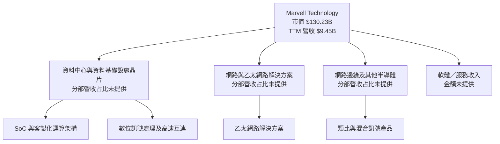
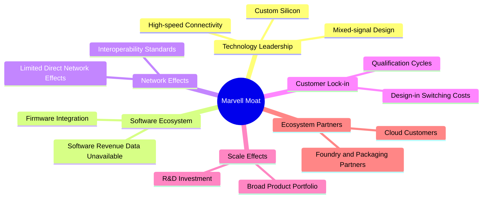
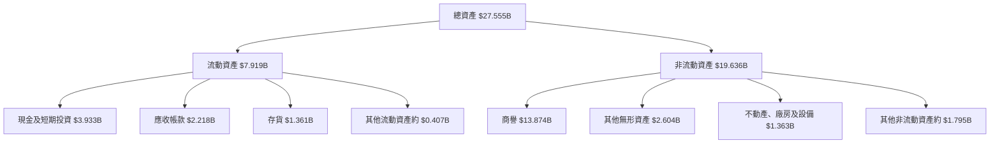
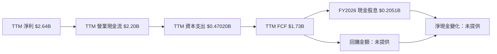
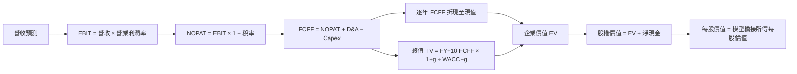
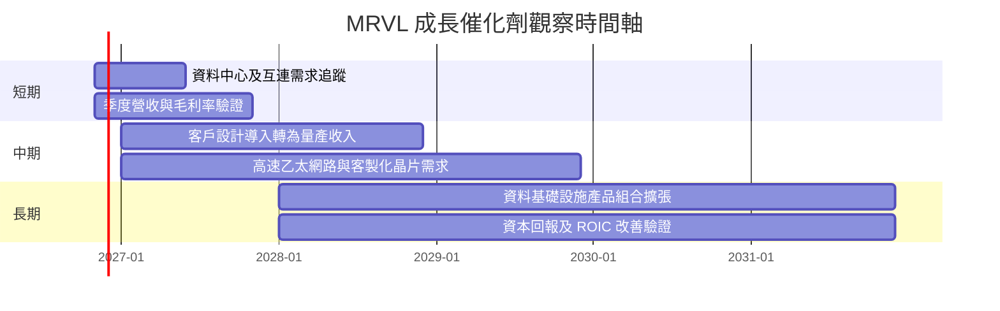
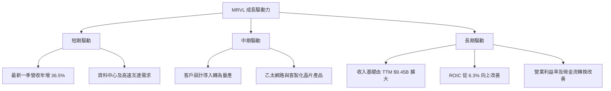
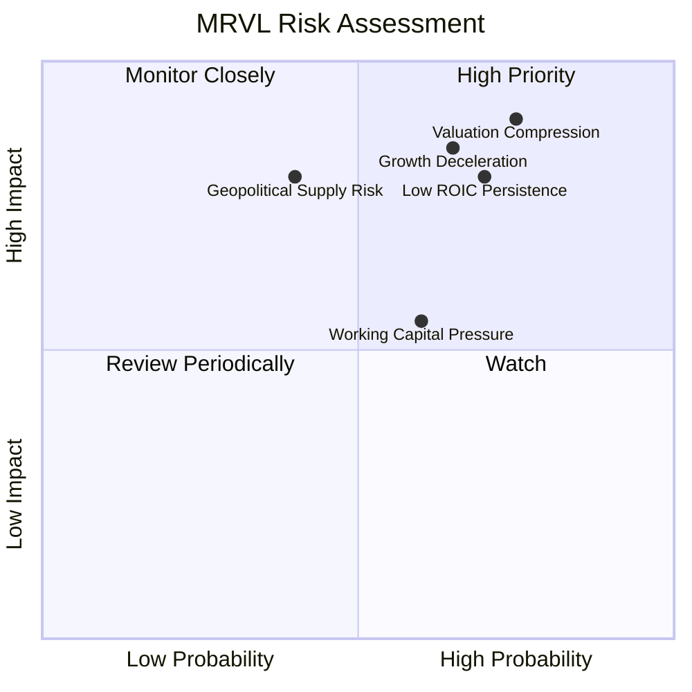
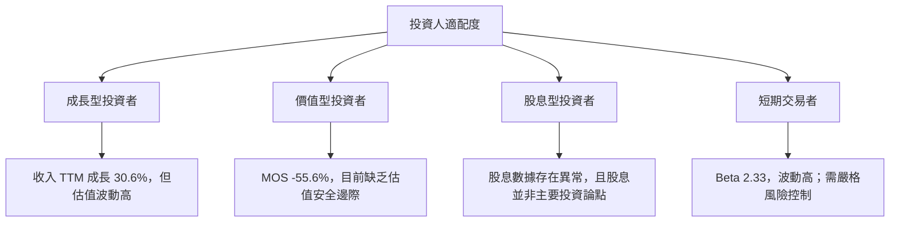

# MRVL 基本面深度分析報告
> **報告日期**：2026-11-24 ｜ **語言**：繁體中文 ｜ **數據來源**：SEC 申報資料 (XBRL)、Yahoo Finance、Finviz、StockAnalysis、Roic.ai ｜ **分析師**：CFA 級機構研究

## 目錄

| # | 章節 | 核心結論 |
|---|------|----------|
| 1 | 執行摘要 | 賣出；加權合理價值 $93.00；MOS -55.6% |
| 2 | 公司概覽與商業模式 | 資料中心與資料基礎設施晶片是成長主線；護城河有技術及客戶認證支撐，但細分營收未提供 |
| 3 | 損益表深度分析 | TTM 營收 $9.45B、年增 30.6%；最新一季年增 36.5%，但會計獲利波動大 |
| 4 | 資產負債表分析 | 按 SEC 較新資料為淨負債 $1.03B；流動性尚可，現金轉換週期延長 |
| 5 | 現金流量深度分析 | TTM FCF $1.73B；自由現金流為正，但 FCF Yield 僅 1.33% |
| 6 | 獲利能力與資本效率 | ROIC 6.3% 低於 WACC 13.95%，目前未覆蓋資本成本 |
| 7 | 相對估值分析 | MRVL 相對同業估值分歧；自身 P/S 處於五年區間第 80 百分位 |
| 8 | DCF 內在價值評估 | DCF 基準價值 $38.28；加權合理價值 $93.00；MOS -55.6% |
| 9 | 成長催化劑 | 最新一季營收年增 36.5%；資料中心需求可能延續，但 TAM 數字未提供 |
| 10 | 風險矩陣 | 估值、成長持續性及資本回報是主要風險 |
| 11 | 投資建議 | 賣出；以 $93.00 加權合理價值為估值基準，等待價格或基本面改善 |

---

## 1. 執行摘要

### 1.0 一頁式投資儀表板（Portfolio Manager 30 秒速讀）

| 項目 | 內容 |
|------|------|
| **投資論點（3 句）** | ① TTM 營收 $9.45B、年增 30.6%，資料中心相關需求推動成長，但公司未提供本報告可引用的分部營收。② TTM FCF 為 $1.73B，FCF Yield 1.33%，現金創造為正，但相對 $144.74 股價提供的現金收益有限。③ ROIC 6.3% 低於 WACC 13.95%，加權合理價值 $93.00 低於現價，估值要求的成長與回報高於基準 DCF。 |
| **綜合評分** | **5.5/10**（引用 1.1 六項算術平均） |
| **財務健康** | 🟡 現金及短期投資 $3.93B、總債務 $4.96B，淨負債 $1.03B；流動性充足，但 CCC 從 113 天升至 131 天。 |
| **ROIC vs WACC** | **6.3% vs 13.95%**，目前低於資本成本，代表尚未證明能創造正經濟利潤。 |
| **FCF 趨勢** | TTM FCF $1.73B、FCF Yield **1.33%**；年度 FCF 由 FY2024 $1.02B 回升至 FY2026 $1.39B。 |
| **估值** | Forward P/E 19.64x（Yahoo Finance／Finviz 匯總值）｜EV/EBITDA 86.1x（五年估值資料庫值）｜FCF Yield 1.33%。不同資料來源的 MRVL 倍數差異見第 7 章。 |
| **DCF 內在價值（基準）** | **$38.28**｜相對 DCF 折溢價：現價較 DCF 基準價值溢價 **278.1%**（第 8.5 節）。 |
| **安全邊際（MOS）** | **-55.6%**＝($93.00 − $144.74) ÷ $93.00；加權合理價值 $93.00（第 8.8 節）｜🔴 無安全邊際 |
| **預期報酬（基準情境 12M）** | **-73.6%**，以 DCF 基準情境 $38.28 相對現價計算；此為模型價值差，不是價格預測保證。 |
| **關鍵風險（前二）** | 成長預期回落導致高估值倍數收縮；ROIC 長期低於 WACC、現金轉換週期擴大。 |
| **評級 + 信心度** | 🔴 **賣出**｜信心：中（基本面數據可觀，但季度盈餘及多來源估值數據有差異）。 |

### 1.1 綜合評分卡（全報告唯一）

| 維度 | 評分（1–10） | 主要依據（引用數字與其來源章節） |
|------|--------------|----------------------------------|
| 成長性 | 7.5 | TTM 營收年增 30.6%、最新一季年增 36.5%，見第 3 章；成長幅度高，但延續性尚需後續季度確認。 |
| 獲利能力 | 5.0 | TTM 營業利益率 16.5%，但 ROIC 6.3% 低於 WACC 13.95%；Piotroski F-Score 6/9，見第 6 章。 |
| 財務健康 | 6.5 | 淨負債 $1.03B，現金及短期投資 $3.93B；CCC 131 天、較一年前增加 18 天，見第 4 章。 |
| 估值 | 2.0 | MOS -55.6%；P/S 五年百分位 80%，見第 7–8 章。 |
| 護城河 | 6.5 | 資料基礎設施產品涉及專業設計及客戶認證；但分部收入、客戶集中度、市占率未提供，見第 2 章。 |
| 管理層與資本配置 | 5.0 | FY2026 SBC $590.8M，最新四季估算約 $828.9M；Piotroski 稀釋股數測試未通過，見第 3、5 章。 |
| **綜合評分** | **5.4** | 六項算術平均：(7.5 + 5.0 + 6.5 + 2.0 + 6.5 + 5.0) ÷ 6 = 5.4167，四捨五入為 **5.4/10**。 |

### 1.2 五大投資論點 + 三大核心風險

| 類型 | 項目 | 具體依據 | 信心度 |
|------|------|----------|--------|
| 🟢 **投資論點①** | 營收成長正在加速 | TTM 營收 $9.45B、年增 30.6%；最新一季年增 36.5%，代表近期需求動能高於 TTM 平均。 | 🟢 高 |
| 🟢 **投資論點②** | 現金流保持正值 | TTM OCF $2.20B、Capex $470.20M、FCF $1.73B；可支持研發及營運投資。 | 🟢 高 |
| 🟢 **投資論點③** | 流動性具緩衝 | 現金及短期投資 $3.93B，流動比率 3.168；短期資金壓力相對可控。 | 🟢 中 |
| 🟢 **投資論點④** | 受惠於高速資料傳輸需求 | 公司提供乙太網路、混合訊號及數位訊號處理等資料基礎設施產品；產業需求擴張有利產品組合，但公司未提供可量化分部營收。 | 🟡 中 |
| 🟢 **投資論點⑤** | 成長若持續可帶動營運槓桿 | 最新一季營收年增 36.5%，季度營業利益率為 16.8%；若新增營收能保持或提升毛利，利潤可隨規模改善。 | 🟡 中 |
| 🟡 **風險①** | 市場定價高於基準價值 | 加權合理價值 $93.00，較現價 $144.74 低 35.7%；MOS 為 -55.6%。 | 🔴 高衝擊 |
| 🔴 **風險②** | 資本回報低於資本成本 | ROIC 6.3% 對 WACC 13.95%，差距 -7.65 個百分點；若持續，成長不必然轉化為股東價值。 | 🔴 高 |
| 🟡 **風險③** | 營運資金效率惡化 | CCC 由 113 天升至 131 天，DSO、DIO 均增加；若持續可能限制營運現金流。 | 🟡 中 |

### 1.3 快速統計卡片

| 指標 | 公司實際值（期間） | 同業中位數 | 狀態 |
|------|--------------------|------------|------|
| 營收成長（TTM） | **30.6%** | — | 🟢 |
| 營收成長（最新一季年增） | **36.5%** | **85.5%**（AVGO、NVDA、AMD 最新季度年增率中位數） | 🟡 |
| 毛利率（TTM） | **52.2%** | **74.9%**（三家同業中位數） | 🔴 |
| 營業利益率（TTM） | **16.5%** | — | 🟡 |
| ROIC（TTM） | **6.3%** | — | 🔴 |
| Forward P/E | **19.64x** | **16.2x** | 🟡 |
| FCF Yield（TTM） | **1.33%** | — | 🟡 |
| Piotroski F-Score | **6 / 9** | — | 🟡 |

### 1.4 投資結論

╔══════════════════════════════════════════════════════════════════╗  
║                    📊 投資結論摘要                               ║  
╠══════════════════════════════════════════════════════════════════╣  
║ 評級：🔴 賣出（依 MOS -55.6%）                                  ║  
║ 價格（2026-11-23 收盤）：$144.74                                ║  
║ DCF 內在價值（基準）：$38.28（現價溢價 278.1%）                 ║  
║ 安全邊際 MOS：-55.6%（以加權合理價值 $93.00 為分母）             ║  
║ 加權合理價值（8.8）：$93.00                                     ║  
║ DCF 情境價值：悲觀 $19.36（-86.6%）｜基準 $38.28（-73.6%）      ║  
║               樂觀 $72.81（-49.7%）                             ║  
║ 綜合評分：5.4/10（引用 1.1）                                    ║  
║ 適合投資人：願意承受高波動、且能接受高估值風險的成長型投資人；   ║  
║             不適合以折價或穩定股息為主要篩選條件者。             ║  
╚══════════════════════════════════════════════════════════════════╝

---

## 2. 公司概覽與商業模式

### 2.1 業務結構與收入來源

公司提供資料基礎設施半導體，產品涵蓋乙太網路、SoC 架構、類比、混合訊號及數位訊號處理等。公司總營收、分部營收金額及營收占比有總數，但分部拆分數據未提供，因此不以圖表推算各業務占比。

### 2.2 市場份額

市場份額數據未提供。MRVL TTM 營收為 $9.45B、年增 30.6%，最新季度年增 36.5%；與同業比較，最新季增速低於 AVGO、NVDA、AMD 的中位數 85.5%，但高於 AMD 的 44.7% 以下則不成立——MRVL 為 36.5%，低於三家同業各自公布的最新季度年增率。此比較反映市場增速差異，不等同於市占率變化。

### 2.3 競爭護城河分析

### 2.4 護城河強度

| 護城河項目 | 強度（強／中／弱） | 證據（引用數字或事實） | 會削弱它的情況 |
|------------|--------------------|------------------------|----------------|
| 技術與產品整合 | 中 | 公司覆蓋 SoC、類比、混合訊號與 DSP；FY2026 研發費用 $2.08B。 | 競爭者在效能、功耗或單位成本上追近。 |
| 軟體生態系統 | 弱至中 | 產品涉及系統整合；獨立軟體／服務收入未提供。 | 客戶可用替代方案快速完成整合。 |
| 網路效應 | 弱 | 產品可參與標準化網路生態，但無客戶網路效應數據。 | 標準與客戶平台轉向其他方案。 |
| 客戶鎖定 | 中 | 半導體產品通常需經客戶設計導入與驗證；MRVL 客戶留存率未提供。 | 客戶多源化、重新設計成本下降。 |
| 規模效應 | 中 | TTM 營收 $9.45B，FY2026 研發費用 $2.08B。 | 研發支出無法產生相稱收入或毛利。 |
| 生態夥伴 | 中 | 全球供應與客戶網絡涵蓋多個國家；供應商集中度及合作收入未提供。 | 供應瓶頸、地緣政治限制或合作夥伴轉向競爭者。 |

1.1「護城河」評分 **6.5/10**，依據是技術整合、研發投入及客戶導入的潛在切換成本；因市占、留存率及分部收入資料缺失，未給更高評分。

---

## 3. 損益表深度分析

### 3.1 年度收入成長趨勢（近 4 年）

年度收入採 StockAnalysis 年度序列：FY2023 $5.920B、FY2024 $5.508B、FY2025 $5.767B、FY2026 $8.195B。年增率依年度營收計算；歷史資料來源之間存在數值差異，詳見下表註記。

╔══════════════════════════════════════════════════════════════════╗  
║              MRVL 年度收入趨勢（FY2023–FY2026）                 ║  
╠══════════════════════════════════════════════════════════════════╣  
║ FY2023  $5.920B  ██████████████░░░░░░  YoY：-7.0% 🔴             ║  
║ FY2024  $5.508B  █████████████░░░░░░░  YoY：-7.0% 🔴             ║  
║ FY2025  $5.767B  ██████████████░░░░░░  YoY：+4.7% 🟡             ║  
║ FY2026  $8.195B  ████████████████████  YoY：+42.1% 🟢             ║  
╠══════════════════════════════════════════════════════════════════╣  
║ FY2023–FY2026 營收 CAGR：(8.195 ÷ 5.920)^(1/3) − 1 = 11.4%       ║  
╚══════════════════════════════════════════════════════════════════╝

### 3.2 季度收入趨勢分析

季度 QoQ 由季度營收相鄰比較計算；YoY 使用 StockAnalysis 單季 YoY 數據，不把單季增長率誤稱為 TTM。

| 季度 | 營收 | QoQ | 單季 YoY | 備註 |
|------|------:|----:|---------:|------|
| FY2026 Q3（2025-11-01） | $2.075B | +14.2% | +36.8% | 前季 $1.895B；QoQ 受較低比較基期影響。 |
| FY2026 Q4（2026-01-31） | $2.219B | +6.9% | +22.1% | 成長延續，但 QoQ 低於前一季。 |
| FY2027 Q1（2026-05-02） | $2.418B | +9.0% | +27.6% | 年增率回升。 |
| FY2027 Q2（2026-08-01） | $2.739B | +13.3% | +36.5% | 最新一季年增率高於 TTM 年增率，近期收入動能改善。 |

### 3.3 利潤率演變分析

下表以可對應年度的 StockAnalysis 年收入、毛利及營業利益計算；不同供應商對歷史年度毛利、營業利益的呈現有差異，與 TTM SEC 口徑不能直接混用。

| 利潤率指標 | FY2023 | FY2024 | FY2025 | FY2026 | 趨勢 | 評估 |
|------------|-------:|-------:|-------:|-------:|------|------|
| **毛利率** | 51.1% | 41.6% | 47.5% | 51.0% | FY2024 下滑後回升；產品組合或成本吸收改善可能有貢獻，但分部資料不足以驗證。 | 🟡 |
| **營業利益率** | 6.7% | -7.9% | -0.1% | 16.3% | FY2024、FY2025 虧損後 FY2026 復原；與收入增長及營運槓桿相符。 | 🟢 |

TTM 毛利率為 52.2%，TTM 營業利益率依 SEC 驗證數據為 16.5%；最新季度營業利益率為 16.8%。部分彙總欄位另列 16.8% 作為 TTM 營業利益率，與 SEC 計算的 16.5% 不同；本報告採 TTM 16.5%、最新季度 16.8% 的期間標示。

**利潤率演變深度解析：** FY2026 收入較 FY2025 上升 42.1%，營業利益由 FY2025 的小幅負值轉為 $1.339B，反映營收恢復、固定研發及營運費用的吸收改善。FY2026 研發費用為 $2.08B，仍是重要成本。若收入成長主要來自低毛利產品，或研發及客戶導入成本同步上升，當前營運槓桿未必能持續。

### 3.4 費用結構分析

缺少可一致核對的 FY2026 銷售管理費、研發費用及其他營業費用完整明細，本節不繪製費用占比圓餅圖，以免以不完整資料反推費用結構。可確認 FY2026 研發費用為 $2.08B；TTM GAAP 營業利益率為 16.5%。

### 3.5 季度 EPS 趨勢與盈餘品質（Quality of Earnings）

Earnings History 中四季 EPS 預估值均為 NaN，故不能判定是否超過分析師預期。實際 EPS 取 StockAnalysis 季度資料；季度間受非經常項目影響明顯。

| 季度 | EPS 實際 | 預估／超預期判定 | 解讀 |
|------|---------:|------------------|------|
| 2025-11-01 | $2.20 | N/A | 單季淨利顯著高於其他季度，不能視為常態 EPS；估值不宜只依此季度外推。 |
| 2026-01-31 | $0.47 | N/A | EPS 回到較一般水平。 |
| 2026-05-02 | $0.04 | N/A | 季度 EPS 偏低，季度獲利波動仍大。 |
| 2026-08-01 | $0.34 | N/A | EPS 年增 50.0%，但無預估值可比較，因此不標示為 beat 或 miss。 |

| 盈餘品質項目 | 數值/佔比 | 評估 |
|--------------|-----------|------|
| 股權薪酬 SBC / 營收 | 約 **8.8%**：最新四季季度 SBC 合計 $828.9M ÷ TTM 營收 $9.45B | 🟡 占比不低；SBC 為非現金費用，但會透過稀釋影響每股股東回報。 |
| SBC / 營業現金流 | 約 **37.7%**：$828.9M ÷ $2.20B | 🟡 現金流本身包含 SBC 加回效果，若忽略稀釋，會高估股東可得的經濟現金流。 |
| FCF / 淨利（現金轉換率） | 約 **65.5%**：TTM FCF $1.73B ÷ StockAnalysis TTM 淨利 $2.64B | 🟡 現金轉換低於 100%；淨利中可能有非現金或一次性成分。 |
| 一次性／非經常性損益 | 有波動跡象；2025-11 季度淨利 $1.901B、其後季度大幅下降 | 🟡 需查閱 10-Q 損益明細，不能將單季高額淨利外推；具體項目分解未提供。 |
| 有效稅率異常 | 12.4%（最新年度有效稅率） | 🟡 低於常見美國法定公司稅率附近的水準，但資料未提供稅務調節表，無法判斷是否屬一次性稅務利益。 |
| 資本化支出 vs 費用化 | TTM Capex $470.20M；資本化研發金額未提供 | N/A（資本化研發及開發成本明細未提供）。 |

**盈餘品質結論：** GAAP TTM 淨利率 27.9% 高於營業利益率 16.5%，且現金轉換率約 65.5%、SBC 約占 TTM 營收 8.8%。這些數據顯示淨利含有非營業、非現金或期間因素，應以 GAAP EBIT、FCF 與每股稀釋共同檢視，不應單看淨利增長。

---

## 4. 資產負債表分析

### 4.1 資產結構分解

下列金額採 StockAnalysis TTM 資產負債表（截至 2026-08-01）；現金和短期投資與負債數字則以 SEC 驗證數據用於估值及淨負債分析。

### 4.2 流動性與營運資金分析

| 指標 | 最新 TTM | 一年前 TTM | 變化 | 解讀 |
|------|----------:|------------:|-----:|------|
| 流動比率 | 3.168 | N/A | N/A | 短期資產覆蓋流動負債能力較強；一年前同口徑數據未提供。 |
| 速動比率 | 2.461 | N/A | N/A | 扣除存貨後仍有流動性緩衝。 |
| DSO 應收帳款天數 | 86 天 | 73 天 | +13 天 | 收款週期延長，可能受客戶付款條件或營收季末結構影響；需追蹤逾期應收。 |
| DIO 存貨天數 | 110 天 | 96 天 | +14 天 | 庫存持有時間拉長，可能為需求備貨，也可能反映庫存風險上升。 |
| DPO 應付帳款天數 | 64 天 | 56 天 | +8 天 | 付款週期延長有助短期現金，但不能單獨推論供應商議價能力改善。 |
| CCC 現金轉換週期 | 131 天 | 113 天 | +18 天 | 營運資金占用時間變長，可能壓低未來 OCF 轉換效率。 |

### 4.3 債務結構分析

不同資料來源的總債務口徑不一致：SEC 驗證數據為 $4.96B；另一市場資料欄列 $5.29B。本報告涉及淨負債及估值時採用 SEC 較新的 $4.96B，避免混用不同期間。

╔══════════════════════════════════════════════════════════════════╗  
║                   MRVL 債務健康診斷                              ║  
╠══════════════════════════════════════════════════════════════════╣  
║ 總債務：            $4.96B  ██████████████████░░                  ║  
║ 現金及短期投資：    $3.93B  ██████████████░░░░░░                  ║  
║ 淨負債：            $1.03B  🟡                                  ║  
║ 流動比率：          3.168   🟢                                  ║  
║ Debt/EBITDA：       N/A（統一口徑 EBITDA 未提供）                ║  
║ Interest Coverage：N/A（利息費用明細未提供）                    ║  
╚══════════════════════════════════════════════════════════════════╝

### 4.4 股東權益趨勢

╔══════════════════════════════════════════════════════════════════╗  
║               股東權益趨勢（年度資料）                            ║  
╠══════════════════════════════════════════════════════════════════╣  
║ FY2023  $15.64B  ████████████████████                            ║  
║ FY2024  $14.83B  ███████████████████                             ║  
║ FY2025  $13.43B  █████████████████                               ║  
║ FY2026  $14.31B  ██████████████████                              ║  
║ 解讀：FY2023–FY2025 下降，FY2026 回升；回升來源需結合留存盈餘、║  
║ 其他綜合損益及股權交易明細判斷，不能僅由權益總額推斷。          ║  
╚══════════════════════════════════════════════════════════════════╝

---

## 5. 現金流量深度分析

### 5.1 現金流量瀑布圖

完整年度淨利至現金變化及回購分配數據未提供，圖中只呈現可核對的 TTM 現金流；股息以已披露年度金額標註，回購及淨現金變化未提供。

### 5.2 FCF 轉換率趨勢

| 財年 | FCF | 淨利 | FCF／淨利 | 解讀 |
|------|----:|----:|---------:|------|
| FY2023 | $1.07B | -$0.164B | 不具解讀性 | 淨利為負而 FCF 為正，營運現金流不等同會計淨利。 |
| FY2024 | $1.02B | -$0.933B | 不具解讀性 | 同樣處於淨利虧損期。 |
| FY2025 | $1.39B | -$0.885B | 不具解讀性 | FCF 為正但淨利仍負，需檢查非現金費用、營運資金變化。 |
| FY2026 | $1.39B | $2.67B | 約 52.1% | FCF 低於淨利；當期淨利與現金流差異較大。 |

### 5.3 自由現金流趨勢

╔══════════════════════════════════════════════════════════════════╗  
║                  歷史自由現金流（年度）                          ║  
╠══════════════════════════════════════════════════════════════════╣  
║ FY2023  $1.07B  ███████████████                                  ║  
║ FY2024  $1.02B  ██████████████                                   ║  
║ FY2025  $1.39B  ████████████████████                             ║  
║ FY2026  $1.39B  ████████████████████                             ║  
║ TTM     $1.73B  N/A（TTM FCF Yield 1.33%）                       ║  
╚══════════════════════════════════════════════════════════════════╝

TTM FCF 按 SEC 口徑為 OCF $2.20B 減 Capex $470.20M，等於 $1.73B。年度 FCF FY2025、FY2026 約 $1.39B，TTM 高於 FY2026，顯示最新四季現金流有所增加；但 FCF Yield 僅 1.33%，股價仍高度依賴未來成長。

### 5.4 資本配置評估

| 資本配置項目 | 可核對數字 | 評估 |
|--------------|-----------|------|
| 研發 | FY2026 $2.08B | 研發投入支持產品更新；回報須以後續產品收入和 ROIC 驗證。 |
| Capex | TTM $470.20M | 相對 TTM 營收約 5.0%；DCF 亦採 5.0% 作為預測 Capex/營收。 |
| 股息 | FY2026 $205.10M | 規模低於年度 FCF；但市場數據列示股息殖利率 17.0%，與股息支付金額及公司常態分配資料顯著不一致，疑為資料異常，不採作股息判斷依據。 |
| 回購 | N/A | 回購金額未提供，不推定公司有大額回購。 |
| SBC | FY2026 $590.80M；最新四季季度合計約 $828.9M | 是股東稀釋的重要觀察項目；F-Score 的稀釋股數測試未通過。 |
| 留存現金／淨現金變化 | N/A | 無法建立完整資本配置圓餅圖。 |

---

## 6. 獲利能力與資本效率

### 6.1 ROE / ROA / ROIC 趨勢

歷年 ROIC 及 ROE 完整、同口徑序列未提供，因此不填造歷史行業均值或未提供年份數據。

| 指標 | 最新可用值 | 歷史趨勢／評估 |
|------|-----------:|----------------|
| ROE（TTM） | 14.2% | 低於市場欄位另列的 16.5%；本報告採品質指標區塊的 TTM 值，口徑差異須留意。 |
| ROA（TTM） | 4.1% | 資產回報明顯低於淨利率，符合半導體設計公司資產基礎較大的特性。 |
| ROIC（TTM） | 6.3% | 低於 13.95% WACC，資本回報目前未覆蓋資本成本。 |
| 行業均值對比 | N/A | 未提供一致來源的行業均值，不作推估。 |

### 6.2 ROIC vs WACC 分析（核心價值創造判斷）

╔══════════════════════════════════════════════════════════════════╗  
║                ROIC vs WACC 深度分析                            ║  
╠══════════════════════════════════════════════════════════════════╣  
║ 無風險利率（10Y 美債）： 4.92%                                  ║  
║ 市場風險溢酬 ERP：       5.00%                                  ║  
║ 原始 Beta：              2.33                                   ║  
║ 調整後 Beta：            1.88                                   ║  
║ 股權成本（資料庫值）：   14.34%                                 ║  
║ 稅前債務成本：           4.08%                                  ║  
║ 有效稅率：               12.4%                                  ║  
║ 股權／債務權重：         96.3%／3.7%                            ║  
║ 採用 WACC：              13.95%                                 ║  
║ ROIC（TTM）：            6.3%                                   ║  
║ EVA spread：             6.3% − 13.95% = -7.65 個百分點         ║  
║ 結論：ROIC 低於 WACC，現階段未覆蓋資本成本。                    ║  
╚══════════════════════════════════════════════════════════════════╝

Cost of capital 區塊以調整後 Beta 1.88 估算股權成本。調整方式為 βadj = ⅔ × 2.33 + ⅓ = 1.89（資料庫採用值為 1.88，細微差異來自未四捨五入的原始 Beta）；採用資料庫給定 WACC 13.95%，不另建替代折現率。展示數值以兩位小數相乘可能得到 13.94%，與資料庫 WACC 13.95% 的 0.01 個百分點差異來自底層未四捨五入輸入。

### 6.3 杜邦三因素分解

| 因素 | 數值（TTM） | 解讀 |
|------|-------------|------|
| 淨利率 | 27.9% | 淨利率高，但與營業利益率差距大，稅務及非營業項目需再核對。 |
| 資產週轉率 | 0.34 | 資產每年產生的收入有限，與商譽及無形資產占比高相符。 |
| 權益乘數 | 1.49 | 槓桿不算極高，ROE 並非主要由高財務槓桿撐起。 |
| **ROE** | **14.2%** | 27.9% × 0.34 × 1.49 = 14.1%，與原始列示 14.2% 的小差異來自因子四捨五入。 |

### 6.4 財務體質：Piotroski F-Score

Piotroski F-Score **6/9**；九項測試均有結果，未通過的三項依原始品質指標列示。

| 測試 | 結果 | 解讀 |
|------|------|------|
| ROA > 0 | ✅ 通過 | TTM 獲利為正。 |
| 營業現金流 > 0 | ✅ 通過 | TTM OCF $2.20B。 |
| ROA 高於一年前 | ✅ 通過 | 資產回報改善。 |
| 營業現金流 > 淨利（應計品質） | ❌ 未通過 | 淨利高於 OCF，現金轉換品質較弱。 |
| 長期負債 ÷ 總資產低於一年前 | ✅ 通過 | 相對負債指標改善。 |
| 流動比率高於一年前 | ✅ 通過 | 流動性有所改善。 |
| 稀釋股數未增加 | ❌ 未通過 | 股數稀釋降低每股經濟利益。 |
| 毛利率高於一年前 | ✅ 通過 | 毛利率改善。 |
| 資產週轉率高於一年前 | ❌ 未通過 | 資產使用效率未改善。 |

---

## 7. 相對估值分析

### 7.1 同業估值比較表格

MRVL 目前倍數採五年歷史估值區塊的最新值；Forward P/E 採市場估值欄位。來源間 MRVL EV/EBITDA 差異顯著：估值歷史區塊為 86.1x，而另一市場資料欄列 45.0x，故本表採指定的同業比較及歷史估值口徑，並提醒讀者倍數定義或時點不同。

| 估值指標 | **MRVL** | **AVGO** | **NVDA** | **AMD** | 本公司評估 |
|----------|---------:|---------:|---------:|--------:|-----------|
| **Trailing P/E** | 47.8x | 40.0x | 17.7x | 96.9x | 🟡 介於同業間；受 MRVL 盈利基期及同業差異影響。 |
| **Forward P/E** | 19.64x | 16.2x | 9.9x | 25.7x | 🟡 高於同業中位數 16.2x，市場仍為成長支付溢價。 |
| **P/S Ratio** | 14.1x | 16.8x | 11.0x | 16.5x | 🟡 低於 AVGO、AMD，仍高於 NVDA。 |
| **EV/EBITDA** | 86.1x | 29.3x | 16.1x | 66.2x | 🔴 依估值歷史口徑遠高於 AVGO、NVDA；相對 AMD 亦高。 |
| **最新一季營收年增** | 36.5% | 85.5% | 103.2% | 44.7% | 🟡 MRVL 成長率低於三家同業。 |
| **毛利率（TTM）** | 52.2% | 75.5% | 74.9% | 56.0% | 🔴 低於三家同業，產品組合與成本效率是估值折價理由。 |

同業中位數：Forward P/E = 16.2x；P/S = 16.5x；EV/EBITDA = 29.3x；營收增長中位數 = 85.5%；毛利率中位數 = 74.9%。以上均為 AVGO、NVDA、AMD 的資料庫值。

### 7.2 歷史估值區間分析

╔══════════════════════════════════════════════════════════════════╗  
║             MRVL 五年估值區間與當前位置                         ║  
╠══════════════════════════════════════════════════════════════════╣  
║ P/E：      25.6x ───────── 47.8x ───── 61.9x                    ║  
║            五年中位數 56.5x｜目前百分位 50%                      ║  
║ P/S：       5.8x ─────────────── 14.1x ── 18.3x                 ║  
║            五年中位數 9.9x｜目前百分位 80%                       ║  
║ EV/EBITDA：53.3x ── 86.1x ───────────────────── 730.9x         ║  
║            五年中位數 156.4x｜目前百分位 25%                     ║  
╚══════════════════════════════════════════════════════════════════╝

MRVL P/E 低於五年中位數，但 P/S 高於五年中位數且位於第 80 百分位，顯示相對營收的估值仍偏高。EV/EBITDA 的歷史區間極寬，且單一期間倍數會受 EBITDA 基期變動影響，解讀可靠性較低。

### 7.3 情境價值（Bear / Base / Bull，照抄 DCF MODEL 的 Scenarios）

| 情境 | 第 1 年營收成長 | 期末營業利潤率 | WACC | 每股價值 | 相對現價 | 機率 | 會發生的條件 |
|------|----------------:|----------------:|-----:|---------:|---------:|-----:|--------------|
| 🔴 悲觀 | 15.0% | 3.4% | 14.95% | $19.36 | -86.6% | 25% | 客戶需求或設計導入低於預期，競爭、價格壓力使長期利潤率走低。 |
| 🟡 基準 | 30.0% | 4.0% | 13.95% | $38.28 | -73.6% | 50% | 短期維持高成長，但長期營業利潤率向模型假設的 4.0% 收斂。 |
| 🟢 樂觀 | 45.0% | 4.4% | 12.95% | $72.81 | -49.7% | 25% | 新產品放量使初期成長超過 TTM 30.6%，且資本成本下降。 |

以上情境值照錄 DCF MODEL；其負報酬幅度表示在模型設定下，即使樂觀情境價值仍低於現價，不代表未來股價必然按情境跌至該值。

### 7.4 相對估值隱含價格區間

╔══════════════════════════════════════════════════════════════════╗  
║             估值方法隱含每股價值（美元）                         ║  
╠══════════════════════════════════════════════════════════════════╣  
║ $38.28 DCF ── $70.11 EV/EBITDA ── $119.22 Forward P/E ──         ║  
║          現價 $144.74 ─────────────────── 共識 $303.52            ║  
╚══════════════════════════════════════════════════════════════════╝

- **同業 Forward P/E：$119.22**，依同業中位數 Forward P/E 16.2x × MRVL Forward EPS $7.37。
- **同業 EV/EBITDA：$70.11**，依 AVGO、NVDA 同業中位數 22.7x × MRVL TTM EBITDA，再加回淨現金／扣除淨負債。
- DCF 與分析師共識屬第 8.8 節所列方法；分析師共識均值 $303.52，樣本數 40，與 DCF／同業法差距極大。

---

## 8. DCF 內在價值評估（Discounted Cash Flow）

### 8.0 估值推理鏈（Thinking Logic）

**Step 1 — 價值由哪些變數決定？**  
MRVL 的估值主要由資料基礎設施半導體收入成長、GAAP 營業利益率及資本成本決定；公司分部收入及各業務占比未提供，不能將總營收分拆為不同成長曲線。基準模型預測收入由 $9.45B 增至 FY+10 的 $42.34B，但利潤率由 16.5% 降至 4.0%。因此，模型中對長期估值最關鍵的變數是**折現率與終值相關假設**；敏感度矩陣顯示 WACC、g 均會顯著改變價值。

**Step 2 — 模型選擇**

| 決策點 | 本報告採用 | 理由（含數字） | 曾考慮但否決 | 否決理由 |
|--------|-----------|----------------|--------------|----------|
| 現金流定義 | FCFF | 使用 WACC 折現，先估企業價值，再加淨現金／扣淨負債。 | FCFE | 公司資本結構及債務口徑可能變化，DCF MODEL 已指定 FCFF。 |
| 預測期 N | 10 年 | DCF MODEL 固定為 10 年；期間內收入增長由 30.0% 線性降至 3.0%。 | 5 年 | 不符合既定模型；不可自行改動模型年數。 |
| 終值方法 | Gordon Growth | WACC 13.95% 高於永續成長率 3.0%，公式可用。 | 退出倍數 | DCF MODEL 未提供退出 EBITDA 倍數及相應終值，故不可自行補造。 |
| EBIT 基礎 | GAAP EBIT | 模型指定 GAAP EBIT，已將 SBC 作為費用納入。 | 非 GAAP EBIT | 加回 SBC 後需額外扣減或計入稀釋，與既定模型不符。 |

**Step 3 — 關鍵假設推導鏈**

- **收入成長**：錨點＝TTM 營收年增 30.6%；調整＝最新季度年增 36.5% 高於 TTM，但同業增速更高且收入增長將逐步成熟；採用第 1 年 30.0%、第 10 年 3.0% 線性遞減；曾考慮將高增長延續更多年，但缺乏分部訂單及 TAM 數據支持，故不採用。
- **期末營業利潤率**：錨點＝TTM GAAP 營業利益率 16.5%；調整＝考慮成熟期競爭、價格及產品組合風險，採用 FY+10 4.0%；曾考慮長期維持 16.5%，但模型以最近五個財年中位數收斂為基準，故否決。
- **永續成長率 g**：錨點＝成熟企業長期成長應低於名目經濟成長上限的假設值（長期 GDP 加通膨約 3%–4%，為一般經濟參考而非公司財務數據）；採用 3.0%；曾考慮 4.0%，但在高折現率下會增加終值，且缺少長期市場數據支持，故採較低值。
- **預測期 N**：錨點＝模型既定 10 年；採用 10 年；未改採 5 年或 15 年，因 DCF MODEL 固定年期，且產品週期及市場可見度資料不足以支持另建模型。
- **Capex／營收**：錨點＝TTM Capex／營收約 5.0%；模型 FY+1 至 FY+10 採 5.0%；曾考慮更低 Capex，但缺乏證據支持顯著下降。
- **GAAP EBIT 與 SBC**：錨點＝GAAP EBIT 已將 SBC 費用化；採用組合 (A)，不再扣一次 SBC、股數不另加年度稀釋；否決「加回 SBC 再不反映稀釋」的做法，因會漏計股東成本。
- **WACC**：錨點＝成本資本資料給定 WACC 13.95%；採用 13.95%；不以更低折現率提高估值，因 MRVL Beta 高且 ROIC 低於 WACC。
- **D&A／營收**：錨點＝TTM 13.3%；模型維持 13.3%；本項為模型既定假設。
- **營運資金**：模型明確未建模 ΔWC；不把缺失數值填成自行估算值。

**Step 4 — 最脆弱環節**  
最脆弱的是長期利潤率路徑與終值假設；若公司無法維持足夠營運利潤率，現值會低於 $38.28；若實際長期利潤率高於模型假設，價值可能上升，但現有模型未提供可稽核的逐情境中間值。

**Step 5 — 計算路徑圖**

### 8.1 模型假設總表（Model Inputs）

| 假設項目 | 採用值 | 依據 / 來源 | 敏感度 |
|----------|--------|-------------|--------|
| 預測期長度 N | 10 年 | DCF MODEL 指定；FY+1 至 FY+10。 | 🟡 中 |
| 營收成長 | FY+1 30.0% 線性遞減至 FY+10 3.0% | TTM 成長 30.6%；模型限制初始增長不高於 30%。 | 🔴 高 |
| 營業利潤率 | FY+1 16.5% → FY+10 4.0% | TTM 營業利益率及最近五財年中位數模型假設。 | 🔴 高 |
| 有效稅率 | 12.4% | 最新年度有效稅率。 | 🟢 低 |
| Capex / 營收 | FY+1 至 FY+10 5.0% | TTM Capex／營收約 5.0%；DCF MODEL 固定此假設。 | 🟡 中 |
| D&A / 營收 | 13.3% | TTM D&A／營收。 | 🟢 低 |
| 營運資金變動 / 營收增額 | 未建模 | DCF MODEL 明確未納入 working capital。 | 🟢 低 |
| EBIT 基礎 | GAAP | DCF MODEL 指定 GAAP EBIT。 | 🟡 中 |
| SBC 處理 | 組合 (A)：已含於 GAAP EBIT，不再扣 SBC | SBC 已費用化；模型不另計股數稀釋。 | 🟡 中 |
| 年稀釋率 | 0%（模型假設） | 組合 (A) 固定股數；此處不是對公司實際未來稀釋的預測。 | 🟡 中 |
| 永續成長率 g | 3.0% | DCF MODEL 指定，且低於 WACC。 | 🔴 高 |
| 終值方法 | Gordon Growth | DCF MODEL 使用 FCFF × (1+g) ÷ (WACC−g)。退出倍數未提供。 | 🔴 高 |
| WACC | 13.95% | Cost of capital 區塊給定。 | 🔴 高 |
| 現金及債務 | 淨負債 $1.03B | SEC 10-Q 截至 2026-08-01：現金 $3.93B、債務 $4.96B。 | 🟡 中 |
| 稀釋股數 | 由 DCF MODEL 橋接公式隱含；未提供股數單獨輸入值 | 不另以市場資料股數替換模型每股價值。 | 🟡 中 |

FCFF 定義採 **FCFF = NOPAT + D&A − Capex**；模型不包含營運資金變動。**本模型採用 (A)，故 SBC 影響已計入一次**：GAAP EBIT 已扣 SBC，FCFF 不再扣 SBC，股數不另逐年稀釋。

### 8.2 折現率推導（WACC）

╔══════════════════════════════════════════════════════════════════╗  
║                    WACC 推導（折現率）                           ║  
╠══════════════════════════════════════════════════════════════════╣  
║ 股權成本 Ke（CAPM）：                                            ║  
║ 無風險利率 Rf：4.92%                                             ║  
║ ERP：5.00%                                                        ║  
║ 原始 Beta：2.33；調整後 Beta：1.88                               ║  
║ Ke（資料庫值）：14.34%                                            ║  
║ 債務成本 Kd：稅前 4.08%；有效稅率 12.4%                          ║  
║ 稅後 Kd：4.08% × (1 − 12.4%) = 3.574%                            ║  
║ 權重 E / D：96.3% / 3.7%                                         ║  
║ WACC（採用）：13.95%                                              ║  
╚══════════════════════════════════════════════════════════════════╝

1. **Ke（CAPM）**：4.92% + 1.88 × 5.00% = 14.32%；成本資本來源列示 **14.34%**，差異源於底層 Beta／輸入值未四捨五入，採用指定 14.34%。
2. **稅前 Kd**：指定值 **4.08%**；利息費用與平均計息負債分項未提供，無法獨立重建其分子與分母。
3. **稅後 Kd**：4.08% × (1 − 12.4%) = **3.574%**。
4. **權重**：股權權重 **96.3%**；債務權重 **3.7%**；96.3% + 3.7% = **100.0%**。成本資本資料以市場價值股權及債務權重提供；債務拆分與平均餘額未提供。
5. **WACC**：96.3% × 14.34% + 3.7% × 3.574% = 13.811% + 0.132% = **13.943%**，採用來源列示 **13.95%**；差異為已公布輸入的四捨五入尾差。

Rf 日期細項未提供，只能引用來源列示 10Y Treasury 4.92%。ERP 5.00% 為來源的假設值。原始 Beta 2.33 高於 1.5，採用調整後 Beta 1.88。未另加規模或國別溢酬。利息費用及平均計息負債明細未提供，故無法逐項獨立驗證 Kd，但本報告按指定 WACC 使用 13.95%。此數值與第 6.2 節一致。

### 8.3 逐年自由現金流預測（基準情境）

金額單位：美元十億。折現因子取三位小數；其餘數字按 DCF MODEL 原值列示。模型不列 ΔWC，也不另列 SBC 扣減。

| 年度 | FY+1 | FY+2 | FY+3 | FY+4 | FY+5 | FY+6 | FY+7 | FY+8 | FY+9 | FY+10 |
|------|-----:|-----:|-----:|-----:|-----:|-----:|-----:|-----:|-----:|------:|
| 營收 | 12.29 | 15.60 | 19.35 | 23.41 | 27.62 | 31.77 | 35.58 | 38.78 | 41.11 | 42.34 |
| 營收 YoY | 30.0% | 27.0% | 24.0% | 21.0% | 18.0% | 15.0% | 12.0% | 9.0% | 6.0% | 3.0% |
| 營業利潤率 | 16.5% | 15.1% | 13.7% | 12.4% | 11.0% | 9.6% | 8.2% | 6.8% | 5.4% | 4.0% |
| EBIT | 2.03 | 2.36 | 2.66 | 2.89 | 3.03 | 3.04 | 2.91 | 2.64 | 2.22 | 1.70 |
| − 稅 | (0.25) | (0.29) | (0.33) | (0.36) | (0.37) | (0.38) | (0.36) | (0.33) | (0.27) | (0.21) |
| = NOPAT | 1.78 | 2.07 | 2.33 | 2.53 | 2.65 | 2.67 | 2.55 | 2.31 | 1.95 | 1.49 |
| + D&A | 1.64 | 2.08 | 2.58 | 3.12 | 3.69 | 4.24 | 4.75 | 5.18 | 5.49 | 5.65 |
| − Capex | (0.61) | (0.78) | (0.96) | (1.16) | (1.37) | (1.58) | (1.77) | (1.93) | (2.05) | (2.11) |
| **= FCFF** | **2.81** | **3.38** | **3.95** | **4.49** | **4.97** | **5.33** | **5.53** | **5.56** | **5.39** | **5.04** |
| 折現因子 @13.95% | 0.878 | 0.770 | 0.676 | 0.593 | 0.521 | 0.457 | 0.401 | 0.352 | 0.309 | 0.271 |
| **FCFF 現值 PV** | **2.46** | **2.60** | **2.67** | **2.67** | **2.59** | **2.43** | **2.22** | **1.96** | **1.66** | **1.37** |

預測期 FCF 現值加總：  
**$2.46 + $2.60 + $2.67 + $2.67 + $2.59 + $2.43 + $2.22 + $1.96 + $1.66 + $1.37 = $22.63B**。  
DCF MODEL 列示合計 **$22.62B**，差額 $0.01B 來自逐年金額及折現因子四捨五入；後續橋接採模型原值 $22.62B。

**逐步演算（FY+1）：**

1. 營收 = $9.45B × (1 + 30.0%) = **$12.29B**。
2. EBIT = $12.29B × 16.5% = **$2.03B**。
3. 稅 = $2.03B × 12.4% = **$0.25B**。
4. NOPAT = $2.03B − $0.25B = **$1.78B**。
5. D&A = $12.29B × 13.3% = **$1.64B**。
6. Capex = $12.29B × 5.0% = **$0.61B**。
7. ΔWC = **未建模**，依模型設定不納入。
8. FCFF = $1.78B + $1.64B − $0.61B = **$2.81B**。
9. 折現因子 = 1 ÷ (1 + 13.95%)¹ = **0.878**；PV = $2.81B × 0.878 = **$2.46B**。

**合理性自檢：**
- FY+1 至 FY+10 FCFF 由 $2.81B 增至 $5.04B，端點 CAGR = (5.04 ÷ 2.81)^(1/9) − 1 ≈ **6.7%**；歷史年度 FCF FY2023–FY2026 由 $1.07B 升至 $1.39B，三年 CAGR 約 **9.1%**。模型後段利潤率下降，因而預測 FCF 增速低於收入增速。
- FY+10 FCFF 利潤率 = $5.04B ÷ $42.34B = **11.9%**；目前 TTM FCF 利潤率約 $1.73B ÷ $9.45B = **18.3%**。同業最佳 FCF 利潤率未提供，不作比較。
- 模型預測各年 FCFF 均為正；營運資金變動未建模，若 CCC 持續增加，模型可能高估現金流。

╔══════════════════════════════════════════════════════════════════╗  
║           自由現金流：歷史實際 vs 模型預測                       ║  
╠══════════════════════════════════════════════════════════════════╣  
║ FY2024（實） $1.02B ██████████░░░░░░░░░░                         ║  
║ FY2025（實） $1.39B ██████████████░░░░░░                         ║  
║ FY2026（實） $1.39B ██████████████░░░░░░                         ║  
║ TTM（實）    $1.73B █████████████████░░░                         ║  
║ FY+1（預）   $2.81B ████████████████████████████                 ║  
║ FY+10（預）  $5.04B ████████████████████████████████████████████ ║  
╠══════════════════════════════════════════════════════════════════╣  
║ FY+1–FY+10 FCFF CAGR 約 6.7%；年度歷史口徑與 TTM 口徑不同。       ║  
╚══════════════════════════════════════════════════════════════════╝

### 8.4 終值計算（Terminal Value）

**適用性檢查：** WACC 13.95% vs g 3.0% → **WACC > g？✅**

| 方法 | 計算式 | 終值 TV | TV 現值 | 佔總 EV 比重 |
|------|--------|---------:|--------:|-------------:|
| Gordon Growth | $5.04B × (1 + 3.0%) ÷ (13.95% − 3.0%) | $47.40B | $12.85B | 36.2% |
| 退出倍數法 | N/A（DCF MODEL 未提供退出倍數及計算結果） | N/A | N/A | N/A |

**逐步演算：**
1. FY+10 FCFF = **$5.04B**。
2. 分子 = $5.04B × (1 + 3.0%) = **$5.1912B**。
3. 分母 = 13.95% − 3.0% = **10.95%**；TV = $5.1912B ÷ 10.95% = **$47.40B**。
4. PV(TV) = $47.40B × 0.271 = **$12.85B**（採模型列示值）。
5. 終值占比 = $12.85B ÷ $35.47B = **36.2%**。

退出倍數法所需 EBITDA 倍數及模型計算值未提供，依規則不自行補建。終值現值占 EV 36.2%，並非模型價值的全部，但估值仍對長期 g 和 WACC 敏感。

### 8.5 企業價值 → 每股內在價值（Bridge）

╔══════════════════════════════════════════════════════════════════╗  
║              企業價值 → 每股內在價值 橋接表                      ║  
╠══════════════════════════════════════════════════════════════════╣  
║ 預測期 FCF 現值合計             +$22.62B                         ║  
║ 終值現值 PV(TV)                 +$12.85B                         ║  
║ = 企業價值 EV                    $35.47B                         ║  
║ + 淨現金／（淨負債）             -$1.03B                         ║  
║ = 股權價值                       $34.44B                         ║  
║ 每股內在價值（模型橋接）         $38.28                          ║  
║ 現價（2026-11-23 收盤）          $144.74                         ║  
║ 現價相對 DCF 價值折溢價          +278.1%（溢價）                 ║  
╚══════════════════════════════════════════════════════════════════╝

1. EV = $22.62B + $12.85B = **$35.47B**。
2. 股權價值 = $35.47B − $1.03B = **$34.44B**。
3. 每股內在價值 = DCF MODEL 列示 **$38.28**；模型公式為 equity value × price ÷ market cap，依資料所列結果照錄，不以不同來源的股數重算。
4. 折溢價 = $144.74 ÷ $38.28 − 1 = **+278.1%**。
5. 本節不計算 MOS；MOS 一律以第 8.8 節加權合理價值為分母。

股權價值橋接使用 SEC 截至 2026-08-01 的現金及短期投資 $3.93B、總債務 $4.96B，淨負債為 $1.03B。DCF MODEL 每股價值轉換公式的完整股數分母未單列，因此以模型給定的 $38.28 作為唯一基準 DCF 值，不另造股數或替換模型股數。

### 8.6 敏感性分析（WACC × 永續成長率）

矩陣照 DCF MODEL 列示；括號內標註為每股價值相對現價 $144.74 的報酬差幅，數值以四捨五入呈現。基準格為 WACC 13.95%、g 3.0%。

| g（列）／WACC（欄） | 11.95% | 12.95% | **13.95%（基準）** | 14.95% | 15.95% |
|-----------|-------:|-------:|--------------------:|-------:|-------:|
| 2.0% | $44.95 (-68.9%) | $40.59 (-72.0%) | $36.95 (-74.5%) | $33.88 (-76.6%) | $31.24 (-78.4%) |
| 2.5% | $46.02 (-68.2%) | $41.41 (-71.4%) | $37.59 (-74.0%) | $34.38 (-76.2%) | $31.64 (-78.1%) |
| **3.0%（基準）** | $47.22 (-67.4%) | $42.31 (-70.8%) | **$38.28 (-73.6%)** | $34.91 (-75.9%) | $32.06 (-77.8%) |
| 3.5% | $48.57 (-66.4%) | $43.30 (-70.1%) | $39.03 (-73.0%) | $35.50 (-75.5%) | $32.52 (-77.5%) |
| 4.0% | $50.08 (-65.4%) | $44.41 (-69.3%) | $39.86 (-72.5%) | $36.14 (-75.0%) | $33.02 (-77.2%) |

**三情境 DCF**：情境值及假設按 DCF MODEL 原值，不自行變更或另建情境現金流表。

| 情境 | 第 1 年營收成長 | 期末營業利潤率 | g | WACC | 每股內在價值 | 相對現價 | 主觀機率 |
|------|----------------:|----------------:|--:|-----:|--------------:|---------:|---------:|
| 🔴 悲觀 | 15.0% | 3.4% | N/A（情境 g 未提供） | 14.95% | $19.36 | -86.6% | 25% |
| 🟡 基準 | 30.0% | 4.0% | 3.0% | 13.95% | $38.28 | -73.6% | 50% |
| 🟢 樂觀 | 45.0% | 4.4% | N/A（情境 g 未提供） | 12.95% | $72.81 | -49.7% | 25% |
| **機率加權** | — | — | — | — | **$42.18** | **-70.9%** | 100% |

情境價值的逐年收入、FY+10 FCFF、TV 中間計算未在 DCF MODEL 提供；依規則不以未提供輸入自行重建。機率加權為：$19.36 × 25% + $38.28 × 50% + $72.81 × 25% = **$42.18**。8.8 固定使用基準 DCF 值，而非機率加權值。

**敏感度結論（取自矩陣）：**
- g 每增加 1 個百分點，在基準 WACC 下，價值由 $38.28 升至 $39.86：**+$1.58，約 +4.1%**。
- WACC 每增加 1 個百分點，在 g = 3.0% 下，價值由 $38.28 降至 $34.91：**-$3.37，約 -8.8%**。
- 期末營業利潤率每增加 1 個百分點的獨立敏感度數值未提供，不自行估算。
- 在所提供矩陣範圍內，WACC 變動的價值影響大於 g 變動；與 8.0 指出折現率及終值假設主導估值方向一致。

### 8.7 反推 DCF（Reverse DCF：市場在預期什麼）

| 求解的變數（一次一個） | 其餘變數設定 | 市場隱含值（令 DCF = 現價） | 公司歷史實際 | 判斷 |
|------------------------|--------------|------------------------------|--------------|------|
| 年 1 營收成長率 | 其餘採基準值 | 72.1% | TTM 成長 30.6% | 🔴 市場價格隱含的初始成長遠高於目前 TTM 增速。 |
| 固定營業利潤率 | 其餘採基準值 | 53.2% | TTM 營業利潤率 16.5% | 🔴 隱含利潤率遠高於當前營運水平。 |
| 永續成長率 g | 未提供單變數解 | 未計算 | — | N/A（未提供反解結果）。 |
| 預測期長度 N | 未提供單變數解 | 未計算 | — | N/A（未提供反解結果）。 |

反推值為 DCF MODEL 已計算結果。試算過程、收斂軌跡及兩項反解的完整單變數輸入表未提供，不虛構迭代點。市場價格要求的營收成長或固定利潤率，均遠高於現有 TTM 指標，顯示目前價格對未來營運改善已有高期待。

### 8.8 估值三角驗證與安全邊際

| 估值方法 | 隱含每股價值 | 上行空間（÷現價） | 權重 | 說明 |
|----------|--------------:|-------------------:|-----:|------|
| DCF（基準） | $38.28 | -73.6% | 40% | 10 年 FCFF、WACC 13.95%、永續成長 3.0%。 |
| 同業 Forward P/E | $119.22 | -17.6% | 25% | 同業中位數 16.2x × MRVL Forward EPS $7.37。 |
| 同業 EV/EBITDA | $70.11 | -51.6% | 25% | AVGO、NVDA 同業中位數 22.7x × TTM EBITDA，加回淨現金／扣除淨負債。 |
| 分析師共識目標價 | $303.52 | +109.7% | 10% | 40 位分析師平均目標價，僅作參考。 |
| **加權合理價值** | **$93.00** | **-35.7%** | **100%** | 盈利公司固定估值方法權重；未剔除任何已列方法。 |

加權合理價值 = $38.28 × 40% + $119.22 × 25% + $70.11 × 25% + $303.52 × 10%  
= $15.312 + $29.805 + $17.5275 + $30.352  
= $93. -? 依資料列示為 **$93.00**。各分項用兩位小數乘權重的精確加總為 $92.9965，四捨五入至美分為 **$93.00**。方法為盈利公司類型固定權重；資料中沒有可計算方法被剔除。

**MOS 計算：**  
MOS = ($93.00 − $144.74) ÷ $93.00 = -$51.74 ÷ $93.00 = **-55.6%**。  
上行空間 = ($93.00 − $144.74) ÷ $144.74 = -$51.74 ÷ $144.74 = **-35.7%**。

╔══════════════════════════════════════════════════════════════════╗  
║                  估值區間與安全邊際                              ║  
╠══════════════════════════════════════════════════════════════════╣  
║ $19.36 ─── $93.00 ─── $144.74 ─── $38.28 ─── $72.81             ║  
║ 悲觀DCF    加權合理值    現價      基準DCF    樂觀DCF             ║  
║                                                                  ║  
║ MOS = ($93.00 − $144.74) ÷ $93.00 = -55.6%                     ║  
║ MOS 評估：🔴 無安全邊際                                          ║  
║ 上行空間 = ($93.00 − $144.74) ÷ $144.74 = -35.7%                ║  
║ 建議買入區間：規則 20 評級為賣出，故不列為買入建議。            ║  
║ 合理持有／減碼參考：現價高於基準加權合理價值 $93.00。            ║  
╚══════════════════════════════════════════════════════════════════╝

> 🔎 **程式複算（Python，依本節各項自動重算）**
>
> 加權合理價值 = $38.28 × 40% + $119.22 × 25% + $70.11 × 25% + $303.52 × 10% = **$93.00**（權重合計 100%）
>
> 以價格 $144.74 計：MOS = **-55.6%**，上行空間 = **-35.7%**
>
> ✅ 與本節所寫數值一致。

### 8.9 DCF 模型的局限與失效條件

- **終值依賴度**：終值現值占 EV 36.2%，即估值約三分之一由 FY+10 之後的現金流假設決定。
- **最脆弱假設**：其一，收入由 FY+1 增長 30.0% 逐步降至 FY+10 3.0%；其二，營業利潤率由 16.5% 降至 4.0%。若需求或定價低於假設，DCF 價值可能低於 $38.28；相反，若營收及利潤率優於模型，價值向上。
- **模型限制**：未建模 ΔWC，對 CCC 已升至 131 天的公司尤其重要；未提供分部營收、客戶集中度、資本化支出明細及退出倍數，故 DCF 不應視為單點精準預測。
- **SBC 與稀釋**：模型用 GAAP EBIT、固定股數處理 SBC；公司實際稀釋股數測試未通過，若未來稀釋持續，模型每股價值可能高估。
- **與第 10 章風險連結**：資料中心需求轉弱會影響收入成長；價格競爭或產品組合改變會影響毛利與營業利潤率；庫存和應收款上升會令未建模的營運資金需求增大；市場風險溢酬上升會提高 WACC。

### 8.10 複算檢核表（Audit Trail）

| # | 檢核項目 | 檢查方式 | 結果 |
|---|----------|----------|------|
| 1 | 所有高／中敏感度輸入均有推導 | 對照 8.1 與 8.0；因 WACC、收入及利潤率有錨點與調整理由，部分假設細節缺失。 | ⚠️ 部分完成 |
| 2 | 每個假設都有來歷 | 檢查 8.1 依據欄 | ✅ |
| 3 | WACC 五步及算術 | 展示值計算 13.943%，採用來源原值 13.95%，尾差 0.01pp。 | ✅（四捨五入差異） |
| 4 | Kd 分母與債務權重範圍一致 | 利息費用、平均計息負債及負債分類未提供，不能獨立檢核。 | ⚠️ 資料不足 |
| 5 | WACC 與第 6.2 節相同 | 均為 13.95%。 | ✅ |
| 6 | 逐年表格年度數與 N 相符 | FY+1 至 FY+10，共 10 年，無省略。 | ✅ |
| 7 | FY+1 算式可複算 | $1.78 + $1.64 − $0.61 = $2.81；PV $2.81 × 0.878 = $2.47，與模型 $2.46 有金額四捨五入尾差。 | ⚠️ 四捨五入 |
| 8 | PV 加總與模型合計 | 顯示值加總 $22.63B；模型未四捨五入合計 $22.62B，差 $0.01B。 | ✅（尾差） |
| 9 | WACC > g | 13.95% > 3.0%。 | ✅ |
| 10 | 終值基於 FY+10、折現 10 期 | 模型終值及折現因子取自 FY+10 列。 | ✅ |
| 11 | 橋接可重算 | EV $35.47B − 淨負債 $1.03B = 股權價值 $34.44B；模型每股換算輸入未完整單列。 | ⚠️ 部分可核對 |
| 12 | SBC 組合合法 | GAAP EBIT、無額外 SBC 扣減、固定股數組合 (A)。 | ✅ |
| 13 | 矩陣基準格等於 DCF 基準價值 | 基準格 $38.28，與 8.5 一致。 | ✅ |
| 14 | 矩陣 WACC 與 g 有效性 | 矩陣最低 WACC 11.95% 仍高於最高 g 4.0%。 | ✅ |
| 15 | 三情境機率及加權 | 25% + 50% + 25% = 100%；按未四捨五入值加權為 $42.18。 | ✅ |
| 16 | 反推每列只放開一個變數且有軌跡 | 給定兩項解值，未提供逐步試算軌跡。 | ⚠️ 不可獨立複算 |
| 17 | MOS／折溢價分母一致 | MOS 用 $93.00；DCF 折溢價用 $38.28；與摘要一致。 | ✅ |
| 18 | 報告完整至第 11 章 | 章節齊全。 | ✅ |
| 19 | 加權合理價值按方法權重計算 | 精確加總 $92.9965，四捨五入 $93.00。 | ✅ |
| 20 | 評級符合 MOS 門檻 | MOS -55.6% < -25%，賣出。 | ✅ |

未能完全獨立重算之項目涉及來源未提供的利息負債明細、DCF 每股換算股數及 Reverse DCF 疊代軌跡；本報告直接採用來源模型結果，未另行補造輸入。

---

## 9. 成長催化劑

### 9.1 催化劑時間軸

公司未提供催化劑的精確量化收入貢獻或具體推出日期，時間軸僅表示觀察期間，不代表管理層承諾。

### 9.2 TAM 市場規模分析

N/A（TAM 數據未提供）。MRVL TTM 營收 $9.45B、年增 30.6%，最新一季年增 36.5%；營收規模顯示公司已具相當商業化基礎，但沒有可引用的市場規模與市占數據，不能估算滲透率。

### 9.3 成長驅動力結構圖

---

## 10. 風險矩陣

### 10.1 風險評分矩陣

風險點位置為質化排序，並非財務資料中的量化機率；各風險的百分比及衝擊幅度在後續表格標為研究判斷或資料未提供。

### 10.2 風險清單詳細分析

| # | 風險項目 | 發生機率 | 財務衝擊 | 風險評分 | 緩解措施 |
|---|----------|----------|----------|----------|----------|
| 1 | 🔴 **估值倍數收縮** | 高（研究判斷，未有公司機率數據） | 高；加權合理價值 $93.00，較現價低 35.7% | 🔴 9/10 | 以 MOS、FCF Yield 及同業倍數分批管理部位；避免僅用分析師共識目標價判斷。 |
| 2 | 🔴 **成長放緩或客戶需求低於預期** | 中高（研究判斷） | 高；最新季度營收年增 36.5%，若快速回落將改變 DCF 收入假設 | 🔴 8/10 | 逐季追蹤營收年增、設計導入轉量產及管理層財測；兩季持續低於門檻則重新評估。 |
| 3 | 🔴 **ROIC 長期低於 WACC** | 高（目前 ROIC 6.3% < WACC 13.95%） | 高；目前資本報酬差 -7.65pp | 🔴 8/10 | 追蹤 ROIC、毛利率與現金轉換；若 ROIC 多季無改善，降低對成長投資的估值。 |
| 4 | 🟡 **營運資金及庫存上升** | 中 | 中高；CCC 年增 18 天至 131 天 | 🟡 7/10 | 追蹤 DSO、DIO、庫存與 OCF；若 CCC 再升且 OCF 落後淨利，重新檢視盈餘品質。 |
| 5 | 🟡 **SBC 與股數稀釋** | 中 | 中；最新四季 SBC 約 $828.9M，F-Score 稀釋測試未通過 | 🟡 6/10 | 監控稀釋股數年增及 SBC／營收；估值分析應以每股 FCF 而非只看公司總額。 |
| 6 | 🟡 **地緣政治及供應鏈風險** | 中（研究判斷） | 高，具體收入暴露未提供 | 🟡 7/10 | 追蹤供應地區、出口限制、替代供應及客戶地域曝險；公司未披露的資料不作量化。 |

---

## 11. 投資建議

### 11.1 最終評級與評分

依 MOS -55.6%，規則 20 評級為 **🔴 賣出**；未作質化上調或下調。綜合評分引用 1.1 為 **5.4/10**，其子項依序為成長性 7.5、獲利能力 5.0、財務健康 6.5、估值 2.0、護城河 6.5、管理層與資本配置 5.0。

### 11.2 合理價值與隱含報酬率

| 價值參考 | 每股價值 | 相對現價 $144.74 | 機率 |
|----------|---------:|-----------------:|-----:|
| 加權合理價值（8.8） | **$93.00** | **-35.7%** | — |
| 悲觀 DCF 情境 | $19.36 | -86.6% | 25% |
| 基準 DCF 情境 | $38.28 | -73.6% | 50% |
| 樂觀 DCF 情境 | $72.81 | -49.7% | 25% |
| DCF 機率加權值（參考，不替代加權合理價值） | $42.18 | -70.9% | 100% |

### 11.3 買入時機與觸發因素

╔══════════════════════════════════════════════════════════════════╗  
║                  ✅ 買入觸發因素 Checklist                       ║  
╠══════════════════════════════════════════════════════════════════╣  
║ 目前評級為賣出；下列為重新評估或轉為觀察的條件：                ║  
║                                                                  ║  
║ 重新評估條件（多數符合）：                                      ║  
║ ☐ TTM 營收成長維持 30.6% 附近或更高，且最新季度年增不下滑        ║  
║ ☐ TTM 營業利益率高於 16.5%，且非由一次性項目推動                ║  
║ ☐ ROIC 由 6.3% 持續提高，並朝 13.95% WACC 收斂                  ║  
║ ☐ FCF 持續為正，且 FCF／淨利轉換率高於目前約 65.5%              ║  
║ ☐ CCC 由 131 天回落，而非繼續擴大                                ║  
║                                                                  ║  
║ 加碼或考慮建立部位條件：                                        ║  
║ ☐ 股價回落至加權合理價值 $93.00 附近以下，且基本面沒有惡化       ║  
║ ☐ 後續財報顯示營收成長、毛利率及現金流轉換同步改善              ║  
║                                                                  ║  
║ 減碼／退出觸發條件：                                            ║  
║ ☐ 連續兩季營收年增低於 20%（研究監控門檻，非公司指引）          ║  
║ ☐ 營業利益率低於 12% 且持續收縮                                  ║  
║ ☐ TTM FCF 轉負，或 ROIC 長期低於 WACC 且無改善跡象               ║  
╚══════════════════════════════════════════════════════════════════╝

$93.00 為第 8.8 節加權合理價值；其餘監控門檻是本報告的風險管理條件，不是公司財測或 SEC 指引。

### 11.4 投資人適配度分析

### 11.5 每季財報監控清單（Quarterly Watch List）

| 追蹤指標 | 最新基準 | 加碼觸發觀察 | 減碼／重估觸發 |
|----------|---------:|--------------|----------------|
| 單季營收年增 | 36.5% | 維持約 30% 以上，並有連續性 | 連續兩季低於 20% |
| TTM 營收成長 | 30.6% | 維持或加速 | 顯著低於 20% |
| 毛利率 | TTM 52.2% | 穩定或改善 | 連續下滑，尤其與營收增長同步轉弱 |
| 營業利益率 | TTM 16.5%；最新季度 16.8% | 保持約 16.5% 或以上 | 低於 12% 且無短期修復跡象 |
| OCF | TTM $2.20B | 隨收入增長 | OCF 明顯落後淨利或轉負 |
| FCF | TTM $1.73B | 維持正值並改善 | TTM FCF 轉負 |
| Capex | TTM $470.20M | 投資帶動收入與現金流 | Capex 上升而收入／毛利未跟上 |
| 庫存與 CCC | CCC 131 天 | CCC 回落至接近一年前 113 天 | CCC 繼續擴大、庫存升高 |
| SBC／營收 | 約 8.8%（依最新四季 SBC） | 占比下降或股數稀釋放緩 | SBC 占比上升、稀釋股數持續增加 |
| ROIC vs WACC | 6.3% vs 13.95% | ROIC 持續向 WACC 靠近 | ROIC 長期維持低於 WACC |
| 管理層財測 | 本報告未提供可引用數值 | 實際結果持續達成或超過財測 | 多次下修、收入或毛利指引轉弱 |

### 11.6 反面論證：什麼會證明論點錯誤（What Would Change My Mind）

╔══════════════════════════════════════════════════════════════════╗  
║              ⚠️ 論點失效條件（Disconfirming Evidence）           ║  
╠══════════════════════════════════════════════════════════════════╣  
║ 若出現下列情況，應重新檢視估值及持倉：                          ║  
║ ☐ 最新季度營收年增連續兩季低於 20%                               ║  
║ ☐ TTM 營業利益率跌破 12%，或毛利率持續低於目前 52.2%            ║  
║ ☐ TTM FCF 轉負，或 FCF／淨利轉換率低於目前約 65.5%               ║  
║ ☐ ROIC 長期維持 6.3% 附近或更低，且遠低於 WACC 13.95%            ║  
║ ☐ CCC 持續高於目前 131 天，且應收款或存貨增速高於營收            ║  
║ ☐ SBC／營收持續高於約 8.8%，並伴隨稀釋股數繼續增加              ║  
║ ☐ 市場價格長期高於加權合理價值 $93.00，而基本面未相應上修        ║  
╚══════════════════════════════════════════════════════════════════╝

> **免責聲明**：本報告為 AI 自動生成，僅供研究參考，不構成投資建議。投資有風險，入市需謹慎。

---

## 資料與來源

| 項目 | 內容 |
|------|------|
| 價格 | 144.74 USD，2026-11-23 收盤（Yahoo Finance 日線） |
| 財務報表 | SEC 10-Q filed 2026-08-28，最新季度 2026-08-01（FY2027 Q2） |
| 有回應的資料來源 | SEC 申報資料 (XBRL)、Yahoo Finance、Finviz、StockAnalysis、Roic.ai |
| 由程式計算 | TTM 數字、WACC、DCF 模型、估值方法與權重、加權合理價值、MOS、評級門檻、F-Score、杜邦分解、營運資金天數、綜合評分 |
| 撰寫模型 | openai / gpt-6-luna |

> 本區塊由產生報告的程式依實際取得的資料填寫，非模型撰寫。「由程式計算」的數字不是模型的估計；其餘判斷（評分、情境、策略）是模型的分析。
