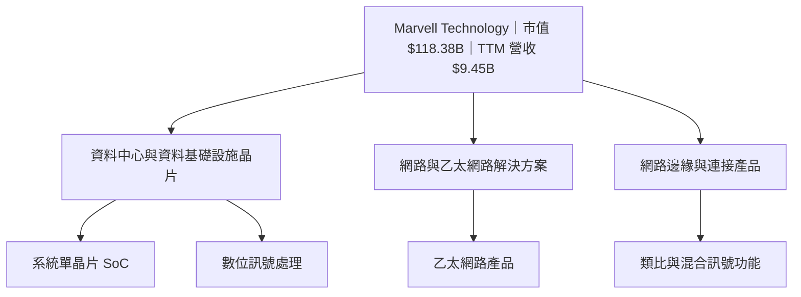
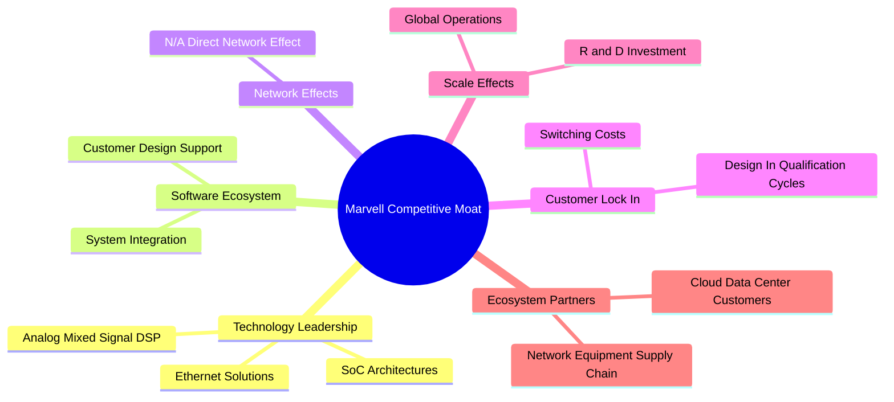
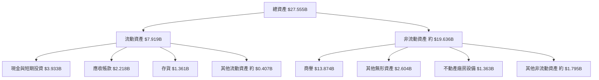
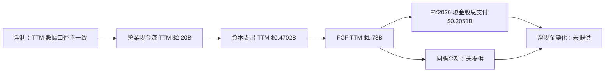
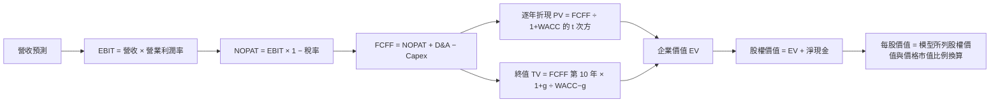
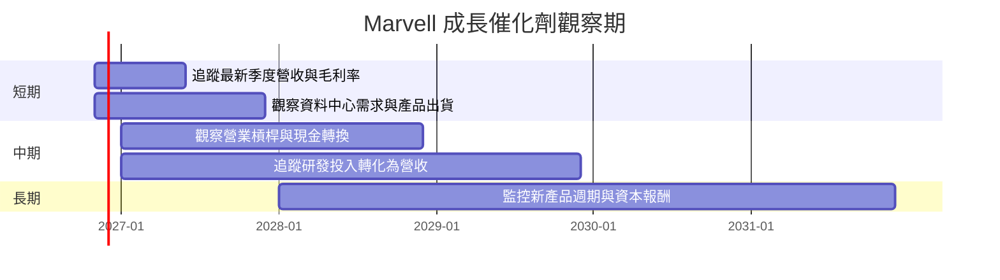
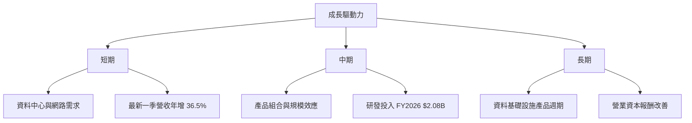
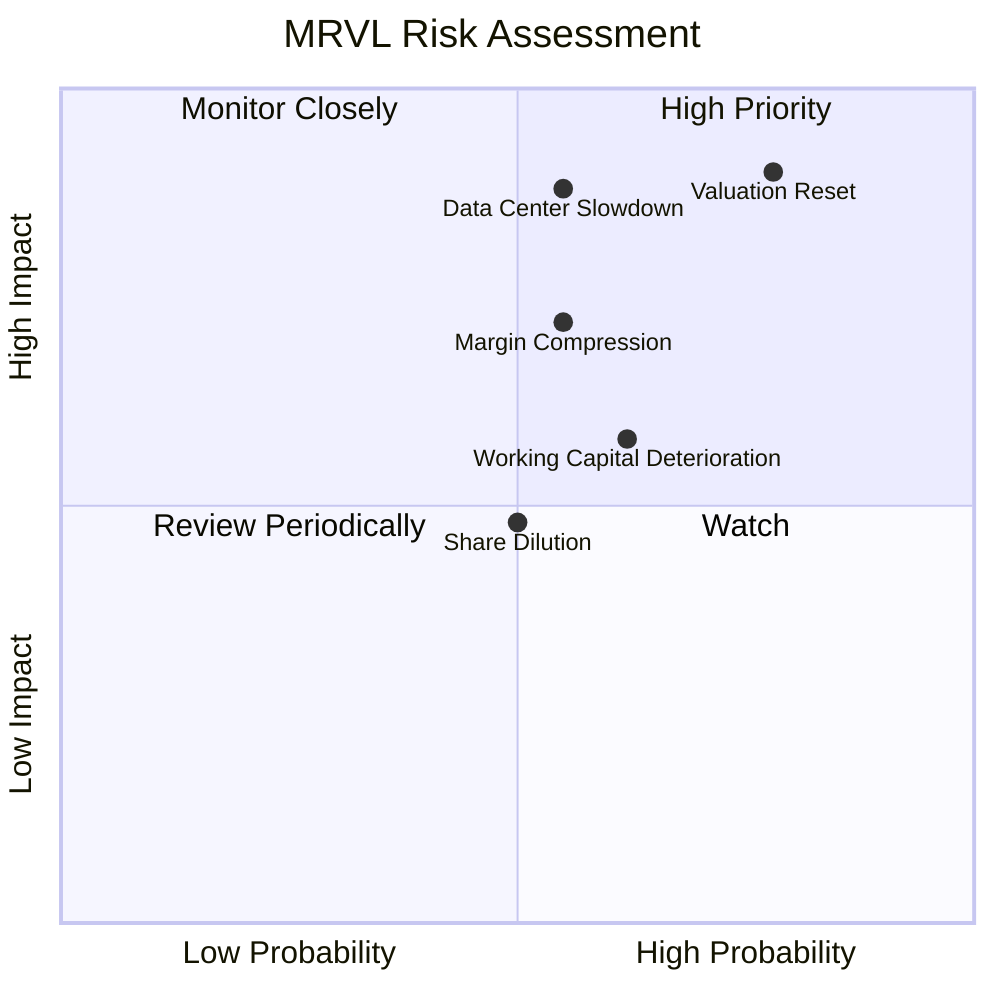
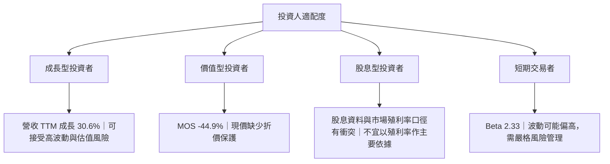

# MRVL 基本面深度分析報告
> **報告日期**：2026-11-25 ｜ **語言**：繁體中文 ｜ **數據來源**：SEC 申報資料 (XBRL)、Yahoo Finance、Finviz、StockAnalysis、Roic.ai ｜ **分析師**：CFA 級機構研究

## 目錄

| # | 章節 | 核心結論 |
|---|------|----------|
| 1 | 執行摘要 | 賣出；加權合理價值 $90.82；MOS -44.9% |
| 2 | 公司概覽與商業模式 | 資料基礎設施半導體公司；產品與客戶關係具技術黏著性，但細分營收資料未提供 |
| 3 | 損益表深度分析 | TTM 營收 $9.45B、成長 30.6%；最新一季年增 36.5% |
| 4 | 資產負債表分析 | 淨負債；現金與短期投資 $3.93B，流動性充裕但營運週期拉長 |
| 5 | 現金流量深度分析 | TTM FCF $1.73B，FCF Yield 1.46%；SBC 對股東回報有稀釋影響 |
| 6 | 獲利能力與資本效率 | ROIC 6.3% 低於 WACC 13.89%，目前未創造超額資本報酬 |
| 7 | 相對估值分析 | 估值高於同業部分倍數，且 P/S 位於自身五年區間第 75 百分位 |
| 8 | DCF 內在價值評估 | 基準 DCF 每股 $38.47；加權合理價值 $90.82 |
| 9 | 成長催化劑 | 雲端與資料中心需求可能是成長支撐；TAM 與產品線營收拆分未提供 |
| 10 | 風險矩陣 | 估值回落、AI／資料中心需求不及預期、利潤率與現金轉換惡化為前三大風險 |
| 11 | 投資建議 | 現價高於加權合理價值；等待價格與基本面條件改善 |

---

## 1. 執行摘要

MRVL 2026-11-24 收盤價為 **$131.57**。TTM 營收 **$9.45B**、TTM 年增 **30.6%**，最新一季營收年增 **36.5%**，但 TTM ROIC 為 **6.3%**，低於 **13.89% WACC**；TTM FCF 為 **$1.73B**、FCF Yield 僅 **1.46%**。DCF 基準價值 **$38.47**，估值方法加權後合理價值 **$90.82**，MOS 為 **-44.9%**。依 MOS 規則，評級為 **賣出**；目前成長數據支持業務動能，但無法抵銷現價相對加權合理價值的折價風險。

### 1.0 一頁式投資儀表板

| 項目 | 內容 |
|------|------|
| **投資論點（3 句）** | ① TTM 營收年增 **30.6%**，顯示近期需求加速。② TTM FCF **$1.73B**，但 FCF Yield 僅 **1.46%**，現金流相對市值有限。③ ROIC **6.3%** 低於 WACC **13.89%**，目前投入資本報酬尚未覆蓋資本成本。 |
| **綜合評分** | **5.8/10**（引用 1.1 評分卡） |
| **財務健康** | 🟡 現金與短期投資 $3.93B、總債務 $4.96B，屬淨負債 $1.03B；流動性尚可，但 CCC 由 113 天升至 131 天。 |
| **ROIC vs WACC** | **6.3% vs 13.89%**，目前摧毀而非創造超額股東價值。 |
| **FCF 趨勢** | FY2023–FY2026 年度 FCF 約 $1.07B、$1.02B、$1.39B、$1.39B；TTM FCF **$1.73B**，TTM FCF Yield **1.46%**。 |
| **估值** | Forward P/E **17.85x** ｜ EV/EBITDA（自身歷史區塊口徑）**78.3x** ｜ FCF Yield **1.46%** |
| **DCF 內在價值（基準）** | **$38.47** ｜現價相對 DCF 折溢價 **+242.0%**（即現價高於 DCF 值） |
| **安全邊際（MOS）** | **-44.9%**＝($90.82 − $131.57) ÷ $90.82；🔴 <10% 無。基準為第 8.8 節加權合理價值。 |
| **預期報酬（基準情境 12M）** | **-70.8%**，以 DCF 基準情境 $38.47 相對現價計算；非市場預測。 |
| **關鍵風險（前二）** | 高估值倍數回落；資料中心需求與成長預期落差。 |
| **評級 + 信心度** | 🔴 **賣出** ｜信心：中（估值訊號明確，但 DCF 對長期假設敏感） |

### 1.1 綜合評分卡

| 維度 | 評分（1–10） | 主要依據（引用數字與其來源章節） |
|------|--------------|----------------------------------|
| 成長性 | 8.0 | TTM 營收成長 30.6%、最新一季年增 36.5%（第 3 章）。 |
| 獲利能力 | 5.5 | TTM 營業利益率 16.5%，但 ROIC 6.3% 低於 WACC 13.89%；F-Score 6/9（第 3、6 章）。 |
| 財務健康 | 6.5 | 淨負債 $1.03B；現金與短期投資 $3.93B；流動比率 3.168；CCC 131 天（第 4 章）。 |
| 估值 | 2.0 | MOS -44.9%；P/S 12.8x，處於自身五年區間第 75 百分位（第 7、8 章）。 |
| 護城河 | 7.0 | 公司提供從資料中心核心至網路邊緣的資料基礎設施晶片，產品涉及 SoC、類比、混合訊號與 DSP；但未提供分部、市占或客戶集中度數據（第 2 章）。 |
| 管理層與資本配置 | 5.5 | FY2026 SBC $590.8M，稀釋股數測試未通過；年度股息支付約 $205.1M（第 3、5 章）。 |
| **綜合評分** | **5.8** | 六項算術平均：$(8.0+5.5+6.5+2.0+7.0+5.5)÷6=5.75$，四捨五入為 **5.8**。 |

### 1.2 五大投資論點 + 三大核心風險

| 類型 | 項目 | 具體依據 | 信心度 |
|------|------|----------|--------|
| 🟢 **投資論點①** | 營收動能加快 | TTM 營收 $9.45B、TTM 年增 30.6%；最新一季年增 36.5%。若出貨與產品組合延續，營業槓桿可能支撐利潤。 | 🟢 高 |
| 🟢 **投資論點②** | 現金流轉正且擴大 | TTM 營業現金流 $2.20B、Capex $470.20M、FCF $1.73B。 | 🟢 高 |
| 🟢 **投資論點③** | 資產負債表流動性充足 | 現金與短期投資 $3.93B、總債務 $4.96B；流動比率 3.168。 | 🟡 中 |
| 🟢 **投資論點④** | 毛利與營收呈復甦 | TTM 毛利率 52.2%；年度營收由 FY2025 $5.77B 增至 FY2026 $8.19B。 | 🟡 中 |
| 🟢 **投資論點⑤** | 產品位處資料基礎設施供應鏈 | 公司提供資料中心至網路邊緣的半導體解決方案；AI 資料中心投資若持續，可能帶動互連與網路相關晶片需求。 | 🟡 中 |
| 🟡 **風險①** | 現價顯著高於加權合理價值 | 現價 $131.57、加權合理價值 $90.82，MOS -44.9%。 | 🔴 高衝擊 |
| 🔴 **風險②** | 資本報酬低於資本成本 | ROIC 6.3% 對 WACC 13.89%，差距 -7.59 個百分點。 | 🔴 高衝擊 |
| 🟡 **風險③** | 盈餘品質與營運資金壓力 | FY2026 SBC $590.8M；CCC 由 113 天升至 131 天，應收、存貨天數均上升。 | 🟡 中高 |

### 1.3 快速統計卡片

| 指標 | 公司實際值（期間） | 同業中位數 | 狀態 |
|------|--------------------|------------|------|
| 營收成長（TTM） | **30.6%** | — | 🟢 |
| 營收成長（最新一季年增） | **36.5%** | **85.5%**（AVGO、NVDA、AMD 中位數） | 🟡 |
| 毛利率（TTM） | **52.2%** | **74.9%** | 🔴 |
| 營業利益率（TTM） | **16.5%** | — | 🟡 |
| ROIC（TTM） | **6.3%** | — | 🔴 |
| Forward P/E | **17.85x** | **15.5x** | 🟡 |
| FCF Yield（TTM） | **1.46%** | — | 🔴 |
| Piotroski F-Score | **6 / 9** | — | 🟡 |

### 1.4 投資結論

```text
╔══════════════════════════════════════════════════════════════════╗
║                    📊 投資結論摘要                               ║
╠══════════════════════════════════════════════════════════════════╣
║  評級：🔴 賣出（依 MOS 規則；未作質化上調或下調）               ║
║  價格（2026-11-24 收盤）：$131.57                               ║
║  DCF 內在價值（基準）：$38.47（現價溢價 +242.0%）               ║
║  安全邊際 MOS：-44.9%（以加權合理價值 $90.82 為分母）           ║
║  加權合理價值（8.8）：$90.82                                    ║
║  DCF 情境價值：                                                  ║
║    悲觀情境：$19.45（相對現價 -85.2%）                          ║
║    基準情境：$38.47（相對現價 -70.8%）                          ║
║    樂觀情境：$73.23（相對現價 -44.3%）                          ║
║  綜合評分：5.8/10（引用 1.1）                                   ║
║  適合投資人：可承受高波動、重視長期資料中心成長的投資人；       ║
║              不適合以現金殖利率或折價安全邊際為主的投資人       ║
╚══════════════════════════════════════════════════════════════════╝
```

---

## 2. 公司概覽與商業模式

### 2.1 業務結構與收入來源

公司概況資料顯示 Marvell Technology 提供資料基礎設施半導體解決方案，涵蓋資料中心核心至網路邊緣，並整合 SoC、類比、混合訊號與數位訊號處理。各產品板塊營收與佔比未提供，因此不拆分數字或繪製未經證實的比例。



### 2.2 市場份額

**市場份額數據未提供**，因此無法可靠估算市占率或製作市場份額圖。公司 TTM 營收為 $9.45B、最新一季營收年增 36.5%；相較 AVGO、NVDA、AMD 最新一季年增 85.5%、103.2%、44.7%，Marvell 成長可觀但低於前兩者。

### 2.3 競爭護城河分析



### 2.4 護城河強度

| 護城河項目 | 強度（強／中／弱） | 證據（引用數字或事實） | 會削弱它的情況 |
|------------|--------------------|------------------------|----------------|
| 技術與產品整合 | 中 | 公司設計 SoC，結合類比、混合訊號與 DSP；FY2026 研發支出 $2.08B。 | 競爭者以更低成本或更高效能替代，或產品迭代落後。 |
| 客戶設計導入與轉換成本 | 中 | 公司業務屬半導體解決方案，通常需要客戶設計與驗證；個別客戶與產品週期數據未提供。 | 大型客戶自研、供應商轉換或集中採購改變。 |
| 軟體生態系統與網路效應 | 弱至中 | 未提供軟體收入、平台活躍度或網路效應量化資料。 | 軟體支援不足或開放標準降低轉換成本。 |
| 規模與研發 | 中 | FY2026 R&D $2.08B，員工 7,480 人。 | 研發支出無法轉為產品收入或成本增速高於營收。 |
| 生態夥伴 | 中 | 產品涵蓋資料中心及網路設備供應鏈；具體合作夥伴與營收貢獻未提供。 | 產業鏈替代方案改變或關鍵夥伴轉向競品。 |

**1.1 護城河評分 7.0/10**：技術整合、研發投入及設計導入特性提供一定黏著性，但缺乏市占、分部營收、客戶集中度及軟體收入證據，故不宜評為最高檔。

---

## 3. 損益表深度分析

### 3.1 年度收入成長趨勢（近 4 年）

年度營收採 StockAnalysis 歷史資料，單位為美元；不同資料來源的 FY2025 毛利數字存在差異，本節不混用毛利資料。

```text
╔══════════════════════════════════════════════════════════════════╗
║                 Marvell 年度收入趨勢 FY2023-FY2026              ║
╠══════════════════════════════════════════════════════════════════╣
║  FY2023  $5.92B  ██████████████░░░░░░░░░░  YoY: 基期              ║
║  FY2024  $5.51B  █████████████░░░░░░░░░░░  YoY: -7.0%   🔴       ║
║  FY2025  $5.77B  ██████████████░░░░░░░░░░  YoY: +4.7%   🟡       ║
║  FY2026  $8.19B  ████████████████████░░░░  YoY: +42.1%  🟢       ║
║                                                                  ║
║  FY2023-FY2026 三年 CAGR：約 11.4%                               ║
╚══════════════════════════════════════════════════════════════════╝
```

FY2026 營收回升至 $8.19B，年增 42.1%，高於 FY2024–FY2025 的低增長期；最新 TTM 營收 $9.45B、年增 30.6%，顯示需求延續，但單一年度反彈不宜直接外推為長期增速。

### 3.2 季度收入趨勢分析

下表以 StockAnalysis 季度序列計算 QoQ；最新季度年增率使用已核實的最新一季數據。

| 季度 | 營收 | QoQ 成長 | YoY 成長 | 備註 |
|------|------:|---------:|---------:|------|
| FY2026 Q3 | $2.075B | — | 36.83% | 前一季資料未完整列入同一序列，QoQ 不列。 |
| FY2026 Q4 | $2.219B | +6.9% | 22.08% | 營收延續季增。 |
| FY2027 Q1 | $2.418B | +9.0% | 27.57% | 增速較上一季加快。 |
| FY2027 Q2 | $2.739B | +13.3% | **36.5%** | 最新季；年增率為單季 YoY，不是 TTM。 |

QoQ 計算示例：FY2027 Q2 為 $(2.739÷2.418)-1=13.3%$。近兩季 QoQ 加速與最新季 YoY 36.5%相符，但仍需觀察其是否由持續性終端需求，而非產品交付時間點推動。

### 3.3 利潤率演變分析

| 利潤率指標 | FY2023 | FY2024 | FY2025 | FY2026 | 趨勢 | 評估 |
|------------|--------|--------|--------|--------|------|------|
| 毛利率 | 51.1% | 41.6% | 47.5% | 51.0% | 近兩年回升 | 🟡 |
| 營業利益率 | 6.7% | -7.9% | 約 -0.1% | 16.3% | FY2026 明顯改善 | 🟡 |
| TTM 營業利益率 | — | — | — | **16.5%** | 目前水準 | 🟡 |
| TTM 淨利率 | — | — | — | **27.9%** | 含非營業與稅務影響的可能性 | 🟡 |

*年度歷史毛利與營業利益率依 StockAnalysis 年度營收、毛利及營業利益計算；資料來源對 FY2025 毛利及營業利益存在口徑差異，歷史比率僅作方向參考。*

FY2026 毛利率回到約 51%，而營業利益率回升至約 16%，與營收加速及規模吸收固定成本相符。不過 TTM 淨利率 27.9%高於 TTM 營業利益率 16.5%，其中可能包含非營業、稅務或一次性項目；單看淨利率容易高估核心經營獲利，需以 GAAP 營業利益與現金流交叉檢驗。

### 3.4 費用結構分析

收入、毛利及研發支出等部分年度金額有資料，但完整營業費用拆分與期間一致的費用項目未充分提供；不繪製會造成誤導的費用比例圖。FY2026 研發支出為 $2.08B，約為 FY2026 營收 $8.19B 的 25.4%，顯示公司需維持高研發投入以支撐產品更新。

### 3.5 季度 EPS 趨勢與盈餘品質（Quality of Earnings）

歷史 EPS 預估值欄位為 NaN，因此無法判定過去四季是否超預期或不及預期。可觀察到季度 EPS 實績序列有明顯波動，包括 FY2026 Q3 約 $2.20、FY2026 Q4 $0.47、FY2027 Q1 $0.04、FY2027 Q2 $0.34；FY2026 Q3 的淨利與 EPS 大幅高於鄰近季度，可能受非經常項目或資料口徑影響，應避免將該季年化。

| 盈餘品質項目 | 數值/佔比 | 評估 |
|--------------|-----------|------|
| 股權薪酬 SBC / 營收 | FY2026 SBC $590.8M ÷ TTM 營收 $9.45B = **6.3%**（期間近似） | 🟡 比率具實質稀釋成本；SBC 不是免費資本。 |
| SBC / 營業現金流 | $590.8M ÷ $2.20B = **26.9%**（期間近似） | 🟡 若以現金替代薪酬，可能降低可分配現金。 |
| FCF / 淨利（現金轉換率） | $1.73B ÷ StockAnalysis TTM 淨利 $2.64B = **65.5%** | 🟡 現金轉換低於 100%；使用不同來源 TTM 淨利口徑，需留意可比性。 |
| 一次性/非經常性損益 | 季度淨利 FY2026 Q3 $1.901B，與相鄰季度差距大 | 🔴 可能存在一次性或特殊會計影響；細項未提供，無法量化調整。 |
| 有效稅率異常 | **12.4%**（最新年有效稅率） | 🟡 若低於長期正常稅率，淨利可受益；稅務明細未提供。 |
| 資本化支出 vs 費用化 | TTM Capex $470.20M；資本化研發明細未提供 | 🟡 無法判定是否有重大成本遞延；研發費用 FY2026 $2.08B。 |

**盈餘品質結論**：營業現金流與 FCF 均為正，但 FCF／淨利約 65.5%、SBC 約佔 TTM 營收 6.3%，且季度淨利波動大。以投資者角度，估值應更重視可持續 FCF 與股數稀釋，而非單季 GAAP EPS。

---

## 4. 資產負債表分析

### 4.1 資產結構分解

截至 2026-08-01 的總資產為 $27.555B，流動資產 $7.919B；非流動資產約 $19.636B（總資產減流動資產）。流動資產細項包括現金與短期投資 $3.933B、應收帳款 $2.218B、存貨 $1.361B。



### 4.2 流動性與營運資金分析

流動比率與速動比率引用市場資料區塊；營運資金天數照錄品質指標計算結果。

| 指標 | 最新 TTM | 一年前 TTM | 變化 | 解讀 |
|------|----------:|----------:|------:|------|
| 流動比率 | 3.168 | 由歷史流動比率資料未提供 | N/A | 目前流動資產對短期負債覆蓋充足。 |
| 速動比率 | 2.461 | N/A | N/A | 排除存貨後仍有流動性緩衝。 |
| DSO 應收帳款天數 | 86 天 | 73 天 | +13 天 | 收款週期拉長，可能反映客戶付款條件或收入組合變化；需監控逾期應收。 |
| DIO 存貨天數 | 110 天 | 96 天 | +14 天 | 存貨占用增加；若需求轉弱，存在去庫存及減值風險。 |
| DPO 應付帳款天數 | 64 天 | 56 天 | +8 天 | 對供應商付款較慢，部分抵銷 DSO、DIO 上升。 |
| CCC 現金轉換週期 | 131 天 | 113 天 | +18 天 | 現金被營運資金占用時間變長，可能壓低現金流轉換率。 |

### 4.3 債務結構分析

採用 SEC／程式計算口徑的現金與短期投資 $3.93B、總債務 $4.96B、淨負債 $1.03B。另有市場資料顯示總債務 $5.29B、淨負債 $1.35B；估值與資本成本分析採用核實財務數字區塊的 $4.96B，不混用口徑。

```text
╔══════════════════════════════════════════════════════════════════╗
║                   Marvell 債務健康診斷                          ║
╠══════════════════════════════════════════════════════════════════╣
║  總債務：        $4.96B   ████████████████████  🟡               ║
║  現金+短期投資： $3.93B   ████████████████░░░░  🟢               ║
║  淨負債：        $1.03B   ████░░░░░░░░░░░░░░░░  🟡               ║
║                                                                  ║
║  流動比率：      3.168x   🟢                                     ║
║  速動比率：      2.461x   🟢                                     ║
║  Debt/EBITDA：   N/A（核實數據未提供一致口徑 EBITDA）            ║
║  利息保障倍數：  N/A（利息費用及可比 EBIT 明細不足）             ║
╚══════════════════════════════════════════════════════════════════╝
```

### 4.4 股東權益趨勢

| 財年 | 股東權益 | 年變化 | 評估 |
|------|---------:|------:|------|
| FY2023 | $15.64B | — | 🟡 |
| FY2024 | $14.83B | -5.2% | 🟡 |
| FY2025 | $13.43B | -9.4% | 🔴 |
| FY2026 | $14.31B | +6.6% | 🟡 |

FY2026 權益回升，但仍低於 FY2023。FY2026 SBC $590.8M 與稀釋股數測試未通過，顯示股東權益增長不等同於每股價值同步提升。

---

## 5. 現金流量深度分析

### 5.1 現金流量瀑布圖

不同期間淨利、股息與現金變化數字未能完全對齊，以下圖僅呈現可核實的現金流順序與 TTM 數值，不把未提供的回購或淨現金變化填入。



### 5.2 FCF 轉換率趨勢

| 財年 | 營業現金流 | Capex | FCF | 淨利 | FCF／淨利 |
|------|-----------:|------:|----:|-----:|----------:|
| FY2023 | $1.29B | $0.217B | $1.07B | -$0.164B | 比率不具經濟意義 |
| FY2024 | $1.37B | $0.350B | $1.02B | -$0.933B | 比率不具經濟意義 |
| FY2025 | $1.68B | $0.292B | $1.39B | -$0.885B | 比率不具經濟意義 |
| FY2026 | $1.75B | $0.359B | $1.39B | $2.67B | 約 52.1% |
| TTM | $2.20B | $0.470B | **$1.73B** | StockAnalysis TTM $2.64B | 約 65.5% |

FY2023–FY2025 淨利為負，無法用 FCF／淨利比率衡量轉換。FY2026 與 TTM FCF 為正，但 TTM 現金轉換仍低於淨利，營運資金天數上升可能是其中一項原因。

### 5.3 自由現金流趨勢

```text
╔══════════════════════════════════════════════════════════════════╗
║                  自由現金流趨勢                                  ║
╠══════════════════════════════════════════════════════════════════╣
║  FY2023  $1.07B  █████████████░░░░░░░░░░░░░  🟡                 ║
║  FY2024  $1.02B  ████████████░░░░░░░░░░░░░░  🟡                 ║
║  FY2025  $1.39B  █████████████████░░░░░░░░░  🟢                 ║
║  FY2026  $1.39B  █████████████████░░░░░░░░░  🟢                 ║
║  TTM     $1.73B  █████████████████████░░░░░  FCF Yield 1.46%    ║
╚══════════════════════════════════════════════════════════════════╝
```

### 5.4 資本配置評估

| 資本配置項目 | 可核實金額 | 評估 |
|--------------|-----------:|------|
| 研發支出 | FY2026 $2.08B | 維持產品競爭力的重要投入；約為 FY2026 營收 25.4%。 |
| Capex | TTM $470.20M | 約為 TTM 營收 5.0%；資本支出強度不高於研發投入。 |
| 股息 | FY2026 $205.1M | 相對 TTM FCF 約 11.9%；每季股息資料顯示每股約 $0.06。 |
| 回購 | N/A | 回購金額未提供，不推算。 |
| 留存現金 | N/A | 缺少期間一致的現金流分配橋接，無法精確計算。 |

---

## 6. 獲利能力與資本效率

### 6.1 ROE / ROA / ROIC 趨勢

| 指標 | FY2026／TTM 最新值 | 歷史可比資料 | 評估 |
|------|-------------------:|--------------|------|
| ROE | TTM **14.2%**（品質指標口徑）；另有市場資料 16.5% | DuPont 區塊採 14.2%，不同來源口徑有差異 | 🟡 |
| ROA | TTM **4.1%** | F-Score 測試顯示 ROA 高於一年前 | 🟡 |
| ROIC | TTM **6.3%** | 歷史序列未提供一致的年度 ROIC | 🔴 |
| 行業均值 | N/A | 未提供可驗證同業 ROIC／ROA 行業均值 | — |

### 6.2 ROIC vs WACC 分析（核心價值創造判斷）

```text
╔══════════════════════════════════════════════════════════════════╗
║                ROIC vs WACC 深度分析                            ║
╠══════════════════════════════════════════════════════════════════╣
║  資本成本（採用核實輸入）：                                      ║
║  ├── 無風險利率（10Y美債）：  4.90%                              ║
║  ├── 市場風險溢酬（假設）：   5.00%                              ║
║  ├── 原始 Beta：              2.33                               ║
║  ├── 調整 Beta：              1.88 = ⅔×2.33 + ⅓×1.00            ║
║  ├── 股權成本：               14.33%                             ║
║  ├── 稅前債務成本：           4.08%                              ║
║  ├── 稅率：                   12.4%                              ║
║  ├── 資本權重 E/D：           96.0% / 4.0%                       ║
║  └── ✅ 採用 WACC：           13.89%                             ║
║                                                                  ║
║  ROIC（TTM）：                 6.3%                               ║
║  EVA 利差：                    6.3% − 13.89% = -7.59 個百分點     ║
║                                                                  ║
║  ROIC  6.3%   ▓▓▓▓▓▓░░░░░░░░░░░░░░░░░░░░░░░░░░  🔴              ║
║  WACC 13.89%  ▓▓▓▓▓▓▓▓▓▓▓▓▓▓▓░░░░░░░░░░░░░░░░░  ──              ║
║                                                                  ║
║  結論：ROIC 低於 WACC；目前每單位投入資本的回報不足以覆蓋資本成本║
╚══════════════════════════════════════════════════════════════════╝
```

資本成本依核實的 Cost of Capital 數據直接採用。以顯示至兩位小數的組成數字試算，$96.0\%×14.33\%+4.0\%×[4.08\%×(1−12.4\%)]=13.90\%$；和程式採用的 **13.89%** 相差約 0.01 個百分點，屬未顯示的小數精度差異。評估與 DCF 均依規定使用 **13.89%**，不另建 WACC。

### 6.3 杜邦三因素分解

| 因素 | 數值（TTM） | 解讀 |
|------|-------------|------|
| 淨利率 | 27.9% | 高於營業利益率，反映稅務及非營業項目可能影響淨利。 |
| 資產週轉率 | 0.34 | 資產規模中商譽與無形資產占比較高，週轉率偏低。 |
| 權益乘數 | 1.49 | 槓桿並非 ROE 的唯一主要來源。 |
| **ROE** | **14.2%** | $27.9\%×0.34×1.49≈14.2\%$；數值採品質指標原列。 |

### 6.4 財務體質：Piotroski F-Score

**Piotroski F-Score：6 / 9**。品質資料對缺少輸入的測試不補分，本資料列明九項結果如下。

| 測試 | 結果 | 解讀 |
|------|------|------|
| ROA > 0 | ✅ 通過 | TTM 資產報酬率為正。 |
| 營業現金流 > 0 | ✅ 通過 | TTM 營業現金流 $2.20B。 |
| ROA 高於一年前 | ✅ 通過 | 資產獲利能力改善。 |
| 營業現金流 > 淨利 | ❌ 未通過 | 應計品質測試未通過，應檢視營運資金與非現金項目。 |
| 長期負債／總資產低於一年前 | ✅ 通過 | 槓桿相對改善。 |
| 流動比率高於一年前 | ✅ 通過 | 流動性指標改善。 |
| 稀釋股數未增加 | ❌ 未通過 | SBC 等因素可能造成股東稀釋。 |
| 毛利率高於一年前 | ✅ 通過 | 毛利率趨勢改善。 |
| 資產週轉率高於一年前 | ❌ 未通過 | 資產增加未同步轉化為更高營收效率。 |

---

## 7. 相對估值分析

### 7.1 同業估值比較表格

公司倍數採價格與財務資料區塊提供值；peer 倍數使用 Yahoo Finance 的 Peer multiples。公司與同業的獲利及財年口徑可能不同，倍數宜視為相對參考。

| 估值指標 | **MRVL** | **AVGO** | **NVDA** | **AMD** | 本公司評估 |
|----------|---------:|---------:|---------:|--------:|-----------|
| **Trailing P/E** | 43.4x | 38.5x | 16.7x | 88.3x | 🟡 高於 AVGO、NVDA，低於 AMD。 |
| **Forward P/E** | 17.85x | 15.5x | 9.4x | 23.4x | 🟡 高於 peer 中位數 15.5x。 |
| **P/S Ratio** | 12.8x | 16.1x | 10.4x | 15.1x | 🟡 低於 AVGO、AMD，但高於 NVDA。 |
| **EV/EBITDA** | 78.3x | 28.2x | 15.2x | 60.2x | 🔴 顯著高於三家對照公司。 |
| **最新季度營收年增** | 36.5% | 85.5% | 103.2% | 44.7% | 🟡 成長高，但低於三家 peer 數值。 |
| **毛利率（TTM）** | 52.2% | 75.5% | 74.9% | 56.0% | 🔴 低於 peer。 |

同業三家公司 P/E、P/S、EV/EBITDA 中位數依所提供數據計算：Trailing P/E **38.5x**、Forward P/E **15.5x**、P/S **15.1x**、EV/EBITDA **28.2x**。估值方法本身使用指定的同業中位數倍數，不以 MRVL 自身倍數回推。

### 7.2 歷史估值區間分析

```text
╔══════════════════════════════════════════════════════════════════╗
║                 MRVL 五年估值區間（TTM）                         ║
╠══════════════════════════════════════════════════════════════════╣
║  P/E：       25.6x ───────── ●43.4x ───────── 61.9x             ║
║                         中位數 56.5x；現值百分位 50%             ║
║  P/S：        5.8x ───────────────── ●12.8x ─── 18.3x           ║
║                         中位數 9.9x；現值百分位 75%              ║
║  EV/EBITDA： 53.3x ─ ●78.3x ───────────────── 730.9x            ║
║                         中位數 156.4x；現值百分位 25%            ║
╚══════════════════════════════════════════════════════════════════╝
```

P/E 位於自身五年區間中段，P/S 位於第 75 百分位、且高於五年中位數；EV/EBITDA 受自身歷史極端高值影響，雖處第 25 百分位，仍高於目前 Peer multiples 中的同業數值。

### 7.3 情境價值（Bear / Base / Bull，照抄 DCF MODEL 的 Scenarios）

| 情境 | 第 1 年營收成長 | 期末營業利潤率 | WACC | 每股價值 | 相對現價 | 機率 | 會發生的條件 |
|------|----------------:|----------------:|-----:|---------:|---------:|-----:|--------------|
| 🔴 悲觀 | 15.0% | 3.4% | 14.89% | $19.45 | -85.2% | 25% | 資料中心需求降溫、競品或客戶自研壓抑成長，利潤率持續收斂。 |
| 🟡 基準 | 30.0% | 4.0% | 13.89% | $38.47 | -70.8% | 50% | 首年延續高增長，之後逐年趨緩，長期營業利潤率回到近五年中位水準。 |
| 🟢 樂觀 | 45.0% | 4.4% | 12.89% | $73.23 | -44.3% | 25% | 產品需求顯著超預期、較高增長持續且資本成本下降。 |

### 7.4 相對估值隱含價格區間

| 方法 | 每股價值 | 相對現價 | 依據 |
|------|---------:|---------:|------|
| 同業 Forward P/E | $114.48 | -13.0% | peer 中位數 Forward P/E 15.5x × MRVL Forward EPS $7.37。 |
| 同業 EV/EBITDA | $66.83 | -49.2% | AVGO、NVDA peer 中位數 21.7x × TTM EBITDA，再加回淨現金／扣除淨負債。 |

```text
╔══════════════════════════════════════════════════════════════════╗
║             相對估值位置（每股美元）                             ║
╠══════════════════════════════════════════════════════════════════╣
║  $66.83 ───────── $114.48 ─────── $131.57                       ║
║  EV/EBITDA       Forward P/E       現價                          ║
╚══════════════════════════════════════════════════════════════════╝
```

兩種同業相對估值均低於現價；Forward P/E 方法距離較近，EV/EBITDA 方法反映公司目前估值倍數相對較高。

---

## 8. DCF 內在價值評估（Discounted Cash Flow）

> 所有 DCF 數字依指定模型引用。模型金額取至 $0.01B、比率取至 0.1 個百分點、折現因子取至三位小數；未顯示的底層精度可能造成小幅尾差。DCF 數字不另行重建。

### 8.0 估值推理鏈（Thinking Logic）

**Step 1 — 價值由哪些變數決定？**  
本模型以整體公司 FCFF 為基礎；資料未提供可核實的分部營收，所以不能把資料中心、網路或邊緣業務分別估值。已知的營收基礎是 TTM $9.45B，最新一季年增 36.5%；模型主導變數是長期營收成長與 GAAP 營業利潤率，WACC 與終值成長率則放大長期現金流折現差異。

**Step 2 — 模型選擇**

| 決策點 | 本報告採用 | 理由（含數字） | 曾考慮但否決 | 否決理由 |
|--------|-----------|----------------|--------------|----------|
| 現金流定義 | FCFF | 對應 WACC 折現並推導企業價值；公司有 $4.96B 債務。 | FCFE | 需另建股權現金流及融資路徑，與指定模型不一致。 |
| 預測期 N | 10 年 | 指定 DCF 模型為 10 年，營收增長由 30.0% 線性降至 3.0%。 | 5 年 | 與指定模型期限不同，且不能直接沿用其終值。 |
| 終值方法 | Gordon Growth | 指定模型以 3.0% 永續增長率計算。 | 只用退出倍數 | 模型未提供可用的終值退出倍數，不另建假設。 |
| EBIT 基礎 | GAAP | 指定模型以 GAAP EBIT 建模。 | 非 GAAP | 不另加回 SBC，避免改寫模型。 |

**Step 3 — 關鍵假設推導鏈**

- **營收增長**：錨點＝TTM 營收年增 30.6%、最新一季年增 36.5% → 調整＝基期高且十年期不能合理假設維持單季高增，模型將增速從首年 30.0% 線性降至第十年 3.0% → **採用首年 30.0%、末年 3.0%** → 曾考慮全期維持 30.6%，因忽略成熟化而否決。
- **期末營業利潤率**：錨點＝TTM 營業利益率 16.5%，近五財年中位數（模型指定）為 4.0% → 調整＝不將目前較高的營業利益率永久化 → **第十年 4.0%** → 曾考慮維持 16.5%，因循環與競爭風險未獲充分緩衝而否決。
- **永續成長率 g**：錨點＝長期名目經濟成長需低於資本成本；模型採 3.0% → 調整＝以成熟期低個位數增長作終值假設 → **採用 3.0%** → 否決高於 3.0%的主假設，因永續成長率必須低於 WACC 13.89%，且較高 g 會放大終值。
- **預測期 N**：錨點＝模型明定 10 年 → 調整＝不作期限調整，以完整呈現增速逐年衰減 → **採用 10 年** → 曾考慮更短預測期，但會改動指定模型期限與現金流路徑。
- **Capex／營收**：錨點＝TTM Capex $470.20M ÷ TTM 營收 $9.45B 約 5.0% → 調整＝模型設定首年與第十年均為 5.0% → **採用 5.0%** → 否決只依單年低 Capex 外推，因可能低估擴張投資。
- **EBIT 基礎與 SBC**：錨點＝FY2026 SBC $590.8M；模型指定採 GAAP EBIT → 調整＝GAAP EBIT 已認列 SBC，不在 FCFF 再扣一次 → **採用組合 (A)** → 否決非 GAAP EBIT，避免更換模型口徑。
- **年稀釋率**：錨點＝Piotroski 稀釋股數測試未通過，代表股數曾增加；但指定 DCF 組合 (A) 要求固定股數 → **採用固定股數，不另加年稀釋** → 否決另以稀釋率放大股數，避免與 GAAP SBC 費用重複計入。
- **終值方法**：錨點＝指定模型採 Gordon Growth，g=3.0% → **採用模型終值** → 未提供一致的退出倍數假設，否決自行增列倍數法。
- **WACC**：錨點＝核實資本成本 WACC 13.89% → 調整＝不對 Beta、ERP 或權重另行改值 → **採用 13.89%** → 否決以較低折現率提高估值，因會偏離核實資本成本輸入。

**Step 4 — 最脆弱一環**  
最脆弱的是營收與利潤率長期路徑；即使模型採用 30.0% 首年成長，現價反推仍要求首年成長 68.7%，顯示現價對指定基準模型有極高的成長要求。

**Step 5 — 計算路徑**



### 8.1 模型假設總表（Model Inputs）

| 假設項目 | 採用值 | 依據 / 來源 | 敏感度 |
|----------|--------|-------------|--------|
| 預測期長度 N | 10 年 | DCF 模型設定；十年營收增長與利潤率逐步衰減。 | 🟡 中 |
| 營收增長路徑 | FY+1 30.0%，FY+10 3.0%，逐年線性下降 | TTM 成長 30.6%；模型首年採 30.0%，末年採 3.0%。 | 🔴 高 |
| 營業利潤率 | FY+1 16.5% → FY+10 4.0% | 16.5% 為 TTM；4.0% 為模型所用近五財年中位數。 | 🔴 高 |
| 有效稅率 | 12.4% | 最新年有效稅率。 | 🟢 低 |
| Capex／營收 | 5.0% | TTM $470.20M ÷ $9.45B 約 5.0%，模型首末年維持 5.0%。 | 🟡 中 |
| D&A／營收 | 13.3% | 指定模型使用 TTM 比率並維持不變。 | 🟢 低 |
| 營運資金變動／營收增額 | 未建模 | 指定模型 FCFF 未納入營運資金變動；營運資金天數資料顯示 CCC 131 天。 | 🟡 中 |
| EBIT 基礎 | GAAP | 指定模型採 GAAP EBIT。 | 🟡 中 |
| SBC 處理 | 組合 (A)：GAAP EBIT、無額外扣 SBC、股數固定 | SBC 已含於 GAAP 費用，避免重複扣除；模型規定固定股數。 | 🟡 中 |
| 年稀釋率 | 0%（模型處理） | 組合 (A) 固定股數；實際稀釋股數曾增加，故是模型限制。 | 🟡 中 |
| 永續成長率 g | 3.0% | 指定 DCF 模型假設，低於 WACC。 | 🔴 高 |
| 終值方法 | Gordon Growth | 指定模型終值公式。 | 🔴 高 |
| WACC | 13.89% | 核實資本成本區塊。 | 🔴 高 |

FCFF 定義依指定模型：**FCFF = NOPAT + D&A − Capex**；不含 ΔWC 列。**本模型採用 (A)，故 SBC 影響已透過 GAAP EBIT 計入一次；DCF 不再扣 SBC，股數不再稀釋。**

### 8.2 折現率推導（WACC）

原始 Beta 為 2.33，調整 Beta 為 1.88；調整方式依核實輸入：$⅔×2.33+⅓×1.00=1.8867$，顯示為 1.88。ERP 5.00% 為核實輸入的假設值；無風險利率為資料列示的 10 年期美債 4.90%，其觀察日期未提供。未另加規模或國別溢酬。

```text
╔══════════════════════════════════════════════════════════════════╗
║                    WACC 推導（採用核實輸入）                     ║
╠══════════════════════════════════════════════════════════════════╣
║  股權成本 Ke（CAPM）：                                           ║
║  ├── 無風險利率 Rf：                 4.90%                       ║
║  ├── 市場風險溢酬 ERP（假設）：       5.00%                       ║
║  ├── 原始 Beta：                     2.33                        ║
║  ├── 調整 Beta：                     1.88                        ║
║  ├── Ke = 4.90% + 1.88 × 5.00% =   14.30%（顯示精度）           ║
║  └── 核實 Ke：                       14.33%                       ║
║                                                                  ║
║  債務成本 Kd：                                                   ║
║  ├── 稅前 Kd：                       4.08%                        ║
║  ├── 稅率：                          12.4%                        ║
║  └── 稅後 Kd = 4.08%×(1−12.4%) =   3.57%                        ║
║                                                                  ║
║  資本結構：                                                      ║
║  ├── 股權權重 E：                    96.0%                        ║
║  ├── 債務權重 D：                     4.0%                        ║
║  └── ✅ 採用 WACC：                  13.89%                       ║
╚══════════════════════════════════════════════════════════════════╝
```

五步計算檢核：

1. **Ke（CAPM）**：$4.90\%+1.88×5.00\%=14.30\%$，核實輸入列示 **14.33%**；差異來自 Beta 與組成輸入的小數未完整顯示，後續採核實 Ke **14.33%**。
2. **稅前 Kd**：核實輸入直接提供 **4.08%**；利息費用及同期間平均計息負債明細未提供，因此不能獨立重算利息／平均負債。
3. **稅後 Kd**：$4.08\%×(1−12.4\%)=3.57408\%\approx3.57\%$。
4. **權重**：核實權重為股權 **96.0%**、債務 **4.0%**，合計 **100.0%**。市值與債務權重的底層未四捨五入數字未提供，不另行反推替代。
5. **WACC**：按顯示值試算 $96.0\%×14.33\%+4.0\%×3.57\%=13.90\%$；核實 WACC 為 **13.89%**。由於組成值已四捨五入，模型折現採用核實的 **13.89%**。

> 成本資本區塊提供 WACC 組成與權重，但未提供利息費用、平均計息負債、完整市值權重底層值，故上述步驟無法由顯示值精確重建至 13.89%；依規定不另算 WACC。

### 8.3 逐年自由現金流預測（基準情境）

單位：美元十億；折現因子依模型原值。`ΔWC` 未建模，故不列為現金流扣項。

| 年度 | FY+1 | FY+2 | FY+3 | FY+4 | FY+5 | FY+6 | FY+7 | FY+8 | FY+9 | FY+10 |
|------|-----:|-----:|-----:|-----:|-----:|-----:|-----:|-----:|-----:|------:|
| 營收 | 12.29 | 15.60 | 19.35 | 23.41 | 27.62 | 31.77 | 35.58 | 38.78 | 41.11 | 42.34 |
| 營收 YoY | 30.0% | 27.0% | 24.0% | 21.0% | 18.0% | 15.0% | 12.0% | 9.0% | 6.0% | 3.0% |
| 營業利潤率 | 16.5% | 15.1% | 13.7% | 12.4% | 11.0% | 9.6% | 8.2% | 6.8% | 5.4% | 4.0% |
| EBIT（GAAP） | 2.03 | 2.36 | 2.66 | 2.89 | 3.03 | 3.04 | 2.91 | 2.64 | 2.22 | 1.70 |
| − 稅 | (0.25) | (0.29) | (0.33) | (0.36) | (0.37) | (0.38) | (0.36) | (0.33) | (0.27) | (0.21) |
| = NOPAT | 1.78 | 2.07 | 2.33 | 2.53 | 2.65 | 2.67 | 2.55 | 2.31 | 1.95 | 1.49 |
| + D&A | 1.64 | 2.08 | 2.58 | 3.12 | 3.69 | 4.24 | 4.75 | 5.18 | 5.49 | 5.65 |
| − Capex | (0.61) | (0.78) | (0.96) | (1.16) | (1.37) | (1.58) | (1.77) | (1.93) | (2.05) | (2.11) |
| **= FCFF** | **2.81** | **3.38** | **3.95** | **4.49** | **4.97** | **5.33** | **5.53** | **5.56** | **5.39** | **5.04** |
| 折現因子 @13.89% | 0.878 | 0.771 | 0.677 | 0.594 | 0.522 | 0.458 | 0.402 | 0.353 | 0.310 | 0.272 |
| **FCFF 現值 PV** | **2.47** | **2.60** | **2.67** | **2.67** | **2.59** | **2.44** | **2.23** | **1.96** | **1.67** | **1.37** |

預測期 PV 加總：$2.47+2.60+2.67+2.67+2.59+2.44+2.23+1.96+1.67+1.37=\mathbf{22.67B}$；模型列示合計 **$22.68B**，差額 $0.01B，來自各年度列值四捨五入。

**FY+1 逐步演算示例**

1. 營收：$9.45B×(1+30.0\%)=12.285B\approx$ **$12.29B**。
2. EBIT：$12.29B×16.5\%=2.028B\approx$ **$2.03B**。
3. 稅：$2.03B×12.4\%=0.252B\approx$ **$0.25B**。
4. NOPAT：$2.03B−$0.25B=$ **$1.78B**。
5. D&A：模型列示 **$1.64B**（D&A／營收假設 13.3%；用顯示數 $12.29B×13.3\%=1.635B\approx$ $1.64B）。
6. Capex：模型列示 **$0.61B**（$12.29B×5.0\%=0.615B，底層精度四捨五入）。
7. ΔWC：**未建模**，模型不扣。
8. FCFF：模型原列 **$2.81B**。以表列已四捨五入數計算，$1.78+$1.64−$0.61=$2.81B。
9. 折現因子與 PV：$1÷(1+13.89\%)^1=0.878$；$2.81×0.878=2.468\approx$ **$2.47B**。

**合理性自檢**

- 模型 FY+1 至 FY+10 收入由 $12.29B 增至 $42.34B，十年複合增長約 **13.2%**；歷史 FY2023–FY2026 營收 CAGR 約 **11.4%**，模型長期增速高於近三年歷史，主要靠前期高增長假設。
- FY+10 FCFF 利潤率約 $5.04B÷$42.34B=11.9%；TTM FCF／營收約 $1.73B÷$9.45B=18.3%。兩者定義、模型期間及未納入營運資金的處理不同，不可直接視為同口徑改善。
- 模型所有年度 FCFF 為正；FY+10 FCFF 低於 FY+8 的 $5.56B，反映營業利潤率逐年降至 4.0%。

```text
╔══════════════════════════════════════════════════════════════════╗
║            自由現金流：歷史實際 vs 模型預測                      ║
╠══════════════════════════════════════════════════════════════════╣
║  FY2024(實)  $1.02B  █████░░░░░░░░░░░░░░░░  🟡                 ║
║  FY2025(實)  $1.39B  ███████░░░░░░░░░░░░░  🟢                 ║
║  FY2026(實)  $1.39B  ███████░░░░░░░░░░░░░  🟢                 ║
║  FY+1 (預)   $2.81B  ██████████████░░░░░░  🟢                 ║
║  FY+10(預)   $5.04B  █████████████████████████░ CAGR約6.0%*    ║
╠══════════════════════════════════════════════════════════════════╣
║  *FY+1至FY+10 FCFF CAGR依模型首末年約6.0%；預測未扣營運資金。   ║
╚══════════════════════════════════════════════════════════════════╝
```

*FY+1 至 FY+10 FCF CAGR：$(5.04÷2.81)^{1/9}-1\approx6.7\%$；上方圖中文字更正為 **約 6.7%**。*

### 8.4 終值計算（Terminal Value）

適用性檢查：**WACC 13.89% vs g 3.0% → WACC > g？✅**

| 方法 | 計算式 | 終值 TV | TV 現值 | 佔總 EV 比重 |
|------|--------|---------:|--------:|--------------:|
| Gordon Growth | FY+10 FCFF $5.04B × (1+3.0%) ÷ (13.89%−3.0%) | $47.62B（模型值） | $12.97B（模型值） | 36.4% |
| 退出倍數法 | N/A | N/A | N/A | N/A |

逐步說明：

1. FY+10 FCFF：**$5.04B**。
2. 分子按顯示數代入：$5.04×1.03=$**5.1912B**。
3. 分母：$13.89\%−3.0\%=$**10.89%**；按顯示值直接計算終值約 $5.1912÷10.89\%=$**$47.67B**。指定模型列示 **$47.62B**，差異反映模型內部未四捨五入數據未提供；依規定後續沿用模型原值。
4. 模型列示 PV(TV) **$12.97B**；以列示 TV 與折現因子試算 $47.62×0.272=$12.95B，差異同樣來自折現因子及底層精度。
5. 終值比重：指定模型列示 **36.4%**。由於模型以未四捨五入數字計算，終值占比沿用原值。

退出倍數資料未包含於 DCF 模型，依規則不另行設定。

### 8.5 企業價值 → 每股內在價值（Bridge）

```text
╔══════════════════════════════════════════════════════════════════╗
║              企業價值 → 每股內在價值 橋接表                      ║
╠══════════════════════════════════════════════════════════════════╣
║  預測期 FCF 現值合計            +$22.68B                         ║
║  終值現值 PV(TV)                +$12.97B                         ║
║  ─────────────────────────────────────────────                  ║
║  = 企業價值 EV                   $35.64B                         ║
║  + 現金及短期投資               +$3.93B                          ║
║  − 總債務                       −$4.96B                          ║
║  ─────────────────────────────────────────────                  ║
║  = 股權價值                      $34.61B                         ║
║  每股換算                       依模型股權價值×價格÷市值          ║
║  ★ 每股內在價值                  $38.47                          ║
║    當前股價                      $131.57                         ║
║    折溢價（現價÷DCF價值−1）      +242.0%（溢價）                 ║
╚══════════════════════════════════════════════════════════════════╝
```

逐步演算：

1. 模型列示 EV **$35.64B**。顯示值相加為 $22.68B+$12.97B=$35.65B，與 EV 相差 $0.01B，屬底層未四捨五入數據與列示值的尾差。
2. 股權價值：$35.64B+$3.93B−$4.96B=$**34.61B**。
3. 每股內在價值：指定模型換算式為股權價值 × 價格 ÷ 市值；模型結果 **$38.47**。因模型所用底層股數／市值精度未完整提供，不以市場股數另行替代。
4. 折溢價：$(131.57÷38.47)-1=+242.0\%$。
5. **本節不計算 MOS**；MOS 僅在第 8.8 節以加權合理價值為分母。

現金與債務採截至 2026-08-01 核實數據。每股價值與稀釋股數採 DCF 模型自身換算；模型使用固定股數假設，未另加年稀釋。

### 8.6 敏感性分析（WACC × 永續成長率）

| g（列）／WACC（欄） | 11.89% | 12.89% | **13.89% 基準** | 14.89% | 15.89% |
|-----------|------:|------:|----------------:|------:|------:|
| **2.0%** | $45.19（-65.6%） | $40.79（-69.0%） | $37.13（-71.8%） | $34.03（-74.1%） | $31.37（-76.2%） |
| **2.5%** | $46.29（-64.8%） | $41.62（-68.4%） | $37.77（-71.3%） | $34.53（-73.7%） | $31.77（-75.9%） |
| **3.0% 基準** | $47.51（-63.9%） | $42.54（-67.7%） | **$38.47（-70.8%）** | $35.07（-73.3%） | $32.20（-75.5%） |
| **3.5%** | $48.87（-62.9%） | $43.55（-66.9%） | $39.23（-70.2%） | $35.66（-72.9%） | $32.66（-75.2%） |
| **4.0%** | $50.41（-61.7%） | $44.67（-66.1%） | $40.08（-69.5%） | $36.31（-72.4%） | $33.17（-74.8%） |

矩陣示範格：**WACC 12.89% > g 2.5% ✅**。該格依指定敏感度模型為 **$41.62／股**；逐年現金流不變，變更折現率與終值折現後的 PV 合計、TV 與每股價值由程式模型直接計算。因未提供該格逐年折現因子與未四捨五入中間值，不另行重建一套格外模型；採用矩陣原值。

**指定 DCF Scenarios**（以模型情境數據為準；並非敏感度矩陣單變數變動）：

| 情境 | 營收成長假設 | 期末營業利潤率 | WACC | 每股內在價值 | 相對現價 | 機率 |
|------|--------------|----------------:|-----:|--------------:|---------:|-----:|
| 🔴 悲觀 | 第 1 年 15.0% | 3.4% | 14.89% | $19.45 | -85.2% | 25% |
| 🟡 基準 | 第 1 年 30.0% | 4.0% | 13.89% | $38.47 | -70.8% | 50% |
| 🟢 樂觀 | 第 1 年 45.0% | 4.4% | 12.89% | $73.23 | -44.3% | 25% |
| **機率加權** | — | — | — | **$42.40** | **-67.8%** | **100%** |

模型提供的三情境價值與機率加權值直接引用；逐情境 FY+10 營收及 FCFF 明細未提供，不能在不改動模型假設下獨立重建其推導鏈。機率加權檢核：$19.45×25\%+$38.47×50\%+$73.23×25\%=$42.405\approx$ **$42.40**（依模型原值）。

**敏感度結論**

- g 由 2.0% 升至 3.0%、WACC 固定 13.89%：每股價值由 $37.13 升至 $38.47，增加 **$1.34／3.6%**。
- WACC 由 12.89% 升至 13.89%、g 固定 3.0%：每股價值由 $42.54 降至 $38.47，減少 **$4.07／9.6%**。
- 期末營業利潤率每 +1pp 的獨立敏感度未提供，標記 **N/A**，不自行試算。
- 在已提供矩陣範圍內，WACC 變化對每股價值的影響大於 g 的同幅測試；與 8.0 所述的長期營收／利潤率主導整體模型不矛盾，因矩陣只測試折現率與永續成長率。

### 8.7 反推 DCF（Reverse DCF）

模型直接提供兩項單變數反推值；沒有提供反推試算軌跡、步進精度及其他變數反推結果，故不補造。

| 求解的變數（一次一個） | 其餘變數設定 | 市場隱含值（令 DCF = 現價） | 公司歷史實際 | 判斷 |
|------------------------|--------------|------------------------------:|--------------|------|
| 第 1 年營收成長 | 其餘參數固定為基準模型 | **68.7%** | TTM 成長 30.6%；最新一季年增 36.5% | 🔴 高於現有成長基準 |
| 固定營業利潤率 | 其餘參數固定為基準模型 | **47.2%** | TTM 營業利益率 16.5% | 🔴 顯著高於目前水準 |
| 永續成長率 g | 未提供解 | N/A | — | 未計算 |
| 預測期 N | 未提供解 | N/A | — | 未計算 |

基準固定輸入為 WACC 13.89%、稅率 12.4%、Capex／營收 5.0%、預測期 10 年；營運資金未建模，股數固定。市場價格若要由該 DCF 模型支持，須在其他基準假設不變時要求首年營收成長 68.7%，或固定營業利潤率 47.2%；兩者均遠高於目前基準數據。模型未提供反推試算表與收斂誤差，不宣稱此處可獨立重現其數值。

### 8.8 估值三角驗證與安全邊際

| 估值方法 | 隱含每股價值 | 上行空間（÷現價） | 權重 | 說明 |
|----------|--------------:|-------------------:|------:|------|
| DCF（基準） | $38.47 | -70.8% | 40% | 十年 FCFF、WACC 13.89%、終值成長 3.0%。 |
| 同業 Forward P/E | $114.48 | -13.0% | 25% | peer 中位數 15.5x × Forward EPS $7.37。 |
| 同業 EV/EBITDA | $66.83 | -49.2% | 25% | AVGO、NVDA 中位數倍數 21.7x × TTM EBITDA，再調整淨負債。 |
| 分析師共識目標價 | $301.02 | +128.8% | 10% | 40 位分析師平均目標價；作為參考而非核心現金流估值。 |
| **加權合理價值** | **$90.82** | **-31.0%** | **100%** | — |

加權計算：$38.47×40\%+$114.48×25\%+$66.83×25\%+$301.02×10\%=$15.388+$28.620+$16.7075+$30.102=$**$90.8175**，即程式列示 **$90.82**。公司類型為獲利公司，方法及權重依指定固定規則；沒有額外估值方法被加入或剔除。

MOS＝$(90.82−131.57)÷90.82=-44.9\%$；上行空間＝$(90.82−131.57)÷131.57=-31.0\%$。MOS 分母為加權合理價值，上行空間分母為現價，兩者定義不同。

```text
╔══════════════════════════════════════════════════════════════════╗
║                  估值區間與安全邊際                              ║
╠══════════════════════════════════════════════════════════════════╣
║  $19.45 ───── $73.23 ───── $90.82 ───── $131.57 ───── $301.02  ║
║  悲觀DCF      樂觀DCF      加權合理值      現價       分析師均值  ║
║                                                                  ║
║  安全邊際 MOS = ($90.82 − $131.57) ÷ $90.82 = -44.9%            ║
║  MOS 評估：🔴 <10% 無安全邊際                                    ║
║  上行空間 = ($90.82 − $131.57) ÷ $131.57 = -31.0%               ║
║                                                                  ║
║  依 MOS ≥10% 的價格上限：$90.82 × 90% = $81.74                 ║
║  依本報告評級：現價不具買入安全邊際，建議等待估值下降。          ║
╚══════════════════════════════════════════════════════════════════╝
```

> 🔎 **程式複算（Python，依本節各項自動重算）**
>
> 加權合理價值 = $38.47 × 40% + $114.48 × 25% + $66.83 × 25% + $301.02 × 10% = **$90.82**（權重合計 100%）
>
> 以價格 $131.57 計：MOS = **-44.9%**，上行空間 = **-31.0%**
>
> ✅ 與本節所寫數值一致。

### 8.9 DCF 模型的局限與失效條件

- **終值依賴度**：終值現值佔企業價值 **36.4%**，不是全部估值來源，但仍顯著依賴 FY+10 之後現金流。
- **最脆弱假設**：營收增長與營業利潤率。指定模型基準每股價值 $38.47；敏感度矩陣中 WACC 13.89%、g 2.0% 時為 $37.13，WACC 15.89%、g 2.0% 時為 $31.37。三情境基準假設下，悲觀值為 $19.45。
- **適用性限制**：公司 TTM FCF 為正，DCF 可作參考；但過去年度淨利波動、季度淨利異常、營運資金週期拉長，降低長期現金流預測可靠度。若成長與利潤率變動大，需配合 EV/Sales、同業估值及產品線分析。
- **與風險矩陣的連結**：資料中心需求不及預期會下修營收增長；價格競爭或產品組合轉差會壓低營業利潤率；利率上行會推升 WACC；DSO、DIO 持續上升則會使未納入 ΔWC 的 FCFF 偏高。

### 8.10 複算檢核表（Audit Trail）

| # | 檢核項目 | 檢查方式 | 結果 |
|---|----------|----------|------|
| 1 | 所有高／中敏感度輸入有完整推導 | 對照 8.0 Step 3 與 8.1 | ⚠️ 已列推導鏈；部分替代值與模型底層依據未提供 |
| 2 | 每個假設有來歷 | 核對 8.1 依據欄 | ✅ |
| 3 | WACC 五步及重算 | 顯示值重算與核實 WACC 比較 | ⚠️ 顯示值重算 13.90%，核實採用 13.89%；使用未四捨五入輸入的差異未披露 |
| 4 | Kd 分母與權重的 D 範圍一致 | 檢查利息、平均計息負債明細 | ⚠️ 利息與平均計息負債明細未提供，無法獨立檢查 |
| 5 | WACC 與第 6.2 節同值 | 比對兩處 | ✅ 均採 13.89% |
| 6 | 預測年數等於 N 且無省略 | 檢查逐年欄位 | ✅ 共 10 年 |
| 7 | FY+1 FCFF 與 PV | 依列示數重算 | ✅ 以已四捨五入欄位可重現至 $0.01B |
| 8 | 預測期 PV 加總 | 逐項相加 | ⚠️ 顯示值相加 $22.67B，模型列示 $22.68B，差 $0.01B |
| 9 | WACC > g | 13.89% 比 3.0% | ✅ |
| 10 | 終值基於 FY+N 並折現 N 期 | 檢查模型欄位 | ✅ 模型設定為 FY+10；列示中間值受四捨五入影響 |
| 11 | EV 至每股價值橋接 | 重算現金、債務及模型換算 | ⚠️ EV 橋接有 $0.01B 尾差；每股模型換算底層股數精度未提供 |
| 12 | SBC 三要素組合相容 | GAAP EBIT、無額外扣 SBC、固定股數 | ✅ 採組合 (A) |
| 13 | 矩陣基準格等於基準 DCF | 比較 13.89%、g 3.0% | ✅ $38.47 |
| 14 | 矩陣格 WACC > g | 檢查各格 | ✅ 全部有效 |
| 15 | 三情境機率加總 | 25%+50%+25% | ✅ 100% |
| 16 | 反推 DCF 只有一個變數改變 | 對照模型反推輸出 | ⚠️ 只列模型有提供的兩個解；未提供疊代軌跡 |
| 17 | MOS 與折溢價分母一致 | MOS 用 $90.82；折溢價用 $38.47 | ✅ |
| 18 | 報告完整至第 11 章 | 檢查章節 | ✅ |
| 19 | 加權合理價值等於加權和 | 逐項乘權重相加 | ✅ $90.8175，列示 $90.82 |
| 20 | 評級符合 MOS 門檻 | MOS -44.9% | ✅ 賣出 |

模型列示值存在 $0.01B 級別的顯示尾差，WACC 組成、反推試算軌跡與逐情境逐年營運數據亦未全部提供；未自行填補缺失輸入，因此 DCF 結論信心度採中等。

---

## 9. 成長催化劑

### 9.1 催化劑時間軸



### 9.2 TAM 市場規模分析

**N/A（TAM 數據未提供）**。公司 TTM 營收 $9.45B、TTM 年增 30.6%，最新一季年增 36.5%，可作為業務擴張規模的觀察指標；但沒有市場總量與可比年份數據，不能計算市場滲透率。

### 9.3 成長驅動力結構圖



資料中心相關成長沒有提供分部營收或市場規模，因此將其列為需驗證的業務催化劑，而非已證實的分部增長數字。

---

## 10. 風險矩陣

### 10.1 風險評分矩陣

以下座標是研究風險評估的相對排序，不是歷史統計概率；影響方向以估值和盈利能力為主。



### 10.2 風險清單詳細分析

| # | 風險項目 | 發生機率 | 財務衝擊 | 風險評分 | 緩解措施 |
|---|----------|----------|----------|----------|----------|
| 1 | 🔴 **估值倍數回落** | 中高；現價相對加權合理價值高 44.9% | DCF 基準值較現價低 70.8%；同業 EV/EBITDA 中位數低於公司倍數 | 🔴 高 | 分批管理曝險，設定以估值與預期 EPS／FCF 為基礎的再評估條件；不要只依分析師目標價決策。 |
| 2 | 🔴 **資料中心與網路需求減速** | 中 | 最新一季年增 36.5%，若增速快速回落，DCF 首年成長與終值現金流將下修 | 🔴 高 | 追蹤季度營收、管理層財測及產品組合；比較年增率與 QoQ 成長。 |
| 3 | 🟠 **營業利潤率收縮** | 中 | TTM 營業利益率 16.5%；DCF 第十年假設降至 4.0%，若提前下滑將降低 FCF | 🟠 中高 | 監控毛利率、R&D／營收、營業費用與產品組合。 |
| 4 | 🟡 **營運資金惡化** | 中 | CCC 131 天，較一年前增加 18 天；DSO +13 天、DIO +14 天 | 🟡 中 | 追蹤應收帳款、存貨與營業現金流；若 CCC 持續上升，重新評估未建模 ΔWC 的影響。 |
| 5 | 🟡 **SBC 與股數稀釋** | 中 | FY2026 SBC $590.8M；Piotroski 稀釋股數測試未通過 | 🟡 中 | 監控稀釋股數、SBC／營收及每股 FCF。 |
| 6 | 🟡 **利率與折現率上升** | 中 | WACC 每上升 1 個百分點，指定矩陣的 DCF 基準附近估值明顯下降 | 🟡 中 | 對照美債殖利率、ERP 與股價隱含成長預期。 |

---

## 11. 投資建議

### 11.1 最終評級與評分

依 MOS **-44.9%**，規則 20 的評級為 **🔴 賣出**，未作質化調整。綜合評分為 **5.8/10**，六項分數沿用 1.1：成長性 8.0、獲利能力 5.5、財務健康 6.5、估值 2.0、護城河 7.0、管理層與資本配置 5.5。

### 11.2 合理價值與隱含報酬率

| 估值基準 | 每股價值 | 相對現價 | 機率／權重 | 解讀 |
|----------|---------:|---------:|-----------:|------|
| 加權合理價值 | $90.82 | -31.0% 上行空間 | 方法權重合計 100% | MOS -44.9%，是評級依據。 |
| DCF 悲觀情境 | $19.45 | -85.2% | 25% | 增長減速、期末利潤率 3.4%、WACC 14.89%。 |
| DCF 基準情境 | $38.47 | -70.8% | 50% | 首年增長 30.0%、期末利潤率 4.0%、WACC 13.89%。 |
| DCF 樂觀情境 | $73.23 | -44.3% | 25% | 首年增長 45.0%、期末利潤率 4.4%、WACC 12.89%。 |
| DCF 情境機率加權 | $42.40 | -67.8% | 100% | 僅作情境參考；8.8 加權合理價值採 DCF 基準值。 |

### 11.3 買入時機與觸發因素

```text
╔══════════════════════════════════════════════════════════════════╗
║                  ✅ 買入觸發因素 Checklist                       ║
╠══════════════════════════════════════════════════════════════════╣
║  目前決策：現價 $131.57，高於加權合理價值 $90.82；不符合買入條件║
║                                                                  ║
║  重新評估買入條件（多數符合）：                                  ║
║  ☐ 股價回落至 $81.74 以下，對應加權合理價值至少 10% MOS         ║
║  ☐ 營收年增維持正增長，且連續季度營收與財測相符                 ║
║  ☐ TTM 營業利益率維持或改善，ROIC 朝 WACC 13.89% 靠近           ║
║  ☐ CCC 停止延長，營業現金流與淨利差距收窄                       ║
║                                                                  ║
║  加碼觸發條件（出現以下任一並重新核估）：                        ║
║  ☐ 估值低於加權合理價值且營收、FCF 假設未下修                   ║
║  ☐ ROIC 持續改善並接近或超過 WACC                               ║
║                                                                  ║
║  減碼／退出觸發條件（出現以下任一）：                            ║
║  ☐ 最新一季營收年增連續兩季低於 15%                              ║
║  ☐ TTM 營業利益率低於 12% 且 FCF 同步下滑                        ║
║  ☐ CCC 持續上升並伴隨營業現金流轉負                             ║
║  ☐ 稀釋股數快速增加，且每股 FCF 未同步成長                       ║
╚══════════════════════════════════════════════════════════════════╝
```

$81.74 是以 $90.82 加權合理價值計算 10% MOS 的價格上限：$90.82×(1−10\%)=$81.74。該價格不是保證支撐位，若財務假設下修，應同步下調合理價值。

### 11.4 投資人適配度分析



### 11.5 每季財報監控清單（Quarterly Watch List）

| 監控指標 | 最新基準 | 加碼／正向訊號 | 減碼／警戒訊號 |
|----------|----------:|----------------|----------------|
| 單季營收年增 | 36.5% | 保持高於 25%，且 QoQ 持續為正 | 連續兩季低於 15% |
| TTM 營收成長 | 30.6% | 維持或加速，且財測支持 | 下修至 15% 以下 |
| TTM 營業利益率 | 16.5% | 持平或改善、毛利率同步穩定 | 跌破 12% 且持續收縮 |
| TTM FCF | $1.73B | FCF 持續增長，轉換率改善 | FCF 轉負或連續兩季下滑 |
| TTM FCF Yield | 1.46% | 股價調整而 FCF 穩定，Yield 提升 | 股價上升但 FCF 未跟上 |
| CCC | 131 天 | 回落至 120 天以下 | 持續高於 140 天 |
| SBC／營收 | FY2026 SBC $590.8M；近似比率 6.3% | SBC 占比下降、股數穩定 | SBC 比率上升且稀釋加快 |
| ROIC vs WACC | 6.3% vs 13.89% | ROIC 逐步接近 13.89% | ROIC 續降或差距擴大 |
| 現金、債務 | 現金 $3.93B、債務 $4.96B | 淨負債下降 | 債務上升且 FCF 惡化 |

### 11.6 反面論證：什麼會證明論點錯誤（What Would Change My Mind）

```text
╔══════════════════════════════════════════════════════════════════╗
║              ⚠️ 論點失效條件（Disconfirming Evidence）           ║
╠══════════════════════════════════════════════════════════════════╣
║  多頭成長論點在下列情況成立時，需重新檢視估值與持倉：            ║
║  ☐ 最新一季營收年增連續兩季低於 15%                              ║
║  ☐ TTM 營業利益率由 16.5% 下滑至 12% 以下                        ║
║  ☐ TTM FCF 轉負，或連續兩季營業現金流低於資本支出               ║
║  ☐ ROIC 持續低於 WACC 13.89%，且沒有改善趨勢                    ║
║  ☐ CCC 高於 140 天並伴隨應收或存貨減值                           ║
║  ☐ 稀釋股數持續增加，且每股 FCF／EPS 未同步成長                  ║
║  ☐ 資料中心及網路產品需求未能支持目前 30.6% 的 TTM 成長基準      ║
╚══════════════════════════════════════════════════════════════════╝
```

> **免責聲明**：本報告為 AI 自動生成，僅供研究參考，不構成投資建議。投資有風險，入市需謹慎。

---

## 資料與來源

| 項目 | 內容 |
|------|------|
| 價格 | 131.57 USD，2026-11-24 收盤（Yahoo Finance 日線） |
| 財務報表 | SEC 10-Q filed 2026-08-28，最新季度 2026-08-01（FY2027 Q2） |
| 有回應的資料來源 | SEC 申報資料 (XBRL)、Yahoo Finance、Finviz、StockAnalysis、Roic.ai |
| 由程式計算 | TTM 數字、WACC、DCF 模型、估值方法與權重、加權合理價值、MOS、評級門檻、F-Score、杜邦分解、營運資金天數、綜合評分 |
| 撰寫模型 | openai / gpt-6-luna |

> 本區塊由產生報告的程式依實際取得的資料填寫，非模型撰寫。「由程式計算」的數字不是模型的估計；其餘判斷（評分、情境、策略）是模型的分析。
