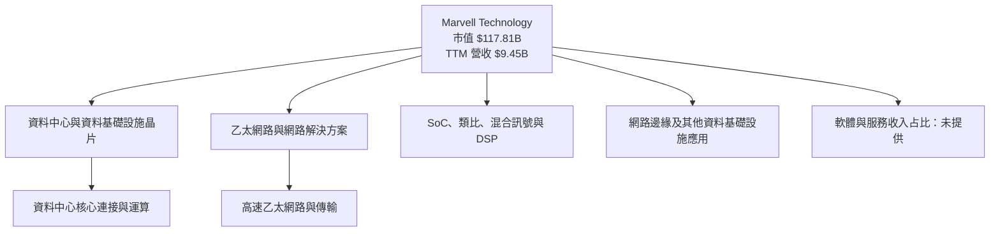
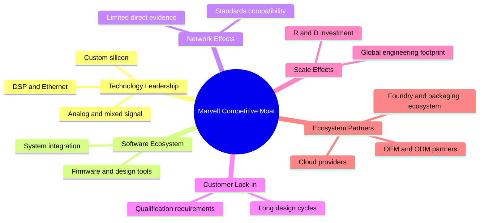
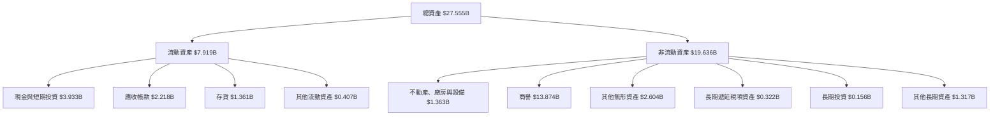
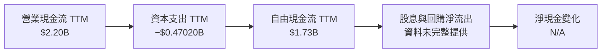
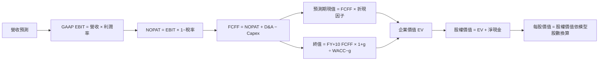
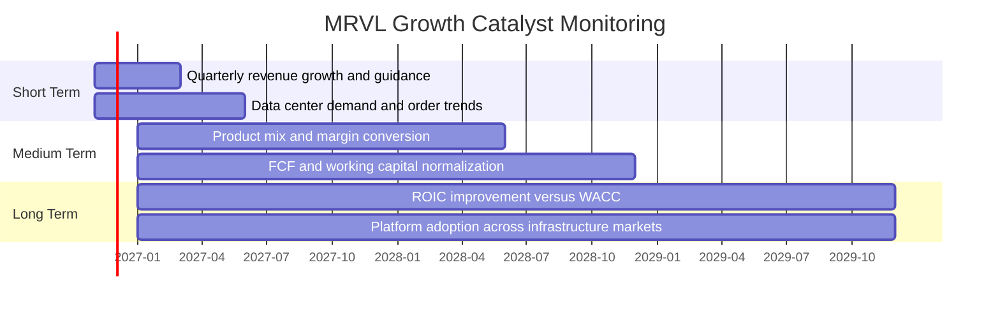
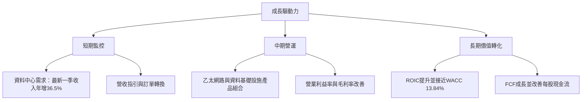
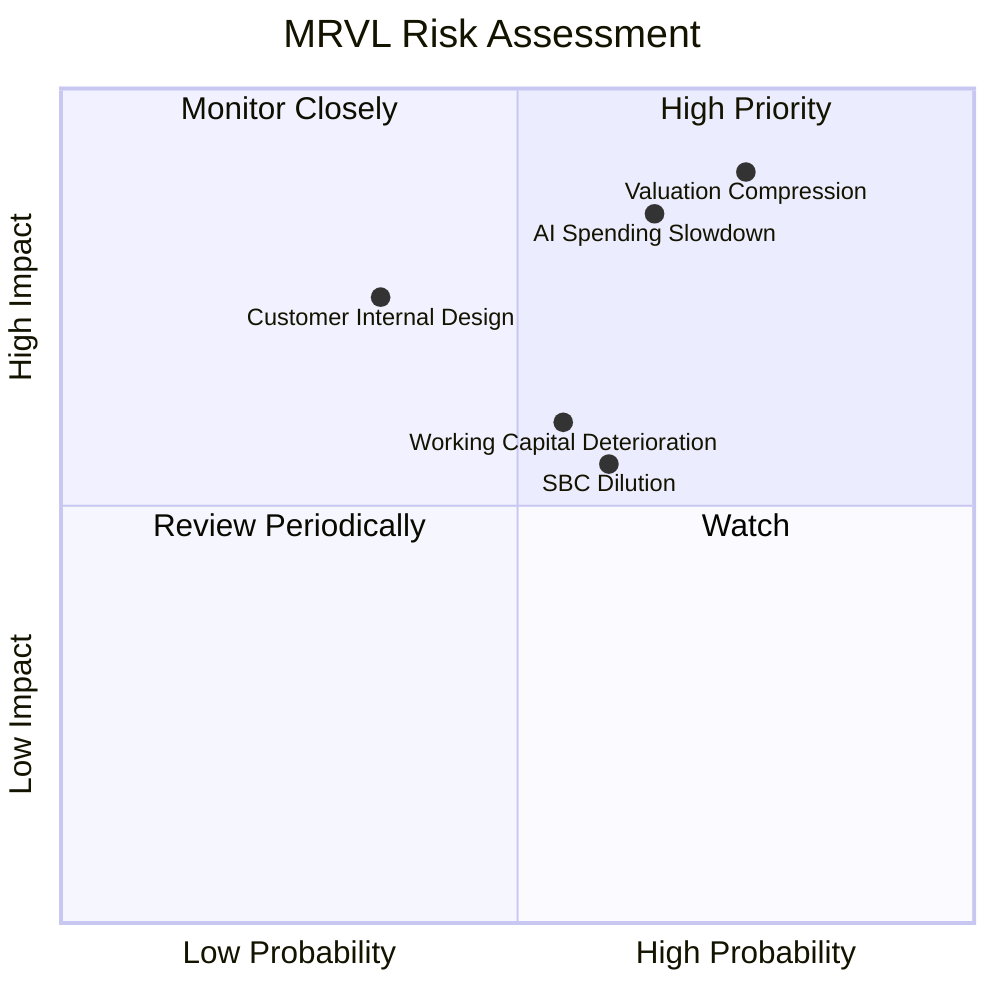
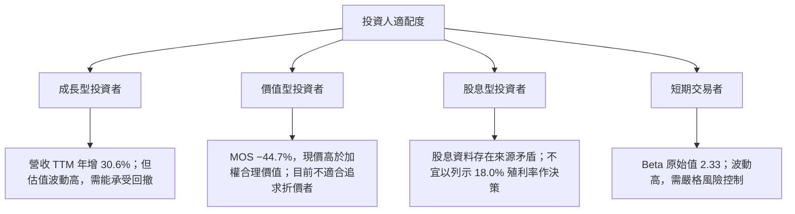

# MRVL 基本面深度分析報告
> **報告日期**：2026-11-26 ｜ **語言**：繁體中文 ｜ **數據來源**：SEC 申報資料 (XBRL)、Yahoo Finance、Finviz、StockAnalysis、Roic.ai ｜ **分析師**：CFA 級機構研究

## 目錄

| # | 章節 | 核心結論 |
|---|------|----------|
| 1 | 執行摘要 | 賣出；加權合理價值 $90.51；MOS −44.7% |
| 2 | 公司概覽與商業模式 | 資料中心與資料基礎設施需求提供成長機會，但分部營收占比未提供 |
| 3 | 損益表深度分析 | TTM 營收 $9.45B、年增 30.6%；最新一季年增 36.5% |
| 4 | 資產負債表分析 | 淨負債 $1.03B；現金與短期投資 $3.93B |
| 5 | 現金流量深度分析 | TTM FCF $1.73B，FCF Yield 1.47%；SBC 對現金流品質有影響 |
| 6 | 獲利能力與資本效率 | ROIC 6.3% 低於 WACC 13.84%，現階段未覆蓋資本成本 |
| 7 | 相對估值分析 | Forward P/E 低於同業中位數，但 DCF 與加權估值均低於現價 |
| 8 | DCF 內在價值評估 | 基準 DCF 每股 $38.67；加權合理價值 $90.51 |
| 9 | 成長催化劑 | AI／資料中心需求可能帶動需求；TAM 與各產品線營收占比未提供 |
| 10 | 風險矩陣 | 估值、AI 資本支出週期及高波動性為主要風險 |
| 11 | 投資建議 | 依 MOS 評級為賣出；現價不具足夠估值保護 |

---

## 1. 執行摘要

### 1.0 一頁式投資儀表板（Portfolio Manager 30 秒速讀）

| 項目 | 內容 |
|------|------|
| **投資論點（3 句）** | ① TTM 營收 $9.45B、年增 30.6%，最新一季年增 36.5%，顯示需求仍在擴張。② TTM FCF 為 $1.73B、FCF Yield 1.47%，現金創造為正，但報酬率不高且 SBC 對股東稀釋不可忽視。③ ROIC 6.3% 低於 WACC 13.84%，加權合理價值 $90.51 低於 2026-11-25 收盤價 $130.93。 |
| **綜合評分** | **5.7/10**（引用 1.1 六項算術平均） |
| **財務健康** | 🟡 現金與短期投資 $3.93B、總債務 $4.96B，淨負債 $1.03B；流動比率 3.168，但現金轉換週期由 113 天升至 131 天。 |
| **ROIC vs WACC** | **6.3% vs 13.84%**：低於資本成本，現階段經濟價值創造不足。 |
| **FCF 趨勢** | TTM FCF $1.73B；年度 FCF 從 FY2023 $1.07B 增至 FY2026 $1.39B，近兩年大致持平；FCF Yield **1.47%**。 |
| **估值** | Forward P/E **17.76x** ｜ EV/EBITDA **40.76x** ｜ FCF Yield **1.47%**。 |
| **DCF 內在價值（基準）** | **$38.67** ｜現價相對 DCF 溢價 **238.6%**（折溢價以 DCF 基準價值計）。 |
| **安全邊際（MOS）** | **−44.7%**＝($90.51 − $130.93) ÷ $90.51（基準為 8.8 加權合理價值）｜🔴 無安全邊際。 |
| **預期報酬（基準情境 12M）** | 以加權合理價值衡量上行空間：**−30.9%**；非保證報酬預測。 |
| **關鍵風險（前二）** | AI／資料中心資本支出放緩；目前估值仍依賴高成長預期，且 ROIC 低於 WACC。 |
| **評級 + 信心度** | 🔴 **賣出** ｜信心：中。MOS 與 DCF 均偏弱，但公司營收成長仍高，未來獲利能力改善可能改變估值。 |

### 1.1 綜合評分卡（全報告唯一）

| 維度 | 評分（1–10） | 主要依據（引用數字與其來源章節） |
|------|--------------|----------------------------------|
| 成長性 | 8.0 | TTM 營收年增 30.6%、最新一季年增 36.5%（第 3 章）；但 DCF 假設成長率由 30% 線性降至 3%。 |
| 獲利能力 | 5.5 | TTM 營業利益率 16.5%，但 ROIC 6.3% 低於 WACC 13.84%；F-Score 6/9（第 6 章）。 |
| 財務健康 | 6.0 | 淨負債 $1.03B、現金 $3.93B、流動比率 3.168；CCC 131 天，較一年前增加 18 天（第 4 章）。 |
| 估值 | 2.0 | MOS −44.7%；DCF 基準 $38.67，低於現價 $130.93（第 7–8 章）。 |
| 護城河 | 7.0 | 資料基礎設施晶片與系統設計具有技術及客戶認證門檻，但缺少分部、客戶集中度及市場份額數據（第 2 章）。 |
| 管理層與資本配置 | 5.0 | FY2026 SBC $590.8M，稀釋股數測試未通過；資本配置及回購歷史資料不足（第 3、5 章）。 |
| **綜合評分** | **5.6** | 六項算術平均：(8.0 + 5.5 + 6.0 + 2.0 + 7.0 + 5.0) ÷ 6 = 5.583，四捨五入至一位小數為 **5.6**。 |

### 1.2 五大投資論點 + 三大核心風險

| 類型 | 項目 | 具體依據 | 信心度 |
|------|------|----------|--------|
| 🟢 **投資論點①** | 營收成長維持高檔 | TTM 營收 $9.45B、年增 30.6%；最新一季年增 36.5%。若資料中心相關需求續增，可能支持營收擴張。 | 🟢 高 |
| 🟢 **投資論點②** | 現金流為正 | TTM 營業現金流 $2.20B、資本支出 $470.20M、FCF $1.73B。 | 🟢 高 |
| 🟢 **投資論點③** | 財務流動性有緩衝 | 現金與短期投資 $3.93B，流動比率 3.168；短期流動性充足。 | 🟢 高 |
| 🟡 **投資論點④** | Forward P/E 低於部分同業 | MRVL Forward P/E 17.76x；AVGO、NVDA、AMD 的 peer Forward P/E 中位數為 15.6x，MRVL 略高於該中位數，但較 AMD 低。 | 🟡 中 |
| 🟡 **投資論點⑤** | 毛利率與營業槓桿有改善空間 | TTM 毛利率 52.2%；年度收入由 FY2025 $5.77B 升至 FY2026 $8.19B，營運規模擴大可能改善成本吸收。 | 🟡 中 |
| 🟡 **風險①** | AI／資料中心支出週期反轉 | 最新一季年增 36.5%，但新聞反映 AI 股票波動及資料中心曝險遭市場重估；若雲端業者調整資本支出，成長可能放緩。 | 🟡 中 |
| 🔴 **風險②** | 估值相對現金流偏高 | 現價 $130.93，DCF 基準 $38.67；FCF Yield 僅 1.47%。 | 🔴 高衝擊 |
| 🔴 **風險③** | 資本報酬低於資金成本 | ROIC 6.3% 對 WACC 13.84%，差距 −7.54 個百分點；若長期不能改善，成長未必轉化為股東價值。 | 🔴 高衝擊 |

### 1.3 快速統計卡片

| 指標 | 公司實際值（期間） | 同業中位數 | 狀態 |
|------|--------------------|------------|------|
| 營收成長（TTM） | **30.6%** | — | 🟢 |
| 營收成長（最新一季年增） | **36.5%** | **44.7%**（AVGO、NVDA、AMD） | 🟡 |
| 毛利率（TTM） | **52.2%** | **74.9%**（三家同業中位數） | 🔴 |
| 營業利益率（TTM） | **16.5%** | — | 🟡 |
| ROIC（TTM） | **6.3%** | — | 🔴 |
| Forward P/E | **17.76x** | **15.6x**（三家同業中位數） | 🟡 |
| FCF Yield（TTM） | **1.47%** | — | 🟡 |
| Piotroski F-Score | **6 / 9** | — | 🟡 |

### 1.4 投資結論

```text
╔══════════════════════════════════════════════════════════════════╗
║                    📊 投資結論摘要                               ║
╠══════════════════════════════════════════════════════════════════╣
║  評級：🔴 賣出（依 8.8 加權合理價值的 MOS 門檻）                 ║
║  價格（2026-11-25 收盤）：$130.93                                ║
║  DCF 內在價值（基準）：$38.67（現價溢價 238.6%）                ║
║  安全邊際 MOS：−44.7%（以加權合理價值為分母）                   ║
║  加權合理價值（8.8）：$90.51                                    ║
║  DCF 情境價值：                                                  ║
║    悲觀情境：$19.54（相對現價 −85.1%）                          ║
║    基準情境：$38.67（相對現價 −70.5%）                          ║
║    樂觀情境：$73.69（相對現價 −43.7%）                          ║
║  綜合評分：5.6/10（引用 1.1）                                   ║
║  適合投資人：能承受高波動、以成長為主且願意等待估值修正者；      ║
║              不適合以現金流折價或資本保全為首要目標者。          ║
╚══════════════════════════════════════════════════════════════════╝
```

---

## 2. 公司概覽與商業模式

### 2.1 業務結構與收入來源

MRVL 提供資料基礎設施半導體解決方案，涵蓋資料中心核心至網路邊緣，並開發整合類比、混合訊號與數位訊號處理的 SoC 架構。個別產品線營收與占比未提供，因此不推估各業務的收入百分比。



**業務含義：**公司收入直接受半導體需求、雲端與資料中心投資週期影響。TTM 營收年增 30.6% 支持成長論點，但目前沒有分部營收或訂單資料，無法判斷成長是否集中於單一產品或客戶。

### 2.2 市場份額

市場份額數據未提供，因此不繪製市場占比圖、不推估市占率。MRVL TTM 營收 $9.45B，最新一季營收年增 36.5%；與 AVGO、NVDA、AMD 的最新一季營收年增率 85.5%、103.2%、44.7% 相比，MRVL 成長快於多數成熟半導體企業的典型速度，但低於這三家同業中的兩家。

### 2.3 競爭護城河分析



### 2.4 護城河強度

| 護城河項目 | 強度（強／中／弱） | 證據（引用數字或事實） | 會削弱它的情況 |
|------------|--------------------|------------------------|----------------|
| 技術與產品整合 | 中 | 公司提供 SoC、類比、混合訊號及 DSP，並聚焦資料基礎設施；TTM 營收 $9.45B。 | 競爭者以更低成本或更高效能替代；客戶轉向內部自研晶片。 |
| 軟體與生態系 | 中 | 產品面向資料中心至網路邊緣，需與客戶系統整合；但軟體收入未提供。 | 平台標準化或開源工具降低整合門檻。 |
| 網路效應 | 弱至中 | 乙太網路產品具有標準相容性，但無法由現有資料證明直接網路效應。 | 開放標準降低產品差異化。 |
| 客戶鎖定 | 中 | 半導體產品需設計導入與認證，通常有切換成本；客戶集中度資料未提供。 | 新平台轉換、客戶自研或供應商替換。 |
| 規模效應 | 中 | FY2026 研發費用 $2.08B，研發投入具規模；市場地位資料未提供。 | 研發費用增長快於收入、產品商業化延遲。 |
| 生態夥伴 | 中 | 公司在多個國家營運，產品涵蓋全球資料基礎設施供應鏈。 | 供應鏈限制、出口管制或關鍵合作關係改變。 |

**評分理由：**1.1「護城河」7.0 分，反映專業晶片設計、系統整合與客戶認證形成一定進入障礙，但目前缺乏市占率、客戶集中度與分部毛利資料，不能視為已被財務數據充分證明的強護城河。

---

## 3. 損益表深度分析

### 3.1 年度收入成長趨勢（近 4 年）

年度營收使用 StockAnalysis 歷史數據；FY2025 與部分損益表欄位存在來源差異，故以此序列計算年度增幅。

```text
╔══════════════════════════════════════════════════════════════════╗
║                Marvell 年度收入趨勢（FY2023-FY2026）              ║
╠══════════════════════════════════════════════════════════════════╣
║  FY2023  $5.92B  ██████████████░░░░░░░░░░  YoY: +7.5%   🟡      ║
║  FY2024  $5.51B  █████████████░░░░░░░░░░░  YoY: −7.0%   🔴      ║
║  FY2025  $5.77B  ██████████████░░░░░░░░░░  YoY: +4.7%   🟡      ║
║  FY2026  $8.19B  ████████████████████░░░░  YoY: +42.1%  🟢      ║
║                                                                  ║
║  FY2023–FY2026 CAGR = (8.195 ÷ 5.920)^(1/3) − 1 = 約 11.5%       ║
╚══════════════════════════════════════════════════════════════════╝
```

FY2026 年營收加速至 $8.19B，主要代表週期回升與資料基礎設施需求擴大；但單一年度高成長不宜直接外推，因 FY2024 曾下滑 7.0%，顯示公司仍具週期性。

### 3.2 季度收入趨勢分析

| 季度 | 營收 | QoQ 成長 | YoY 成長 | 備註 |
|------|------|----------|----------|------|
| 2025-11-01（FY2026 Q3） | $2.075B | N/A | 36.83% | QoQ 所需的上一季收入未列於同一季度表。 |
| 2026-01-31（FY2026 Q4） | $2.219B | +6.94% | 22.08% | 營收續增，但年增率低於前一季。 |
| 2026-05-02（FY2027 Q1） | $2.418B | +8.97% | 27.57% | 季增延續，年增率重新加速。 |
| 2026-08-01（FY2027 Q2） | $2.739B | +13.28% | 36.5% | 最新一季年增率為單季數字，不是 TTM 成長率。 |

QoQ 計算示例：($2.739B ÷ $2.418B) − 1 = 13.28%。最近兩季季增加速，與需求回升一致；若後續季增回落，年增率也可能因比較基期改變而下降。

### 3.3 利潤率演變分析

年度毛利及營業利益的來源資料存在差異，且歷史期間不完全一致；因此不以不一致數據製造年度利潤率序列。以下採用可直接引用的 TTM 與最新一季指標。

| 利潤率指標 | TTM | 最新一季 | 歷史趨勢 | 評估 |
|------------|-----|----------|----------|------|
| **毛利率** | 52.2% | N/A | TTM 年度比較值未提供 | 🟡 |
| **營業利益率** | 16.5% | 16.8% | 最新一季比 TTM 高 0.3 個百分點 | 🟡 |
| **EBITDA 利潤率** | 30.2% | N/A | 同口徑季度比較未提供 | 🟡 |
| **淨利率** | 27.9% | N/A | 最近季度淨利波動大，不宜外推 | 🟡 |

**利潤率演變深度解析：**最新一季營業利益率 16.8%，略高於 TTM 的 16.5%，可能反映產品組合及營運費用吸收改善；但缺少分部毛利率、價格與單位成本拆解，無法確認改善來源是否具持續性。FY2026 年報告營業利益 $1.34B，與 TTM 營業利益率 16.5% 的期間口徑不同，故不混用作同一年度比較。

### 3.4 費用結構分析

完整費用項目及各項目占收入比例未提供，不能把毛利、營業利益、研發費用與 SBC 拼成不完整費用圓餅圖。

已知 FY2026 研發費用為 $2.08B；同年度股權薪酬為 $590.8M。研發費用支持產品開發與新設計導入，但若增長無法轉化為收入與 ROIC，會壓低股東回報。

### 3.5 季度 EPS 趨勢與盈餘品質（Quality of Earnings）

過去四季 EPS 實際值可得，但分析師預估 EPS 欄位為空，因此無法判斷超預期或不及預期。

| 季度 | EPS 實際值 | 估計值／超預期狀態 | 觀察 |
|------|------------|--------------------|------|
| 2025-11-01 | $2.20 | N/A | 高於相鄰季度，但季度淨利與其他季度差距極大，應檢視一次性項目。 |
| 2026-01-31 | $0.47 | N/A | 與前季差異顯著。 |
| 2026-05-02 | $0.04 | N/A | EPS 明顯降低；資料無法辨識單一原因。 |
| 2026-08-01 | $0.33 | N/A | 年增 EPS 50.0%（資料來源提供），但無一致預估值可比較。 |

| 盈餘品質項目 | 數值／佔比 | 評估 |
|--------------|------------|------|
| 股權薪酬 SBC / 營收 | 估計 TTM SBC $828.9M ÷ TTM 營收 $9.45B = **8.8%** | 🟡偏高；SBC 非現金費用仍代表股東稀釋成本。TTM SBC 為所列四季 SBC 加總。 |
| SBC / 營業現金流 | $828.9M ÷ $2.20B = **37.7%** | 🟡 SBC 規模相當於營業現金流約三分之一以上，GAAP 現金流不能忽視股權支付成本。 |
| FCF / 淨利（現金轉換率） | $1.73B ÷ TTM 淨利 $2.64B = **65.5%** | 🟡低於 100%；現金轉換尚可但不算充分。 |
| 一次性／非經常性損益 | 2025-11-01 季淨利 $1.901B，營業利益 $367.9M；具異常差距，項目明細未提供 | 🟡 有潛在非經常性或稅務因素；不可把單季淨利直接年化。 |
| 有效稅率異常 | WACC 模型採用最新年度有效稅率 **12.4%** | 🟡 尚無多年稅率序列，無法判定是否可持續。 |
| 資本化支出 vs 費用化 | TTM Capex $470.20M；資本化研發等資料未提供 | 🟡 無足夠資料判定是否遞延成本或資本化政策變更。 |

**盈餘品質結論：**TTM FCF 為正，但 FCF／淨利約 65.5%，且 SBC 約占 TTM 營收 8.8%、營業現金流 37.7%。因此 GAAP 獲利有一定現金支撐，但股權薪酬造成的經濟成本與季度淨利波動應納入估值折讓。

---

## 4. 資產負債表分析

### 4.1 資產結構分解

以下採 2026-08-01 資產負債表資料。金額加總與總資產 $27.555B 相符。



資產中商譽 $13.874B，約占總資產一半；若未來收購資產的現金流低於預期，商譽減損可能壓低 GAAP 獲利及帳面權益。

### 4.2 流動性與營運資金分析

流動比率、速動比率採資料來源所列；營運資金天數照列 QUALITY FIGURES。

| 指標 | 最新 TTM | 一年前 TTM | 變化 | 解讀 |
|------|----------|------------|------|------|
| 流動比率 | 3.168 | N/A | N/A | 短期資產覆蓋流動負債能力良好；年度比較未提供同口徑。 |
| 速動比率 | 2.461 | N/A | N/A | 排除存貨後仍具流動性緩衝。 |
| DSO 應收帳款天數 | 86 天 | 73 天 | +13 天 | 收款天數增加，需追蹤客戶付款與應收帳款品質。 |
| DIO 存貨天數 | 110 天 | 96 天 | +14 天 | 存貨占用資金增加；若產品需求不及預期，可能帶來跌價風險。 |
| DPO 應付帳款天數 | 64 天 | 56 天 | +8 天 | 付款天數增加，可能代表供應商付款條件或採購週期變化；不宜單獨視為議價能力改善。 |
| CCC 現金轉換週期 | 131 天 | 113 天 | +18 天 | 現金被營運資金占用的期間延長，是近期營運資金效率的負面訊號。 |

### 4.3 債務結構分析

```text
╔══════════════════════════════════════════════════════════════════╗
║                   Marvell 債務健康診斷                           ║
╠══════════════════════════════════════════════════════════════════╣
║  總債務（估值／資本成本口徑）：$4.96B                             ║
║  現金及短期投資：             $3.93B                              ║
║  淨負債：                     $1.03B  🟡                          ║
║                                                                  ║
║  淨負債 = $4.96B − $3.93B = $1.03B                               ║
║  流動比率：3.168x  🟢                                             ║
║  速動比率：2.461x  🟢                                             ║
║  Debt/EBITDA：N/A（計算口徑與債務資料存在來源差異，不反推）       ║
║  Interest Coverage：N/A（利息費用與營業利益同口徑資料未提供）     ║
╚══════════════════════════════════════════════════════════════════╝
```

市場資料另列總債務 $5.29B、淨負債 $1.35B，與 SEC 及資本成本採用的 $4.96B／$1.03B 不同。本報告在需引用「VERIFIED FIGURES」的估值及淨負債分析中，採用 $4.96B 總債務與 $1.03B 淨負債，不混用不同來源口徑。

### 4.4 股東權益趨勢

```text
╔══════════════════════════════════════════════════════════════════╗
║                  Marvell 股東權益變化                             ║
╠══════════════════════════════════════════════════════════════════╣
║  FY2023  $15.64B  ████████████████████░░░░  🟢                   ║
║  FY2024  $14.83B  ███████████████████░░░░░  🟡                   ║
║  FY2025  $13.43B  █████████████████░░░░░░░  🟡                   ║
║  FY2026  $14.31B  ██████████████████░░░░░░  🟡                   ║
╚══════════════════════════════════════════════════════════════════╝
```

FY2026 股東權益較 FY2025 回升，但未恢復至 FY2023 水準。SBC 與股數增加是需要持續監控的股東回報因素；單看權益變動不足以判定資本配置效率。

---

## 5. 現金流量深度分析

### 5.1 現金流量瀑布圖

因未提供可比口徑的 TTM 淨利、股息、回購及淨現金變化完整瀑布數據，以下只呈現有實際金額的營運現金流至 FCF 關係；不補造未提供項目。



### 5.2 FCF 轉換率趨勢

| 財年 | FCF | 淨利 | FCF／淨利 | 備註 |
|------|-----|------|-----------|------|
| FY2023 | $1.07B | −$0.164B | 不具經濟意義 | 淨利為負，比例不適合比較。 |
| FY2024 | $1.02B | −$0.933B | 不具經濟意義 | FCF 為正但 GAAP 淨利為負，可能受非現金費用影響。 |
| FY2025 | $1.39B | −$0.885B | 不具經濟意義 | 同樣不宜用比值解讀。 |
| FY2026 | $1.39B | $2.67B | 約 52.1% | FCF 使用年度報表值；淨利為年度資料。 |
| TTM | $1.73B | $2.64B | 約 65.5% | TTM FCF 使用規定口徑 OCF−Capex。 |

年度損益資料出現多個負淨利年度，而現金流為正，反映 GAAP 盈餘受非現金項目、收購相關攤銷或稅務因素影響；但缺乏完整調節表，不能將差異歸因於單一因素。

### 5.3 自由現金流趨勢

```text
╔══════════════════════════════════════════════════════════════════╗
║               自由現金流與現金殖利率                             ║
╠══════════════════════════════════════════════════════════════════╣
║  FY2023  FCF $1.07B  ███████████████░░░░░░░  FCF Yield：N/A      ║
║  FY2024  FCF $1.02B  ██████████████░░░░░░░░  FCF Yield：N/A      ║
║  FY2025  FCF $1.39B  ███████████████████░░░  FCF Yield：N/A      ║
║  FY2026  FCF $1.39B  ███████████████████░░░  FCF Yield：N/A      ║
║  TTM     FCF $1.73B  ██████████████████████  FCF Yield：1.47%    ║
╚══════════════════════════════════════════════════════════════════╝
```

年度 FCF 從 FY2023 至 FY2026 大致增加，但 FY2025、FY2026 均約 $1.39B，年度增長暫停。TTM FCF 提高至 $1.73B，與營收加速一致；然而 FCF Yield 1.47% 代表現價對現金流仍給予較高成長預期。

### 5.4 資本配置評估

資本配置 Pie Chart 所需各類別完整金額未提供，故不繪製比例圖。

| 項目 | 已知資料 | 評估 |
|------|----------|------|
| 資本支出 | TTM $470.20M；FY2026 $358.60M | TTM Capex 約占 TTM 營收 5.0%，支持營運，但投資報酬明細未提供。 |
| 股息 | FY2026 支付 $205.1M；季度每股股息資料約 $0.06 | 現金股息規模低於年度 FCF。 |
| SBC | FY2026 $590.8M | 高於 FY2026 現金股息；股權薪酬的稀釋成本須納入評估。 |
| 回購 | 金額未提供 | 無法量化回購是否抵銷股數稀釋。 |
| 留存現金 | 2026-08-01 現金與短期投資 $3.93B | 提供流動性，但目前仍為淨負債狀態。 |

提供的股息殖利率資料列示 18.0%，與季度股息及股價背景不一致，疑為資料品質問題；本報告不採用該 18.0% 作為投資依據，也不以其推導股息回報。

---

## 6. 獲利能力與資本效率

### 6.1 ROE / ROA / ROIC 趨勢

歷史 ROE、ROA、ROIC 的完整可比序列未提供；以下只列可直接引用的 TTM 指標與 DuPont 資料。

| 指標 | TTM | 其他可得資料 | 評估 |
|------|-----|--------------|------|
| ROE | 14.2%（QUALITY FIGURES） | 其他匯總資料另列 16.5%，口徑有差異 | 採用品質指標計算值 14.2%。 |
| ROA | N/A（品質指標未提供可比 TTM 數值） | 其他匯總資料列 4.1% | 不與其他期間數值混為同一口徑。 |
| ROIC | 6.3% | TTM after-tax operating income ÷ (equity + debt − cash) | 低於 WACC 13.84%。 |
| WACC | 13.84% | 資本成本資料 | 資本成本高於目前投入資本回報。 |

### 6.2 ROIC vs WACC 分析（核心價值創造判斷）

```text
╔══════════════════════════════════════════════════════════════════╗
║                ROIC vs WACC 深度分析                             ║
╠══════════════════════════════════════════════════════════════════╣
║  WACC（直接採用資本成本資料）：13.84%                             ║
║  ├── 無風險利率（10Y 美債）：     4.85%                           ║
║  ├── 市場風險溢酬 ERP：           5.00%                           ║
║  ├── 原始 Beta：                  2.33                            ║
║  ├── 調整後 Beta：                1.88                            ║
║  ├── 股權成本 Ke：                14.27%                          ║
║  ├── 稅前債務成本：               4.08%                           ║
║  ├── 稅後債務成本：               4.08% × (1−12.4%) = 3.57%       ║
║  ├── 資本權重：股權 96.0%，債務 4.0%                              ║
║  └── WACC：                       13.84%                          ║
║                                                                  ║
║  ROIC（TTM，採 VERIFIED FIGURES）：6.3%                           ║
║  EVA spread = ROIC − WACC = 6.3% − 13.84% = −7.54 個百分點       ║
║  ROIC / WACC = 6.3% ÷ 13.84% = 0.46x                             ║
║                                                                  ║
║  ROIC  6.3%   ▓▓▓▓▓▓▓▓▓▓▓░░░░░░░░░░░░░░░░░░░░  🔴               ║
║  WACC 13.84%  ▓▓▓▓▓▓▓▓▓▓▓▓▓▓▓▓▓▓▓▓▓▓▓▓▓▓▓▓▓▓  ──               ║
║                                                                  ║
║  結論：目前 ROIC 低於 WACC，按此口徑尚未覆蓋資本成本。           ║
╚══════════════════════════════════════════════════════════════════╝
```

**股權成本驗算：**  
Ke = Rf + β × ERP = 4.85% + 1.88 × 5.00% = 14.25%；資本成本區塊直接列示 **14.27%**，本報告遵照區塊採用值，不以四捨五入後重算值替換。原始 Beta 2.33 依區塊採用調整後 Beta：⅔ × 2.33 + ⅓ = 約 1.89，區塊指定值為 1.88。

WACC 五步推導如下：  
1. **Ke**：資本成本區塊採用 14.27%。  
2. **稅前 Kd**：利息費用金額未提供；採用區塊列示的利息／債務成本 **4.08%**，不反推利息金額。  
3. **稅後 Kd**：4.08% × (1 − 12.4%) = **3.57408% ≈ 3.57%**。  
4. **權重**：E/D 權重直接採用 **96.0%／4.0%**；市值與債務權重已由資本成本資料計算，避免以來源口徑不一的負債自行重建權重。  
5. **WACC**：96.0% × 14.27% + 4.0% × 3.57% = 13.6992% + 0.1428% = **13.842% ≈ 13.84%**。

**價值創造判斷：**以 ROIC 6.3% 與 WACC 13.84% 比較，差距為 −7.54 個百分點，顯示現行營運回報未達資金要求報酬率。若未來產品組合與營業利益率改善，ROIC 有機會上升；但目前可用數據不足以證明該改善已實現。

### 6.3 杜邦三因素分解

| 因素 | 數值（TTM） | 解讀 |
|------|-------------|------|
| 淨利率 | 27.9% | 高淨利率提高 ROE，但 TTM 淨利受異常季度與可能非經常項目影響，須審慎看待。 |
| 資產週轉率 | 0.34x | 每單位資產創造的收入不高，且公司商譽與無形資產占資產較大。 |
| 權益乘數 | 1.49x | 槓桿程度不算主要 ROE 驅動因素。 |
| **ROE** | **14.2%** | 27.9% × 0.34 × 1.49 = 14.13%，與區塊列示 14.2% 的差異來自四捨五入。 |

### 6.4 財務體質：Piotroski F-Score

**Piotroski F-Score：6 / 9**（TTM 至 2026-08-01 對比 TTM 至 2025-08-02；缺少輸入的測試不納入分母）。

| 測試 | 結果 | 解讀 |
|------|------|------|
| ROA > 0 | ✅ 通過 | 盈利能力指標為正。 |
| 營業現金流 > 0 | ✅ 通過 | TTM 營業現金流 $2.20B。 |
| ROA 高於一年前 | ✅ 通過 | 盈利資產效率改善。 |
| 營業現金流 > 淨利（應計品質） | ❌ 未通過 | 現金流低於淨利，與約 65.5% 的 FCF／淨利轉換率一致。 |
| 長期負債 ÷ 總資產低於一年前 | ✅ 通過 | 槓桿相對資產的比較結果改善。 |
| 流動比率高於一年前 | ✅ 通過 | 短期流動性相對改善。 |
| 稀釋股數未增加 | ❌ 未通過 | 股數增加代表原有股東持股比例被稀釋。 |
| 毛利率高於一年前 | ✅ 通過 | 毛利率比較測試通過。 |
| 資產週轉率高於一年前 | ❌ 未通過 | 資產增長未同步帶來相同幅度的營收效率改善。 |

F-Score 6/9 顯示財務基本面多數測試通過，但應計品質、股數稀釋與資產週轉率是三項警訊。

---

## 7. 相對估值分析

### 7.1 同業估值比較

MRVL 倍數採市場估值資料；同業倍數依 Peer multiples 區塊。不同資料來源的 MRVL P/E、P/S、EV/EBITDA 略有差異，故此表明確採用同一市場估值區塊的 MRVL 值，而同業採指定 Peer multiples。

| 估值指標 | **MRVL** | **AVGO** | **NVDA** | **AMD** | MRVL 評估 |
|----------|----------:|--------:|--------:|-------:|-----------|
| **Trailing P/E** | 43.07x | 38.4x | 16.0x | 86.8x | 🟡 高於 AVGO、NVDA，低於 AMD。 |
| **Forward P/E** | 17.76x | 15.6x | 9.0x | 23.0x | 🟡 高於同業中位數 15.6x；低於 AMD。 |
| **P/S Ratio** | 12.47x | 16.1x | 10.0x | 14.8x | 🟡 介於 NVDA 與 AVGO／AMD 之間。 |
| **EV/EBITDA** | 40.76x | 28.2x | 14.5x | 59.2x | 🔴 高於 AVGO、NVDA；低於 AMD。 |
| **最新一季營收年增** | 36.5% | 85.5% | 103.2% | 44.7% | 🟡 成長低於三家同業。 |
| **毛利率（TTM）** | 52.2% | 75.5% | 74.9% | 56.0% | 🔴 低於三家同業。 |

MRVL 的 Forward P/E 17.76x 並非同業最低，且 EV/EBITDA 高於 AVGO、NVDA；因此「比 AMD 便宜」不等同於整體估值具吸引力。更重要的是 ROIC 低於 WACC，較高倍數需由未來資本回報改善來支持。

### 7.2 歷史估值區間分析

```text
╔══════════════════════════════════════════════════════════════════╗
║                  MRVL 五年估值區間                                ║
╠══════════════════════════════════════════════════════════════════╣
║  P/E：       25.6x ├────────●──────────────┤ 61.9x               ║
║                          現值 43.2x；中位數 56.5x；百分位 50%    ║
║  P/S：        5.8x ├────────────────●──────┤ 18.3x               ║
║                          現值 12.8x；中位數 9.9x；百分位 75%     ║
║  EV/EBITDA： 53.3x ├──●────────────────────┤ 730.9x              ║
║                          現值 77.9x；中位數 156.4x；百分位 25%  ║
╚══════════════════════════════════════════════════════════════════╝
```

從自身歷史看，P/E 現值低於五年中位數，但 P/S 位於歷史 75 百分位；EV/EBITDA 低於歷史中位數，然而倍數區間受歷史極端值影響很大。歷史相對便宜不能替代絕對現金流估值。

### 7.3 情境價值（Bear / Base / Bull，照抄 DCF MODEL）

| 情境 | 第 1 年營收成長 | 期末營業利潤率 | WACC | 每股價值 | 相對現價 | 機率 | 會發生的條件 |
|------|----------------|----------------|------|----------|----------|------|--------------|
| 🔴 悲觀 | 15.0% | 3.4% | 14.84% | $19.54 | −85.1% | 25% | 資料中心訂單放緩、競爭加劇，營收成長低於基準且資金成本維持高檔。 |
| 🟡 基準 | 30.0% | 4.0% | 13.84% | $38.67 | −70.5% | 50% | 起始成長接近 TTM 成長，之後逐年減速，營業利潤率長期回落至歷史中位數假設。 |
| 🟢 樂觀 | 45.0% | 4.4% | 12.84% | $73.69 | −43.7% | 25% | AI／資料中心需求顯著超預期、成長維持較久且資金成本下降。 |

基準情境仍顯著低於現價；即便採樂觀情境，模型價值仍低於 $130.93，顯示現價包含高於上述模型情境的預期。

### 7.4 相對估值隱含價格區間

```text
╔══════════════════════════════════════════════════════════════════╗
║              相對估值隱含每股價值與現價                           ║
╠══════════════════════════════════════════════════════════════════╣
║  $38.67 ── $65.85 ── $90.51 ── $114.71 ── $130.93 ── $298.99   ║
║   DCF      EV/EBITDA  加權值    Forward P/E      現價     共識   ║
╚══════════════════════════════════════════════════════════════════╝
```

| 方法 | 每股價值 | 相對現價 | 依據 |
|------|---------:|---------:|------|
| DCF（基準） | $38.67 | −70.5% | 10 年 FCFF、WACC 13.84%、終值成長率 3.0%。 |
| 同業 Forward P/E | $114.71 | −12.4% | Peer 中位數 15.6x × Forward EPS $7.37。 |
| 同業 EV/EBITDA | $65.85 | −49.7% | AVGO、NVDA 中位數 21.4x × TTM EBITDA，再加淨現金／負債橋接。 |
| 分析師共識目標價 | $298.99 | +128.4% | 39 位分析師平均目標價；不等同內在價值。 |

分析師共識與 DCF 基準價差距極大，反映對成長與估值倍數的假設分歧。共識目標價不應替代現金流或資本回報分析。

---

## 8. DCF 內在價值評估（Discounted Cash Flow）

> **口徑說明：**本章逐年預測、終值、橋接、敏感度與情境均照 DCF MODEL 的數字引用。金額單位為美元；表格金額以 $B 表示，除每股價值外取兩位小數。由於模型未將營運資金變動納入 FCFF，也未提供非基準敏感度格的中間現金流明細，相關項目明確列示，不自行重建第二套 DCF。

### 8.0 估值推理鏈（Thinking Logic）

**Step 1 — 價值由哪些變數決定？**  
MRVL 的模型價值主要由資料基礎設施晶片現有收入基礎、後續資料中心成長，以及長期 GAAP 營業利益率決定。公司總 TTM 營收為 $9.45B，但各產品線占比未提供，不能把某一業務的營收比重視為已知。模型敏感度表顯示 WACC 與永續成長率會顯著改變結果；在營運端，營收成長路徑與長期利潤率是估值的重要來源。

**Step 2 — 模型選擇**

| 決策點 | 本報告採用 | 理由（含數字） | 曾考慮但否決 | 否決理由 |
|--------|-----------|----------------|--------------|----------|
| 現金流定義 | FCFF | 使用 NOPAT + D&A − Capex，並以 WACC 折現求 EV。 | FCFE | 債務成本及股權成本皆進入資本結構，FCFF 對應 EV 橋接。 |
| 預測期 N | 10 年 | DCF MODEL 固定預測 FY+1 至 FY+10。 | 5 年 | 會提前將成長曲線交給終值，與既定模型不一致。 |
| 終值方法 | Gordon Growth | 模型給定永續成長率 3.0%，且 WACC 13.84% 高於 g。 | 退出倍數作主要估值 | DCF MODEL 未提供完整終值 EBITDA 退出倍數計算，不能自行另建模型。 |
| EBIT 基礎 | GAAP EBIT | 模型明確採 GAAP EBIT，TTM 營業利益率 16.5%。 | 非 GAAP EBIT | 可能加回 SBC，與模型設定及股數處理不同。 |

**Step 3 — 主要假設推導鏈**

- **營收成長路徑（高敏感度）**：錨點＝TTM 營收年增 30.6%；最新一季年增 36.5% → 調整＝起始成長率限制於 30%，並由 30% 線性降至第 10 年 3%，反映目前成長不應永久延續 → **採用 FY+1 30.0%、FY+10 3.0%** → 曾考慮把 36.5% 當作起始值，但模型上限設定為 30%，且單季年增不宜直接外推十年。
- **營業利潤率（高敏感度）**：錨點＝TTM GAAP 營業利益率 16.5% → 調整＝依模型逐年淡化至近五個財年的中位數 → **FY+1 16.5% 線性降至 FY+10 4.0%** → 曾考慮維持 16.5%，但這會假設近期利潤率永久維持，未反映週期與競爭風險。
- **永續成長率 g（高敏感度）**：錨點＝模型採用長期名目成長假設 3.0% → 調整＝成熟期成長應低於短期成長，且必須低於 WACC → **採用 3.0%** → 否決更高 g，避免終值過度依賴高成長；目前資料未提供可驗證的長期名目 GDP 假設。
- **預測期 N（中敏感度）**：錨點＝模型指定 10 年；公司產品設計週期與成長延續年數未提供可核實估計 → **採用 10 年** → 否決自行縮短或延長，因 DCF MODEL 已固定期間，且更改會違反統一模型口徑。
- **Capex／營收（中敏感度）**：錨點＝TTM 資本支出 $470.20M ÷ TTM 營收 $9.45B，約 5.0% → 模型採平坦比例 → **FY+1 至 FY+10 均按 5.0%** → 否決自訂更低資本支出率，避免提高 FCF 而缺乏資料依據。
- **EBIT 基礎與 SBC 處理（中敏感度）**：錨點＝FY2026 SBC $590.8M、TTM GAAP 營業利益率 16.5% → 採用 GAAP EBIT，SBC 已在費用中 → **採用組合 (A)：GAAP EBIT + 固定股數；不另扣 SBC，年稀釋率 0%** → 否決再扣 SBC 或再放大股數，避免重複計算同一成本。
- **年稀釋率（中敏感度）**：錨點＝品質指標顯示稀釋股數測試未通過，歷史股數增加 → 組合 (A) 已把 SBC 視為 GAAP 費用，模型同時指定不再稀釋 → **採用模型固定股數處理** → 否決自行加年稀釋率，避免違反模型指定組合及重複計入。
- **WACC（高敏感度）**：錨點＝資本成本區塊 WACC 13.84% → 調整理由＝不另作調整，直接使用資本成本輸入 → **採用 13.84%** → 否決另用較低折現率，因會與資本成本及第 6.2 節不一致。
- **D&A／營收（低敏感度）**：錨點＝TTM D&A／營收 13.3% → **採用 13.3% 固定**；不另設第二個假設值。
- **有效稅率（低敏感度）**：錨點＝最新年度有效稅率 12.4% → **採用 12.4%**。
- **營運資金變動**：DCF MODEL 明確未建模；**不假設 ΔWC／營收增額比例，也不加入 FCFF**。這是模型限制，不代表營運資金需求為零。

**Step 4 — 最脆弱環節**  
最脆弱環節是營業利益率與營運資金路徑：模型把營業利益率由 16.5% 降至 4.0%，但又不扣營運資金變動；若現實中營運資金持續吸收現金，或成長期利潤率下滑比模型慢／快，DCF 價值都可能明顯偏離，方向取決於現金流與利潤率實際走勢。

**Step 5 — 計算路徑圖**



### 8.1 模型假設總表（Model Inputs）

| 假設項目 | 採用值 | 依據／來源 | 敏感度 |
|----------|--------|-------------|--------|
| 預測期長度 **N** | 10 年 | DCF MODEL 固定期間；逐年表列 FY+1 至 FY+10。 | 🟡 中 |
| 營收成長路徑 | FY+1 30.0%，FY+10 3.0%，線性遞減 | TTM 成長 30.6%；模型把起始值限制於 30%。 | 🔴 高 |
| 營業利潤率 | FY+1 16.5% → FY+10 4.0% | 以 TTM 營業利益率及近五年中位數作模型錨點。 | 🔴 高 |
| 有效稅率 | 12.4% | 最新年度有效稅率。 | 🟢 低 |
| Capex／營收 | 5.0% | TTM Capex $470.20M ÷ TTM 營收 $9.45B，約 5.0%；模型採用值照錄。 | 🟡 中 |
| D&A／營收 | 13.3% | DCF MODEL 列示的 TTM 比例。 | 🟢 低 |
| 營運資金變動／營收增額 | 未建模 | 模型明確排除營運資金變動，不能自行填比例。 | 🟢 低 |
| EBIT 基礎 | GAAP | DCF MODEL 使用 GAAP EBIT。 | 🟡 中 |
| SBC 處理 | 組合 (A)：GAAP 已費用化、不另扣 SBC | 模型明確表示 SBC 已含於 GAAP EBIT。 | 🟡 中 |
| 年稀釋率 | 0%（模型固定股數） | 模型明確不再額外稀釋股數，與組合 (A) 一致。 | 🟡 中 |
| 永續成長率 g | 3.0% | DCF MODEL 指定；低於 WACC。 | 🔴 高 |
| 終值方法 | Gordon Growth | DCF MODEL 已提供終值，不另建退出倍數模型。 | 🔴 高 |
| WACC | 13.84% | Cost of capital 區塊；第 6.2 節採同一值。 | 🔴 高 |

**模型處理確認：**本模型採用 **(A) GAAP EBIT + 固定股數**，故 SBC 影響已計入一次；FCFF 不另減 SBC，股數也不再逐年放大。模型 FCFF 定義為 NOPAT + D&A − Capex；營運資金變動未建模。

### 8.2 折現率推導（WACC）

```text
╔══════════════════════════════════════════════════════════════════╗
║                    WACC 推導（折現率）                           ║
╠══════════════════════════════════════════════════════════════════╣
║  股權成本 Ke（CAPM）：                                           ║
║  ├── 無風險利率 Rf：                 4.85%                       ║
║  ├── 市場風險溢酬 ERP：              5.00%                       ║
║  ├── 原始 Beta（Yahoo）：            2.33                        ║
║  ├── 調整後 Beta（採用）：           1.88                        ║
║  ├── 規模／國別溢酬：                0.00%（未另加）             ║
║  └── 區塊列示 Ke：                   14.27%                      ║
║                                                                  ║
║  債務成本 Kd：                                                   ║
║  ├── 稅前 Kd（利息 ÷ 債務）：        4.08%                       ║
║  ├── 有效稅率：                      12.4%                       ║
║  └── 稅後 Kd = 4.08% × (1−12.4%) = 3.57408% ≈ 3.57%             ║
║                                                                  ║
║  資本結構權重：                                                  ║
║  ├── 股權權重：                      96.0%                       ║
║  ├── 債務權重：                      4.0%                        ║
║  └── WACC = 96.0%×14.27% + 4.0%×3.57% = 13.842% ≈ 13.84%       ║
╚══════════════════════════════════════════════════════════════════╝
```

**輸入來歷與限制：**10 年期美債無風險利率為 4.85%，但具體觀測日期未提供；ERP 5.00% 為資本成本資料中的假設值。原始 Beta 2.33，採用調整後 Beta 1.88（區塊指定調整值）。沒有另加規模或國別溢酬。稅前債務成本直接採用區塊列示的 4.08%；利息金額與平均計息負債明細未提供，因此不虛構第 2 步的利息金額除法。E/D 權重直接採用區塊所列 96.0%／4.0%。本 WACC 與第 6.2 節一致。

### 8.3 逐年自由現金流預測（基準情境）

| 年度 | FY+1 | FY+2 | FY+3 | FY+4 | FY+5 | FY+6 | FY+7 | FY+8 | FY+9 | FY+10 |
|------|------:|------:|------:|------:|------:|------:|------:|------:|------:|-------:|
| 營收 | 12.29 | 15.60 | 19.35 | 23.41 | 27.62 | 31.77 | 35.58 | 38.78 | 41.11 | 42.34 |
| 營收 YoY | 30.0% | 27.0% | 24.0% | 21.0% | 18.0% | 15.0% | 12.0% | 9.0% | 6.0% | 3.0% |
| 營業利潤率 | 16.5% | 15.1% | 13.7% | 12.4% | 11.0% | 9.6% | 8.2% | 6.8% | 5.4% | 4.0% |
| 營業利益 EBIT（GAAP） | 2.03 | 2.36 | 2.66 | 2.89 | 3.03 | 3.04 | 2.91 | 2.64 | 2.22 | 1.70 |
| − 稅（12.4%） | (0.25) | (0.29) | (0.33) | (0.36) | (0.37) | (0.38) | (0.36) | (0.33) | (0.27) | (0.21) |
| = NOPAT | 1.78 | 2.07 | 2.33 | 2.53 | 2.65 | 2.67 | 2.55 | 2.31 | 1.95 | 1.49 |
| + D&A | 1.64 | 2.08 | 2.58 | 3.12 | 3.69 | 4.24 | 4.75 | 5.18 | 5.49 | 5.65 |
| − Capex | (0.61) | (0.78) | (0.96) | (1.16) | (1.37) | (1.58) | (1.77) | (1.93) | (2.05) | (2.11) |
| − ΔWC | 未建模 | 未建模 | 未建模 | 未建模 | 未建模 | 未建模 | 未建模 | 未建模 | 未建模 | 未建模 |
| **= FCFF** | **2.81** | **3.38** | **3.95** | **4.49** | **4.97** | **5.33** | **5.53** | **5.56** | **5.39** | **5.04** |
| 折現因子 @13.84% | 0.878 | 0.772 | 0.678 | 0.595 | 0.523 | 0.459 | 0.404 | 0.355 | 0.311 | 0.274 |
| **FCFF 現值 PV** | **2.47** | **2.60** | **2.68** | **2.68** | **2.60** | **2.45** | **2.23** | **1.97** | **1.68** | **1.38** |

**預測期 PV 合計：**  
$2.47 + $2.60 + $2.68 + $2.68 + $2.60 + $2.45 + $2.23 + $1.97 + $1.68 + $1.38 = **$22.74B**。模型列示合計為 **$22.73B**；約 $0.01B 差異來自逐格以兩位小數呈現與未四捨五入底層值相加，沿用模型合計。

**FY+1 逐步演算：**

1. **營收** = $9.45B × (1 + 30.0%) = $12.285B ≈ **$12.29B**。  
2. **EBIT** = $12.29B × 16.5% = $2.02785B ≈ **$2.03B**。  
3. **稅** = $2.03B × 12.4% = $0.25172B ≈ **$0.25B**。  
4. **NOPAT** = $2.03B − $0.25B = **$1.78B**。  
5. **D&A** = $12.29B × 13.3% = $1.63457B ≈ **$1.64B**。  
6. **Capex** = $12.29B × 5.0% = $0.6145B ≈ **$0.61B**。  
7. **ΔWC** = **未建模**（DCF MODEL 明確未納入）。  
8. **FCFF** = $1.78B + $1.64B − $0.61B = **$2.81B**。  
9. **折現因子** = 1 ÷ (1 + 13.84%)¹ = 0.878；**PV** = $2.81B × 0.878 = $2.467B ≈ **$2.47B**。

**合理性自檢：**

- 預測 FCFF FY+1 $2.81B 至 FY+10 $5.04B 的 9 年 CAGR 約為 **6.7%**；FY2023 至 FY2026 歷史 FCF $1.07B 至 $1.39B 的三年 CAGR 約 **9.1%**。預測增速較低，主因模型將利潤率逐年壓至 4.0%。
- FY+10 FCFF 利潤率 = $5.04B ÷ $42.34B = **11.9%**；目前 TTM FCF 利潤率 = $1.73B ÷ $9.45B = **18.3%**。同業最佳 FCF 利潤率未提供，不能作數值比較。
- 預測期間各年 FCFF 均為正；不含 ΔWC，可能高估成長期自由現金流。

```text
╔══════════════════════════════════════════════════════════════════╗
║            自由現金流：歷史實際 vs 模型預測                      ║
╠══════════════════════════════════════════════════════════════════╣
║  FY2024(實)  $1.02B  ███████░░░░░░░░░░░░░░░░░░░░░              ║
║  FY2025(實)  $1.39B  █████████░░░░░░░░░░░░░░░░░░░              ║
║  FY2026(實)  $1.39B  █████████░░░░░░░░░░░░░░░░░░░              ║
║  FY+1 (預)   $2.81B  ██████████████████░░░░░░░░░              ║
║  FY+10(預)   $5.04B  ██████████████████████████████            ║
╠══════════════════════════════════════════════════════════════════╣
║  ⚠️ FY+1 至 FY+10 FCFF CAGR 約 6.7%，低於近期歷史 FCF CAGR 約 9.1%║
║  ⚠️ 模型未扣營運資金變動，現金轉換週期上升可能使實際 FCF 更低。 ║
╚══════════════════════════════════════════════════════════════════╝
```

### 8.4 終值計算（Terminal Value）

**適用性檢查：**WACC 13.84% vs g 3.0% → WACC > g？✅

| 方法 | 計算式 | 終值 TV | TV 現值 | 佔總 EV 比重 |
|------|--------|---------|---------|--------------|
| Gordon Growth（模型提供） | $5.04B × (1 + 3.0%) ÷ (13.84% − 3.0%) | $47.87B | $13.10B | 36.6% |
| 退出倍數法 | N/A（DCF MODEL 未提供退出倍數終值及相關中間值；不另建模型） | N/A | N/A | N/A |

**Gordon Growth 逐步演算：**

1. FY+10 FCFF = **$5.04B**（取自 8.3）。  
2. 分子 = $5.04B × (1 + 3.0%) = $5.1912B。  
3. 分母 = 13.84% − 3.0% = 10.84%；TV = $5.1912B ÷ 10.84% = **$47.87B**。  
4. PV(TV) = $47.87B × 0.274 = **$13.10B**。  
5. PV(TV) ÷ EV = $13.10B ÷ $35.83B = **36.6%**（模型列示值）。

終值占企業價值 36.6%，低於 75% 警戒線，但仍約占 EV 三分之一以上，故 g 與 WACC 仍會明顯影響估值。

### 8.5 企業價值 → 每股內在價值（Bridge）

```text
╔══════════════════════════════════════════════════════════════════╗
║              企業價值 → 每股內在價值 橋接表                      ║
╠══════════════════════════════════════════════════════════════════╣
║  預測期 FCF 現值合計              +$22.73B                       ║
║  終值現值 PV(TV)                  +$13.10B                       ║
║  ─────────────────────────────────────────────                  ║
║  = 企業價值 EV                     $35.83B                       ║
║  + 淨現金（負值即淨負債）          −$1.03B                       ║
║  = 股權價值                        $34.80B                       ║
║  每股價值：模型指定換算             $38.67                         ║
║  2026-11-25 收盤價                  $130.93                        ║
║  折溢價（現價÷DCF價值−1）           +238.6% 溢價                  ║
╚══════════════════════════════════════════════════════════════════╝
```

**逐步演算：**

1. **EV** = $22.73B + $13.10B = **$35.83B**。  
2. **股權價值** = $35.83B + 淨現金（−$1.03B） = **$34.80B**。  
3. **每股內在價值**：模型指定公式為股權價值 × 價格 ÷ 市值；$34.80B × $130.93 ÷ $117.81B = **$38.67**（模型列示值；計算採未四捨五入底層數字）。  
4. **折溢價** = $130.93 ÷ $38.67 − 1 = **+238.6%**。正值表示現價相對 DCF 基準價值溢價。  
5. **本節不計算 MOS**；MOS 僅在 8.8 以加權合理價值為分母。

**股數／淨負債口徑：**DCF MODEL 使用模型指定的價格／市值換算方式；模型另指明股數不再稀釋，與 SBC 組合 (A) 一致。淨負債採 2026-08-01 口徑 $1.03B，與資本成本區塊一致。

### 8.6 敏感性分析（WACC × 永續成長率）

括號內上行空間相對 2026-11-25 收盤價 $130.93；矩陣數值照 DCF MODEL。

| g（列）／WACC（欄） | 11.84% | 12.84% | **13.84%（基準）** | 14.84% | 15.84% |
|-----------|------:|------:|------------------:|------:|------:|
| 2.0% | $45.46 (−65.3%) | $41.02 (−68.7%) | $37.31 (−71.5%) | $34.19 (−73.9%) | $31.51 (−75.9%) |
| 2.5% | $46.58 (−64.4%) | $41.86 (−68.0%) | $37.96 (−71.0%) | $34.70 (−73.5%) | $31.91 (−75.6%) |
| **3.0%（基準）** | $47.82 (−63.5%) | $42.79 (−67.3%) | **$38.67 (−70.5%)** | $35.25 (−73.1%) | $32.35 (−75.3%) |
| 3.5% | $49.20 (−62.4%) | $43.81 (−66.5%) | $39.45 (−69.9%) | $35.85 (−72.6%) | $32.82 (−74.9%) |
| 4.0% | $50.77 (−61.2%) | $44.96 (−65.7%) | $40.31 (−69.2%) | $36.50 (−72.1%) | $33.33 (−74.5%) |

**代表格驗算限制：**所選格為 WACC 14.84% > g 3.0% ✅。敏感度表只提供每股價值，未提供非基準 WACC 下逐年折現現值合計與重算後 TV 中間值；依規則不得另建 DCF 或補造中間數字。可直接核對的模型結果為：WACC 14.84%、g 3.0% → 每股 **$35.25**，與矩陣該格一致。

**三情境 DCF（模型提供值）**

| 情境 | 營收假設 | 期末營業利潤率 | g | WACC | 每股內在價值 | 相對現價 | 機率 |
|------|----------|----------------|---|------|--------------|----------|------|
| 🔴 悲觀 | 第 1 年成長 15.0% | 3.4% | 3.0%（基準設定） | 14.84% | $19.54 | −85.1% | 25% |
| 🟡 基準 | 第 1 年成長 30.0% | 4.0% | 3.0% | 13.84% | $38.67 | −70.5% | 50% |
| 🟢 樂觀 | 第 1 年成長 45.0% | 4.4% | 3.0%（基準設定） | 12.84% | $73.69 | −43.7% | 25% |
| **機率加權** | — | — | — | — | **$42.64** | **−67.4%** | **100%** |

三情境每年營收與 FY+N FCFF 的完整底層序列未在 DCF MODEL 中提供，因此不補造「營收 CAGR → 第十年營收 → FCFF → TV」中間值；情境價值照模型輸出。  
機率加權驗算：$19.54 × 25% + $38.67 × 50% + $73.69 × 25% = $4.885 + $19.335 + $18.4225 = **$42.6425 ≈ $42.64**。

**敏感度結論：**

- g 由 3.0% 提高至 4.0%：$40.31 − $38.67 = **+$1.64／+4.2%**。
- WACC 由 13.84% 提高至 14.84%：$35.25 − $38.67 = **−$3.42／−8.8%**。
- 期末營業利潤率每 +1 個百分點：DCF MODEL 未提供此單變數敏感度，故 **N/A**，不另行重算。
- 在已公布的矩陣範圍內，WACC 變化對估值的影響高於 g 變化；與 8.0 所指出折現率及營運假設共同驅動估值的判斷一致。

### 8.7 反推 DCF（Reverse DCF：市場在預期什麼）

模型只公布兩個反推結果；其餘變數並未解出，故標為未計算，不自行疊代補值。

| 求解的變數（一次一個） | 其餘變數設定 | 市場隱含值（令 DCF = 現價） | 公司歷史／基準 | 判斷 |
|------------------------|--------------|------------------------------|----------------|------|
| 第 1 年營收成長 | 其他輸入固定基準值 | **68.3%** | DCF 基準 30.0%；TTM 成長 30.6% | 🔴 高於近期 TTM 成長，要求極高。 |
| 固定營業利潤率 | 其他輸入固定基準值 | **46.6%** | 基準利潤率路徑 16.5% → 4.0% | 🔴 遠高於目前營業利益率。 |
| 永續成長率 g | 未計算 | 未計算 | 基準 g 3.0% | N/A（模型未提供解）。 |
| 預測期長度 N | 未計算 | 未計算 | 基準 N = 10 年 | N/A（模型未提供解）。 |

模型提供的反推值顯示，若其他假設固定於基準值，現價需要遠高於基準的起始營收成長，或長期固定營業利潤率；因此現價對完美執行與成長持續性的要求偏高。

### 8.8 估值三角驗證與安全邊際

| 估值方法 | 隱含每股價值 | 上行空間（÷現價） | 權重 | 說明 |
|----------|--------------|-------------------|------|------|
| DCF（基準） | $38.67 | −70.5% | 40% | 10 年 FCFF、WACC 13.84%、g 3.0%。 |
| 同業 Forward P/E | $114.71 | −12.4% | 25% | 同業中位數 15.6x × Forward EPS $7.37。 |
| 同業 EV/EBITDA | $65.85 | −49.7% | 25% | AVGO、NVDA 中位數 21.4x × TTM EBITDA，再加淨現金／負債橋接。 |
| 分析師共識目標價 | $298.99 | +128.4% | 10% | 39 位分析師平均目標價；作參考而非主要內在價值依據。 |
| **加權合理價值** | **$90.51** | **−30.9%** | **100%** | 依盈利公司類型之固定方法權重。 |

加權合理價值驗算：  
$38.67 × 40% + $114.71 × 25% + $65.85 × 25% + $298.99 × 10%  
= $15.468 + $28.6775 + $16.4625 + $29.899  
= **$90.507 ≈ $90.51**。  
該權重對應盈利公司類型；估值方法依指定來源均有計算值，沒有額外剔除方法。

```text
╔══════════════════════════════════════════════════════════════════╗
║                  估值區間與安全邊際                              ║
╠══════════════════════════════════════════════════════════════════╣
║  $19.54 ───── $38.67 ───── $90.51 ───── $130.93 ───── $298.99   ║
║  悲觀DCF       基準DCF       加權合理值      現價       共識目標價 ║
║                                                                  ║
║  MOS = ($90.51 − $130.93) ÷ $90.51 = −44.7%                     ║
║  MOS 評估：🔴 <10% 無安全邊際                                     ║
║  上行空間 = ($90.51 − $130.93) ÷ $130.93 = −30.9%               ║
║                                                                  ║
║  MOS ≥10% 對應價格上限：$90.51 × (1−10%) = $81.46               ║
║  建議買入觀察區間：低於 $81.46；現價不符合 MOS 門檻。            ║
╚══════════════════════════════════════════════════════════════════╝
```

MOS 以加權合理價值為分母，和 1.0 儀表板一致；DCF 折溢價則以 DCF 基準價值為分母，兩者用途不同。

> 🔎 **程式複算（Python，依本節各項自動重算）**
>
> 加權合理價值 = $38.67 × 40% + $114.71 × 25% + $65.85 × 25% + $298.99 × 10% = **$90.51**（權重合計 100%）
>
> 以價格 $130.93 計：MOS = **-44.7%**，上行空間 = **-30.9%**
>
> ✅ 與本節所寫數值一致。

### 8.9 DCF 模型的局限與失效條件

- **終值依賴度：**終值現值占 EV **36.6%**，估值仍受第 10 年後現金流成長假設影響。
- **最脆弱的假設：**  
  1. WACC 13.84% 對應高折現率，基準價值僅 $38.67；敏感度表中 WACC 上升 1 個百分點至 14.84%，價值降至 $35.25。  
  2. 營運資金變動未建模，而 CCC 已由 113 天升至 131 天；若應收帳款與存貨繼續占用資金，實際 FCF 可能低於模型。
- **適用性：**公司 TTM FCF 為正，DCF 可作參考；但年度 GAAP 淨利波動與高 SBC 使單一年度獲利指標不穩定。相對估值與分部估值可用於交叉驗證，但分部營收、毛利與獨立現金流資料未提供，無法作可靠 SOTP。
- **與第 10 章風險連結：**AI 資本支出下滑會壓低營收成長；價格競爭會壓低營業利潤率；市場風險溢酬上升會提高 WACC；CCC 延長會使未建模營運資金需求惡化。

### 8.10 複算檢核表（Audit Trail）

| # | 檢核項目 | 檢查方式 | 結果 |
|---|----------|----------|------|
| 1 | 高／中敏感度輸入均有推導鏈 | 對照 8.0 Step 3 與 8.1 | ✅ |
| 2 | 每個假設均有依據 | 檢視 8.1「依據／來源」欄 | ✅ |
| 3 | WACC 算式與權重相加正確 | 96.0% + 4.0% = 100%；WACC 約 13.84% | ✅ |
| 4 | Kd 分母與債務權重口徑一致 | 直接採用資本成本區塊 Kd 與權重；底層計息負債明細未提供 | ⚠️ 中間借款明細無法獨立重建 |
| 5 | WACC 與第 6.2 節同值 | 兩處均為 13.84% | ✅ |
| 6 | 逐年欄位數等於 N | 10 年；FY+1 至 FY+10 完整列示 | ✅ |
| 7 | FY+1 FCFF 與 PV 可複算 | 1.78 + 1.64 − 0.61 = 2.81；2.81 × 0.878 ≈ 2.47 | ✅ |
| 8 | 預測期 PV 合計 | 模型列示 $22.73B；兩位小數逐格相加 $22.74B，差 $0.01B，屬底層未四捨五入差異 | ✅ |
| 9 | WACC > g | 13.84% > 3.0% | ✅ |
| 10 | 終值以 FY+10 FCFF 並折現 10 期 | 使用 FY+10 $5.04B 與折現因子 0.274 | ✅ |
| 11 | EV 至每股橋接 | $22.73B + $13.10B = $35.83B；股權價值 $34.80B；每股依模型公式 $38.67 | ✅ |
| 12 | SBC 組合一致 | GAAP EBIT、不另扣 SBC、固定股數 | ✅ |
| 13 | 敏感度基準格等於 DCF 基準值 | 矩陣 13.84%／3.0% = $38.67 | ✅ |
| 14 | 敏感度格 WACC > g | 矩陣全格 WACC 高於 g | ✅ |
| 15 | 三情境機率合計與加權值 | 25% + 50% + 25% = 100%；加權 $42.64 | ✅ |
| 16 | 反推 DCF 一次只解一個變數 | 僅照錄模型提供的 68.3% 與 46.6%；沒有自行新增試算軌跡 | ⚠️ 模型未提供迭代過程 |
| 17 | MOS 與折溢價基準分開 | MOS 以 $90.51；折溢價以 $38.67 | ✅ |
| 18 | 完整輸出至第 11 章 | 章節與子章節完整列示 | ✅ |
| 19 | 加權合理價值等於各方法加權總和 | 加總 $90.507 ≈ $90.51 | ✅ |
| 20 | 評級符合 MOS 門檻 | MOS −44.7% 對應賣出，未作質化調整 | ✅ |

**未能完全獨立重建之處：**DCF MODEL 未提供非基準敏感度的現金流中間值、退出倍數終值及反推 DCF 迭代表；依規則不自行編造，採用模型公布結果並降低模型可稽核性信心。

---

## 9. 成長催化劑

### 9.1 催化劑時間軸

資料未提供可驗證的產品上市日或客戶投產時間，因此以下按投資監控週期標示，不把日期當作公司承諾。



### 9.2 TAM 市場規模分析

**N/A（TAM 數據未提供）**。現有數據可確認公司 TTM 營收 $9.45B、年增 30.6%，最新一季年增 36.5%；但沒有資料可可靠量化資料中心、乙太網路或自訂晶片市場的 TAM 與滲透率。成長空間應透過未來季度收入、訂單與產品組合驗證，而非自行填入市場規模。

### 9.3 成長驅動力結構圖



成長催化劑須同時滿足收入轉化、毛利與 ROIC 改善；單靠高營收成長而 ROIC 長期低於 WACC，未必創造股東價值。

---

## 10. 風險矩陣

### 10.1 風險評分矩陣



### 10.2 風險清單詳細分析

| # | 風險項目 | 發生機率 | 財務衝擊 | 風險評估 | 緩解措施 |
|---|----------|----------|----------|----------|----------|
| 1 | 🔴 **估值壓縮** | 高；可觀察到市場波動與高估值敏感性 | 高：DCF $38.67，低於現價 $130.93；現價相對 DCF 溢價 238.6% | 🔴 極高 | 以分批建倉、估值上限與 FCF Yield 門檻管理，不以共識目標價取代估值。 |
| 2 | 🔴 **資料中心／AI 資本支出週期反轉** | 中高；新聞顯示 AI 股票與資料中心曝險受市場重估 | 高：若最新一季 36.5% 年增轉弱，DCF 成長曲線需下修 | 🔴 高 | 追蹤季營收年增、管理層指引、客戶訂單與產品組合。 |
| 3 | 🟡 **ROIC 長期低於 WACC** | 中高；目前 ROIC 6.3% 對 WACC 13.84% | 高：價值創造缺口 −7.54 個百分點 | 🔴 高 | 監控營業利益率、資本周轉率與收購資產回報。 |
| 4 | 🟡 **營運資金惡化** | 中；CCC 由 113 天升至 131 天 | 中：現金轉換放慢，可能壓低實際 FCF | 🟡 中 | 逐季追蹤 DSO、DIO、應收帳款與存貨。 |
| 5 | 🟡 **SBC 與股數稀釋** | 中高；F-Score 稀釋股數測試未通過 | 中：SBC 約為 TTM 營收 8.8%、營業現金流 37.7% | 🟡 中高 | 追蹤稀釋股數同比變化、SBC／營收與回購抵銷程度。 |
| 6 | 🟡 **客戶自研或供應商替換** | 中；公司產品涉及大型資料中心與網路客戶，但集中度未提供 | 中高：失去關鍵設計案可能降低收入與產能利用率 | 🟡 中高 | 追蹤客戶集中度、設計案轉量產與新增平台。 |
| 7 | 🟡 **季度盈餘及稅務波動** | 中；單季淨利與營業利益曾出現大幅差距 | 中：可能使 P/E 與淨利率失真 | 🟡 中 | 以 GAAP 營業利益、OCF、FCF 及有效稅率共同判讀。 |

---

## 11. 投資建議

### 11.1 最終評級與評分

依 8.8 加權合理價值 $90.51 與 2026-11-25 收盤價 $130.93 計算，MOS 為 −44.7%，依規則 20 評級為**賣出**，沒有作一級質化調整。1.1 綜合評分為 **5.6/10**；六項分數為成長性 8.0、獲利能力 5.5、財務健康 6.0、估值 2.0、護城河 7.0、管理層與資本配置 5.0。

### 11.2 合理價值與隱含報酬率

| 估值項目 | 每股價值 | 相對現價 | 機率／權重 | 解讀 |
|----------|---------:|---------:|-----------|------|
| 加權合理價值 | $90.51 | −30.9% | 100% | 依 DCF、同業倍數與分析師共識加權。 |
| 悲觀 DCF 情境 | $19.54 | −85.1% | 25% | 成長低於基準、利潤率與 WACC 轉弱。 |
| 基準 DCF 情境 | $38.67 | −70.5% | 50% | 採用模型基準成長、利潤率、WACC 與 g。 |
| 樂觀 DCF 情境 | $73.69 | −43.7% | 25% | 成長較高且 WACC 較低，仍低於現價。 |
| 機率加權 DCF（參考） | $42.64 | −67.4% | 100% | 情境參考值；8.8 加權合理價值仍以基準 DCF 作方法輸入。 |

### 11.3 買入時機與觸發因素

```text
╔══════════════════════════════════════════════════════════════════╗
║                  ✅ 買入觸發因素 Checklist                      ║
╠══════════════════════════════════════════════════════════════════╣
║  目前狀態：現價 $130.93，高於加權合理價值 $90.51；不建議追價。  ║
║                                                                  ║
║  重新評估買入條件（多數符合）：                                  ║
║  ☐ 股價降至 $81.46 以下，對 $90.51 加權合理價值具 ≥10% MOS      ║
║  ☐ 最新一季營收年增維持在 30% 以上，且非單一季度偶發            ║
║  ☐ TTM FCF 持續為正，FCF Yield 隨估值下降而改善                  ║
║  ☐ CCC 不再持續升高，DSO／DIO 趨勢穩定或回落                     ║
║                                                                  ║
║  加碼觸發條件（出現多項）：                                      ║
║  ☐ ROIC 連續改善並逐步接近 WACC 13.84%                           ║
║  ☐ TTM 營業利益率維持或高於 16.5%，且自由現金流同步增長          ║
║  ☐ 稀釋股數增幅放緩，SBC／營收下降                                ║
║                                                                  ║
║  減碼／退出觸發條件（出現任一）：                                ║
║  ☐ 連續兩季營收年增低於 20%                                      ║
║  ☐ TTM FCF 轉負，或營業利益率顯著跌破目前 16.5%                  ║
║  ☐ ROIC 持續低於 WACC，且趨勢未改善                              ║
║  ☐ DSO、DIO、CCC 再度顯著延長並伴隨存貨或應收帳款增加            ║
╚══════════════════════════════════════════════════════════════════╝
```

**價格區間說明：**依 MOS 至少 10% 的門檻，以 $90.51 × (1 − 10%) = **$81.46** 作為估值觀察上限；此為估值框架而非保證買入價。建議買入區間應隨基本面及加權合理價值更新。

### 11.4 投資人適配度分析



### 11.5 每季財報監控清單（Quarterly Watch List）

| 監控指標 | 目前基準 | 加碼／改善觸發 | 減碼／警戒觸發 |
|----------|----------|----------------|----------------|
| 營收年增率 | 最新一季 36.5%；TTM 30.6% | 維持 30% 以上且季度成長來源多元 | 連續兩季低於 20% |
| 營業利益率 | TTM 16.5%；最新一季 16.8% | 維持在 16.5% 以上並轉化為 FCF | 連續兩季低於 14%，需重新檢視毛利與費用趨勢 |
| 毛利率 | TTM 52.2% | 穩定或改善，並高於公司自身近期水準 | 明顯下滑且伴隨營收放緩 |
| TTM FCF | $1.73B | 持續為正、同比增加；FCF Yield 隨估值改善 | 轉負或與淨利差距擴大 |
| Capex | TTM $470.20M | 投資帶來相應營收、利潤率與產能利用 | Capex 增長但收入或 FCF 停滯 |
| SBC／營收 | 估計 TTM 約 8.8% | 比率下降且稀釋股數增幅收斂 | 比率升高、稀釋加速 |
| DSO／DIO／CCC | 86／110／131 天 | CCC 不再上升或逐步回落 | CCC 持續高於 131 天並伴隨存貨上升 |
| ROIC 對 WACC | 6.3% 對 13.84% | ROIC 逐步提高，縮小 7.54 個百分點差距 | ROIC 長期無改善或進一步下降 |
| 管理層財測 | 最新財測數值未提供 | 財測上修且實際結果跟上 | 財測下修、訂單延後或客戶需求轉弱 |

### 11.6 反面論證：什麼會證明論點錯誤（What Would Change My Mind）

```text
╔══════════════════════════════════════════════════════════════════╗
║              ⚠️ 論點失效條件（Disconfirming Evidence）           ║
╠══════════════════════════════════════════════════════════════════╣
║  本報告偏空估值判斷在下列情況出現時應重新檢視：                  ║
║  ☐ 營收年增率連續兩季高於 40%，且非單一客戶或低基期造成          ║
║  ☐ TTM 營業利益率持續高於 16.5%，並使 ROIC 明確趨近 WACC        ║
║  ☐ ROIC 超過 WACC 13.84%，且至少兩季／多期可持續                  ║
║  ☐ TTM FCF 持續高於 $1.73B，FCF／淨利轉換率提高至 80% 以上      ║
║  ☐ CCC 從 131 天回落，且應收帳款與存貨未快於營收增加              ║
║  ☐ 稀釋股數增幅下降，SBC／營收從估計 8.8% 明顯下行               ║
║                                                                  ║
║  若相反情況發生：營收連續兩季低於 20%、FCF 轉負、營業利益率      ║
║  低於 14%，或 ROIC 長期低於 WACC，則本報告基本面與估值風險加劇。║
╚══════════════════════════════════════════════════════════════════╝
```

> **免責聲明：**本報告為 AI 自動生成，僅供研究參考，不構成投資建議。投資有風險，入市需謹慎。

---

## 資料與來源

| 項目 | 內容 |
|------|------|
| 價格 | 130.93 USD，2026-11-25 收盤（Yahoo Finance 日線） |
| 財務報表 | SEC 10-Q filed 2026-08-28，最新季度 2026-08-01（FY2027 Q2） |
| 有回應的資料來源 | SEC 申報資料 (XBRL)、Yahoo Finance、Finviz、StockAnalysis、Roic.ai |
| 由程式計算 | TTM 數字、WACC、DCF 模型、估值方法與權重、加權合理價值、MOS、評級門檻、F-Score、杜邦分解、營運資金天數、綜合評分 |
| 撰寫模型 | openai / gpt-6-luna |

> 本區塊由產生報告的程式依實際取得的資料填寫，非模型撰寫。「由程式計算」的數字不是模型的估計；其餘判斷（評分、情境、策略）是模型的分析。
