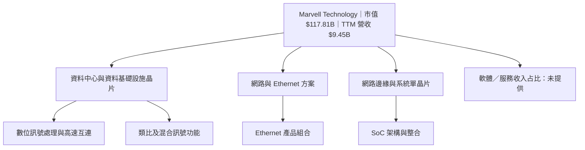
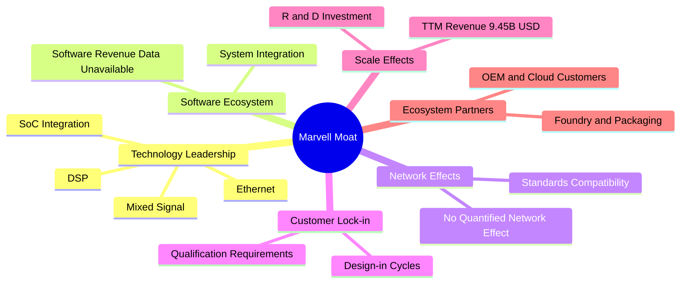
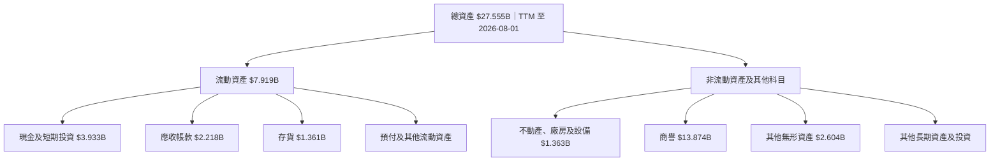
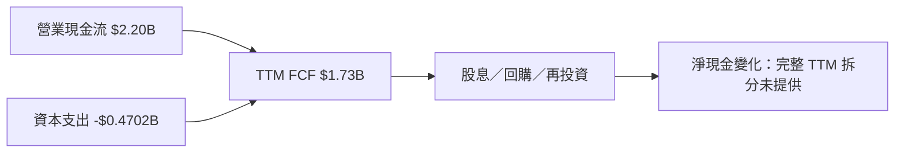
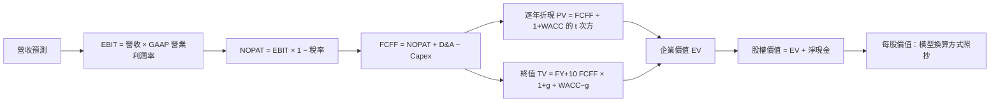
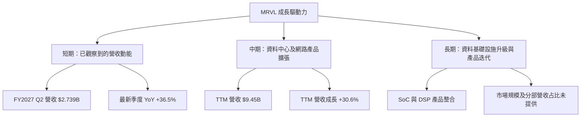
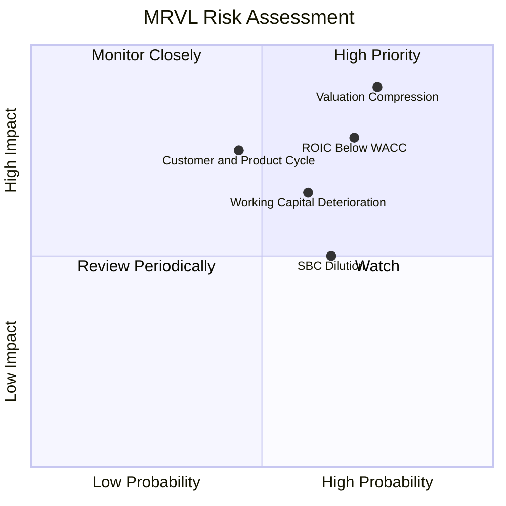
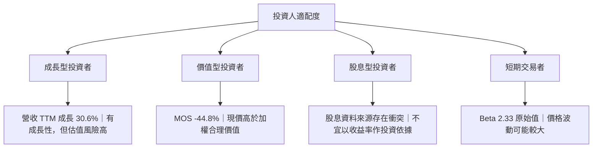

# MRVL 基本面深度分析報告
> **報告日期**：2026-11-27 ｜ **語言**：繁體中文 ｜ **數據來源**：SEC 申報資料 (XBRL)、Yahoo Finance、Finviz、StockAnalysis、Roic.ai ｜ **分析師**：CFA 級機構研究

## 目錄

| # | 章節 | 核心結論 |
|---|------|----------|
| 1 | 執行摘要 | 評級：賣出；加權合理價值 $90.43；MOS -44.8% |
| 2 | 公司概覽與商業模式 | 資料中心及資料基礎設施晶片具技術與客戶黏著優勢，但分部收入資料不足以量化護城河 |
| 3 | 損益表深度分析 | TTM 營收 $9.45B、TTM 年增 30.6%；單季年增 36.5%，但獲利受到季度波動與股權薪酬影響 |
| 4 | 資產負債表分析 | 淨負債 $1.03B；現金與短期投資 $3.93B，流動性尚可，營運資金週期拉長 |
| 5 | 現金流量深度分析 | TTM FCF $1.73B、FCF Yield 1.47%；現金流為正但相對市值偏低 |
| 6 | 獲利能力與資本效率 | ROIC 6.3% 低於 WACC 13.84%，目前未能覆蓋資本成本 |
| 7 | 相對估值分析 | MRVL 估值高於部分同業相對倍數；自身 P/S 位於五年區間偏高位置 |
| 8 | DCF 內在價值評估 | DCF 基準價值 $38.67；加權合理價值 $90.43，現價仍高於兩者 |
| 9 | 成長催化劑 | 資料中心需求與產品組合可能支持成長；市場規模及催化劑時間表數據未提供 |
| 10 | 風險矩陣 | 估值壓縮、資本回報低於資本成本、營運資金惡化為主要風險 |
| 11 | 投資建議 | 依 MOS 評級為賣出；現價 $130.93 高於加權合理價值，需以成長及現金流改善驗證 |

---

## 1. 執行摘要

### 1.0 一頁式投資儀表板（Portfolio Manager 30 秒速讀）

| 項目 | 內容 |
|------|------|
| **投資論點（3 句）** | ① TTM 營收 $9.45B、年增 30.6%，資料中心與資料基礎設施需求提供成長基礎。② TTM FCF 為 $1.73B，但 FCF Yield 僅 1.47%，且 ROIC 6.3% 低於 WACC 13.84%。③ 2026-11-25 收盤價 $130.93，高於加權合理價值 $90.43，顯示估值尚未提供足夠下檔保護。 |
| **綜合評分** | **5.5/10**（引用 1.1 評分卡） |
| **財務健康** | 🟡 現金及短期投資 $3.93B，總債務 $4.96B，淨負債 $1.03B；流動比率資料來源有差異，見第 4 章。 |
| **ROIC vs WACC** | **6.3% vs 13.84%**；資本回報低於資本成本，現階段未創造足夠經濟價值。 |
| **FCF 趨勢** | TTM FCF $1.73B；FCF Yield **1.47%**。近年年度 FCF 約 $1.02B–$1.39B，但季度波動明顯。 |
| **估值** | Forward P/E **17.76x**（市場資料）；EV/EBITDA **40.76x**（市場資料）；FCF Yield **1.47%**（VERIFIED FIGURES）。 |
| **DCF 內在價值（基準）** | **$38.67**；現價相對 DCF 溢價 **238.6%**（折溢價＝現價 ÷ DCF 基準價值 − 1）。 |
| **安全邊際（MOS）** | **-44.8%**＝($90.43 − $130.93) ÷ $90.43；基準為 8.8 節加權合理價值。🔴 無安全邊際。 |
| **預期報酬（基準情境 12M）** | 以加權合理價值衡量，上行空間 **-30.9%**；DCF 基準情境為 $38.67，對現價變化 **-70.5%**。兩者為不同估值口徑，不應混用。 |
| **關鍵風險（前二）** | ① ROIC 低於 WACC；② 估值對營收及利潤率假設高度敏感。 |
| **評級 + 信心度** | 🔴 **賣出**｜信心：中。依 MOS 門檻直接採用；DCF 基準值遠低於現價，但估值方法間分歧大。 |

### 1.1 綜合評分卡（全報告唯一）

| 維度 | 評分（1–10） | 主要依據（引用數字與其來源章節） |
|------|--------------|----------------------------------|
| 成長性 | 8.0 | TTM 營收年增 30.6%、最新一季年增 36.5%（第 3 章）；近四個季度營收逐季增加。 |
| 獲利能力 | 5.0 | TTM 營業利益率 16.5%，但 ROIC 6.3% 低於 WACC 13.84%；F-Score 6/9（第 6 章）。 |
| 財務健康 | 6.0 | 淨負債 $1.03B，現金與短期投資 $3.93B；CCC 由 113 天升至 131 天（第 4 章）。 |
| 估值 | 2.0 | MOS -44.8%；P/S 現值 12.8x，高於自身五年中位數 9.9x（第 7–8 章）。 |
| 護城河 | 7.0 | 高速互連、網路與資料基礎設施晶片需要長期設計導入；但未提供分部收入、客戶集中度或市場份額數據（第 2 章）。 |
| 管理層與資本配置 | 5.0 | 年度 SBC 約 $0.55B–$0.61B，稀釋股數測試未通過；年度股息支付約 $0.20B，缺少回購及併購回報拆分（第 3、5 章）。 |
| **綜合評分** | **5.5** | 六項算術平均：$(8+5+6+2+7+5) ÷ 6 = 5.5$。 |

### 1.2 五大投資論點 + 三大核心風險

| 類型 | 項目 | 具體依據 | 信心度 |
|------|------|----------|--------|
| 🟢 **投資論點①** | 資料基礎設施需求擴張 | TTM 營收 $9.45B，年增 30.6%；最新一季年增 36.5%。若持續，規模擴大可支持營業槓桿。 | 🟢 高 |
| 🟢 **投資論點②** | TTM 現金流為正 | 營業現金流 $2.20B，資本支出 $470.20M，TTM FCF $1.73B。 | 🟢 高 |
| 🟢 **投資論點③** | 近期季度營收連續成長 | 最近四季營收由 $2.075B 增至 $2.739B；最新季 QoQ 約增 13.3%。 | 🟢 高 |
| 🟡 **投資論點④** | 產品導入具有一定客戶黏著 | 公司涵蓋 Ethernet、類比、混合訊號及數位訊號處理產品；但客戶導入週期和轉換成本無量化資料。 | 🟡 中 |
| 🟡 **投資論點⑤** | 資產負債表保有流動性 | 現金與短期投資 $3.93B，淨負債 $1.03B；可支持研發及營運投資。 | 🟡 中 |
| 🟡 **風險①** | 資本回報低於資金成本 | ROIC 6.3%，WACC 13.84%，差距 **-7.54 個百分點**。若不能提升回報，成長未必轉化為股東價值。 | 🔴 高衝擊 |
| 🔴 **風險②** | 估值對成長預期敏感 | DCF 基準價值 $38.67，低於現價 $130.93；反推 DCF 顯示現價隱含第一年營收成長 68.3%，高於基準假設 30.0%。 | 🔴 高 |
| 🟡 **風險③** | SBC 與營運資金佔用 | FY2026 SBC $590.8M，CCC 由 113 天升至 131 天；若應收及存貨持續擴張，現金轉換會受壓。 | 🟡 中高 |

### 1.3 快速統計卡片

| 指標 | 公司實際值（期間） | 同業中位數 | 狀態 |
|------|--------------------|------------|------|
| 營收成長（TTM） | **30.6%** | — | 🟢 |
| 營收成長（最新一季年增） | **36.5%** | **85.5%**（AVGO、NVDA、AMD 中位數） | 🟡 |
| 毛利率（TTM） | **52.2%** | **74.9%**（同業中位數） | 🟡 |
| 營業利益率（TTM） | **16.5%** | — | 🟡 |
| ROIC（TTM） | **6.3%** | — | 🔴 |
| Forward P/E | **17.76x**（市場資料） | **15.5x**（Peer multiples 中位數） | 🟡 |
| FCF Yield（TTM） | **1.47%** | — | 🟡 |
| Piotroski F-Score | **6 / 9** | — | 🟡 |

### 1.4 投資結論

╔══════════════════════════════════════════════════════════════════╗  
║                    📊 投資結論摘要                               ║  
╠══════════════════════════════════════════════════════════════════╣  
║  評級：🔴 賣出（MOS -44.8%，依規則 20）                         ║  
║  價格（2026-11-25 收盤）：$130.93                               ║  
║  DCF 內在價值（基準）：$38.67（現價溢價 238.6%）               ║  
║  安全邊際 MOS：-44.8%（以加權合理價值 $90.43 為分母）          ║  
║  加權合理價值（8.8）：$90.43                                    ║  
║  DCF 情境價值：                                                   ║  
║    悲觀情境：$19.54（-85.1%）                                   ║  
║    基準情境：$38.67（-70.5%）                                   ║  
║    樂觀情境：$73.69（-43.7%）                                   ║  
║  綜合評分：5.5/10（引用 1.1）                                   ║  
║  適合投資人：能承受高波動、重視半導體成長但接受高估值風險者；   ║  
║              不適合以價值折價或高股息為主要目標者。             ║  
╚══════════════════════════════════════════════════════════════════╝

---

## 2. 公司概覽與商業模式

### 2.1 業務結構與收入來源

公司資料描述 MRVL 提供從資料中心核心至網路邊緣的資料基礎設施半導體方案，涵蓋 Ethernet、SoC、類比、混合訊號及 DSP。分部營收與產品營收占比未提供，因此不以估算比例填補。

TTM 營收 $9.45B 是公司整體營收，而非單一資料中心部門數字。公司未提供各業務板塊金額、百分比及軟體服務收入占比，故無法對收入集中度作量化判斷。

### 2.2 市場份額

市場份額數據未提供，亦沒有可引用的市場規模或份額年份。質化而言，MRVL 的 TTM 營收規模為 $9.45B，低於大型綜合半導體公司 Broadcom 與 NVIDIA 的市場體量；但其 TTM 營收成長 30.6%，顯示業務仍處於擴張階段。

### 2.3 競爭護城河分析

### 2.4 護城河強度

| 護城河項目 | 強度（強／中／弱） | 證據（引用數字或事實） | 會削弱它的情況 |
|------------|--------------------|------------------------|----------------|
| 技術與產品整合 | 中至強 | 公司提供 SoC、類比、混合訊號、DSP、Ethernet 等多類資料基礎設施產品。 | 競爭者推出效能、功耗或成本更具優勢的替代方案。 |
| 軟體生態系統 | 中 | 產品需要嵌入客戶系統與網路架構；軟體營收及生態系規模數據未提供。 | 開放標準降低軟體及系統切換成本。 |
| 網路效應 | 弱至中 | Ethernet 等標準帶來互通性，但網路效應強度未量化。 | 客戶可以多供應商採購，標準化削弱差異。 |
| 客戶鎖定 | 中 | 半導體設計導入及驗證需要時間，切換供應商可能產生重新設計成本；客戶集中度未提供。 | 大客戶自行設計、替代供應商取得認證或需求轉向。 |
| 規模效應 | 中 | FY2026 研發費用 $2.08B，TTM 營收 $9.45B；研發規模可支持產品廣度。 | 研發投入未能轉化為收入與更高 ROIC。 |
| 生態夥伴 | 中 | 公司跨多個國家營運並服務資料中心至網路邊緣市場；合作夥伴收入貢獻未提供。 | 供應鏈限制、客戶自研或替代生態系擴張。 |

**1.1 護城河評分 7.0/10 的理由**：產品整合及客戶設計導入具一定壁壘，但目前缺少市場份額、客戶集中度、分部收入與切換成本的量化證據。

---

## 3. 損益表深度分析

### 3.1 年度收入成長趨勢（近 4 年）

╔══════════════════════════════════════════════════════════════════╗  
║              Marvell 年度收入趨勢（FY2023–FY2026）               ║  
╠══════════════════════════════════════════════════════════════════╣  
║ FY2023  $5.92B  ██████████████░░░░░░░░░░  YoY: 基期              ║  
║ FY2024  $5.51B  █████████████░░░░░░░░░░░  YoY: -7.0% 🟡         ║  
║ FY2025  $5.77B  ██████████████░░░░░░░░░░  YoY: +4.7% 🟡         ║  
║ FY2026  $8.19B  ████████████████████░░░░  YoY: +42.0% 🟢         ║  
╠══════════════════════════════════════════════════════════════════╣  
║ FY2023–FY2026 收入 CAGR：(8.19 ÷ 5.92)^(1/3) − 1 = 約 11.4%     ║  
╚══════════════════════════════════════════════════════════════════╝

年度營收依 SEC／StockAnalysis 年度資料列示。FY2026 營收增長由 $5.77B 升至 $8.19B，與資料中心等需求擴張一致；FY2024 曾回落，說明半導體營收仍受產品週期及需求波動影響。

### 3.2 季度收入趨勢分析

| 季度 | 營收 | QoQ 成長 | YoY 成長 | 備註 |
|------|------:|---------:|---------:|------|
| FY2026 Q3（2025-11-01） | $2.075B | 約 +7.2% | +36.8% | YoY 依 StockAnalysis 單季列值。 |
| FY2026 Q4（2026-01-31） | $2.219B | 約 +6.9% | +22.1% | 以 $2.075B 為前季比較。 |
| FY2027 Q1（2026-05-02） | $2.418B | 約 +9.0% | +27.6% | 單季年增率，不是 TTM。 |
| FY2027 Q2（2026-08-01） | $2.739B | 約 +13.3% | **36.5%** | 最新季度營收加速；SEC 10-Q 為季度資料錨點。 |

QoQ 由約 7%升至 13.3%，與近季收入擴大相符；但單季增速不可直接外推為長期成長率。TTM 營收年增率為 30.6%，與單季 36.5% 是不同期間指標。

### 3.3 利潤率演變分析

| 利潤率指標 | FY2023 | FY2024 | FY2025 | FY2026／TTM | 趨勢 | 評估 |
|------------|--------|--------|--------|-------------|------|------|
| **毛利率** | 約 50.5% | 約 41.6% | 約 41.2% | TTM 52.2% | 近期回升 | 🟢 |
| **營業利益率** | 約 6.1% | 約 -7.9% | 約 -6.4% | TTM 16.5%；最新季 16.8% | 明顯改善 | 🟢 |
| **淨利率** | 約 -2.8% | 約 -16.9% | 約 -15.3% | TTM 27.9% | 顯著反彈 | 🟡 |

年度毛利與營業利益率由年度收入及利潤表列數計算；不同資料源對部分歷史年度毛利有差異，故年度比率僅作方向參考，TTM 以 VERIFIED FIGURES 為準。營業利益率從連續虧損轉為 TTM 16.5%，反映營收回升、產品組合及營運槓桿改善；淨利率 27.9% 高於營業利益率，代表非營業項目、稅務或其他一次性項目可能對淨利有重要影響，不能將單一期間淨利率直接視為可持續常態。

### 3.4 費用結構分析

公司披露 FY2026 研發費用 $2.08B；但銷售管理費、其他營業費用及完整 TTM 費用明細未在可核對數據中完整提供，因此不畫費用比例圓餅圖，避免以不完整分項湊成 100%。

╔══════════════════════════════════════════════════════════════════╗  
║ FY2026 研發費用：$2.08B ｜ TTM 營收：$9.45B                   ║  
║ 研發費用／TTM 營收：2.08 ÷ 9.45 = 約 22.0%                    ║  
║ 註：期間不完全一致，該比率僅作投入規模參考，不代表 FY2026 精確比率。║  
╚══════════════════════════════════════════════════════════════════╝

### 3.5 季度 EPS 趨勢與盈餘品質（Quality of Earnings）

最近四季 EPS 實際值有列示，但估計 EPS 欄為 nan，無法核實超預期或不及預期；因此不把實際 EPS 變動誤寫為 beat/miss。

| 季度 | EPS 實際值 | YoY／季度觀察 | 超預期／不及預期 |
|------|------------:|---------------|------------------|
| 2026-07-31 | $0.33 | EPS YoY +50.0%（資料源列值） | N/A：EPS 預估值缺失 |
| 2026-04-30 | $0.04 | EPS YoY -80.44%（資料源列值） | N/A：EPS 預估值缺失 |
| 2026-01-31 | $0.47 | EPS YoY +106.27%（資料源列值） | N/A：EPS 預估值缺失 |
| 2025-10-31 | $2.20 | 當季淨利 $1.901B，與相鄰季度差異極大 | N/A：EPS 預估值缺失 |

| 盈餘品質項目 | 數值／佔比 | 評估 |
|--------------|-----------|------|
| 股權薪酬 SBC / 營收 | FY2026 $590.8M ÷ FY2026 營收 $8.19B ≈ **7.2%** | 🔴 SBC 對股東有實質經濟成本；稀釋股數測試未通過。 |
| SBC / 營業現金流 | FY2026 $590.8M ÷ $1.75B ≈ **33.8%** | 🟡 佔比不低，部分營業現金流來自非現金費用回加，須連同稀釋評估。 |
| FCF / 淨利（現金轉換率） | TTM FCF $1.73B ÷ TTM 淨利（依 TTM 淨利率 27.9% × $9.45B 推得約 $2.64B）≈ **65.5%** | 🟡 低於 100%；以資料中的 TTM 淨利率及收入計算，屬近似值。 |
| 一次性／非經常性損益 | FY2026 Q3 淨利 $1.901B，明顯高於相鄰季度；具體成因未提供 | 🟡 季度淨利波動大，須避免以單季 EPS 年化。 |
| 有效稅率異常 | 12.4%（最近年度有效稅率） | 🟡 低於常見名目稅率，但沒有足夠明細判斷是否為持續稅務利益。 |
| 資本化支出 vs 費用化 | 資本支出 TTM $470.20M；資本化開發成本資料未提供 | 🟡 無法量化資本化政策對盈餘的影響。 |

**盈餘品質結論**：營業現金流與 FCF 均為正，但 FCF 約為淨利的 65.5%，年度 SBC 約佔收入 7.2%，且季度淨利波動顯著。GAAP 盈利並非毫無現金支撐，但股權薪酬稀釋與非經常性項目降低了報表淨利作為持續經濟盈餘的可靠度。

---

## 4. 資產負債表分析

### 4.1 資產結構分解

FY2026 年末總資產為 $22.29B；較新的 TTM 資產表資料列總資產 $27.56B，時間點不同。下圖採用 TTM 資產表列示的 $27.555B 及主要科目；細項未列全者不強行補足。

### 4.2 流動性與營運資金分析

| 指標 | 最新 TTM | 一年前 TTM | 變化 | 解讀 |
|------|----------|------------|------|------|
| DSO 應收帳款天數 | 86 天 | 73 天 | +13 天 | 收款天數增加，可能反映銷售組合、付款條件或收款節奏變化；應追蹤應收帳款增速是否高於收入。 |
| DIO 存貨天數 | 110 天 | 96 天 | +14 天 | 存貨占用增加；可能是為需求備貨，也可能是需求預測偏差，需檢視存貨與收入同步性。 |
| DPO 應付帳款天數 | 64 天 | 56 天 | +8 天 | 延長供應商付款時間可部分抵銷應收與存貨增加，但不能單獨證明議價力提高。 |
| CCC 現金轉換週期 | 131 天 | 113 天 | +18 天 | 現金被營運資金占用的期間拉長，短期現金流品質受到壓力。 |

流動比率資料在市場資料與品質指標來源中不一致：Yahoo／Finviz 合併資料列 3.168，StockAnalysis 的 TTM 流動資產 $7.919B、流動負債 $2.500B 對應約 3.17；FY2026 年末則為 $6.46B ÷ $3.22B ≈ 2.01。此處將 3.168 視為最新資料源值，不與年度時點混用。

### 4.3 債務結構分析

VERIFIED FIGURES 的資本成本及淨負債計算採總債務 $4.96B、現金及短期投資 $3.93B。市場資料合併段落另列總債務 $5.29B、淨負債 $1.35B，與 SEC 對應口徑不完全一致；本報告依 VERIFIED FIGURES 口徑引用。

╔══════════════════════════════════════════════════════════════════╗  
║                   MRVL 債務健康診斷                              ║  
╠══════════════════════════════════════════════════════════════════╣  
║  總債務：        $4.96B   ████████████████████                  ║  
║  現金+短期投資： $3.93B   ████████████████                      ║  
║  淨負債：        $1.03B   ████░░░░░░░░░░░░░░  🟡                ║  
║  Debt/EBITDA：   N/A（統一口徑 EBITDA 未提供）                   ║  
║  Interest Coverage：N/A（利息費用及 EBIT 一致期間數據不足）      ║  
╚══════════════════════════════════════════════════════════════════╝

### 4.4 股東權益趨勢

| 財年 | 股東權益 | 年變化 | 觀察 |
|------|----------:|-------:|------|
| FY2023 | $15.64B | — | 歷史高位之一。 |
| FY2024 | $14.83B | -5.2% | 權益下降。 |
| FY2025 | $13.43B | -9.4% | 連續下降。 |
| FY2026 | $14.31B | +6.6% | 近期回升。 |

╔══════════════════════════════════════════════════════════════════╗  
║ FY2023 $15.64B  ████████████████████                            ║  
║ FY2024 $14.83B  ███████████████████                             ║  
║ FY2025 $13.43B  █████████████████                               ║  
║ FY2026 $14.31B  ██████████████████                              ║  
╚══════════════════════════════════════════════════════════════════╝

---

## 5. 現金流量深度分析

### 5.1 現金流量瀑布圖

最新 TTM 可核對的數字為營業現金流 $2.20B、資本支出 $470.20M、FCF $1.73B。最新 TTM 淨利、股息及回購的完整一致口徑數字未提供，故不在流程圖中虛構。

### 5.2 FCF 轉換率趨勢

| 財年 | 營業現金流 | 資本支出 | FCF | 淨利 | FCF／淨利 |
|------|-----------:|---------:|----:|-----:|----------:|
| FY2023 | $1.29B | $0.217B | $1.07B | -$0.164B | 比率不具經濟解讀性 |
| FY2024 | $1.37B | $0.350B | $1.02B | -$0.933B | 比率不具經濟解讀性 |
| FY2025 | $1.68B | $0.292B | $1.39B | -$0.885B | 比率不具經濟解讀性 |
| FY2026 | $1.75B | $0.359B | $1.39B | $2.67B | 約 52.1% |
| TTM 至 2026-08-01 | $2.20B | $0.470B | $1.73B | 依 TTM 淨利率推算約 $2.64B | 約 65.5%（近似） |

早期年度有淨虧損，不能用 FCF／淨利比例直接比較；FY2026 及 TTM 轉為正值，但轉換率仍低於 100%，且受 SBC、營運資金與稅務影響。

### 5.3 自由現金流趨勢

╔══════════════════════════════════════════════════════════════════╗  
║ FY2023 FCF $1.07B  ███████████████                               ║  
║ FY2024 FCF $1.02B  ██████████████                                ║  
║ FY2025 FCF $1.39B  ████████████████████                          ║  
║ FY2026 FCF $1.39B  ████████████████████                          ║  
║ TTM     FCF $1.73B  █████████████████████████                    ║  
╠══════════════════════════════════════════════════════════════════╣  
║ TTM FCF Yield：1.47%；以市值 $117.81B 計，現金回報率偏低。      ║  
╚══════════════════════════════════════════════════════════════════╝

### 5.4 資本配置評估

資本配置圓餅圖所需的同一期間回購、投資、資本支出、股息與留存金額未完整提供，故不以不完整數據繪製比例圖。

| 配置項目 | 已知數據 | 評估 |
|----------|----------|------|
| 研發投入 | FY2026 $2.08B | 對半導體產品迭代與客戶設計導入重要；須以 ROIC 改善檢驗回報。 |
| 資本支出 | TTM $470.20M | 相對營收約 5.0%，符合資產較輕的晶片設計公司特徵。 |
| 股息 | FY2026 現金股息支付 $205.1M | 規模低於 FCF；現金股息支付額可核對。 |
| SBC | FY2026 $590.8M | 大於 FY2026 現金股息支付額，需留意稀釋及員工薪酬成本。 |
| 回購／併購 | 完整同期數字未提供 | 不對資本回報作定量結論。 |

---

## 6. 獲利能力與資本效率

### 6.1 ROE / ROA / ROIC 趨勢

| 指標 | 最新可用值 | 歷史資料 | 評估 |
|------|-----------:|----------|------|
| ROE | TTM **14.2%**（QUALITY FIGURES） | 市場合併資料另列 16.5%，口徑不一致 | 以品質指標 14.2% 為主；不把不同來源值混合成趨勢。 |
| ROA | TTM **4.1%** | 歷史年度一致口徑未提供 | 資產回報低於 ROE，顯示資產利用效率仍有提升空間。 |
| ROIC | TTM **6.3%** | 歷史一致口徑未提供 | 低於 13.84% WACC。 |
| 行業均值對比 | N/A | 未提供同口徑行業 ROE／ROA／ROIC | 不填入無來源數值。 |

### 6.2 ROIC vs WACC 分析（核心價值創造判斷）

╔══════════════════════════════════════════════════════════════════╗  
║                ROIC vs WACC 深度分析                            ║  
╠══════════════════════════════════════════════════════════════════╣  
║  WACC 輸入（成本資本資料）：                                     ║  
║  ├── 無風險利率（10Y 美債）：4.85%                               ║  
║  ├── 市場風險溢酬 ERP：5.00%                                     ║  
║  ├── 原始 Beta：2.33；採用調整後 Beta：1.88                     ║  
║  ├── 股權成本 Ke：14.27%（成本資本資料原值）                    ║  
║  ├── 稅前債務成本：4.08%；稅率：12.4%                           ║  
║  ├── 股權／債務權重：96.0%／4.0%                                ║  
║  └── WACC：13.84%                                                ║  
║                                                                  ║  
║  ROIC（TTM）：6.3%                                               ║  
║  EVA 差額：6.3% − 13.84% = -7.54 個百分點                       ║  
║  ROIC  6.3%  ▓▓▓▓▓▓░░░░░░░░░░░░░░░░░░░░░░░░                    ║  
║  WACC 13.84% ▓▓▓▓▓▓▓▓▓▓▓▓▓▓░░░░░░░░░░░░░░                      ║  
║                                                                  ║  
║  結論：ROIC 低於 WACC，現階段每單位投入資本回報未覆蓋資金成本。 ║  
╚══════════════════════════════════════════════════════════════════╝

成本資本資料已直接提供 WACC 13.84%；利息費用、平均計息負債及市值權重各項未提供足以獨立重建全部底層計算的細節，因此不另行推導新的 WACC。第 8.2 節沿用相同數值。

### 6.3 杜邦三因素分解

| 因素 | 數值（TTM） | 解讀 |
|------|-------------|------|
| 淨利率 | 27.9% | 淨利率是 ROE 的主要正向來源，但可能受非營業及稅務項目影響。 |
| 資產週轉率 | 0.34 | 每單位資產產生的營收有限，資產效率是改善 ROE 的關鍵。 |
| 權益乘數 | 1.49 | 財務槓桿不高，ROE 並非主要由高槓桿推升。 |
| **ROE** | **14.2%** | 27.9% × 0.34 × 1.49 ≈ 14.2%（照抄 QUALITY FIGURES）。 |

### 6.4 財務體質：Piotroski F-Score

Piotroski F-Score 為 **6/9**。下表逐項照抄品質指標結果。

| 測試 | 結果 | 解讀 |
|------|------|------|
| ROA > 0 | ✅ 通過 | TTM 資產回報為正。 |
| 營業現金流 > 0 | ✅ 通過 | TTM 營業現金流為 $2.20B。 |
| ROA 高於一年前 | ✅ 通過 | 資產獲利能力改善。 |
| 營業現金流 > 淨利（應計品質） | ❌ 未通過 | 現金流未高於淨利，需注意應計項目及稅務／非營業項目。 |
| 長期負債 ÷ 總資產低於一年前 | ✅ 通過 | 相對槓桿狀況改善。 |
| 流動比率高於一年前 | ✅ 通過 | 短期償付能力較一年前提升。 |
| 稀釋股數未增加 | ❌ 未通過 | 股數增加，SBC 對持股比例造成稀釋。 |
| 毛利率高於一年前 | ✅ 通過 | 毛利率改善與較佳產品組合或定價有關。 |
| 資產週轉率高於一年前 | ❌ 未通過 | 資產增速或營運資產投入尚未充分轉化為收入。 |

---

## 7. 相對估值分析

### 7.1 同業估值比較表格

MRVL 本身採用 VERIFIED FIGURES 的歷史／估值資料；同業倍數照引 Peer multiples。來源中同業 Forward P/E 中位數為 15.5x。

| 估值指標 | **MRVL** | **AVGO** | **NVDA** | **AMD** | MRVL 評估 |
|----------|---------:|---------:|---------:|--------:|-----------|
| **Trailing P/E** | 43.2x | 38.4x | 16.0x | 86.8x | 🟡 高於 AVGO、NVDA，低於 AMD。 |
| **Forward P/E** | 17.76x（市場資料） | 15.5x | 9.0x | 23.0x | 🟡 高於同業中位數 15.5x。 |
| **P/S Ratio** | 12.8x | 16.1x | 10.0x | 14.8x | 🟡 高於 NVDA，低於 AVGO、AMD。 |
| **EV/EBITDA** | 77.9x（VERIFIED FIGURES 歷史估值口徑） | 28.2x | 14.5x | 59.2x | 🔴 依這組口徑 MRVL 倍數偏高；其他市場資料列 40.76x，口徑不同，不混用。 |
| **最新一季營收年增** | 36.5% | 85.5% | 103.2% | 44.7% | 🟡 成長快，但低於三家同業。 |
| **TTM 毛利率** | 52.2% | 75.5% | 74.9% | 56.0% | 🟡 低於三家同業。 |

Peer multiples 的財務期間及市場來源口徑可能與公司資料略有差異，尤其 EV/EBITDA 同一資料包另有市場合併值 40.756x；此表按要求採用 Peer／估值歷史區塊數值，不將兩種倍數拼接。

### 7.2 歷史估值區間分析

╔══════════════════════════════════════════════════════════════════╗  
║                 MRVL 五年估值區間（TTM）                         ║  
╠══════════════════════════════════════════════════════════════════╣  
║ P/E：        25.6x ├──────── 43.2x 現值 ────────┤ 61.9x         ║  
║              五年中位數 56.5x｜現值百分位 50%                    ║  
║ P/S：         5.8x ├──────── 12.8x 現值 ────────┤ 18.3x        ║  
║              五年中位數 9.9x｜現值百分位 75%                     ║  
║ EV/EBITDA：  53.3x ├─ 77.9x 現值 ──────────────┤ 730.9x       ║  
║              五年中位數 156.4x｜現值百分位 25%                   ║  
╚══════════════════════════════════════════════════════════════════╝

P/E 現值 43.2x 低於自身五年中位數 56.5x，但 P/S 12.8x 高於中位數 9.9x、處於第 75 百分位。EV/EBITDA 歷史區間極寬，顯示歷史盈利基數波動，單獨以該倍數判斷便宜或昂貴可靠度有限。

### 7.3 情境價值（Bear / Base / Bull，照抄 DCF MODEL 的 Scenarios）

| 情境 | 第 1 年營收成長 | 期末營業利潤率 | WACC | 每股價值 | 相對現價 | 機率 | 會發生的條件 |
|------|----------------|----------------|------|----------:|----------:|------:|--------------|
| 🔴 悲觀 | 15.0% | 3.4% | 14.84% | $19.54 | -85.1% | 25% | 資料中心成長放緩、價格或產品組合承壓，資金成本維持偏高。 |
| 🟡 基準 | 30.0% | 4.0% | 13.84% | $38.67 | -70.5% | 50% | 第一年度成長接近 TTM 30.6%，長期成長與利潤率逐步淡化至模型假設。 |
| 🟢 樂觀 | 45.0% | 4.4% | 12.84% | $73.69 | -43.7% | 25% | 高成長延續、期末利潤率較基準高，且 WACC 降低。 |

此三情境採用程式計算模型原值；由於模型未提供三種情境的逐年完整損益與現金流，不能另行補造中間年度數值。

### 7.4 相對估值隱含價格區間

╔══════════════════════════════════════════════════════════════════╗  
║ 相對估值法每股價值（現價 $130.93）                              ║  
╠══════════════════════════════════════════════════════════════════╣  
║ $38.67 DCF ── $65.85 EV/EBITDA ── $114.40 Forward P/E ── $130.93 現價║  
║ 分析師共識：$298.99（39 位分析師平均目標價）                    ║  
╚══════════════════════════════════════════════════════════════════╝

- **同業 Forward P/E：$114.40**：Peer 中位數 15.5x × Forward EPS $7.37。
- **同業 EV/EBITDA：$65.85**：AVGO、NVDA 中位數 21.4x × TTM EBITDA，再加淨現金。
- **分析師共識目標價：$298.99**：39 位分析師平均值，與內在估值模型分歧很大，應視為市場預期參考而非現金流計算結果。
- 相對估值方法均低於現價；分析師共識是唯一高於現價的方法。

---

## 8. DCF 內在價值評估（Discounted Cash Flow）

> 本節嚴格採用程式計算的 DCF MODEL；所有原模型假設與估值結果照抄，不另建模型。金額取至 $0.01B、比率取至 0.1 個百分點、折現因子取至三位小數。因模型採四捨五入列示，逐項加總可能有不超過 1% 的尾差。

### 8.0 估值推理鏈（Thinking Logic：在算之前先想清楚）

**Step 1 — 價值由哪些變數決定？**  
本 DCF 將 MRVL 價值拆成「現有資料基礎設施產品現金流 + 資料中心成長延伸 + 長期終值」。目前資料只提供公司整體 TTM 營收 $9.45B，未提供資料中心或其他分部收入占比，因此不能把其中某一分部的價值比例假定為已知。模型中最主導估值的變數是**營業利潤率與 WACC**：收入雖快速成長，但 DCF 利潤率由 TTM 16.5%逐步降至 FY+10 4.0%，而折現率達 13.84%。

**Step 2 — 模型選擇**

| 決策點 | 本報告採用 | 理由（含數字） | 曾考慮但否決 | 否決理由 |
|--------|-----------|----------------|--------------|----------|
| 現金流定義 | FCFF | 以 WACC 折現並得出企業價值；模型直接列示 FCFF。 | FCFE | 模型預設是企業自由現金流，不能改成股東現金流。 |
| 預測期 N | 10 年 | DCF MODEL 固定為 10 年，逐年淡化成長及利潤率。 | 5 年 | 會改動程式模型與估值結果。 |
| 終值方法 | Gordon Growth | 模型提供終值公式及終值現值。 | 退出倍數 | DCF MODEL 未提供可供本模型直接使用的退出倍數終值結果。 |
| EBIT 基礎 | GAAP EBIT | DCF 假設明確採 GAAP EBIT。 | 非 GAAP EBIT | 會加回 SBC，與程式模型不一致。 |

**Step 3 — 關鍵假設推導鏈**

- **營收成長**：錨點＝TTM 營收成長 30.6% → 因資料中心需求成長可能延續，但十年期不宜維持固定高成長，採 FY+1 30.0%，之後線性下降至 FY+10 3.0% → **採用模型原值** → 曾考慮將 30.6%直接固定十年，因會忽略基期擴大與半導體週期而不採用。
- **期末營業利潤率**：錨點＝TTM 營業利益率 16.5%，近年年度營業利益率曾為負值 → 模型假設逐年淡化至 FY+10 4.0%，反映成熟期競爭與利潤正常化 → **採用 4.0%** → 曾考慮維持 16.5%，但會把當前利潤水準無條件外推十年，故不採用。
- **永續成長率 g**：錨點＝成熟企業長期增長應低於高成長期，且必須低於 WACC 13.84% → 模型採 3.0%，與長期低個位數增長相符 → **採用 3.0%** → 曾考慮更高長期成長，但會提高終值並放大遠期假設依賴，故不採用。
- **預測期 N**：錨點＝半導體產品迭代及客戶導入存在多年週期；數據未提供可直接估算護城河年限 → **採用模型固定 10 年** → 曾考慮 5 年，但會違反模型設定並改變價值。
- **Capex／營收**：錨點＝TTM 資本支出 $470.20M、營收 $9.45B，約 5.0% → 模型保持約 5.0%，並與模型 D&A 假設一致 → **採用 5.0%** → 不採用由 FCF 反推資本支出的替代值。
- **GAAP EBIT 與 SBC**：錨點＝FY2026 SBC $590.8M；模型明示 GAAP EBIT 已將 SBC 列為費用 → **採用組合 (A)：GAAP EBIT、不另扣 SBC、固定股數** → 否決非 GAAP 加回 SBC 後再扣回或股數稀釋組合，避免改動模型及重複計算。
- **年稀釋率**：因採組合 (A)，GAAP EBIT 已包含 SBC 費用，模型固定股數；**採用 0% 額外年稀釋**。替代方案是另行放大股數，但會與程式模型不一致。
- **終值方法**：錨點＝模型提供 Gordon Growth 終值，且 WACC 13.84% 大於 g 3.0% → **採用 Gordon Growth** → 退出倍數可作交叉驗證，但模型沒有提供本次 DCF 的退出倍數終值計算，故不自行增加。
- **WACC**：錨點＝Cost of capital 原值 WACC 13.84%，其中股權權重 96.0%、債務權重 4.0% → 半導體高 Beta 使折現率高 → **採用 13.84%** → 不另選低於資料值的折現率，以免人工抬高估值。
- **稅率、D&A／營收及營運資金**：模型採有效稅率 12.4%、D&A／營收 13.3%；營運資金未建模。缺少能支持獨立替換的模型輸入，故沿用原值，不以推算值補入。

**Step 4 — 最脆弱的一環**  
最脆弱的是長期營業利潤率及高成長延續假設；若成長低於基準或成熟利潤率低於 4.0%，每股價值將低於 $38.67，而相反方向也只能由情境表所列的樂觀值 $73.69 參考，仍低於現價。

**Step 5 — 計算路徑圖**

### 8.1 模型假設總表（Model Inputs）

| 假設項目 | 採用值 | 依據／來源 | 敏感度 |
|----------|--------|------------|--------|
| 預測期長度 **N** | 10 年 | DCF MODEL 固定預測期；延伸至成熟期。 | 🟡 中 |
| 營收成長 | FY+1 30.0%，FY+10 3.0%，線性淡化 | TTM 年增 30.6%；模型將高成長逐步淡化。 | 🔴 高 |
| 營業利潤率 | FY+1 16.5% → FY+10 4.0% | TTM 16.5%；模型以近五年中位數作成熟期參考。 | 🔴 高 |
| 有效稅率 | 12.4% | Cost of capital 資料列示的最新年度有效稅率。 | 🟢 低 |
| Capex／營收 | FY+1 5.0% → FY+10 5.0% | 模型原值；TTM Capex $470.20M／TTM 營收 $9.45B 約 5.0%。 | 🟡 中 |
| D&A／營收 | 13.3% | DCF MODEL 原值，依 TTM 假設固定。 | 🟢 低 |
| 營運資金變動 | 不建模 | DCF MODEL 明示 working capital is not modelled；不是零變動的實際預測。 | 🟡 中 |
| EBIT 基礎 | GAAP | 模型使用 GAAP EBIT。 | 🟡 中 |
| 股權薪酬 SBC 處理 | 採用組合 (A)：GAAP EBIT 已含 SBC，不另扣 | SBC 是 GAAP 費用；模型固定股數。**SBC 影響已計入一次。** | 🟡 中 |
| 年稀釋率 | 0% 額外稀釋 | 與組合 (A) 一致，照模型固定股數。 | 🟡 中 |
| 永續成長率 g | 3.0% | DCF MODEL 原值；低於 WACC 13.84%。 | 🔴 高 |
| 終值方法 | Gordon Growth | DCF MODEL 終值公式及終值金額。 | 🔴 高 |
| WACC | 13.84% | Cost of capital 原值；第 6.2 節採同一數值。 | 🔴 高 |

FCFF 定義採模型原式：**FCFF = NOPAT + D&A − Capex**。模型未列 ΔWC，故本節不新增 ΔWC 行，也不把其默認為可核驗的零值。

### 8.2 折現率推導（WACC）

╔══════════════════════════════════════════════════════════════════╗  
║                    WACC 推導（折現率）                           ║  
╠══════════════════════════════════════════════════════════════════╣  
║ 股權成本 Ke（CAPM，照成本資本輸入）：                            ║  
║ ├── 無風險利率 Rf（10Y 美債）：4.85%                            ║  
║ ├── 市場風險溢酬 ERP：5.00%                                     ║  
║ ├── 原始 Beta（Yahoo）：2.33                                     ║  
║ ├── 調整後 Beta：1.88（⅔ × 2.33 + ⅓ × 1）                       ║  
║ ├── 規模／國別溢酬：未另加                                      ║  
║ └── Ke：14.27%（成本資本資料原值）                              ║  
║                                                                  ║  
║ 債務成本：                                                       ║  
║ ├── 稅前 Kd：4.08%（利息 ÷ 債務，成本資本資料原值）             ║  
║ ├── 有效稅率：12.4%                                             ║  
║ └── 稅後 Kd = 4.08% × (1 − 12.4%) = 3.57408%                    ║  
║                                                                  ║  
║ 資本結構：股權權重 96.0%；債務權重 4.0%                         ║  
║ WACC = 96.0% × 14.27% + 4.0% × 3.57408%                         ║  
║      = 13.6992% + 0.1430% = 13.8422% ≈ 13.84%                  ║  
╚══════════════════════════════════════════════════════════════════╝

逐步檢核：

1. **Ke（CAPM）**：資料列示採用調整後 Beta 1.88、Rf 4.85%、ERP 5.00%，成本資本輸入列示 Ke **14.27%**。用已四捨五入的 Beta 直接重算為 4.85% + 1.88 × 5.00% = 14.25%；差異來自來源輸入精度／四捨五入，本報告依規定採用 Ke 原值 14.27%。
2. **稅前 Kd**：4.08% 為成本資本資料原值；利息費用與平均計息負債金額未逐項提供，故無法另列分子、分母重算。
3. **稅後 Kd**：4.08% × (1 − 12.4%) = **3.57408%**。
4. **資本權重**：股權 96.0% + 債務 4.0% = **100.0%**。市值及債務原始金額各自已有資料，但底層權重採用成本資本資料原值，不另造一組權重。
5. **WACC**：96.0% × 14.27% + 4.0% × 3.57408% = 13.6992% + 0.1430% = 13.8422% ≈ **13.84%**。

成本資本資料沒有提供無風險利率的具體取值日，故不自行指定日期。原始 Beta 2.33 高於 1.5，採用調整後 Beta 1.88。沒有另加規模或國別溢酬。第 6.2 與本節一致採 WACC 13.84%。

### 8.3 逐年自由現金流預測（基準情境）

| 年度 | FY+1 | FY+2 | FY+3 | FY+4 | FY+5 | FY+6 | FY+7 | FY+8 | FY+9 | FY+10 |
|------|-----:|-----:|-----:|-----:|-----:|-----:|-----:|-----:|-----:|------:|
| 營收 | 12.29 | 15.60 | 19.35 | 23.41 | 27.62 | 31.77 | 35.58 | 38.78 | 41.11 | 42.34 |
| 營收 YoY | 30.0% | 27.0% | 24.0% | 21.0% | 18.0% | 15.0% | 12.0% | 9.0% | 6.0% | 3.0% |
| 營業利潤率 | 16.5% | 15.1% | 13.7% | 12.4% | 11.0% | 9.6% | 8.2% | 6.8% | 5.4% | 4.0% |
| 營業利益 EBIT（GAAP） | 2.03 | 2.36 | 2.66 | 2.89 | 3.03 | 3.04 | 2.91 | 2.64 | 2.22 | 1.70 |
| − 稅（12.4%） | (0.25) | (0.29) | (0.33) | (0.36) | (0.37) | (0.38) | (0.36) | (0.33) | (0.27) | (0.21) |
| = NOPAT | 1.78 | 2.07 | 2.33 | 2.53 | 2.65 | 2.67 | 2.55 | 2.31 | 1.95 | 1.49 |
| + D&A | 1.64 | 2.08 | 2.58 | 3.12 | 3.69 | 4.24 | 4.75 | 5.18 | 5.49 | 5.65 |
| − Capex | (0.61) | (0.78) | (0.96) | (1.16) | (1.37) | (1.58) | (1.77) | (1.93) | (2.05) | (2.11) |
| **= FCFF** | **2.81** | **3.38** | **3.95** | **4.49** | **4.97** | **5.33** | **5.53** | **5.56** | **5.39** | **5.04** |
| 折現因子 @13.84% | 0.878 | 0.772 | 0.678 | 0.595 | 0.523 | 0.459 | 0.404 | 0.355 | 0.311 | 0.274 |
| **FCFF 現值 PV** | **2.47** | **2.60** | **2.68** | **2.68** | **2.60** | **2.45** | **2.23** | **1.97** | **1.68** | **1.38** |

預測期 PV 加總依模型原值為 **$22.73B**。按表中已四捨五入 PV 重加為 $22.74B，與模型合計差 $0.01B，低於 1% 的四捨五入尾差，保留模型總值 $22.73B。

**FY+1 逐步演算：**

1. 營收 = TTM 營收 $9.45B × (1 + 30.0%) = $12.285B ≈ **$12.29B**。
2. EBIT = $12.29B × 16.5% = $2.0279B ≈ **$2.03B**。
3. 稅 = $2.03B × 12.4% = $0.2517B ≈ **$0.25B**。
4. NOPAT = $2.03B − $0.25B = **$1.78B**。
5. D&A = $12.29B × 13.3% ≈ **$1.64B**。
6. Capex = $12.29B × 5.0% ≈ **$0.61B**。
7. ΔWC：模型未建模，不列作一項預測扣減。
8. FCFF = $1.78B + $1.64B − $0.61B = **$2.81B**。
9. 折現因子 = 1 ÷ (1 + 13.84%)¹ ≈ **0.878**；PV = $2.81B × 0.878 ≈ **$2.47B**。

**合理性自檢**

- 模型未提供預測 FCF CAGR 的明確欄位；FY+1 FCFF $2.81B、FY+10 $5.04B，按九個年度間隔計算約 6.7% CAGR。歷史 FCF 由 FY2023 $1.07B 至 FY2026 $1.39B，三年 CAGR 約 9.1%；模型預測低於該歷史區間，原因是利潤率逐年下降。
- FY+10 FCF 利潤率＝$5.04B ÷ $42.34B ≈ **11.9%**；目前 TTM FCF 利潤率＝$1.73B ÷ $9.45B ≈ **18.3%**。同業最佳 FCF 利潤率數據未提供，不能比較。
- 模型預測期各年 FCFF 均為正；但未建模營運資金變化，若 CCC 延長或應收、存貨進一步上升，實際 FCFF 可能低於模型值。

╔══════════════════════════════════════════════════════════════════╗  
║            自由現金流：歷史實際 vs 模型預測                      ║  
╠══════════════════════════════════════════════════════════════════╣  
║ FY2024（實） $1.02B  ████████░░░░░░░░░░░░  YoY: -4.7%           ║  
║ FY2025（實） $1.39B  ███████████░░░░░░░░░  YoY: +36.3%          ║  
║ FY2026（實） $1.39B  ███████████░░░░░░░░░  YoY: 約持平          ║  
║ FY+1（預）   $2.81B  ██████████████████░░  模型值               ║  
║ FY+10（預）  $5.04B  ████████████████████  模型值               ║  
╠══════════════════════════════════════════════════════════════════╣  
║ FY+1 至 FY+10 FCFF CAGR 約 6.7%；模型利潤率由 16.5% 降至 4.0%。║  
╚══════════════════════════════════════════════════════════════════╝

### 8.4 終值計算（Terminal Value）

**適用性檢查**：WACC 13.84% vs g 3.0% → **WACC > g ✅**

| 方法 | 計算式 | 終值 TV | TV 現值 | 佔總 EV 比重 |
|------|--------|---------:|--------:|-------------:|
| Gordon Growth | FY+10 FCFF × (1+g) ÷ (WACC−g) | $47.87B | $13.10B | 36.6% |
| 退出倍數法 | DCF MODEL 未提供退出倍數終值 | N/A | N/A | N/A |

逐步演算：

1. FY+N FCFF = **$5.04B**（取自 8.3 FY+10）。
2. 分子 = $5.04B × (1 + 3.0%) = $5.1912B ≈ **$5.19B**。
3. 分母 = 13.84% − 3.0% = **10.84%**；模型原值 TV = **$47.87B**。以已四捨五入輸入直接重算為 $5.1912B ÷ 10.84% ≈ $47.89B，約 $0.02B 差異來自模型內部未四捨五入數值；估值結果依規定照抄模型原值 $47.87B。
4. PV(TV) = $47.87B × 0.274 = **$13.10B**（模型原值）。
5. 終值佔比 = $13.10B ÷ $35.83B = **36.6%**。

模型未提供退出倍數法的 EBITDA 終值及倍數，不能自行建立第二個終值作交叉驗證。

### 8.5 企業價值 → 每股內在價值（Bridge）

╔══════════════════════════════════════════════════════════════════╗  
║              企業價值 → 每股內在價值 橋接表                      ║  
╠══════════════════════════════════════════════════════════════════╣  
║ 預測期 FCF 現值合計            +$22.73B                          ║  
║ 終值現值 PV(TV)                +$13.10B                          ║  
║ = 企業價值 EV                   $35.83B                          ║  
║ + 淨現金／（淨負債）            -$1.03B                           ║  
║ = 股權價值                      $34.80B                          ║  
║ 每股價值：模型換算方式照抄       $38.67                           ║  
║ 現價（2026-11-25 收盤）          $130.93                          ║  
║ 折溢價：現價 ÷ DCF 價值 − 1      +238.6%（溢價）                  ║  
╚══════════════════════════════════════════════════════════════════╝

逐步演算：

1. EV = $22.73B + $13.10B = **$35.83B**。
2. 股權價值 = $35.83B − $1.03B 淨負債 = **$34.80B**。
3. 每股內在價值按 DCF MODEL 原式：股權價值 $34.80B × 股價 $130.93 ÷ 市值 $117.81B = **$38.67**。此處嚴格照抄模型換算方式，不改用另一股數口徑。
4. 折溢價 = $130.93 ÷ $38.67 − 1 ≈ **+238.6%**。
5. **本節不計算 MOS**；MOS 僅於 8.8 以加權合理價值為分母計算。

股權價值橋接使用淨負債 $1.03B（即淨現金為負）；模型未另列少數股東權益。模型每股換算以價格／市值比例表述，並未在 DCF 區塊提供獨立稀釋股數輸入；依規則照抄模型值。

### 8.6 敏感性分析（WACC × 永續成長率）

矩陣每格列示模型每股價值及相對現價的上行／下行空間；基準格為 **WACC 13.84%、g 3.0%**。

| g（列）／WACC（欄） | 11.84% | 12.84% | **13.84%（基準）** | 14.84% | 15.84% |
|-----------|-------:|-------:|-------------------:|-------:|-------:|
| 2.0% | $45.46（-65.3%） | $41.02（-68.7%） | $37.31（-71.5%） | $34.19（-73.9%） | $31.51（-75.9%） |
| 2.5% | $46.58（-64.4%） | $41.86（-68.0%） | $37.96（-71.0%） | $34.70（-73.5%） | $31.91（-75.6%） |
| **3.0%（基準）** | $47.82（-63.5%） | $42.79（-67.3%） | **$38.67（-70.5%）** | $35.25（-73.1%） | $32.35（-75.3%） |
| 3.5% | $49.20（-62.4%） | $43.81（-66.5%） | $39.45（-69.9%） | $35.85（-72.6%） | $32.82（-74.9%） |
| 4.0% | $50.77（-61.2%） | $44.96（-65.7%） | $40.31（-69.2%） | $36.50（-72.1%） | $33.33（-74.5%） |

**矩陣逐步演算範例**：所選格 WACC **12.84% > g 3.0% ✅**。模型未提供該格預測期 PV、終值及股權價值拆分，只提供該格每股價值 **$42.79**；依規則不得另建模型重算中間項，故此格的完整 EV 重算數據為 N/A，矩陣數值照抄 DCF MODEL。

**三情境 DCF（模型已提供每股價值與假設）**

| 情境 | 營收成長假設 | 期末營業利潤率 | g | WACC | 每股內在價值 | 相對現價 | 主觀機率 |
|------|-------------|----------------|---|------|--------------:|----------:|----------:|
| 🔴 悲觀 | 第 1 年 15.0% | 3.4% | 模型未另列，情境照 DCF MODEL | 14.84% | $19.54 | -85.1% | 25% |
| 🟡 基準 | 第 1 年 30.0% | 4.0% | 3.0% | 13.84% | $38.67 | -70.5% | 50% |
| 🟢 樂觀 | 第 1 年 45.0% | 4.4% | 模型未另列，情境照 DCF MODEL | 12.84% | $73.69 | -43.7% | 25% |
| **機率加權** | — | — | — | — | **$42.64** | **-67.4%** | 100% |

DCF MODEL 未提供三情境的 FY+10 營收、FCFF、終值逐步拆解；因此不能為了滿足形式而補造各情境中間變數。機率加權值照抄模型原值。

- **g 每 +1pp**：基準 WACC 下，$38.67 → $40.31，增加 **$1.64／約 4.2%**（比較 g 3.0% 與 4.0%）。
- **WACC 每 +1pp**：g 3.0% 下，$38.67 → $35.25，減少 **$3.42／約 8.8%**（比較 WACC 13.84% 與 14.84%）。
- **期末營業利潤率每 +1pp**：模型未提供單變數敏感度，**N/A**，不得另行估算。
- 目前可量化的上述兩項中，WACC 變動對估值影響較大；這與 8.0 指出折現率及利潤率是主導變數一致，但利潤率的精確彈性未提供。

### 8.7 反推 DCF（Reverse DCF：市場在預期什麼）

反推 DCF 僅使用模型提供的逐一變數解；其他輸入固定為基準模型值。模型未提供相應逐年試算軌跡，因此不補造收斂表。

| 求解的變數（一次一個） | 其餘變數設定 | 市場隱含值（令 DCF = 現價） | 公司歷史實際 | 判斷 |
|------------------------|--------------|------------------------------|--------------|------|
| Year-1 營收成長 | 其他輸入保持基準值 | **68.3%**（基準 30.0%） | TTM 成長 30.6% | 🔴 現價隱含顯著高於近期成長。 |
| 固定營業利潤率 | 其他輸入保持基準值 | **46.6%** | TTM 營業利益率 16.5% | 🔴 大幅高於目前營業利益率。 |
| 永續成長率 g | N/A：模型未提供解 | 未計算 | — | N/A |
| 預測期長度 N | N/A：模型未提供解 | 未計算 | — | N/A |

市場隱含 68.3% 的第一年營收成長，或固定營業利潤率 46.6%，相較基準假設 30.0%及目前 TTM 16.5%均要求大幅改善；按模型的單變數反推結果，現價需要更高成長或利潤率才能由 DCF 支持。

### 8.8 估值三角驗證與安全邊際

| 估值方法 | 隱含每股價值 | 上行空間（÷現價） | 權重 | 說明 |
|----------|--------------:|-------------------:|------:|------|
| DCF（基準） | $38.67 | -70.5% | 40% | 10 年 FCFF、WACC 13.84%、終值成長 3.0%。 |
| 同業 Forward P/E | $114.40 | -12.6% | 25% | 同業中位數 15.5x × Forward EPS $7.37。 |
| 同業 EV/EBITDA | $65.85 | -49.7% | 25% | AVGO、NVDA 中位數 21.4x × TTM EBITDA，加淨現金。 |
| 分析師共識目標價 | $298.99 | +128.4% | 10% | 39 位分析師平均目標價。 |
| **加權合理價值** | **$90.43** | **-30.9%** | **100%** | 公司類型為盈利企業；依固定權重計算。 |

加權合理價值算式：

**$38.67 × 40% + $114.40 × 25% + $65.85 × 25% + $298.99 × 10%  
= $15.468 + $28.600 + $16.4625 + $29.899  
= $90.4295 ≈ $90.43。**

權重合計＝40% + 25% + 25% + 10%＝100%。四種方法均有數值，未剔除方法。

MOS 與上行空間：

- **MOS**＝($90.43 − $130.93) ÷ $90.43＝-$40.50 ÷ $90.43＝**-44.8%**。
- **上行空間**＝($90.43 − $130.93) ÷ $130.93＝-$40.50 ÷ $130.93＝**-30.9%**。

╔══════════════════════════════════════════════════════════════════╗  
║                  估值區間與安全邊際                              ║  
╠══════════════════════════════════════════════════════════════════╣  
║ $19.54 悲觀 DCF ── $90.43 加權合理值 ── $130.93 現價 ── $298.99 共識║  
║                                                                  ║  
║ MOS = (加權合理價值 − 現價) ÷ 加權合理價值 = -44.8%             ║  
║ 上行空間 = (合理價值 − 現價) ÷ 現價 = -30.9%                    ║  
║                                                                  ║  
║ 建議買入區間：規則 20 評級為賣出，故不設定買入區間。             ║  
║ 合理持有區間：現價需回落至加權合理價值附近，並確認現金流改善。    ║  
║ 減碼考慮：現價高於 DCF 基準及三個 DCF 情境價值。                 ║  
╚══════════════════════════════════════════════════════════════════╝

> 🔎 **程式複算（Python，依本節各項自動重算）**
>
> 加權合理價值 = $38.67 × 40% + $114.40 × 25% + $65.85 × 25% + $298.99 × 10% = **$90.43**（權重合計 100%）
>
> 以價格 $130.93 計：MOS = **-44.8%**，上行空間 = **-30.9%**
>
> ✅ 與本節所寫數值一致。

### 8.9 DCF 模型的局限與失效條件

- **終值依賴度**：終值現值佔 EV **36.6%**，即約三分之一企業價值由 FY+10 後假設決定。
- **最脆弱假設**：營收成長能否持續以及成熟期營業利潤率。基準 DCF 為 $38.67，樂觀情境為 $73.69；即使樂觀情境仍低於現價 $130.93。
- **模型局限**：Working capital 未建模；CCC 已由 113 天升至 131 天，營運資金變化可能令實際 FCF 低於模型。SBC 已經 GAAP 費用化，但採固定股數，未額外反映未來稀釋，這是組合 (A) 的模型簡化。
- **估值方法分歧**：DCF $38.67、同業 Forward P/E $114.40、分析師共識 $298.99 差距極大。加權價值 $90.43 是規則權重下的結合值，不應視為精確單點。
- **與第 10 章風險連結**：資料中心需求放緩會降低營收假設；價格競爭會壓低營業利潤率；利率上升提高 WACC；應收、存貨天數增加會使未建模營運資金的風險放大。

### 8.10 複算檢核表（Audit Trail：輸出前自我驗算）

| # | 檢核項目 | 檢查方式 | 結果 |
|---|----------|----------|------|
| 1 | 所有 🔴高／🟡中敏感度輸入均說明推導 | 對照 8.0 Step 3 | ✅ 已列明主要假設來源與替代值否決理由；模型未提供部分細節已標示。 |
| 2 | 每個假設都有來歷 | 檢查 8.1 依據欄 | ✅ 未提供項目明確標示。 |
| 3 | WACC 五步算式及乘加 | 以原始 WACC 組成核對 | 🟡 Ke 原值 14.27%與四捨五入 Beta 重算 14.25%有差異；採用模型 WACC 13.84%。 |
| 4 | Kd 分母與債務權重 D 範圍一致 | 檢查負債口徑 | 🟡 平均計息負債及利息費用分項未提供，無法獨立稽核原始 Kd。 |
| 5 | WACC 與第 6.2 節一致 | 比對 | ✅ 兩處均為 13.84%。 |
| 6 | 年度欄位數等於 N，無省略 | 逐欄計數 | ✅ 10 年，FY+1 至 FY+10。 |
| 7 | FY+1 算式可複算 | 依列示四捨五入數字檢查 | ✅ 依模型四捨五入值可得約 $2.81B FCFF、$2.47B PV。 |
| 8 | 預測期 PV 加總 | 已列 10 項加總核對 | 🟡 表中四捨五入數值加總 $22.74B，模型原合計 $22.73B，差 $0.01B，低於 1%。 |
| 9 | WACC > g | 13.84% 比 3.0% | ✅ |
| 10 | 終值以 FY+10 FCFF 為基礎、折現 10 期 | 對照模型 | ✅ 模型給定 FY+10 FCFF $5.04B、折現因子 0.274。 |
| 11 | EV 至每股價值橋接 | 核對模型橋接 | ✅ $22.73B + $13.10B = $35.83B；加淨負債後股權價值 $34.80B。 |
| 12 | SBC 三要素組合合法 | GAAP／SBC 列／股數處理 | ✅ 組合 (A)：GAAP EBIT、不另扣 SBC、固定股數。 |
| 13 | 敏感性基準格等於 DCF 基準 | 比對 8.5 與 8.6 | ✅ 均為 $38.67。 |
| 14 | 矩陣有效性 | g 均低於各欄 WACC | ✅ 25 格均滿足 WACC > g。 |
| 15 | 三情境機率加總 | 25% + 50% + 25% | ✅ 100%。 |
| 16 | Reverse DCF 每列只解一個變數 | 對照模型提供值 | 🟡 只列模型有提供的兩個解；逐步收斂軌跡未提供，不另造。 |
| 17 | MOS 以 8.8 加權值為分母；折溢價以 DCF 值為基準 | 比對 1.0、8.5、8.8 | ✅ MOS -44.8%；DCF 折溢價 +238.6%。 |
| 18 | 報告完整輸出至第 11 章 | 檢查章節 | ✅ |
| 19 | 加權合理價值等於加權總和 | 重新核算 | ✅ $90.4295 ≈ $90.43。 |
| 20 | 評級符合 MOS 門檻 | MOS -44.8% | ✅ 評級為賣出，未作質化調整。 |

---

## 9. 成長催化劑

### 9.1 催化劑時間軸

具體產品發布、客戶投產或管理層財測日期未提供，無法建立可核實日期的 Mermaid Gantt 時間軸。時間上可追蹤的催化指標包括下一季營收與營業利潤率、資料中心相關業務成長、以及存貨和應收帳款是否跟收入同步。

### 9.2 TAM 市場規模分析

**N/A（TAM 數據未提供）**。公司 TTM 營收為 $9.45B，TTM 年增 30.6%，最新一季年增 36.5%；這支持公司仍在擴張，但在缺乏可引用 TAM 金額、年份及市場份額資料時，不估算滲透率或市場份額。

### 9.3 成長驅動力結構圖

---

## 10. 風險矩陣

### 10.1 風險評分矩陣

機率與衝擊座標是分析師的定性分類，不是財務數據；量化財務影響未有可靠資料者不虛構百分比。

### 10.2 風險清單詳細分析

| # | 風險項目 | 發生機率 | 財務衝擊 | 風險評分 | 緩解措施 |
|---|----------|----------|----------|----------|----------|
| 1 | 🔴 **估值壓縮** | 中高；量化機率未提供 | DCF 基準 $38.67、加權價值 $90.43，均低於現價 $130.93；若成長預期下修，估值倍數可能收縮。 | 🔴 高 | 以加權價值及 DCF 情境作估值錨點；不以分析師共識單獨支撐買入。 |
| 2 | 🔴 **ROIC 長期低於 WACC** | 中高 | ROIC 6.3% 對比 WACC 13.84%，差距 -7.54pp；若持續，新增投資可能無法創造股東價值。 | 🔴 高 | 逐季追蹤 ROIC、營業利潤率及研發投資回報。 |
| 3 | 🟡 **營運資金占用增加** | 中 | DSO +13 天、DIO +14 天，CCC +18 天至 131 天；可能削弱現金轉換。 | 🟡 中高 | 追蹤應收帳款、存貨增速相對收入增速及 CCC。 |
| 4 | 🟡 **半導體產品週期與競爭** | 中 | 最新一季營收年增 36.5%，但低於 AVGO、NVDA、AMD 同業中位數 85.5%；需求週期反轉可能使成長降速。 | 🟡 中高 | 追蹤季度營收、毛利率及管理層財測；不把單季年增線性外推。 |
| 5 | 🟡 **SBC 與稀釋** | 中 | FY2026 SBC $590.8M，約佔收入 7.2%；F-Score 的稀釋股數測試未通過。 | 🟡 中 | 追蹤稀釋股數、SBC／營收及回購是否能抵銷稀釋。 |

---

## 11. 投資建議

### 11.1 最終評級與評分

現價 $130.93 對照加權合理價值 $90.43，MOS 為 -44.8%，依規則 20 評級為 **🔴賣出**，未作質化調整。1.1 綜合評分為 **5.5/10**，六項分數為成長性 8.0、獲利能力 5.0、財務健康 6.0、估值 2.0、護城河 7.0、管理層與資本配置 5.0。

### 11.2 合理價值與隱含報酬率

| 估值基準 | 每股價值 | 相對現價 $130.93 | 機率／權重 | 解讀 |
|----------|---------:|-----------------:|------------:|------|
| 加權合理價值（8.8） | **$90.43** | **-30.9%** | 方法權重 100% | 用於 MOS 與整體合理價值比較。 |
| DCF 悲觀情境 | $19.54 | -85.1% | 25% | 成長放緩、利潤率及 WACC 走弱。 |
| DCF 基準情境 | $38.67 | -70.5% | 50% | DCF 模型基準值。 |
| DCF 樂觀情境 | $73.69 | -43.7% | 25% | 成長、期末利潤率及折現率均優於基準。 |
| DCF 機率加權參考 | $42.64 | -67.4% | 100% | DCF MODEL 原值；不替代 8.8 的加權合理價值。 |
| 分析師共識目標價 | $298.99 | +128.4% | 39 位分析師均值 | 與內在現金流估值差距極大，僅作市場預期參考。 |

### 11.3 買入時機與觸發因素

╔══════════════════════════════════════════════════════════════════╗  
║                  ✅ 投資觸發因素 Checklist                       ║  
╠══════════════════════════════════════════════════════════════════╣  
║  重新評估買入條件（多數符合）：                                  ║  
║  ☐ 股價回落至加權合理價值 $90.43 附近或以下，重新檢視估值。      ║  
║  ☐ ROIC 持續改善，並向 WACC 13.84% 收斂。                        ║  
║  ☐ 營業利益率維持或高於 TTM 16.5%，且非由一次性項目推動。         ║  
║  ☐ CCC 自 131 天回落，DSO、DIO 不再同步延長。                    ║  
║                                                                  ║  
║  加碼觸發條件（符合後重新估值）：                                ║  
║  ☐ 連續兩季營收年增至少維持 30%，且毛利率不下滑。                ║  
║  ☐ TTM FCF 高於 $1.73B 且 FCF Yield 隨市值變動維持改善。         ║  
║  ☐ 稀釋股數增速下降，SBC／營收低於 FY2026 約 7.2%。              ║  
║                                                                  ║  
║  減碼／退出觸發條件：                                            ║  
║  ☐ 連續兩季營收年增低於 20%。                                    ║  
║  ☐ TTM FCF 轉負，或營業利益率由 16.5% 明顯收縮。                 ║  
║  ☐ CCC 持續高於 131 天且存貨增速快於收入。                       ║  
╚══════════════════════════════════════════════════════════════════╝

### 11.4 投資人適配度分析

股息率在合併市場資料中列示 18.0%，與 FY2026 現金股息支付 $205.1M 及每股股息歷史資料不一致；本報告不採用 18.0% 作收益率結論，股息型投資者應先核實來源。

### 11.5 每季財報監控清單（Quarterly Watch List）

| 指標 | 最新基準 | 觸發加碼／改善訊號 | 觸發減碼／惡化訊號 |
|------|----------|--------------------|--------------------|
| 營收年增 | TTM +30.6%；最新季 +36.5% | 連續兩季維持 ≥30%，且未只靠單一季度拉動。 | 連續兩季低於 20%。 |
| 營業利益率 | TTM 16.5%；最新季 16.8% | 維持 ≥16.5%，同時現金流同步改善。 | 低於 14.0% 且持續兩季。 |
| 毛利率 | TTM 52.2% | 持平或上升，反映產品組合未惡化。 | 連續兩季低於 50%。 |
| 營業現金流與 FCF | TTM OCF $2.20B、FCF $1.73B | FCF 高於目前基準且現金轉換率改善。 | TTM FCF 轉負，或現金流長期落後淨利。 |
| Capex | TTM $470.20M | Capex 與營收同步，並能支持收入增長。 | Capex 上升但收入與 FCF 未同步改善。 |
| DSO／DIO／CCC | 86／110／131 天 | CCC 由 131 天回落，應收及存貨天數下降。 | DSO 或 DIO 持續上升、CCC 高於 131 天。 |
| SBC／稀釋股數 | FY2026 SBC $590.8M；F-Score 稀釋測試未過 | SBC／營收下降且稀釋股數趨穩。 | SBC／營收高於約 7.2% 且股數加速增加。 |
| ROIC 對 WACC | 6.3% vs 13.84% | ROIC 持續上升並縮小差距。 | ROIC 進一步下降或長期停滯。 |
| 管理層財測 | 本資料未提供完整前瞻指引 | 實際營收與利潤率達到或超越正式財測。 | 下修營收、毛利率或營業利益率展望。 |

### 11.6 反面論證：什麼會證明論點錯誤（What Would Change My Mind）

╔══════════════════════════════════════════════════════════════════╗  
║              ⚠️ 論點失效條件（Disconfirming Evidence）           ║  
╠══════════════════════════════════════════════════════════════════╣  
║ 本報告對成長與現金流的正面判斷，若以下任一情況成立須重新檢視：║  
║ ☐ 最新季度營收年增連續兩季低於 20%。                           ║  
║ ☐ TTM 營業利益率低於 14.0%，且產品組合或價格競爭無改善跡象。   ║  
║ ☐ TTM FCF 轉負，或 FCF／淨利持續低於 50%。                     ║  
║ ☐ ROIC 持續低於 WACC 13.84%，且差距未逐步收窄。               ║  
║ ☐ CCC 高於 131 天並繼續延長，或 DSO／DIO 明顯快於營收增長。    ║  
║ ☐ SBC／營收高於約 7.2%，且稀釋股數繼續增加。                  ║  
║ ☐ 估值仍高於 $90.43 加權合理價值，但營收成長與利潤率下修。    ║  
╚══════════════════════════════════════════════════════════════════╝

> **免責聲明**：本報告為 AI 自動生成，僅供研究參考，不構成投資建議。投資有風險，入市需謹慎。

---

## 資料與來源

| 項目 | 內容 |
|------|------|
| 價格 | 130.93 USD，2026-11-25 收盤（Yahoo Finance 日線） |
| 財務報表 | SEC 10-Q filed 2026-08-28，最新季度 2026-08-01（FY2027 Q2） |
| 有回應的資料來源 | SEC 申報資料 (XBRL)、Yahoo Finance、Finviz、StockAnalysis、Roic.ai |
| 由程式計算 | TTM 數字、WACC、DCF 模型、估值方法與權重、加權合理價值、MOS、評級門檻、F-Score、杜邦分解、營運資金天數、綜合評分 |
| 撰寫模型 | openai / gpt-6-luna |

> 本區塊由產生報告的程式依實際取得的資料填寫，非模型撰寫。「由程式計算」的數字不是模型的估計；其餘判斷（評分、情境、策略）是模型的分析。
