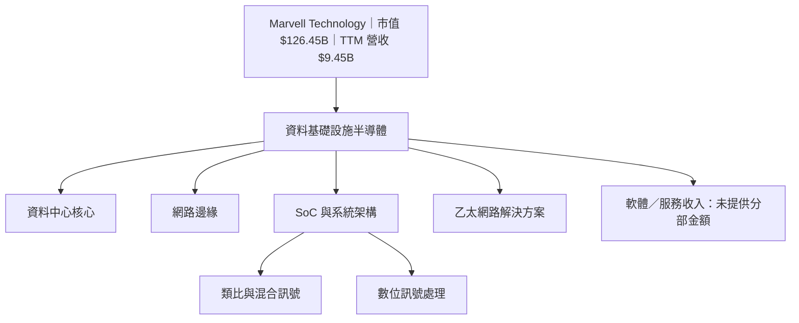
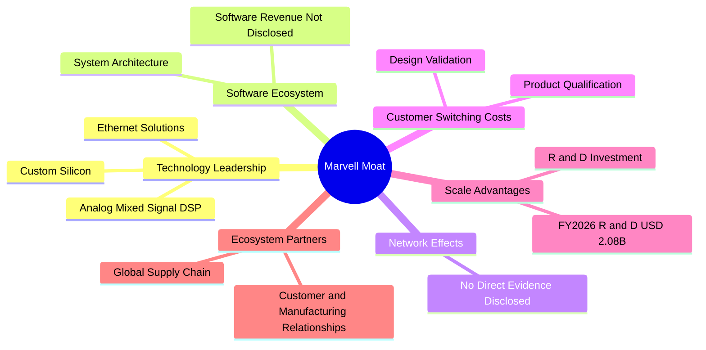
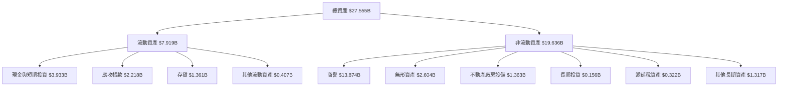
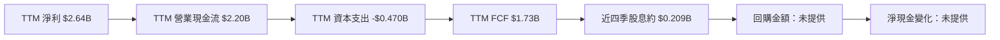
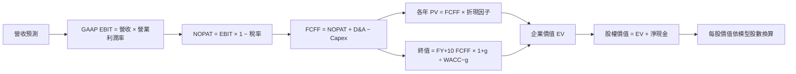
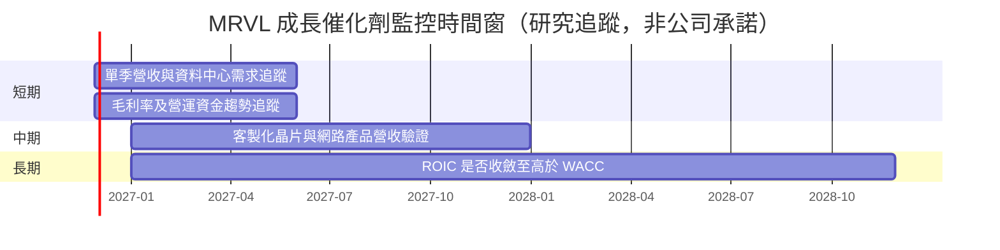
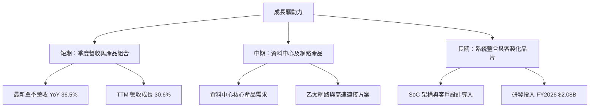
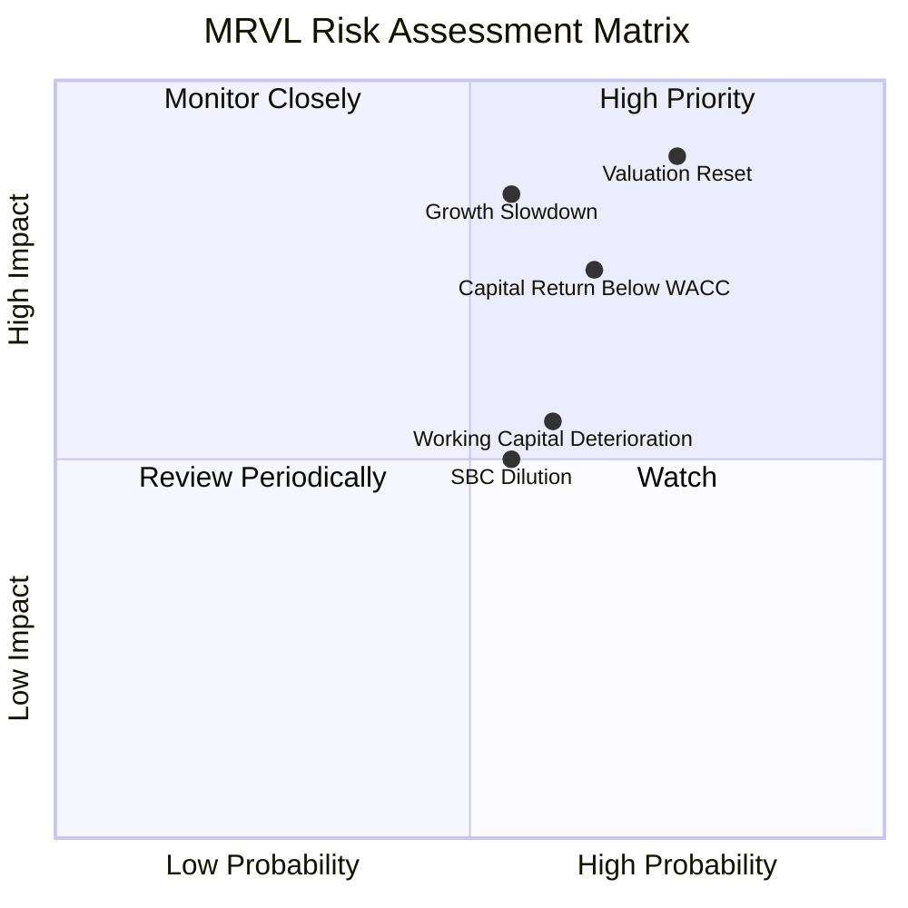
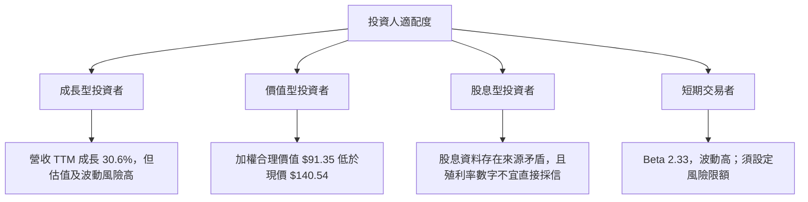

# MRVL 基本面深度分析報告
> **報告日期**：2026-11-28 ｜ **語言**：繁體中文 ｜ **數據來源**：SEC 申報資料 (XBRL)、Yahoo Finance、Finviz、StockAnalysis、Roic.ai ｜ **分析師**：CFA 級機構研究

---

## 目錄

| # | 章節 | 核心結論 |
|---|------|----------|
| 1 | 執行摘要 | 賣出；加權合理價值 $91.35；MOS -53.8% |
| 2 | 公司概覽與商業模式 | 資料中心及資料基礎設施晶片具技術與客戶黏著度，產品營收拆分未提供 |
| 3 | 損益表深度分析 | TTM 營收 $9.45B、年增 30.6%；單季年增 36.5% |
| 4 | 資產負債表分析 | 淨負債 $1.03B；現金充裕，但營運資金週期拉長 |
| 5 | 現金流量深度分析 | TTM FCF $1.73B；SBC 對現金流及股東稀釋仍具影響 |
| 6 | 獲利能力與資本效率 | ROIC 6.3% 低於 WACC 13.95%，目前未創造經濟價值 |
| 7 | 相對估值分析 | MRVL 估值高於部分同業；P/S 處於自身五年區間第 80 百分位 |
| 8 | DCF 內在價值評估 | 基準 DCF $38.25；加權合理價值 $91.35，兩者均低於現價 |
| 9 | 成長催化劑 | AI／資料中心需求可能推動成長，TAM 與細分業務數字未提供 |
| 10 | 風險矩陣 | 估值、成長持續性與資本效率為主要風險 |
| 11 | 投資建議 | 依 MOS 評級為賣出；重新評估需等待估值或基本面改善 |

---

## 1. 執行摘要

以 2026-11-27 收盤價 **$140.54** 計，程式估算的加權合理價值為 **$91.35**，故安全邊際 **MOS = -53.8%**；基準 DCF 每股價值 **$38.25**，ROIC **6.3%** 低於 WACC **13.95%**，且 TTM FCF yield 僅 **1.37%**。因此，依估值評級規則為 **賣出**：成長與現金流雖正向，但不足以抵銷現價相對估值的溢價及 ROIC 對資本成本的落差。

### 1.0 一頁式投資儀表板（Portfolio Manager 30 秒速讀）

| 項目 | 內容 |
|------|------|
| **投資論點（3 句）** | ① TTM 營收年增 **30.6%**，最新單季年增 **36.5%**，顯示近期需求加速。② TTM FCF **$1.73B**，但 FCF yield 僅 **1.37%**，股價已反映相當高的成長預期。③ ROIC **6.3%** 低於 WACC **13.95%**，代表目前資本報酬尚未覆蓋資本成本。 |
| **綜合評分** | **5.8/10**（引用 1.1；品質與估值的綜合印象，不取代評級） |
| **財務健康** | 🟡 現金及短期投資 **$3.93B**，總債務 **$4.96B**，淨負債 **$1.03B**；流動比率資料來源間有差異。 |
| **ROIC vs WACC** | **6.3% vs 13.95%**：目前摧毀經濟價值。 |
| **FCF 趨勢** | TTM FCF **$1.73B**；FCF yield **1.37%**。 |
| **估值** | Forward P/E **19.0x**（市場資料區）；EV/EBITDA **43.7x**（市場資料區）；FCF yield **1.37%**。Peer multiples 區另列的 MRVL P/E 為 **46.4x**，口徑不同，不混用。 |
| **DCF 內在價值（基準）** | **$38.25**；現價相對 DCF 溢價 **267.4%**（現價 ÷ DCF 價值 − 1）。 |
| **安全邊際（MOS）** | **-53.8%＝($91.35 − $140.54) ÷ $91.35**；🟡/🔴區間中屬 **低於 -25%，無安全邊際**。 |
| **預期報酬（基準情境 12M）** | DCF 基準情境相對現價 **-72.8%**；並非一年期價格預測，只作估值情境參考。 |
| **關鍵風險（前二）** | 估值遠高於加權合理價值；ROIC 低於 WACC 且 DCF 對長期假設敏感。 |
| **評級 + 信心度** | 🔴 **賣出** ｜ 信心：中；DCF 輸入與市場資料存在口徑差異，需持續核對。 |

### 1.1 綜合評分卡（全報告唯一）

| 維度 | 評分（1–10） | 主要依據（引用數字與其來源章節） |
|------|--------------|----------------------------------|
| 成長性 | 8.0 | TTM 營收年增 30.6%、最新單季年增 36.5%（第 3 章）。 |
| 獲利能力 | 6.0 | TTM 營業利益率 16.5%，但 ROIC 6.3% 低於 WACC 13.95%；F-Score 6/9（第 6 章）。 |
| 財務健康 | 6.5 | 淨負債 $1.03B，現金及短期投資 $3.93B；CCC 由 113 天升至 131 天（第 4 章）。 |
| 估值 | 2.0 | MOS -53.8%；P/S 13.7x，高於五年中位數 9.9x（第 7–8 章）。 |
| 護城河 | 7.0 | 複雜晶片設計、系統整合與客戶驗證具黏著性；但未提供分部市占及客戶集中度（第 2 章）。 |
| 管理層與資本配置 | 5.5 | SBC FY2026 為 $590.8M，稀釋股數測試未通過；回購資料不足以評估（第 3、5 章）。 |
| **綜合評分** | **5.8** | 六項算術平均：**(8.0 + 6.0 + 6.5 + 2.0 + 7.0 + 5.5) ÷ 6 = 5.8**。 |

### 1.2 五大投資論點 + 三大核心風險

| 類型 | 項目 | 具體依據 | 信心度 |
|------|------|----------|--------|
| 🟢 **投資論點①** | 資料中心相關需求推升營收 | TTM 營收 $9.45B、年增 30.6%；最新單季年增 36.5%。 | 🟢 高 |
| 🟢 **投資論點②** | 季度成長呈加速 | 最近四季營收由 $2.075B 增至 $2.739B，最新季 QoQ 約 +13.3%。 | 🟢 中 |
| 🟢 **投資論點③** | 現金流維持正值 | TTM OCF $2.20B、資本支出 $470.20M、FCF $1.73B。 | 🟢 高 |
| 🟢 **投資論點④** | 流動性有緩衝 | 現金及短期投資 $3.93B，總債務 $4.96B。 | 🟢 中 |
| 🟢 **投資論點⑤** | 產品進入門檻不只在晶片本身 | 高速互連、網路及客製化晶片需要設計驗證與系統整合；但其收入占比未提供。 | 🟡 中 |
| 🟡 **風險①** | 估值過高 | 加權合理價值 $91.35，現價 $140.54，MOS -53.8%。 | 🔴 高衝擊 |
| 🔴 **風險②** | 資本報酬未覆蓋資金成本 | ROIC 6.3% 對 WACC 13.95%，差距 -7.65 個百分點。 | 🔴 高衝擊 |
| 🟡 **風險③** | 營運資金效率惡化 | CCC 由 113 天升至 131 天，DSO 增 13 天、DIO 增 14 天。 | 🟡 中 |

### 1.3 快速統計卡片

| 指標 | 公司實際值（期間） | 同業中位數 | 狀態 |
|------|--------------------|------------|------|
| 營收成長（TTM） | **30.6%** | — | 🟢 |
| 營收成長（最新一季年增） | **36.5%** | **85.5%** | 🟡 |
| 毛利率（TTM） | **52.2%** | **74.9%** | 🟡 |
| 營業利益率（TTM） | **16.5%** | — | 🟡 |
| ROIC（TTM） | **6.3%** | — | 🔴 |
| Forward P/E | **19.0x**（市場估值資料） | **16.2x** | 🟡 |
| FCF Yield（TTM） | **1.37%** | — | 🔴 |
| Piotroski F-Score | **6 / 9** | — | 🟡 |

### 1.4 投資結論

```text
╔══════════════════════════════════════════════════════════════════╗
║                    📊 投資結論摘要                               ║
╠══════════════════════════════════════════════════════════════════╣
║  評級：賣出（依 MOS -53.8%，符合 MOS < -25% 門檻）               ║
║  價格（2026-11-27 收盤）：$140.54                                ║
║  DCF 內在價值（基準）：$38.25（現價溢價 267.4%）                ║
║  安全邊際 MOS：-53.8%（＝($91.35−$140.54)÷$91.35）              ║
║  加權合理價值（8.8）：$91.35                                     ║
║  DCF 情境價值：                                                  ║
║    悲觀情境：$19.35（-86.2%）                                    ║
║    基準情境：$38.25（-72.8%）                                    ║
║    樂觀情境：$72.76（-48.2%）                                    ║
║  綜合評分：5.8/10（引用 1.1）                                    ║
║  適合投資人：能承受高波動且已有部位者；不適合以價值或股息為主者  ║
╚══════════════════════════════════════════════════════════════════╝
```

---

## 2. 公司概覽與商業模式

Marvell Technology 為美國半導體公司，提供資料基礎設施晶片，涵蓋資料中心核心至網路邊緣，產品涉及 SoC 架構、類比、混合訊號、數位訊號處理及乙太網路解決方案。公司市值 **$126.45B**，TTM 營收 **$9.45B**。所提供資料未列出業務板塊營收與占比，故以下圖表只呈現公司與產品關係，不虛構分部金額或百分比。

### 2.1 業務結構與收入來源



### 2.2 市場份額

市場份額資料未提供，故不以圖表或估算比例呈現。MRVL TTM 營收為 $9.45B、TTM 年增 30.6%；同業最新單季營收年增率中，AVGO 為 85.5%、NVDA 為 103.2%、AMD 為 44.7%。這些公司業務組合不同，僅能比較成長速度，不能直接推導市場份額。

### 2.3 競爭護城河分析



### 2.4 護城河強度

| 護城河項目 | 強度（強／中／弱） | 證據（引用數字或事實） | 會削弱它的情況 |
|------------|--------------------|------------------------|----------------|
| 技術與系統整合 | 中 | SoC 涵蓋類比、混合訊號與 DSP；FY2026 研發支出 $2.08B。 | 競品性能或能效大幅改善、客戶自研替代。 |
| 客戶鎖定 | 中 | 客製化晶片與網路產品一般需設計驗證；具體續約與轉換成本未提供。 | 主要客戶重新設計、產品延遲或驗證失敗。 |
| 軟體生態系 | 弱至中 | 公司提供系統架構與資料基礎設施解決方案；軟體收入數據未提供。 | 軟體無法提升硬體黏著度，或開放標準降低差異化。 |
| 規模效應 | 中 | TTM 營收 $9.45B、研發投入 FY2026 $2.08B。 | 研發支出成長快於營收，資本回報持續低於 WACC。 |
| 網路效應與夥伴生態 | 弱至中 | 全球營運及供應鏈布局存在，但網路效應與夥伴貢獻未量化。 | 供應鏈集中、客戶議價或替代供應商增加。 |

1.1「護城河」評分 **7.0/10** 的理由是研發投入與系統設計複雜度支持產品黏著性，但市占、客戶集中度及分部經濟性資料不足。

---

## 3. 損益表深度分析

### 3.1 年度收入成長趨勢（近 4 年）

下表採年度損益表所列營收；FY2026 的 StockAnalysis 數字為 $8.195B，表格呈現四捨五入至 $0.01B。歷史來源間部分年度毛利與淨利數字有差異，年度趨勢以同一張年度報表序列為主。

```text
╔══════════════════════════════════════════════════════════════════╗
║              MRVL 年度收入趨勢（FY2023-FY2026）                 ║
╠══════════════════════════════════════════════════════════════════╣
║  FY2023  $5.92B  ███████████████░░░░░░░░░░░░░  YoY +32.7% 🟢   ║
║  FY2024  $5.51B  ██████████████░░░░░░░░░░░░░░  YoY  -7.0% 🔴   ║
║  FY2025  $5.77B  ███████████████░░░░░░░░░░░░░  YoY  +4.7% 🟡   ║
║  FY2026  $8.19B  █████████████████████░░░░░░░  YoY +42.1% 🟢   ║
╠══════════════════════════════════════════════════════════════════╣
║  FY2023-FY2026 營收 CAGR 約 11.4%                                ║
╚══════════════════════════════════════════════════════════════════╝
```

FY2026 的加速主要反映近年資料中心與網路需求回升；但年度成長波動顯示半導體需求仍受產品週期、客戶庫存及終端需求影響。FY2023 至 FY2026 CAGR 約 11.4%，低於最近 TTM 30.6%，故不宜將近期成長率視為長期穩態。

### 3.2 季度收入趨勢分析

最近四季金額取 StockAnalysis 季度營收；QoQ 為與前一季比較，YoY 為與去年同期比較，百分比四捨五入至一位小數。

| 季度 | 營收（$B） | QoQ | YoY | 備註 |
|------|------------|-----|-----|------|
| FY2026 Q3 | 2.075 | +3.4% | +36.8% | 相較 FY2026 Q2 $2.006B；YoY 對比 FY2025 Q3。 |
| FY2026 Q4 | 2.219 | +6.9% | +22.1% | 相較 FY2026 Q3 $2.075B。 |
| FY2027 Q1 | 2.418 | +9.0% | +27.6% | 相較 FY2026 Q4 $2.219B。 |
| FY2027 Q2 | 2.739 | +13.3% | +36.5% | 最新季度；TTM 與單季年增率不可混為一談。 |

最新一季的營收加速與毛利額上升，代表需求改善已體現在營收規模上；後續仍需觀察是否由更高毛利產品帶動，而非單純出貨量增加。

### 3.3 利潤率演變分析

年度毛利率及營業利益率依年度損益表數字計算，四捨五入至一位小數；TTM 數字採 SEC 口徑程式計算值。

| 利潤率指標 | FY2023 | FY2024 | FY2025 | FY2026 | 趨勢 | 評估 |
|------------|--------|--------|--------|--------|------|------|
| **毛利率** | 50.8% | 41.6% | 41.2% | 51.0% | FY2026 回升 | 🟡 |
| **營業利益率** | 6.1% | -7.9% | -6.4% | 16.3% | 由虧轉盈 | 🟡 |
| **淨利率** | -2.8% | -16.9% | -15.3% | 32.6% | FY2026 明顯改善 | 🟡 |

TTM 毛利率為 **52.2%**、營業利益率為 **16.5%**。FY2026 利潤率反轉，與營收恢復及產品組合改善相符；但年度淨利率受不同年度非營業、併購及稅務項目影響，不宜將 FY2026 32.6%直接視為常態。季度 GAAP 淨利也呈現大幅波動，進一步凸顯應同時追蹤營業現金流與非經常性項目。

### 3.4 費用結構分析

年度資料提供研發費用，但未提供完整且口徑一致的銷貨成本、銷管費用、併購攤銷與其他營業費用拆分，故不繪製費用比例圓餅圖，避免以未核實的殘差推估費用結構。FY2026 研發支出為 **$2.08B**，占營收約 **25.4%**（$2.08B ÷ $8.195B）；這筆投入支持產品開發，但須以後續營收與 ROIC 檢驗回報。

### 3.5 季度 EPS 趨勢與盈餘品質（Quality of Earnings）

近四季 EPS estimate 與實際值在 Yahoo Finance 盈餘歷史資料中均為缺值，因此無法判定超預期或不及預期。StockAnalysis 報告的季度 EPS 為 FY2026 Q3 $2.20、Q4 $0.47、FY2027 Q1 $0.04、Q2 $0.34；Q3 的高值與其他季度落差極大，顯示單季 GAAP 淨利受非經常性項目影響，不能當成常態盈利率。

| 盈餘品質項目 | 數值/佔比 | 評估 |
|--------------|-----------|------|
| 股權薪酬 SBC / 營收 | 約 **8.8%**：近四季 SBC $828.9M ÷ TTM 營收 $9.45B | 🔴 SBC 占比高，股東經濟成本不容忽視。 |
| SBC / 營業現金流 | 約 **37.7%**：$828.9M ÷ $2.20B | 🟡 對 OCF 的比重顯著；SBC 是非現金費用，但會稀釋股東。 |
| FCF / 淨利（現金轉換率） | 約 **65.5%**：TTM FCF $1.73B ÷ TTM 淨利 $2.64B | 🟡 現金轉換低於 100%；可能反映營運資金及非現金／非經常項目。 |
| 一次性/非經常性損益 | 季 EPS 波動明顯；具體一次性項目金額 N/A | 🟡 單季淨利不宜直接年化。 |
| 有效稅率異常 | DCF 採用 12.4%；實際逐季稅務調節明細未提供 | 🟡 需確認稅務利益是否具持續性。 |
| 資本化支出 vs 費用化 | TTM 資本支出 $470.20M；資本化研發金額 N/A | 🟡 無法確認是否存在重大成本遞延。 |

**盈餘品質結論**：TTM OCF 為正且 FCF 達 $1.73B，支持盈利並非完全由會計應計構成；但 FCF／淨利約 65.5%、SBC 約占營收 8.8%，顯示 GAAP 獲利的股東含金量低於單看淨利所呈現的程度。估值應考慮稀釋成本及現金轉換，而非單用 EPS。

---

## 4. 資產負債表分析

### 4.1 資產結構分解

以下使用截至 2026-08-01 的季度資產負債表；金額為 StockAnalysis 所列、以 $B 表示。



資產中商譽及無形資產合計 **$16.478B**，約占總資產 59.8%。這反映併購形成的資產比重較高，後續需留意減損風險與併購資產的現金回報。

### 4.2 流動性與營運資金分析

不同資料來源的 current ratio 有差異：市場資料區列 **3.168**，但用 2026-08-01 資產負債表流動資產 $7.919B ÷ 流動負債 $2.500B，約為 3.17。主要流動性指標如下：

| 指標 | 最新值 | 評估 |
|------|--------|------|
| 流動比率 | 3.168 | 🟢 具短期資產緩衝；需注意應收與存貨占比。 |
| 速動比率 | 2.461 | 🟢 高於 1；不同來源計算口徑可能略異。 |
| 現金及短期投資 | $3.93B | 🟢 可提供流動性緩衝。 |
| 淨負債 | $1.03B | 🟡 債務可控但並非淨現金。 |

**營運資金天數**：以下照錄品質指標程式計算數字。

| 指標 | 最新 TTM | 一年前 TTM | 變化 | 解讀 |
|------|----------|------------|------|------|
| DSO 應收帳款天數 | 86 天 | 73 天 | +13 天 | 🟡 收款週期拉長，可能反映客戶付款條件或收入時點變化。 |
| DIO 存貨天數 | 110 天 | 96 天 | +14 天 | 🟡 存貨天數增加，須檢查是否因備貨或需求預測偏差。 |
| DPO 應付帳款天數 | 64 天 | 56 天 | +8 天 | 🟡 付款天數延長，可能部分抵銷應收與存貨占用。 |
| CCC 現金轉換週期 | 131 天 | 113 天 | +18 天 | 🔴 現金回收週期惡化，成長對營運資金的占用上升。 |

### 4.3 債務結構分析

財務核心數字採 SEC 申報資料程式計算口徑；市場資料區另一來源列總債務 $5.29B、淨負債 $1.35B，與核心數據 $4.96B、$1.03B 有差異，以下採前者以外的 VERIFIED 數字，即 $4.96B／$1.03B。

```text
╔══════════════════════════════════════════════════════════════════╗
║                   MRVL 債務健康診斷                              ║
╠══════════════════════════════════════════════════════════════════╣
║  總債務：       $4.96B  ████████████████████  🟡                 ║
║  現金+短期投資：$3.93B  ████████████████░░░░  🟢                 ║
║  淨負債：       $1.03B  ████░░░░░░░░░░░░░░░░  🟡                 ║
║                                                                  ║
║  Debt/EBITDA：N/A（未提供同口徑 EBITDA 與債務期間配對）          ║
║  Interest Coverage：N/A（利息費用與營業利益口徑未提供）          ║
║  資本成本提供的稅前債務成本：4.08%                                ║
╚══════════════════════════════════════════════════════════════════╝
```

### 4.4 股東權益趨勢

年度股東權益由 FY2023 $15.64B 降至 FY2024 $14.83B、FY2025 $13.43B，再升至 FY2026 $14.31B。FY2026 的回升與盈利恢復相符；股東權益並不等於可分配現金，且商譽與無形資產較高，帳面權益的資產回收品質仍需折價看待。

```text
╔══════════════════════════════════════════════════════════════════╗
║                 MRVL 股東權益變化（年度）                        ║
╠══════════════════════════════════════════════════════════════════╣
║  FY2023  $15.64B  ████████████████████                           ║
║  FY2024  $14.83B  ███████████████████                            ║
║  FY2025  $13.43B  █████████████████                              ║
║  FY2026  $14.31B  ██████████████████                             ║
╚══════════════════════════════════════════════════════════════════╝
```

---

## 5. 現金流量深度分析

### 5.1 現金流量瀑布圖

FY2026 年度淨利與 TTM 現金流期間不同，故不將兩者硬接成單一期間的精確瀑布；以下依 TTM OCF、Capex、FCF 數字呈現現金流關係。股息近四季約 $209M；回購及淨現金變化明細未提供。



### 5.2 FCF 轉換率趨勢

| 財年 | FCF（$B） | 淨利（$B） | FCF/淨利 | 解讀 |
|------|-----------|-----------|----------|------|
| FY2023 | 1.07 | -0.164 | N/M | 淨利為負，比率不具可比性。 |
| FY2024 | 1.02 | -0.933 | N/M | 淨利為負，比率不具可比性。 |
| FY2025 | 1.39 | -0.885 | N/M | 淨利為負，比率不具可比性。 |
| FY2026 | 1.39 | 2.67 | 約 52.1% | 現金轉換低於淨利；年度資料來源口徑須留意。 |
| TTM | 1.73 | 2.64 | 約 65.5% | 現金流為正，但未完全轉化為 FCF。 |

FY2023–FY2025 歷史淨利為負，故不適合用 FCF/淨利比率判斷獲利品質；FY2026 與 TTM 轉正後仍低於 100%，應追蹤營運資金回收及 SBC。

### 5.3 自由現金流趨勢

年度 FCF 來自現金流量表；TTM FCF 必須採 OCF 減資本支出的定義。

```text
╔══════════════════════════════════════════════════════════════════╗
║                   MRVL 自由現金流趨勢                            ║
╠══════════════════════════════════════════════════════════════════╣
║  FY2023  $1.07B  ███████████████░░░░░░░░░░  🟢                  ║
║  FY2024  $1.02B  ██████████████░░░░░░░░░░░  🟡                  ║
║  FY2025  $1.39B  ███████████████████░░░░░░  🟢                  ║
║  FY2026  $1.39B  ███████████████████░░░░░░  🟢                  ║
║  TTM      $1.73B  ████████████████████████░  FCF Yield 1.37%    ║
╚══════════════════════════════════════════════════════════════════╝
```

TTM FCF 高於 FY2026 全年，但現價市值使 FCF yield 僅 1.37%；現金流改善本身不等於股價便宜。

### 5.4 資本配置評估

提供的資料有 FY2026 資本支出 $358.6M、現金股息 $205.1M，以及 SBC $590.8M；未提供同期間回購金額與現金併購支出，因此不繪製資本配置比例圓餅圖。

| 資本配置項目 | 數值 | 評估 |
|--------------|------|------|
| 研發支出 | FY2026 $2.08B | 主要投入產品開發；須觀察回報轉化。 |
| 資本支出 | FY2026 $358.6M；TTM $470.20M | 相對收入不高，但資料中心產品仍需供應鏈與工程投入。 |
| 現金股息 | FY2026 $205.1M | 規模低於 FCF；市場資料的 17.0% 殖利率與股息金額不一致，不採用該殖利率。 |
| 股票回購 | N/A | 回購金額未提供。 |
| SBC | FY2026 $590.8M | 🟡/🔴 具持續稀釋成本，Piotroski 稀釋股數測試未通過。 |

---

## 6. 獲利能力與資本效率

### 6.1 ROE / ROA / ROIC 趨勢

可核實的統一口徑 TTM 數字如下；歷年 ROIC／ROA 序列及可比同業行業平均未提供，故不填補推估值。

| 指標 | 最新 TTM | 歷史趨勢資料 | 評估 |
|------|----------|--------------|------|
| ROE | 14.2% | 歷年統一口徑 N/A | 🟡 正報酬，但杜邦分解顯示資產週轉率偏低。 |
| ROA | 4.1% | 歷年統一口徑 N/A | 🟡 資產回報低於股權回報。 |
| ROIC | 6.3% | 歷年統一口徑 N/A | 🔴 低於 WACC 13.95%。 |

### 6.2 ROIC vs WACC 分析（核心價值創造判斷）

```text
╔══════════════════════════════════════════════════════════════════╗
║                ROIC vs WACC 深度分析                            ║
╠══════════════════════════════════════════════════════════════════╣
║  WACC（採用資本成本資料）：13.95%                                ║
║  ├── 無風險利率（10Y美債）：4.94%                                ║
║  ├── ERP：5.00%                                                   ║
║  ├── 原始 Beta：2.33；採用調整後 Beta：1.88                     ║
║  ├── 提供的股權成本 Ke：14.36%                                   ║
║  ├── 稅前債務成本：4.08%；稅後約 3.57%                           ║
║  ├── 股權／債務權重：96.2%／3.8%                                 ║
║  └── ✅ WACC 採用值：13.95%                                      ║
║                                                                  ║
║  ROIC（TTM）：6.3%                                               ║
║  EVA spread = ROIC − WACC = 6.3% − 13.95% = -7.65pp             ║
║                                                                  ║
║  ROIC  6.3%   ▓▓▓▓▓▓▓▓▓▓░░░░░░░░░░░░░░░░                        ║
║  WACC 13.95%  ▓▓▓▓▓▓▓▓▓▓▓▓▓▓▓▓▓▓▓▓▓▓                             ║
║                                                                  ║
║  結論：ROIC 低於 WACC 7.65 個百分點，當前資本配置未覆蓋資本成本  ║
╚══════════════════════════════════════════════════════════════════╝
```

Beta 採調整後 **1.88**，原始 Yahoo Beta **2.33**；調整方法為 ⅔ × 2.33 + ⅓。以表列四捨五入輸入計算 CAPM 得 4.94% + 1.88 × 5.00% = 14.34%，與資本成本資料所列 Ke 14.36% 相差 0.02 個百分點；本報告依規則採用來源列示的 **Ke 14.36%、WACC 13.95%**，差異可能來自底層未四捨五入數字。稅前 Kd 及權重也直接採來源列示數值，不以另一套負債範圍重算。

### 6.3 杜邦三因素分解

以下照錄品質指標程式計算的 DuPont 結果。

| 因素 | 數值（TTM） | 解讀 |
|------|-------------|------|
| 淨利率 | 27.9% | 對 ROE 有正向貢獻，但需留意非經常項目與現金轉換。 |
| 資產週轉率 | 0.34 | 🟡 資產使用效率偏低，商譽與無形資產占比高。 |
| 權益乘數 | 1.49 | 槓桿不是 ROE 的主要來源。 |
| **ROE** | **14.2%** | **27.9% × 0.34 × 1.49 = 14.2%**。 |

### 6.4 財務體質：Piotroski F-Score

F-Score **6/9**，九項測試皆有判定。

| 測試 | 結果 | 解讀 |
|------|------|------|
| ROA > 0 | ✅ 通過 | TTM 資產報酬為正。 |
| 營業現金流 > 0 | ✅ 通過 | TTM OCF $2.20B。 |
| ROA 高於一年前 | ✅ 通過 | 盈利恢復改善資產報酬。 |
| 營業現金流 > 淨利（應計品質） | ❌ 未通過 | 現金流低於淨利，應追蹤應計與營運資金。 |
| 長期負債 ÷ 總資產低於一年前 | ✅ 通過 | 指標相較一年前改善。 |
| 流動比率高於一年前 | ✅ 通過 | 短期流動性指標改善。 |
| 稀釋股數未增加 | ❌ 未通過 | 股數增加，SBC 對股東持股比例有稀釋。 |
| 毛利率高於一年前 | ✅ 通過 | 毛利率改善。 |
| 資產週轉率高於一年前 | ❌ 未通過 | 資產周轉效率未改善。 |

整體分數中等偏正，但應計品質、稀釋及資產周轉三項未通過，代表成長品質不宜只看營收及 EPS。

---

## 7. 相對估值分析

### 7.1 同業估值比較表格

Peer multiples 區的 MRVL P/E 與一般市場估值區的 P/E 定義或抓取時點不一致；此處遵守同業比較要求，使用 Peer multiples 所列 MRVL 數據。公司 Forward P/E 的另一市場欄位為 19.0x，Peer multiples 區 MRVL Forward P/E 未提供；相對比較採估值方法區採用的同業倍數。

| 估值指標 | **MRVL** | **AVGO** | **NVDA** | **AMD** | MRVL 評估 |
|----------|----------:|---------:|--------:|-------:|-----------|
| **Trailing P/E** | 46.4x | 39.9x | 16.0x | 90.7x | 🟡 高於 AVGO、NVDA，低於 AMD。 |
| **Forward P/E** | 19.0x¹ | 16.2x | 9.1x | 24.1x | 🟡 高於 AVGO、NVDA，低於 AMD。 |
| **P/S Ratio** | 13.7x | 16.7x | 10.0x | 15.5x | 🟡 高於 NVDA，低於 AVGO、AMD。 |
| **EV/EBITDA** | 83.6x | 29.2x | 14.7x | 61.9x | 🔴 明顯高於三家對照數字。 |
| 最新一季營收 YoY | 36.5% | 85.5% | 103.2% | 44.7% | 🟡 成長正向，但低於三家同業所列增速。 |
| 毛利率（TTM） | 52.2% | 75.5% | 74.9% | 56.0% | 🟡 低於三家比較公司。 |

¹ MRVL Forward P/E 19.0x 為市場估值資料區；Peer multiples 未列 MRVL Forward P/E，不能將它誤稱為 Peer 區原值。

### 7.2 歷史估值區間分析

```text
╔══════════════════════════════════════════════════════════════════╗
║              MRVL 五年歷史估值區間（TTM）                        ║
╠══════════════════════════════════════════════════════════════════╣
║  P/E       25.6x ───── 中位數 56.5x ───── 61.9x                  ║
║             現值 46.4x｜百分位 50%                                ║
║                                                                  ║
║  P/S        5.8x ───── 中位數 9.9x ────── 18.3x                  ║
║             現值 13.7x｜百分位 80%                                ║
║                                                                  ║
║  EV/EBITDA 53.3x ──── 中位數 156.4x ──── 730.9x                 ║
║             現值 83.6x｜百分位 25%                                ║
╚══════════════════════════════════════════════════════════════════╝
```

P/E 位於自身五年區間中位附近，P/S 目前在 80 百分位，代表收入倍數偏高。EV/EBITDA 的歷史範圍極寬，受獲利低基期影響，百分位雖為 25%，不代表絕對便宜。

### 7.3 情境價值（Bear / Base / Bull，照抄 DCF MODEL 的 Scenarios）

| 情境 | 第 1 年營收成長 | 期末營業利潤率 | WACC | 每股價值 | 相對現價 | 機率 | 會發生的條件 |
|------|----------------|----------------|------|----------|----------|------|--------------|
| 🔴 悲觀 | 15.0% | 3.4% | 14.95% | $19.35 | -86.2% | 25% | 需求降速、競爭或產品組合使長期利潤率低於基準。 |
| 🟡 基準 | 30.0% | 4.0% | 13.95% | $38.25 | -72.8% | 50% | 採用模型基準成長與利潤率衰減路徑。 |
| 🟢 樂觀 | 45.0% | 4.4% | 12.95% | $72.76 | -48.2% | 25% | 資料中心需求更強、成長加速且折現率下降。 |

### 7.4 相對估值隱含價格區間

```text
╔══════════════════════════════════════════════════════════════════╗
║                估值方法每股價值對照                              ║
╠══════════════════════════════════════════════════════════════════╣
║  $38.25 ───── $67.68 ───── $91.35 ───── $119.50 ───── $140.54   ║
║  DCF基準       EV/EBITDA     加權合理值   Forward P/E      現價 ║
║                                                                  ║
║  分析師共識：$292.58（均值目標價，39 位分析師）                  ║
╚══════════════════════════════════════════════════════════════════╝
```

同業 Forward P/E 方法以同業中位數 **16.2x** 乘以公司 Forward EPS **$7.39**，得 $119.50；同業 EV/EBITDA 使用 AVGO、NVDA 中位數 **21.9x** 乘 TTM EBITDA，再加回淨現金，程式列示每股 $67.68。分析師共識 $292.58 為 39 位分析師平均目標價，和基準 DCF 差距很大，應視為樂觀參考而非基本面下檔保護。

---

## 8. DCF 內在價值評估（Discounted Cash Flow）

### 8.0 估值推理鏈（Thinking Logic：在算之前先想清楚）

**Step 1 — 價值由哪些變數決定？**  
模型核心為資料基礎設施晶片帶來的營收擴張、GAAP 營業利潤率變化，以及折現率與終值。已提供整體 TTM 營收 $9.45B，但未提供各業務營收占比，故不能把 AI、乙太網路或其他產品的收入占比當作已知事實。模型中對估值最關鍵的變數是營收成長、營業利潤率與 WACC；敏感性表顯示 WACC 與終值成長率均影響每股價值。

**Step 2 — 模型選擇**

| 決策點 | 本報告採用 | 理由（含數字） | 曾考慮但否決 | 否決理由 |
|--------|-----------|----------------|--------------|----------|
| 現金流定義 | FCFF | 與 WACC 折現並先求 EV；模型明列 FCFF = NOPAT + D&A − Capex。 | FCFE | 債務結構不需直接納入股權現金流預測。 |
| 預測期 N | 10 年 | 模型設定 FY+1 至 FY+10，並逐年淡出成長率。 | 5 年 | 會更快將成長期轉入終值，與既定模型不一致。 |
| 終值方法 | Gordon Growth | 模型提供終值及 3.0% 永續成長率。 | 退出倍數 | DCF 模型未提供可直接採用的退出倍數終值，不能另造。 |
| EBIT 基礎 | GAAP | DCF 明列 GAAP EBIT，SBC 已列費用。 | 非 GAAP | 加回 SBC 會改變既定模型。 |

**Step 3 — 假設推導鏈**

- **營收成長**：錨點＝TTM 年增 30.6%、最新單季年增 36.5% → 調整＝單季增速高於 TTM，但年度成長可能隨基期抬高而放緩 → 採用 FY+1 30.0%、FY+10 3.0% 線性淡出 → 否決 FY+1 36.5%，因單季 YoY 不等於可持續年度成長率。
- **營業利潤率**：錨點＝TTM GAAP 營業利益率 16.5% → 調整＝規模與組合改善可能被競爭、週期與成本抵銷 → FY+1 16.5% 線性降至 FY+10 4.0% → 否決長期維持 16.5%，因模型採近五年中位數作期末利潤率錨點。
- **永續成長率 g**：錨點＝模型採用 3.0% → 調整＝需低於 WACC 13.95%，並考慮成熟期成長收斂 → 採用 3.0% → 否決更高的長期成長率，因會不合理提高終值比重。
- **預測期 N**：錨點＝模型指定 10 年 → 調整＝產品週期、客戶設計導入可見度有限，10 年已屬長期外推 → 採用 10 年 → 否決更長期限，因現有資料無法支撐更遠期可見度。
- **Capex／營收**：錨點＝TTM 資本支出占營收約 5.0% → 模型於預測期維持 5.0% → 否決提高資本支出比率，因模型未列管理層新增產能財測；但需留意實際投資需求可能不同。
- **EBIT 基礎、SBC 與稀釋**：錨點＝GAAP EBIT 已含 SBC，SBC FY2026 為 $590.8M → 採用模型組合 **(A)：GAAP EBIT、FCFF 不另扣 SBC、固定股數／年稀釋率 0%** → 否決非 GAAP 加回 SBC，因會低估股東成本或造成重複計算。本模型採用 (A)，故 SBC 影響已計入一次。
- **WACC**：錨點＝資本成本資料列示 13.95% → 採用 13.95% → 否決更低折現率，因調整後 Beta 仍為 1.88，且來源已提供統一折現率。
- **D&A／營收與稅率**：錨點＝TTM D&A／營收 13.3%、有效稅率 12.4% → 模型固定採用兩者；D&A 高、Capex 低的組合會提高 FCFF，應視為重要模型風險。
- **營運資金**：錨點＝最新 CCC 131 天、一年前 113 天 → 模型未納入營運資金變動 → 不自行補值；這會使模型未反映成長可能帶來的應收及存貨現金占用。
- **終值方法**：錨點＝模型採 Gordon Growth、g 3.0% → 採用模型終值 → 退出倍數只作相對估值參考，不能在缺少 DCF 終值倍數輸入時重建另一個終值。

**Step 4 — 最脆弱的一環**  
模型未納入營運資金變動，且 D&A／營收 13.3% 大幅高於 Capex／營收 5.0%；若折舊攤銷不是可持續的非現金項目，或 CCC 拉長造成現金占用，FCFF 與 DCF 價值將向下偏。

**Step 5 — 計算路徑圖**



### 8.1 模型假設總表（Model Inputs）

| 假設項目 | 採用值 | 依據 / 來源 | 敏感度 |
|----------|--------|-------------|--------|
| 預測期長度 **N** | 10 年 | DCF 模型設定，逐年預測 FY+1 至 FY+10。 | 🟡 中 |
| 營收成長率 | FY+1 30.0% → FY+10 3.0% | TTM YoY 30.6%；線性淡出。 | 🔴 高 |
| 營業利潤率 | FY+1 16.5% → FY+10 4.0% | 起點採 TTM，期末採近五年中位數。 | 🔴 高 |
| 有效稅率 | 12.4% | 最新年度有效稅率。 | 🟢 低 |
| Capex / 營收 | 5.0% 至 5.0% | TTM 資本支出約占營收 5.0%，模型維持。 | 🟡 中 |
| D&A / 營收 | 13.3% | TTM 比率，模型固定。 | 🟢 低 |
| 營運資金變動 | 未建模 | 模型明確未納入 working capital。 | 🟡 中 |
| EBIT 基礎 | GAAP EBIT | DCF 模型指定。 | 🟡 中 |
| SBC 處理 | 組合 (A)：GAAP EBIT、不另扣 SBC | SBC 已反映於 GAAP EBIT；股數不再稀釋。 | 🟡 中 |
| 年稀釋率 | 0%（固定股數） | 與組合 (A) 相容，採模型設定。 | 🟡 中 |
| 永續成長率 g | 3.0% | DCF 模型設定；低於 WACC。 | 🔴 高 |
| 終值方法 | Gordon Growth | DCF 模型提供。 | 🔴 高 |
| WACC | 13.95% | 資本成本來源列示值；見 8.2。 | 🔴 高 |

### 8.2 折現率推導（WACC）

```text
╔══════════════════════════════════════════════════════════════════╗
║                    WACC 推導（折現率）                           ║
╠══════════════════════════════════════════════════════════════════╣
║  股權成本 Ke（CAPM，採來源列示值）：14.36%                       ║
║  ├── 無風險利率 Rf（10Y 美債）：4.94%                            ║
║  ├── ERP：5.00%                                                   ║
║  ├── 原始 Beta：2.33；調整後 Beta：1.88                          ║
║  ├── CAPM 以顯示值試算：4.94% + 1.88×5.00% = 14.34%             ║
║  └── 採用 Ke：14.36%（來源精度口徑）                             ║
║                                                                  ║
║  債務成本 Kd：                                                   ║
║  ├── 稅前 Kd：4.08%（來源列示；利息金額未提供，不能獨立重建）     ║
║  ├── 有效稅率：12.4%                                              ║
║  └── 稅後 Kd = 4.08%×(1−12.4%) = 3.57%                           ║
║                                                                  ║
║  資本結構（市值基礎）：股權 96.2%，債務 3.8%                     ║
║  └── ✅ WACC 採用值：13.95%                                      ║
╚══════════════════════════════════════════════════════════════════╝
```

五步演算：

1. **Ke**：來源原始 Beta 2.33，調整後 Beta 1.88；以表列精度試算  
   **4.94% + 1.88 × 5.00% = 14.34%**；資本成本來源列示 **14.36%**，採用來源值。
2. **稅前 Kd**：來源列示 **4.08%**；利息費用金額及平均計息負債明細未提供，故無法用「利息 ÷ 平均計息負債」重建。
3. **稅後 Kd**：**4.08% × (1 − 12.4%) = 3.57%**。
4. **權重**：股權 **96.2%**、債務 **3.8%**；合計 **100.0%**。來源以市值／債務列示權重，另一期末計息負債明細未充分提供，故不另重算市值與債務權重。
5. **WACC**：以來源列示值計算，**96.2% × 14.36% + 3.8% × 3.57% ≈ 13.95%**；模型與第 6.2 節均採 **13.95%**。因輸入值經四捨五入，顯示算式可能有小幅尾差。

### 8.3 逐年自由現金流預測（基準情境）

以下逐年數字照錄 DCF 模型，單位 $B；折現因子保留三位小數。模型未納入 ΔWC，故不列該項；SBC 依組合 (A) 不重複扣除。  
**四捨五入規則**：金額至小數二位、比率至一位、折現因子三位；表中加總可能因模型內未四捨五入底數有尾差。

| 年度 | FY+1 | FY+2 | FY+3 | FY+4 | FY+5 | FY+6 | FY+7 | FY+8 | FY+9 | FY+10 |
|------|------:|------:|------:|------:|------:|------:|------:|------:|------:|-------:|
| 營收 | 12.29 | 15.60 | 19.35 | 23.41 | 27.62 | 31.77 | 35.58 | 38.78 | 41.11 | 42.34 |
| 營收 YoY | 30.0% | 27.0% | 24.0% | 21.0% | 18.0% | 15.0% | 12.0% | 9.0% | 6.0% | 3.0% |
| 營業利潤率 | 16.5% | 15.1% | 13.7% | 12.4% | 11.0% | 9.6% | 8.2% | 6.8% | 5.4% | 4.0% |
| EBIT（GAAP） | 2.03 | 2.36 | 2.66 | 2.89 | 3.03 | 3.04 | 2.91 | 2.64 | 2.22 | 1.70 |
| − 稅 | (0.25) | (0.29) | (0.33) | (0.36) | (0.37) | (0.38) | (0.36) | (0.33) | (0.27) | (0.21) |
| = NOPAT | 1.78 | 2.07 | 2.33 | 2.53 | 2.65 | 2.67 | 2.55 | 2.31 | 1.95 | 1.49 |
| + D&A | 1.64 | 2.08 | 2.58 | 3.12 | 3.69 | 4.24 | 4.75 | 5.18 | 5.49 | 5.65 |
| − Capex | (0.61) | (0.78) | (0.96) | (1.16) | (1.37) | (1.58) | (1.77) | (1.93) | (2.05) | (2.11) |
| **= FCFF** | **2.81** | **3.38** | **3.95** | **4.49** | **4.97** | **5.33** | **5.53** | **5.56** | **5.39** | **5.04** |
| 折現因子 | 0.878 | 0.770 | 0.676 | 0.593 | 0.520 | 0.457 | 0.401 | 0.352 | 0.309 | 0.271 |
| **FCFF 現值 PV** | **2.46** | **2.60** | **2.67** | **2.67** | **2.59** | **2.43** | **2.22** | **1.95** | **1.66** | **1.36** |

預測期 PV 加總照錄模型合計 **$22.62B**；表中已四捨五入的年度 PV 逐項相加會有小幅差異，來自底層未四捨五入數值。

**逐步演算（FY+1 代表年度）**

1. 營收：$9.45B × (1 + 30.0%) = **$12.29B**（模型以未四捨五入底數計算）。
2. EBIT：$12.29B × 16.5% = **$2.03B**。
3. 稅：$2.03B × 12.4% = **$0.25B**。
4. NOPAT：$2.03B − $0.25B = **$1.78B**。
5. D&A：$12.29B × 13.3% = **$1.64B**。
6. Capex：$12.29B × 5.0% = **$0.61B**。
7. ΔWC：**未建模**，故不在模型中扣除。
8. FCFF：模型列示 **$2.81B**；以上述已四捨五入的分項重算可能有 0.01B 左右尾差，模型採未四捨五入輸入。
9. 折現因子：**1 ÷ (1 + 13.95%)¹ = 0.878**；PV：**$2.81B × 0.878 = $2.46B**。

**合理性自檢**

- FY+1 至 FY+10 FCFF：$2.81B 至 $5.04B，九個年度區間 CAGR 約 **6.7%**；FY2023 至 FY2026 年度 FCF 由 $1.07B 至 $1.39B，三年區間 CAGR 約 **9.1%**。預測略低於歷史，但兩者期間與定義不同。
- FY+10 FCFF 利潤率：**5.04 ÷ 42.34 = 11.9%**；TTM FCF／營收約 **1.73 ÷ 9.45 = 18.3%**。同業最佳 FCF 利潤率未提供，無法作數值比較。
- 模型各年 FCFF 均為正；由於未建模營運資金，現金流預測可能高估成長期可分配現金。

```text
╔══════════════════════════════════════════════════════════════════╗
║            自由現金流：歷史實際 vs 模型預測                      ║
╠══════════════════════════════════════════════════════════════════╣
║  FY2024(實)  $1.02B  █████░░░░░░░░░░░░░░░                       ║
║  FY2025(實)  $1.39B  ███████░░░░░░░░░░░░░░                     ║
║  FY2026(實)  $1.39B  ███████░░░░░░░░░░░░░                     ║
║  FY+1 (預)   $2.81B  ██████████████░░░░░░                       ║
║  FY+10(預)   $5.04B  █████████████████████████                  ║
╠══════════════════════════════════════════════════════════════════╣
║  模型預測與歷史 FCF 口徑不同；營運資金未納入是主要上行偏誤來源   ║
╚══════════════════════════════════════════════════════════════════╝
```

### 8.4 終值計算（Terminal Value）

適用性檢查：**WACC 13.95% vs g 3.0% → WACC > g？✅**

| 方法 | 計算式 | 終值 TV | TV 現值 | 佔總 EV 比重 |
|------|--------|---------|---------|--------------|
| Gordon Growth | $5.04B × (1+3.0%) ÷ (13.95%−3.0%) | $47.37B | $12.83B | 36.2% |
| 退出倍數法 | DCF 模型未提供終值 EBITDA 倍數輸入 | N/A | N/A | N/A |

逐步演算：

1. FY+10 FCFF：**$5.04B**。
2. 分子：模型列示終值採 FCFF×(1+g)；顯示值為 **$5.04B × (1+3.0%)**。
3. 分母：**13.95% − 3.0% = 10.95%**；模型列示終值 **$47.37B**。由已四捨五入的 $5.04B 重算會有細微差異，底層模型使用未四捨五入現金流。
4. PV(TV)：**$47.37B × 0.271 = $12.83B**（模型採用未四捨五入折現因子）。
5. 終值占 EV：**$12.83B ÷ $35.45B = 36.2%**。

終值現值占 EV 36.2%，非主要價值來源；但退出倍數交叉驗證所需的 FY+10 EBITDA 與 DCF 終值倍數未提供，不另造數字。

### 8.5 企業價值 → 每股內在價值（Bridge）

```text
╔══════════════════════════════════════════════════════════════════╗
║              企業價值 → 每股內在價值 橋接表                      ║
╠══════════════════════════════════════════════════════════════════╣
║  預測期 FCF 現值合計            +$22.62B                         ║
║  終值現值 PV(TV)                +$12.83B                         ║
║  = 企業價值 EV                    $35.45B                        ║
║  + 淨現金（來源列示為負，代表淨負債） -$1.03B                    ║
║  = 股權價值                       $34.42B                        ║
║  每股價值（模型換算）             $38.25                          ║
║  當前股價（2026-11-27 收盤）       $140.54                         ║
║  折溢價（現價÷DCF內在價值−1）     +267.4%（溢價）                ║
╚══════════════════════════════════════════════════════════════════╝
```

逐步演算：

1. **EV**：$22.62B + $12.83B = **$35.45B**。
2. **股權價值**：$35.45B + 淨現金 (-$1.03B) = **$34.42B**。
3. **每股內在價值**：DCF 模型列示公式為「股權價值 × 價格 ÷ 市值」，結果 **$38.25**。市場資料另列流通股數 877.99M；與模型的市值換算口徑無法完全核對，因此照錄模型每股結果，不另以外部股數替換。
4. **折溢價**：**$140.54 ÷ $38.25 − 1 = +267.4%**。
5. **本節不計算 MOS**；MOS 只在 8.8 以加權合理價值為分母計算一次。

現金與債務橋接採 2026-08-01 資料程式計算的淨負債 $1.03B；模型將其作為淨現金負數項扣除。

### 8.6 敏感性分析（WACC × 永續成長率）

以下每股價值照錄 DCF 模型矩陣；括號內相對現價的上行空間，以 $140.54 收盤價計算並四捨五入至一位小數。

| g（列）／WACC（欄） | 11.95% | 12.95% | **13.95%（基準）** | 14.95% | 15.95% |
|-----------|------:|------:|------------------:|------:|------:|
| **2.0%** | $44.92 (-68.0%) | $40.56 (-71.1%) | $36.93 (-73.7%) | $33.86 (-75.9%) | $31.23 (-77.8%) |
| **2.5%** | $45.99 (-67.3%) | $41.38 (-70.6%) | $37.57 (-73.3%) | $34.36 (-75.6%) | $31.62 (-77.5%) |
| **3.0%** | $47.19 (-66.4%) | $42.28 (-69.9%) | **$38.25 (-72.8%)** | $34.90 (-75.2%) | $32.05 (-77.2%) |
| **3.5%** | $48.53 (-65.5%) | $43.27 (-69.2%) | $39.01 (-72.2%) | $35.48 (-74.8%) | $32.51 (-76.9%) |
| **4.0%** | $50.04 (-64.4%) | $44.38 (-68.4%) | $39.84 (-71.7%) | $36.12 (-74.3%) | $33.00 (-76.5%) |

矩陣基準格為 $38.25，與 8.5 一致。示範重算的中間年度現值在替代 WACC 下未由模型提供，因此不自建替代模型；選取矩陣有效格 **WACC 14.95% > g 3.0% ✅**，其模型列示每股值為 **$34.90**。

**三情境 DCF（模型已提供的結果）**

| 情境 | 營收成長假設 | 期末營業利潤率 | 永續 g | WACC | 每股內在價值 | 相對現價 | 主觀機率 |
|------|--------------|----------------|--------|------|--------------|----------|----------|
| 🔴 悲觀 | 第一年 15.0% | 3.4% | N/A（情境區未單列） | 14.95% | $19.35 | -86.2% | 25% |
| 🟡 基準 | 第一年 30.0% | 4.0% | 3.0% | 13.95% | $38.25 | -72.8% | 50% |
| 🟢 樂觀 | 第一年 45.0% | 4.4% | N/A（情境區未單列） | 12.95% | $72.76 | -48.2% | 25% |
| **機率加權** | — | — | — | — | **$42.16** | **-70.0%** | 100% |

模型提供情境價格與機率，但未提供每個情境的 FY+10 營收、FCFF、TV 等完整中間值，故不反推或重建。機率加權值依模型列示 **$42.16**，僅作情境參考；8.8 依規則使用基準 DCF $38.25。

**敏感度結論**：由矩陣可見，WACC 上升時價值下降、g 上升時價值上升；基準 g 由 2.0% 變 3.0%，每股價值由 $36.93 變 $38.25；WACC 由 12.95% 升至 13.95%，每股價值由 $42.28 降至 $38.25。營業利潤率每 +1pp 的獨立敏感度未提供，不能編造。營收成長、利潤率及折現率均重要，與 8.0 所列估值主導變數一致。

### 8.7 反推 DCF（Reverse DCF：市場在預期什麼）

固定其餘輸入為模型基準值：WACC **13.95%**、稅率 **12.4%**、Capex／營收 **5.0%**、D&A／營收 **13.3%**、預測期 **10 年**、永續 g **3.0%**；營運資金未建模。模型只提供兩項反推結果：

| 求解的變數（一次一個） | 其餘變數設定 | 市場隱含值（令 DCF = 現價） | 公司歷史實際 | 判斷 |
|------------------------|--------------|------------------------------|--------------|------|
| 第一年營收成長 | 其餘為基準值 | 71.1% | TTM 成長 30.6%；最新單季 YoY 36.5% | 🔴 高於目前增速約一倍，要求偏激進。 |
| 固定營業利潤率 | 其餘為基準值 | 51.4% | TTM 16.5% | 🔴 大幅高於目前營業利益率。 |
| 永續成長率 g | N/A | 未計算 | — | 模型未提供解。 |
| 高成長持續年數 N | N/A | 未計算 | — | 模型未提供解。 |

反推模型未提供逐點試算軌跡，故不能宣稱已用指定級距重新收斂。市場價格要由基準 DCF 解釋，需依模型分別要求極高的第一年營收成長或固定營業利潤率；這顯示現價包含遠高於基準的成長預期。

### 8.8 估值三角驗證與安全邊際

| 估值方法 | 隱含每股價值 | 上行空間（÷現價） | 權重 | 說明 |
|----------|--------------|-------------------|------|------|
| DCF（基準） | $38.25 | -72.8% | 40% | 10 年 FCFF、WACC 13.95%、永續成長 3.0%。 |
| 同業 Forward P/E | $119.50 | -15.0% | 25% | 同業中位數 16.2x × Forward EPS $7.39。 |
| 同業 EV/EBITDA | $67.68 | -51.8% | 25% | AVGO、NVDA 中位數 21.9x × TTM EBITDA，加回淨現金。 |
| 分析師共識目標價 | $292.58 | +108.2% | 10% | 39 位分析師平均目標價，作參考。 |
| **加權合理價值** | **$91.35** | **-35.0%** | **100%** | 依「profitable」公司類型固定權重。 |

加權計算：  
**$38.25 × 40% + $119.50 × 25% + $67.68 × 25% + $292.58 × 10% = $91.35**（四捨五入至美分；權重合計 100%）。方法與權重依公司類型固定；未列其他方法，因估值方法清單未提供。

```text
╔══════════════════════════════════════════════════════════════════╗
║                  估值區間與安全邊際                              ║
╠══════════════════════════════════════════════════════════════════╣
║  $19.35 ───── $38.25 ───── [$91.35] ───── $140.54 ───── $292.58 ║
║  悲觀DCF       基準DCF       加權合理值        現價       共識目標║
║                                                                  ║
║  MOS = ($91.35 − $140.54) ÷ $91.35 = -53.8%                     ║
║  評估：🔴 低於 -25%，代表現價高於加權合理價值                    ║
║  上行空間 = ($91.35 − $140.54) ÷ $140.54 = -35.0%               ║
║                                                                  ║
║  MOS 評級：🔴 賣出                                               ║
║  MOS ≥ 10% 價格門檻：$91.35 × 90% = $82.22                      ║
║  目前買入區間：未達；只有價格降至約 $82.22 或以下才達 MOS ≥ 10%   ║
║  MOS 對應減碼區：價格高於 $100.49 時 MOS < -10%                  ║
╚══════════════════════════════════════════════════════════════════╝
```

> 🔎 **程式複算（Python，依本節各項自動重算）**
>
> 加權合理價值 = $38.25 × 40% + $119.50 × 25% + $67.68 × 25% + $292.58 × 10% = **$91.35**（權重合計 100%）
>
> 以價格 $140.54 計：MOS = **-53.8%**，上行空間 = **-35.0%**
>
> ✅ 與本節所寫數值一致。

### 8.9 DCF 模型的局限與失效條件

- **終值依賴度**：終值現值占 EV **36.2%**，仍有逾三分之一價值取決於預測期之後的現金流。
- **最脆弱假設**：營收第一年成長 30.0%、D&A／營收固定 13.3% 且 Capex／營收僅 5.0%。前者若不成立會降低預測營收；後兩項若低估維持投資，會高估 FCFF。
- **營運資金未納入**：CCC 已由 113 天升至 131 天；若營收成長伴隨更高應收和存貨，實際 FCFF 會低於模型。
- **適用性**：公司 TTM FCF 為正，因此 DCF 可用；但年度淨利曾大幅波動且 SBC、併購攤銷影響大，應同時參考 EV/Sales、同業倍數及資產與現金流品質。
- **風險連結**：資料中心需求降速會衝擊營收成長；價格競爭會壓低營業利潤率；資金成本上升會推高 WACC；庫存與收款天數上升會削弱模型未計入的營運資金現金流。

### 8.10 複算檢核表（Audit Trail：輸出前自我驗算）

| # | 檢核項目 | 檢查方式 | 結果 |
|---|----------|----------|------|
| 1 | 高／中敏感度輸入均有推導 | 對照 8.0 Step 3 與 8.1 | ✅ |
| 2 | 假設均有來歷 | 8.1 逐項列錨點或模型設定 | ✅ |
| 3 | WACC 算式及權重 | 來源 Ke、Kd、權重；顯示輸入存在四捨五入尾差 | 🟡 |
| 4 | Kd 與 D 範圍一致 | 利息金額及完整計息負債明細未提供，未自行重算 | 🟡 |
| 5 | WACC 與第 6.2 節相同 | 兩處均採 13.95% | ✅ |
| 6 | 逐年表格年度數等於 N | FY+1 至 FY+10，共 10 年 | ✅ |
| 7 | FY+1 算式可複算 | 分項使用四捨五入後有小額尾差；模型採未四捨五入底數 | 🟡 |
| 8 | 預測期 PV 合計 | 照錄模型 $22.62B；表格為四捨五入數 | ✅ |
| 9 | WACC > g | 13.95% > 3.0% | ✅ |
| 10 | 終值以 FY+N 為基礎並折現 10 期 | FY+10 FCFF、折現因子 0.271 | ✅ |
| 11 | EV 至股權價值橋接 | $22.62B + $12.83B = $35.45B；扣 $1.03B = $34.42B | ✅ |
| 12 | SBC 組合相容 | GAAP EBIT、不另扣 SBC、固定股數組合 (A) | ✅ |
| 13 | 敏感性基準格一致 | 矩陣 g 3.0%、WACC 13.95% = $38.25 | ✅ |
| 14 | 矩陣有效格 | 所列矩陣格均 WACC > g | ✅ |
| 15 | 三情境機率加總 | 25% + 50% + 25% = 100% | ✅ |
| 16 | 反推各列只放開一項且有軌跡 | 模型提供兩項結果，未提供疊代軌跡 | ❌ |
| 17 | MOS 與折溢價分母 | MOS 用 $91.35；折溢價用 DCF $38.25 | ✅ |
| 18 | 報告完整至第 11 章 | 章節完整 | ✅ |
| 19 | 加權合理價值加總 | 四項價值乘權重後合計 $91.35 | ✅ |
| 20 | 評級符合 MOS 門檻 | MOS -53.8%，評級賣出 | ✅ |

反推疊代軌跡與 DCF 情境中間值未提供，因此未自行重建；WACC 組成及模型四捨五入造成的細小差異亦保留並明確標示，DCF 結論信心度為中。

---

## 9. 成長催化劑

### 9.1 催化劑時間軸

財務與新聞資料沒有列出具體產品量產時點或管理層訂單指引。下表為研究監控時間窗，不代表公司已公告的交付承諾。



### 9.2 TAM 市場規模分析

**N/A（TAM 數據未提供）**。目前可確認 MRVL TTM 營收 $9.45B、TTM 年增 30.6%，最新單季年增 36.5%；因未提供市場規模及市場滲透率資料，不能以假設 TAM 推導成長空間。

### 9.3 成長驅動力結構圖



上述方向有產品與營收資料支持，但未提供各項業務營收占比，不能量化各催化劑對營收的貢獻。

---

## 10. 風險矩陣

### 10.1 風險評分矩陣

下列機率與衝擊座標為研究者定性估計，非公司揭露的統計機率；不代表財務預測。



### 10.2 風險清單詳細分析

| # | 風險項目 | 發生機率 | 財務衝擊 | 風險評估 | 緩解措施 |
|---|----------|----------|----------|----------|----------|
| 1 | 🔴 **估值回檔** | 高（研究估計 75%） | 高；加權合理價值 $91.35，較現價低 35.0% | 🔴 高 | 分批部署、以估值門檻控制部位；避免只依共識目標價買入。 |
| 2 | 🔴 **資料中心需求降速／成長不達預期** | 中高（研究估計 55%） | 高；TTM 成長 30.6%，若落至低於模型基準，DCF 下修 | 🔴 高 | 追蹤季度營收 YoY、財測、毛利率與客戶需求訊號。 |
| 3 | 🔴 **ROIC 長期低於 WACC** | 中高（研究估計 65%） | 高；目前差距 -7.65pp | 🔴 高 | 要求營業利潤率與資產效率改善，觀察 ROIC 是否持續上升。 |
| 4 | 🟡 **營運資金惡化** | 中（研究估計 60%） | CCC 增加 18 天，可能壓低未來 OCF／FCF | 🟡 中高 | 追蹤 DSO、DIO、CCC 是否連續數季擴大。 |
| 5 | 🟡 **SBC 與股數稀釋** | 中（研究估計 55%） | SBC 約占 TTM 營收 8.8%；稀釋股數測試未通過 | 🟡 中 | 對照 SBC／營收、稀釋股數、回購抵銷效果。 |

---

## 11. 投資建議

### 11.1 最終評級與評分

評級為 **賣出**，依 MOS **-53.8%** 符合 MOS 低於 -25% 的賣出門檻；沒有做一級質化調整。綜合評分引用 1.1 的 **5.8/10**，由成長性 8.0、獲利能力 6.0、財務健康 6.5、估值 2.0、護城河 7.0、管理層與資本配置 5.5 算術平均而得。

### 11.2 合理價值與隱含報酬率

| 估值項目 | 每股價值 | 相對現價 | 機率 | 解讀 |
|----------|----------|----------|------|------|
| 加權合理價值 | $91.35 | -35.0% | — | MOS -53.8%，低於現價。 |
| 悲觀 DCF | $19.35 | -86.2% | 25% | 低成長、低期末利潤率及較高 WACC。 |
| 基準 DCF | $38.25 | -72.8% | 50% | 依基準 10 年模型。 |
| 樂觀 DCF | $72.76 | -48.2% | 25% | 假設更高首年成長及較低 WACC。 |
| 機率加權 DCF | $42.16 | -70.0% | 100% | 情境參考值，不替代 8.8 的加權合理價值。 |

### 11.3 買入時機與觸發因素

```text
╔══════════════════════════════════════════════════════════════════╗
║                  ✅ 買入觸發因素 Checklist                      ║
╠══════════════════════════════════════════════════════════════════╣
║  目前：不符合估值買入條件；現價 $140.54，高於加權合理價值 $91.35║
║                                                                  ║
║  重新評估買入條件：                                              ║
║  ☐ 股價降至約 $82.22 或以下，達 MOS ≥ 10%                       ║
║  ☐ 營收成長仍為正，且毛利率維持或改善                           ║
║  ☐ CCC 停止擴大，DSO 或 DIO 至少有一項回落                      ║
║  ☐ ROIC 朝 WACC 13.95% 收斂，且不是只靠財務槓桿                 ║
║                                                                  ║
║  加碼觸發條件：                                                  ║
║  ☐ 估值回到 MOS ≥ 10%，同時現金流及利潤率未惡化                 ║
║  ☐ 連續季度營收成長與毛利率均支持公司財測                       ║
║                                                                  ║
║  減碼／退出觸發條件：                                            ║
║  ☐ 連續兩季營收年增低於 20%                                     ║
║  ☐ TTM FCF 轉負，或營業利益率持續低於 16.5% 且下滑              ║
║  ☐ CCC 再增加 15 天以上，或 ROIC 持續低於 WACC                   ║
╚══════════════════════════════════════════════════════════════════╝
```

### 11.4 投資人適配度分析



### 11.5 每季財報監控清單（Quarterly Watch List）

| 監控指標 | 最新基準 | 觸發加碼／正面訊號 | 觸發減碼／負面訊號 |
|----------|----------|--------------------|--------------------|
| 營收 YoY | 最新單季 36.5% | 維持 30% 以上，且 QoQ 成長未轉負 | 連續兩季低於 20% |
| 營業利益率 | 最新單季 16.8%；TTM 16.5% | 維持或高於 TTM 基準 | 連續兩季低於 15%，且下降 |
| 毛利率 | TTM 52.2% | 回升且高於目前 TTM | 連續兩季下滑、低於 50% |
| OCF／FCF | TTM OCF $2.20B；FCF $1.73B | FCF 增長快於營收、現金轉換率改善 | TTM FCF 轉負或 FCF／淨利持續低於 50% |
| 資本支出 | TTM $470.20M | 投資支出換得營收及 ROIC 改善 | Capex 上升但收入或現金流未改善 |
| DSO／DIO／CCC | 86／110／131 天 | CCC 回落至 120 天以下 | CCC 高於 140 天，或持續上升 |
| SBC／營收 | 近四季估算約 8.8% | SBC 占比下降、稀釋減緩 | SBC 占比繼續上升或股數加速增加 |
| ROIC vs WACC | 6.3% vs 13.95% | ROIC 持續向 13.95% 靠近 | ROIC 再度下滑且差距擴大 |
| 管理層財測 | 未提供前瞻財測數字 | 實際數據達成或上修財測 | 下修財測，或實際營收低於指引 |

### 11.6 反面論證：什麼會證明論點錯誤（What Would Change My Mind）

```text
╔══════════════════════════════════════════════════════════════════╗
║              ⚠️ 論點失效條件（Disconfirming Evidence）           ║
╠══════════════════════════════════════════════════════════════════╣
║  多頭論點若要成立，需有持續營收與現金流改善；以下情況將推翻論點：║
║  ☐ 核心營收年增連續兩季低於 20%                                 ║
║  ☐ TTM 營業利益率跌破 15%，且連續兩季沒有回升                   ║
║  ☐ TTM FCF 轉負，或 FCF／淨利低於 50% 並持續惡化                ║
║  ☐ DSO、DIO 同時增加，CCC 超過 140 天                           ║
║  ☐ ROIC 維持低於 WACC 13.95%，且資本效率沒有改善                ║
║  ☐ SBC／營收高於目前約 8.8%，同時稀釋股數繼續快速增加           ║
║  ☐ 核心成長假設需達到反推的 71.1% 首年營收成長，卻無法實現       ║
╚══════════════════════════════════════════════════════════════════╝
```

> **免責聲明**：本報告為 AI 自動生成，僅供研究參考，不構成投資建議。投資有風險，入市需謹慎。

---

## 資料與來源

| 項目 | 內容 |
|------|------|
| 價格 | 140.54 USD，2026-11-27 收盤（Yahoo Finance 日線） |
| 財務報表 | SEC 10-Q filed 2026-08-28，最新季度 2026-08-01（FY2027 Q2） |
| 有回應的資料來源 | SEC 申報資料 (XBRL)、Yahoo Finance、Finviz、StockAnalysis、Roic.ai |
| 由程式計算 | TTM 數字、WACC、DCF 模型、估值方法與權重、加權合理價值、MOS、評級門檻、F-Score、杜邦分解、營運資金天數、綜合評分 |
| 撰寫模型 | openai / gpt-6-luna |

> 本區塊由產生報告的程式依實際取得的資料填寫，非模型撰寫。「由程式計算」的數字不是模型的估計；其餘判斷（評分、情境、策略）是模型的分析。
