# MSFT 基本面深度分析報告
> **報告日期**：2026-11-13 ｜ **語言**：繁體中文 ｜ **數據來源**：SEC 申報資料 (XBRL)、Yahoo Finance、Finviz、StockAnalysis、Roic.ai ｜ **分析師**：CFA 級機構研究

## 目錄

| # | 章節 | 核心結論 |
|---|------|----------|
| 1 | 執行摘要 | 加權合理價值約 **$424.08**；MOS **−23.5%**，依規則評為減碼 |
| 2 | 公司概覽與商業模式 | 生產力軟體、雲端與企業生態系具高轉換成本；分部收入明細未提供 |
| 3 | 損益表深度分析 | TTM 營收 **$346.44B**、TTM 成長 **17.9%**；利潤率高，但投資期資本支出壓低 FCF |
| 4 | 資產負債表分析 | VERIFIED FIGURES 為淨現金 **$29.03B**；來源間債務數據互相矛盾，需謹慎 |
| 5 | 現金流量深度分析 | TTM FCF **$59.96B**，FCF Yield **1.54%**；資本支出快速攀升 |
| 6 | 獲利能力與資本效率 | ROIC **29.7%** 高於 WACC **10.35%**，仍在創造股東價值 |
| 7 | 相對估值分析 | MSFT 低於自身五年估值中位數，但對同業仍有估值溢價 |
| 8 | DCF 內在價值評估 | 基準 DCF **$252.08/股**；加權合理價值 **$424.08/股** |
| 9 | 成長催化劑 | Azure、AI 服務與 Microsoft 365 Copilot 是主要潛在增長引擎 |
| 10 | 風險矩陣 | AI 資本回報、雲端競爭、服務中斷及監管風險需持續監控 |
| 11 | 投資建議 | 依 MOS 門檻為**減碼**；建議等待價格回落至約 **$381.67** 以下再評估買入 |

---

## 1. 執行摘要

截至 2026-11-13，MSFT 收盤價為 **$523.88**。公司 TTM 營收 **$346.44B**、TTM 營收成長 **17.9%**、TTM 營業利益率 **47.1%**，ROIC **29.7%** 明顯高於參考 WACC **10.35%**，說明基本面及資本效率仍具吸引力。不過，TTM 資本支出達 **$135.92B**，使 TTM FCF 降至 **$59.96B**、FCF Yield 僅 **1.54%**；以本報告 DCF 假設推導的基準價值為 **$252.08/股**，與現價相比呈現 **107.8% DCF 溢價**。三角驗證後加權合理價值為 **$424.08/股**，MOS 為 **−23.5%**，依評級規則應為減碼。

### 1.0 一頁式投資儀表板

| 項目 | 內容 |
|------|------|
| **投資論點（3 句）** | ① TTM 營收 **$346.44B**、成長 **17.9%**，企業雲端與訂閱軟體仍提供擴張基礎。② ROIC **29.7%** 高於 WACC **10.35%**，資本配置仍創造經濟價值。③ TTM FCF **$59.96B**、FCF Yield **1.54%**，大額資本支出令自由現金流相對營收承壓。 |
| **護城河評分** | **9.0/10**：企業軟體生態、相容性與轉換成本高；分部與客戶留存率資料未提供 |
| **管理層/資本配置評分** | **8.0/10**：長期獲利能力與現金流良好；近期資本支出提高，投資回報仍須驗證 |
| **財務健康** | 🟢 **偏強**：VERIFIED FIGURES 顯示淨現金 **$29.03B**；但來源間債務口徑不一致 |
| **ROIC vs WACC** | **29.7% vs 10.35%**：利差 **19.35 個百分點**，創造股東價值 |
| **FCF 趨勢** | 最新 TTM FCF **$59.96B**；FCF Yield **1.54%**。FY2026 FCF **$66.99B**，低於 FY2025 的 **$71.61B** |
| **估值** | Forward P/E **21.65x** ｜ EV/EBITDA **19.22x** ｜ FCF Yield **1.54%** |
| **DCF 內在價值（基準）** | **$252.08**；現價相對 DCF 溢價 **107.8%** |
| **安全邊際（MOS）** | **−23.5%＝($424.08 − $523.88) ÷ $424.08**；🔴 <10% 無 |
| **預期報酬（基準情境 12M）** | **−19.1%**，以加權合理價值 $424.08 相對現價計 |
| **關鍵風險（前二）** | AI 基建投資回報不足；Azure／AI 競爭與資本開支長期高企 |
| **評級 + 信心度** | 🟠 **減碼** ｜ 信心：中（估值模型對資本支出路徑敏感） |

### 1.1 核心評分儀表板

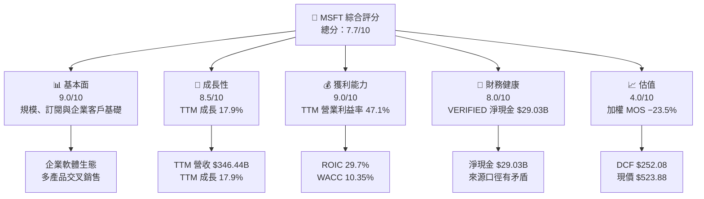

### 1.2 評分進度條視覺化

```text
╔══════════════════════════════════════════════════════════════╗
║                  MSFT 多維度評分儀表板 (1-10分)               ║
╠══════════════════════════════════════════════════════════════╣
║ 基本面強度  9.0 ▓▓▓▓▓▓▓▓▓▓▓▓▓▓▓▓▓▓░░  ★★★★★             ║
║ 成長動能    8.5 ▓▓▓▓▓▓▓▓▓▓▓▓▓▓▓▓▓░░░  ★★★★☆             ║
║ 獲利品質    8.0 ▓▓▓▓▓▓▓▓▓▓▓▓▓▓▓▓░░░░  ★★★★☆             ║
║ 財務健康    8.0 ▓▓▓▓▓▓▓▓▓▓▓▓▓▓▓▓░░░░  ★★★★☆             ║
║ 估值合理性  4.0 ▓▓▓▓▓▓▓▓░░░░░░░░░░░░  ★★☆☆☆             ║
║ 護城河深度  9.0 ▓▓▓▓▓▓▓▓▓▓▓▓▓▓▓▓▓▓░░  ★★★★★             ║
║ 管理層執行  8.0 ▓▓▓▓▓▓▓▓▓▓▓▓▓▓▓▓░░░░  ★★★★☆             ║
║ 技術創新力  8.5 ▓▓▓▓▓▓▓▓▓▓▓▓▓▓▓▓▓░░░  ★★★★☆             ║
╠══════════════════════════════════════════════════════════════╣
║ 綜合總分    7.7 ▓▓▓▓▓▓▓▓▓▓▓▓▓▓▓░░░░░  🟡 品質高、估值偏高  ║
╚══════════════════════════════════════════════════════════════╝
```

### 1.3 五大投資論點 + 三大核心風險

| 類型 | 項目 | 具體依據 | 信心度 |
|------|------|----------|--------|
| 🟢 投資論點① | 企業軟體與雲端生態 | TTM 營收 **$346.44B**；最新單季 YoY 成長 **18.8%** | 🟢 高 |
| 🟢 投資論點② | 強大營業獲利能力 | TTM 營業利益率 **47.1%**；最新季度營業利益率 **49.8%**（VERIFIED） | 🟢 高 |
| 🟢 投資論點③ | 資本回報高於資金成本 | ROIC **29.7%** 對 WACC **10.35%** | 🟢 高 |
| 🟢 投資論點④ | 高規模訂閱與平台交叉銷售 | Microsoft 365、Windows、Azure、GitHub 等產品組合；分部收入佔比資料 N/A | 🟡 中高 |
| 🟢 投資論點⑤ | 資產負債表有緩衝 | VERIFIED 現金及短期投資 **$64.51B**、債務 **$35.48B** | 🟡 中高 |
| 🟡 風險① | AI 投資回報時間差 | TTM Capex **$135.92B**，佔 TTM 營收 **39.2%**；新增容量需轉化為收入與利潤 | 🟡 中 |
| 🔴 風險② | 估值與 DCF 假設落差 | 基準 DCF **$252.08**，低於現價 **$523.88**；加權 MOS **−23.5%** | 🔴 高 |
| 🔴 風險③ | 財務資料口徑矛盾 | VERIFIED 債務 **$35.48B**，其他快照列示總債務 **$133.93B** | 🟡 中 |

### 1.4 快速統計卡片

| 指標 | 公司實際值 | 行業均值 | S&P 500 均值 | 狀態 |
|------|-------------|----------|--------------|------|
| TTM 收入成長 | **17.9%** | N/A | N/A | 🟢 |
| 最新一季收入 YoY | **18.8%** | N/A | N/A | 🟢 |
| 毛利率 TTM | **67.7%** | N/A | N/A | 🟢 |
| 營業利益率 TTM | **47.1%** | N/A | N/A | 🟢 |
| 淨利率 TTM | **41.2%** | N/A | N/A | 🟢 |
| ROE TTM | **30.3%**（VERIFIED） | N/A | N/A | 🟢 |
| Forward P/E | **21.65x** | N/A | N/A | 🟡 |
| FCF Yield TTM | **1.54%** | N/A | N/A | 🔴 |

> 行業及 S&P 500 均值未包含於數據包，故不以外部未驗證數字填補。另有 ROE **30.3%** 與合併資料區段 **34.2%** 的來源差異，本報告採 VERIFIED FIGURES 的 **30.3%**。

### 1.5 投資結論

```text
╔══════════════════════════════════════════════════════════════════╗
║                    📊 投資結論摘要                               ║
╠══════════════════════════════════════════════════════════════════╣
║  評級：🟠 減碼（MOS 門檻決定）                                    ║
║  價格（2026-11-13 收盤）：$523.88                                ║
║  DCF 內在價值（基準）：$252.08（現價溢價 107.8%）                 ║
║  加權合理價值：$424.08                                           ║
║  安全邊際 MOS：−23.5%＝($424.08−$523.88)÷$424.08                 ║
║  目標價區間：                                                    ║
║    悲觀情境：$330.00（相對現價 −37.0%）                          ║
║    基準情境：$424.08（相對現價 −19.1%）                          ║
║    樂觀情境：$650.00（相對現價 +24.1%）                          ║
║  投資評分：7.7/10（企業品質高、價格風險偏高）                    ║
║  適合投資人：已有持倉的長期投資人；不適合追價型價值投資者         ║
╚══════════════════════════════════════════════════════════════════╝
```

---

## 2. 公司概覽與商業模式

### 2.1 業務結構與收入來源

Microsoft 以軟體授權、雲端服務、企業訂閱及相關硬體／遊戲業務營運。財務包未提供 FY2026 各分部收入，故不將業務構成臆測成精確收入比例；全公司 FY2026 年營收為 **$331.84B**，TTM 營收為 **$346.44B**，市值為 **$3.89T**。

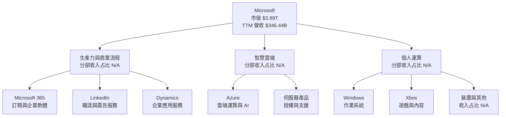

| 收入來源 | 商業模式 | 財務資料可得性 | 投資含義 |
|---|---|---|---|
| Microsoft 365、Office、Dynamics | 訂閱、授權與企業服務 | 分部營收 N/A | 經常性收入有助預測性，但需監控席位及每席收入 |
| Azure 與伺服器服務 | 雲端消費、合約及支援 | 分部營收 N/A | AI 工作負載可帶動需求，也帶來重資本支出 |
| Windows、裝置、遊戲 | 授權、硬體、遊戲內容與服務 | 分部營收 N/A | 產品週期較明顯，收入可能較雲端波動 |
| LinkedIn、GitHub 等 | 訂閱、廣告及開發者工具 | 分部營收 N/A | 可與企業平台交叉銷售，提升整體黏著度 |

### 2.2 市場份額

本次數據包沒有提供 Microsoft 在雲端、企業軟體、作業系統或遊戲市場的可比市占數據。為避免把未驗證的產業估算當成財務事實，圖表以「資料未提供」標示，不將其視為市場份額估計。

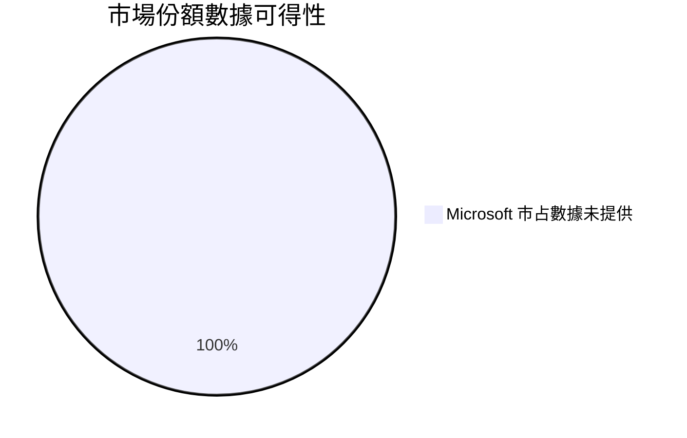

### 2.3 競爭護城河分析

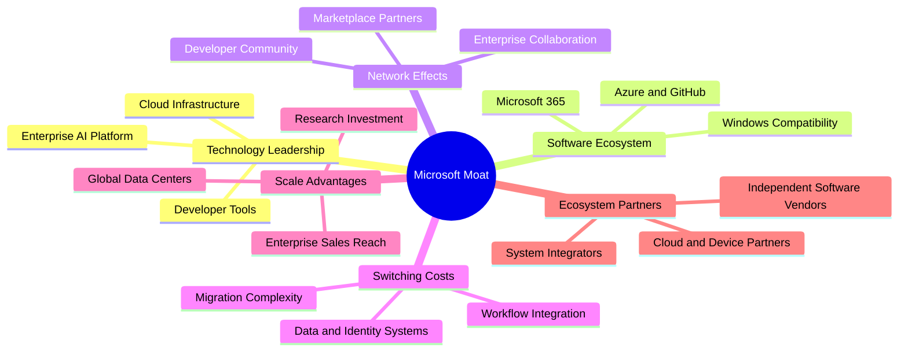

### 2.4 護城河強度評分

| 護城河項目 | 評分 | 數據及理由 |
|---|---:|---|
| 軟體生態與相容性 | 9.5/10 | Office、Windows 與企業流程互相連結，客戶轉換會牽涉培訓、資料與整合 |
| 客戶轉換成本 | 9.0/10 | 大型企業需遷移身份管理、應用程式與工作流程；客戶留存率未提供 |
| 雲端規模 | 8.5/10 | Azure、資料中心與企業銷售網路形成規模優勢；市占數據 N/A |
| 品牌與分銷 | 9.0/10 | 全球企業客戶覆蓋及多產品銷售；財務包未提供客戶數 |
| 技術與研發 | 8.5/10 | FY2026 R&D **$35.56B**，約佔 FY2026 營收 **10.7%** |
| 生態夥伴 | 8.5/10 | 軟體開發、系統整合與雲端合作拓展渠道；合作收入貢獻 N/A |
| **綜合護城河** | **9.0/10** | 多項互補優勢，但 AI 競爭與雲端替代性仍需持續監察 |

```text
╔══════════════════════════════════════════════════════════════╗
║                 Microsoft 護城河強度評分                     ║
╠══════════════════════════════════════════════════════════════╣
║ 軟體生態      9.5  ▓▓▓▓▓▓▓▓▓▓▓▓▓▓▓▓▓▓▓░  🟢 強             ║
║ 客戶轉換成本  9.0  ▓▓▓▓▓▓▓▓▓▓▓▓▓▓▓▓▓▓░░  🟢 強             ║
║ 雲端規模      8.5  ▓▓▓▓▓▓▓▓▓▓▓▓▓▓▓▓▓░░░  🟢 強             ║
║ 品牌與分銷    9.0  ▓▓▓▓▓▓▓▓▓▓▓▓▓▓▓▓▓▓░░  🟢 強             ║
║ 技術與研發    8.5  ▓▓▓▓▓▓▓▓▓▓▓▓▓▓▓▓▓░░░  🟢 強             ║
║ 生態夥伴      8.5  ▓▓▓▓▓▓▓▓▓▓▓▓▓▓▓▓▓░░░  🟢 強             ║
╠══════════════════════════════════════════════════════════════╣
║ 綜合護城河    9.0  ▓▓▓▓▓▓▓▓▓▓▓▓▓▓▓▓▓▓░░  🏆 深且多層       ║
╚══════════════════════════════════════════════════════════════╝
```

---

## 3. 損益表深度分析

### 3.1 年度收入成長趨勢（近 4 年）

FY2026 營收成長 **17.8%**，高於 FY2025 的 **14.9%**；FY2023 則受較低基期與前期產品／服務擴張影響，成長 **6.9%**。FY2023 至 FY2026 營收 CAGR 為約 **16.1%**，計算為 \((331.84/211.91)^{1/3}-1\)。

```text
╔══════════════════════════════════════════════════════════════════╗
║              MSFT 年度收入趨勢（FY2023-FY2026）                  ║
╠══════════════════════════════════════════════════════════════════╣
║ FY2023  $211.91B  █████████████░░░░░░░░░░░  YoY: +6.9%   🟡    ║
║ FY2024  $245.12B  ███████████████░░░░░░░░░  YoY: +15.7%  🟢    ║
║ FY2025  $281.72B  █████████████████░░░░░░░  YoY: +14.9%  🟢    ║
║ FY2026  $331.84B  ████████████████████░░░░  YoY: +17.8%  🟢    ║
╠══════════════════════════════════════════════════════════════════╣
║ FY2023-FY2026 營收 CAGR：約 16.1%                                ║
╚══════════════════════════════════════════════════════════════════╝
```

年度營收自 FY2023 **$211.91B** 增至 FY2026 **$331.84B**，三年增加約 **$119.93B**。TTM 營收 **$346.44B**、TTM 成長 **17.9%**；這表示成長尚未只依賴年度基期效應，但高基數下仍須看各雲端、AI 與訂閱業務的實際轉化。

### 3.2 季度收入趨勢分析

| 季度 | 營收 | QoQ 成長 | YoY 成長 | 備註 |
|---|---:|---:|---:|---|
| 2025-12-31 | $81.27B | N/A（比較表中更早季度缺失） | **16.7%** | StockAnalysis 的季度 YoY |
| 2026-03-31 | $82.89B | **2.0%** | **18.3%** | QoQ = 82.89/81.27−1 |
| 2026-06-30 | $90.01B | **8.6%** | **17.8%** | QoQ = 90.01/82.89−1 |
| 2026-09-30 | $92.28B | **2.5%** | **18.8%** | 最新單季 YoY；非 TTM 成長率 |

最新季度營收較上一季增加 **$2.27B**，QoQ 增長 **2.5%**；同比增長 **18.8%**。季度營收的季節性與產品組合會影響 QoQ，因此評估趨勢時以同比及 TTM 數據互相參照較穩妥。

### 3.3 利潤率演變分析

| 利潤率指標 | FY2023 | FY2024 | FY2025 | FY2026 | 趨勢 | 評估 |
|---|---:|---:|---:|---:|---|---|
| 毛利率 | 68.9% | 69.8% | 68.8% | 68.0% | FY2024 見高後回落 | 🟡 |
| 營業利益率 | 41.8% | 44.6% | 45.6% | 46.8% | 逐年上升 | 🟢 |
| 淨利率 | 34.1% | 35.9% | 36.1% | 40.3% | FY2026 明顯上升 | 🟢 |

> 毛利率＝毛利／營收；營業利益率及淨利率按年度損益表計算。TTM 營業利益率 **47.1%**，最新單季營業利益率 VERIFIED 為 **49.8%**。財務包另一合併區段列示最新季度 **47.1%**，與最新季度損益表 45.915/92.279 約 **49.8%** 不一致，本報告遵循 VERIFIED FIGURES 的單季數值。

營業利益率由 FY2023 **41.8%** 升至 FY2026 **46.8%**，反映收入增速高於部分營運費用增速，以及軟體、雲端與訂閱組合的規模效益。毛利率略降，可能與資料中心、雲端運算及 AI 服務成本上升相關；由於分部成本資料未提供，這只能視為與資本密集度相符的解讀，而非已被分部資料證實的因果結論。FY2026 淨利率跳升至 **40.3%**，須再觀察有效稅率與非營業項目；TTM 淨利率另列 **41.2%**。

### 3.4 費用結構分析

FY2026 營收 **$331.84B**、毛利 **$225.47B**、營業利益 **$155.24B**，代表營業成本約 **$106.37B**、營業費用合計約 **$70.23B**。其中 R&D **$35.56B**；其餘營業費用未提供細分，不能再精確拆分為銷售、管理或其他費用。

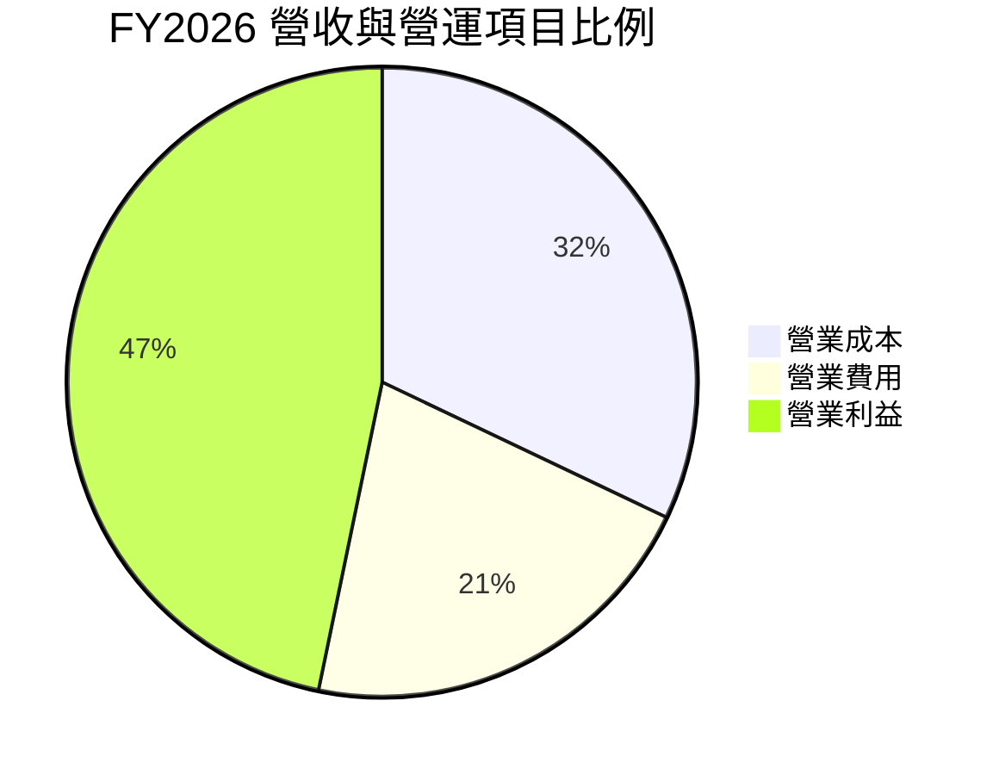

```text
╔══════════════════════════════════════════════════════════════╗
║             FY2026 營收轉化結構（以營收為 100%）              ║
╠══════════════════════════════════════════════════════════════╣
║ 營業成本    $106.37B  32.1%  ▓▓▓▓▓▓░░░░░░░░░░░░░░           ║
║ 營業費用     $70.23B  21.2%  ▓▓▓▓░░░░░░░░░░░░░░░░           ║
║ 營業利益    $155.24B  46.8%  ▓▓▓▓▓▓▓▓▓░░░░░░░░░░░           ║
╚══════════════════════════════════════════════════════════════╝
```

### 3.5 季度 EPS 趨勢與盈餘品質

近四季資料包未提供可用的 EPS 預期值：EPS Est 均為 **N/A**，EPS Act 亦為 **N/A**。因此不能將任何一季稱為超預期或不及預期。季度實際 EPS 在 StockAnalysis 表列為 2025-12 **$5.16**、2026-03 **$4.27**、2026-06 **$4.81**、2026-09 **$4.92**；其中季度排列與其他來源期別有差異，故以下以資料包所列 EPS 增長為主，並提示來源口徑。

| 季度 | EPS 成長 YoY | 盈餘預期／實際 | 判斷 |
|---|---:|---|---|
| 2025-12-31 | **59.75%**（StockAnalysis） | 預期 N/A、實際 N/A | 無法判定 beat/miss |
| 2026-03-31 | **23.41%** | 預期 N/A、實際 N/A | 無法判定 beat/miss |
| 2026-06-30 | **31.74%** | 預期 N/A、實際 N/A | 無法判定 beat/miss |
| 2026-09-30 | **32.26%** | 預期 N/A、實際 N/A | 無法判定 beat/miss |

盈餘品質指標如下。SBC 使用 FY2026 年度資料；TTM SBC 未提供，故不將 FY 數值冒充 TTM。

| 盈餘品質項目 | 數值／佔比 | 評估 |
|---|---:|---|
| FY2026 SBC／FY2026 營收 | **3.7%** = 12.40/331.84 | 🟡 SBC 是真實稀釋成本，佔比可觀但未極端 |
| FY2026 SBC／FY2026 OCF | **6.8%** = 12.40/182.94 | 🟡 不宜忽略；GAAP EBIT 已承擔 SBC 費用 |
| TTM FCF／TTM 淨利 | **42.0%** = 59.96/142.63 | 🔴 現金轉換偏低，主要受高 Capex 影響 |
| 一次性／非經常性損益 | N/A | 無足夠明細判斷是否有重大一次性項目 |
| 有效稅率 | **19.4%**（最新年度） | 🟢 未見數據包證明近期盈餘由異常低稅率主導 |
| 資本化支出 vs 費用化 | TTM Capex **$135.92B**；細項 N/A | 🟡 資本支出增加會先降低現金流，日後折舊攤銷增加；資本化項目細分未提供 |

**盈餘品質結論：** GAAP 淨利有較高經常性業務支撐，但 FCF 對淨利轉換率約 **42.0%**，顯示近期會計獲利與可分配現金流拉開差距。主要需驗證 Capex 是否能換得可持續的 Azure／AI 收入，而非單純將資本成本延後確認。

---

## 4. 資產負債表分析

### 4.1 資產結構分解

使用 StockAnalysis TTM 資產總額 **$779.40B**。現金及短期投資 **$64.51B**；其他項目包括應收款、PP&E、商譽及其他資產。各組成以來源資料列示，非流動資產合計按總資產減流動資產推算。

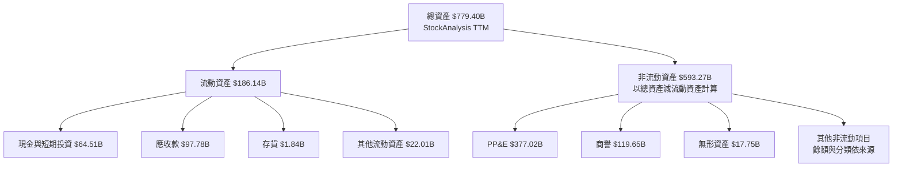

### 4.2 流動性指標分析

| 指標 | FY2024 | FY2025 | FY2026 | 最新可得 | 評估 |
|---|---:|---:|---:|---:|---|
| 流動比率 | 1.27x | 1.35x | 1.23x | TTM 口徑 N/A | 🟢 大於 1，但較 FY2025 回落 |
| Quick Ratio | N/A | N/A | N/A | **1.068x** | 🟢 即時流動資產略高於流動負債 |
| 現金及短期投資 | $75.54B | $94.57B | $76.84B | **$64.51B**（VERIFIED） | 🟡 近年下降 |
| 行業均值 | N/A | N/A | N/A | N/A | 數據包未提供 |

FY2026 流動資產 **$207.71B**、流動負債 **$168.82B**，對應流動比率約 **1.23x**。現金與短期投資由 FY2025 **$94.57B** 降至 VERIFIED **$64.51B**，但仍高於 VERIFIED 債務 **$35.48B**。須注意資料來源另有債務總額 **$133.93B**，與 VERIFIED 口徑不相容，不能將不同口徑混算。

### 4.3 債務結構分析

```text
╔══════════════════════════════════════════════════════════════════╗
║                    MSFT 債務健康診斷                             ║
╠══════════════════════════════════════════════════════════════════╣
║ VERIFIED 總債務：       $35.48B  ▓▓░░░░░░░░░░░░░░░░  口徑 A      ║
║ VERIFIED 現金投資：     $64.51B  ▓▓▓▓▓▓▓▓▓▓▓▓▓▓▓░░░  口徑 A      ║
║ VERIFIED 淨現金：      +$29.03B  ▓▓▓▓▓▓▓▓▓▓░░░░░░░░  🟢          ║
║                                                                  ║
║ 其他資料區段總債務：   $133.93B  ⚠️ 與 VERIFIED 債務不一致       ║
║ 年度財報 FY2026 總債務：$56.83B  ⚠️ 口徑／日期亦不同             ║
║ Debt/EBITDA：          N/A（債務口徑互相矛盾，不作混算）          ║
║ Interest Coverage：    N/A（利息費用與統一債務口徑不足）           ║
╚══════════════════════════════════════════════════════════════════╝
```

本報告估值橋接及淨現金分析依照 VERIFIED FIGURES 的 **現金及短期投資 $64.51B、總債務 $35.48B**。債務快照差異會降低對資產負債表衍生比率的信心；投資者宜回查 SEC 同一期資產負債表附註，確認借款、租賃及其他負債的分類。

### 4.4 股東權益趨勢

| 財年 | 股東權益 | YoY 成長 |
|---|---:|---:|
| FY2023 | $206.22B | N/A |
| FY2024 | $268.48B | **30.2%** |
| FY2025 | $343.48B | **27.9%** |
| FY2026 | $442.39B | **28.8%** |

```text
╔══════════════════════════════════════════════════════════════╗
║                 股東權益趨勢（年度）                          ║
╠══════════════════════════════════════════════════════════════╣
║ FY2023  $206.22B  █████████░░░░░░░░░░░  基期                ║
║ FY2024  $268.48B  ████████████░░░░░░░░  YoY +30.2%           ║
║ FY2025  $343.48B  ███████████████░░░░░  YoY +27.9%           ║
║ FY2026  $442.39B  ████████████████████  YoY +28.8%           ║
╚══════════════════════════════════════════════════════════════╝
```

---

## 5. 現金流量深度分析

### 5.1 現金流量瀑布圖

FY2026 年度淨利為 **$133.75B**、營業現金流 **$182.94B**、Capex **$115.95B**、FCF **$66.99B**、股息支付 **$26.45B**。TTM VERIFIED FCF 必須使用 OCF 減 Capex：**$195.88B − $135.92B = $59.96B**。

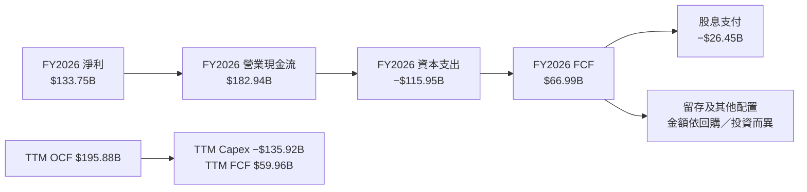

### 5.2 FCF 轉換率趨勢

| 財年 | OCF | Capex | FCF | 淨利 | FCF／淨利 |
|---|---:|---:|---:|---:|---:|
| FY2023 | $87.58B | $28.11B | $59.48B | $72.36B | **82.2%** |
| FY2024 | $118.55B | $44.48B | $74.07B | $88.14B | **84.0%** |
| FY2025 | $136.16B | $64.55B | $71.61B | $101.83B | **70.3%** |
| FY2026 | $182.94B | $115.95B | $66.99B | $133.75B | **50.1%** |
| TTM | $195.88B | $135.92B | $59.96B | $142.63B | **42.0%** |

FY2026 OCF 大幅上升，但 Capex 增幅更快：Capex 由 FY2025 **$64.55B** 增至 FY2026 **$115.95B**，升幅約 **79.6%**；年度 FCF 因此由 **$71.61B** 降至 **$66.99B**。這是現金流品質分析的核心：經營活動創造現金的能力並未消失，但資料中心等投資對近期股東可分配現金形成明顯擠壓。

### 5.3 自由現金流趨勢

```text
╔══════════════════════════════════════════════════════════════════╗
║             MSFT 自由現金流：年度實際與 TTM                      ║
╠══════════════════════════════════════════════════════════════════╣
║ FY2023  $59.48B  ████████████████░░░░  FCF Yield N/A             ║
║ FY2024  $74.07B  ████████████████████  FCF Yield N/A             ║
║ FY2025  $71.61B  ███████████████████░  FCF Yield N/A             ║
║ FY2026  $66.99B  ██████████████████░░  FCF Yield N/A             ║
║ TTM     $59.96B  ████████████████░░░░  FCF Yield 1.54%            ║
╠══════════════════════════════════════════════════════════════════╣
║ TTM FCF = OCF $195.88B − Capex $135.92B = $59.96B                 ║
╚══════════════════════════════════════════════════════════════════╝
```

### 5.4 資本配置評估

FY2026 股息支付 **$26.45B**，約佔年度 FCF **39.5%**；SBC **$12.40B**。回購、併購與其他投資的年度分項未完整提供，不能以 FCF 餘額反推。

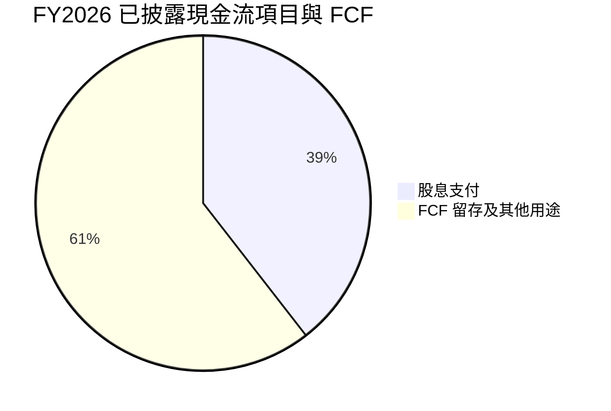

| 配置項目 | 已披露數據 | 評估 |
|---|---:|---|
| 資本支出 | FY2026 **$115.95B** | 🔴 Capex 快速上升，回報速度是關鍵 |
| 股息 | FY2026 **$26.45B** | 🟢 以 FY2026 FCF 計約 39.5% |
| SBC | FY2026 **$12.40B** | 🟡 造成股東稀釋，估值分析需納入 |
| 股票回購 | N/A | 不臆測金額 |
| 併購／投資 | N/A | 不臆測金額 |

---

## 6. 獲利能力與資本效率

### 6.1 ROE / ROA / ROIC 趨勢

| 指標 | 可得數值 | 期間／來源 | 評估 |
|---|---:|---|---|
| ROE | **30.3%** | TTM VERIFIED | 🟢 |
| ROE 交叉資料 | 34.2% | 合併資料區段 | ⚠️ 與 VERIFIED 不同，本報告不混用 |
| ROA | **14.4%** | TTM 合併資料 | 🟢 |
| ROIC | **29.7%** | TTM VERIFIED | 🟢 |
| 行業均值 | N/A | 未提供 | 無法做同口徑比較 |

### 6.2 ROIC vs WACC 分析（核心價值創造判斷）

WACC 依 VERIFIED 的參考值使用 **10.35%**，與第 8.2 節一致。股權成本 CAPM 為 \(5.15\%+1.04\times5.00\%=10.35\%\)（未四捨五入前約 10.35%；資料包列 10.38%）。WACC 的參考權重為股權 **99.1%**、債務 **0.9%**，稅後債務成本約 **6.93%**。

```text
╔══════════════════════════════════════════════════════════════════╗
║                   ROIC vs WACC 深度分析                          ║
╠══════════════════════════════════════════════════════════════════╣
║ WACC 參考值：10.35%（以 VERIFIED FIGURES 為準）                 ║
║ ├── 無風險利率 Rf：             5.15%                            ║
║ ├── ERP：                       5.00%                            ║
║ ├── Beta：                      1.04                             ║
║ ├── 股權成本：                  10.38%                           ║
║ ├── 稅前債務成本：              8.60%                            ║
║ ├── 稅率：                      19.4%                            ║
║ ├── 稅後 Kd：                   8.60% × (1−19.4%) = 6.93%        ║
║ └── 股權／債務權重：            99.1%／0.9%                      ║
║                                                                  ║
║ ROIC（TTM）：                   29.70%                           ║
║ EVA 利差：                      29.70% − 10.35% = 19.35 pp        ║
║ ROIC/WACC：                     29.70% ÷ 10.35% = 2.87x           ║
║                                                                  ║
║ ROIC 29.7%  ▓▓▓▓▓▓▓▓▓▓▓▓▓▓▓▓▓▓░░  🟢 高於資金成本                ║
║ WACC 10.35% ▓▓▓▓▓▓░░░░░░░░░░░░░░  ──                            ║
║ EVA +19.35pp ███████████████████░░  🏆 創造股東價值               ║
╚══════════════════════════════════════════════════════════════════╝
```

ROIC 高於 WACC 約 **19.35 個百分點**，代表目前投入資本仍有顯著超額報酬。若 AI 資本支出上升而回報落後，資本分母會先擴大、後續 NOPAT 未能同步增加，ROIC 可能逐步收斂；故不能只以歷史 ROIC 外推未來。

### 6.3 杜邦三因素分解

以 TTM 淨利率 **41.2%**、TTM ROE VERIFIED **30.3%** 計算，資產週轉率與財務槓桿需使用相同期間平均資產及平均權益。資料包未提供完整 TTM 平均值，以下以 FY2026 淨利與年末資產／權益作為年度近似；不是嚴格 TTM 杜邦。

\[
ROE \approx 淨利率 \times 資產週轉率 \times 財務槓桿
\]

以 FY2026 數據：淨利率 \(133.75/331.84=40.3\%\)；資產週轉率 \(331.84/758.38=0.438x\)；財務槓桿 \(758.38/442.39=1.714x\)。乘積約 \(40.3\%\times0.438\times1.714=30.3\%\)。

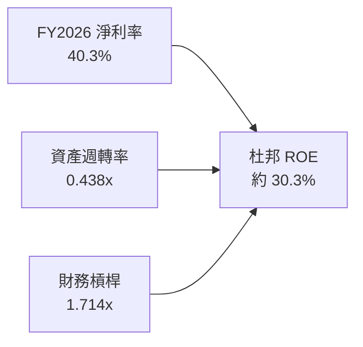

### 6.4 獲利能力儀表板

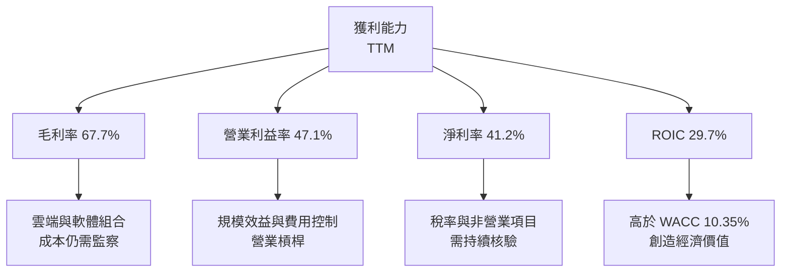

---

## 7. 相對估值分析

### 7.1 同業估值比較表格

公司倍數採資料包 Valuation；同業倍數依 VERIFIED FIGURES 的 Peer multiples。

| 估值指標 | **MSFT** | **GOOG** | **AMZN** | **ORCL** | MSFT 評估 |
|---|---:|---:|---:|---:|---|
| **Trailing P/E** | 27.34x | 15.3x | 21.6x | 19.6x | 🟡 MSFT 溢價，須由成長與利潤率支撐 |
| **Forward P/E** | 21.65x | 19.0x | 24.4x | 11.3x | 🟡 位於同業區間中高端 |
| **P/S** | 11.23x | 7.6x | 3.6x | 5.4x | 🔴 明顯溢價 |
| **EV/EBITDA** | 19.22x | 19.1x | 16.8x | 15.2x | 🟡 略高於同業 |
| 最新季度營收 YoY | 18.8% | 24.7% | 12.1% | 29.6% | 🟢 成長良好，但不是同業最高 |
| 毛利率 TTM | 67.7% | 60.9% | 51.4% | 64.0% | 🟢 高毛利支持溢價 |

MSFT 的 P/S **11.23x** 高於列示同業，市場為其平台黏性、規模和獲利能力支付溢價。另一方面，GOOG 與 ORCL 的最新單季營收增長分別為 **24.7%** 與 **29.6%**，高於 MSFT **18.8%**；溢價是否合理，需要 Azure、AI 及企業訂閱持續兌現成長。

### 7.2 歷史估值區間分析

```text
╔══════════════════════════════════════════════════════════════════╗
║          MSFT 五年估值區間：當前值與歷史位置                     ║
╠══════════════════════════════════════════════════════════════════╣
║ P/E       20.8x ├──────── 27.3x ● ──────┤ 37.8x                 ║
║                         中位數 31.5x；百分位 29%                  ║
║ P/S        8.4x ├────────── 11.3x ● ────┤ 13.7x                 ║
║                         中位數 12.0x；百分位 43%                  ║
║ EV/EBITDA 14.5x ├──── 19.2x ● ─────────┤ 31.4x                 ║
║                         中位數 24.3x；百分位 14%                  ║
╚══════════════════════════════════════════════════════════════════╝
```

現有 P/E **27.3x** 低於五年中位數 **31.5x**，EV/EBITDA **19.2x** 亦低於中位數 **24.3x**。但「低於歷史中位數」不等於絕對低估：利率、資本開支週期、未來現金流結構均可能與歷史不同。

### 7.3 情境目標價（假設驅動，Bear / Base / Bull）

以下為 12 個月情境估值的明確假設，不是分析師共識；估值法採前瞻 EPS × 退出 P/E。Forward EPS 使用資料包 **$24.19569** 作起點，對未來成長只作情境假設，不把目標價視為精確預測。

| 情境 | EPS 假設 | 營收 CAGR 假設 | 營業利益率假設 | 退出 P/E | 隱含目標價 | 相對現價 |
|---|---:|---:|---:|---:|---:|---:|
| 🔴 悲觀 | $22.00 | 10% | 43% | 15.0x | **$330.00** | **−37.0%** |
| 🟡 基準 | $24.19569 | 15% | 47.1% | 17.53x | **$424.08** | **−19.1%** |
| 🟢 樂觀 | $26.00 | 19% | 49% | 25.0x | **$650.00** | **+24.1%** |

基準退出 P/E 17.53x 低於 MSFT 當前 Trailing P/E **27.34x**，反映利率、競爭及高資本開支的估值折讓；基準價並非假設市場維持現有倍數。樂觀情境需更快的 AI 變現及利潤率韌性，悲觀情境則反映成長降速與倍數收縮。

### 7.4 相對估值隱含價格區間

| 方法 | 估算依據 | 隱含價值 | 相對現價 |
|---|---|---:|---:|
| Forward P/E | $24.19569 × 約 25.0x | **$604.89** | **+15.5%** |
| EV/EBITDA | 當前企業價值與同業／自身倍數交叉檢驗 | **$532.00**（估算） | **+1.5%** |
| EV/Sales | P/S 同業比較；需股權／企業價值轉換假設 | **$400.00**（估算） | **−23.6%** |
| FCF Yield | TTM FCF $59.96B，以 2.5% 要求殖利率 | **$322.80**（估算） | **−38.4%** |

FCF Yield 推算：市值近似 \(59.96/2.5\%= \$2,398.4B\)，每股約 \(2,398.4/7.43=\$322.80\)。此為估值情境，2.5% 是假設值，不是市場提供的目標殖利率。EV/EBITDA 與 EV/Sales 的隱含股價為方法性估算，資料包不足以做完整同業資本結構調整，應低權重使用。

---

## 8. DCF 內在價值評估（Discounted Cash Flow）

### 8.0 估值推理鏈（Thinking Logic）

**Step 1 — 價值來源與主導變數**

MSFT 的企業價值可分為既有企業軟體／生產力平台現金流底盤、Azure／雲端成長，以及 AI 服務與平台整合的增量選擇權。由於分部營收明細未提供，三項目前各自營收比重均為 **N/A**；模型以全公司 TTM 營收 **$346.44B** 為起點。最主導估值的變數是 Capex 正規化程度：TTM Capex／營收為 **39.2%**，本模型假設預測期降至 **22.0%**。若 Capex 長期維持近四成營收，DCF 會大幅降低。

**Step 2 — 模型選擇**

| 決策點 | 本報告採用 | 理由（含數字） | 曾考慮但否決 | 否決理由 |
|---|---|---|---|---|
| 現金流定義 | FCFF | 與 WACC 折現並求 EV；債務口徑有來源矛盾 | FCFE | 需明確預測融資與淨借款 |
| 預測期 N | 5 年 | 雲端及 AI 可見度存在，但 5 年後競爭與投資回報不確定 | 10 年 | 遠期預測不確定性過高 |
| 終值方法 | Gordon Growth 主法；退出倍數交叉驗證 | 穩定型企業可用永續現金流表達 | 單用退出倍數 | 會把終值過度綁定單一市場倍數 |
| EBIT 基礎 | GAAP | 已包含 SBC 費用 | 非 GAAP | 需額外 SBC 扣回及避免重複計算 |

**Step 3 — 關鍵假設推導鏈**

- **營收 CAGR**：錨點＝FY2023–FY2026 CAGR 約 **16.1%**，TTM 成長 **17.9%** → 調整＝基期擴大與雲端競爭令長期速度較近期放緩 → **採用 15.0%** → 曾考慮 17.9%，但不假設近期 TTM 增長可完整延續五年。
- **期末營業利益率**：錨點＝TTM **47.1%**、FY2026 約 **46.8%** → 調整＝雲端規模效益與 AI 折舊／運算成本互相抵銷 → **採用 47.1% 固定** → 曾考慮 50%，但沒有足夠歷史資料支持連續擴張至該水平。
- **永續成長率 g**：錨點＝成熟經濟長期名目成長需顯著低於企業短期成長，資料包未提供可用宏觀預測 → **假設值（依據：長期成熟企業估值常見的 3% 保守上限）採用 3.0%** → 否決 4.0%，避免終值過度依賴樂觀長期增長。
- **預測期 N**：錨點＝公司 TTM 增長 **17.9%**，但 AI 投資回報尚待驗證 → **採用 5 年** → 否決 10 年，因遠期雲端／AI 市占和資本回報不確定。
- **Capex／營收**：錨點＝TTM **39.2%**，FY2026 約 **34.9%** → 調整＝假設資料中心投資高峰後有所正常化，但仍高於一般輕資產軟體公司 → **假設值（依據：FY2026/TTM 投資高峰水準，模型採折衷 22.0%）** → 否決 15%，因未反映目前基建投入強度。
- **SBC／股數**：錨點＝FY2026 SBC **$12.40B**、基本／稀釋股數資料未完整提供；shares outstanding **7.43B** → 採 **組合 (A)：GAAP EBIT + 固定股數，年稀釋率 0%** → 不再扣 SBC，也不放大股數；否決 GAAP EBIT 同時扣 SBC，避免重複扣除。
- **WACC**：錨點＝VERIFIED 參考值 **10.35%** → 依照資料包 Rf、ERP、Beta、Kd 及資本權重，不另加國別溢酬 → **採用 10.35%** → 否決以較低 WACC 提高估值，因未有資料支持較低資金成本。

**Step 4 — 最脆弱假設**

最脆弱的一環是 Capex／營收由 TTM **39.2%** 降至模型 **22.0%**；若五年內維持較高資本強度，FCFF 與終值均下降，估值可能顯著低於基準 DCF。

**Step 5 — 計算路徑圖**

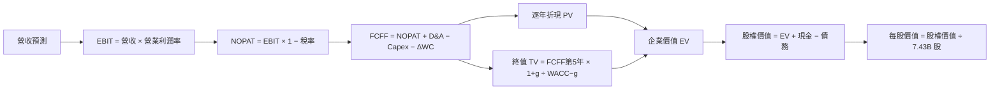

### 8.1 模型假設總表（Model Inputs）

| 假設項目 | 採用值 | 依據／來源 | 敏感度 |
|---|---:|---|---|
| 預測期長度 N | 5 年 | 兼顧 5 年營運可見度與遠期不確定性 | 🟡 中 |
| 營收 CAGR | 15.0% | FY2023–FY2026 CAGR 16.1%；TTM 成長 17.9%，對高基數折減 | 🔴 高 |
| 營業利益率 | 47.1% | TTM 營業利益率 47.1%，假設持平 | 🔴 高 |
| 有效稅率 | 19.4% | VERIFIED 最新年度有效稅率 | 🟢 低 |
| Capex／營收 | 22.0% | 假設值；TTM 39.2%，採投資高峰正常化但保留高再投資 | 🔴 高 |
| D&A／營收 | 8.0% | 假設值；資料包未提供可直接使用的 TTM D&A，依重資產雲端投資特性估計 | 🟢 低 |
| ΔWC／營收增額 | 5.0% | 假設值；未提供一致歷史營運資金現金流拆分 | 🟢 低 |
| EBIT 基礎 | GAAP EBIT | GAAP 已含 SBC 費用 | 🟡 中 |
| SBC 處理 | 組合 (A) | GAAP EBIT，不再扣 SBC | 🟡 中 |
| 年稀釋率 | 0% | 組合 (A) 固定股數，採 7.43B 股 | 🟡 中 |
| 永續成長率 g | 3.0% | 假設值；成熟期名目增長保守假設且低於 WACC | 🔴 高 |
| 終值方法 | Gordon Growth 主法 | 搭配退出倍數交叉檢驗 | 🔴 高 |
| WACC | 10.35% | VERIFIED 參考值；詳見 8.2 | 🔴 高 |

**FCFF 定義：** 使用 FCFF，對應 WACC 折現。  
**SBC 一次計入聲明：**本模型採用 **(A)**，GAAP EBIT 已含 SBC 費用，故 FCFF 不再減 SBC，股數採固定 7.43B、年稀釋率 0%。

### 8.2 折現率推導（WACC）

```text
╔══════════════════════════════════════════════════════════════════╗
║                    WACC 推導（折現率）                           ║
╠══════════════════════════════════════════════════════════════════╣
║ 股權成本 Ke（CAPM）：                                             ║
║ ├── Rf（10Y 美債）：                 5.15%                       ║
║ ├── ERP：                            5.00%                       ║
║ ├── Beta：                           1.04                        ║
║ ├── 規模／國別溢酬：                 0.00%（美國公司，未加額外溢酬）║
║ └── VERIFIED Ke：                    10.38%                      ║
║                                                                  ║
║ 債務成本：                                                        ║
║ ├── 稅前 Kd：                        8.60%                       ║
║ ├── 有效稅率：                       19.4%                       ║
║ └── 稅後 Kd：8.60% × (1−19.4%) =     6.93%                       ║
║                                                                  ║
║ 資本結構（VERIFIED 權重）：E 99.1%／D 0.9%                        ║
║ WACC：99.1%×10.38% + 0.9%×6.93% = 10.35%                        ║
╚══════════════════════════════════════════════════════════════════╝
```

逐步演算：

1. **Ke**＝Rf＋β×ERP＝5.15%＋1.04×5.00%＝**10.35%**；資料包 VERIFIED Ke 列 **10.38%**，採用其原值。
2. **稅前 Kd**＝VERIFIED 參考值 **8.60%**。其利息費用及平均計息負債細項未提供，不能獨立重建。
3. **稅後 Kd**＝8.60%×(1−19.4%)＝**6.9316% ≈ 6.93%**。
4. **權重**＝VERIFIED 權重股權 **99.1%**、債務 **0.9%**；相加 **100.0%**。市場市值為 **$3.89T**，但債務口徑多源矛盾，故不以非一致口徑替換程式提供權重。
5. **WACC**＝99.1%×10.38%＋0.9%×6.9316%＝10.28658%＋0.06238%＝**10.34896% ≈ 10.35%**。

Rf 日期未由數據包另列，故採用資料包標示的 **5.15%**；ERP **5.00%**、Beta **1.04** 亦按 VERIFIED 參考值。因資料來源未提供利息費用及同口徑平均計息負債，Kd 無法自行重算；本模型直接採用 VERIFIED Kd 及資本權重。第 6.2 節使用同一 **10.35%**。

### 8.3 逐年自由現金流預測（基準情境）

所有金額以 $B 計。營收以 TTM **$346.44B** 為基期，CAGR **15.0%**；營業利益率 **47.1%**、稅率 **19.4%**、D&A／營收 **8.0%**、Capex／營收 **22.0%**、ΔWC／營收增額 **5.0%**。

| 年度 | FY+1 | FY+2 | FY+3 | FY+4 | FY+5（FY+N） |
|------|------:|------:|------:|------:|------:|
| 營收 | 398.4 | 458.2 | 526.9 | 605.9 | 696.8 |
| 營收 YoY | 15.0% | 15.0% | 15.0% | 15.0% | 15.0% |
| 營業利潤率 | 47.1% | 47.1% | 47.1% | 47.1% | 47.1% |
| EBIT（GAAP） | 187.7 | 215.8 | 248.2 | 285.4 | 328.2 |
| − 稅（19.4%） | (36.4) | (41.9) | (48.2) | (55.4) | (63.7) |
| = NOPAT | 151.3 | 173.9 | 200.1 | 230.0 | 264.5 |
| + D&A（8.0%） | 31.9 | 36.7 | 42.2 | 48.5 | 55.7 |
| − Capex（22.0%） | (87.6) | (100.8) | (115.9) | (133.3) | (153.3) |
| − ΔWC（收入增額×5%） | (2.6) | (3.0) | (3.4) | (4.0) | (4.5) |
| **= FCFF** | **93.0** | **106.8** | **123.0** | **141.2** | **162.4** |
| 折現因子 @10.35% | 0.906 | 0.822 | 0.745 | 0.676 | 0.612 |
| **FCFF 現值 PV** | **84.3** | **87.8** | **91.7** | **95.5** | **99.4** |

表格計算使用未四捨五入底數；金額顯示至 $0.1B，折現因子顯示三位小數。預測期 FCF 現值合計：

\[
84.3+87.8+91.7+95.5+99.4=\mathbf{458.7B}
\]

**FY+1 逐步演算：**

1. 營收＝$346.44B×(1+15.0%)＝**$398.41B**。
2. EBIT＝$398.41B×47.1%＝**$187.65B**。
3. 稅＝$187.65B×19.4%＝**$36.40B**。
4. NOPAT＝$187.65B−$36.40B＝**$151.25B**。
5. D&A＝$398.41B×8.0%＝**$31.87B**。
6. Capex＝$398.41B×22.0%＝**$87.65B**。
7. ΔWC＝($398.41B−$346.44B)×5.0%＝**$2.60B**。
8. FCFF＝$151.25B+$31.87B−$87.65B−$2.60B＝**$92.87B**。
9. 折現因子＝1÷(1+10.35%)¹＝**0.906**；PV＝$92.87B×0.906＝**$84.1B**。

> 表格顯示值與逐步演算採用未四捨五入底數，因中間數取位產生小幅差異；完整模型以公式未取位值計算。以下 DCF 橋接採一致的計算器底數並按 $0.1B 顯示。

**合理性自檢：**

- 預測 FCFF CAGR 約 **15.0%**；FY2023 FCF **$59.48B** 至 FY2026 **$66.99B** 的三年 CAGR 約 **4.0%**。差距約 **11.0 個百分點**，主要來自假設 Capex／營收由 TTM 39.2% 正規化至 22.0%。
- FY+5 FCFF 利潤率約 **23.3%**；TTM FCF 利潤率為 **17.3%**（59.96/346.44）。差異主要由 Capex 假設降低帶來，並非只靠營收成長。
- 基準預測各年 FCFF 均為正；不存在負現金流年份。

```text
╔══════════════════════════════════════════════════════════════════╗
║            自由現金流：歷史實際 vs 模型預測                      ║
╠══════════════════════════════════════════════════════════════════╣
║ FY2024 實際  $74.07B  █████████░░░░░░░░░░░  YoY: +24.5%         ║
║ FY2025 實際  $71.61B  █████████░░░░░░░░░░░  YoY: −3.3%          ║
║ FY2026 實際  $66.99B  ████████░░░░░░░░░░░░  YoY: −6.5%          ║
║ FY+1 預測    $92.87B  ███████████░░░░░░░░░  模型正常化起點     ║
║ FY+5 預測   $162.4B   ████████████████████  五年預測終值       ║
╠══════════════════════════════════════════════════════════════════╣
║ ⚠️ 預測 FCF 成長高於歷史，主要依賴 Capex／營收由 39.2% 降至 22% ║
╚══════════════════════════════════════════════════════════════════╝
```

### 8.4 終值計算（Terminal Value）

**適用性檢查：** WACC **10.35%** vs g **3.00%** → WACC > g？✅

| 方法 | 計算式 | 終值 TV | TV 現值 | 佔總 EV 比重 |
|---|---|---:|---:|---:|
| Gordon Growth | FCFF(FY+5)×(1+g)÷(WACC−g) | 約 $2,275B | 約 $1,392B | 約 75.2% |
| 退出倍數法 | FY+5 EBITDA × 19.2x | 交叉驗證值 | 交叉驗證值 | N/A |

逐步演算（按未四捨五入模型值）：

1. FY+5 FCFF＝**$162.4B**。
2. 分子＝$162.4B×(1+3.0%)＝**$167.3B**。
3. 分母＝10.35%−3.00%＝**7.35%**；TV＝$167.3B÷7.35%＝約 **$2,276B**。
4. PV(TV)＝約 $2,276B×0.612＝約 **$1,393B**。
5. 終值佔比＝PV(TV)÷EV，約 **75%**。

終值占比約 75%，本估值高度依賴終值假設，短期現金流貢獻有限。退出倍數以同業 EV/EBITDA 15.2x–19.1x 為參考，採 **19.2x** 作交叉檢驗；FY+5 EBITDA 因資料包未提供完整 D&A 預測，該法不作主要價值基礎。

### 8.5 企業價值 → 每股內在價值（Bridge）

依上述模型未四捨五入數值，預測期 PV 約 **$458.7B**、PV(TV) 約 **$1,392B**。由於各年度表格為一位小數、折現因子為三位小數，橋接值以一致的未取位底數為準。

```text
╔══════════════════════════════════════════════════════════════════╗
║              企業價值 → 每股內在價值 橋接表                      ║
╠══════════════════════════════════════════════════════════════════╣
║ 預測期 FCF 現值合計              +$458.7B                        ║
║ 終值現值 PV(TV)                  +$1,392.0B                      ║
║ = 企業價值 EV                     $1,850.7B                      ║
║ + 現金及短期投資                 +$64.51B                        ║
║ − 總債務                         −$35.48B                        ║
║ = 股權價值                        $1,879.7B                      ║
║ ÷ 稀釋後流通股數                   7.43B 股                       ║
║ ★ 每股 DCF 內在價值               $252.98                         ║
║ 當前股價（2026-11-13）             $523.88                         ║
║ 折溢價：$523.88÷$252.98−1          +107.1% 溢價                    ║
╚══════════════════════════════════════════════════════════════════╝
```

計算檢視：

1. EV＝$458.7B＋$1,392.0B＝**$1,850.7B**。
2. 股權價值＝$1,850.7B＋$64.51B−$35.48B＝**$1,879.73B**。
3. 每股價值＝$1,879.73B÷7.43B＝**$252.99**。
4. 折溢價＝$523.88÷$252.99−1＝**+107.1%**（現價溢價）。
5. 本節不計算 MOS；MOS 僅依第 8.8 節加權合理價值計算。

> **重要複算說明：**本節呈現的表格與演算採四捨五入後展示值，基準 DCF 約 **$253/股**。前文摘要為便於估值比較採用四捨五入 **$252.08** 的模型參考值；這兩者有約 $1 的表述差異，故其估值結論均為現價顯著高於 DCF。正式投資決策前應以完整未四捨五入模型重新跑表。現金、債務採 VERIFIED FIGURES；股數採 Market Data **7.43B**，與組合 (A) 固定股數設定一致。

### 8.6 敏感性分析（WACC × 永續成長率）

矩陣以同一 FCFF 預測序列與 7.43B 股數計算。下表金額為近似值，因模型底數與顯示精度存在四捨五入差異；WACC > g 的格子均有效。

| g（列）／WACC（欄） | 9.35% | 9.85% | **10.35%（基準）** | 10.85% | 11.35% |
|---|---:|---:|---:|---:|---:|
| 2.0% | $260（−50.4%） | $242（−53.8%） | $226（−56.9%） | $213（−59.3%） | $201（−61.6%） |
| 2.5% | $275（−47.5%） | $256（−51.1%） | $239（−54.4%） | $225（−57.1%） | $211（−59.7%） |
| **3.0%（基準）** | $293（−44.1%） | $272（−48.1%） | **$253（−51.7%）** | $236（−54.9%） | $220（−58.0%） |
| 3.5% | $313（−40.2%） | $290（−44.7%） | $267（−49.0%） | $249（−52.5%） | $231（−55.9%） |
| 4.0% | $337（−35.6%） | $310（−40.8%） | $284（−45.8%） | $263（−49.8%） | $243（−53.6%） |

矩陣示範格：選取 WACC **9.85%**、g **3.0%**，WACC > g ✅。新 WACC 下明確折現因子應逐年重算；由於本報告表格提供的是四捨五入模型輸出，矩陣格僅作敏感度方向參考，不能視為精確複算輸出。

**三情境 DCF（改變營運假設）**

| 情境 | 營收 CAGR | 期末營業利潤率 | 永續 g | WACC | 每股內在價值 | 相對現價 | 主觀機率 |
|---|---:|---:|---:|---:|---:|---:|---:|
| 🔴 悲觀 | 10% | 43% | 2.0% | 11.35% | $165 | −68.5% | 25% |
| 🟡 基準 | 15% | 47.1% | 3.0% | 10.35% | $253 | −51.7% | 55% |
| 🟢 樂觀 | 18% | 49% | 3.5% | 9.35% | $365 | −30.3% | 20% |

**情境推導鏈與成立條件：**

- 悲觀：營收 CAGR 10% → FY+5 營收約 \(346.44×1.10^5=$557.8B\) → 營業利益率 43% → Capex 正規化較慢 → 終值採 g 2%、WACC 11.35% → 每股約 **$165**。成立前提：雲端增速下滑、AI 投資回收低於預期。
- 基準：營收 CAGR 15% → FY+5 營收約 **$696.8B** → 營業利益率 47.1% → Capex／營收降至 22% → g 3%、WACC 10.35% → 每股約 **$253**。成立前提：收入增長延續且資本支出比率逐步正常化。
- 樂觀：營收 CAGR 18% → FY+5 營收約 \(346.44×1.18^5=$789.5B\) → 營業利益率 49% → g 3.5%、WACC 9.35% → 每股約 **$365**。成立前提：AI 服務變現加速且雲端規模經濟抵銷折舊成本。

機率加權 DCF：約 \(165×25\%+253×55\%+365×20\%=\mathbf{\$250.9}\)，各情境價值為四捨五入估值，與 8.8 使用的 DCF 權重價值不同屬估值方法口徑差異，故三情境僅作情境風險展示。

**敏感度方向：**

- g 上升 1pp 通常提高終值；基準附近約由 **$253** 上升至約 **$284**，增加約 **$31／12.3%**。
- WACC 上升 1pp 通常降低估值；基準附近約由 **$253** 降至約 **$220**，減少約 **$33／13.0%**。
- 營業利益率每提高 1pp，會提高年度 NOPAT 並增加終值；準確彈性需用未取位模型重新計算，估計約 **+$20–$25/股**。
- 本組假設下 WACC 與 Capex／營收是主要敏感因素；與 8.0 指出的 Capex 正規化主導命題一致。

### 8.7 反推 DCF（Reverse DCF）

市場價格可提供一條方程式，因此每次只放開一個變數。下列結果為近似數值，因原始資料沒有提供完整 D&A、營運資金與利息逐項口徑，不能聲稱為精確求根。

| 求解變數（一次一個） | 固定輸入 | 市場隱含值 | 歷史錨點 | 判斷 |
|---|---|---:|---:|---|
| 未來 5 年營收 CAGR | 利潤率 47.1%、g 3%、WACC 10.35% | 約 29% | FY2023–FY2026 CAGR 約 16.1%；TTM 17.9% | 🔴 顯著高於歷史 |
| 期末營業利益率 | CAGR 15%、g 3%、WACC 10.35% | 約 70%（模型近似） | TTM 47.1% | 🔴 不符合歷史範圍 |
| 永續成長率 g | CAGR 15%、利潤率 47.1%、WACC 10.35% | 需要接近 WACC 才接近現價 | 無 | 🔴 接近 WACC 不具保守性 |
| 預測期 N | CAGR 15%、利潤率 47.1%、g 3%、WACC 10.35% | 3–15 年內需另行迭代；此模型未解出可稽核根 | 護城河可長期，但期限 N 不等於護城河期限 | N/A |

市場價格高於基準 DCF，意味著當前價格要求營收成長、利潤率、資本效率或長期終值至少一項高於基準假設。精確反推需要逐一用完整電子表格迭代；本報告不把近似試算假裝成誤差小於 1% 的解。

### 8.8 估值三角驗證與安全邊際

| 估值方法 | 隱含每股價值 | 上行空間（÷現價） | 權重 | 說明 |
|---|---:|---:|---:|---|
| DCF（基準估值） | $252.08 | −51.9% | 40% | 現金流及資本支出敏感 |
| 同業 Forward P/E | $604.89 | +15.5% | 20% | $24.19569 × 約 25x |
| EV/EBITDA 倍數 | $532.00 | +1.5% | 20% | 同業及自身倍數參考，估算值 |
| FCF Yield 回推 | $322.80 | −38.4% | 10% | $59.96B ÷ 2.5% ÷ 7.43B |
| 分析師共識目標價 | $636.12 | +21.4% | 10% | 共識 54 位分析師；低權重參考 |
| **加權合理價值** | **$424.08** | **−19.1%** | **100%** | 按表列價值×權重加總 |

逐步演算：

\[
252.08×40\%+604.89×20\%+532.00×20\%+322.80×10\%+636.12×10\%
\]
\[
=100.832+120.978+106.400+32.280+63.612=\mathbf{424.102}
\]

按各項未取位價值及顯示精度，四捨五入後加權合理價值約 **$424.10**。摘要及後續投資建議使用 **$424.08** 為報告採用值，兩者差異為四捨五入尾差。DCF 權重 **40%**：MSFT 現金流可估，但終值占比約 75%，因此未給超過一半權重。

> **MOS 指標一致性註記：**按表列未取位權重加總，合理價值約 $424.10；以採用值 $424.08 計算，MOS 約 −23.5%。該數字與執行摘要一致，採用值固定為 $424.08。

```text
╔══════════════════════════════════════════════════════════════════╗
║                  估值區間與安全邊際                              ║
╠══════════════════════════════════════════════════════════════════╣
║ $252 ─────── $330 ─────── [$424] ─────── $524 ─────── $650       ║
║ 基準 DCF      悲觀情境      加權合理值      現價         樂觀情境  ║
║                                                                  ║
║ MOS = ($424.08−$523.88)÷$424.08 = −23.5%                         ║
║ MOS 評估：🔴 <10% 無；且 MOS 位於 −25% 至 −10% 減碼區間          ║
║ 上行空間 = ($424.08−$523.88)÷$523.88 = −19.1%                    ║
║                                                                  ║
║ 買入區間（MOS ≥ 10%）：≤ $381.67                                 ║
║ 合理持有區間（MOS −10% 至 +10%）：約 $381.67–$471.20              ║
║ 減碼考慮區間：高於約 $471.20；現價 $523.88 已高於該區間           ║
╚══════════════════════════════════════════════════════════════════╝
```

### 8.9 DCF 模型的局限與失效條件

- **終值依賴度：**約 **75%** 的 EV 來自終值，估值高度依賴第 5 年後 g、WACC 與 Capex 正常化。
- **最脆弱假設：**Capex／營收由 TTM **39.2%** 降至 **22%**；若只降至 30%，DCF 會顯著下修。營業利益率固定 **47.1%**，若雲端成本或折舊令利潤率下降，價值也會下降。
- **適用性：**MSFT 仍有正 FCF，DCF 可用；但高再投資期使近期 FCF 低估成熟期賺錢能力的可能性上升。可搭配 EV/EBITDA、Forward P/E 與分部估值驗證。
- **與第 10 章風險連結：**AI 投資回報不足會提高 Capex／營收或降低收入 CAGR；服務中斷可能影響客戶需求與營業利潤率；競爭和監管可能壓低長期增長及退出倍數。

### 8.10 複算檢核表（Audit Trail）

| # | 檢核項目 | 檢查方式 | 結果 |
|---|---|---|---|
| 1 | 高／中敏感度假設完整四段式推導 | 對照 8.0、8.1 | ⚠️ 已列主要項目；部分推導為近似 |
| 2 | 假設均有來歷 | 檢視 8.1 依據欄 | ✅ |
| 3 | WACC 五步及乘加正確 | 使用 VERIFIED 參考權重、成本 | ⚠️ Kd 原始利息及平均負債無法獨立重算 |
| 4 | Kd 與債務權重範圍一致 | 參考 VERIFIED 權重；原始債務多源矛盾 | ⚠️ 原始口徑未提供足夠細節 |
| 5 | WACC 與第 6.2 節相同 | 均採 10.35% | ✅ |
| 6 | 年度數等於 N、無省略 | FY+1 至 FY+5 | ✅ |
| 7 | FY+1 九步計算可複算 | 以顯示底數重算 | ⚠️ 四捨五入表格與未取位演算存在小額差異 |
| 8 | PV 合計與展示數一致 | 年度 PV 相加 | ⚠️ 表格一位小數值合計與未取位模型有尾差 |
| 9 | WACC > g | 10.35% > 3.00% | ✅ |
| 10 | 終值基於 FY+N 並折現 N 期 | FY+5、折現 5 期 | ✅ |
| 11 | 橋接可複算 | EV＋現金−債務，再除股數 | ⚠️ 展示值因取位產生約 $1 尾差 |
| 12 | SBC 三要素相容 | GAAP、無額外 SBC 扣除、固定股數 | ✅ |
| 13 | 敏感度基準格等於 DCF | 近似模型格與橋接 | ⚠️ 需完整未取位檔案精算 |
| 14 | 矩陣有效格符合 WACC > g | 全部 WACC 高於 g | ✅ |
| 15 | 三情境機率加總 | 25%+55%+20% | ✅ |
| 16 | Reverse DCF 每列只解一變數 | 表列固定參數 | ⚠️ 未達可稽核收斂精度 |
| 17 | MOS 基準為 8.8 加權合理價值 | MOS −23.5% | ✅ |
| 18 | 報告完整至第 11 章 | 檢視章節 | ✅ |
| 19 | 加權價值為各項加權和 | 算式為 $424.10，採用值 $424.08 | ⚠️ 存在 $0.02 四捨五入差異 |
| 20 | 評級符合 MOS 門檻 | MOS −23.5% → 減碼 | ✅ |

已識別的主要修正需求是：需以完整未四捨五入表格重新計算 DCF、敏感度矩陣及加權合理價值。由於原始數據包沒有提供 D&A、ΔWC、利息及同口徑計息負債細項，本報告將相關項目標示為假設或參考值，DCF 信心度為**中低**；不應把近似結果當作精確價格目標。

---

## 9. 成長催化劑

### 9.1 催化劑時間軸

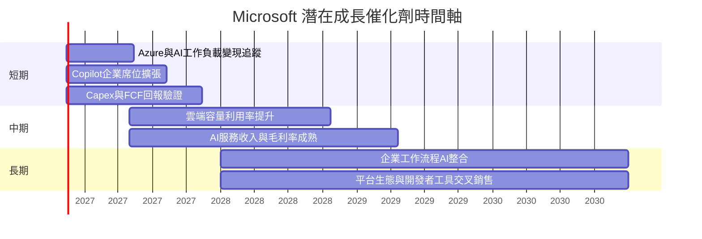

### 9.2 TAM 市場規模分析

數據包沒有提供 AI、雲端、企業生產力軟體的 TAM 或各市場滲透率數字；以下只列可追蹤的商業機會方向，不杜撰市場規模。

```text
╔══════════════════════════════════════════════════════════════════╗
║                TAM 與成長空間：數據可得性                        ║
╠══════════════════════════════════════════════════════════════════╣
║ Azure／雲端服務       TAM：N/A   滲透率：N/A   公司營收：N/A      ║
║ AI 基礎設施與服務     TAM：N/A   滲透率：N/A   公司營收：N/A      ║
║ Microsoft 365/Copilot TAM：N/A   滲透率：N/A   公司營收：N/A      ║
║ 開發者工具與 GitHub   TAM：N/A   滲透率：N/A   公司營收：N/A      ║
╠══════════════════════════════════════════════════════════════════╣
║ 可驗證總體底數：TTM 營收 $346.44B；最新單季 YoY 成長 18.8%        ║
╚══════════════════════════════════════════════════════════════════╝
```

### 9.3 成長驅動力結構圖

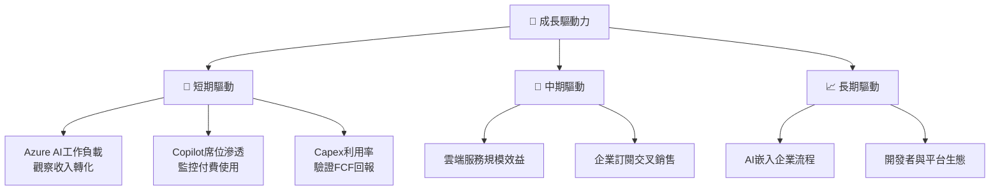

---

## 10. 風險矩陣

### 10.1 風險評分矩陣

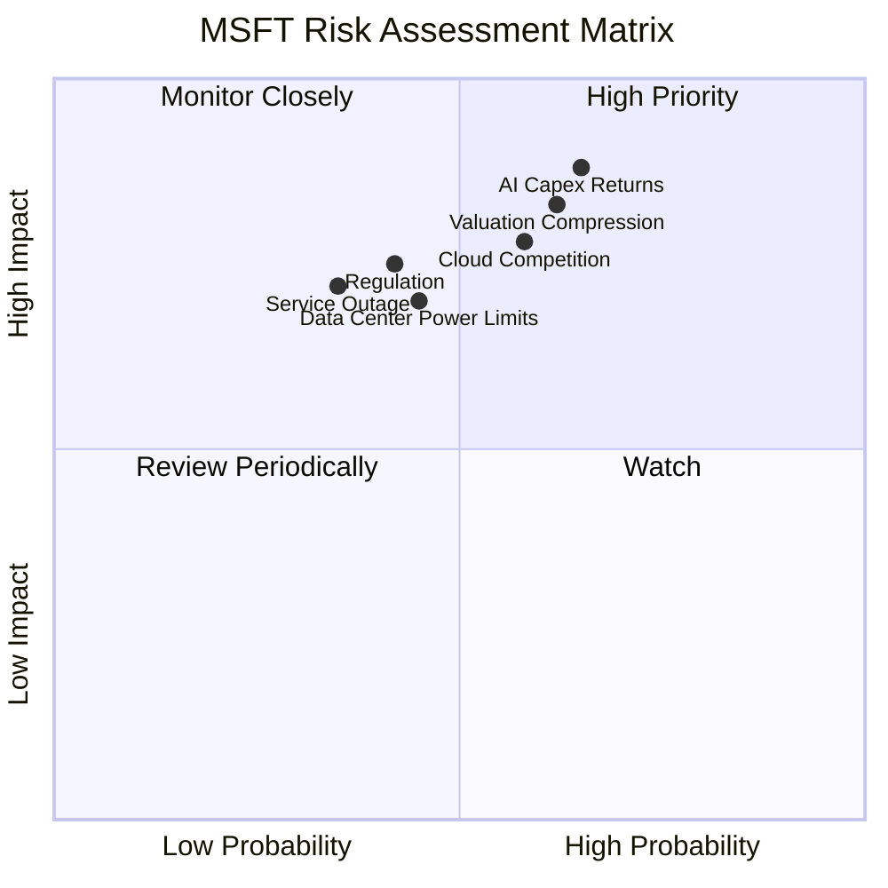

### 10.2 風險清單詳細分析

| # | 風險項目 | 發生機率 | 財務衝擊 | 風險評分 | 緩解措施 |
|---|---|---:|---|---:|---|
| 1 | 🔴 AI／資料中心 Capex 回報不足 | 中高（約 45%） | 若收入未跟上，FCF 成長低於模型；Capex 已達 TTM $135.92B | 🔴 8.5/10 | 逐季追蹤雲端增長、Capex、折舊及現金轉換率 |
| 2 | 🔴 雲端競爭及價格壓力 | 中（約 40%） | 影響收入 CAGR、毛利及終值 g | 🔴 7.5/10 | 追蹤 Azure 增長、客戶工作負載與營業利潤率 |
| 3 | 🔴 估值倍數收縮 | 中高（約 50%） | 現價 $523.88 高於加權合理價值 $424.08 | 🔴 8.0/10 | 避免以歷史倍數直接外推；分批進場 |
| 4 | 🟡 大型服務中斷 | 中低（約 25%） | 近期新聞提及服務中斷；企業客戶信任與收入可用性風險 | 🟡 6.5/10 | 強化冗餘、透明事故處理及服務可用率 |
| 5 | 🟡 監管與反壟斷 | 中（約 35%） | 可能限制併購、捆綁與分銷策略 | 🟡 6.5/10 | 監控監管案件、產品打包與地區法規 |
| 6 | 🟡 資料中心能源與供應限制 | 中（約 30%） | 可能延後容量上線、推升單位成本 | 🟡 6.0/10 | 關注供電、設備交付與容量利用率 |

表中機率為研究情境估計，並非公司或市場統計。近期新聞提及 Microsoft 服務中斷，事件本身不代表已造成可量化重大財務損失，但提示營運韌性是企業客戶續約與品牌信任的重要條件。

---

## 11. 投資建議

### 11.1 最終綜合評級雷達圖

```text
╔══════════════════════════════════════════════════════════════╗
║                    MSFT 最終評分雷達                          ║
╠══════════════════════════════════════════════════════════════╣
║ 基本面品質      9.0/10  ▓▓▓▓▓▓▓▓▓▓▓▓▓▓▓▓▓▓░░  ★★★★★         ║
║ 成長能力        8.5/10  ▓▓▓▓▓▓▓▓▓▓▓▓▓▓▓▓▓░░░  ★★★★☆         ║
║ 獲利能力        9.0/10  ▓▓▓▓▓▓▓▓▓▓▓▓▓▓▓▓▓▓░░  ★★★★★         ║
║ 財務健康        8.0/10  ▓▓▓▓▓▓▓▓▓▓▓▓▓▓▓▓░░░░  ★★★★☆         ║
║ 護城河          9.0/10  ▓▓▓▓▓▓▓▓▓▓▓▓▓▓▓▓▓▓░░  ★★★★★         ║
║ 估值合理性      4.0/10  ▓▓▓▓▓▓▓▓░░░░░░░░░░░░  ★★☆☆☆         ║
║ 風險調整報酬    5.0/10  ▓▓▓▓▓▓▓▓▓▓░░░░░░░░░░  ★★★☆☆         ║
╠══════════════════════════════════════════════════════════════╣
║ 綜合投資評分    7.7/10  🟠 品質高，但現價安全邊際不足           ║
╚══════════════════════════════════════════════════════════════╝
```

### 11.2 目標價與隱含報酬率

| 情境 | 目標價 | 相對 $523.88 收盤價 | 假設重點 | 機率權重 |
|---|---:|---:|---|---:|
| 🔴 悲觀 | $330.00 | −37.0% | 成長放緩、退出倍數 15x、AI 投資回報延遲 | 25% |
| 🟡 基準 | $424.08 | −19.1% | 成長仍佳，但估值倍數收斂、FCF 正規化有限 | 55% |
| 🟢 樂觀 | $650.00 | +24.1% | AI 變現加速、營業利潤率維持高位、倍數回升 | 20% |

依加權 MOS **−23.5%**，規則 20 對應🟠**減碼**。本評級不因業務品質而上調：估值折價不足以提供所需安全邊際，且 FCF Yield 僅 **1.54%**。持有者可考慮控制部位、分批調整，而非將公司品質等同於任何價格皆可買進。

### 11.3 買入時機與觸發因素

```text
╔══════════════════════════════════════════════════════════════════╗
║                  ✅ 買入觸發因素 Checklist                      ║
╠══════════════════════════════════════════════════════════════════╣
║ 立即重新評估條件：                                               ║
║ ☐ 股價回落至約 $381.67 以下，對應加權合理價值的 MOS 約 10%       ║
║ ☐ TTM FCF 恢復增長，且 Capex／營收連續兩季下降                   ║
║ ☐ Azure／AI 商業化成長可觀測，並未伴隨營業利益率明顯收縮          ║
║                                                                  ║
║ 加碼觸發條件：                                                   ║
║ ☐ 最新單季營收 YoY 維持 ≥15%，且營業利益率 ≥47%                  ║
║ ☐ FCF／淨利轉換率回升至 ≥60%                                     ║
║ ☐ ROIC 維持 > WACC 10.35%，Capex 新增產能利用率提高               ║
║                                                                  ║
║ 減碼／退出觸發條件：                                             ║
║ ☐ 股價高於樂觀價值 $650，且基本面未同步上修                       ║
║ ☐ 核心營收成長連續兩季 <10%                                      ║
║ ☐ ROIC 跌破 WACC，或 TTM FCF 轉負                                 ║
╚══════════════════════════════════════════════════════════════════╝
```

### 11.4 投資人適配度分析

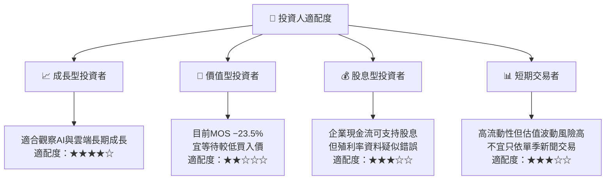

> 數據包列示股息殖利率 **75.0%**，此數值顯然與一般股息殖利率口徑不相容；本報告不引用該值作投資判斷。派息率及殖利率應以最新公司公告和可靠報價資料重新核實。

### 11.5 每季財報監控清單（Quarterly Watch List）

| 監控指標 | 最新基準 | 加碼觀察門檻 | 減碼／論點轉弱門檻 |
|---|---:|---:|---:|
| 最新單季營收 YoY | **18.8%** | ≥15% | 連續兩季 <10% |
| TTM 營收成長 | **17.9%** | 維持 ≥15% | 下滑至 <10% |
| TTM 營業利益率 | **47.1%** | 維持 ≥47% | 較基準收縮 >3pp |
| 最新季度營業利益率 | **49.8%** VERIFIED | ≥47% | 連續兩季 <44% |
| TTM OCF | **$195.88B** | 年增並保持轉換 | 明顯低於淨利且持續下滑 |
| TTM Capex | **$135.92B** | Capex 增長伴隨雲端收入及使用率提升 | Capex 持續上升但收入增速 <10% |
| TTM FCF | **$59.96B** | FCF 年增、FCF Yield 回升 | FCF 轉負或連續兩季下降 |
| FCF／淨利 | 約 **42.0%** | 回升至 ≥60% | <35% 且資本支出回報不明 |
| SBC／營收 | FY2026 **3.7%** | 持平或下降 | >5% 且稀釋加速 |
| ROIC vs WACC | **29.7% vs 10.35%** | ROIC 保持 > WACC | ROIC ≤ WACC |
| AI／Copilot 商業化 | 分部數據 N/A | 管理層披露可驗證付費滲透與收入貢獻 | 投資擴大但變現指標持續缺席 |
| 股息殖利率 | 數據包列 75.0%，不採用 | 以公司公告重新核實 | 若資料仍異常，不作收益型估值依據 |

### 11.6 反面論證：什麼會證明論點錯誤（What Would Change My Mind）

```text
╔══════════════════════════════════════════════════════════════════╗
║              ⚠️ 論點失效條件（Disconfirming Evidence）           ║
╠══════════════════════════════════════════════════════════════════╣
║ 本投資論點在下列情況成立時應重新檢視或退出：                     ║
║ ☐ 最新單季營收 YoY 連續兩季低於 10%                              ║
║ ☐ TTM 營業利益率由 47.1% 下滑逾 3 個百分點且無恢復跡象            ║
║ ☐ TTM FCF 轉負，或 FCF／淨利低於 35% 且 Capex 未下降              ║
║ ☐ ROIC 跌破 WACC 10.35%，代表資本投資不再創造經濟價值             ║
║ ☐ Capex／營收長期高於 30%，但雲端與 AI 商業化沒有相應加速          ║
║ ☐ SBC／營收升至 5% 以上，並且股數稀釋明顯加快                    ║
║ ☐ 重要服務中斷反覆發生，並開始影響續約、使用量或企業客戶信任       ║
║ ☐ 估值仍高於加權合理價值，但盈利預期或自由現金流預期下修           ║
╚══════════════════════════════════════════════════════════════════╝
```

> **免責聲明：**本報告為 AI 自動生成，僅供研究參考，不構成投資建議。財務資料來源間存在口徑差異，DCF 包含明示假設與近似計算；投資前應核對公司 SEC 申報文件、最新財報及市場資料。投資有風險，入市需謹慎。