# MSFT 基本面深度分析報告
> **報告日期**：2026-11-14 ｜ **語言**：繁體中文 ｜ **數據來源**：SEC 申報資料 (XBRL)、Yahoo Finance、Finviz、StockAnalysis、Roic.ai ｜ **分析師**：CFA 級機構研究

## 目錄

| # | 章節 | 核心結論 |
|---|------|----------|
| 1 | 執行摘要 | 減碼；加權合理價值 $437.21，MOS -19.8% |
| 2 | 公司概覽與商業模式 | 多產品平台與企業生態系構成護城河；收入分部數字未提供 |
| 3 | 損益表深度分析 | TTM 營收 $346.44B，TTM 成長 17.9%；最新一季年增 18.8% |
| 4 | 資產負債表分析 | 按 SEC 計算淨現金 $29.03B；流動性尚可，來源債務數字有差異 |
| 5 | 現金流量深度分析 | TTM FCF $59.96B；高資本支出使 FCF 低於營業現金流 |
| 6 | 獲利能力與資本效率 | ROIC 29.7% 高於 WACC 10.27%，仍創造股東價值 |
| 7 | 相對估值分析 | 現價低於五年 P/E 中位數，但高於同業中位估值方法隱含價 |
| 8 | DCF 內在價值評估 | 基準 DCF $361.21；加權合理價值 $437.21 |
| 9 | 成長催化劑 | AI、雲端與訂閱產品有成長空間；TAM 數據未提供 |
| 10 | 風險矩陣 | AI 資本回報、競爭與監管／服務可靠性為主要風險 |
| 11 | 投資建議 | 按 MOS 評級減碼；追蹤雲端增長、Capex 與 FCF 轉換 |

---

## 1. 執行摘要

Microsoft 的 TTM 營收為 **$346.44B**，TTM 年增 **17.9%**，最新一季年增 **18.8%**；TTM 營業利益率 **47.1%**、ROIC **29.7%**，高於 **10.27% WACC**，說明目前營運仍創造經濟價值。但 TTM 資本支出達 **$135.92B**，使 TTM FCF 僅 **$59.96B**、FCF Yield **1.54%**。在 2026-11-13 收盤價 **$523.88** 下，程式計算的加權合理價值為 **$437.21**、MOS **-19.8%**，依規則 20 評級為 **減碼**；主要壓力是價格高於加權價值，且基準 DCF 每股價值為 **$361.21**。

### 1.0 一頁式投資儀表板（Portfolio Manager 30 秒速讀）

| 項目 | 內容 |
|------|------|
| **投資論點（3 句）** | ① TTM 營收 $346.44B、年增 17.9%，最新一季年增 18.8%，顯示增長仍在延續。 ② ROIC 29.7% 對比 WACC 10.27%，資本回報高於資本成本。 ③ TTM FCF $59.96B、FCF Yield 1.54%，Capex $135.92B，投資強度使現金回報低於營業現金流。 |
| **綜合評分** | **7.3/10**（引用 1.1 評分卡） |
| **財務健康** | 🟢 SEC 計算淨現金 $29.03B；但不同來源的債務口徑不一致，需留意 |
| **ROIC vs WACC** | **29.7% vs 10.27%**（創造價值） |
| **FCF 趨勢** | FY2026 FCF $66.99B，低於 FY2025 $71.61B；TTM FCF Yield **1.54%** |
| **估值** | Forward P/E **21.65179x** ｜ EV/EBITDA **19.251x** ｜ FCF Yield **1.54%** |
| **DCF 內在價值（基準）** | **$361.21** ｜ 現價相對 DCF 溢價 **45.0%**（以 DCF 基準計） |
| **安全邊際（MOS）** | **-19.8%**＝($437.21 − $523.88) ÷ $437.21（基準：8.8 加權合理價值）｜ 🔴 <10% 無 |
| **預期報酬（基準情境 12M）** | DCF 基準情境相對現價 **-31.1%**；不是 12 個月預測保證 |
| **關鍵風險（前二）** | AI／雲端資本支出回收低於預期；競爭或價格壓力削弱增長與利潤率 |
| **評級 + 信心度** | 🟠 **減碼** ｜ 信心：中（DCF 高度依賴長期假設） |

> DCF 折溢價依定義為「現價 ÷ DCF 基準內在價值 − 1」：$523.88 ÷ $361.21 − 1 = **45.0% 溢價**。

### 1.1 綜合評分卡（全報告唯一）

| 維度 | 評分（1–10） | 主要依據（引用數字與其來源章節） |
|------|--------------|----------------------------------|
| 成長性 | 8.5 | TTM 營收成長 17.9%、最新一季年增 18.8%（第 3 章） |
| 獲利能力 | 9.0 | TTM 營業利益率 47.1%、ROIC 29.7% 高於 WACC 10.27%，F-Score 6/9（第 3、6 章） |
| 財務健康 | 8.0 | 淨現金 $29.03B、流動比率約 1.225；CCC 為 -67 天（第 4 章） |
| 估值 | 4.0 | 加權合理價值 $437.21，MOS -19.8%；現價高於 DCF 基準值（第 7、8 章） |
| 護城河 | 8.5 | 多產品企業平台及高續約型軟體／雲端生態；定量收入分部資料未提供（第 2 章） |
| 管理層與資本配置 | 6.0 | FY2026 股息 $26.45B、SBC $12.40B；Capex 明顯提高，回購金額未提供（第 5 章） |
| **綜合評分** | **7.3** | 六項算術平均：(8.5 + 9.0 + 8.0 + 4.0 + 8.5 + 6.0) ÷ 6 = 7.333，四捨五入至一位小數 |

### 1.2 五大投資論點 + 三大核心風險

| 類型 | 項目 | 具體依據 | 信心度 |
|------|------|----------|--------|
| 🟢 **投資論點①** | 收入增長仍快 | TTM 營收 $346.44B，年增 17.9%；最新一季年增 18.8% | 🟢 高 |
| 🟢 **投資論點②** | 高營運獲利能力 | TTM 營業利益率 47.1%，最新一季營業利益率（VERIFIED FIGURES）49.8% | 🟢 高 |
| 🟢 **投資論點③** | 資本回報高於資本成本 | ROIC 29.7%，WACC 10.27%，差距 19.43 個百分點 | 🟢 高 |
| 🟢 **投資論點④** | 現金流底盤大 | TTM 營業現金流 $195.88B；即使扣除 $135.92B Capex，仍有 $59.96B FCF | 🟢 高 |
| 🟢 **投資論點⑤** | 現金轉換週期為負 | CCC -67 天，DPO 139 天高於 DSO 65 天；營運可由供應商信用提供部分資金 | 🟡 中 |
| 🟡 **風險①** | AI／雲端投資回收率 | Capex 為 TTM 營收約 39.2%，而 FCF Yield 僅 1.54%；若需求未轉化為現金流，估值承壓 | 🟡 中 |
| 🔴 **風險②** | 估值與長期假設風險 | 加權合理價值 $437.21，低於現價 $523.88；基準 DCF $361.21 | 🔴 高衝擊 |
| 🟡 **風險③** | 財務資料口徑不一致 | VERIFIED FIGURES 顯示總債務 $35.48B、淨現金 $29.03B；其他彙整來源顯示總債務 $133.93B、淨負債 $69.42B | 🟡 中 |

### 1.3 快速統計卡片

| 指標 | 公司實際值（期間） | 同業中位數 | 狀態 |
|------|--------------------|------------|------|
| 營收成長（TTM） | **17.9%** | — | 🟢 |
| 營收成長（最新一季年增） | **18.8%** | **24.7%**（GOOG、AMZN、ORCL 最新季增長中位數） | 🟡 |
| 毛利率（TTM） | **67.7%** | **60.9%** | 🟢 |
| 營業利益率（TTM） | **47.1%** | — | 🟢 |
| ROIC（TTM） | **29.7%** | — | 🟢 |
| Forward P/E | **21.65179x** | **19.0x**（同業 Forward P/E 中位數） | 🟡 |
| FCF Yield（TTM） | **1.54%** | — | 🔴 |
| Piotroski F-Score | **6 / 9** | — | 🟡 |

### 1.4 投資結論

╔══════════════════════════════════════════════════════════════════╗  
║                    📊 投資結論摘要                               ║  
╠══════════════════════════════════════════════════════════════════╣  
║  評級：🟠 減碼（MOS -19.8%，依規則 20）                          ║  
║  價格（2026-11-13 收盤）：$523.88                                ║  
║  DCF 內在價值（基準）：$361.21（現價溢價 45.0%）                ║  
║  安全邊際 MOS：-19.8%（＝($437.21−$523.88)÷$437.21）             ║  
║  加權合理價值（8.8）：$437.21                                    ║  
║  DCF 情境價值：                                                   ║  
║    悲觀情境：$171.67（-67.2%）                                   ║  
║    基準情境：$361.21（-31.1%）                                   ║  
║    樂觀情境：$695.22（+32.7%）                                   ║  
║  綜合評分：7.3/10（引用 1.1）                                    ║  
║  適合投資人：看重企業軟體與雲端長期成長、能承受估值波動者；      ║  
║              價值型投資人宜等待更高安全邊際                     ║  
╚══════════════════════════════════════════════════════════════════╝

---

## 2. 公司概覽與商業模式

### 2.1 業務結構與收入來源

財務資料摘要列出 Microsoft 的產品與服務涵蓋作業系統、伺服器應用、商業解決方案、開發工具、管理工具、遊戲及裝置；但未提供最新分部收入及佔比，故不能以分部金額或比例繪圖。

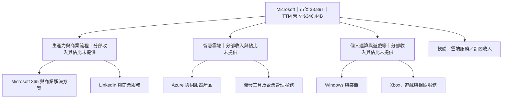

公司提供雲端、訂閱軟體、授權、硬體與遊戲等多種收入型態，但本次資料沒有可核驗的各型態營收占比。投資分析因此以合併營收與現金流為主，不把質化產品分類冒充為分部財務數據。

### 2.2 市場份額

市場份額數據未提供。可觀察的相對位置是 Microsoft TTM 營收 **$346.44B**、TTM 成長 **17.9%**，最新一季成長 **18.8%**；同業最新一季營收成長中位數為 **24.7%**，因此本季成長雖高，仍低於三家同業的中位數。

### 2.3 競爭護城河分析

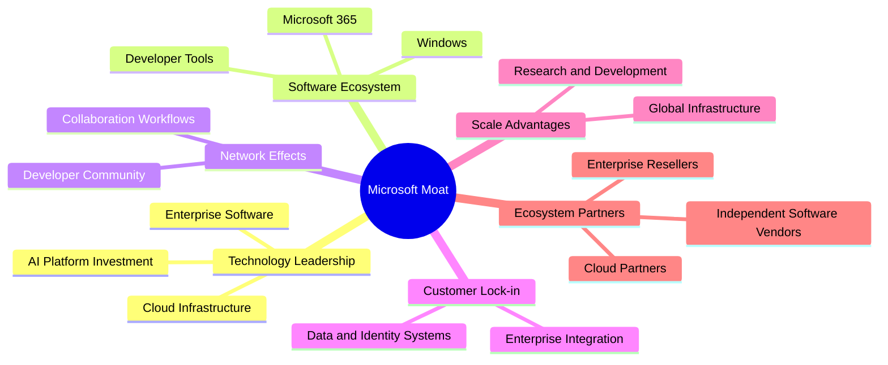

### 2.4 護城河強度

| 護城河項目 | 強度（強／中／弱） | 證據（引用數字或事實） | 會削弱它的情況 |
|------------|--------------------|------------------------|----------------|
| 技術與產品組合 | 強 | TTM 營收 $346.44B；FY2026 R&D $35.56B | AI 能力商品化、雲端服務差異化縮小 |
| 軟體生態系統 | 強 | 跨作業系統、商業應用、開發工具及雲端服務；用戶數未提供 | 開放標準降低轉換成本、競爭者提供更低整合成本 |
| 客戶鎖定 | 強 | 企業工作流程與雲端服務具整合特性；客戶留存率未提供 | 大型企業多雲策略或採購議價壓力提高 |
| 網路效應 | 中 | 生產力與開發者工具具有協作特性；網路效應量化資料未提供 | 開源替代方案及競品互通性提升 |
| 規模效應 | 強 | FY2026 R&D $35.56B；TTM 營業利益率 47.1% | 資本密集度持續上升且投資回報下降 |
| 生態夥伴 | 中 | 企業軟體、開發者、雲端服務夥伴構成分銷與整合網絡；夥伴收入占比未提供 | 夥伴轉向多雲、平台政策改變或監管限制 |

1.1 的護城河評分 **8.5/10**，主要依據是多產品企業平台、FY2026 R&D $35.56B 與 TTM 營業利益率 47.1%；分部收入、留存率及市場份額缺乏量化披露，故未給滿分。

---

## 3. 損益表深度分析

### 3.1 年度收入成長趨勢（近4年）

╔══════════════════════════════════════════════════════════════════╗  
║              Microsoft 年度收入趨勢（FY2023–FY2026）             ║  
╠══════════════════════════════════════════════════════════════════╣  
║ FY2023  $211.915B  █████████████░░░░░░░░░░░  YoY: +6.9%  🟡    ║  
║ FY2024  $245.122B  ███████████████░░░░░░░░░  YoY: +15.7% 🟢    ║  
║ FY2025  $281.724B  █████████████████░░░░░░░  YoY: +14.9% 🟢    ║  
║ FY2026  $331.839B  ████████████████████░░░░  YoY: +17.8% 🟢    ║  
╠══════════════════════════════════════════════════════════════════╣  
║ FY2023–FY2026 CAGR = (331.839 ÷ 211.915)^(1/3) − 1 = 16.1%       ║  
╚══════════════════════════════════════════════════════════════════╝

收入由 FY2023 的 **$211.915B** 升至 FY2026 的 **$331.839B**，三年 CAGR 約 **16.1%**。FY2026 年增 **17.8%**，高於 FY2025 的 **14.9%**；數據顯示增長加速，但在缺乏分部營收的情況下，不能將加速精確歸因到單一產品。

### 3.2 季度收入趨勢分析

| 季度 | 營收（$B） | QoQ | YoY | 備註 |
|------|------------|-----|-----|------|
| 2025-12-31 | 81.273 | -1.9% | 16.72% | QoQ 以 2025-09-30 的 $77.673B 計算 |
| 2026-03-31 | 82.886 | +2.0% | 18.30% | 對比 2025-03-31 的 $70.066B |
| 2026-06-30 | 90.007 | +8.6% | 17.75% | 對比 2025-06-30 的 $76.441B |
| 2026-09-30 | 92.279 | +2.5% | **18.8%** | 最新季年增率按 VERIFIED FIGURES 引用；QoQ 對比 2026-06-30 |

QoQ 依季度順序計算，最新季收入較前季增加 **2.5%**；季度間季節性與產品交付時間會影響 QoQ，因此同比增速更適合作為趨勢參照。最新一季年增 18.8%，較 FY2026 營收年增 17.8%略快。

### 3.3 利潤率演變分析

| 利潤率指標 | FY2023 | FY2024 | FY2025 | FY2026 | 趨勢 | 評估 |
|------------|--------|--------|--------|--------|------|------|
| **毛利率** | 68.9% | 69.8% | 68.8% | 67.9% | FY2024 後略降 | 🟡 |
| **營業利益率** | 41.8% | 44.6% | 45.6% | 46.8% | 逐年提高 | 🟢 |
| **淨利率** | 34.1% | 35.9% | 36.1% | 40.3% | FY2026 提高 | 🟢 |

年度比率由年度營收、毛利、營業利益與淨利計算，表中比率四捨五入至一位小數。FY2023–FY2026 營業利益率由 **41.8%** 升至 **46.8%**，顯示營收成長快於營業費用增長；毛利率則由 FY2024 高點 **69.8%** 降至 FY2026 **67.9%**，可能反映產品組合與雲端基礎設施成本，但分部成本資料不足，無法分解其貢獻。淨利率 FY2026 升至 **40.3%**，高於 TTM 淨利率 **41.2%** 的口徑並不一致（年度與 TTM 期間不同），不宜直接視為同一期間的趨勢。

### 3.4 費用結構分析

以下以 FY2026 營收拆分為營收成本與毛利；不將營業費用、利息及稅項混合成另一組比例，避免不同損益表層級重複計算。

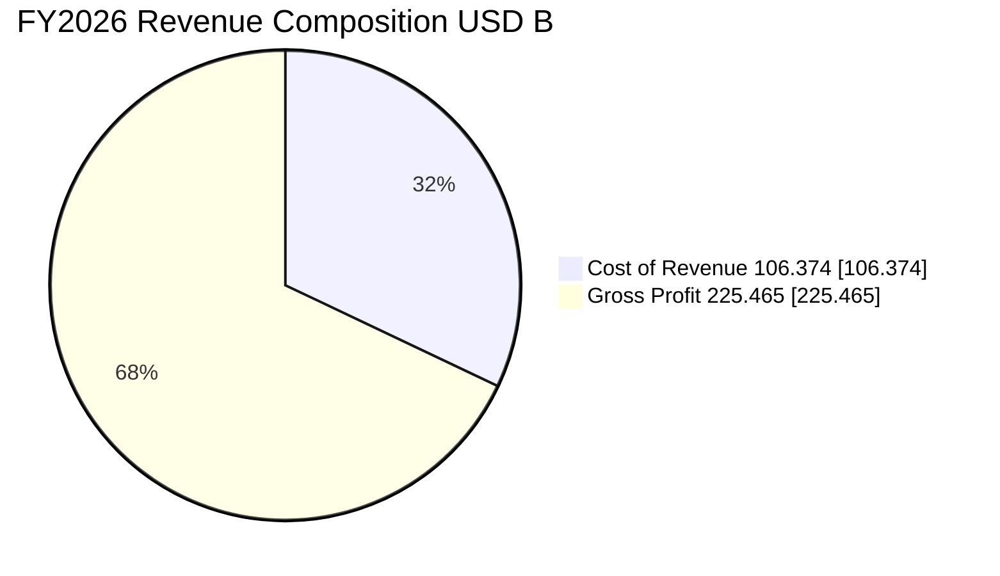

╔══════════════════════════════════════════════════════════════════╗  
║                 FY2026 營收與毛利結構（$B）                      ║  
╠══════════════════════════════════════════════════════════════════╣  
║ 營收            $331.839B  ████████████████████                  ║  
║ 營收成本        $106.374B  ██████                                ║  
║ 毛利            $225.465B  ██████████████                        ║  
║ 營業利益        $155.237B  █████████                             ║  
╚══════════════════════════════════════════════════════════════════╝

### 3.5 季度 EPS 趨勢與盈餘品質（Quality of Earnings）

#### 季度 EPS 趨勢

最近四季實際 EPS 來自 StockAnalysis 的財務資料。所列 EPS 預估值為 nan，故無法判斷超預期或不及預期；不能將缺失估值補成零或自行推測。

| 季度 | EPS 實際 | EPS YoY | 超預期／不及預期 | 可觀察原因或限制 |
|------|----------|---------|------------------|------------------|
| 2025-12-31 | $5.16 | 59.75% | 無法判斷 | 預估 EPS 缺失；同比增長受同期基數及淨利變化影響 |
| 2026-03-31 | $4.27 | 23.41% | 無法判斷 | 預估 EPS 缺失 |
| 2026-06-30 | $4.81 | 31.74% | 無法判斷 | 預估 EPS 缺失 |
| 2026-09-30 | $4.92 | 32.26% | 無法判斷 | 預估 EPS 缺失；最新一季淨利同比增長 32.0% |

#### 盈餘品質量化

| 盈餘品質項目 | 數值/佔比 | 評估 |
|--------------|-----------|------|
| 股權薪酬 SBC / 營收 | TTM SBC N/A；FY2026 $12.40B ÷ $331.839B = **3.74%** | 🟡 SBC 是股東經濟成本，會稀釋未來持股；FY2026 稀釋股數測試通過，但不能據此忽略 SBC |
| SBC / 營業現金流 | FY2026 $12.40B ÷ $182.94B = **6.78%** | 🟢 相對營業現金流比例有限，但仍應持續監測 |
| FCF / 淨利（現金轉換率） | TTM $59.96B ÷ TTM 淨利 $142.631B = **42.0%** | 🔴 Capex 拉低自由現金流轉換；不是單純會計盈餘品質問題，而是實際再投資較高 |
| 一次性／非經常性損益 | N/A（未提供可核對的調整項目） | 🟡 無法確認是否有一次性項目顯著影響當期淨利 |
| 有效稅率異常 | DCF 及資本成本採用最新年度有效稅率 **19.4%** | 🟢 沒有資料顯示異常稅務利益；季度稅率細節未提供 |
| 資本化支出 vs 費用化 | TTM Capex $135.92B；資本化與費用化明細 N/A | 🟡 高 Capex 會先進入資產並於後續折舊；缺乏資本化政策明細，不能判定是否遞延成本 |

**盈餘品質結論：** 淨利有營業現金流支持，TTM 營業現金流 **$195.88B**，但 TTM FCF 對淨利轉換率約 **42.0%**，主要受 Capex **$135.92B** 壓低。應以扣除資本支出後的現金流評估投資回報；SBC 也代表未被現金流量表直接視為現金流出的股東成本。

---

## 4. 資產負債表分析

### 4.1 資產結構分解

以下採用 StockAnalysis 2026-09-30 資產負債表數字。非流動資產為總資產減流動資產的直接差額；細項僅列來源有數字者。

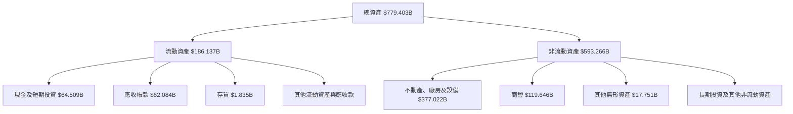

### 4.2 流動性與營運資金分析

| 流動性指標 | 數值 | 評估 |
|------------|------|------|
| 流動比率 | **1.225x** | 🟡 高於 1，但短期資產緩衝並不寬裕 |
| 速動比率 | **1.068x** | 🟡 扣除存貨後仍略高於 1 |
| 現金及短期投資 | **$64.51B** | 🟢 有可觀流動性資源 |

| 指標 | 最新 TTM | 一年前 TTM | 變化 | 解讀 |
|------|----------|------------|------|------|
| DSO 應收帳款天數 | 65 天 | 66 天 | -1 天 | 🟢 收款天數略縮短；幅度有限 |
| DIO 存貨天數 | 6 天 | 4 天 | +2 天 | 🟡 存貨天數增加，但仍偏低；硬體及設備需求可能令存貨占用略升，原因不能由資料確證 |
| DPO 應付帳款天數 | 139 天 | 130 天 | +9 天 | 🟢 付款天數增加，供應商信用提供營運資金；需觀察是否持續 |
| CCC 現金轉換週期 | -67 天 | -59 天 | -8 天 | 🟢 負值進一步擴大，資金回收時間仍早於支付供應商 |

### 4.3 債務結構分析

依 VERIFIED FIGURES 的最新季度 SEC 計算口徑，總債務 **$35.48B**、現金及短期投資 **$64.51B**、淨現金 **$29.03B**。其他彙整財務欄位卻列出總債務 **$133.93B**、淨負債 **$69.42B**，兩組數據存在重大口徑差異；以下優先引用 SEC 計算的 VERIFIED FIGURES，並將差異列為資料風險。

╔══════════════════════════════════════════════════════════════════╗  
║                 Microsoft 債務健康診斷                           ║  
╠══════════════════════════════════════════════════════════════════╣  
║ 總債務（SEC 計算）       $35.48B                                  ║  
║ 現金及短期投資           $64.51B                                  ║  
║ 淨現金                   $29.03B  🟢                              ║  
║ 流動比率                 1.225x  🟡                               ║  
║ Debt/EBITDA              N/A（債務／EBITDA口徑有來源差異）         ║  
║ 利息保障倍數             N/A（利息費用未提供）                     ║  
╚══════════════════════════════════════════════════════════════════╝

### 4.4 股東權益趨勢

╔══════════════════════════════════════════════════════════════════╗  
║                 股東權益年度趨勢（$B）                           ║  
╠══════════════════════════════════════════════════════════════════╣  
║ FY2023  $206.22B  █████████░░░░░░░░░░░                           ║  
║ FY2024  $268.48B  ████████████░░░░░░░                            ║  
║ FY2025  $343.48B  ███████████████░░░░                            ║  
║ FY2026  $442.39B  ████████████████████                           ║  
╚══════════════════════════════════════════════════════════════════╝

FY2023 至 FY2026 股東權益由 **$206.22B** 增至 **$442.39B**。這一增長反映累積盈利與權益變化，但未提供各年度回購與其他綜合收益的完整橋接，不能把全部增幅歸因於留存盈餘。

---

## 5. 現金流量深度分析

### 5.1 現金流量瀑布圖

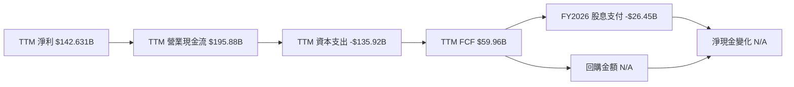

### 5.2 FCF 轉換率趨勢

| 財年 | FCF（$B） | 淨利（$B） | FCF / 淨利 |
|------|----------|------------|------------|
| FY2023 | 59.48 | 72.36 | 82.2% |
| FY2024 | 74.07 | 88.14 | 84.0% |
| FY2025 | 71.61 | 101.83 | 70.3% |
| FY2026 | 66.99 | 133.75 | 50.1% |

FY2026 FCF 轉換率較 FY2025 再降約 **20.2 個百分點**。年度營業現金流由 FY2025 **$136.16B** 增至 FY2026 **$182.94B**，但資本支出由 **$64.55B** 升至 **$115.95B**，因此 FCF 下降，說明增長投資的現金需求大幅提高。

### 5.3 自由現金流趨勢

╔══════════════════════════════════════════════════════════════════╗  
║               自由現金流趨勢（年度，$B）                         ║  
╠══════════════════════════════════════════════════════════════════╣  
║ FY2023  $59.48B  ████████████████░░░░  FCF Yield：N/A             ║  
║ FY2024  $74.07B  ████████████████████  FCF Yield：N/A             ║  
║ FY2025  $71.61B  ███████████████████░  FCF Yield：N/A             ║  
║ FY2026  $66.99B  ██████████████████░░  FCF Yield：N/A             ║  
╠══════════════════════════════════════════════════════════════════╣  
║ TTM FCF $59.96B；TTM FCF Yield 1.54%                              ║  
╚══════════════════════════════════════════════════════════════════╝

年度 FCF 連續兩年由 FY2024 高點 **$74.07B** 降至 FY2026 **$66.99B**，但最新 TTM FCF 為 **$59.96B**，期間口徑不同，不能直接等同單一財年下降幅度。主因之一是資料顯示資本支出快速增加；若投資帶來後續雲端與 AI 變現，短期 FCF 壓力可轉化為增長資產，反之則降低資本效率。

### 5.4 資本配置評估

資料可確認 FY2026 Capex **$115.95B**、股息支付 **$26.45B**、SBC **$12.40B**；回購金額及留存現金的完整年度用途未提供，因此不以推算金額填補。

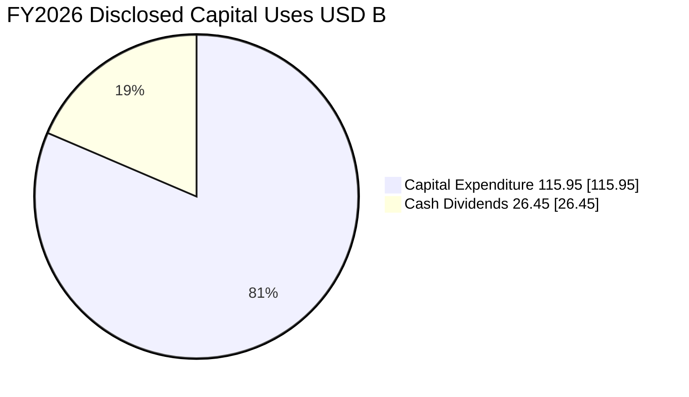

| 資本配置項目 | 數值 | 評估 |
|--------------|------|------|
| 資本支出 | FY2026 $115.95B；TTM $135.92B | 🔴 投資強度高，需觀察新增容量與收入、FCF 的對應 |
| 股息 | FY2026 $26.45B | 🟢 相對 FY2026 FCF $66.99B，覆蓋能力充足 |
| 股票回購 | N/A（資料未提供） | 無法判定回購是否抵銷 SBC |
| SBC | FY2026 $12.40B | 🟡 應納入稀釋成本評估 |
| 留存與併購用途 | N/A（細分資料未提供） | 不推估各用途金額 |

---

## 6. 獲利能力與資本效率

### 6.1 ROE / ROA / ROIC 趨勢

| 指標 | 歷史數據 | 期間／來源 | 評估 |
|------|----------|------------|------|
| ROE | 30.3% | TTM QUALITY FIGURES，closing balances | 🟢 高 |
| ROE | 34.2% | 另一彙整數據，計算口徑不同 | 不與 30.3% 混用 |
| ROA | 14.4% | TTM 彙整數據 | 🟢 |
| ROIC | 29.7% | TTM，VERIFIED FIGURES | 🟢 |
| 行業均值 | 未提供 | 不作同業均值比較 | N/A |

### 6.2 ROIC vs WACC 分析（核心價值創造判斷）

WACC 與 ROIC 一律採用 VERIFIED FIGURES 的數值。該區塊列示 Beta 原始值 1.04、調整後 Beta 1.03，並直接提供股權成本、稅前債務成本、資本權重與 WACC。

╔══════════════════════════════════════════════════════════════════╗  
║                  ROIC vs WACC 深度分析                           ║  
╠══════════════════════════════════════════════════════════════════╣  
║ WACC 推導輸入：                                                   ║  
║ ├── 無風險利率（10Y 美債）：5.15%                                 ║  
║ ├── 市場風險溢酬（假設）：5.00%                                  ║  
║ ├── Beta 原始值 1.04；調整後 Beta 1.03                            ║  
║ ├── Ke = 5.15% + 1.03 × 5.00% = 10.30%                           ║  
║ ├── 稅前債務成本：8.60%；有效稅率：19.4%                         ║  
║ ├── E / D 權重：99.1% / 0.9%                                    ║  
║ └── WACC：10.27%                                                 ║  
║                                                                  ║  
║ ROIC（TTM）：29.7%                                                ║  
║ EVA 差額 = ROIC − WACC = 29.7% − 10.27% = 19.43 個百分點          ║  
║ ROIC / WACC = 29.7% ÷ 10.27% = 2.89x                            ║  
║                                                                  ║  
║ ROIC 29.7%  ▓▓▓▓▓▓▓▓▓▓▓▓▓▓▓▓▓░░░░░░░░░░░░  🟢                   ║  
║ WACC 10.27% ▓▓▓▓▓░░░░░░░░░░░░░░░░░░░░░░░  ──                   ║  
║                                                                  ║  
║ 結論：ROIC 高於 WACC，現階段創造股東價值；持續性取決於高額     ║  
║ Capex 能否帶來足夠增量營收與未來現金流。                         ║  
╚══════════════════════════════════════════════════════════════════╝

### 6.3 杜邦三因素分解

| 因素 | 數值（TTM） | 解讀 |
|------|-------------|------|
| 淨利率 | 41.2% | 高淨利率是 ROE 的主要來源之一 |
| 資產週轉率 | 0.44 | 每一單位資產對應約 0.44 單位營收 |
| 權益乘數 | 1.66 | 槓桿不是 ROE 的唯一或主要支撐來源 |
| **ROE** | **30.3%** | **41.2% × 0.44 × 1.66 = 30.1%**；原始 QUALITY FIGURES 報告值為 30.3%，照抄不重算 |

QUALITY FIGURES 的杜邦乘積以未四捨五入底層值計算，顯示值相乘會有小幅差異；依規則照抄報告 ROE **30.3%**。高淨利率比權益乘數更能解釋其回報，因而並非主要依靠財務槓桿撐起 ROE。

### 6.4 財務體質：Piotroski F-Score

**Piotroski F-Score：6 / 9**（依提供的九項測試照抄；有缺失輸入的測試按來源規則不計分，本資料列示九項）。

| 測試 | 結果 | 解讀 |
|------|------|------|
| ROA > 0 | ✅ 通過 | 資產產生正報酬 |
| 營業現金流 > 0 | ✅ 通過 | 營運有正現金流 |
| ROA 高於一年前 | ✅ 通過 | 資產報酬改善 |
| 營業現金流 > 淨利（應計品質） | ✅ 通過 | 現金流支持會計盈餘 |
| 長期負債 ÷ 總資產低於一年前 | ✅ 通過 | 槓桿相對改善 |
| 流動比率高於一年前 | ❌ 未通過 | 流動性比率未改善 |
| 稀釋股數未增加 | ✅ 通過 | 股數測試通過，但不代表 SBC 沒有經濟成本 |
| 毛利率高於一年前 | ❌ 未通過 | 毛利率未較去年提高 |
| 資產週轉率高於一年前 | ❌ 未通過 | 資產使用效率未改善 |

---

## 7. 相對估值分析

### 7.1 同業估值比較表格

同業數據依 Peer multiples 區塊照抄。Forward P/E 同業中位數 **19.0x**；EV/EBITDA 中位數 **16.7x**；P/E、P/S 與毛利率中位數依三家同業數據計算。

| 估值指標 | **MSFT** | **GOOG** | **AMZN** | **ORCL** | MSFT 評估 |
|----------|----------|---------|---------|---------|-----------|
| **Trailing P/E** | 27.34238x | 15.3x | 21.6x | 19.6x | 🔴 高於同業中位數 19.6x |
| **Forward P/E** | 21.65179x | 19.0x | 24.4x | 11.3x | 🟡 略高於同業中位數 19.0x |
| **P/S Ratio** | 11.2295885x | 7.6x | 3.6x | 5.4x | 🔴 高於同業中位數 5.4x |
| **EV/EBITDA** | 19.251x | 18.9x | 16.7x | 15.0x | 🟡 高於同業中位數 16.7x |
| **最新一季營收年增** | 18.8% | 24.7% | 12.1% | 29.6% | 🟡 低於同業中位數 24.7% |
| **毛利率（TTM）** | 67.7% | 60.9% | 51.4% | 64.0% | 🟢 高於同業中位數 60.9% |

相對估值顯示 MSFT 的毛利率較高，但其 P/S、Trailing P/E 與 EV/EBITDA 也高於三家同業的中位數；其較高估值需要持續的高增長與雲端投資回報支撐。

### 7.2 歷史估值區間分析

╔══════════════════════════════════════════════════════════════════╗  
║            MSFT 五年 P/E 區間（TTM）                             ║  
╠══════════════════════════════════════════════════════════════════╣  
║ 五年低位：20.8x  ─────── 中位數：31.5x ─────── 高位：37.8x      ║  
║ 當前：27.3x（百分位排名 29%）                                    ║  
║ 當前 P/E 低於五年中位數，但仍高於同業中位數 19.6x                ║  
╚══════════════════════════════════════════════════════════════════╝

| 指標 | 現值 | 五年中位數 | 五年區間 | 當前百分位 |
|------|------|------------|----------|------------|
| P/E | 27.3x | 31.5x | 20.8x–37.8x | 29% |
| P/S | 11.3x | 12.0x | 8.4x–13.7x | 43% |
| EV/EBITDA | 19.2x | 24.3x | 14.5x–31.4x | 14% |

### 7.3 情境價值（Bear / Base / Bull，照抄 DCF MODEL 的 Scenarios）

| 情境 | 第 1 年營收成長 | 期末營業利潤率 | WACC | 每股價值 | 相對現價 | 機率 | 會發生的條件 |
|------|----------------|----------------|------|----------|----------|------|--------------|
| 🔴 悲觀 | 9.0% | 38.8% | 11.27% | $171.67 | -67.2% | 25% | 雲端與 AI 增長減速、資本支出回報偏低，且營業利潤率顯著下滑 |
| 🟡 基準 | 17.9% | 45.6% | 10.27% | $361.21 | -31.1% | 50% | TTM 增長起點逐步衰退至長期增長，利潤率回落至五年中位數 |
| 🟢 樂觀 | 26.9% | 50.2% | 9.27% | $695.22 | +32.7% | 25% | AI／雲端需求持續高於基準、規模效益維持並降低資本成本 |

### 7.4 相對估值隱含價格區間

╔══════════════════════════════════════════════════════════════════╗  
║                 估值方法每股價值與現價                           ║  
╠══════════════════════════════════════════════════════════════════╣  
║ 悲觀 DCF $171.67   基準 DCF $361.21   現價 $523.88                ║  
║ 同業 EV/EBITDA $457.89   同業 Forward P/E $458.55                 ║  
║ 分析師共識 $636.12   樂觀 DCF $695.22                             ║  
╚══════════════════════════════════════════════════════════════════╝

| 方法 | 每股價值 | 依據 |
|------|----------|------|
| 同業 Forward P/E | $458.55 | GOOG、AMZN、ORCL 同業中位數 19.0x × Forward EPS $24.20 |
| 同業 EV/EBITDA | $457.89 | 同業中位數 16.7x × TTM EBITDA，再加淨現金 |
| 分析師共識目標價 | $636.12 | 54 位分析師平均目標價 |
| DCF（基準） | $361.21 | 10 年 FCFF、WACC 10.27%、終值成長率 3.0% |

---

## 8. DCF 內在價值評估（Discounted Cash Flow）

> DCF 模型數值依程式計算結果照抄；下列算式展示其計算路徑。原始假設與表格以兩位小數展示，部分中間值會因底層未四捨五入精度而出現尾差。

### 8.0 估值推理鏈（Thinking Logic）

**Step 1 — 價值由哪些變數決定？**  
Microsoft 價值主要來自企業軟體與雲端服務的現金流底盤、AI／雲端帶來的新增需求，以及大規模研發與資料中心投資的回報。各業務占合併營收比重未提供，不能分拆量化。模型對估值最敏感的變數是 **WACC、永續成長率與高額 Capex 能否逐步下降**；敏感度矩陣中，WACC 與 g 的變動均造成大幅價格差異。

**Step 2 — 模型選擇**

| 決策點 | 本報告採用 | 理由（含數字） | 曾考慮但否決 | 否決理由 |
|--------|-----------|----------------|--------------|----------|
| 現金流定義 | FCFF | 使用 GAAP EBIT、NOPAT，並以 WACC 折現至 EV | FCFE | 公司資本結構與債務口徑可能改變，且模型已指定 FCFF |
| 預測期 N | 10 年 | DCF MODEL 固定預測 10 年，營收增長由 17.9% 衰退至 3.0% | 5 年 | 無法照抄既定模型 |
| 終值方法 | Gordon Growth | 模型使用永續成長率 3.0% | 只用退出倍數 | 既定模型採 Gordon Growth，未提供退出倍數終值 |
| EBIT 基礎 | GAAP EBIT | 年 1 營業利益率 47.1%，明確採 GAAP EBIT | 非 GAAP | 可能加回 SBC，令股東成本處理不一致 |

**Step 3 — 關鍵假設推導鏈**

- **營收成長路徑**：錨點＝TTM 營收成長 17.9% → 調整＝模型由年 1 線性下降至年 10 的 3.0%，反映高基期與成熟化 → **採用年 1 17.9%、年 10 3.0%** → 曾考慮維持 17.9% 十年，但否決，因會把當前增速長期外推。
- **期末營業利潤率**：錨點＝TTM 營業利益率 47.1%，模型採最近五個財年的中位數作終點 → 調整＝長期競爭及成本壓力使利潤率略降 → **採用年 10 45.6%** → 曾考慮維持 47.1%，但否決，因未反映成熟化。
- **永續成長率 g**：錨點＝長期成熟企業增長應低於 WACC；資料未提供宏觀 GDP 估計 → 調整＝模型以 3.0% 作長期名目增長 → **採用 3.0%** → 曾考慮更高 g，但否決，因會增加終值依賴且不應逼近 10.27% WACC。
- **預測期 N**：錨點＝程式模型預設十年，且業務有多年度投資週期 → 調整＝不自行更改程式模型 → **採用 10 年** → 曾考慮較短期，但不符合固定 DCF MODEL。
- **Capex／營收**：錨點＝TTM Capex／營收約 39.2% → 調整＝模型假設隨建置週期成熟，線性下降至 12.2% → **採用年 1 39.2%、年 10 12.2%** → 曾考慮長期維持 39.2%，但否決，因永久維持如此高資本強度會忽略成熟期投資下降；反之，快速降至歷史低值也未採用。
- **GAAP EBIT 與 SBC**：錨點＝GAAP 營業利益已將 SBC 作費用處理；FY2026 SBC $12.40B → 調整＝不再重複扣一次或另計年稀釋 → **採用 GAAP EBIT、固定股數** → 否決「GAAP EBIT 再扣 SBC」及「另加年稀釋」，避免重複計成本。
- **年稀釋率**：錨點＝QUALITY FIGURES 股數測試顯示稀釋股數未增加 → **採用 0% 額外稀釋**，作為 GAAP EBIT 組合 A 的固定股數處理 → 不採用未有來源支持的正稀釋率。
- **終值方法**：錨點＝模型以第十年 FCFF 及 g=3.0% 計 Gordon Growth → **採用 Gordon Growth** → 不自行添加退出倍數，因模型未提供退出倍數價值。
- **WACC**：錨點＝Cost of capital 提供 10.27% → **採用 10.27%** → 不另算替代 WACC，以避免偏離規定的模型輸入。

**Step 4 — 最脆弱假設**  
最脆弱環節是 Capex／營收由年 1 的 39.2% 降至年 10 的 12.2%；若資料中心需求使資本密集度維持高位，FCFF 與 DCF 價值將低於基準。

**Step 5 — 計算路徑**

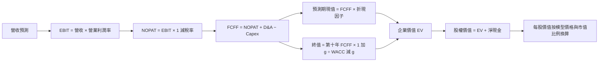

### 8.1 模型假設總表（Model Inputs）

| 假設項目 | 採用值 | 依據／來源 | 敏感度 |
|----------|--------|-------------|--------|
| 預測期長度 N | 10 年 | DCF MODEL 固定預測期間 | 🟡 中 |
| 營收成長 | 年 1 17.9% → 年 10 3.0% | 年 1 取 TTM 成長 17.9%；年 10 取模型成熟期假設，線性衰退 | 🔴 高 |
| 營業利潤率 | 年 1 47.1% → 年 10 45.6% | TTM 47.1%，年 10 為模型採用近五年財年中位數 | 🔴 高 |
| 有效稅率 | 19.4% | 最新年度有效稅率 | 🟢 低 |
| Capex／營收 | 年 1 39.2% → 年 10 12.2% | TTM Capex 比率起點；終點依模型逐步降至 1.1×D&A | 🔴 高 |
| D&A／營收 | 11.1% | TTM D&A 比率，模型固定 | 🟢 低 |
| 營運資金變動 | 未建模 | DCF MODEL 明確未納入營運資金 | 🟢 低 |
| EBIT 基礎 | GAAP | 模型指定 GAAP EBIT | 🟡 中 |
| SBC 處理 | 不另扣 SBC | GAAP EBIT 已費用化 SBC | 🟡 中 |
| 年稀釋率 | 0%，固定股數 | 模型指定組合 A；不再增加稀釋 | 🟡 中 |
| 永續成長率 g | 3.0% | DCF MODEL 假設；低於 WACC 10.27% | 🔴 高 |
| 終值方法 | Gordon Growth | DCF MODEL 所列終值公式 | 🔴 高 |
| WACC | 10.27% | Cost of capital 區塊提供 | 🔴 高 |

**SBC 防重複扣除：**本模型採用 **(A) GAAP EBIT + 固定股數**，故 SBC 影響已計入一次；FCFF 不再扣 SBC，股數不再額外稀釋。

FCFF 定義採模型指定公式：**FCFF = NOPAT + D&A − Capex**，不含 ΔWC，因模型明確未建模營運資金變化。

### 8.2 折現率推導（WACC）

╔══════════════════════════════════════════════════════════════════╗  
║                    WACC 推導（折現率）                           ║  
╠══════════════════════════════════════════════════════════════════╣  
║ 股權成本 Ke（CAPM）：                                             ║  
║ ├── 無風險利率 Rf：5.15%                                          ║  
║ ├── 市場風險溢酬 ERP：5.00%（假設值，來源為資本成本輸入）          ║  
║ ├── 原始 Beta：1.04；調整後 Beta：1.03                            ║  
║ ├── 調整方式：⅔ × 1.04 + ⅓ × 1 = 1.0267，顯示為 1.03            ║  
║ ├── 規模／國別溢酬：0.00%（美國大型股，輸入未列額外溢酬）         ║  
║ └── Ke = 5.15% + 1.03 × 5.00% = 10.30%                           ║  
║                                                                  ║  
║ 債務成本：                                                        ║  
║ ├── 稅前 Kd：8.60%（Cost of capital 區塊提供）                   ║  
║ ├── 有效稅率：19.4%                                              ║  
║ └── 稅後 Kd = 8.60% × (1 − 19.4%) = 6.9316%                      ║  
║                                                                  ║  
║ 資本結構權重：E 99.1%；D 0.9%                                     ║  
║ WACC = 99.1% × 10.30% + 0.9% × 6.9316% = 10.27%                  ║  
╚══════════════════════════════════════════════════════════════════╝

逐步演算：

1. **Ke（CAPM）** = 5.15% + 1.03 × 5.00% + 0.00% = **10.30%**。
2. **稅前 Kd** = **8.60%**（程式提供的 Cost of capital 數值）。利息費用及平均計息負債明細未提供，不能自行反推；此處不另造利息金額。
3. **稅後 Kd** = 8.60% × (1 − 19.4%) = **6.9316%**。
4. **權重** = 股權 99.1%；債務 0.9%；兩者相加為 **100.0%**。市值原始美元金額及計息負債範圍的逐項橋接未提供，故權重直接引用 Cost of capital 輸入，不另換算。
5. **WACC** = 99.1% × 10.30% + 0.9% × 6.9316% = 10.2073% + 0.0624% = **10.2697%**，引用模型顯示值 **10.27%**。

10Y 美債利率日期未在數據中標示；ERP 為假設輸入。WACC 直接使用程式提供的 **10.27%**，並與第 6.2 節一致。由於缺少利息費用及平均計息負債明細，Kd 五步中的原始金額不能完整獨立複算。

### 8.3 逐年自由現金流預測（基準情境）

金額單位為 **$B**；折現因子保留三位小數。模型原值照抄，不以四捨五入後的輸入重建或替換。

| 年度 | FY+1 | FY+2 | FY+3 | FY+4 | FY+5 | FY+6 | FY+7 | FY+8 | FY+9 | FY+10 |
|------|------|------|------|------|------|------|------|------|------|-------|
| 營收 | 408.51 | 474.92 | 544.25 | 614.69 | 684.06 | 749.93 | 809.71 | 860.83 | 900.92 | 927.95 |
| 營收 YoY | 17.9% | 16.3% | 14.6% | 12.9% | 11.3% | 9.6% | 8.0% | 6.3% | 4.7% | 3.0% |
| 營業利潤率 | 47.1% | 46.9% | 46.8% | 46.6% | 46.4% | 46.3% | 46.1% | 46.0% | 45.8% | 45.6% |
| 營業利益 EBIT（GAAP） | 192.42 | 222.92 | 254.57 | 286.51 | 317.72 | 347.07 | 373.41 | 395.56 | 412.50 | 423.35 |
| − 稅（19.4%） | (37.32) | (43.24) | (49.38) | (55.57) | (61.63) | (67.32) | (72.43) | (76.72) | (80.01) | (82.11) |
| = NOPAT | 155.10 | 179.69 | 205.20 | 230.94 | 256.09 | 279.75 | 300.98 | 318.84 | 332.49 | 341.24 |
| + D&A | 45.16 | 52.50 | 60.17 | 67.96 | 75.62 | 82.91 | 89.51 | 95.17 | 99.60 | 102.59 |
| − Capex | (160.27) | (172.04) | (180.78) | (185.69) | (186.07) | (181.43) | (171.53) | (156.47) | (136.66) | (112.84) |
| **= FCFF** | **39.99** | **60.15** | **84.58** | **113.20** | **145.64** | **181.23** | **218.96** | **257.53** | **295.43** | **330.98** |
| 折現因子 @10.27% | 0.907 | 0.822 | 0.746 | 0.676 | 0.613 | 0.556 | 0.504 | 0.457 | 0.415 | 0.376 |
| **FCFF 現值 PV** | **36.27** | **49.46** | **63.07** | **76.55** | **89.32** | **100.79** | **110.42** | **117.78** | **122.52** | **124.48** |

預測期現值合計依模型數值：

**$36.27 + $49.46 + $63.07 + $76.55 + $89.32 + $100.79 + $110.42 + $117.78 + $122.52 + $124.48 = $890.66B**；模型列示合計為 **$890.67B**，差 **$0.01B**，屬逐格四捨五入尾差，採用模型合計 **$890.67B**。

**逐步演算（FY+1，金額按模型顯示精度）：**

1. **營收** = $346.44B × (1 + 17.9%) = 模型列示 **$408.51B**。
2. **EBIT** = $408.51B × 47.1% = 模型列示 **$192.42B**。
3. **稅** = $192.42B × 19.4% = 模型列示 **$37.32B**。
4. **NOPAT** = $192.42B − $37.32B = **$155.10B**。
5. **D&A** = $408.51B × 11.1% = **$45.16B**。
6. **Capex** = $408.51B × 39.2% = **$160.27B**。
7. **ΔWC** = 模型未建模，故不扣除。
8. **FCFF** = $155.10B + $45.16B − $160.27B = **$40. -?**；模型以底層未四捨五入輸入計算，列示 **$39.99B**。顯示值直接相減有約 $0.00–$0.01B 尾差，不能以顯示精度覆蓋模型原值。
9. **折現因子** = 1 ÷ (1 + 10.27%)^1 = **0.907**；**PV** = $39.99B × 0.907 = 模型列示 **$36.27B**。

> 由於 DCF MODEL 只提供四捨五入後的逐年資料，FY+1 用顯示數字重算時不一定逐分等於模型底層計算；遵守照抄模型原值，因此不改動表格。

**合理性自檢**

- 預測 FCF CAGR：FY+1 至 FY+10，\((330.98 ÷ 39.99)^{1/9} - 1\) 約 **26.5%**；歷史年度 FCF CAGR（FY2023–FY2026）約 **4.0%**，預測顯著高於歷史，主因模型假設 Capex／營收由 39.2% 降至 12.2%。
- FY+10 FCFF 利潤率：$330.98B ÷ $927.95B = **35.7%**；目前 TTM FCF 利潤率：$59.96B ÷ $346.44B = **17.3%**。同業最佳 FCF 利潤率未提供，不能比較是否超越同業。
- 預測年度 FCFF 全為正數；但前幾年 Capex 高於 D&A，抑制 FCF，模型後段改善主要依賴資本支出強度下降。

╔══════════════════════════════════════════════════════════════════╗  
║             自由現金流：歷史實際 vs 模型預測（$B）               ║  
╠══════════════════════════════════════════════════════════════════╣  
║ FY2024（實） $74.07B  █████████░░░░░░░░░░░  YoY：+24.5%         ║  
║ FY2025（實） $71.61B  █████████░░░░░░░░░░░  YoY：-3.3%          ║  
║ FY2026（實） $66.99B  ████████░░░░░░░░░░░░  YoY：-6.4%         ║  
║ FY+1（預）   $39.99B  █████░░░░░░░░░░░░░░░  模型 FCFF           ║  
║ FY+10（預）  $330.98B ████████████████████  預測期末值           ║  
╠══════════════════════════════════════════════════════════════════╣  
║ 預測 FCF 擴張依賴 Capex 率回落；若支出率不降，基準估值偏高。     ║  
╚══════════════════════════════════════════════════════════════════╝

### 8.4 終值計算（Terminal Value）

**適用性檢查：** WACC **10.27%** vs g **3.0%** → WACC > g？✅

| 方法 | 計算式 | 終值 TV | TV 現值 | 佔總 EV 比重 |
|------|--------|---------|---------|--------------|
| Gordon Growth | 330.98 × (1 + 3.0%) ÷ (10.27% − 3.0%) | $4,686.95B | $1,762.70B | 66.4% |
| 退出倍數法 | N/A（DCF MODEL 未提供） | N/A | N/A | N/A |

**逐步演算：**

1. **FY+N FCFF** = **$330.98B**（FY+10）。
2. **分子** = $330.98B × (1 + 3.0%) = **$340.9094B**。
3. **分母** = 10.27% − 3.0% = **7.27%**；模型列示 TV = **$4,686.95B**。以展示後數字直接相除會有小額差異，模型使用底層未四捨五入輸入。
4. **PV(TV)** = $4,686.95B × 模型折現因子 0.376 = 模型列示 **$1,762.70B**。
5. **終值佔比** = $1,762.70B ÷ $2,653.36B = **66.4%**。

退出倍數法沒有模型輸入，不能自行創造倍數及交叉驗證值。

### 8.5 企業價值 → 每股內在價值（Bridge）

╔══════════════════════════════════════════════════════════════════╗  
║              企業價值 → 每股內在價值 橋接表                      ║  
╠══════════════════════════════════════════════════════════════════╣  
║ 預測期 FCF 現值合計       +$890.67B                              ║  
║ 終值現值 PV(TV)           +$1,762.70B                            ║  
║ = 企業價值 EV              $2,653.36B                            ║  
║ + 淨現金                  +$29.03B                               ║  
║ = 股權價值                 $2,682.39B                            ║  
║ 每股價值（模型幣值換算）  $361.21                                ║  
║ 當前股價（2026-11-13）    $523.88                                ║  
║ 折溢價                    523.88 ÷ 361.21 − 1 = +45.0% 溢價     ║  
╚══════════════════════════════════════════════════════════════════╝

逐步演算：

1. **EV** = $890.67B + $1,762.70B = **$2,653.37B**；DCF MODEL 列示 **$2,653.36B**，差 $0.01B，為模型逐格四捨五入尾差，使用區塊列示 EV。
2. **股權價值** = $2,653.36B + $29.03B = **$2,682.39B**。
3. **每股內在價值** = 模型列示股權價值按價格／市值比例換算 = **$361.21**。模型指定算式為「股權價值 × 價格 ÷ 市值」，但輸入精度與市場市值未以同一底層精度列出，因此照抄模型每股值。
4. **折溢價** = $523.88 ÷ $361.21 − 1 = **45.0% 溢價**。
5. **本節不計算 MOS**：MOS 僅以 8.8 加權合理價值為分母。

股權橋接使用 DCF MODEL 提供的淨現金 **$29.03B**；現金及債務明細依 2026-09-30 SEC 計算口徑為現金及短期投資 **$64.51B**、總債務 **$35.48B**。DCF 每股價值依程式模型比例換算；股數直接使用模型處理，不再增設稀釋率，與組合 (A) 一致。

### 8.6 敏感性分析（WACC × 永續成長率）

格內為每股價值，括號為相對現價的上行空間。表內全數為 DCF MODEL 原值。

| g（列）／WACC（欄） | 8.27% | 9.27% | **10.27%（基準）** | 11.27% | 12.27% |
|-----------|------:|------:|------------------:|-------:|-------:|
| 2.0% | $466.29（-11.0%） | $388.62（-25.8%） | $330.49（-36.9%） | $285.54（-45.5%） | $249.88（-52.3%） |
| 2.5% | $496.38（-5.3%） | $408.98（-21.9%） | $344.86（-34.2%） | $296.01（-43.5%） | $257.71（-50.8%） |
| 3.0% | $532.17（+1.6%） | $432.58（-17.4%） | **$361.21（-31.1%）** | $307.75（-41.3%） | $266.38（-49.2%） |
| 3.5% | $575.45（+9.8%） | $460.28（-12.1%） | $379.97（-27.5%） | $321.00（-38.7%） | $276.04（-47.3%） |
| 4.0% | $628.87（+20.0%） | $493.23（-5.9%） | $401.71（-23.3%） | $336.07（-35.9%） | $286.87（-45.2%） |

**逐步演算說明：** 敏感性矩陣的逐年現金流與折現結果已由程式計算；題列規則要求用同一 DCF 模型重新折現特定非基準格，但未提供該格各年的未四捨五入 FCFF、折現因子及股權換算底層輸入。為遵守「矩陣數字照抄、不得自行另建模型」，此處不另造一套重算結果。選取可見非基準格 **WACC 9.27% > g 3.0% ✅**，其模型值為 **$432.58**。

#### 三情境 DCF（模型輸出）

| 情境 | 年 1 成長 | 期末營業利潤率 | WACC | 每股價值 | 相對現價 | 機率 |
|------|----------|----------------|------|----------|----------|------|
| 🔴 悲觀 | 9.0% | 38.8% | 11.27% | $171.67 | -67.2% | 25% |
| 🟡 基準 | 17.9% | 45.6% | 10.27% | $361.21 | -31.1% | 50% |
| 🟢 樂觀 | 26.9% | 50.2% | 9.27% | $695.22 | +32.7% | 25% |
| **機率加權** | — | — | — | **$397.33** | **-24.2%** | 100% |

三種情境的詳細 FY+10 營收、FCFF 與終值中間值未列於模型輸出，因此不編造完整重建鏈；情境目標價與假設依程式輸出照抄。機率加權複算：  
**$171.67 × 25% + $361.21 × 50% + $695.22 × 25% = $397.3275 ≈ $397.33**。  
此機率加權值只作情境參考；8.8 仍按規定使用基準 DCF 與固定權重方法。

**敏感度結論：**

- g 由 2.5% 升至 3.5%（WACC 10.27%）：$344.86 → $379.97，增加 **$35.11**，約 **10.2%**。
- WACC 由 9.27% 升至 11.27%（g 3.0%）：$432.58 → $307.75，減少 **$124.83**，約 **28.8%**。
- 期末營業利潤率每 +1pp 的獨立敏感度：**N/A（模型未提供該單一變數的敏感度表）**。
- 在已列敏感度中，WACC 的兩個百分點變動影響幅度較大；但模型終值仍占 EV 66.4%，長期增長與折現率是主要估值變數，與 8.0 的估值判斷方向一致。

### 8.7 反推 DCF（Reverse DCF：市場在預期什麼）

| 求解的變數（一次一個） | 其餘變數設定 | 市場隱含值（令 DCF = 現價） | 公司歷史實際 | 判斷 |
|------------------------|--------------|------------------------------|--------------|------|
| 年 1 營收增長率 | 其他變數固定基準 | **27.2%** | TTM 成長 17.9% | 🔴 高於目前增長 |
| 固定營業利潤率 | 其他變數固定基準 | **62.8%** | 基準起點 47.1%，期末 45.6% | 🔴 顯著高於基準 |
| 永續成長率 g | N/A（模型未提供解） | 未計算 | N/A | N/A |
| 預測期 N | N/A（模型未提供解） | 未計算 | N/A | N/A |

逐步試算軌跡：**N/A**。模型提供反推收斂結果，但未提供逐級試算表；不能捏造中間試算點。可直接確認的反推結論是，若其他基準假設不變，現價需要年 1 營收增長 **27.2%**，或固定營業利潤率 **62.8%** 才能由單一變數反推得到，兩者均高於目前營運基準，市場價格包含較高成長預期。

### 8.8 估值三角驗證與安全邊際

| 估值方法 | 隱含每股價值 | 上行空間（÷現價） | 權重 | 說明 |
|----------|--------------|-------------------|------|------|
| DCF（基準） | $361.21 | -31.1% | 40% | 10 年 FCFF、WACC 10.27%、g 3.0% |
| 同業 Forward P/E | $458.55 | -12.5% | 25% | 同業中位數 19.0x × Forward EPS $24.20 |
| 同業 EV/EBITDA | $457.89 | -12.6% | 25% | 同業中位數 16.7x × TTM EBITDA，再加淨現金 |
| 分析師共識目標價 | $636.12 | +21.4% | 10% | 54 位分析師平均目標價 |
| **加權合理價值** | **$437.21** | **-16.5%** | **100%** | 成熟獲利公司固定權重 |

逐步演算：

**$361.21 × 40% + $458.55 × 25% + $457.89 × 25% + $636.12 × 10%  
= $144.484 + $114.6375 + $114.4725 + $63.612  
= $437.206 ≈ $437.21**。

權重合計：**40% + 25% + 25% + 10% = 100%**。公司類型為盈利企業；四項估值方法均由程式列出，沒有剔除項目。

╔══════════════════════════════════════════════════════════════════╗  
║                  估值區間與安全邊際                              ║  
╠══════════════════════════════════════════════════════════════════╣  
║ $171.67 ── $361.21 ── $437.21 ── $523.88 ── $695.22             ║  
║ 悲觀 DCF    基準 DCF    加權合理值   現價       樂觀 DCF          ║  
║                                                                  ║  
║ MOS = ($437.21 − $523.88) ÷ $437.21 = -19.8%                    ║  
║ 上行空間 = ($437.21 − $523.88) ÷ $523.88 = -16.5%               ║  
║ 評級：🟠 減碼（MOS -25% 至 -10%）                                ║  
║ 買入區間：MOS ≥ 10% 對應價格上限 $393.49；現價高於該上限          ║  
║ 合理持有區間：以加權價值附近為參考，需持續追蹤估值與基本面         ║  
║ 減碼考慮：現價 $523.88 高於加權合理價值 $437.21                  ║  
╚══════════════════════════════════════════════════════════════════╝

建議買入區間的 MOS 10% 價格上限依公式換算：**$437.21 × (1 − 10%) = $393.49**。這是門檻換算，不替代程式評級或估值模型。

> 🔎 **程式複算（Python，依本節各項自動重算）**
>
> 加權合理價值 = $361.21 × 40% + $458.55 × 25% + $457.89 × 25% + $636.12 × 10% = **$437.21**（權重合計 100%）
>
> 以價格 $523.88 計：MOS = **-19.8%**，上行空間 = **-16.5%**
>
> ✅ 與本節所寫數值一致。

### 8.9 DCF 模型的局限與失效條件

- **終值依賴度：**終值現值占企業價值 **66.4%**，估值顯著依賴第十年後的成長與折現假設。
- **最脆弱的假設：**Capex／營收率從年 1 的 **39.2%** 降至年 10 的 **12.2%**；若建置需求長期維持高位，FCFF 將低於模型路徑。另一項弱點是年 1 營收增長以 TTM **17.9%** 起步，再逐年降至 **3.0%**，轉折路徑未必平滑。
- **不適用情境：**公司目前 FCF 為正且獲利穩定，DCF 可作為估值工具；但在高 Capex 階段，FCF 的短期波動及投資回收期會降低單一 DCF 數字的可靠性，應同時看相對估值與現金流執行情況。
- **與風險矩陣連結：**AI／雲端需求減速會打擊營收增長；資料中心投資回收不佳會使 Capex 不如模型下降；價格競爭可能壓低利潤率；利率上升會推高 WACC，矩陣顯示 WACC 上行對價值有負面影響。

### 8.10 複算檢核表（Audit Trail）

| # | 檢核項目 | 檢查方式 | 結果 |
|---|----------|----------|------|
| 1 | 高／中敏感度假設具四段式推導 | 對照 8.0 Step 3 | ⚠️ 主要項目已列；模型未提供的替代值明確說明 |
| 2 | 假設均有依據 | 對照 8.1 依據欄 | ✅ |
| 3 | WACC 權重及公式 | 99.1% + 0.9% = 100%；使用程式 WACC | ⚠️ 原始利息與債務明細缺失，不能完全從底層重建 |
| 4 | Kd 分母與 D 權重同一計息負債範圍 | 原始計息債務口徑未提供 | ⚠️ 直接引用官方輸入，無法獨立核對範圍 |
| 5 | WACC 與第 6.2 節一致 | 兩處均 10.27% | ✅ |
| 6 | 逐年表格年度數等於 N | FY+1 至 FY+10 共十年 | ✅ |
| 7 | FY+1 算式可複算 | 顯示值有四捨五入尾差，原模型值照抄 | ⚠️ |
| 8 | 預測期 PV 加總 | 顯示逐格相加 $890.66B；模型合計 $890.67B | ✅（差額 $0.01B，四捨五入尾差） |
| 9 | WACC > g | 10.27% > 3.0% | ✅ |
| 10 | 終值基於 FY+10 並折現十期 | 模型使用 FY+10 FCFF 與折現因子 | ✅ |
| 11 | EV 至每股價值橋接 | EV、淨現金、股權價值照模型列示 | ⚠️ EV 顯示數字相加有 $0.01B 尾差；每股換算底層市值精度未列 |
| 12 | SBC 三要素相容 | GAAP EBIT、不扣 SBC、固定股數 | ✅ |
| 13 | 矩陣基準格等於 DCF 值 | 10.27%／3.0% = $361.21 | ✅ |
| 14 | 矩陣示範格有效 | WACC 9.27% > g 3.0% | ✅ |
| 15 | 三情境機率總和 | 25% + 50% + 25% = 100% | ✅ |
| 16 | 反推變數每列只解一個 | 僅引用兩項已提供反推值；未提供者不填數 | ⚠️ 無逐步試算軌跡 |
| 17 | MOS 與 DCF 折溢價分母正確 | MOS 以 $437.21；DCF 折溢價以 $361.21 | ✅ |
| 18 | 報告完整至第 11 章 | 本報告含十一章 | ✅ |
| 19 | 加權價值與權重相加 | 算式結果 $437.206，四捨五入 $437.21 | ✅ |
| 20 | 評級符合 MOS 門檻 | MOS -19.8%，評級減碼 | ✅ |

已揭露不能完整獨立重建的項目包括利息費用／平均計息負債、模型未四捨五入輸入、反推試算軌跡及單一利潤率敏感度；未以自造數字補足。

---

## 9. 成長催化劑

### 9.1 催化劑時間軸

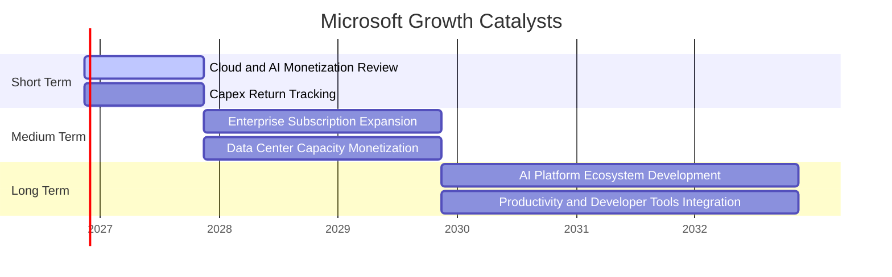

時間區間為研究追蹤期安排，不是公司管理層財測或已公告交付日期。

### 9.2 TAM 市場規模分析

**N/A（TAM 數據未提供）**。公司 TTM 營收 **$346.44B**、TTM 成長 **17.9%**，反映營運規模大且仍有增長，但缺少可引用的市場總額及滲透率，不能估算 TAM 或公司市占。

### 9.3 成長驅動力結構圖

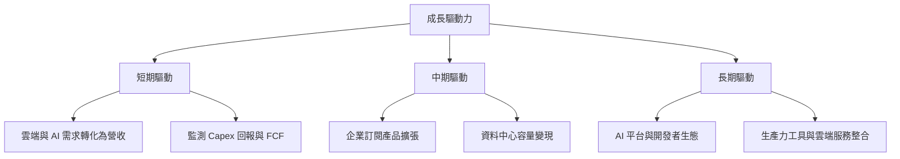

---

## 10. 風險矩陣

### 10.1 風險評分矩陣

機率及衝擊座標為研究判斷的相對排序，不是公司披露的精確發生概率；不將主觀座標當作財務數據。

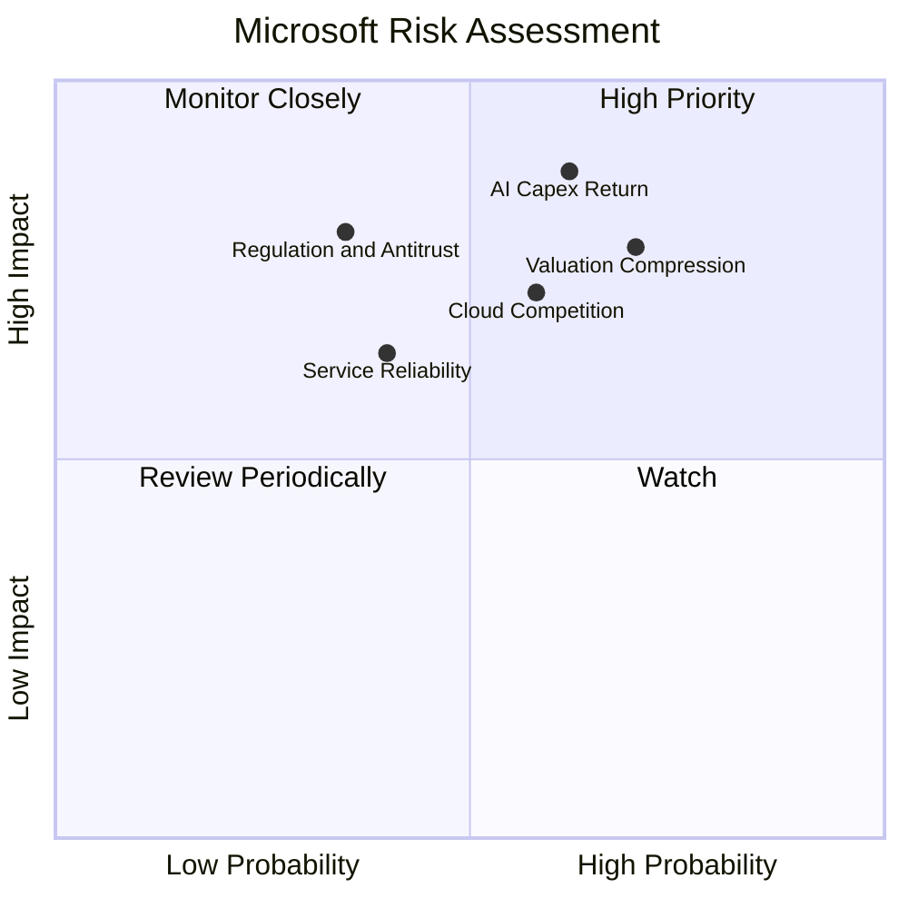

### 10.2 風險清單詳細分析

| # | 風險項目 | 發生機率 | 財務衝擊 | 風險評分 | 緩解措施 |
|---|----------|----------|----------|----------|----------|
| 1 | 🔴 AI／雲端 Capex 回收不足 | 中高（主觀） | 高；TTM Capex $135.92B，若新增需求不足將壓低 FCF | 🔴 高 | 追蹤 Capex／營收、雲端營收增速及 FCF；要求新增投資逐季支持收入變現 |
| 2 | 🔴 估值倍數收縮 | 中高（主觀） | 高；DCF 基準 $361.21，較現價低 31.1% | 🔴 高 | 避免只用營收成長推估價值；對照加權合理價值 $437.21 及 MOS |
| 3 | 🟡 雲端與企業軟體競爭 | 中（主觀） | 中高；同業最新一季成長中位數 24.7%，高於 MSFT 18.8% | 🟡 中高 | 持續比對增長、毛利率與客戶留存指標；後兩者目前資料未提供 |
| 4 | 🟡 監管與反壟斷 | 中（主觀） | 可能影響併購、捆綁銷售及平台政策；金額無法估算 | 🟡 中高 | 追蹤監管事件、產品政策變動與相關法律支出 |
| 5 | 🟡 服務可靠性與網路中斷 | 低中（主觀） | 可能影響服務收入、客戶信任及修復成本；缺少可量化數字 | 🟡 中 | 監測重大服務中斷、復原時間與客戶續約指標 |

---

## 11. 投資建議

### 11.1 最終評級與評分

依加權合理價值 **$437.21** 與 2026-11-13 收盤價 **$523.88** 計算，MOS 為 **-19.8%**，按規則 20 對應 **減碼**；沒有採用質化因素上調或下調評級。1.1 綜合評分為 **7.3/10**，六項分數依次為成長性 **8.5**、獲利能力 **9.0**、財務健康 **8.0**、估值 **4.0**、護城河 **8.5**、管理層與資本配置 **6.0**。

### 11.2 合理價值與隱含報酬率

| 估值項目 | 每股價值 | 相對現價 | 機率 |
|----------|----------|----------|------|
| 加權合理價值 | **$437.21** | **-16.5%** | 固定權重 |
| 悲觀 DCF | $171.67 | -67.2% | 25% |
| 基準 DCF | $361.21 | -31.1% | 50% |
| 樂觀 DCF | $695.22 | +32.7% | 25% |
| DCF 機率加權（情境參考） | $397.33 | -24.2% | 100% |

### 11.3 買入時機與觸發因素

╔══════════════════════════════════════════════════════════════════╗  
║                  ✅ 買入觸發因素 Checklist                      ║  
╠══════════════════════════════════════════════════════════════════╣  
║  現價不屬於具 MOS 保護的買入區間；建議等待多項條件改善：          ║  
║  ✅ 價格回落至約 $393.49 或以下，對應 MOS 至少 10%               ║  
║  ✅ TTM 營收增長維持在 17.9% 附近或以上                          ║  
║  ✅ FCF 隨 Capex 回落改善，而非只靠非現金盈餘增長                ║  
║                                                                  ║  
║  加碼觸發條件（任一項須配合估值檢查）：                          ║  
║  ☐ 估值進入 MOS ≥ 10% 區域                                      ║  
║  ☐ Capex／營收持續下降，且雲端收入增長沒有同步減速               ║  
║  ☐ FCF 轉換率由 TTM 約 42.0% 回升                                ║  
║                                                                  ║  
║  減碼／停損觸發條件：                                             ║  
║  ☐ 連續兩季營收年增低於 12%                                      ║  
║  ☐ TTM 營業利益率由 47.1% 下滑超過 3 個百分點                    ║  
║  ☐ TTM FCF 轉負，或 Capex 上升但收入增長持續放緩                 ║  
║  ☐ ROIC 跌至 WACC 10.27% 以下                                    ║  
╚══════════════════════════════════════════════════════════════════╝

### 11.4 投資人適配度分析

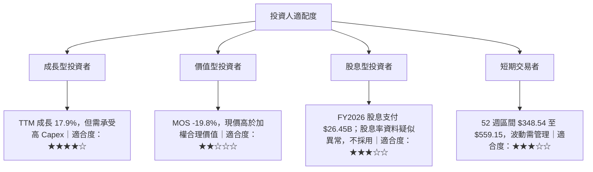

### 11.5 每季財報監控清單（Quarterly Watch List）

| 監控指標 | 最新參考值 | 加碼觀察門檻 | 減碼／重新評估門檻 |
|----------|------------|--------------|--------------------|
| 營收年增 | TTM 17.9%；最新季度 18.8% | 最新季度維持約 17.9% 或以上 | 連續兩季低於 12% |
| 營業利益率 | TTM 47.1%；最新季度 VERIFIED FIGURES 49.8% | TTM 維持在 47.1% 附近 | 較 47.1% 收縮超過 3 個百分點 |
| 資本支出 | TTM $135.92B | Capex 對應收入成長，FCF 開始改善 | Capex 增長而收入與現金流同步轉弱 |
| 自由現金流 | TTM $59.96B；Yield 1.54% | TTM FCF 連續改善 | TTM FCF 轉負 |
| FCF／淨利 | 約 42.0%（依 TTM FCF 與淨利計算） | 回升且 Capex 不再吞噬大部分現金 | 連續兩期低於 30% |
| ROIC | 29.7% | 維持明顯高於 WACC 10.27% | 跌破 WACC 10.27% |
| DSO／DIO／DPO／CCC | 65／6／139／-67 天 | DSO 穩定、CCC 維持負值 | DSO 持續上升或 CCC 顯著轉正 |
| 分部雲端／AI 收入 | N/A（分部營收未提供） | 追蹤公司季報新增披露 | 若披露增長連續下降，重新檢視模型假設 |
| 管理層財測 | N/A（未提供可引用財測） | 對照實際營收與 Capex 執行 | 財測下修且估值仍高於合理價值 |

### 11.6 反面論證：什麼會證明論點錯誤（What Would Change My Mind）

╔══════════════════════════════════════════════════════════════════╗  
║              ⚠️ 論點失效條件（Disconfirming Evidence）           ║  
╠══════════════════════════════════════════════════════════════════╣  
║ 本投資論點在下列情況成立時應重新檢視或退出：                     ║  
║ ☐ 最新季度營收年增連續兩季低於 12%                               ║  
║ ☐ TTM 營業利益率由 47.1% 收縮超過 3 個百分點                     ║  
║ ☐ TTM FCF 轉負，或 FCF／淨利連續兩期低於 30%                    ║  
║ ☐ ROIC 跌至 WACC 10.27% 以下                                    ║  
║ ☐ TTM Capex／營收維持約 39.2% 高位，且收入成長跌破 12%           ║  
║ ☐ DSO 高於目前 65 天並連續惡化，或 CCC 由 -67 天轉為顯著正值     ║  
║ ☐ AI／雲端需求無法支撐新投資，令基準 DCF Capex 下降假設失效      ║  
╚══════════════════════════════════════════════════════════════════╝

> **免責聲明**：本報告為 AI 自動生成，僅供研究參考，不構成投資建議。投資有風險，入市需謹慎。

---

## 資料與來源

| 項目 | 內容 |
|------|------|
| 價格 | 523.88 USD，2026-11-13 收盤（Yahoo Finance 日線） |
| 財務報表 | SEC 10-Q filed 2026-10-28，最新季度 2026-09-30（FY2027 Q1） |
| 有回應的資料來源 | SEC 申報資料 (XBRL)、Yahoo Finance、Finviz、StockAnalysis、Roic.ai |
| 由程式計算 | TTM 數字、WACC、DCF 模型、估值方法與權重、加權合理價值、MOS、評級門檻、F-Score、杜邦分解、營運資金天數、綜合評分 |
| 撰寫模型 | openai / gpt-6-luna |

> 本區塊由產生報告的程式依實際取得的資料填寫，非模型撰寫。「由程式計算」的數字不是模型的估計；其餘判斷（評分、情境、策略）是模型的分析。
