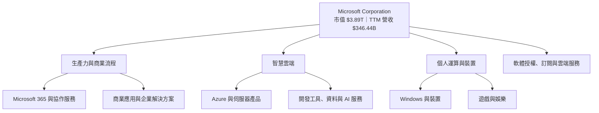
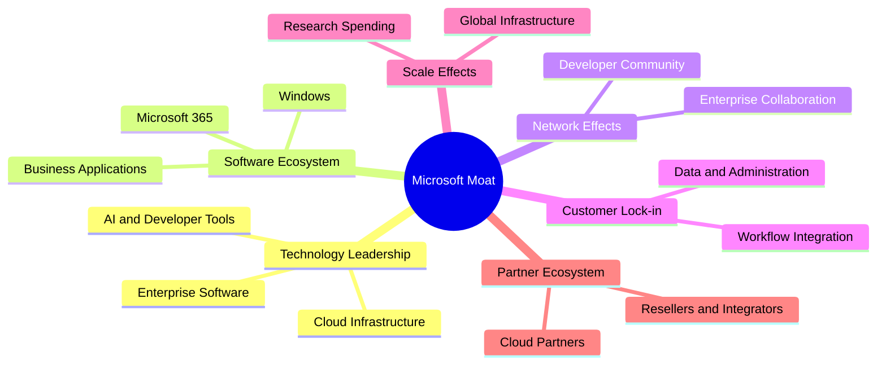
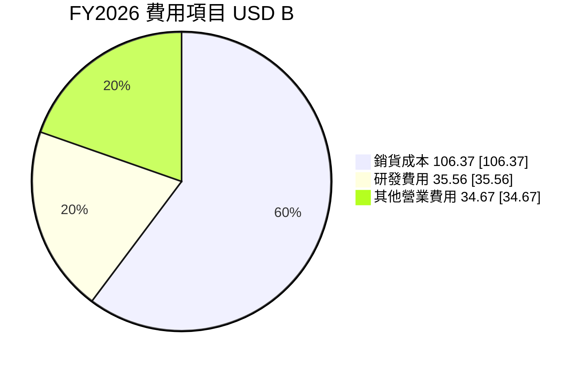
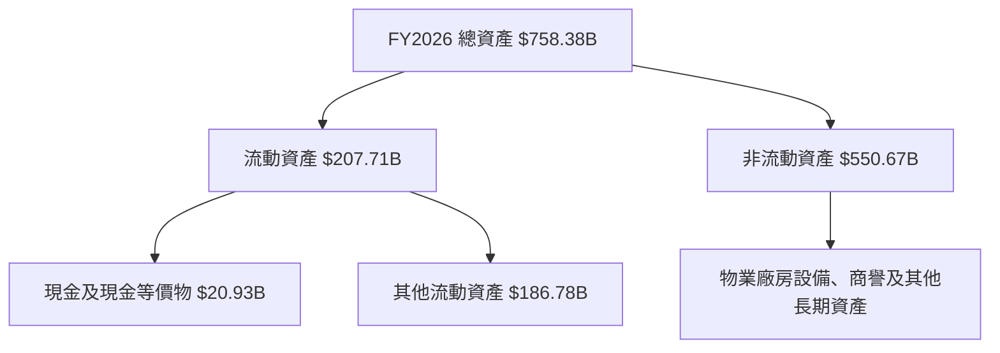
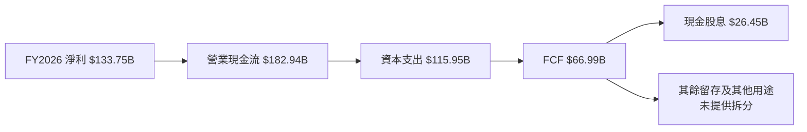
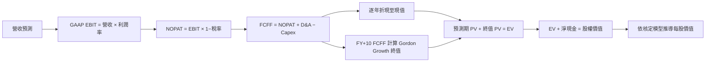
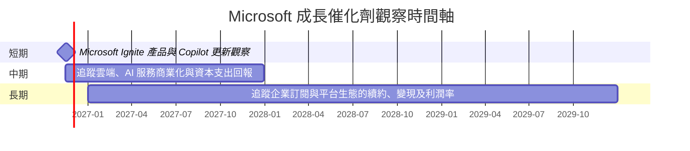
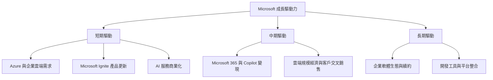
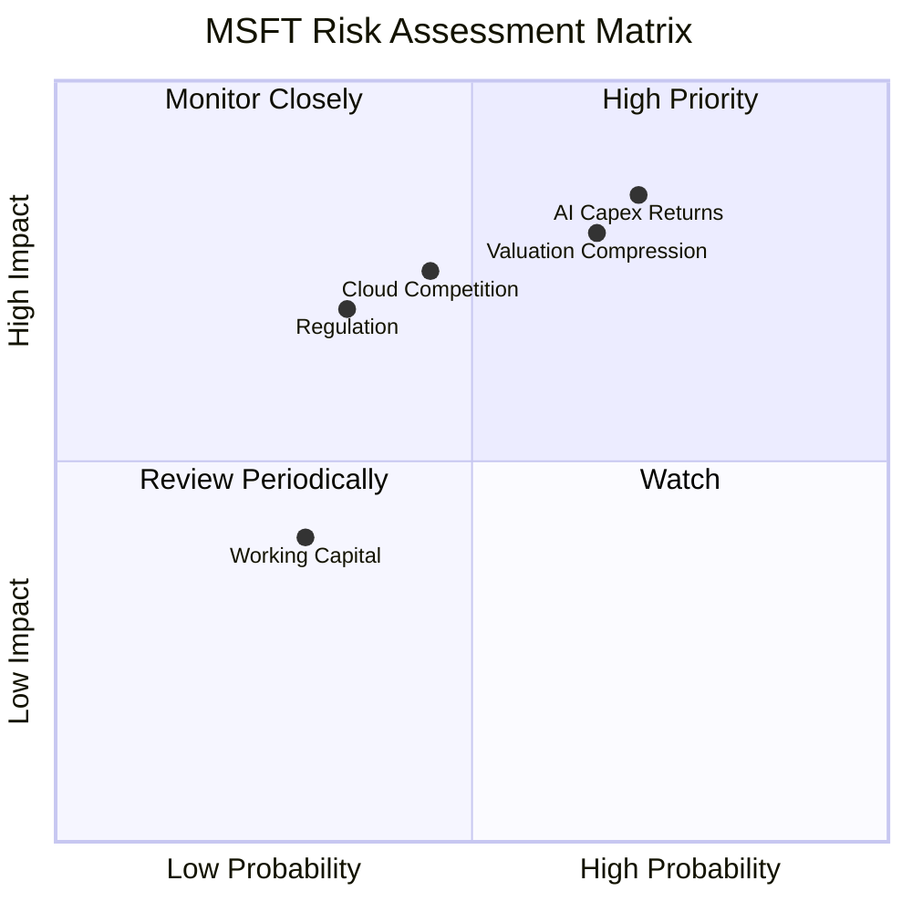
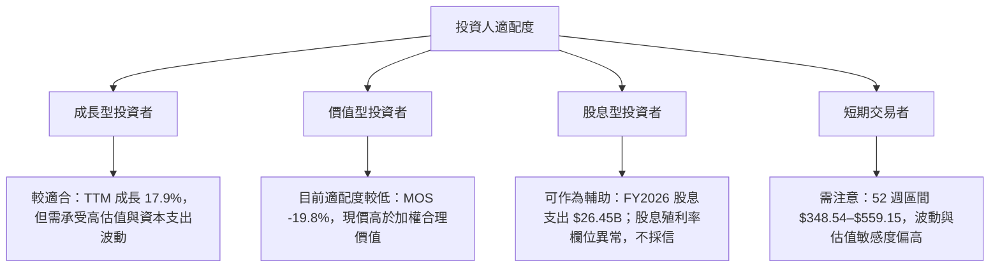

# MSFT 基本面深度分析報告
> **報告日期**：2026-11-15 ｜ **語言**：繁體中文 ｜ **數據來源**：SEC 申報資料 (XBRL)、Yahoo Finance、Finviz、StockAnalysis、Roic.ai ｜ **分析師**：CFA 級機構研究

## 目錄

| # | 章節 | 核心結論 |
|---|------|----------|
| 1 | 執行摘要 | 減碼；加權合理價值 $437.21，MOS -19.8% |
| 2 | 公司概覽與商業模式 | 多產品平台與企業軟體生態形成護城河；分部營收占比未提供 |
| 3 | 損益表深度分析 | TTM 營收 $346.44B，TTM 成長 17.9%；營業利益率 47.1% |
| 4 | 資產負債表分析 | 依 SEC 最新季度口徑為淨現金 $29.03B；來源間債務數據有差異 |
| 5 | 現金流量深度分析 | TTM FCF $59.96B，資本支出上升使現金轉換承壓 |
| 6 | 獲利能力與資本效率 | ROIC 29.7% 高於 WACC 10.27%，仍創造經濟價值 |
| 7 | 相對估值分析 | 本益比低於自身五年中位數，但仍高於所列同業 |
| 8 | DCF 內在價值評估 | DCF 基準價值 $361.21；加權合理價值 $437.21 |
| 9 | 成長催化劑 | AI／雲端與企業訂閱產品是主要方向；TAM 數據未提供 |
| 10 | 風險矩陣 | AI 資本支出回報、估值與競爭是核心風險 |
| 11 | 投資建議 | 目前 MOS 為負；等待估值回落並監控 FCF、資本支出與雲端成長 |

## 1. 執行摘要

### 1.0 一頁式投資儀表板（Portfolio Manager 30 秒速讀）

| 項目 | 內容 |
|------|------|
| **投資論點（3 句）** | ① TTM 營收成長 17.9%、最新一季年增 18.8%，雲端與訂閱業務仍提供成長動能。② TTM ROIC 29.7% 對比 WACC 10.27%，資本報酬高於資本成本。③ 但 TTM FCF 僅 $59.96B、FCF Yield 1.54%，反映資本支出增加且現價高於加權合理價值。 |
| **綜合評分** | **7.8/10**（引用 1.1 評分卡） |
| **財務健康** | 🟢 依最新 SEC 季報口徑，現金與短期投資 $64.51B、總債務 $35.48B，淨現金 $29.03B；不同資料來源的債務數字不一致，需留意。 |
| **ROIC vs WACC** | **29.7% vs 10.27%**；正利差 19.43 個百分點，創造股東價值。 |
| **FCF 趨勢** | FY2026 年度 FCF $66.99B；TTM FCF $59.96B，FCF Yield 1.54%。資本支出大幅增加是現金流壓力來源。 |
| **估值** | Forward P/E 21.65x ｜ EV/EBITDA 19.2x ｜ FCF Yield 1.54% |
| **DCF 內在價值（基準）** | **$361.21** ｜現價相對 DCF 溢價 **45.0%**（依公式 $523.88 ÷ $361.21 − 1） |
| **安全邊際（MOS）** | **-19.8%＝($437.21 − $523.88) ÷ $437.21**；基準為 8.8 加權合理價值。🔴 無安全邊際 |
| **預期報酬（基準情境 12M）** | **-31.1%**（DCF 基準情境值 $361.21 相對現價；並非獨立的 12 個月股價預測） |
| **關鍵風險（前二）** | AI 基礎設施投入未能轉化為相稱的 FCF；雲端與企業軟體成長或利潤率不及估值要求。 |
| **評級 + 信心度** | 🔴 **減碼** ｜ 信心：中；公司品質佳，但估值模型與跨來源債務資料存在限制。 |

> **評級推導**：DCF、同業 Forward P/E、同業 EV/EBITDA 與分析師共識依固定權重計算後，加權合理價值為 $437.21；現價 $523.88 對應 MOS -19.8%，依 MOS 門檻為**減碼**。ROIC 29.7% 高於 WACC 10.27% 是基本面優勢，但不足以抵銷目前估值的負安全邊際。

### 1.1 綜合評分卡（全報告唯一）

| 維度 | 評分（1–10） | 主要依據（引用數字與其來源章節） |
|------|--------------|----------------------------------|
| 成長性 | 8.5 | TTM 營收成長 17.9%、最新一季年增 18.8%（第 3 章） |
| 獲利能力 | 9.0 | TTM 營業利益率 47.1%、ROIC 29.7% 高於 WACC 10.27%；F-Score 6/9（第 3、6 章） |
| 財務健康 | 8.0 | 最新季口徑淨現金 $29.03B，CCC -67 天；流動比率資料為 1.225（第 4 章） |
| 估值 | 4.0 | MOS -19.8%；P/E 27.3x，低於自身五年中位數 31.5x，但高於所列同業（第 7、8 章） |
| 護城河 | 9.0 | 營收規模 $346.44B、營業利益率 47.1%，跨產品與企業軟體生態支持客戶黏著（第 2 章） |
| 管理層與資本配置 | 8.0 | FY2026 SBC $12.40B、股息支出 $26.45B；最新稀釋股數未增加測試通過（第 3、5、6 章） |
| **綜合評分** | **7.8** | 六項算術平均：(8.5 + 9.0 + 8.0 + 4.0 + 9.0 + 8.0) ÷ 6 = 7.75，四捨五入至一位小數 |

### 1.2 五大投資論點 + 三大核心風險

| 類型 | 項目 | 具體依據 | 信心度 |
|------|------|----------|--------|
| 🟢 **投資論點①** | 營收仍維持雙位數成長 | TTM 營收 $346.44B，年增 17.9%；最新一季年增 18.8%。若主要雲端及訂閱業務持續擴張，可支撐中期營收成長。 | 🟢 高 |
| 🟢 **投資論點②** | 高營業利潤率與資本回報 | TTM 營業利益率 47.1%、ROIC 29.7%；相對 WACC 10.27% 有明顯利差。 | 🟢 高 |
| 🟢 **投資論點③** | 企業產品生態具黏著力 | Windows、Microsoft 365、Azure、開發工具與商業應用形成交叉銷售網絡；財務資料未提供各產品收入占比。 | 🟢 中高 |
| 🟢 **投資論點④** | 資產負債表仍有淨現金 | 最新季口徑現金及短期投資 $64.51B、債務 $35.48B，淨現金 $29.03B。 | 🟢 中高 |
| 🟢 **投資論點⑤** | 產品與研發投入持續 | FY2026 研發費用 $35.56B，FY2025 為 $32.49B；投入擴大可支持 AI、雲端與企業服務產品演進。 | 🟢 中 |
| 🟡 **風險①** | AI 基礎設施投入壓低自由現金流 | TTM 資本支出 $135.92B、TTM FCF $59.96B，FCF Yield 1.54%；若產能利用與變現速度偏慢，估值承壓。 | 🟡 中高 |
| 🔴 **風險②** | 估值缺乏安全邊際 | 現價 $523.88 高於加權合理價值 $437.21，MOS -19.8%；DCF 基準值 $361.21。 | 🔴 高 |
| 🟡 **風險③** | 競爭與監管壓力 | GOOG、AMZN、ORCL 最新一季營收年增分別為 24.7%、12.1%、29.6%；競爭者成長與企業雲端投資可能改變市占與定價。 | 🟡 中 |

### 1.3 快速統計卡片

| 指標 | 公司實際值（期間） | 同業中位數 | 狀態 |
|------|--------------------|------------|------|
| 營收成長（TTM） | **17.9%** | — | 🟢 |
| 營收成長（最新一季年增） | **18.8%** | **24.7%** | 🟡 |
| 毛利率（TTM） | **67.7%** | **60.9%** | 🟢 |
| 營業利益率（TTM） | **47.1%** | — | 🟢 |
| ROIC（TTM） | **29.7%** | — | 🟢 |
| Forward P/E | **21.7x** | **19.0x** | 🟡 |
| FCF Yield（TTM） | **1.54%** | — | 🔴 |
| Piotroski F-Score | **6 / 9** | — | 🟡 |

### 1.4 投資結論

```
╔══════════════════════════════════════════════════════════════════╗
║                    📊 投資結論摘要                               ║
╠══════════════════════════════════════════════════════════════════╣
║  評級：🔴 減碼（依 MOS -19.8% 的規則 20 門檻）                   ║
║  價格（2026-11-13 收盤）：$523.88                                ║
║  DCF 內在價值（基準）：$361.21（現價溢價約 45.0%）               ║
║  安全邊際 MOS：-19.8%＝($437.21−$523.88)÷$437.21                 ║
║  加權合理價值（8.8）：$437.21                                    ║
║  DCF 情境價值：                                                   ║
║    悲觀情境：$171.67（-67.2%）                                   ║
║    基準情境：$361.21（-31.1%）                                   ║
║    樂觀情境：$695.22（+32.7%）                                   ║
║  綜合評分：7.8/10（引用 1.1）                                    ║
║  適合投資人：具長期持有能力、接受 AI 投資與估值波動者；不適合    ║
║  僅以低估值或高股息為主要策略的投資人。                         ║
╚══════════════════════════════════════════════════════════════════╝
```

## 2. 公司概覽與商業模式

### 2.1 業務結構與收入來源

營收分部及各產品收入占比未提供，因此不製作分部比例圖；以下僅呈現公司與產品關係，不代表營收占比。公司 TTM 營收為 $346.44B。



### 2.2 市場份額

市場份額數據未提供，故不列市占百分比。MSFT TTM 營收 $346.44B、年增 17.9%，最新一季年增 18.8%；同業最新一季營收年增 GOOG 24.7%、AMZN 12.1%、ORCL 29.6%，顯示公司規模大，但不同公司業務組合及營收口徑並不完全可比。

### 2.3 競爭護城河分析



### 2.4 護城河強度

| 護城河項目 | 強度（強／中／弱） | 證據（引用數字或事實） | 會削弱它的情況 |
|------------|--------------------|------------------------|----------------|
| 技術與產品平台 | 強 | FY2026 研發 $35.56B；TTM 營業利益率 47.1%。 | 產品迭代慢於新興雲端與 AI 競爭者，或研發無法形成商業化收入。 |
| 軟體生態系統 | 強 | Windows、Microsoft 365、Azure、開發工具與商業應用覆蓋企業工作流程；各產品收入分項未提供。 | 開放替代品增加、企業將工作流程轉向多供應商方案。 |
| 客戶鎖定 | 強 | 企業軟體與雲端服務跨產品整合，可增加轉換成本；量化留存率未提供。 | 價格上升、互通性改善或企業雲端遷移成本下降。 |
| 規模效應 | 強 | TTM 營收 $346.44B、現金及短期投資 $64.51B。 | 資本支出回報下降，或規模帶來的成本優勢被競爭抵銷。 |
| 網路效應與夥伴 | 中 | 開發者、系統整合商及企業客戶生態支持產品分發；量化合作夥伴數據未提供。 | 競爭平台吸引開發者與合作夥伴，或監管限制捆綁銷售。 |

護城河評分引用 1.1 的 **9.0/10**：主要依據是 $346.44B TTM 營收、高達 47.1% 的營業利益率及跨產品企業生態；缺少產品別營收與客戶留存數據，故不把質化判斷視為已量化驗證。

## 3. 損益表深度分析

### 3.1 年度收入成長趨勢（近 4 年）

年度營收採公司會計年度，成長率以相鄰年度營收計算；圖中條長為營收相對大小的視覺呈現。

```
╔══════════════════════════════════════════════════════════════════╗
║              Microsoft 年度收入趨勢（FY2023-FY2026）             ║
╠══════════════════════════════════════════════════════════════════╣
║  FY2023  $211.91B  █████████████░░░░░░░░░░░  YoY: +6.9%         ║
║  FY2024  $245.12B  ███████████████░░░░░░░░░  YoY: +15.7%        ║
║  FY2025  $281.72B  █████████████████░░░░░░░  YoY: +14.9%        ║
║  FY2026  $331.84B  ████████████████████░░░░  YoY: +17.8%        ║
║                                                                  ║
║  FY2023 至 FY2026 營收 CAGR：約 16.1%                            ║
╚══════════════════════════════════════════════════════════════════╝
```

FY2026 營收比 FY2025 增加 $50.12B，年增 17.8%；TTM 營收成長 17.9%。成長主要受雲端服務、訂閱軟體及企業需求支持，但各分部貢獻資料未提供，不能將整體增長全部歸因於單一產品。

### 3.2 季度收入趨勢分析

| 季度 | 營收 | QoQ 成長 | YoY 成長 | 備註 |
|------|------|----------|----------|------|
| 2025-12-31 | $81.27B | +4.6% | +16.7% | QoQ 以前一季 $77.67B 計；YoY 依季度資料。 |
| 2026-03-31 | $82.89B | +2.0% | +18.3% | 同比加速，季度營收逐步增加。 |
| 2026-06-30 | $90.01B | +8.6% | +17.8% | QoQ 增幅較高；季節性可能影響比較。 |
| 2026-09-30 | $92.28B | +2.5% | +18.8% | 最新季度年增 18.8%，不能標作 TTM 成長。 |

計算示例：2026-09-30 QoQ = $92.279B ÷ $90.007B − 1 = 2.5%；YoY 18.8% 直接引用季度年增率。

### 3.3 利潤率演變分析

| 利潤率指標 | FY2023 | FY2024 | FY2025 | FY2026 | 趨勢 | 評估 |
|------------|--------|--------|--------|--------|------|------|
| **毛利率** | 68.9% | 69.8% | 68.8% | 67.9% | FY2024 高位後回落 | 🟡 |
| **營業利益率** | 41.8% | 44.6% | 45.6% | 46.8% | 連續改善 | 🟢 |
| **淨利率** | 34.1% | 36.0% | 36.1% | 40.3% | FY2026 上升 | 🟢 |

年度毛利率與營業利益率按年度毛利、營業利益除以營收計算，四捨五入至一位小數。營業利益率上升而毛利率略降，表示改善主要發生於毛利以下的費用層級，可能反映營業費用增速低於營收；不過雲端基礎設施與 AI 相關成本亦可能壓低毛利率。最新 TTM 營業利益率為 47.1%，最新一季營業利益率依已核定數值為 49.8%；另有彙整來源列示最新季度 47.1%，口徑不一致，本文不混用。

### 3.4 費用結構分析

FY2026 年度數據可推導銷貨成本 $106.37B（營收減毛利），營業費用總額 $70.23B（毛利減營業利益）；其中研發費用 $35.56B，其餘營業費用 $34.67B。下圖僅呈現已披露及可由年度報表計算的費用，不含利息、稅項及其他未拆分項目。



```
╔══════════════════════════════════════════════════════════════════╗
║             FY2026 已披露費用項目（USD B）                       ║
╠══════════════════════════════════════════════════════════════════╣
║  銷貨成本       $106.37B  ████████████████████                    ║
║  研發費用        $35.56B  ███████                                 ║
║  其他營業費用    $34.67B  ██████                                  ║
║  註：研發為營業費用組成；以上不是完整損益表費用分類。           ║
╚══════════════════════════════════════════════════════════════════╝
```

### 3.5 季度 EPS 趨勢與盈餘品質（Quality of Earnings）

| 季度 | EPS 實際值 | 超預期／不及預期 | 數據說明 |
|------|------------|------------------|----------|
| 2025-12-31 | $5.16 | N/A | EPS 預估值缺失，不能判斷 beat／miss。 |
| 2026-03-31 | $4.27 | N/A | EPS 預估值缺失，不能判斷 beat／miss。 |
| 2026-06-30 | $4.81 | N/A | EPS 預估值缺失，不能判斷 beat／miss。 |
| 2026-09-30 | $4.92 | N/A | EPS 預估值缺失，不能判斷 beat／miss。 |

| 盈餘品質項目 | 數值／佔比 | 評估 |
|--------------|------------|------|
| 股權薪酬 SBC / 營收 | 約 3.6%（季度資料合計 $12.55B ÷ TTM 營收 $346.44B） | 🟡 SBC 是實質股東成本；若回購未抵銷稀釋，股東每股權益會受影響。 |
| SBC / 營業現金流 | 約 6.4%（$12.55B ÷ $195.88B） | 🟡 現金流本身包含 SBC 加回效果，須與股數變化共同評估。 |
| FCF / 淨利（現金轉換率） | 約 42.0%（TTM FCF $59.96B ÷ TTM 淨利 $142.63B） | 🔴 轉換率偏低，主因 TTM 資本支出達 $135.92B。 |
| 一次性／非經常性損益 | N/A（未提供足以核實的一次性損益拆分） | 無法判斷一次性項目是否美化當期盈餘。 |
| 有效稅率異常 | 19.4%（最新年度有效稅率） | 🟢 DCF 採用此稅率；未見可核實的異常稅務利益拆分。 |
| 資本化支出 vs 費用化 | TTM 資本支出 $135.92B；資本化政策明細 N/A | 資本支出直接壓低 FCF；無足夠資料判定費用是否被不當資本化。 |

SBC/營收與 SBC/營業現金流使用最近四季 SBC 合計 $12.55B 作為估算分子，營收與營業現金流採 TTM 數值。GAAP 淨利有營業現金流支持，但 FCF 僅為淨利約 42.0%，因此現階段的主要盈餘品質折價不是應計項目，而是 AI 與雲端基礎設施投資帶來的高資本支出。EPS 預估值缺失，不能對最近四季的盈餘驚喜作方向性判斷。

## 4. 資產負債表分析

### 4.1 資產結構分解

以下採 FY2026 年度資產負債表。非流動資產為總資產減流動資產，並非單一披露項目。



### 4.2 流動性與營運資金分析

| 指標 | 最新 TTM | 一年前 TTM | 變化 | 解讀 |
|------|----------|------------|------|------|
| 流動比率 | 1.225 | N/A | N/A | 另一年末口徑的流動資產 $207.71B、流動負債 $168.82B，與季末口徑不同；不混算趨勢。 |
| DSO 應收帳款天數 | 65 天 | 66 天 | -1 天 | 收款天數略降，未見收款週期明顯惡化。 |
| DIO 存貨天數 | 6 天 | 4 天 | +2 天 | 存貨天數上升，但絕對水準仍低；須觀察後續是否持續增加。 |
| DPO 應付帳款天數 | 139 天 | 130 天 | +9 天 | 延長供應商付款週期可能支撐現金流，也可能反映付款節奏變化。 |
| CCC 現金轉換週期 | -67 天 | -59 天 | -8 天 | 負週期擴大，營運資金結構對現金流有利。 |

DSO、DIO、DPO 與 CCC 照錄品質指標計算值；CCC = 65 + 6 − 139 = -68 天，與報告值 -67 天存在四捨五入差異，採原列品質指標 -67 天。同比 CCC 的負值擴大，反映付款天數增幅大於收款與存貨天數變化。

### 4.3 債務結構分析

核定財務數據列示現金與短期投資 $64.51B、總債務 $35.48B、淨現金 $29.03B。另有彙整市場數據列示總債務 $133.93B、淨負債 $69.42B，與 SEC 季報核定口徑不一致；以下債務診斷及 DCF 一律採核定數值，不將不同期間或口徑混合。

```
╔══════════════════════════════════════════════════════════════════╗
║                   Microsoft 債務健康診斷                         ║
╠══════════════════════════════════════════════════════════════════╣
║  總債務：       $35.48B   ████████░░░░░░░░░░░░  🟢              ║
║  現金+短期投資：$64.51B   ███████████████░░░░░  🟢              ║
║  淨現金：       $29.03B   ███████░░░░░░░░░░░░░  🟢              ║
║  Debt/EBITDA：核定口徑 EBITDA 未匹配，N/A                     ║
║  利息保障倍數：N/A（利息費用與營業利益口徑未提供完整配對）      ║
║  註：其他彙整來源總債務 $133.93B，與此處核定值有差異。          ║
╚══════════════════════════════════════════════════════════════════╝
```

### 4.4 股東權益趨勢

FY2026 股東權益 $442.39B，FY2025 $343.48B，FY2024 $268.48B，FY2023 $206.22B。FY2026 較 FY2025 增加約 28.8%；增加可能由留存盈餘及資本交易共同形成，完整權益變動明細未提供。

```
╔══════════════════════════════════════════════════════════════════╗
║             股東權益趨勢（年度，USD B）                          ║
╠══════════════════════════════════════════════════════════════════╣
║  FY2023  $206.22B  █████████░░░░░░░░░░░░░░                      ║
║  FY2024  $268.48B  ████████████░░░░░░░░░░░░                    ║
║  FY2025  $343.48B  ███████████████░░░░░░░░░                    ║
║  FY2026  $442.39B  ████████████████████░░░░                    ║
╚══════════════════════════════════════════════════════════════════╝
```

## 5. 現金流量深度分析

### 5.1 現金流量瀑布圖

FY2026 年度淨利 $133.75B、營業現金流 $182.94B、資本支出 $115.95B、FCF $66.99B；FY2026 股息支出 $26.45B。回購與淨現金變化金額未提供，故不在圖中補值。



### 5.2 FCF 轉換率趨勢

| 年度 | FCF | 淨利 | FCF／淨利 | 趨勢 |
|------|-----|------|-----------|------|
| FY2023 | $59.48B | $72.36B | 82.2% | 🟢 |
| FY2024 | $74.07B | $88.14B | 84.0% | 🟢 |
| FY2025 | $71.61B | $101.83B | 70.3% | 🟡 |
| FY2026 | $66.99B | $133.75B | 50.1% | 🔴 |

FY2026 FCF 比 FY2025 減少 $4.62B，主要與資本支出由 $64.55B 增至 $115.95B 同時發生；營業現金流則由 $136.16B 增至 $182.94B。若新增資產日後帶來雲端收入與現金流回報，短期轉換率下降可以接受；若資本支出持續上行而 FCF 不回升，則會降低投資回報。

### 5.3 自由現金流趨勢

```
╔══════════════════════════════════════════════════════════════════╗
║                 自由現金流趨勢（年度，USD B）                    ║
╠══════════════════════════════════════════════════════════════════╣
║  FY2023  $59.48B  ████████████████░░░░  YoY: -19.7%             ║
║  FY2024  $74.07B  ████████████████████  YoY: +24.5%             ║
║  FY2025  $71.61B  ███████████████████░  YoY: -3.3%              ║
║  FY2026  $66.99B  ██████████████████░░  YoY: -6.4%              ║
║  最新 TTM FCF：$59.96B ｜ FCF Yield：1.54%                       ║
╚══════════════════════════════════════════════════════════════════╝
```

年度 FCF Yield 歷史序列未提供，僅列核定 TTM FCF Yield 1.54%。年度 FCF 下滑與資本支出增速高於營業現金流增速相符。

### 5.4 資本配置評估

FY2026 現金股息支付 $26.45B、資本支出 $115.95B、SBC $12.40B。回購金額與投資支出中併購／策略投資拆分未提供，因此不繪製會造成比例誤導的資本配置圓餅圖。

| 配置項目 | FY2026 數值 | 分析 |
|----------|------------|------|
| 資本支出 | $115.95B | 較 FY2025 的 $64.55B 明顯增加，是 FCF 下降的核心變數。 |
| 現金股息 | $26.45B | 低於 FY2026 FCF $66.99B；仍有現金流覆蓋。 |
| SBC | $12.40B | 需配合股數稀釋與回購共同看待。 |
| 股票回購 | N/A | 財務資料未提供可比金額。 |
| 併購與策略投資 | N/A | 未提供年度拆分。 |

## 6. 獲利能力與資本效率

### 6.1 ROE／ROA／ROIC 趨勢

| 指標 | 最新可用值 | 評估 |
|------|------------|------|
| ROE | 30.3%（QUALITY FIGURES，TTM） | 高回報；不同彙整資料另列 34.2%，口徑不一致，杜邦分析採 30.3%。 |
| ROA | 14.4% | 資產獲利能力良好；年度歷史序列未提供一致口徑。 |
| ROIC | 29.7%（TTM） | 明顯高於 WACC 10.27%，目前創造經濟價值。 |

行業均值數據未提供，故不列行業對照欄。

### 6.2 ROIC vs WACC 分析（核心價值創造判斷）

資本成本採核定 Cost of capital 數據；ROIC 採 TTM 29.7%。Beta 原始值 1.04、採用調整後 Beta 1.03。核定數據已給定股權成本 10.30%、稅前債務成本 8.60%、資本權重 99.1%／0.9% 與 WACC 10.27%。

```
╔══════════════════════════════════════════════════════════════════╗
║                ROIC vs WACC 深度分析                            ║
╠══════════════════════════════════════════════════════════════════╣
║  無風險利率（10Y 美債）：5.15%                                  ║
║  市場風險溢酬（假設值）：5.00%                                  ║
║  Beta：原始 1.04；調整後採用 1.03                               ║
║  股權成本：5.15% + 1.03 × 5.00% = 10.30%                        ║
║  稅前債務成本：8.60%；稅率：19.4%                               ║
║  稅後債務成本：8.60% × (1−19.4%) = 6.93%                       ║
║  資本權重：股權 99.1%，債務 0.9%                                ║
║  採用 WACC：10.27%（依核定資本成本資料）                         ║
║                                                                  ║
║  ROIC：29.70%                                                    ║
║  EVA 利差：29.70% − 10.27% = +19.43 個百分點                   ║
║  ROIC / WACC：約 2.89 倍                                        ║
║                                                                  ║
║  ROIC 29.70%  ▓▓▓▓▓▓▓▓▓▓▓▓▓▓▓▓▓▓▓▓▓▓▓▓▓▓▓░░░  🟢              ║
║  WACC 10.27%  ▓▓▓▓▓▓▓▓▓▓░░░░░░░░░░░░░░░░░░░░  ──              ║
║  結論：ROIC 顯著高於資本成本，現階段創造股東價值。             ║
╚══════════════════════════════════════════════════════════════════╝
```

ROIC 的分子、投入資本詳細拆分未提供，本節直接採核定 TTM ROIC，不另行反推。WACC 是估值所採用的統一折現率，與第 8.2 節一致。

### 6.3 杜邦三因素分解

以下照錄 QUALITY FIGURES 的 TTM DuPont 結果：

| 因素 | 數值（TTM） | 解讀 |
|------|-------------|------|
| 淨利率 | 41.2% | 高淨利率是 ROE 的主要來源之一。 |
| 資產週轉率 | 0.44 | 每單位資產創造的營收低於輕資產企業，但平台資產與雲端基礎設施可支撐規模。 |
| 權益乘數 | 1.66 | 槓桿存在，但 ROE 並非主要靠高財務槓桿撐起。 |
| **ROE** | **30.3%** | 41.2% × 0.44 × 1.66 = 約 30.1%；QUALITY FIGURES 列示 30.3%，差異來自各因子四捨五入。 |

### 6.4 財務體質：Piotroski F-Score

Piotroski F-Score 為 **6/9**，逐項照錄：

| 測試 | 結果 | 解讀 |
|------|------|------|
| ROA > 0 | ✅ 通過 | 公司仍維持正獲利。 |
| 營業現金流 > 0 | ✅ 通過 | TTM 營業現金流為 $195.88B。 |
| ROA 高於一年前 | ✅ 通過 | 資產獲利能力改善。 |
| 營業現金流 > 淨利 | ✅ 通過 | 營業現金流高於 TTM 淨利，支持應計品質。 |
| 長期負債／總資產低於一年前 | ✅ 通過 | 指標改善。 |
| 流動比率高於一年前 | ❌ 未通過 | 流動性比率未改善，須追蹤短期負債與流動資產。 |
| 稀釋股數未增加 | ✅ 通過 | 最新比較期間測試通過；仍須注意 SBC 的長期稀釋成本。 |
| 毛利率高於一年前 | ❌ 未通過 | 毛利率沒有改善，可能與成本及產品組合變化相關。 |
| 資產週轉率高於一年前 | ❌ 未通過 | 資產擴張尚未同步轉成更高周轉效率。 |

F-Score 6/9 表示公司仍有獲利與現金流優勢，但流動比率、毛利率及資產週轉率三項未通過，與資本密集投資及資產增加的背景相呼應。

## 7. 相對估值分析

### 7.1 同業估值比較表格

| 估值指標 | **MSFT** | **GOOG** | **AMZN** | **ORCL** | MSFT 評估 |
|----------|----------|---------|---------|---------|-----------|
| **Trailing P/E** | 27.3x | 15.3x | 21.6x | 19.6x | 🔴 明顯高於所列同業 |
| **Forward P/E** | 21.7x | 19.0x | 24.4x | 11.3x | 🟡 高於同業中位數 19.0x |
| **P/S Ratio** | 11.3x | 7.6x | 3.6x | 5.4x | 🔴 高於同業；估值包含較高盈利與生態系預期 |
| **EV/EBITDA** | 19.2x | 18.9x | 16.7x | 15.0x | 🟡 高於同業中位數 16.7x |
| **最新一季營收年增** | 18.8% | 24.7% | 12.1% | 29.6% | 🟡 高於 AMZN、低於 GOOG 與 ORCL |
| **毛利率（TTM）** | 67.7% | 60.9% | 51.4% | 64.0% | 🟢 所列同業中最高 |

MSFT 品質與規模支持估值溢價，但所列同業倍數顯示其價格並非便宜。以上同業倍數依 Yahoo Finance 所列數據；不同公司的會計及業務組合差異會影響倍數可比性。

### 7.2 歷史估值區間分析

```
╔══════════════════════════════════════════════════════════════════╗
║               MSFT 五年估值區間（TTM P/E）                       ║
╠══════════════════════════════════════════════════════════════════╣
║  五年低點 20.8x ───── 中位數 31.5x ───── 五年高點 37.8x         ║
║  現值 27.3x：低於中位數 4.2x；歷史百分位第 29 百分位           ║
║  評估：相對自身五年估值歷史偏低，但不代表絕對便宜。             ║
║  P/S 現值 11.3x；中位數 12.0x；百分位第 43 百分位。             ║
║  EV/EBITDA 現值 19.2x；中位數 24.3x；百分位第 14 百分位。       ║
╚══════════════════════════════════════════════════════════════════╝
```

歷史倍數採核定五年區間數據。P/E、P/S、EV/EBITDA 均低於各自五年中位數；但現價仍高於 DCF 與加權合理價值，故「相對歷史較便宜」不等於有足夠安全邊際。

### 7.3 情境價值（Bear / Base / Bull）

下表照錄 DCF MODEL 情境；情境所列機率為模型假設，不代表客觀發生機率。

| 情境 | 第 1 年營收成長 | 期末營業利潤率 | WACC | 每股價值 | 相對現價 | 機率 | 會發生的條件 |
|------|----------------|----------------|------|----------|----------|------|--------------|
| 🔴 悲觀 | 9.0% | 38.8% | 11.27% | $171.67 | -67.2% | 25% | 雲端成長顯著放緩、競爭與成本壓力推低長期利潤率、資本成本上升。 |
| 🟡 基準 | 17.9% | 45.6% | 10.27% | $361.21 | -31.1% | 50% | 成長由 TTM 17.9% 線性放緩，營業利益率逐步回到五年中位數。 |
| 🟢 樂觀 | 26.9% | 50.2% | 9.27% | $695.22 | +32.7% | 25% | AI／雲端需求帶動成長加速，規模經濟推高利潤率，折現率下降。 |

### 7.4 相對估值隱含價格區間

```
╔══════════════════════════════════════════════════════════════════╗
║                相對估值方法與現價（USD／股）                     ║
╠══════════════════════════════════════════════════════════════════╣
║  $361.21 DCF ── $437.21 加權合理價值 ── $523.88 現價             ║
║                                                                  ║
║  同業 Forward P/E：$458.55                                       ║
║    GOOG／AMZN／ORCL 同業中位數 19.0x × Forward EPS $24.20        ║
║  同業 EV/EBITDA：$457.89                                         ║
║    同業中位數 16.7x × TTM EBITDA，再加淨現金                     ║
║  分析師共識目標價：$636.12（54 位分析師平均）                    ║
╚══════════════════════════════════════════════════════════════════╝
```

## 8. DCF 內在價值評估（Discounted Cash Flow）

> 本章以核定 DCF MODEL 作為唯一模型，不自行重建或替換模型數字。模型幣別為 USD billion，逐年現金流、終值、橋接、敏感性與情境均照錄。模型與展示精度存在小幅算術／四捨五入差異，於 8.10 揭露。

### 8.0 估值推理鏈（Thinking Logic）

**Step 1 — 價值來源與主導變數**

MSFT 價值主要由既有企業軟體與雲端營收底盤、雲端／AI 等成長延伸，以及長期現金流終值構成。產品分部收入比例未提供，不能給出各部分營收占比。模型中終值現值占 EV 66.4%，因此長期 FCFF、WACC 與永續成長率對估值影響最大。

**Step 2 — 模型選擇**

| 決策點 | 本報告採用 | 理由 | 曾考慮但否決 | 否決理由 |
|--------|-----------|------|--------------|----------|
| 現金流定義 | FCFF | 與 WACC 折現並推導企業價值相配 | FCFE | 債務資本成本與資本權重已納入 WACC。 |
| 預測期 N | 10 年 | DCF MODEL 預先設定 10 年成長與利潤率收斂路徑 | 5 年 | 模型明確提供 10 年逐年現金流，不能另改。 |
| 終值方法 | Gordon Growth | DCF MODEL 使用永續成長率 3.0% 計算終值 | 退出倍數 | DCF MODEL 未提供退出倍數與對應終值，不能自建。 |
| EBIT 基礎 | GAAP | 模型採 GAAP EBIT，SBC 已作為費用處理 | 非 GAAP EBIT | 若再加回 SBC 並另作股數稀釋會改變核定模型。 |

**Step 3 — 關鍵假設推導鏈**

- **營收成長**：錨點＝TTM 營收成長 17.9% → 模型假設年 1 採現有增速，之後線性遞減至年 10 的 3.0% → **採用年 1 17.9%、年 10 3.0%** → 不採全期維持 17.9%，因會忽略基期變大與長期成長收斂。
- **期末營業利潤率**：錨點＝TTM 47.1%；模型參照含 TTM 在內的近五年財年中位數 → 逐年淡化至 45.6% → **採用 FY+10 45.6%** → 不假設長期持續高於現有 TTM 47.1%，因會把當前利潤率永久化。
- **預測期 N**：錨點＝核定模型 N=10 年 → 使用十年期逐年預測，與模型不可拆分 → **採用 10 年** → 不改成 5 年，避免與核定現金流和終值不一致。
- **Capex／營收**：錨點＝TTM Capex／營收 39.2% → 模型假設隨時間下降，至 FY+10 12.2%，即 1.1 倍 D&A → **採用模型逐年路徑** → 不假設立刻回到低投資比例，因目前 AI／雲端基礎設施投資強度高。
- **永續成長率 g**：錨點＝模型採用 3.0%；長期名目經濟成長估計值常須低於折現率，模型 WACC 為 10.27% → **採用 3.0%** → 不採用更高 g，以避免終值被不成比例放大。
- **WACC**：錨點＝核定資本成本 WACC 10.27% → 直接使用，不作主觀調整 → **採用 10.27%** → 不替換成公司歷史回報或自建折現率，以保持模型一致。
- **有效稅率**：錨點＝最新年度有效稅率 19.4% → 模型持平使用 19.4%。
- **D&A／營收**：錨點＝TTM 11.1% → 模型保持 11.1%。
- **ΔWC／營收增額**：模型未建模，非以零值推定其真實經濟影響；不另加未核定營運資金假設。
- **SBC 與股數**：採 **(A) GAAP EBIT + 固定股數**。模型 EBIT 已含 SBC 費用，因此 FCFF 不再扣 SBC；股數不另行增加，年稀釋率 0%。本模型採用 (A)，故 SBC 影響已計入一次。
- **終值方法**：錨點＝DCF MODEL 使用 Gordon Growth；模型沒有提供退出倍數 → 只採已提供的 Gordon Growth 終值，不另估退出倍數。

**Step 4 — 最脆弱假設**

最脆弱一環是 Capex／營收由 TTM 39.2% 下滑至 FY+10 的 12.2%；若資本支出強度無法按模型下降，FCFF 與估值會低於基準，方向及敏感度應結合終值占比 66.4% 與情境區間判讀。

**Step 5 — 計算路徑圖**



### 8.1 模型假設總表（Model Inputs）

| 假設項目 | 採用值 | 依據／來源 | 敏感度 |
|----------|--------|-------------|--------|
| 預測期長度 **N** | 10 年 | DCF MODEL 預設十年逐年路徑 | 🟡 中 |
| 營收成長 | 年 1 17.9%，年 10 3.0% | 起點為 TTM vs prior TTM 成長 17.9%，線性淡出 | 🔴 高 |
| 營業利潤率 | FY+1 47.1% → FY+10 45.6% | TTM 47.1% 淡化至模型所用近五年財年中位數 | 🔴 高 |
| 有效稅率 | 19.4% | 最新年度有效稅率 | 🟢 低 |
| Capex／營收 | FY+1 39.2% → FY+10 12.2% | TTM 39.2%；模型淡化至 1.1×D&A 比率 | 🔴 高 |
| D&A／營收 | 11.1% | TTM 比率，模型固定 | 🟢 低 |
| 營運資金變動 | 未建模 | DCF MODEL 明列 Working capital is not modelled | 🟢 模型限制 |
| EBIT 基礎 | GAAP | DCF MODEL 使用 GAAP EBIT | 🟡 中 |
| SBC 處理 | 採組合 A；不再扣 SBC | GAAP EBIT 已含 SBC 費用 | 🟡 中 |
| 年稀釋率 | 0%（固定股數） | 組合 A；不另以股數計入 SBC | 🟡 中 |
| 永續成長率 g | 3.0% | DCF MODEL 輸入，低於 WACC 10.27% | 🔴 高 |
| 終值方法 | Gordon Growth | DCF MODEL 提供的終值公式 | 🔴 高 |
| WACC | 10.27% | Cost of capital 核定值，詳見 8.2 | 🔴 高 |

**FCFF 定義**：採 FCFF，`FCFF = NOPAT + D&A − Capex`。核定模型明列未建模營運資金，本報告不另填 ΔWC，也不將其靜默假設為某個百分比。

### 8.2 折現率推導（WACC）

```text
╔══════════════════════════════════════════════════════════════════╗
║                    WACC 推導（折現率）                           ║
╠══════════════════════════════════════════════════════════════════╣
║  無風險利率 Rf（10Y 美債）：5.15%                                ║
║  市場風險溢酬 ERP（假設值）：5.00%                               ║
║  Beta 原始值：1.04；採用調整後 Beta：1.03                        ║
║  調整方式：⅔ × 1.04 + ⅓ × 1 = 1.03（四捨五入）                 ║
║  Ke = 5.15% + 1.03 × 5.00% = 10.30%                             ║
║                                                                  ║
║  稅前 Kd：8.60%（核定利息 ÷ 債務成本輸入）                       ║
║  有效稅率：19.4%                                                 ║
║  稅後 Kd = 8.60% × (1−19.4%) = 6.93%                            ║
║  股權／債務權重：99.1%／0.9%                                     ║
║  採用 WACC：10.27%（核定 Cost of capital 數值）                  ║
╚══════════════════════════════════════════════════════════════════╝
```

**逐步演算與輸入限制**

1. **Ke（CAPM）** = Rf + β × ERP = 5.15% + 1.03 × 5.00% = **10.30%**。10Y 殖利率日期未提供，故不臆造具體觀測日期；ERP 為核定假設值。
2. **稅前 Kd**：核定資料給定利息／債務成本 8.60%，但未提供可重建的利息費用與平均計息負債金額，故**不反推金額**，直接引用核定成本。
3. **稅後 Kd** = 8.60% × (1 − 19.4%) = **6.93%**。
4. **權重**：核定 E／D 權重為 99.1%／0.9%。依 E=市值、D=債務的核定資本結構權重直接採用；由於市場資本額及債務口徑的可比明細未完整提供，不另以來源不一致的總債務數字重算權重。
5. **WACC**：核定值 **10.27%**。按顯示權重及已四捨五入成本估算，`99.1% × 10.30% + 0.9% × 6.93% = 10.27%`（按未四捨五入輸入計算後採核定值）。

WACC 與第 6.2 節一致。市場資料另列總債務 $133.93B，而核定成本資料所用債務口徑與資產負債表核定 $35.48B 不一致；因此不聲稱已由提供的債務明細獨立重建全部資本權重。

### 8.3 逐年自由現金流預測（基準情境）

以下逐年數字照錄 DCF MODEL；金額單位 $B，折現因子保留三位小數。營運資金未建模；SBC 採組合 A，故不另列扣除項。

| 年度 | FY+1 | FY+2 | FY+3 | FY+4 | FY+5 | FY+6 | FY+7 | FY+8 | FY+9 | FY+10 |
|------|------|------|------|------|------|------|------|------|------|-------|
| 營收 | 408.51 | 474.92 | 544.25 | 614.69 | 684.06 | 749.93 | 809.71 | 860.83 | 900.92 | 927.95 |
| 營收 YoY | 17.9% | 16.3% | 14.6% | 12.9% | 11.3% | 9.6% | 8.0% | 6.3% | 4.7% | 3.0% |
| 營業利潤率 | 47.1% | 46.9% | 46.8% | 46.6% | 46.4% | 46.3% | 46.1% | 46.0% | 45.8% | 45.6% |
| EBIT（GAAP） | 192.42 | 222.92 | 254.57 | 286.51 | 317.72 | 347.07 | 373.41 | 395.56 | 412.50 | 423.35 |
| − 稅（19.4%） | (37.32) | (43.24) | (49.38) | (55.57) | (61.63) | (67.32) | (72.43) | (76.72) | (80.01) | (82.11) |
| NOPAT | 155.10 | 179.69 | 205.20 | 230.94 | 256.09 | 279.75 | 300.98 | 318.84 | 332.49 | 341.24 |
| + D&A | 45.16 | 52.50 | 60.17 | 67.96 | 75.62 | 82.91 | 89.51 | 95.17 | 99.60 | 102.59 |
| − Capex | (160.27) | (172.04) | (180.78) | (185.69) | (186.07) | (181.43) | (171.53) | (156.47) | (136.66) | (112.84) |
| **= FCFF** | **39.99** | **60.15** | **84.58** | **113.20** | **145.64** | **181.23** | **218.96** | **257.53** | **295.43** | **330.98** |
| 折現因子 @10.27% | 0.907 | 0.822 | 0.746 | 0.676 | 0.613 | 0.556 | 0.504 | 0.457 | 0.415 | 0.376 |
| **FCFF 現值 PV** | **36.27** | **49.46** | **63.07** | **76.55** | **89.32** | **100.79** | **110.42** | **117.78** | **122.52** | **124.48** |

預測期 PV 加總：  
`$36.27 + $49.46 + $63.07 + $76.55 + $89.32 + $100.79 + $110.42 + $117.78 + $122.52 + $124.48 = $890.66B`。  
核定 DCF MODEL 列示合計 **$890.67B**；差異 $0.01B，屬逐年顯示四捨五入，採模型合計值。

**FY+1 逐步演算示例**

1. 營收 = TTM 營收 $346.44B × (1 + 17.9%)；核定模型列示 **$408.51B**。
2. EBIT = $408.51B × 47.1% = **$192.42B**（模型顯示精度）。
3. 稅 = $192.42B × 19.4% = **$37.32B**。
4. NOPAT = $192.42B − $37.32B = **$155.10B**。
5. D&A = $408.51B × 11.1% = **$45.16B**（模型列示）。
6. Capex = $408.51B × 39.2% = **$160.27B**（模型列示）。
7. ΔWC = **未建模**，不另作扣除。
8. FCFF = $155.10B + $45.16B − $160.27B = **$39.99B**。
9. 折現因子 = 1 ÷ (1 + 10.27%)¹ = **0.907**；PV = $39.99B × 0.907 = **$36.27B**（模型列示，差異為顯示精度）。

合理性自檢：
- FY+1 至 FY+10 FCFF 由 $39.99B 增至 $330.98B；端點 CAGR = `($330.98 ÷ $39.99)^(1/9) − 1`，約 26.5%。歷史 FCF 由 FY2023 $59.48B 至 FY2026 $66.99B，三年 CAGR 約 4.0%；預測遠高於歷史，主要依賴 Capex／營收下降與成長持續。
- FY+10 FCFF 利潤率 = $330.98B ÷ $927.95B = **35.7%**；目前 TTM FCF 利潤率 = $59.96B ÷ $346.44B = **17.3%**。所列同業最佳 FCF 利潤率未提供，不能判斷是否超越同業最佳。
- 預測年度 FCFF 均為正；但這不代表投資回報已實現，因模型預測中後期現金流仰賴 Capex 比率回落。

```
╔══════════════════════════════════════════════════════════════════╗
║            自由現金流：歷史實際 vs 模型預測（USD B）             ║
╠══════════════════════════════════════════════════════════════════╣
║  FY2024(實)  $74.07B   █████░░░░░░░░░░░░░░░  YoY: +24.5%       ║
║  FY2025(實)  $71.61B   █████░░░░░░░░░░░░░░░  YoY: -3.3%        ║
║  FY2026(實)  $66.99B   ████░░░░░░░░░░░░░░░░  YoY: -6.4%        ║
║  FY+1 (預)   $39.99B   ███░░░░░░░░░░░░░░░░░  起點低於實績      ║
║  FY+10(預)  $330.98B   ████████████████████  端點值             ║
╠══════════════════════════════════════════════════════════════════╣
║  ⚠️ 預測 FCFF 端點 CAGR 約 26.5%，高於 FY2023–FY2026 約 4.0%；  ║
║  差異主要依賴 Capex 強度回落，應列為模型核心風險。             ║
╚══════════════════════════════════════════════════════════════════╝
```

### 8.4 終值計算（Terminal Value）

適用性檢查：`WACC 10.27% vs g 3.0% → WACC > g？✅`

核定模型只提供 Gordon Growth 終值，未提供可直接引用的退出倍數，因此不另行建立退出倍數法。

| 方法 | 計算式 | 終值 TV | TV 現值 | 佔總 EV 比重 |
|------|--------|---------|---------|--------------|
| Gordon Growth | $330.98B × (1 + 3.0%) ÷ (10.27% − 3.0%) | $4,686.95B（核定模型值） | $1,762.70B | 66.4% |
| 退出倍數法 | N/A（模型未提供退出倍數與對應終值） | N/A | N/A | N/A |

逐步演算：
1. FY+10 FCFF = **$330.98B**。
2. 分子 = $330.98B × (1 + 3.0%) = **$340.91B**（按顯示精度）。
3. 分母 = 10.27% − 3.0% = **7.27%**；核定模型列示 TV **$4,686.95B**。以表列四捨五入輸入重算會有小幅差異，見 8.10。
4. PV(TV) = $4,686.95B × 0.376 = **$1,762.70B**（採核定模型值）。
5. 終值占 EV = $1,762.70B ÷ $2,653.36B = **66.4%**。

### 8.5 企業價值 → 每股內在價值（Bridge）

```
╔══════════════════════════════════════════════════════════════════╗
║              企業價值 → 每股內在價值 橋接表                      ║
╠══════════════════════════════════════════════════════════════════╣
║  預測期 FCF 現值合計            +$890.67B                         ║
║  終值現值 PV(TV)               +$1,762.70B                        ║
║  = 企業價值 EV                  $2,653.36B                        ║
║  + 淨現金                       +$29.03B                          ║
║  = 股權價值                     $2,682.39B                        ║
║  每股內在價值（核定模型）        $361.21                           ║
║  現價（2026-11-13 收盤）         $523.88                           ║
║  折溢價：現價÷DCF價值−1           +45.0%（溢價）                   ║
╚══════════════════════════════════════════════════════════════════╝
```

逐步演算：
1. EV = 預測期 PV $890.67B + PV(TV) $1,762.70B = **$2,653.37B**；模型列示 EV **$2,653.36B**，相差 $0.01B，為列示四捨五入差異。
2. 股權價值 = EV $2,653.36B + 淨現金 $29.03B = **$2,682.39B**。
3. 每股內在價值：核定 DCF MODEL 指定 `股權價值 × 價格 ÷ 市值` 並列示 **$361.21**。市值只有約 $3.89T 的呈現精度，不能用此四捨五入市值精確複算每股值。
4. 折溢價 = 現價 $523.88 ÷ DCF 基準值 $361.21 − 1 = **約 +45.0% 溢價**。
5. 本節不計算 MOS；MOS 依規定只用第 8.8 節加權合理價值計算。

現金及債務採核定最新季度口徑：現金與短期投資 $64.51B、總債務 $35.48B，淨現金 $29.03B。核定模型每股值照錄；因模型指定的市值只提供約數，且不同資料來源債務不一致，本報告不聲稱能由四捨五入市值與獨立股數完全重建 $361.21。

### 8.6 敏感性分析（WACC × 永續成長率）

下表每股價值及相對現價百分比按核定矩陣與 $523.88 現價呈現；基準格採用模型值 **$361.21**。

| g（列）／WACC（欄） | 8.27% | 9.27% | **10.27%（基準）** | 11.27% | 12.27% |
|-----------|------|------|------------------|------|-------|
| **2.0%** | $466.29 (-11.0%) | $388.62 (-25.8%) | $330.49 (-36.9%) | $285.54 (-45.5%) | $249.88 (-52.3%) |
| **2.5%** | $496.38 (-5.3%) | $408.98 (-21.9%) | $344.86 (-34.2%) | $296.01 (-43.5%) | $257.71 (-50.8%) |
| **3.0%（基準）** | $532.17 (+1.6%) | $432.58 (-17.4%) | **$361.21 (-31.1%)** | $307.75 (-41.3%) | $266.38 (-49.1%) |
| **3.5%** | $575.45 (+9.8%) | $460.28 (-12.1%) | $379.97 (-27.5%) | $321.00 (-38.7%) | $276.04 (-47.3%) |
| **4.0%** | $628.87 (+20.0%) | $493.23 (-5.9%) | $401.71 (-23.3%) | $336.07 (-35.9%) | $286.87 (-45.2%) |

**代表格重算限制**：核定敏感性表只提供每格每股價值，沒有提供各折現率下的預測期 PV、TV、淨現金橋接及精確稀釋股數，且規則禁止自行重建模型。因此可照錄有效非基準格，例如 `WACC 9.27% > g 3.0%` 的模型值 **$432.58**，但無法在不重算／改造模型的前提下可靠地分拆並重建該格全部中間值。

**三情境 DCF（核定模型值）**

| 情境 | 營收成長假設 | 期末營業利潤率 | 永續成長 g | WACC | 每股內在價值 | 相對現價 | 主觀機率 |
|------|-------------|----------------|------------|------|--------------|----------|----------|
| 🔴 悲觀 | 年 1 9.0% | 38.8% | 3.0%（模型共用值） | 11.27% | $171.67 | -67.2% | 25% |
| 🟡 基準 | 年 1 17.9% | 45.6% | 3.0% | 10.27% | $361.21 | -31.1% | 50% |
| 🟢 樂觀 | 年 1 26.9% | 50.2% | 3.0%（模型共用值） | 9.27% | $695.22 | +32.7% | 25% |
| **機率加權** | — | — | — | — | **$397.33** | **-24.2%** | **100%** |

核定情境只提供成長、期末利潤率、WACC、每股價值與機率，沒有提供每個情境的 FY+10 營收、FCFF、TV 中間值；依「DCF MODEL 數字不可改、不可另建模型」要求，不臆造完整情境推導鏈。核定機率加權值照錄為 $397.33，僅作情境參考，不替代 8.8 基準估值。

敏感性結論：以核定矩陣觀察，在 WACC 10.27% 下，g 從 2.0% 提高至 3.0%，價值由 $330.49 升至 $361.21；g 由 3.0% 升至 4.0%，價值由 $361.21 升至 $401.71。WACC 由 9.27% 升至 10.27%、g 維持 3.0% 時，價值由 $432.58 降至 $361.21。三個因素中，WACC、g 與長期 FCFF 路徑均重要；與 8.0 指出的「終值／長期現金流主導」一致。

### 8.7 反推 DCF（Reverse DCF：市場在預期什麼）

核定反推 DCF 僅解出兩個變數；其他變數維持基準值的精確設定、迭代路徑與每次試算中間值未提供，因此不自造迭代結果。

| 求解的變數（一次一個） | 其餘變數設定 | 市場隱含值（令 DCF = 現價） | 公司歷史實際 | 判斷 |
|------------------------|--------------|------------------------------|--------------|------|
| 年 1 營收成長 | 其餘依基準模型固定 | 27.2% | TTM 成長 17.9% | 🔴 高於當前增長 9.3 個百分點 |
| 固定營業利潤率 | 其餘依基準模型固定 | 62.8% | TTM 營業利益率 47.1% | 🔴 顯著高於目前利潤率 |
| 永續成長率 g | N/A | N/A（核定模型未解出） | — | 不自行推算 |
| 高成長持續年數 N | N/A | N/A（核定模型未解出） | 護城河持續年限未量化 | 不自行推算 |

迭代軌跡未隨核定反推結果提供，故無法展示可複算的逐級試算表。反推結果指出：在其餘基準假設不變下，要使 DCF 等於現價，需要年 1 營收成長 27.2%，或固定營業利潤率 62.8%；兩者皆高於目前 TTM 指標，顯示現價包含相當高的未來成長或盈利預期。

### 8.8 估值三角驗證與安全邊際

| 估值方法 | 隱含每股價值 | 上行空間（÷現價） | 權重 | 說明 |
|----------|--------------|-------------------|------|------|
| DCF（基準） | $361.21 | -31.1% | 40% | 十年 FCFF、WACC 10.27%、終值成長 3.0%。 |
| 同業 Forward P/E | $458.55 | -12.5% | 25% | GOOG、AMZN、ORCL 同業中位數 19.0x × Forward EPS $24.20。 |
| 同業 EV/EBITDA | $457.89 | -12.6% | 25% | 同業中位數 16.7x × TTM EBITDA，再加淨現金。 |
| 分析師共識目標價 | $636.12 | +21.4% | 10% | 54 位分析師平均目標價。 |
| **加權合理價值** | **$437.21** | **-16.5%** | **100%** | 固定權重，公司類型為 profitable。 |

逐步演算：  
`$361.21 × 40% + $458.55 × 25% + $457.89 × 25% + $636.12 × 10%`  
`= $144.484 + $114.6375 + $114.4725 + $63.612`  
`= $437.206 ≈ $437.21`。  
四個方法權重合計 `40% + 25% + 25% + 10% = 100%`。該權重由公司類型固定；核定清單未提供可計算的退出倍數法等其他方法，不新增估值方法。

```
╔══════════════════════════════════════════════════════════════════╗
║                  估值區間與安全邊際                              ║
╠══════════════════════════════════════════════════════════════════╣
║  $171.67 ─── $361.21 ─── $437.21 ─── $523.88 ─── $695.22       ║
║  悲觀DCF       基準DCF     加權合理值      現價       樂觀DCF     ║
║                                                                  ║
║  MOS = ($437.21 − $523.88) ÷ $437.21 = -19.8%                   ║
║  MOS 評估：🔴 無安全邊際                                          ║
║  上行空間 = ($437.21 − $523.88) ÷ $523.88 = -16.5%              ║
║  建議買入區間：≤ $393.49（以加權價值的 90% 對應 MOS ≥ 10%）     ║
║  合理持有參考：$393.49–$437.21                                   ║
║  減碼考慮：現價高於加權合理價值；估值不支持額外溢價。            ║
╚══════════════════════════════════════════════════════════════════╝
```

MOS 計算只使用加權合理價值 $437.21，與執行摘要一致。買入門檻 $393.49 的推導為 `$437.21 × (1 − 10%) = $393.489`，四捨五入至美分。

> 🔎 **程式複算（Python，依本節各項自動重算）**
>
> 加權合理價值 = $361.21 × 40% + $458.55 × 25% + $457.89 × 25% + $636.12 × 10% = **$437.21**（權重合計 100%）
>
> 以價格 $523.88 計：MOS = **-19.8%**，上行空間 = **-16.5%**
>
> ✅ 與本節所寫數值一致。

### 8.9 DCF 模型的局限與失效條件

- **終值依賴度**：終值現值占企業價值 **66.4%**，代表估值約三分之二取決於 FY+10 以後的假設。
- **最脆弱假設**：Capex／營收由 TTM 39.2% 降至 FY+10 12.2%，以及長期收入與利潤率維持模型路徑。若成長降至悲觀情境，核定每股值為 $171.67；若按基準情境為 $361.21。
- **不適用與限制**：公司目前有正 FCF，DCF 可作參考；但處於高資本支出階段，且模型未建模營運資金。應同時參考同業相對估值與多情境分析，不將單一 DCF 點估值視為精確真值。
- **與第 10 章風險連結**：AI／雲端投資回報落後會影響 Capex／營收與 FCFF；雲端競爭影響營收成長及營業利潤率；利率上升則提高 WACC，壓低終值。

### 8.10 複算檢核表（Audit Trail）

| # | 檢核項目 | 檢查方式 | 結果 |
|---|----------|----------|------|
| 1 | 所有 🔴高／🟡中敏感度輸入均有推導 | 對照 8.1 與 8.0；部分模型資料沒有提供的推導細節已明示限制 | ⚠️ 部分資料未提供 |
| 2 | 每個假設有來歷 | 逐項列出核定模型或財務數據錨點 | ✅ |
| 3 | WACC 算式與權重 | 引用核定 WACC；權重顯示合計 100% | ⚠️ Kd 原始金額未提供，不能完整獨立重建 |
| 4 | Kd 分母與 D 範圍一致 | 債務口徑跨來源不一致，未用無息負債填補 | ⚠️ 存在資料口徑限制 |
| 5 | WACC 與第 6.2 節同值 | 兩處均為 10.27% | ✅ |
| 6 | 逐年欄位數等於 N | FY+1 至 FY+10，共 10 年 | ✅ |
| 7 | FY+1 九步算式 | 以核定列值複核，受顯示精度影響 | ⚠️ 小幅四捨五入差異 |
| 8 | PV 逐項加總 | 顯示數字合計 $890.66B；模型列示 $890.67B | ⚠️ $0.01B 四捨五入差異 |
| 9 | WACC > g | 10.27% > 3.0% | ✅ |
| 10 | 終值基於 FY+N 並折現 N 期 | 使用 FY+10 FCFF 與 10 年折現因子 | ✅ |
| 11 | 橋接算式 | EV 分項顯示合計與模型列值差 $0.01B；每股值依模型照錄 | ⚠️ 小幅精度差異 |
| 12 | SBC 組合相容 | GAAP EBIT、不另扣 SBC、固定股數 | ✅ |
| 13 | 敏感性矩陣基準格 | g 3.0%、WACC 10.27% = $361.21 | ✅ |
| 14 | 矩陣有效格 | 全部列示格皆 WACC > g | ✅ |
| 15 | 三情境機率加總 | 25% + 50% + 25% = 100% | ✅ |
| 16 | 反推 DCF 只放開一變數 | 核定模型列示營收成長與固定利潤率各自解值；迭代明細未提供 | ⚠️ 無法展示試算軌跡 |
| 17 | MOS 與折溢價基準 | MOS 使用 $437.21；DCF 折溢價使用 $361.21 | ✅ |
| 18 | 報告完整至第 11 章 | 檢查章節完整 | ✅ |
| 19 | 加權合理價值 | 四項價值乘權重相加約 $437.21 | ✅ |
| 20 | 評級符合 MOS 門檻 | MOS -19.8%，採減碼；未作一級調整 | ✅ |

不一致處主要為核定模型輸出精度、債務來源口徑與未提供的反推迭代細節；本文未改寫核定 DCF 數字，並降低模型點估值的精確度信心。

## 9. 成長催化劑

### 9.1 催化劑時間軸

具體產品收入與發布日期未完整提供。可引用的近期資訊包括 2026-11-17 開始的 Microsoft Ignite，以及 FY2026 研發支出 $35.56B；下表不把新聞標題視作已實現財務催化劑。



### 9.2 TAM 市場規模分析

**N/A（TAM 數據未提供）**。MSFT TTM 營收 $346.44B、TTM 成長 17.9%，最新季度年增 18.8%，已顯示現有業務仍有擴張；但沒有可引用的市場規模、滲透率及年份數據，不推估 TAM 金額或市場滲透率。

### 9.3 成長驅動力結構圖



## 10. 風險矩陣

### 10.1 風險評分矩陣

機率與衝擊座標是分析師定性判斷，不是財務報表數字；財務影響門檻另列於 10.2。



### 10.2 風險清單詳細分析

| # | 風險項目 | 發生機率 | 財務衝擊 | 風險評分 | 緩解措施 |
|---|----------|----------|----------|----------|----------|
| 1 | 🔴 **AI／雲端資本支出回報不及預期** | 中高（主觀） | 高：若 Capex 維持高位，FCF 低於 TTM $59.96B；DCF 基準值 $361.21 | 🔴 高 | 逐季追蹤 Capex、雲端成長與 FCF；要求新增資本投入逐步轉化為收入與現金流。 |
| 2 | 🔴 **估值收縮** | 中高（主觀） | 高：現價 $523.88 高於加權合理價值 $437.21，MOS -19.8% | 🔴 高 | 分批投資；以加權價值約 $393.49 作為 MOS 10% 參考價位，不以分析師共識替代基本面。 |
| 3 | 🟡 **雲端與 AI 競爭升高** | 中（主觀） | 中高：所列同業最新季度營收年增 12.1%–29.6%，可能影響定價及成長 | 🟡 中高 | 追蹤產品需求、毛利率、客戶採用及企業續約；避免只以市場敘事推估變現。 |
| 4 | 🟡 **利率上行與折現率增加** | 中（主觀） | 高：WACC 10.27% 基準下 DCF $361.21；WACC 變化會影響終值 | 🟡 中高 | 觀察 10 年期美債及資本成本；以 WACC 敏感性矩陣評估估值變動。 |
| 5 | 🟡 **來源間債務口徑不一致** | 中（資料品質風險） | 中：核定債務 $35.48B，但另一彙整來源列 $133.93B | 🟡 中 | 以 SEC 申報資料核實負債分類、租賃與期間，未釐清前不混用淨現金數字。 |

## 11. 投資建議

### 11.1 最終評級與評分

評級為**減碼**，依 MOS -19.8% 對應規則 20，未作質化一級調整。綜合評分為 **7.8/10**，六項分數依次為成長性 8.5、獲利能力 9.0、財務健康 8.0、估值 4.0、護城河 9.0、管理層與資本配置 8.0；評分反映公司品質較佳，但現價估值構成主要折價因素。

### 11.2 合理價值與隱含報酬率

| 估值參考 | 每股價值 | 相對現價 | 機率／權重 | 備註 |
|----------|----------|----------|------------|------|
| 加權合理價值 | **$437.21** | **-16.5%** | 方法權重合計 100% | MOS -19.8%；MOS 分母為加權合理價值。 |
| DCF 悲觀情境 | $171.67 | -67.2% | 25% | 成長、利潤率與 WACC 均採悲觀設定。 |
| DCF 基準情境 | $361.21 | -31.1% | 50% | DCF 基準模型。 |
| DCF 樂觀情境 | $695.22 | +32.7% | 25% | 成長與利潤率較高、WACC 較低。 |
| DCF 機率加權參考 | $397.33 | -24.2% | 100% 情境機率 | 情境參考值，不代替核定 8.8 加權合理價值。 |

### 11.3 買入時機與觸發因素

```
╔══════════════════════════════════════════════════════════════════╗
║                  ✅ 買入觸發因素 Checklist                       ║
╠══════════════════════════════════════════════════════════════════╣
║  立即建立／持有條件（多數符合）：                                ║
║  ☐ 能接受高估值與 AI 基礎設施投資帶來的 FCF 波動                ║
║  ☐ 雲端及企業產品年增維持雙位數，營業利益率未明顯收縮           ║
║  ☐ 以分批方式管理單一科技股與估值風險                           ║
║                                                                  ║
║  加碼觸發條件（出現以下任一並經核實）：                          ║
║  ☐ 股價進入約 $393.49 以下，對應加權價值約 10% MOS              ║
║  ☐ FCF 由 TTM $59.96B 回升，且 Capex 投入開始產生現金回報       ║
║  ☐ 營收成長維持雙位數，營業利益率維持在 45% 以上                ║
║                                                                  ║
║  減碼／停損觸發條件（出現以下任一）：                            ║
║  ☐ 連續兩季營收年增低於 10%                                     ║
║  ☐ TTM 營業利益率低於 42%，且無短期復原證據                     ║
║  ☐ FCF 轉負或資本支出增加但雲端成長與盈利未跟進                 ║
║  ☐ ROIC 降至 WACC 10.27% 以下                                   ║
╚══════════════════════════════════════════════════════════════════╝
```

上述營運門檻是投資監控條件，不是公司財測。買入參考上限 $393.49 由 `$437.21 × 90%` 推導；不構成保證價格底部。

### 11.4 投資人適配度分析



### 11.5 每季財報監控清單（Quarterly Watch List）

| 監控指標 | 目前基準 | 加碼觀察條件 | 減碼／重估條件 |
|----------|----------|--------------|----------------|
| 營收成長 | TTM 17.9%；最新一季年增 18.8% | 維持雙位數成長 | 連續兩季低於 10% |
| 營業利益率 | TTM 47.1%；最新季核定值 49.8% | 維持 45% 以上 | 連續兩季低於 42% |
| 資本支出 | TTM $135.92B | Capex 增長放緩而營收、現金流續增 | Capex 持續上升且雲端收入／利潤無改善 |
| FCF | TTM $59.96B；Yield 1.54% | FCF 回升且現金轉換改善 | FCF 轉負或持續低於盈利增速 |
| SBC | 最近四季合計約 $12.55B | 股數維持不增，回購足以抵銷稀釋 | SBC／營收上升且稀釋股數增加 |
| DSO／DIO／DPO／CCC | 65／6／139／-67 天 | CCC 維持負值且 DSO 不明顯上升 | DSO 連續上升或 CCC 顯著轉正 |
| 研發支出 | FY2026 $35.56B | 產品變現同步改善 | 投入增加但營收或毛利未受益 |
| 財測與雲端需求 | 最新季度營收年增 18.8% | 公司財測支持雙位數成長 | 成長指引下修並伴隨利潤率收縮 |

### 11.6 反面論證：什麼會證明論點錯誤（What Would Change My Mind）

```
╔══════════════════════════════════════════════════════════════════╗
║              ⚠️ 論點失效條件（Disconfirming Evidence）           ║
╠══════════════════════════════════════════════════════════════════╣
║  本投資論點在下列情況成立時應重新檢視或退出：                    ║
║  ☐ 營收最新季度年增連續兩季低於 10%                              ║
║  ☐ TTM 營業利益率低於 42%，且連續兩季無改善                     ║
║  ☐ TTM FCF 轉負，或連續兩季低於同期淨利的 25%                   ║
║  ☐ ROIC 跌至 WACC 10.27% 以下                                   ║
║  ☐ TTM Capex 維持高於 $135.92B，卻未帶動營收及 FCF 回升         ║
║  ☐ 現金與債務口徑核實後顯示淨負債持續擴大                        ║
║  ☐ AI／雲端產品投入未能在後續財報轉化為收入、毛利或現金流        ║
╚══════════════════════════════════════════════════════════════════╝
```

> **免責聲明**：本報告為 AI 自動生成，僅供研究參考，不構成投資建議。投資有風險，入市需謹慎。

---

## 資料與來源

| 項目 | 內容 |
|------|------|
| 價格 | 523.88 USD，2026-11-13 收盤（Yahoo Finance 日線） |
| 財務報表 | SEC 10-Q filed 2026-10-28，最新季度 2026-09-30（FY2027 Q1） |
| 有回應的資料來源 | SEC 申報資料 (XBRL)、Yahoo Finance、Finviz、StockAnalysis、Roic.ai |
| 由程式計算 | TTM 數字、WACC、DCF 模型、估值方法與權重、加權合理價值、MOS、評級門檻、F-Score、杜邦分解、營運資金天數、綜合評分 |
| 撰寫模型 | openai / gpt-6-luna |

> 本區塊由產生報告的程式依實際取得的資料填寫，非模型撰寫。「由程式計算」的數字不是模型的估計；其餘判斷（評分、情境、策略）是模型的分析。
