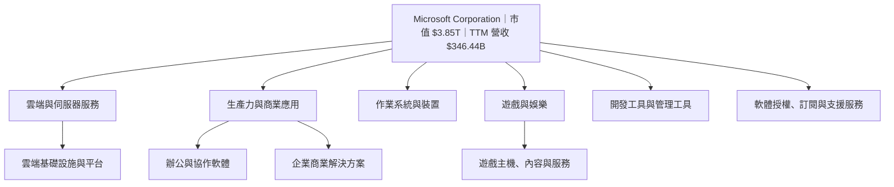
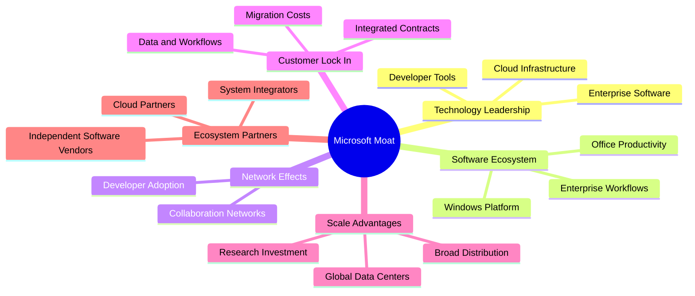
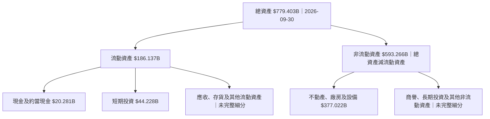
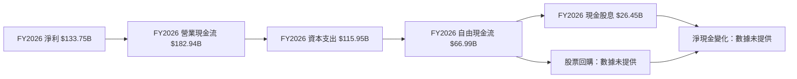
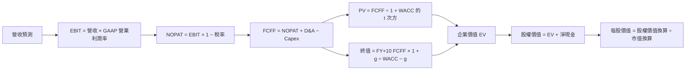
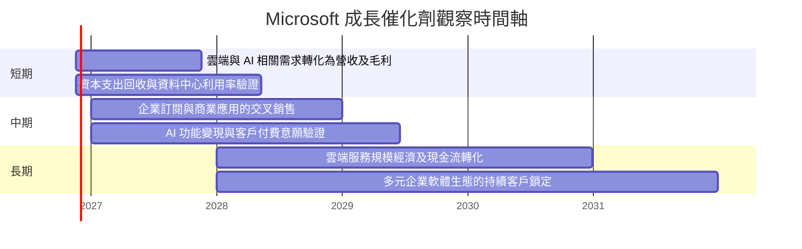
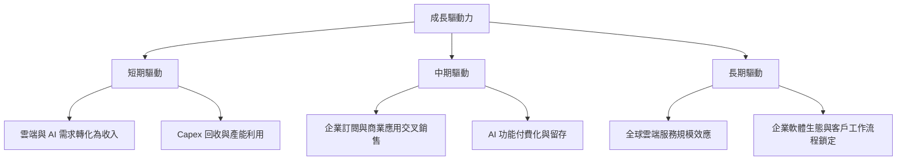
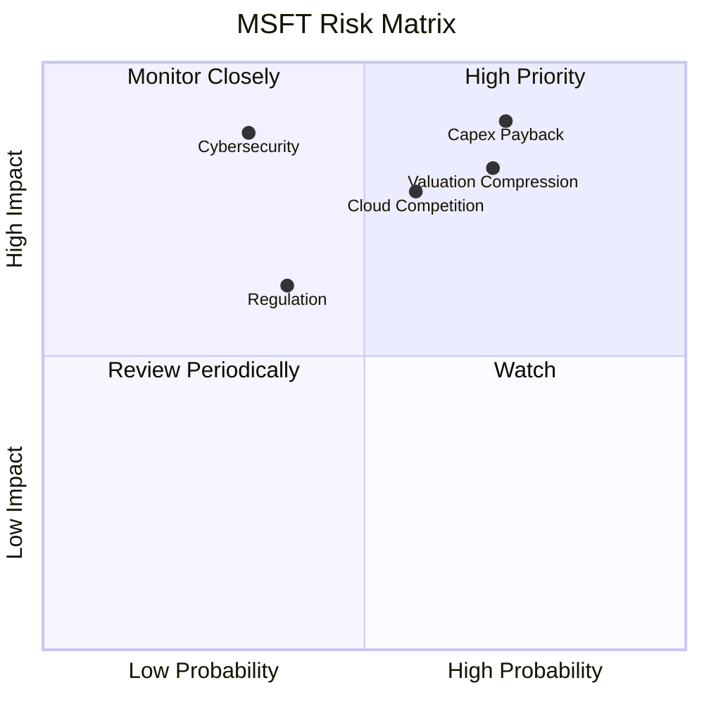
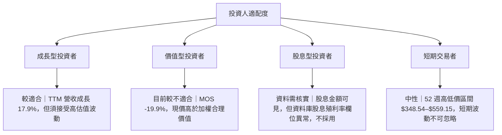

# MSFT 基本面深度分析報告
> **報告日期**：2026-11-17 ｜ **語言**：繁體中文 ｜ **數據來源**：SEC 申報資料 (XBRL)、Yahoo Finance、Finviz、StockAnalysis、Roic.ai ｜ **分析師**：CFA 級機構研究

## 目錄

| # | 章節 | 核心結論 |
|---|------|----------|
| 1 | 執行摘要 | MOS 為 -19.9%，規則 20 評級為減碼；加權合理價值 $431.90 |
| 2 | 公司概覽與商業模式 | 企業軟體、雲端與生產力服務形成多層護城河；分部營收比例未提供 |
| 3 | 損益表深度分析 | TTM 營收 $346.44B、年增 17.9%；最新一季年增 18.8% |
| 4 | 資產負債表分析 | 指定計算口徑下淨現金 $29.03B；現金轉換週期為 -67 天 |
| 5 | 現金流量深度分析 | TTM FCF $59.96B，但 FCF Yield 僅 1.56%，資本支出大幅增加 |
| 6 | 獲利能力與資本效率 | ROIC 29.7% 高於 WACC 10.24%，資本回報仍高於資金成本 |
| 7 | 相對估值分析 | 估值低於自身五年中位數，但高於同業多數倍數 |
| 8 | DCF 內在價值評估 | 基準 DCF $363.24；加權合理價值 $431.90，現價仍有折價風險 |
| 9 | 成長催化劑 | 雲端、AI 與訂閱服務是質化催化劑；TAM 數字未提供 |
| 10 | 風險矩陣 | 資本支出回收、雲端競爭與估值敏感度為主要風險 |
| 11 | 投資建議 | 依 MOS 評級為減碼；等待估值改善並監控 FCF 與雲端成長 |

---

## 1. 執行摘要

截至 2026-11-16 收盤價 **$517.99**，MSFT 的 TTM 營收為 **$346.44B**、TTM 營收成長率 **17.9%**、ROIC **29.7%**，明顯高於 **10.24% WACC**；但 TTM FCF 為 **$59.96B**、FCF Yield 僅 **1.56%**，且基準 DCF 每股價值 **$363.24**，低於現價 **29.9%**。四種估值方法加權後合理價值為 **$431.90**，MOS **-19.9%**，因此依規則 20 評級為 **減碼**，並非對公司競爭力的否定，而是反映現價對成長與未來現金流回收的要求偏高。

### 1.0 一頁式投資儀表板（Portfolio Manager 30 秒速讀）

| 項目 | 內容 |
|------|------|
| **投資論點（3 句）** | ① TTM 營收年增 **17.9%**、最新一季年增 **18.8%**，營收動能仍在。② ROIC **29.7%** 高於 WACC **10.24%**，目前仍創造正經濟利潤。③ TTM FCF **$59.96B**，但 Capex **$135.92B**、FCF Yield **1.56%**，新增算力投資回收是估值核心變數。 |
| **綜合評分** | **7.8/10**（引用 1.1；六項算術平均） |
| **財務健康** | 🟢 指定淨現金口徑為 **$29.03B**；惟資料來源的債務口徑有差異，詳見第 4 章。 |
| **ROIC vs WACC** | **29.7% vs 10.24%**；利差 **19.46 個百分點**，創造股東價值。 |
| **FCF 趨勢** | 近年 FCF 低於 FY2024 高點；TTM FCF **$59.96B**，FCF Yield **1.56%**。 |
| **估值** | Forward P/E **21.4x** ｜ EV/EBITDA **19.0x** ｜ FCF Yield **1.56%** |
| **DCF 內在價值（基準）** | **$363.24** ｜ 現價較 DCF 溢價 **42.6%**（折溢價以 DCF 為基準） |
| **安全邊際（MOS）** | **-19.9%**＝($431.90 − $517.99) ÷ $431.90，基準為 8.8 加權合理價值；🔴 無安全邊際 |
| **預期報酬（基準情境 12M）** | 加權合理價值相對現價的隱含上行空間 **-16.6%**；不是時間保證的 12 個月報酬預測。 |
| **關鍵風險（前二）** | AI／雲端投資的資本回收不及預期；Capex 高企使 FCF Yield 持續偏低。 |
| **評級 + 信心度** | 🟠 **減碼** ｜ 信心：中（DCF 與同業估值均低於現價；但長期成長與資本支出回收存有不確定性） |

### 1.1 綜合評分卡（全報告唯一）

| 維度 | 評分（1–10） | 主要依據（引用數字與其來源章節） |
|------|--------------|----------------------------------|
| 成長性 | 8.5 | TTM 營收年增 **17.9%**、最新一季年增 **18.8%**（第 3 章）；FY2026 年營收年增 **17.8%**。 |
| 獲利能力 | 9.0 | TTM 營業利益率 **47.1%**、ROIC **29.7%** 對 WACC **10.24%**；Piotroski **6/9**（第 6 章）。 |
| 財務健康 | 8.5 | 指定口徑淨現金 **$29.03B**；CCC **-67 天**，但流動比率高於一年前的測試未通過（第 4、6 章）。 |
| 估值 | 4.0 | MOS **-19.9%**；現價 TTM P/E **27.0x**，低於自身五年中位數 **31.5x**，但估值方法加權值仍低於現價（第 7、8 章）。 |
| 護城河 | 9.0 | TTM 營業利益率 **47.1%**、毛利率 **67.7%**、營收年增 **17.9%**，與企業軟體生態及雲端規模相互支持（第 2 章）。 |
| 管理層與資本配置 | 7.5 | FY2026 OCF **$182.94B**、Capex **$115.95B**、股息 **$26.45B**；FY2026 SBC **$12.40B**，且資本支出快速增加，回報週期需追蹤（第 5 章）。 |
| **綜合評分** | **7.8** | 六項算術平均：(8.5 + 9.0 + 8.5 + 4.0 + 9.0 + 7.5) ÷ 6 = **7.75，四捨五入為 7.8**。 |

### 1.2 五大投資論點 + 三大核心風險

| 類型 | 項目 | 具體依據 | 信心度 |
|------|------|----------|--------|
| 🟢 **投資論點①** | 營收動能具延續性 | TTM 營收 **$346.44B**、TTM 年增 **17.9%**；最新一季年增 **18.8%**。若雲端及訂閱業務延續此速度，固定成本可支撐營業槓桿。 | 🟢 高 |
| 🟢 **投資論點②** | 營業獲利能力高 | TTM 營業利益率 **47.1%**，最新一季 **49.8%**；高毛利軟體與服務收入有助吸收研發及基礎設施成本。 | 🟢 高 |
| 🟢 **投資論點③** | 資本回報高於資金成本 | ROIC **29.7%** 對 WACC **10.24%**，利差 **19.46 個百分點**；現階段投入資本仍有價值創造。 | 🟢 高 |
| 🟢 **投資論點④** | 資產負債表具彈性 | 指定口徑現金及短期投資 **$64.51B**、債務 **$35.48B**、淨現金 **$29.03B**。 | 🟢 中高 |
| 🟢 **投資論點⑤** | 現金轉換週期為負 | CCC **-67 天**，較一年前 **-59 天**更負；供應商付款時點長於應收回收及存貨週期，帶來營運資金優勢。 | 🟢 中 |
| 🟡 **風險①** | 資本支出侵蝕 FCF | TTM Capex **$135.92B**、OCF **$195.88B**，FCF **$59.96B**；若新增資產利用率不足，估值模型中 Capex 下降假設可能落空。 | 🔴 高衝擊 |
| 🔴 **風險②** | 價格隱含高成長 | 反推 DCF 顯示市場價格隱含第一年營收成長 **26.8%**，高於基準 **17.9%**；成長降速會放大估值下修。 | 🔴 高衝擊 |
| 🟡 **風險③** | FCF Yield 偏低 | TTM FCF Yield **1.56%**；相對現價，估值需要長期現金流與成長兌現支撐。 | 🟡 中高 |

### 1.3 快速統計卡片

| 指標 | 公司實際值（期間） | 同業中位數 | 狀態 |
|------|--------------------|------------|------|
| 營收成長（TTM） | **17.9%** | — | 🟢 |
| 營收成長（最新一季年增） | **18.8%** | **24.7%** | 🟡 |
| 毛利率（TTM） | **67.7%** | **60.9%** | 🟢 |
| 營業利益率（TTM） | **47.1%** | — | 🟢 |
| ROIC（TTM） | **29.7%** | — | 🟢 |
| Forward P/E | **21.4x** | **18.5x** | 🟡 |
| FCF Yield（TTM） | **1.56%** | — | 🔴 |
| Piotroski F-Score | **6 / 9** | — | 🟡 |

### 1.4 投資結論

```text
╔══════════════════════════════════════════════════════════════════╗
║                    📊 投資結論摘要                               ║
╠══════════════════════════════════════════════════════════════════╣
║  評級：減碼（MOS -19.9%，依規則 20）                             ║
║  價格（2026-11-16 收盤）：$517.99                                ║
║  DCF 內在價值（基準）：$363.24（現價溢價 42.6%）                 ║
║  安全邊際 MOS：-19.9%（=(加權合理價值−現價)÷加權合理價值）       ║
║  加權合理價值（8.8）：$431.90                                    ║
║  DCF 情境價值：                                                  ║
║    悲觀情境：$172.54（-66.7%）                                   ║
║    基準情境：$363.24（-29.9%）                                   ║
║    樂觀情境：$699.70（+35.1%）                                   ║
║  綜合評分：7.8/10（引用 1.1）                                    ║
║  適合投資人：看重高品質企業、可承受估值波動的長線投資人；         ║
║              不適合要求明確估值折價或高現金收益的投資人。         ║
╚══════════════════════════════════════════════════════════════════╝
```

---

## 2. 公司概覽與商業模式

### 2.1 業務結構與收入來源

公司業務涵蓋作業系統、伺服器與企業應用軟體、生產力工具、雲端服務、開發工具、遊戲及裝置。資料未提供最新期間各事業群的營收分部與占比，因此不臆測分部金額；以下圖示只呈現業務關係，不代表營收比例。



業務模型同時包含企業訂閱、軟體授權、雲端用量與消費性產品收入。訂閱及雲端服務可提高經常性收入比重；但資料沒有收入分部占比，無法量化各板塊對 TTM 成長的貢獻。

### 2.2 市場份額

市場份額數據未提供。可觀察的相對位置是：MSFT TTM 營收 **$346.44B**，高於同業表中各公司可見的營收成長與毛利率資料範圍；最新一季營收年增 **18.8%**，低於 GOOG 的 **24.7%**，但高於 AMZN 的 **12.1%**。這些數字反映成長比較，不能替代市場份額。

### 2.3 競爭護城河分析



### 2.4 護城河強度

| 護城河項目 | 強度（強／中／弱） | 證據（引用數字或事實） | 會削弱它的情況 |
|------------|--------------------|------------------------|----------------|
| 技術與研發 | 強 | FY2026 R&D **$35.56B**；TTM 營業利益率 **47.1%**，顯示研發投入仍能與高獲利並存。 | AI 或雲端技術快速商品化，研發支出未轉化為收入或留存。 |
| 軟體生態系統 | 強 | 涵蓋作業系統、辦公軟體、伺服器、企業應用及開發工具，企業工作流程轉換具成本。 | 開源、跨平台與低價替代品降低切換成本。 |
| 網路效應 | 中至強 | 協作軟體與開發工具的使用者、企業與夥伴互補；量化使用者數未提供。 | 使用者轉向互通標準或競品平台，網路密度下降。 |
| 客戶鎖定 | 強 | 企業軟體與雲端部署涉及資料、權限、工作流程及遷移成本；具體留存率未提供。 | 客戶多雲策略、議價集中或合約重談造成價格下滑。 |
| 規模效應 | 強 | FY2026 Capex **$115.95B**，TTM Capex **$135.92B**，顯示可承擔大型基礎設施投資。 | 資本支出回報低於資金成本，或資料中心供需失衡。 |
| 生態夥伴 | 中至強 | 公司產品覆蓋企業軟體、開發工具及雲端服務，合作夥伴網絡廣；合作夥伴數據未提供。 | 監管限制綁售、平台互通要求或夥伴轉投競爭者。 |

1.1「護城河」評分 **9.0/10**，依據是 **47.1% TTM 營業利益率、67.7% TTM 毛利率與 17.9% TTM 營收成長**，但因分部市占、留存與客戶集中度數據未提供，未將評估視為無條件確定。

---

## 3. 損益表深度分析

### 3.1 年度收入成長趨勢（近 4 年）

年度收入採公司財年，FY2023–FY2026。FY2022 數值僅用於計算四年 CAGR。

```text
╔══════════════════════════════════════════════════════════════════╗
║       Microsoft 年度收入趨勢（FY2023–FY2026，美元）              ║
╠══════════════════════════════════════════════════════════════════╣
║  FY2023  $211.91B  █████████████░░░░░░░░░░░  YoY: +6.88%  🟡   ║
║  FY2024  $245.12B  ███████████████░░░░░░░░░  YoY: +15.67% 🟢   ║
║  FY2025  $281.72B  █████████████████░░░░░░░  YoY: +14.93% 🟢   ║
║  FY2026  $331.84B  ████████████████████░░░░░  YoY: +17.79% 🟢   ║
╠══════════════════════════════════════════════════════════════════╣
║  FY2022–FY2026 四年收入 CAGR：((331.84 ÷ 198.27)^(1/4) − 1)     ║
║  = 約 13.7%                                                     ║
╚══════════════════════════════════════════════════════════════════╝
```

FY2026 收入年增 **17.79%**，較 FY2025 的 **14.93%** 加速。公司整體收入增速提升，與雲端運算、企業訂閱及 AI 相關服務需求相符；但現有資料沒有分部收入，不能將加速全部歸因於單一產品。

### 3.2 季度收入趨勢分析

| 季度 | 營收（$B） | QoQ 成長 | YoY 成長 | 備註 |
|------|-----------:|---------:|---------:|------|
| 2025-12-31 | 81.27 | N/A | 16.72% | QoQ 比較所需的前一季數據未列於季度表。 |
| 2026-03-31 | 82.89 | 2.0% | 18.30% | 依季度營收計算 QoQ。 |
| 2026-06-30 | 90.01 | 8.6% | 17.75% | 季末收入較前季明顯增加。 |
| 2026-09-30 | 92.28 | 2.5% | 18.80% | 最新一季年增率為單季 YoY，不是 TTM 成長率。 |

例如最新一季 QoQ = ($92.28B ÷ $90.01B) − 1 = **2.5%**；YoY **18.8%** 取單季同比數據。季度成長率有季節性與大型合約認列影響，不宜將單季 QoQ 直接年化。

### 3.3 利潤率演變分析

| 利潤率指標 | FY2023 | FY2024 | FY2025 | FY2026 | 趨勢 | 評估 |
|------------|-------:|-------:|-------:|-------:|------|------|
| **毛利率** | 68.9% | 69.8% | 68.8% | 67.9% | FY2024 見高後回落，可能反映雲端基礎設施與產品組合成本增加。 | 🟡 |
| **營業利益率** | 41.8% | 44.6% | 45.6% | 46.8% | 逐年提升，收入規模擴大與營運槓桿抵銷部分成本壓力。 | 🟢 |
| **淨利率** | 34.1% | 36.0% | 36.1% | 40.3% | FY2026 提升幅度較大；除營業獲利外，稅率與非營業項目亦可能影響，需留意一次性因素。 | 🟢 |

年度利潤率依年度營收、毛利、營業利益與淨利計算，四捨五入至一位小數。TTM 淨利率 **41.2%** 與年度 FY2026 的 **40.3%** 期間不同，不能混用。最新一季營業利益率依 SEC 10-Q 的口徑為 **49.8%**；季度營業利益 **$45.91B** 除以營收 **$92.28B** 約為 **49.8%**。此值高於 TTM **47.1%**，但單季可能受收入組合、費用時點與營運槓桿影響，需看後續季度是否延續。

### 3.4 費用結構分析

資料提供 R&D，但未提供完整 TTM 費用分項及期間一致的成本明細，故不畫費用圓餅圖，以免將不完整項目誤作完整費用結構。FY2026 R&D 為 **$35.56B**，較 FY2025 **$32.49B** 增加約 **9.4%**，低於同期收入年增 **17.8%**；若此趨勢持續，研發費用率下降有助營業槓桿，但投資效率仍需以產品收入與雲端回報驗證。

### 3.5 季度 EPS 趨勢與盈餘品質（Quality of Earnings）

| 季度 | EPS 實際值 | EPS YoY 成長 | 超預期／不及預期 |
|------|-----------:|-------------:|-------------------|
| 2025-12-31 | $5.16 | 59.75% | N/A：EPS 預期值缺漏，無法判定。 |
| 2026-03-31 | $4.27 | 23.41% | N/A：EPS 預期值缺漏，無法判定。 |
| 2026-06-30 | $4.81 | 31.74% | N/A：EPS 預期值缺漏，無法判定。 |
| 2026-09-30 | $4.92 | 32.26% | N/A：EPS 預期值缺漏，無法判定。 |

EPS 歷史資料表中四季預期值均為空值，因此不能將其標為超預期或不及預期。EPS 同比成長持續為正，但 2025-12 季度淨利含較高數值，季度基期及稅務／非營業因素可能影響同比幅度，不能僅以 EPS 成長推論核心營運改善。

| 盈餘品質項目 | 數值／佔比 | 評估 |
|--------------|------------|------|
| 股權薪酬 SBC / 營收 | FY2026 SBC **$12.40B ÷ $331.84B = 3.7%** | 🟡 SBC 是股東經濟成本；資料提供的 FY2026 稀釋股數測試通過，但仍須監控長期淨稀釋。此比例不是 TTM 比率。 |
| SBC / 營業現金流 | FY2026 **$12.40B ÷ $182.94B = 6.8%** | 🟡 SBC 相對 OCF 不高，但因其非現金性，不能因此忽略稀釋成本。 |
| FCF / 淨利（現金轉換率） | TTM **$59.96B ÷ $142.63B = 42.0%** | 🔴 低於常見的高現金轉換狀態，主要背景是資本支出高；不代表應計盈餘必然失真，但估值應重視投資現金流回報。 |
| 一次性／非經常性損益 | N/A（缺少足以分類的項目明細） | 無法確認是否存在重大一次性收益或費用；FY2025 至 FY2026 淨利成長較營收快，需查閱申報附註。 |
| 有效稅率異常 | DCF 採用有效稅率 **19.4%** | 單一有效稅率不構成異常證據；FY2026 淨利率上升可能包含稅務及非營業影響，資料不足以拆分。 |
| 資本化支出 vs 費用化 | TTM Capex **$135.92B**；資本化明細 N/A | 高資本支出透過折舊逐期認列，不能由現有資料量化資本化與費用化的差異。 |

**盈餘品質結論**：GAAP 營業利益已反映 SBC 費用，但 FCF 因資料中心投資而明顯低於淨利；以 TTM FCF **$59.96B** 對 TTM 淨利 **$142.63B** 的 **42.0%** 轉換率看，現階段現金獲利含金量低於帳面獲利所呈現的表象。估值不應只套用 EPS 倍數，應持續檢查 Capex 的收益轉化。

---

## 4. 資產負債表分析

### 4.1 資產結構分解

最新季度資產負債表總資產 **$779.403B**，流動資產 **$186.137B**，非流動資產按差額計算為 **$593.266B**。非流動細項不完整，故不再拆分比例。



流動資產及現金數字採 StockAnalysis 季末資料；現金及短期投資合計 **$64.509B**，與經驗證口徑的 **$64.51B** 一致。

### 4.2 流動性與營運資金分析

資料中的流動比率為 **1.225x**、速動比率 **1.068x**。FY2026 期末流動資產 **$207.71B**、流動負債 **$168.82B**；相較前期流動比率測試未通過，顯示短期流動性雖高於 1 倍，仍須注意資本支出與短期負債的同步變化。

| 指標 | 最新 TTM | 一年前 TTM | 變化 | 解讀 |
|------|----------|------------|------|------|
| DSO 應收帳款天數 | 65 天 | 66 天 | -1 天 | 回款時間略縮短，方向正面；變化幅度有限。 |
| DIO 存貨天數 | 6 天 | 4 天 | +2 天 | 存貨天數上升，但絕對天數仍低；需追蹤是否與硬體供應或產品組合有關。 |
| DPO 應付帳款天數 | 139 天 | 130 天 | +9 天 | 付款週期延長，有利營運資金，但若持續拉長可能反映供應商融資依賴增加。 |
| CCC 現金轉換週期 | -67 天 | -59 天 | -8 天 | 週期更負，收款與付款時點使公司在營運週期內取得資金；不宜簡單視為無成本融資。 |

### 4.3 債務結構分析

不同市場與財務資料來源的債務總額口徑不一致：經驗證的現金、短期投資及債務口徑為 **$64.51B、$35.48B**，但其他資料來源列出的總債務可達 **$133.93B**。以下以經驗證的同一口徑計算淨現金，不把不同口徑混合。

```text
╔══════════════════════════════════════════════════════════════════╗
║                  Microsoft 債務健康診斷                         ║
╠══════════════════════════════════════════════════════════════════╣
║  總債務（指定口徑）：   $35.48B                                  ║
║  現金及短期投資：       $64.51B                                  ║
║  淨現金：               $29.03B   🟢                             ║
║                                                                  ║
║  Debt/EBITDA：N/A（不同來源的債務口徑不一致，避免混算）           ║
║  Interest Coverage：N/A（利息費用及一致口徑 EBIT 未提供）        ║
║                                                                  ║
║  注意：市場資料另列總債務 $133.93B、淨債務 $69.42B；              ║
║        其債務範圍與上述口徑不同，不能直接互換。                   ║
╚══════════════════════════════════════════════════════════════════╝
```

### 4.4 股東權益趨勢

| 財年 | 股東權益（$B） | YoY 成長 |
|------|---------------:|---------:|
| FY2023 | 206.22 | — |
| FY2024 | 268.48 | 30.2% |
| FY2025 | 343.48 | 27.9% |
| FY2026 | 442.39 | 28.8% |

```text
╔══════════════════════════════════════════════════════════════════╗
║             股東權益趨勢（FY2023–FY2026，$B）                    ║
╠══════════════════════════════════════════════════════════════════╣
║  FY2023  $206.22B  █████████░░░░░░░░░░░░░░                     ║
║  FY2024  $268.48B  ████████████░░░░░░░░░░                       ║
║  FY2025  $343.48B  █████████████████░░░                         ║
║  FY2026  $442.39B  ██████████████████████                       ║
╚══════════════════════════════════════════════════════════════════╝
```

股東權益逐年增加，與累積獲利及資產擴張相符。FY2026 總資產 **$758.38B**，高於 FY2025 **$619.00B**；其中 PP&E 擴張顯示資本投入規模上升，未來回報將取決於新增資產的利用率。

---

## 5. 現金流量深度分析

### 5.1 現金流量瀑布圖

下圖以 FY2026 年度數據呈現已提供的現金流項目。回購與淨現金變化資料未提供，不以推算值補入。



FY2026 OCF 高於淨利，反映非現金費用與營運資金等因素；但扣除 **$115.95B** Capex 後，FCF 為 **$66.99B**。TTM FCF 進一步降至 **$59.96B**，因此現金流評估應看扣除投資後的現金，而非只看 OCF。

### 5.2 FCF 轉換率趨勢

| 財年 | FCF（$B） | 淨利（$B） | FCF / 淨利 |
|------|----------:|-----------:|-----------:|
| FY2023 | 59.48 | 72.36 | 82.2% |
| FY2024 | 74.07 | 88.14 | 84.0% |
| FY2025 | 71.61 | 101.83 | 70.3% |
| FY2026 | 66.99 | 133.75 | 50.1% |
| TTM 至 2026-09-30 | 59.96 | 142.63 | 42.0% |

FY2024 後現金轉換率下滑，主要同時受到 Capex 加速與淨利增長快於 FCF 影響。這不等同於營運現金流惡化：FY2026 OCF 為 **$182.94B**，高於 FY2025 **$136.16B**；核心壓力是資本支出由 FY2025 **$64.55B** 增至 FY2026 **$115.95B**。

### 5.3 自由現金流趨勢

```text
╔══════════════════════════════════════════════════════════════════╗
║                自由現金流趨勢（年度及 TTM）                      ║
╠══════════════════════════════════════════════════════════════════╣
║  FY2023  $59.48B  ████████████████░░░░  FCF Yield：N/A            ║
║  FY2024  $74.07B  ████████████████████  FCF Yield：N/A            ║
║  FY2025  $71.61B  ███████████████████░  FCF Yield：N/A            ║
║  FY2026  $66.99B  ██████████████████░░  FCF Yield：N/A            ║
║  TTM     $59.96B  ████████████████░░░░  FCF Yield：1.56%          ║
╠══════════════════════════════════════════════════════════════════╣
║  FY2024 至 FY2026 FCF 下降，與 Capex 增長相連；                   ║
║  資本投入能否轉化為未來 OCF，是投資論點的重要驗證點。             ║
╚══════════════════════════════════════════════════════════════════╝
```

歷史年度市值基準未提供，因此僅列 TTM FCF Yield **1.56%**，不補算年度殖利率。

### 5.4 資本配置評估

| FY2026 已提供項目 | 金額 | 對資本配置的含義 |
|------------------|-----:|------------------|
| 營業現金流 | $182.94B | 內部現金生成能力強，但包含營運資金與非現金費用影響。 |
| 資本支出 | $115.95B | 資本投入顯著增加，應以雲端產能利用、收入及現金回收驗證。 |
| 自由現金流 | $66.99B | OCF 扣除 Capex 後的餘額，低於 FY2024。 |
| 現金股息 | $26.45B | 約為 FY2026 FCF 的 39.5%；計算為 26.45 ÷ 66.99。 |
| 股票回購 | N/A | 回購金額未提供，不作資本配置比例圖。 |
| 留存現金／其他投資 | N/A | 缺少完整現金用途表，不能將差額反推為特定用途。 |

---

## 6. 獲利能力與資本效率

### 6.1 ROE / ROA / ROIC 趨勢

可比歷史期間的 ROE 與 ROA 未提供一致序列，僅列現有指標，不以自行推算的年度均值取代。不同來源的 ROE 亦有差異：品質指標提供 TTM **30.3%**，合併市場資料另列 **34.2%**；本報告杜邦分析採品質指標口徑 **30.3%**。

| 指標 | 最新可用值 | 歷史趨勢 | 評估 |
|------|----------:|----------|------|
| ROE（TTM，品質指標口徑） | 30.3% | 歷史一致口徑未提供 | 🟢 |
| ROA（TTM） | 14.4% | Piotroski 測試顯示高於一年前 | 🟢 |
| ROIC（TTM） | 29.7% | 一致歷史序列未提供 | 🟢 |
| WACC | 10.24% | 依 8.2 固定採用 | 基準折現率 |

### 6.2 ROIC vs WACC 分析（核心價值創造判斷）

成本資本資料提供的 WACC 為 **10.24%**；ROIC 為 **29.7%**。兩者利差 **19.46 個百分點**，代表按該口徑計算的投入資本回報高於資金成本。以下保留來源所列的 WACC 輸入，不以資料不足的利息費用或債務口徑另造 WACC。

```text
╔══════════════════════════════════════════════════════════════════╗
║                ROIC vs WACC 深度分析                            ║
╠══════════════════════════════════════════════════════════════════╣
║  WACC 輸入（成本資本資料）：                                     ║
║  ├── 無風險利率（10Y 美債）：       5.12%                       ║
║  ├── 股權風險溢酬 ERP：             5.00%                       ║
║  ├── 原始 Beta：                    1.04                        ║
║  ├── 調整後 Beta：                  1.03                        ║
║  ├── 股權成本：                     10.27%                      ║
║  ├── 稅前債務成本：                 8.60%                       ║
║  ├── 有效稅率：                     19.4%                       ║
║  ├── E / D 權重：                   99.1% / 0.9%                 ║
║  └── WACC：                         10.24%                      ║
║                                                                  ║
║  ROIC 與價值利差：                                                ║
║  ├── ROIC（TTM）：                  29.7%                       ║
║  ├── WACC：                         10.24%                      ║
║  ├── ROIC − WACC：                  19.46 個百分點              ║
║  └── ROIC / WACC：                  約 2.90 倍                   ║
║                                                                  ║
║  ROIC  29.7%  ▓▓▓▓▓▓▓▓▓▓▓▓▓▓▓▓▓▓▓▓▓▓▓▓▓▓▓░░░  🟢              ║
║  WACC  10.24% ▓▓▓▓▓▓▓▓▓▓░░░░░░░░░░░░░░░░░░░░░  ──              ║
╠══════════════════════════════════════════════════════════════════╣
║  結論：ROIC 高於 WACC，現有投入資本創造價值；未來需檢驗新增       ║
║        資料中心資本能否維持類似回報。                             ║
╚══════════════════════════════════════════════════════════════════╝
```

### 6.3 杜邦三因素分解

| 因素 | 數值（TTM） | 解讀 |
|------|-------------|------|
| 淨利率 | 41.2% | 高淨利率是 ROE 的主要推動來源之一。 |
| 資產週轉率 | 0.44 | 每單位資產創造收入的效率；大型基礎設施投資可能暫時壓低週轉率。 |
| 權益乘數 | 1.66 | 槓桿程度有限，ROE 並非主要靠高財務槓桿支撐。 |
| **ROE** | **30.3%** | 41.2% × 0.44 × 1.66 = **30.1%**；與程式提供的 **30.3%** 有約 0.2 個百分點的四捨五入差異，原值照列。 |

### 6.4 財務體質：Piotroski F-Score

Piotroski F-Score 為 **6 / 9**；九項測試均有結果。

| 測試 | 結果 | 解讀 |
|------|------|------|
| ROA > 0 | ✅ 通過 | 資產仍產生正報酬。 |
| 營業現金流 > 0 | ✅ 通過 | 營運現金流為正。 |
| ROA 高於一年前 | ✅ 通過 | 近年資產獲利改善。 |
| 營業現金流 > 淨利（應計品質） | ✅ 通過 | 現金流大於淨利，有助支持盈餘品質；但高 Capex 仍壓低 FCF。 |
| 長期負債 ÷ 總資產低於一年前 | ✅ 通過 | 負債相對資產的指標改善。 |
| 流動比率高於一年前 | ❌ 未通過 | 流動性比率未改善，需留意短期資產負債匹配。 |
| 稀釋股數未增加 | ✅ 通過 | 期間測試未顯示稀釋股數上升。 |
| 毛利率高於一年前 | ❌ 未通過 | 毛利率未同比改善，可能受資本密集型雲端組合影響。 |
| 資產週轉率高於一年前 | ❌ 未通過 | 資產增長可能快於收入，反映投資先行、變現滯後。 |

---

## 7. 相對估值分析

### 7.1 同業估值比較表格

Peer multiples 採 Yahoo Finance 資料。MSFT 本身的 Forward P/E 使用提供的市場估值資料；同業排序是相同期間倍數比較，不代表各公司的業務風險完全一致。

| 估值指標 | **MSFT** | **GOOG** | **AMZN** | **ORCL** | MSFT 評估 |
|----------|---------:|--------:|--------:|--------:|-----------|
| **Trailing P/E** | 27.0x | 14.7x | 20.8x | 18.7x | 🔴 高於三家同業；品質溢價需由持續成長支撐。 |
| **Forward P/E** | 21.4x | 18.5x | 23.6x | 10.8x | 🟡 高於同業中位數 **18.5x**；ORCL 遠期倍數顯著較低。 |
| **P/S Ratio** | 11.1x | 7.3x | 3.5x | 5.2x | 🔴 高於三家同業，市場給予較高收入倍數。 |
| **EV/EBITDA** | 19.0x | 18.1x | 16.2x | 14.4x | 🔴 高於同業中位數 **16.2x**。 |
| **最新一季營收成長** | 18.8% | 24.7% | 12.1% | 29.6% | 🟡 低於 GOOG、ORCL，高於 AMZN。 |
| **毛利率（TTM）** | 67.7% | 60.9% | 51.4% | 64.0% | 🟢 高於三家同業，反映高毛利軟體與服務組合。 |

同業成長率與估值倍數存在明顯差異，不能只用最低倍數判斷便宜。MSFT 的毛利率較高，但現價 Forward P/E **21.4x** 仍高於同業中位數 **18.5x**，估值隱含其毛利、成長與現金流品質持續優於一般同業。

### 7.2 歷史估值區間分析

```text
╔══════════════════════════════════════════════════════════════════╗
║           MSFT 五年估值區間（TTM 倍數，2026-11）                 ║
╠══════════════════════════════════════════════════════════════════╣
║  P/E        20.8x ──────────────● 27.0x────────────── 37.8x     ║
║             五年中位數 31.5x｜目前百分位 29%                      ║
║  P/S         8.4x ───────────● 11.1x─────────────── 13.7x       ║
║             五年中位數 12.0x｜目前百分位 43%                      ║
║  EV/EBITDA  14.5x ─────● 19.0x───────────────────── 31.4x      ║
║             五年中位數 24.3x｜目前百分位 14%                      ║
╚══════════════════════════════════════════════════════════════════╝
```

三項倍數目前均低於各自五年中位數，EV/EBITDA 百分位為 **14%**，代表相對自身歷史偏低；但低於自身歷史中位數不等同於絕對低估，因為當前 Capex、利率與現金流結構亦不同於過往。

### 7.3 情境價值（Bear / Base / Bull，照抄 DCF MODEL 的 Scenarios）

| 情境 | 第 1 年營收成長 | 期末營業利潤率 | WACC | 每股價值 | 相對現價 | 機率 | 會發生的條件 |
|------|----------------|----------------|------|----------|----------|------|--------------|
| 🔴 悲觀 | 9.0% | 38.8% | 11.24% | $172.54 | -66.7% | 25% | 雲端／AI 增速放緩、價格競爭擴大，且高資本支出壓縮營業利潤率。 |
| 🟡 基準 | 17.9% | 45.6% | 10.24% | $363.24 | -29.9% | 50% | TTM 成長初期延續，之後逐步降至 3.0%；長期利潤率由 47.1% 緩降至 45.6%。 |
| 🟢 樂觀 | 26.9% | 50.2% | 9.24% | $699.70 | +35.1% | 25% | AI 與雲端需求加速、定價與產品組合改善，並使長期營業利潤率高於基準。 |

以上三組情境價值及機率直接採用 DCF 模型輸出；各情境的中間年度現金流未提供，不另行重建。

### 7.4 相對估值隱含價格區間

```text
╔══════════════════════════════════════════════════════════════════╗
║              各估值方法每股價值與現價位置                       ║
╠══════════════════════════════════════════════════════════════════╣
║  DCF（基準）           $363.24                                   ║
║  同業 EV/EBITDA        $443.67                                   ║
║  同業 Forward P/E      $448.28                                   ║
║  分析師共識目標價      $636.12                                   ║
║                        │                                         ║
║  2026-11-16 現價       $517.99  ────────────────────●            ║
╚══════════════════════════════════════════════════════════════════╝
```

- **同業 Forward P/E：$448.28**，依 GOOG、AMZN、ORCL 同業中位數 **18.5x** 乘上 MSFT Forward EPS **$24.20**。
- **同業 EV/EBITDA：$443.67**，依同業中位數 **16.2x** 乘上 TTM EBITDA，再加回淨現金。
- **分析師共識目標價：$636.12**，為 54 位分析師平均目標價；此法權重僅 10%，不作為主要估值依據。

---

## 8. DCF 內在價值評估（Discounted Cash Flow）

### 8.0 估值推理鏈（Thinking Logic）

**Step 1 — 價值由哪些變數決定？**  
本模型以 TTM 營收 **$346.44B** 為起點，主要價值來自現有軟體與服務現金流、雲端及 AI 相關需求帶來的成長，以及終值階段的持續獲利；各業務收入占比沒有提供，不能把其拆成特定百分比。敏感度矩陣顯示 WACC 與終值成長率會顯著影響每股價值；實際營收成長和 Capex 由高投資轉向現金回收，則是現金流預測的主要營運變數。

**Step 2 — 模型選擇**

| 決策點 | 本報告採用 | 理由（含數字） | 曾考慮但否決 | 否決理由 |
|--------|-----------|----------------|--------------|----------|
| 現金流定義 | FCFF | 以 WACC **10.24%** 折現，先得 EV 再橋接至股權價值。 | FCFE | 不與本模型企業價值架構一致。 |
| 預測期 N | 10 年 | DCF 模型固定預測 FY+1 至 FY+10。 | 縮短或延長 | 區塊沒有替代預測期的可稽核模型輸出。 |
| 終值方法 | Gordon Growth | 使用終值成長率 **3.0%**，且 WACC **10.24% > 3.0%**。 | 退出倍數 | DCF 模型未提供終值退出倍數，不自建。 |
| EBIT 基礎 | GAAP EBIT | 模型以 GAAP 營業利益率為基礎。 | 非 GAAP EBIT | 會改變 SBC 的處理方式，與模型固定設定不相容。 |

**Step 3 — 關鍵假設推導鏈**

- **營收成長**：錨點＝TTM 營收成長 **17.9%**；模型採 FY+1 **17.9%**，其後線性降至 FY+10 **3.0%**。這假設近期增長可延續、但成熟期回歸較低增長。模型未提供管理層財測或替代 CAGR 序列，因此不能虛構被否決的精確數值。
- **期末營業利潤率**：錨點＝TTM **47.1%**；採用 47.1% 逐步淡化至 **45.6%**，依模型說明為近五個財年的中位數。這代表獲利能力大致維持，但不假設長期持續擴張。
- **永續成長率 g**：採用 **3.0%**，低於 WACC **10.24%**，模型得以使用 Gordon Growth。此值是模型假設，並非財務報表直接觀測值；更高 g 會抬升價值，矩陣已提供 2.0%–4.0% 的敏感度。
- **預測期 N**：採用 **10 年**，錨點是模型期間設定；這使終值佔 EV **66.6%**，代表長期假設仍具重要性。替代年數未提供完整 DCF 結果，不自行重算。
- **Capex／營收**：FY+1 **39.2%**，逐步降至 FY+10 **12.2%**。錨點是 TTM Capex 占比；模型假設資本支出率收斂至 D&A 的 1.1 倍。這是偏樂觀且高度重要的現金流改善假設，若算力投資長期維持高位，DCF 將下修。
- **EBIT 基礎、SBC 與股數**：採 GAAP EBIT；股權薪酬已作為費用反映在 GAAP 營業利益中。模型固定股數不再稀釋，採組合 **(A)**，因此 FCFF 不另扣 SBC，也不額外放大股數；SBC 影響在模型內計入一次。
- **有效稅率及 D&A**：稅率採 **19.4%**；D&A／營收採 TTM **11.1%** 並固定。兩者為模型輸入，細項計算資料未提供。
- **WACC**：直接採用 **10.24%**；各項輸入與調整見 8.2。不得另以其他債務範圍重算取代。
- **營運資金**：模型明確不建模營運資金變動，因此 FCFF 不列 ΔWC；這是模型限制，而不是 ΔWC 等於零的實證結論。

**Step 4 — 最脆弱環節**  
最脆弱的假設是 Capex／營收由 TTM 約 **39.2%** 逐步降至 FY+10 **12.2%**；若高資本支出具有結構性而未能下降，基準 DCF **$363.24** 可能高估價值。

**Step 5 — 計算路徑**



### 8.1 模型假設總表（Model Inputs）

| 假設項目 | 採用值 | 依據／來源 | 敏感度 |
|----------|--------|-------------|--------|
| 預測期長度 **N** | 10 年 | DCF 模型預測 FY+1 至 FY+10。 | 🟡 中 |
| 營收成長 | FY+1 17.9% → FY+10 3.0% | 起點為 TTM 營收成長 17.9%，逐年線性淡化。 | 🔴 高 |
| 營業利潤率 | FY+1 47.1% → FY+10 45.6% | TTM 47.1% 淡化至近五個財年的中位數。 | 🔴 高 |
| 有效稅率 | 19.4% | 最新年度有效稅率輸入。 | 🟢 低 |
| Capex／營收 | FY+1 39.2% → FY+10 12.2% | 由 TTM 比例淡化至 D&A 的 1.1 倍；模型假設。 | 🔴 高 |
| D&A／營收 | 11.1% | TTM 比例固定。 | 🟢 低 |
| 營運資金變動／營收增額 | 不建模 | DCF 模型明確未建模營運資金。 | 🟡 中 |
| EBIT 基礎 | GAAP | DCF 模型採用 GAAP EBIT。 | 🟡 中 |
| 股權薪酬 SBC 處理 | GAAP EBIT 已費用化，不再扣除 | 模型採組合 A。 | 🟡 中 |
| 年稀釋率 | 0%（模型固定股數） | 模型註明股數不再稀釋；與組合 A 一致。 | 🟡 中 |
| 永續成長率 g | 3.0% | DCF 模型輸入，低於 WACC 10.24%。 | 🔴 高 |
| 終值方法 | Gordon Growth | 模型終值採 Gordon Growth。 | 🔴 高 |
| WACC | 10.24% | 直接採成本資本區塊數值，見 8.2。 | 🔴 高 |

**FCFF 定義**：`FCFF = NOPAT + D&A − Capex`；本模型**不含**營運資金變動列。SBC 防呆聲明：**本模型採用 (A)，GAAP EBIT 已含 SBC 費用，所以 FCFF 不再減 SBC，股數也不再增加，SBC 影響已計入一次。**

### 8.2 折現率推導（WACC）

成本資本資料提供無風險利率 **5.12%**、ERP **5.00%**、Beta 原值 **1.04**，調整方式為 `2/3 × 1.04 + 1/3 × 1 = 1.0267`，採用調整後 Beta **1.03**。股權成本、稅前債務成本、資本權重與 WACC 直接引用該來源。10Y 美債的觀測日期未提供；ERP 為假設輸入，沒有另加規模或國別溢酬。

```text
╔══════════════════════════════════════════════════════════════════╗
║                    WACC 推導（折現率）                           ║
╠══════════════════════════════════════════════════════════════════╣
║  股權成本 Ke（CAPM）：                                           ║
║  ├── 無風險利率 Rf（10Y 美債）：      5.12%                     ║
║  ├── 市場風險溢酬 ERP：               5.00%                     ║
║  ├── 原始 Beta：                      1.04                      ║
║  ├── 調整後 Beta：                    1.03                      ║
║  ├── 規模／國別溢酬：                 0.00%（未另加）            ║
║  └── Ke = 5.12% + 1.03 × 5.00% = 10.27%                        ║
║                                                                  ║
║  債務成本 Kd：                                                   ║
║  ├── 稅前 Kd（來源提供）：             8.60%                     ║
║  ├── 有效稅率：                       19.4%                     ║
║  └── 稅後 Kd = 8.60% × (1 − 19.4%) = 6.93%                     ║
║                                                                  ║
║  資本結構（市值基礎權重）：                                      ║
║  ├── 股權權重 E：                     99.1%                     ║
║  ├── 債務權重 D：                     0.9%                      ║
║  └── WACC = 99.1%×10.27% + 0.9%×6.93% = 10.24%                 ║
╚══════════════════════════════════════════════════════════════════╝
```

逐步演算：

1. **Ke（CAPM）** = Rf + β × ERP = 5.12% + 1.03 × 5.00% = **10.27%**。
2. **稅前 Kd** = **8.60%**（成本資本來源提供；利息費用與平均計息負債金額未提供，因此無法獨立重建分子、分母）。
3. **稅後 Kd** = 8.60% × (1 − 19.4%) = 8.60% × 80.6% = **6.93%**。
4. **權重** = E **99.1%**；D **0.9%**；兩者合計 **100.0%**。市值金額可見資料為 **$3.85T**，但成本資本來源未提供未四捨五入市值與完整同範圍計息負債細項，故保留其原始權重，不以另一債務口徑反推替代。
5. **WACC** = 99.1% × 10.27% + 0.9% × 6.93% = 10.17757% + 0.06237% = **10.23994% ≈ 10.24%**。

WACC 與第 6.2 節一致。需要注意的是，稅前債務成本的底層平均負債及利息費用明細不可得；本報告依要求直接採用來源提供的 WACC 與組成，不另算另一個 WACC。

### 8.3 逐年自由現金流預測（基準情境）

金額單位為 **$B**；折現因子保留三位小數。下表逐年照錄 DCF 模型輸出，ΔWC 不建模，SBC 不重複扣除。

| 年度 | FY+1 | FY+2 | FY+3 | FY+4 | FY+5 | FY+6 | FY+7 | FY+8 | FY+9 | FY+10 |
|------|-----:|-----:|-----:|-----:|-----:|-----:|-----:|-----:|-----:|------:|
| 營收 | 408.51 | 474.92 | 544.25 | 614.69 | 684.06 | 749.93 | 809.71 | 860.83 | 900.92 | 927.95 |
| 營收 YoY | 17.9% | 16.3% | 14.6% | 12.9% | 11.3% | 9.6% | 8.0% | 6.3% | 4.7% | 3.0% |
| 營業利潤率 | 47.1% | 46.9% | 46.8% | 46.6% | 46.4% | 46.3% | 46.1% | 46.0% | 45.8% | 45.6% |
| 營業利益 EBIT（GAAP） | 192.42 | 222.92 | 254.57 | 286.51 | 317.72 | 347.07 | 373.41 | 395.56 | 412.50 | 423.35 |
| − 稅 | (37.32) | (43.24) | (49.38) | (55.57) | (61.63) | (67.32) | (72.43) | (76.72) | (80.01) | (82.11) |
| = NOPAT | 155.10 | 179.69 | 205.20 | 230.94 | 256.09 | 279.75 | 300.98 | 318.84 | 332.49 | 341.24 |
| + D&A | 45.16 | 52.50 | 60.17 | 67.96 | 75.62 | 82.91 | 89.51 | 95.17 | 99.60 | 102.59 |
| − Capex | (160.27) | (172.04) | (180.78) | (185.69) | (186.07) | (181.43) | (171.53) | (156.47) | (136.66) | (112.84) |
| **= FCFF** | **39.99** | **60.15** | **84.58** | **113.20** | **145.64** | **181.23** | **218.96** | **257.53** | **295.43** | **330.98** |
| 折現因子 @10.24% | 0.907 | 0.823 | 0.746 | 0.677 | 0.614 | 0.557 | 0.505 | 0.458 | 0.416 | 0.377 |
| **FCFF 現值 PV** | **36.28** | **49.49** | **63.13** | **76.65** | **89.45** | **100.97** | **110.66** | **118.06** | **122.85** | **124.85** |

預測期 FCF 現值合計：

`$36.28 + $49.49 + $63.13 + $76.65 + $89.45 + $100.97 + $110.66 + $118.06 + $122.85 + $124.85 = $892.39B`

**FY+1 逐步演算**（以下以模型已四捨五入值呈現；模型細部未四捨五入輸入未提供，因此部分乘法末位會有差異）：

1. **營收** = $346.44B × (1 + 17.9%) = **$408.51B**。
2. **EBIT** = $408.51B × 47.1% = **$192.42B**。
3. **稅** = $192.42B × 19.4% = **$37.32B**。
4. **NOPAT** = $192.42B − $37.32B = **$155.10B**。
5. **D&A** = 模型列示 **$45.16B**；D&A／營收採用 **11.1%**，但完整未四捨五入比例不可得。
6. **Capex** = 模型列示 **$160.27B**；Capex／營收採用 **39.2%**，模型底層精度不可得。
7. **ΔWC** = 不建模，模型 FCFF 定義不含營運資金變動。
8. **FCFF** = $155.10B + $45.16B − $160.27B = **$39.99B**。
9. **折現因子** = 1 ÷ (1 + 10.24%)^1 = **0.907**；PV = $39.99B × 0.907 ≈ **$36.28B**（差異受模型未四捨五入折現因子影響）。

**合理性自檢**：FY+1 至 FY+10 FCFF 由 **$39.99B** 增至 **$330.98B**，期間 CAGR 約 **26.5%**；FY2023–FY2026 歷史 FCF 由 **$59.48B** 至 **$66.99B**，三年 CAGR 約 **4.0%**，預測遠高於歷史，關鍵來自營收成長與 Capex／營收大幅下降。FY+10 FCF 利潤率為 **35.7%**（$330.98B ÷ $927.95B），高於目前 TTM FCF 利潤率約 **17.3%**（$59.96B ÷ $346.44B）；同業最佳數據未提供，不能宣稱超越產業最佳。預測期各年 FCFF 均為正。

```text
╔══════════════════════════════════════════════════════════════════╗
║            自由現金流：歷史實際 vs 模型預測                      ║
╠══════════════════════════════════════════════════════════════════╣
║  FY2024(實)  $74.07B   █████████░░░░░░░░░░░░  YoY: +24.5%       ║
║  FY2025(實)  $71.61B   █████████░░░░░░░░░░░░  YoY: -3.3%        ║
║  FY2026(實)  $66.99B   ████████░░░░░░░░░░░░░  YoY: -6.4%        ║
║  FY+1 (預)   $39.99B   █████░░░░░░░░░░░░░░░░  FCFF              ║
║  FY+10(預)   $330.98B  ████████████████████  FCFF              ║
╠══════════════════════════════════════════════════════════════════╣
║  ⚠️ 模型預測 FCFF CAGR 約 26.5%，遠高於 FY2023–FY2026 約 4.0%；  ║
║     Capex 率下降是預測差距的重要來源。                           ║
╚══════════════════════════════════════════════════════════════════╝
```

### 8.4 終值計算（Terminal Value）

適用性檢查：`WACC 10.24% vs g 3.0% → WACC > g？✅`

| 方法 | 計算式 | 終值 TV | TV 現值 | 佔總 EV 比重 |
|------|--------|--------:|--------:|-------------:|
| Gordon Growth | $330.98B × (1 + 3.0%) ÷ (10.24% − 3.0%) | $4,708.34B | $1,776.06B | 66.6% |
| 退出倍數法 | N/A（DCF 模型未提供 FY+10 EBITDA 退出倍數） | N/A | N/A | N/A |

逐步演算：

1. **FY+10 FCFF** = **$330.98B**。
2. **分子** = $330.98B × (1 + 3.0%) = **$340.9094B**。
3. **分母** = 10.24% − 3.0% = **7.24%**；TV = $340.9094B ÷ 7.24% = **$4,708.34B**。
4. **PV(TV)** = $4,708.34B × **0.377** = **$1,776.06B**（依模型未四捨五入因子計算）。
5. **終值佔比** = $1,776.06B ÷ $2,668.45B = **66.6%**。

終值低於 75% 警示門檻，但仍佔企業價值約三分之二，故估值對長期成長與折現率敏感。退出倍數法因模型未提供所需終值倍數，不另造交叉驗證值。

### 8.5 企業價值 → 每股內在價值（Bridge）

```text
╔══════════════════════════════════════════════════════════════════╗
║              企業價值 → 每股內在價值 橋接表                      ║
╠══════════════════════════════════════════════════════════════════╣
║  預測期 FCF 現值合計             +$892.39B                        ║
║  終值現值 PV(TV)                 +$1,776.06B                      ║
║  ─────────────────────────────────────────────                  ║
║  = 企業價值 EV                    $2,668.45B                      ║
║  + 淨現金（現金減債務）           +$29.03B                         ║
║  = 股權價值                       $2,697.47B                      ║
║  ÷ 模型市值／價格換算股數          模型換算                         ║
║  ★ 每股內在價值                   $363.24                          ║
║    2026-11-16 收盤價              $517.99                          ║
║    折溢價（現價÷DCF價值−1）        +42.6%（溢價）                  ║
╚══════════════════════════════════════════════════════════════════╝
```

逐步演算：

1. **EV** = $892.39B + $1,776.06B = **$2,668.45B**。
2. **股權價值** = 模型列示 EV **$2,668.45B** + 淨現金 **$29.03B** = **$2,697.47B**；未四捨五入底層數值未提供，因此依模型結果照錄。
3. **每股內在價值**：模型指定公式為「股權價值 × 價格 ÷ 市值」，其輸出為 **$363.24**；模型未提供未四捨五入市值及換算細節，故不以公開股數另行替換。
4. **折溢價** = $517.99 ÷ $363.24 − 1 = **+42.6%**。
5. **本節不計算 MOS**；安全邊際僅在 8.8 以加權合理價值為基準計算。

模型以股權價值及市場價格／市值換算每股價值，沒有提供單獨稀釋股數輸入。模型採組合 A，股數不再稀釋。淨現金採模型提供的 **$29.03B**，未與其他來源的不同債務口徑混用。

### 8.6 敏感性分析（WACC × 永續成長率）

下表格內直接列示 DCF 模型的每股價值。現價基準為 **$517.99**；本節不改動矩陣格值。

| g（列）／WACC（欄） | 8.24% | 9.24% | **10.24%（基準）** | 11.24% | 12.24% |
|-----------|------:|------:|------------------:|------:|------:|
| **2.0%** | $469.30 | $390.82 | $332.17 | $286.86 | $250.93 |
| **2.5%** | $499.80 | $411.44 | $346.70 | $297.44 | $258.84 |
| **3.0%（基準）** | $536.13 | $435.35 | **$363.24** | $309.30 | $267.59 |
| **3.5%** | $580.11 | $463.43 | $382.23 | $322.70 | $277.35 |
| **4.0%** | $634.47 | $496.87 | $404.26 | $337.94 | $288.30 |

**代表性非基準格重算資料限制**：模型提供完整敏感度矩陣，但沒有提供各 WACC 下逐年折現的未四捨五入 PV 與橋接明細。為遵守「DCF 唯一模型、不得另建模型」原則，不虛構中間算式；例如 WACC **9.24%**、g **3.0%** 的模型格值為 **$435.35**，可直接與模型矩陣核對。

**三情境 DCF（模型輸出）**

| 情境 | 營收成長假設 | 期末營業利潤率 | 永續成長 g | WACC | 每股內在價值 | 相對現價 | 主觀機率 |
|------|-------------:|---------------:|------------:|-----:|--------------:|---------:|----------:|
| 🔴 悲觀 | 年 1 成長 9.0% | 38.8% | N/A（未在情境摘要另列） | 11.24% | $172.54 | -66.7% | 25% |
| 🟡 基準 | 年 1 成長 17.9% | 45.6% | 3.0% | 10.24% | $363.24 | -29.9% | 50% |
| 🟢 樂觀 | 年 1 成長 26.9% | 50.2% | N/A（未在情境摘要另列） | 9.24% | $699.70 | +35.1% | 25% |
| **機率加權** | — | — | — | — | **$399.68** | **-22.8%** | **100%** |

模型未提供悲觀及樂觀情境的完整營收、FCFF、終值中間值，因此不虛構逐步推導鏈。加權算式為 `$172.54 × 25% + $363.24 × 50% + $699.70 × 25% = $399.68`（按模型輸出四捨五入）。

敏感度方向明確：在基準 WACC 下，g 由 **2.0%** 提升至 **3.0%**，每股價值由 **$332.17** 升至 **$363.24**；WACC 固定 10.24% 時，g 由 **3.0%** 提升至 **4.0%**，價值升至 **$404.26**。WACC 由 **9.24%** 升至 **10.24%**、g 固定 3.0%，價值由 **$435.35** 降至 **$363.24**。終值折現與長期成長共同主導估值，與 8.0 所述一致。期末利潤率每提高 1 個百分點的獨立價格彈性未提供，不能另行估算。

### 8.7 反推 DCF（Reverse DCF：市場在預期什麼）

反推 DCF 僅列模型提供的變數。市場價格為 **$517.99**，其他固定輸入依基準模型；未提供的反推情境不推算。

| 求解的變數（一次一個） | 其餘變數設定 | 市場隱含值（令 DCF = 現價） | 公司歷史實際 | 判斷 |
|------------------------|--------------|------------------------------:|--------------|------|
| 年 1 營收成長 | 其餘變數固定於基準 | **26.8%** | TTM 成長 **17.9%** | 🔴 市場要求較基準更高的短期成長 |
| 固定營業利潤率 | 其餘變數固定於基準 | **61.9%** | TTM 營業利益率 **47.1%** | 🔴 遠高於目前營業利潤率 |
| 永續成長率 g | N/A | 未計算 | — | 反推結果未提供 |
| 預測期 N | N/A | 未計算 | — | 反推結果未提供 |

模型提供的反推結果沒有逐點試算軌跡，故不能編造收斂表。反推顯示：若其他基準假設不變，現價需要年 1 營收成長提高至 **26.8%**，或固定營業利潤率提高至 **61.9%**，兩者均高於當前基準。市場估值對長期高成長與高利潤率有相當依賴；其中固定利潤率反推值高於現有 **47.1%**，是偏進取的市場預期訊號。

### 8.8 估值三角驗證與安全邊際

| 估值方法 | 隱含每股價值 | 上行空間（÷現價） | 權重 | 說明 |
|----------|--------------:|-------------------:|-----:|------|
| DCF（基準） | $363.24 | -29.9% | 40% | 10 年 FCFF、WACC 10.24%、終值成長 3.0%。 |
| 同業 Forward P/E | $448.28 | -13.5% | 25% | 同業中位數 18.5x × Forward EPS $24.20。 |
| 同業 EV/EBITDA | $443.67 | -14.3% | 25% | 同業中位數 16.2x × TTM EBITDA，再加回淨現金。 |
| 分析師共識目標價 | $636.12 | +22.8% | 10% | 54 位分析師平均目標價，作參考而非主要估值錨。 |
| **加權合理價值** | **$431.90** | **-16.6%** | **100%** | — |

逐步演算：  
`$363.24 × 40% + $448.28 × 25% + $443.67 × 25% + $636.12 × 10%`  
`= $145.296 + $112.070 + $110.9175 + $63.612 = $431.8955 ≈ $431.90`。  
方法權重依獲利型公司固定設定；各方法均有可用數值，沒有剔除方法。

```text
╔══════════════════════════════════════════════════════════════════╗
║                  估值區間與安全邊際                              ║
╠══════════════════════════════════════════════════════════════════╣
║  $172.54 ─── $363.24 ─── $431.90 ─── $517.99 ─── $699.70       ║
║  悲觀DCF      基準DCF    加權合理值      現價       樂觀DCF        ║
║                                                                  ║
║  安全邊際 MOS = ($431.90 − $517.99) ÷ $431.90 = -19.9%         ║
║  MOS 評估：🔴 <10% 無                                            ║
║  上行空間 = ($431.90 − $517.99) ÷ $517.99 = -16.6%             ║
║                                                                  ║
║  買入區間參考：$388.71 以下（加權合理價值的 90%，MOS 至少 10%）  ║
║  合理持有區間：$388.71–$431.90                                  ║
║  減碼考慮區間：高於 $431.90；目前 $517.99 已高於該值             ║
╚══════════════════════════════════════════════════════════════════╝
```

買入參考價 **$388.71** 由 `$431.90 × (1 − 10%) = $388.71` 推導，代表在合理價值不變時達到至少 10% MOS 的價格上限；這是估值門檻，不是保證價格或 DCF 情境目標。

> 🔎 **程式複算（Python，依本節各項自動重算）**
>
> 加權合理價值 = $363.24 × 40% + $448.28 × 25% + $443.67 × 25% + $636.12 × 10% = **$431.90**（權重合計 100%）
>
> 以價格 $517.99 計：MOS = **-19.9%**，上行空間 = **-16.6%**
>
> ✅ 與本節所寫數值一致。

### 8.9 DCF 模型的局限與失效條件

- **終值依賴度**：終值現值佔 EV **66.6%**，價值較多由 FY+10 以後的現金流假設決定。
- **最脆弱假設**：Capex／營收由 TTM **39.2%** 降至 FY+10 **12.2%**；若下降不成立，FCFF 低於模型路徑，內在價值向下。敏感性矩陣顯示基準 g 下，WACC **12.24%** 時每股值為 **$267.59**，但這不是 Capex 變化的單獨估值。
- **預測與歷史差異**：模型 FCFF 預測 CAGR 約 **26.5%**，高於 FY2023–FY2026 FCF CAGR 約 **4.0%**。這使模型適合呈現長期成長的價值，但不應視作低不確定性的精確目標價。
- **營運資金限制**：模型不納入 ΔWC；而 CCC 最新為 **-67 天**，營運資金實際變化可能影響 FCFF。
- **SBC／股數限制**：採 GAAP EBIT 與固定股數，與模型組合 A 一致；如果未來股數淨稀釋持續，固定股數假設將高估每股價值。
- **第 10 章風險連結**：算力投資回收偏慢會使 Capex 率下降不如預期；雲端競爭可能壓低營收成長或利潤率；利率上升則直接透過 WACC 壓低終值與現值。

### 8.10 複算檢核表（Audit Trail）

| # | 檢核項目 | 檢查方式 | 結果 |
|---|----------|----------|------|
| 1 | 所有 🔴 高／🟡 中敏感度輸入有四段式推導 | 8.0 已列主要假設錨點、採用值及替代資料限制 | ⚠️ 替代假設的完整模型結果未提供，未虛構。 |
| 2 | 每個假設都有來歷 | 8.1 列出來源或模型固定設定 | ✅ |
| 3 | WACC 五步算式齊全且相乘相加正確 | 權重 99.1% + 0.9% = 100%；加權計算約 10.24% | ⚠️ Kd 底層利息金額及平均負債未提供，採來源原值。 |
| 4 | Kd 分母與權重 D 範圍一致 | 來源提供權重與 Kd，但完整計息負債明細不足 | ⚠️ 不以不同債務口徑重算。 |
| 5 | WACC 與第 6.2 節同值 | 兩處均為 10.24% | ✅ |
| 6 | 逐年表格年度數等於 N，無省略符號 | FY+1 至 FY+10 共 10 年 | ✅ |
| 7 | FY+1 FCFF 與 PV 可複算 | FCFF = 155.10 + 45.16 − 160.27 = 39.99；未四捨五入折現因子未提供 | ⚠️ PV 以模型輸出為準。 |
| 8 | 預測期 PV 逐項相加 | 10 年 PV 加總為 $892.39B | ✅ |
| 9 | WACC > g | 10.24% > 3.0% | ✅ |
| 10 | 終值以 FY+10 FCFF 為基礎並折現 10 期 | 終值以 $330.98B、0.377 折現 | ✅ |
| 11 | EV 至每股橋接 | EV、淨現金、股權價值及每股價值依模型照列 | ⚠️ 每股換算用未提供的底層市值精度。 |
| 12 | SBC 組合相容 | GAAP EBIT、無額外 SBC 扣除、固定股數 | ✅ |
| 13 | 敏感度基準格 = 8.5 每股價值 | 10.24%／3.0% 格為 $363.24 | ✅ |
| 14 | 矩陣格均為 WACC > g | 最低 WACC 8.24% 仍高於最高 g 4.0% | ✅ |
| 15 | 三情境機率合計 100% | 25% + 50% + 25% = 100% | ✅ |
| 16 | 反推 DCF 每列一次一個變數 | 僅列模型提供的兩項反推結果 | ⚠️ 逐點疊代軌跡未提供。 |
| 17 | MOS 與折溢價分母一致 | MOS 以 $431.90；折溢價以 $363.24 DCF 值 | ✅ |
| 18 | 報告完整輸出至第 11 章 | 章節 1–11 均列出 | ✅ |
| 19 | 加權合理價值為價值乘權重之和 | 未四捨五入合計 $431.8955，顯示 $431.90 | ✅ |
| 20 | 評級符合 MOS 門檻 | MOS -19.9%，落在減碼區間 | ✅ |

---

## 9. 成長催化劑

### 9.1 催化劑時間軸

以下為質化時間軸，不代表財務數據中的具體業績指引。



短期重點不是單看營收增長，而是觀察大額 Capex 是否帶來相應 OCF 與 FCF；TTM Capex **$135.92B** 對應 FCF **$59.96B**，資本回收效率是投資人需要追蹤的核心。

### 9.2 TAM 市場規模分析

**N/A（TAM 數據未提供）**。可觀察的公司規模為 TTM 營收 **$346.44B**、成長率 **17.9%**，最新一季成長 **18.8%**；但缺乏可引用的 TAM、來源與年份，故不計算市場滲透率。

### 9.3 成長驅動力結構圖



---

## 10. 風險矩陣

### 10.1 風險評分矩陣

機率與衝擊坐標為定性分析位置，不代表財務模型中的精確機率；可量化財務數字仍以各風險條目所列已知數據為主。



### 10.2 風險清單詳細分析

| # | 風險項目 | 發生機率 | 財務衝擊 | 風險評分 | 緩解措施 |
|---|----------|----------|----------|----------|----------|
| 1 | 🔴 **Capex 回報不及預期** | 中高（定性） | 高；TTM Capex **$135.92B**，若投資回報不足，FCF **$59.96B** 難以支持估值 | 🔴 高 | 追蹤 Capex 同比、OCF、FCF 與雲端收入；若 Capex 持續增長但 FCF 長期下滑，重估終值與資本回報。 |
| 2 | 🔴 **雲端競爭及價格壓力** | 中（定性） | 高；基準模型長期營業利潤率仍為 **45.6%**，低於預期可能壓低現金流 | 🔴 高 | 監控雲端業務成長、毛利率、合約續約與客戶支出；分部數據目前未提供。 |
| 3 | 🔴 **估值倍數收縮** | 中高（定性） | 高；現價 **$517.99**，高於加權合理值 **$431.90**，MOS **-19.9%** | 🔴 高 | 設定估值紀律；按同業倍數、FCF Yield 及 WACC 更新估值，不因公司品質而忽略價格。 |
| 4 | 🟡 **監管及平台規範** | 中（定性） | 中至高；可能影響綁售、資料使用與產品整合，具體金額未提供 | 🟡 中 | 追蹤監管裁決、地區合規成本與產品拆分要求。 |
| 5 | 🟡 **網路安全與雲端服務中斷** | 低至中（定性） | 高；可能造成客戶流失、法律成本及聲譽損害，損失估值未提供 | 🟡 中高 | 追蹤重大事故、服務可用率、資安投資與事件披露。 |

---

## 11. 投資建議

### 11.1 最終評級與評分

依 **MOS -19.9%**，規則 20 評級為 **減碼**，未作質化上調或下調；因 MOS 落在 **-25% 至 -10%** 區間。1.1 綜合評分為 **7.8/10**，六項分數依序為成長性 **8.5**、獲利能力 **9.0**、財務健康 **8.5**、估值 **4.0**、護城河 **9.0**、管理層與資本配置 **7.5**；公司品質高，但估值項目拉低整體吸引力。

### 11.2 合理價值與隱含報酬率

| 估值項目 | 每股價值 | 相對現價 | 機率／權重 |
|----------|---------:|---------:|-----------:|
| 加權合理價值 | $431.90 | -16.6% | 估值方法加權 100% |
| 悲觀 DCF | $172.54 | -66.7% | 25% |
| 基準 DCF | $363.24 | -29.9% | 50% |
| 樂觀 DCF | $699.70 | +35.1% | 25% |
| DCF 情境機率加權值（參考） | $399.68 | -22.8% | 100% |

加權合理價值採 8.8 的固定估值方法及權重；三情境值依 DCF 模型原輸出，不把機率加權情境值替代為 8.8 的加權合理價值。

### 11.3 買入時機與觸發因素

```text
╔══════════════════════════════════════════════════════════════════╗
║                  ✅ 買入觸發因素 Checklist                      ║
╠══════════════════════════════════════════════════════════════════╣
║  目前估值判斷：現價 $517.99，高於加權合理價值 $431.90。          ║
║                                                                  ║
║  重新評估買入條件（需多數符合）：                                ║
║  ☐ 股價回到約 $388.71 以下，對應合理價值至少 10% MOS。           ║
║  ☐ TTM FCF 在 Capex 增加下仍轉為連續成長。                       ║
║  ☐ 最新一季營收年增維持在 17.9% TTM 成長附近或以上。             ║
║  ☐ TTM 營業利益率維持約 47.1%，沒有連續收縮。                    ║
║                                                                  ║
║  加碼觸發條件（出現以下任一且估值未明顯擴張）：                  ║
║  ☐ Capex／營收下降同時，OCF 與 FCF 同步改善。                    ║
║  ☐ ROIC 維持高於 10.24% WACC，且新增投資有現金流證據。           ║
║                                                                  ║
║  減碼／重新檢視條件：                                            ║
║  ☐ FCF 轉負或營業利益率持續低於現有 TTM 47.1%。                  ║
║  ☐ Capex 維持高位而現金流未增長，投資回收假設下修。              ║
║  ☐ 雲端及企業軟體成長明顯低於 TTM 17.9%，且估值仍高於合理值。    ║
╚══════════════════════════════════════════════════════════════════╝
```

### 11.4 投資人適配度分析



### 11.5 每季財報監控清單（Quarterly Watch List）

| 指標 | 最新基準 | 加碼觀察門檻 | 減碼／重估門檻 |
|------|----------|--------------|----------------|
| 營收成長 | TTM **17.9%**；最新一季 YoY **18.8%** | 單季 YoY 大致維持在 17.9% 附近或以上 | 連續兩季顯著低於 17.9%，需檢討成長預期 |
| 營業利益率 | TTM **47.1%**；最新一季 **49.8%** | TTM 穩定或改善，並確認非單季費用時點效應 | TTM 持續低於 47.1% 或連續收縮 |
| 資本支出 | TTM **$135.92B**；FY2026 **$115.95B** | Capex 增速放緩且 OCF／FCF 加速 | Capex 維持高位、但 OCF 及 FCF 停滯或下滑 |
| FCF | TTM **$59.96B** | TTM FCF 回升並改善 FCF Yield **1.56%** | FCF 轉負或現金轉換率進一步下降 |
| 毛利率 | TTM **67.7%** | 維持或提升，顯示產品組合及定價可控 | 連續下滑，且伴隨營業利益率收縮 |
| SBC | FY2026 **$12.40B**，佔營收 **3.7%** | SBC 占比穩定或下降，稀釋股數未增加 | SBC 增速持續高於營收，或稀釋股數反轉上升 |
| 應收與營運資金 | DSO **65 天**、CCC **-67 天** | DSO 不惡化、CCC 維持負值 | DSO 明顯上升、CCC 快速轉正 |
| 雲端／AI 變現 | 分部數據未提供 | 後續揭露的分部成長與現金流同步改善 | 成長放緩而 Capex 仍上升 |
| 公司指引 | 本資料未提供管理層財測 | 指引支持目前 17.9% TTM 成長假設 | 指引下修且競爭或成本因素同步惡化 |

### 11.6 反面論證：什麼會證明論點錯誤（What Would Change My Mind）

```text
╔══════════════════════════════════════════════════════════════════╗
║              ⚠️ 論點失效條件（Disconfirming Evidence）           ║
╠══════════════════════════════════════════════════════════════════╣
║  ☐ 最新一季營收 YoY 連續兩季低於 17.9% TTM 成長基準。            ║
║  ☐ TTM 營業利益率較目前 47.1% 收縮 2 個百分點以上，且未回升。   ║
║  ☐ FCF 轉負，或 TTM FCF／淨利低於目前約 42.0%。                 ║
║  ☐ ROIC 跌破 WACC 10.24%，表示新增資本開始侵蝕價值。            ║
║  ☐ Capex／營收無法由模型起始約 39.2% 逐步下降，                 ║
║     且新增投資未帶來 OCF 或收入的相應增長。                      ║
║  ☐ 稀釋股數開始持續增加，使 GAAP SBC 費用與固定股數假設不相容。 ║
║  ☐ 雲端競爭使毛利率與營業利益率同時下降，且公司指引下修。       ║
╚══════════════════════════════════════════════════════════════════╝
```

> **免責聲明**：本報告為 AI 自動生成，僅供研究參考，不構成投資建議。投資有風險，入市需謹慎。

---

## 資料與來源

| 項目 | 內容 |
|------|------|
| 價格 | 517.99 USD，2026-11-16 收盤（Yahoo Finance 即時報價（該交易日已收盤）） |
| 財務報表 | SEC 10-Q filed 2026-10-28，最新季度 2026-09-30（FY2027 Q1） |
| 有回應的資料來源 | SEC 申報資料 (XBRL)、Yahoo Finance、Finviz、StockAnalysis、Roic.ai |
| 由程式計算 | TTM 數字、WACC、DCF 模型、估值方法與權重、加權合理價值、MOS、評級門檻、F-Score、杜邦分解、營運資金天數、綜合評分 |
| 撰寫模型 | openai / gpt-6-luna |

> 本區塊由產生報告的程式依實際取得的資料填寫，非模型撰寫。「由程式計算」的數字不是模型的估計；其餘判斷（評分、情境、策略）是模型的分析。
