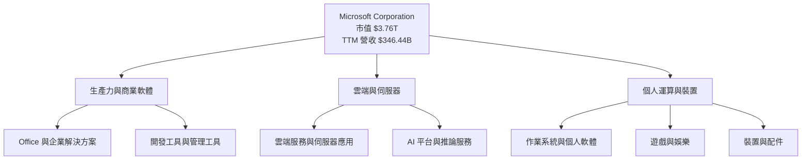
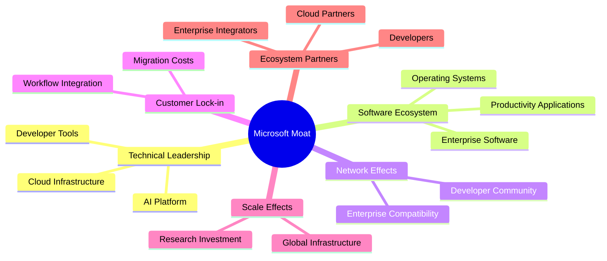
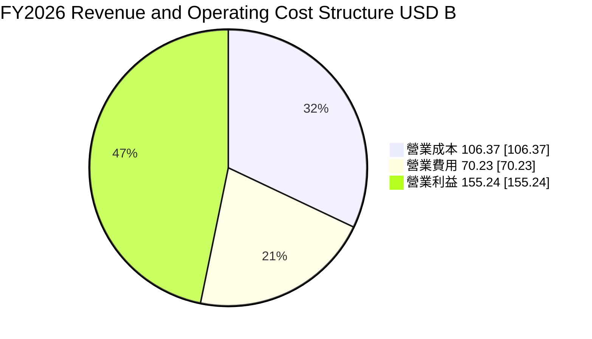
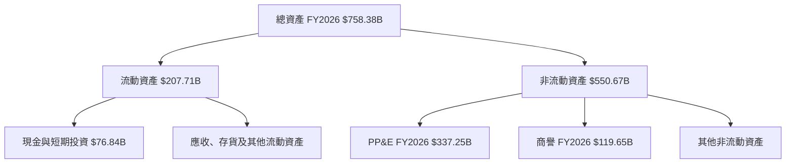
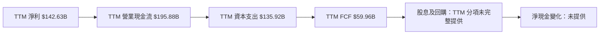
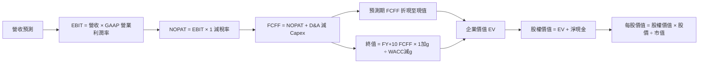
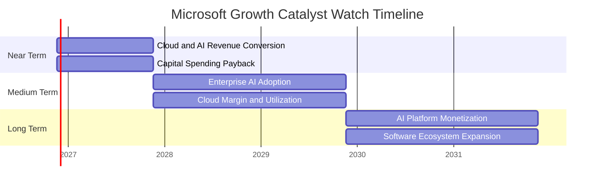
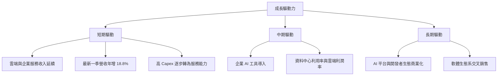
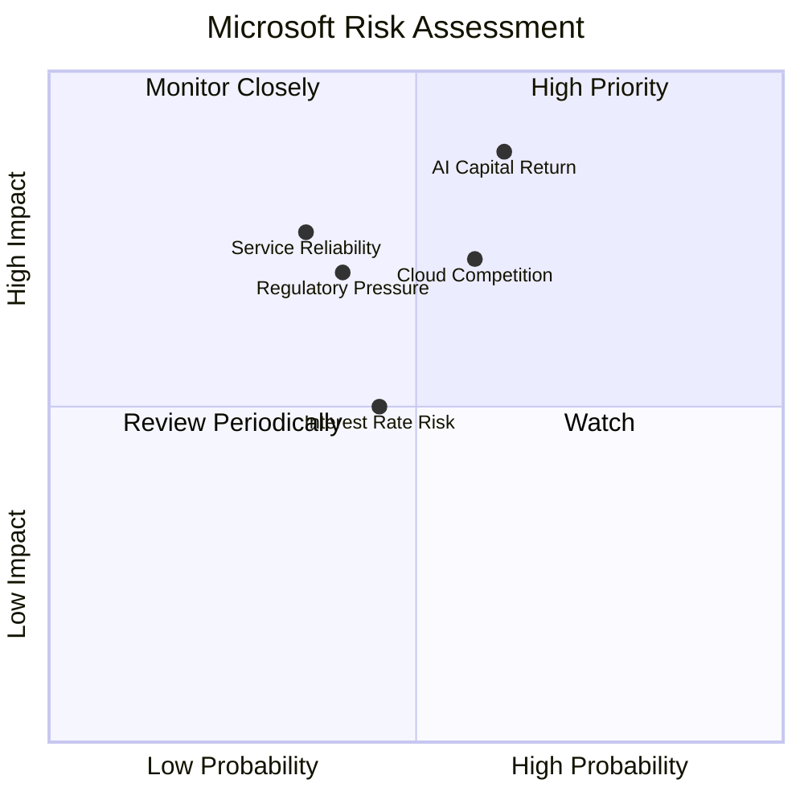
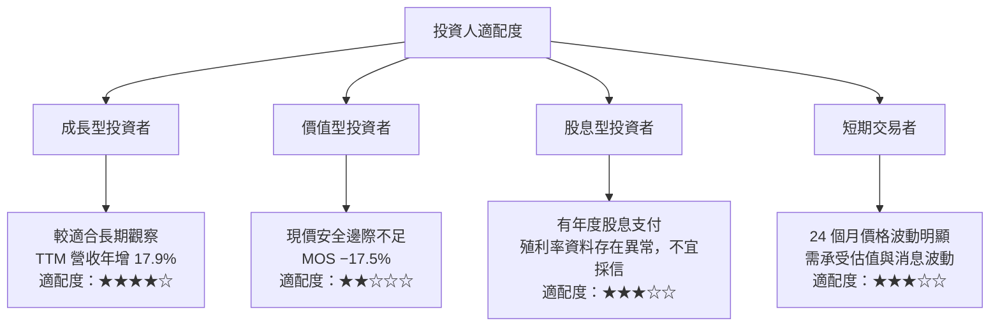

# MSFT 基本面深度分析報告
> **報告日期**：2026-11-18 ｜ **語言**：繁體中文 ｜ **數據來源**：SEC 申報資料 (XBRL)、Yahoo Finance、Finviz、StockAnalysis、Roic.ai ｜ **分析師**：CFA 級機構研究

## 目錄

| # | 章節 | 核心結論 |
|---|------|----------|
| 1 | 執行摘要 | 減碼；加權合理價值 $430.96，MOS −17.5% |
| 2 | 公司概覽與商業模式 | 軟體、雲端與企業生態系形成多層護城河；分部營收占比未提供 |
| 3 | 損益表深度分析 | TTM 營收 $346.44B，TTM 年增 17.9%；營業利益率 47.1% |
| 4 | 資產負債表分析 | 淨現金 $29.03B；CCC −67 天，但流動比率較一年前走弱 |
| 5 | 現金流量深度分析 | TTM FCF $59.96B，FCF Yield 1.59%；資本支出大幅擴張壓低現金轉換 |
| 6 | 獲利能力與資本效率 | ROIC 29.7% 高於 WACC 10.22%，仍有正經濟利潤 |
| 7 | 相對估值分析 | 自身 P/E 低於五年中位數；相對同業仍有估值溢價 |
| 8 | DCF 內在價值評估 | 基準 DCF 每股 $364.39；加權合理價值 $430.96 |
| 9 | 成長催化劑 | 雲端、AI 與企業軟體為主要增長線；TAM 數字未提供 |
| 10 | 風險矩陣 | AI 投資回報、雲端競爭及監管／服務可靠性是主要風險 |
| 11 | 投資建議 | 依 MOS 評級為減碼；等待價格回落或現金流改善再評估 |

## 1. 執行摘要

### 1.0 一頁式投資儀表板（Portfolio Manager 30 秒速讀）

| 項目 | 內容 |
|------|------|
| **投資論點（3 句）** | ① TTM 營收 $346.44B、年增 17.9%，且最新一季年增 18.8%，顯示需求仍在擴張。② TTM 營業利益率 47.1%、ROIC 29.7% 對比 WACC 10.22%，核心業務仍創造經濟價值。③ 但 TTM FCF 僅 $59.96B、FCF Yield 1.59%；加權合理價值 $430.96 低於 2026-11-17 收盤價 $506.24，估值安全墊不足。 |
| **綜合評分** | **7.9/10**（引用 1.1 六項算術平均） |
| **財務健康** | 🟢 淨現金 $29.03B；流動比率 1.225，但流動比率較一年前下降，且資本支出上升使 FCF 低於淨利 |
| **ROIC vs WACC** | **29.7% vs 10.22%**；ROIC 高出 19.48 個百分點，創造股東價值 |
| **FCF 趨勢** | FY2023–FY2026 年度 FCF 先升後降，最近 FY2026 為 $66.99B；TTM FCF $59.96B，FCF Yield **1.59%** |
| **估值** | Forward P/E **20.9x** ｜ EV/EBITDA **18.6x** ｜ FCF Yield **1.59%** |
| **DCF 內在價值（基準）** | **$364.39** ｜ 現價相對 DCF 溢價 **38.9%**（折溢價以現價 ÷ DCF 價值 − 1 計） |
| **安全邊際（MOS）** | **−17.5%**＝($430.96 加權合理價值 − $506.24 現價) ÷ $430.96｜🔴 <10%：無正安全邊際 |
| **預期報酬（基準情境 12M）** | DCF 基準情境相對現價 **−28.0%**；加權合理價值隱含上行空間 **−14.9%** |
| **關鍵風險（前二）** | AI／資料中心資本支出無法轉成足夠現金回報；雲端競爭與監管／服務中斷影響增長、利潤率 |
| **評級 + 信心度** | **🟠 減碼** ｜ 信心：中（估值結論明確；DCF 對終值與投資回報假設敏感） |

### 1.1 綜合評分卡（全報告唯一）

| 維度 | 評分（1–10） | 主要依據（引用數字與其來源章節） |
|------|--------------|----------------------------------|
| 成長性 | 8.5 | TTM 營收年增 17.9%、最新一季年增 18.8%（第 3 章）；最新一季收入 $92.28B |
| 獲利能力 | 9.5 | TTM 營業利益率 47.1%、ROIC 29.7% 高於 WACC 10.22%，F-Score 6/9（第 6 章） |
| 財務健康 | 8.5 | 淨現金 $29.03B；CCC −67 天，但流動比率 1.225 且 F-Score 流動比率測試未通過（第 4、6 章） |
| 估值 | 4.0 | MOS −17.5%；Forward P/E 20.9x 高於同業中位數 18.3x，但自身 P/E 低於五年中位數（第 7、8 章） |
| 護城河 | 9.5 | 多產品企業軟體與雲端生態、TTM 營業利益率 47.1%、營收年增 17.9%（第 2 章） |
| 管理層與資本配置 | 7.5 | FY2026 SBC $12.40B、股數測試未顯示增加；但 FY2026 Capex $115.95B、年度 FCF 降至 $66.99B（第 3、5 章） |
| **綜合評分** | **7.9** | 六項算術平均：(8.5 + 9.5 + 8.5 + 4.0 + 9.5 + 7.5) ÷ 6 = **7.9** |

### 1.2 五大投資論點 + 三大核心風險

| 類型 | 項目 | 具體依據 | 信心度 |
|------|------|----------|--------|
| 🟢 **投資論點①** | 雲端與企業軟體需求延續 | TTM 營收 $346.44B、年增 17.9%；最新一季年增 18.8%，最新一季營收 $92.28B | 🟢 高 |
| 🟢 **投資論點②** | 高利潤率與營業槓桿 | TTM 營業利益率 47.1%，最新一季營業利益率 49.8%；最新一季營業利益年增約 21%（45.915B 對 37.961B） | 🟢 高 |
| 🟢 **投資論點③** | 資本回報高於資本成本 | ROIC 29.7% 對 WACC 10.22%，利差 19.48 個百分點 | 🟢 高 |
| 🟢 **投資論點④** | 現金與營運資金結構有韌性 | 淨現金 $29.03B；CCC −67 天，應付帳款週期長於應收與庫存週期 | 🟢 中高 |
| 🟢 **投資論點⑤** | 估值低於自身五年中位數 | P/E 26.4x 對五年中位數 31.5x；EV/EBITDA 18.6x 對中位數 24.3x | 🟢 中 |
| 🟡 **風險①** | 高資本支出令 FCF 轉換承壓 | TTM Capex $135.92B、FCF $59.96B；FCF／TTM 淨利約 42.0% | 🔴 高衝擊 |
| 🔴 **風險②** | 現價高於估值三角驗證結果 | 現價 $506.24 高於加權合理價值 $430.96；MOS −17.5%，基準 DCF $364.39 | 🔴 高 |
| 🟡 **風險③** | 雲端競爭與服務可靠性 | Google、Amazon、Oracle 最新季度營收年增分別為 24.7%、12.1%、29.6%；近期新聞亦提及服務中斷 | 🟡 中 |

### 1.3 快速統計卡片

| 指標 | 公司實際值（期間） | 同業中位數 | 狀態 |
|------|--------------------|------------|------|
| 營收成長（TTM） | **17.9%** | — | 🟢 |
| 營收成長（最新一季年增） | **18.8%** | **24.7%** | 🟡 |
| 毛利率（TTM） | **67.7%** | **60.9%** | 🟢 |
| 營業利益率（TTM） | **47.1%** | — | 🟢 |
| ROIC（TTM） | **29.7%** | — | 🟢 |
| Forward P/E | **20.9x** | **18.3x** | 🟡 |
| FCF Yield（TTM） | **1.59%** | — | 🔴 |
| Piotroski F-Score | **6 / 9** | — | 🟡 |

同業中位數採 GOOG、AMZN、ORCL 三家公司之 Peer multiples；未提供的同業指標不作推算。

### 1.4 投資結論

╔══════════════════════════════════════════════════════════════════╗  
║                    📊 投資結論摘要                               ║  
╠══════════════════════════════════════════════════════════════════╣  
║ 評級：🟠 減碼（MOS −17.5%，依規則 20）                           ║  
║ 價格（2026-11-17 收盤）：$506.24                                 ║  
║ DCF 內在價值（基準）：$364.39（現價溢價 38.9%）                  ║  
║ 安全邊際 MOS：−17.5%＝($430.96−$506.24)÷$430.96                  ║  
║ 加權合理價值（8.8）：$430.96                                     ║  
║ DCF 情境價值：                                                    ║  
║   悲觀情境：$173.03（相對現價 −65.8%）                           ║  
║   基準情境：$364.39（相對現價 −28.0%）                           ║  
║   樂觀情境：$702.23（相對現價 +38.7%）                           ║  
║ 綜合評分：7.9/10（引用 1.1）                                     ║  
║ 適合投資人：可接受高估值與 AI 投資週期波動的長期成長型投資人     ║  
╚══════════════════════════════════════════════════════════════════╝

依 MOS 門檻應為「減碼」，未作質化調整。雖然公司營收與 ROIC 數據支持業務品質，估值方法加權後仍低於現價，且 FCF Yield 僅 1.59%。

## 2. 公司概覽與商業模式

### 2.1 業務結構與收入來源

公司資料顯示 Microsoft 跨足企業與個人軟體、伺服器應用、開發工具、雲端服務、商業解決方案、遊戲與裝置。資料未提供最新分部營收及各分部占比，因此不以推估百分比繪製收入比例圖。

以上是產品與服務關係圖，不代表各分部收入比例。FY2026 營收為 $331.84B，TTM 營收升至 $346.44B；分部增長貢獻因未提供分部數據，無法量化拆解。

### 2.2 市場份額

市場份額數據未提供，亦無法從公司營收直接推算市場占比。以規模及成長作相對判讀，MSFT TTM 營收為 $346.44B、年增 17.9%；同業最新一季營收年增率分別為 GOOG 24.7%、AMZN 12.1%、ORCL 29.6%。由於各公司業務組合不同，這些成長率不等同於同一市場份額變化。

### 2.3 競爭護城河分析

### 2.4 護城河強度

| 護城河項目 | 強度（強／中／弱） | 證據（引用數字或事實） | 會削弱它的情況 |
|------------|--------------------|------------------------|----------------|
| 技術與研發 | 強 | FY2026 研發費用 $35.56B；雲端、AI、伺服器及開發工具覆蓋多種企業需求 | AI 模型或雲端服務性能、成本落後競爭者 |
| 軟體生態系統 | 強 | 產品涵蓋作業系統、商業軟體、開發工具、管理工具和雲端服務 | 開放標準或替代平台降低跨產品綁定價值 |
| 網路效應 | 中至強 | 開發者、企業客戶與合作夥伴共同擴充產品價值；具體網路效應數值未提供 | 開發者及企業工作流程轉向其他生態系 |
| 客戶鎖定 | 強 | 企業軟體整合與遷移成本高；CCC 為 −67 天，體現一定議價與供應鏈地位 | 客戶多雲化、降低單一供應商依賴，或合約續約價格下降 |
| 規模效應 | 強 | TTM 營收 $346.44B，TTM 營業利益率 47.1% | 資料中心投資回報低於折舊及資本成本 |
| 生態夥伴 | 中至強 | 雲端、開發工具、企業整合與 AI 服務依賴多方合作 | 夥伴自建平台、監管限制或渠道利益衝突 |

1.1「護城河」評為 9.5/10，依據是跨產品企業生態、FY2026 研發支出 $35.56B 及 TTM 營業利益率 47.1%；但生態系分部收入與客戶留存資料未提供，因此不是滿分。

## 3. 損益表深度分析

### 3.1 年度收入成長趨勢（近 4 年）

╔══════════════════════════════════════════════════════════════════╗  
║              Microsoft 年度收入趨勢（FY2023–FY2026）             ║  
╠══════════════════════════════════════════════════════════════════╣  
║ FY2023  $211.91B  █████████████░░░░░░░░░░░  YoY +6.88% 🟡       ║  
║ FY2024  $245.12B  ███████████████░░░░░░░░░  YoY +15.67% 🟢      ║  
║ FY2025  $281.72B  █████████████████░░░░░░░  YoY +14.93% 🟢      ║  
║ FY2026  $331.84B  ████████████████████░░░░  YoY +17.79% 🟢      ║  
╠══════════════════════════════════════════════════════════════════╣  
║ FY2023–FY2026 收入 CAGR = (331.84÷211.91)^(1÷3)−1 ≈ 16.1%       ║  
╚══════════════════════════════════════════════════════════════════╝

三年收入 CAGR 約 16.1%，FY2026 增長加速至 17.79%。FY2026 營收增加 $50.12B，反映企業雲端、商業軟體及 AI 相關需求的整體擴張；由於缺少分部數據，不能將增量歸因至單一產品線。

### 3.2 季度收入趨勢分析

| 季度 | 營收（$B） | QoQ 成長 | YoY 成長 | 備註 |
|------|-----------:|---------:|---------:|------|
| 2025-12-31 | 81.27 | +4.63% | +16.72% | QoQ 比較 2025-09-30 的 $77.67B |
| 2026-03-31 | 82.89 | +1.98% | +18.30% | 季增放緩，年增仍高於 18% |
| 2026-06-30 | 90.01 | +8.59% | +17.75% | 季度營收明顯增加 |
| 2026-09-30 | 92.28 | +2.52% | +18.80% | 最新一季年增加速至 18.8% |

QoQ 為相鄰季度營收之比；YoY 直接採用公司單季年增資料，不能與 TTM 年增率混用。最新一季營收 $92.28B，季增 2.52%、年增 18.8%，顯示收入基礎仍在擴張，但單季季增會受季度季節性影響。

### 3.3 利潤率演變分析

| 利潤率指標 | FY2023 | FY2024 | FY2025 | FY2026 | 趨勢 | 評估 |
|------------|-------:|-------:|-------:|-------:|------|------|
| **毛利率** | 68.9% | 69.8% | 68.8% | 68.0% | FY2024 後回落；FY2026 TTM 為 67.7% | 🟡 |
| **營業利益率** | 41.8% | 44.6% | 45.6% | 46.8% | 連續改善；TTM 為 47.1% | 🟢 |
| **淨利率** | 34.2% | 36.0% | 36.1% | 40.3% | FY2026 上升；TTM 品質指標為 41.2% | 🟢 |

年度比率依年度損益表計算；TTM 毛利率、營業利益率及淨利率則引用各自資料欄。毛利率近期略降，可能與產品組合及資料中心相關成本變化有關，但分部成本資料未提供，不能把原因視為已證實。營業利益率上升至 47.1%，代表營收擴張速度高於營業費用增長，存在營業槓桿；若雲端和 AI 基礎建設成本持續快於收入，該趨勢可能反轉。

### 3.4 費用結構分析

FY2026 有可計算的損益表分項：營收 $331.84B、毛利 $225.47B、營業利益 $155.24B。以下為營收分配的成本結構，並非現金流資本配置。

╔══════════════════════════════════════════════════════════════════╗  
║ FY2026 損益結構（$B）                                            ║  
╠══════════════════════════════════════════════════════════════════╣  
║ 營收       331.84  ████████████████████                         ║  
║ 毛利       225.47  ██████████████                               ║  
║ 營業費用    70.23  ████（毛利 − 營業利益）                       ║  
║ 營業利益   155.24  █████████                                    ║  
╚══════════════════════════════════════════════════════════════════╝

FY2026 營業費用約 $70.23B，計算為 $225.47B − $155.24B。此為由報表已列數字計算的合計營業費用，不代表單項費用分解；細項中研發費用為 $35.56B。

### 3.5 季度 EPS 趨勢與盈餘品質（Quality of Earnings）

| 季度 | EPS 實際（$） | EPS YoY | 預估／實際差異 | 解讀 |
|------|--------------:|--------:|----------------|------|
| 2025-12-31 | 5.16 | +59.75% | N/A（EPS Est 為 nan） | 單季增長高；沒有一致可用的預估值，不能判定超預期 |
| 2026-03-31 | 4.27 | +23.41% | N/A（EPS Est 為 nan） | EPS 正增長，來源可能包括收入增長與利潤改善 |
| 2026-06-30 | 4.81 | +31.74% | N/A（EPS Est 為 nan） | 同比增長高於 30% |
| 2026-09-30 | 4.92 | +32.26% | N/A（EPS Est 為 nan） | 最新一季 EPS 年增 32.26%；無法判定 beat/miss |

資料提供的四季 EPS estimates 均為缺失值，因此「超預期／不及預期」不可判定；EPS 成長率本身也不能替代市場預期差。

| 盈餘品質項目 | 數值／佔比 | 評估 |
|--------------|-----------|------|
| 股權薪酬 SBC / 營收 | TTM SBC 約 $12.55B ÷ $346.44B = **3.62%** | 🟡 SBC 是股東經濟成本；比例不算忽略不計，但稀釋股數測試通過 |
| SBC / 營業現金流 | 約 $12.55B ÷ $195.88B = **6.41%** | 🟢 SBC 相對 OCF 有限，但仍代表非現金費用加回後的現金轉換差異 |
| FCF / 淨利 | $59.96B ÷ $142.631B = **42.0%** | 🔴 FCF 低於淨利，主因資本支出高；短期現金盈餘轉換不足 |
| 一次性／非經常性損益 | N/A（未提供可核實的逐項明細） | 無法判定是否有一次性項目美化或壓低單季盈餘 |
| 有效稅率異常 | 19.4%（最新年度有效稅率） | 🟢 未見資料顯示極端稅率；DCF 亦採用 19.4% |
| 資本化支出 vs 費用化 | TTM Capex $135.92B；資本化比例細項 N/A | 高資本支出當期不全數進入損益，經折舊逐年費用化；需持續檢視資產利用率與折舊負擔 |

TTM SBC 約以近四季 SBC $3.13B、$3.12B、$3.08B、$3.22B 加總。盈餘品質的主要扣分在 FCF／淨利僅約 42.0%，而非 SBC：若高 Capex 能形成可持續的雲端與 AI 收入，FCF 可能在投資週期後回升；若回報不足，GAAP 獲利會高估可分配給股東的近期現金能力。

## 4. 資產負債表分析

### 4.1 資產結構分解

截至 FY2026，總資產 $758.38B，流動資產 $207.71B，非流動資產按差額計為 $550.67B。細項資料顯示大量資產投入 PP&E，但各項完整分類與租賃資產明細未在此處充分提供。

現金與短期投資 $76.84B 為 FY2026 年結數；最新季度計算口徑的現金及短期投資為 $64.51B。資產結構趨勢顯示 PP&E 自 FY2025 的 $229.79B 增至 FY2026 的 $337.25B，與大規模基礎設施投入相符；但資產增長是否帶來足夠回報，需由 ROIC 和 FCF 持續驗證。

### 4.2 流動性與營運資金分析

| 指標 | 最新 TTM | 一年前 TTM | 變化 | 解讀 |
|------|----------|------------|------|------|
| 流動比率 | 1.225 | N/A | N/A | 大於 1，短期流動性尚可；資料未提供一致的一年前比率 |
| DSO 應收帳款天數 | 65 天 | 66 天 | −1 天 | 收款天數略減，未見收款週期惡化 |
| DIO 存貨天數 | 6 天 | 4 天 | +2 天 | 存貨天數上升，但絕對天數仍低 |
| DPO 應付帳款天數 | 139 天 | 130 天 | +9 天 | 付款週期延長，有利短期現金；亦需留意供應商條款與集中度 |
| CCC 現金轉換週期 | −67 天 | −59 天 | −8 天 | 負現金轉換週期擴大，資金先於收款由供應鏈提供 |

以上營運資金天數照抄品質指標計算值。CCC 公式為 DSO + DIO − DPO，因此最新值 65 + 6 − 139 = −68 天，與來源列示 −67 天有 1 天差異，屬原始天數四捨五入尾差；報告仍以來源列示的 **−67 天**為準。

### 4.3 債務結構分析

不同財務資料欄位對總債務有不一致數字；以下資產負債判斷採用 SEC 財報計算欄的 VERIFIED FIGURES：總債務 $35.48B、現金及短期投資 $64.51B、淨現金 $29.03B。未以其他供應商的 $133.93B 總債務替代該口徑。

╔══════════════════════════════════════════════════════════════════╗  
║                   Microsoft 債務健康診斷                         ║  
╠══════════════════════════════════════════════════════════════════╣  
║ 總債務：        $35.48B   ███████░░░░░░░░░░░░░  🟢               ║  
║ 現金及短期投資：$64.51B   █████████████░░░░░░░  🟢               ║  
║ 淨現金：        $29.03B   ██████░░░░░░░░░░░░░░  🟢               ║  
║ Debt/EBITDA：   N/A（總債務口徑與 EBITDA 計算口徑不一致）        ║  
║ 利息保障倍數：  N/A（未提供可核實利息費用與 EBIT 同期明細）      ║  
╚══════════════════════════════════════════════════════════════════╝

### 4.4 股東權益趨勢

╔══════════════════════════════════════════════════════════════════╗  
║              Microsoft 股東權益年度變化（$B）                    ║  
╠══════════════════════════════════════════════════════════════════╣  
║ FY2023  $206.22B  ██████████░░░░░░░░░░░░░░                     ║  
║ FY2024  $268.48B  █████████████░░░░░░░░░░░                     ║  
║ FY2025  $343.48B  █████████████████░░░░░░░                     ║  
║ FY2026  $442.39B  ██████████████████████░░                     ║  
╚══════════════════════════════════════════════════════════════════╝

FY2023 至 FY2026 股東權益持續上升，FY2026 較 FY2025 增加 $98.91B。此趨勢與累積淨利相符，但不能僅憑帳面權益增加判定資本使用效率；效率仍須配合 ROIC、現金流及資本回報率分析。

## 5. 現金流量深度分析

### 5.1 現金流量瀑布圖

最新季度資料給出營業現金流和資本支出；沒有完整的 TTM 股息、回購及淨現金變化數字，故不為後段配置虛構金額。

營業現金流高於淨利，代表應計項目與非現金費用增加經營現金；但高額資本支出消耗大部分 OCF，令 FCF 低於淨利。

### 5.2 FCF 轉換率趨勢

| 財年 | FCF（$B） | 淨利（$B） | FCF／淨利 |
|------|----------:|-----------:|----------:|
| FY2023 | 59.48 | 72.36 | 82.2% |
| FY2024 | 74.07 | 88.14 | 84.0% |
| FY2025 | 71.61 | 101.83 | 70.3% |
| FY2026 | 66.99 | 133.75 | 50.1% |
| TTM 至 2026-09-30 | 59.96 | 142.631 | 42.0% |

FCF／淨利近年下滑，與資本支出增加一致：FY2024 Capex $44.48B、FY2025 $64.55B、FY2026 $115.95B，TTM Capex 已達 $135.92B。投資可能支撐未來容量與服務收入，但回報驗證期變長，不能把營業現金流直接視為可分配現金。

### 5.3 自由現金流趨勢

╔══════════════════════════════════════════════════════════════════╗  
║                   年度 FCF 趨勢（$B）                            ║  
╠══════════════════════════════════════════════════════════════════╣  
║ FY2023  $59.48B  ████████████████░░░░  FCF Yield：N/A             ║  
║ FY2024  $74.07B  ████████████████████  FCF Yield：N/A             ║  
║ FY2025  $71.61B  ███████████████████░  FCF Yield：N/A             ║  
║ FY2026  $66.99B  ██████████████████░░  FCF Yield：N/A             ║  
║ TTM     $59.96B  ████████████████░░░░  FCF Yield：1.59%           ║  
╚══════════════════════════════════════════════════════════════════╝

歷史年度 FCF Yield 未提供一致歷史市值口徑，因此不計算。FY2026 FCF 低於 FY2025，TTM 進一步降至 $59.96B；這是估值上的重要反向訊號，尤其現價對應的 FCF Yield 只有 1.59%。

### 5.4 資本配置評估

完整的回購金額及 TTM 股息分配未提供，故不繪製資本配置比例圓餅圖。可確認的年度數字如下：

| 資本配置項目 | FY2026 | FY2025 | 解讀 |
|--------------|-------:|-------:|------|
| 資本支出 | $115.95B | $64.55B | 投資大幅增加；需追蹤新增資產的收入與現金回報 |
| 現金股息 | $26.45B | $24.08B | 股息支付額上升 |
| SBC | $12.40B | $11.97B | 對員工的非現金薪酬成本增加 |
| 股票回購 | N/A | N/A | 未提供可核實金額，不推估 |
| FCF | $66.99B | $71.61B | 資本支出擴張後 FCF 收縮 |

股息殖利率資料欄列示 76.0%，與年度股息支付 $26.45B、淨利及 19.0% payout ratio 等資料不相容，視為資料品質異常，不用於投資判斷。年度股息金額與 FCF 相比仍可負擔，但若 Capex 維持高位，回購和其他資本配置的彈性會受限。

## 6. 獲利能力與資本效率

### 6.1 ROE / ROA / ROIC 趨勢

| 指標 | FY2023／歷史 | FY2024／歷史 | FY2025／歷史 | 最新 TTM | 評估 |
|------|--------------|--------------|--------------|----------|------|
| ROE | 歷史序列 N/A | 歷史序列 N/A | 歷史序列 N/A | **30.3%** | 高回報；採用品質指標的 TTM 口徑 |
| ROA | 歷史序列 N/A | 歷史序列 N/A | 歷史序列 N/A | 14.4% | 資產盈利能力良好；來源口徑未完全一致 |
| ROIC | 歷史序列 N/A | 歷史序列 N/A | 歷史序列 N/A | **29.7%** | 顯著高於 10.22% WACC |

Yahoo Finance 顯示 ROE 34.2%，品質指標則為 30.3%；此處依規則採用品質指標中已固定定義的 **ROE 30.3%**。行業均值未提供，不作比較。

### 6.2 ROIC vs WACC 分析（核心價值創造判斷）

╔══════════════════════════════════════════════════════════════════╗  
║                ROIC vs WACC 深度分析                             ║  
╠══════════════════════════════════════════════════════════════════╣  
║ WACC 估算：                                                       ║  
║ ├── 無風險利率（10Y 美債）：       5.10%                         ║  
║ ├── 市場風險溢酬（ERP）：          5.00%                         ║  
║ ├── Beta（原始／調整後）：         1.04／1.03                    ║  
║ ├── 股權成本：5.10% + 1.03×5.00% = 10.25%                       ║  
║ ├── 稅前債務成本：                 8.60%                         ║  
║ ├── 稅後債務成本：8.60%×(1−19.4%) = 6.93%                       ║  
║ ├── 資本結構：股權 99.1%，債務 0.9%                              ║  
║ └── WACC：                         10.22%                        ║  
║                                                                  ║  
║ ROIC（TTM）：                     29.7%                         ║  
║ EVA Spread = 29.7% − 10.22% =    +19.48 個百分點                ║  
║ ROIC / WACC = 29.7% ÷ 10.22% =    2.91 倍                        ║  
║                                                                  ║  
║ 結論：ROIC 明顯高於 WACC，現階段創造經濟價值；需留意 Capex 回報。║  
╚══════════════════════════════════════════════════════════════════╝

WACC 採用資本成本區塊已計算的 **10.22%**，不另行替換。雖然 ROIC–WACC 利差顯著為正，但高額資料中心投資會增加未來投入資本；若新增資產回報下降，ROIC 可能收斂。

### 6.3 杜邦三因素分解

| 因素 | 數值（TTM） | 解讀 |
|------|-------------|------|
| 淨利率 | 41.2% | 高利潤率是 ROE 的重要來源 |
| 資產週轉率 | 0.44 | 資產基礎較大，收入相對資產的週轉速度有限 |
| 權益乘數 | 1.66 | 有財務槓桿，但並非主要 ROE 驅動因素 |
| **ROE** | **30.3%** | 41.2% × 0.44 × 1.66 = 30.1%；來源列示 30.3%，差異來自輸入精度與四捨五入 |

ROE 主要由淨利率支持，權益乘數 1.66 倍表示並非單靠高槓桿放大回報。

### 6.4 財務體質：Piotroski F-Score

Piotroski F-Score 為 **6 / 9**。以下逐項照錄品質指標結果：

| 測試 | 結果 | 解讀 |
|------|------|------|
| ROA > 0 | ✅ 通過 | 盈利資產回報為正 |
| 營業現金流 > 0 | ✅ 通過 | 營業現金流為正 |
| ROA 高於一年前 | ✅ 通過 | 資產盈利能力改善 |
| 營業現金流 > 淨利（應計品質） | ✅ 通過 | 盈利有現金流支持 |
| 長期負債 ÷ 總資產低於一年前 | ✅ 通過 | 相對負債比率改善 |
| 流動比率高於一年前 | ❌ 未通過 | 短期流動性相對弱化 |
| 稀釋股數未增加 | ✅ 通過 | 近期未見淨股數增加訊號 |
| 毛利率高於一年前 | ❌ 未通過 | 毛利率比較未改善 |
| 資產週轉率高於一年前 | ❌ 未通過 | 資產增加快於收入週轉改善 |

未通過項目分別指向短期流動性、毛利率與資產效率，需要與資本支出擴張一起追蹤。F-Score 6/9 表示財務訊號中性偏正，不等於沒有資本回報風險。

## 7. 相對估值分析

### 7.1 同業估值比較表格

| 估值指標 | **MSFT** | **GOOG** | **AMZN** | **ORCL** | MSFT 評估 |
|----------|---------:|---------:|---------:|---------:|-----------|
| **Trailing P/E** | 26.4x | 14.5x | 20.8x | 18.0x | 🔴 高於三家同業 |
| **Forward P/E** | 20.9x | 18.3x | 23.6x | 10.4x | 🟡 高於同業中位數 18.3x |
| **P/S Ratio** | 10.9x | 7.2x | 3.5x | 5.0x | 🔴 明顯高於同業 |
| **EV/EBITDA** | 18.6x | 17.9x | 16.2x | 14.1x | 🟡 高於同業中位數 16.2x |
| **最新一季營收 YoY** | 18.8% | 24.7% | 12.1% | 29.6% | 🟡 成長高於 AMZN、低於 GOOG/ORCL |
| **毛利率 TTM** | 67.7% | 60.9% | 51.4% | 64.0% | 🟢 高於三家同業 |

MSFT 的估值溢價部分可由較高毛利率與高營業利潤率解釋，但 Forward P/E 仍高於同業中位數；投資人需要確信 AI 和雲端增長足以抵銷高資本支出對 FCF 的壓力。

### 7.2 歷史估值區間分析

╔══════════════════════════════════════════════════════════════════╗  
║           MSFT 過去 5 年估值位置（TTM multiples）                ║  
╠══════════════════════════════════════════════════════════════════╣  
║ P/E       20.8x ├──────────● 26.4x─────────────┤ 37.8x          ║  
║             五年中位數 31.5x；現值百分位 14%                     ║  
║ P/S        8.4x ├────────────● 10.9x───────────┤ 13.7x          ║  
║             五年中位數 12.0x；現值百分位 38%                     ║  
║ EV/EBITDA 14.5x ├──────● 18.6x─────────────────┤ 31.4x          ║  
║             五年中位數 24.3x；現值百分位 10%                     ║  
╚══════════════════════════════════════════════════════════════════╝

相對自身歷史，三項倍數均低於五年中位數，尤其 EV/EBITDA 位於歷史較低位置；但這不代表絕對便宜，因當前 FCF Yield 僅 1.59%，而相對同業仍有溢價。

### 7.3 情境價值（Bear / Base / Bull，照抄 DCF MODEL）

| 情境 | 第 1 年營收成長 | 期末營業利潤率 | WACC | 每股價值 | 相對現價 | 機率 | 會發生的條件 |
|------|----------------:|----------------:|-----:|----------:|----------:|------:|--------------|
| 🔴 悲觀 | 9.0% | 38.8% | 11.22% | $173.03 | −65.8% | 25% | 雲端增長顯著降速、AI 資本投入回報不足、長期利潤率下滑且資本成本提高 |
| 🟡 基準 | 17.9% | 45.6% | 10.22% | $364.39 | −28.0% | 50% | 起始收入增長維持 TTM 水準，長期營業利潤率逐步回落至五年中位水準 |
| 🟢 樂觀 | 26.9% | 50.2% | 9.22% | $702.23 | +38.7% | 25% | AI／雲端需求進一步加速、規模經濟推升利潤率，且資本成本下降 |

以上情境價值與假設均來自 DCF 模型，不另行調整。基準情境已隱含長期營業利潤率從 47.1% 向 45.6% 收斂，仍依賴收入成長和 Capex 效率持續改善。

### 7.4 相對估值隱含價格區間

╔══════════════════════════════════════════════════════════════════╗  
║              相對估值方法隱含每股價值（USD）                    ║  
╠══════════════════════════════════════════════════════════════════╣  
║ 悲觀 DCF $173.03 ── DCF 基準 $364.39 ── 現價 $506.24            ║  
║ 同業 Forward P/E $442.47 ─ 同業 EV/EBITDA $443.89                ║  
║ 分析師共識目標價 $636.12 ─ 樂觀 DCF $702.23                    ║  
╚══════════════════════════════════════════════════════════════════╝

- **同業 Forward P/E：$442.47**，以 GOOG、AMZN、ORCL 的同業中位數 Forward P/E **18.3x** 乘 MSFT Forward EPS **$24.20**。
- **同業 EV/EBITDA：$443.89**，以同業中位數 EV/EBITDA **16.2x** 乘 MSFT TTM EBITDA，再加淨現金；價格直接引用程式估值方法結果。
- **DCF 基準：$364.39**，10 年 FCFF、WACC 10.22%、永續成長率 3.0%。
- **分析師共識：$636.12**，54 位分析師平均目標價；其為參考值，不應取代現金流估值。

## 8. DCF 內在價值評估（Discounted Cash Flow）

### 8.0 估值推理鏈（Thinking Logic）

**Step 1 — 價值由哪些變數決定？**  
MSFT 的價值主要來自既有企業軟體與雲端現金流、雲端／AI 相關增長，以及新增基礎設施投資能否轉成現金回報。可用數字錨點為 TTM 營收 $346.44B、營業利益率 47.1%、Capex $135.92B；因未提供分部營收比例，不能量化各業務收入占比。模型敏感度最直接的因素是 WACC、永續成長率及高 Capex 逐步回落的假設。

**Step 2 — 模型選擇**

| 決策點 | 本報告採用 | 理由（含數字） | 曾考慮但否決 | 否決理由 |
|--------|-----------|----------------|--------------|----------|
| 現金流定義 | FCFF | 與 WACC 折現後計算 EV；模型採 NOPAT + D&A − Capex | FCFE | 資本結構及債務現金流不作逐年預測 |
| 預測期 N | 10 年 | 模型直接採 10 年；可覆蓋增長逐步衰退至長期水準的路徑 | 5 年 | 會更早把大量價值交由終值假設決定 |
| 終值方法 | Gordon Growth | 模型提供永續成長率 3.0% 及終值 | 退出倍數 | DCF MODEL 未提供退出倍數輸入，不自行新增 |
| EBIT 基礎 | GAAP | 模型使用 GAAP EBIT，SBC 已作費用 | 非 GAAP EBIT | 會把 SBC 加回，必須另行扣回，與現有模型不相容 |

**Step 3 — 假設推導鏈**

- **營收增長**：錨點＝TTM 營收年增 17.9% → 模型將 FY+1 定為 17.9%，並線性減速至 FY+10 的 3.0% → **採用模型給定逐年增長路徑** → 曾考慮將全年固定在 17.9%，但否決，因 10 年期維持高增長會忽略規模擴大及成熟化。
- **營業利潤率**：錨點＝TTM 47.1%；模型 FY+10 為近五個財年中位數 45.6% → 反映現有高利潤率部分回歸中期歷史水準 → **採用 47.1% 逐步下降至 45.6%** → 否決長期高於 50%，因無資料支持歷史可持續達到該水準。
- **永續成長率 g**：錨點＝模型設定 3.0%，低於 WACC 10.22% → 符合成熟大型企業長期增長需低於資本成本的限制 → **採用 3.0%** → 否決更高 g，因會顯著放大終值，且沒有長期宏觀或公司財測資料支持。
- **預測期 N**：錨點＝程式模型固定 10 年 → 使營收增長由 17.9% 逐步降至 3.0% → **採用 10 年** → 否決自行改為其他年數，以維持模型輸入一致。
- **Capex／營收**：錨點＝TTM Capex／營收約 39.2%；模型由 FY+1 39.2% 降至 FY+10 12.2% → 隨資本投入回歸約 1.1 倍 D&A → **採用模型逐年 Capex** → 否決長期維持 39.2%，因該比例若長期不降會使自由現金流遠低於模型預測。
- **EBIT 基礎與 SBC**：錨點＝GAAP EBIT 已扣除 SBC → **採用 GAAP EBIT**，不再於 FCFF 另扣 SBC，也不再增加稀釋股數 → 否決「GAAP EBIT 再扣 SBC」及「另計股數稀釋」，避免重複計算成本。
- **年稀釋率**：配合組合 (A) 採固定股數，年稀釋率 **0%** → SBC 成本已在 GAAP 費用體現 → 否決非零稀釋率，避免對同一成本重複計價。
- **營運資金變動**：模型明確不建模 ΔWC，未提供模型輸入 → **採用模型設定：不列 ΔWC** → 不自行套用歷史營運資金比例，以免改動程式模型。
- **有效稅率**：錨點＝最新年度有效稅率 19.4% → **採用 19.4%**。
- **D&A／營收**：錨點＝TTM 11.1% → **採用 11.1% 固定**。
- **WACC**：錨點＝資本成本計算為 10.22% → **採用 10.22%**；組成推導見 8.2。否決另外使用市場報價或自行調整 Beta 導出的折現率，以避免偏離既定資本成本口徑。
- **終值方法**：模型採 Gordon Growth，g 3.0% 且低於 WACC 10.22% → **採用此方法** → 退出倍數交叉驗證未提供，故不另建模型。

**Step 4 — 最脆弱的一環**  
最脆弱假設是 Capex／營收由 FY+1 的 39.2% 降至 FY+10 的 12.2%；若投資強度長期居高，FCFF、終值與每股價值均會向下，敏感度矩陣顯示 WACC／g 變動亦可令基準價值顯著偏移。

**Step 5 — 計算路徑圖**

### 8.1 模型假設總表（Model Inputs）

| 假設項目 | 採用值 | 依據／來源 | 敏感度 |
|----------|--------|-------------|--------|
| 預測期長度 **N** | 10 年 | DCF MODEL 固定預測期；增長由 17.9% 線性衰退至 3.0% | 🟡 中 |
| 營收增長路徑 | FY+1 17.9%，FY+10 3.0% | TTM 成長 17.9%；期末為模型長期成長假設 | 🔴 高 |
| 營業利潤率 | FY+1 47.1% → FY+10 45.6% | TTM 47.1%，逐步回歸近五年中位數 | 🔴 高 |
| 有效稅率 | 19.4% | 最新年度有效稅率 | 🟢 低 |
| Capex／營收 | FY+1 39.2% → FY+10 12.2% | TTM 比率 39.2%；期末回落至模型 1.1×D&A 規則 | 🔴 高 |
| D&A／營收 | 11.1% | TTM 比率，模型固定 | 🟢 低 |
| 營運資金變動／營收增額 | 不建模 | DCF MODEL 明確未建模營運資金 | 🟢 低 |
| EBIT 基礎 | GAAP EBIT | DCF MODEL 明示 GAAP EBIT | 🟡 中 |
| SBC 處理 | SBC 已在 GAAP EBIT 扣除；FCFF 不再扣 SBC | 模型組合 (A) | 🟡 中 |
| 年稀釋率 | 0%；固定股數處理 | 與組合 (A) 一致；不再稀釋股數 | 🟡 中 |
| 永續成長率 g | 3.0% | DCF MODEL 假設；低於 WACC | 🔴 高 |
| 終值方法 | Gordon Growth | DCF MODEL 提供終值；未提供退出倍數 | 🔴 高 |
| WACC | 10.22% | 資本成本計算區塊 | 🔴 高 |

本模型採用 **(A) GAAP EBIT + 固定股數**；SBC 影響已在 GAAP EBIT 中計入一次，FCFF 不再減 SBC，股數不再逐年稀釋。模型 FCFF 定義為 **NOPAT + D&A − Capex**，不含 ΔWC。

### 8.2 折現率推導（WACC）

╔══════════════════════════════════════════════════════════════════╗  
║                    WACC 推導（折現率）                           ║  
╠══════════════════════════════════════════════════════════════════╣  
║ 股權成本 Ke（CAPM）：                                             ║  
║ ├── 無風險利率 Rf（10Y 美債）：      5.10%                       ║  
║ ├── 市場風險溢酬 ERP：               5.00%（假設值）              ║  
║ ├── 原始 Beta（Yahoo）：             1.04                        ║  
║ ├── 調整後 Beta：                    1.03                        ║  
║ ├── Beta 調整：2/3×1.04 + 1/3×1.00 = 1.03                       ║  
║ └── Ke = 5.10% + 1.03×5.00% = 10.25%                           ║  
║                                                                  ║  
║ 債務成本 Kd：                                                     ║  
║ ├── 稅前 Kd：                        8.60%                       ║  
║ ├── 有效稅率：                       19.4%                       ║  
║ └── 稅後 Kd = 8.60%×(1−19.4%) = 6.93%                           ║  
║                                                                  ║  
║ 資本結構（市值基礎）：                                            ║  
║ ├── 股權權重 E：                     99.1%                       ║  
║ ├── 債務權重 D：                      0.9%                       ║  
║ └── WACC = 99.1%×10.25% + 0.9%×6.93% = 10.22%                  ║  
╚══════════════════════════════════════════════════════════════════╝

**逐步演算與限制：**

1. **Ke（CAPM）** = 5.10% + 1.03 × 5.00% = **10.25%**。原始 Beta 1.04，調整後 Beta 1.03；未另加規模或國別溢酬。無風險利率資料提供值為 5.10%，未附觀察日期，故不自行指定日期。
2. **稅前 Kd** = **8.60%**，來源直接提供利息／債務成本；原始利息費用與平均計息負債明細未提供，不能自行反推。
3. **稅後 Kd** = 8.60% × (1 − 19.4%) = **6.93%**。
4. **權重**：股權權重 **99.1%**、債務權重 **0.9%**，相加為 100%。資本成本區塊已固定此市值權重；未提供同一口徑計息債務明細及逐項平均餘額，故不另行用會計負債重算權重。
5. **WACC** = 99.1% × 10.25% + 0.9% × 6.93% = 10.1578% + 0.0624% = **10.22%**。

以上 WACC 與第 6.2 節使用同一數值。Beta 採調整後值；ERP 5.00% 為資本成本假設，未另加入其他溢酬。

### 8.3 逐年自由現金流預測（基準情境）

金額單位為 USD billions；年度、輸入值及計算結果依 DCF MODEL 列示。模型表格不含 ΔWC。

| 年度 | FY+1 | FY+2 | FY+3 | FY+4 | FY+5 | FY+6 | FY+7 | FY+8 | FY+9 | FY+10 |
|------|-----:|-----:|-----:|-----:|-----:|-----:|-----:|-----:|-----:|------:|
| 營收 | 408.51 | 474.92 | 544.25 | 614.69 | 684.06 | 749.93 | 809.71 | 860.83 | 900.92 | 927.95 |
| 營收 YoY | 17.9% | 16.3% | 14.6% | 12.9% | 11.3% | 9.6% | 8.0% | 6.3% | 4.7% | 3.0% |
| 營業利潤率 | 47.1% | 46.9% | 46.8% | 46.6% | 46.4% | 46.3% | 46.1% | 46.0% | 45.8% | 45.6% |
| 營業利益 EBIT（GAAP） | 192.42 | 222.92 | 254.57 | 286.51 | 317.72 | 347.07 | 373.41 | 395.56 | 412.50 | 423.35 |
| − 稅（19.4%） | (37.32) | (43.24) | (49.38) | (55.57) | (61.63) | (67.32) | (72.43) | (76.72) | (80.01) | (82.11) |
| = NOPAT | 155.10 | 179.69 | 205.20 | 230.94 | 256.09 | 279.75 | 300.98 | 318.84 | 332.49 | 341.24 |
| + D&A | 45.16 | 52.50 | 60.17 | 67.96 | 75.62 | 82.91 | 89.51 | 95.17 | 99.60 | 102.59 |
| − Capex | (160.27) | (172.04) | (180.78) | (185.69) | (186.07) | (181.43) | (171.53) | (156.47) | (136.66) | (112.84) |
| **= FCFF** | **39.99** | **60.15** | **84.58** | **113.20** | **145.64** | **181.23** | **218.96** | **257.53** | **295.43** | **330.98** |
| 折現因子 @10.22% | 0.907 | 0.823 | 0.747 | 0.678 | 0.615 | 0.558 | 0.506 | 0.459 | 0.416 | 0.378 |
| **FCFF 現值 PV** | **36.28** | **49.51** | **63.16** | **76.70** | **89.53** | **101.07** | **110.79** | **118.22** | **123.04** | **125.06** |

**預測期 FCF 現值合計：**  
$36.28 + $49.51 + $63.16 + $76.70 + $89.53 + $101.07 + $110.79 + $118.22 + $123.04 + $125.06 = **$893.36B**

**逐步演算（FY+1）：**

1. **營收** = $346.44B × (1 + 17.9%) = **$408.51B**（依模型表格取整）
2. **EBIT** = $408.51B × 47.1% = **$192.42B**
3. **稅** = $192.42B × 19.4% = **$37.32B**
4. **NOPAT** = $192.42B − $37.32B = **$155.10B**
5. **D&A** = $408.51B × 11.1% = **$45.16B**
6. **Capex** = $408.51B × 模型 Capex 比率 = **$160.27B**
7. **ΔWC** = 模型未建模，**不列入 FCFF**
8. **FCFF** = $155.10B + $45.16B − $160.27B = **$39.99B**
9. **折現因子** = 1 ÷ (1 + 10.22%)¹ = **0.907**；PV = $39.99B × 0.907 = **$36.28B**

因模型表格各列均以有限位數呈現，按表格四捨五入重算可能有小額尾差；模型輸出數值與逐年 PV 合計均照列示，不另改動。

**合理性自檢：**

- FY+1 至 FY+10 FCFF 由 $39.99B 升至 $330.98B，10 年端點 CAGR 約 **23.6%**；FY2023 至 FY2026 年度 FCF 由 $59.48B 升至 $66.99B，三年端點 CAGR 約 **4.0%**。模型 FCF 增長較歷史快，主要依賴 Capex／營收從 39.2% 降至 12.2%。
- FY+10 FCFF 利潤率 = $330.98B ÷ $927.95B = **35.7%**；目前 TTM FCF 利潤率 = $59.96B ÷ $346.44B = **17.3%**。Peer 區塊未提供同業 FCF 利潤率，不能比較同業最佳。
- 模型各年度 FCFF 為正；FY+1 雖僅 $39.99B，因模型假設 Capex 後續下降，現金流逐年增加。

╔══════════════════════════════════════════════════════════════════╗  
║            自由現金流：歷史實際 vs 模型預測（$B）                ║  
╠══════════════════════════════════════════════════════════════════╣  
║ FY2024（實） $74.07  █████████░░░░░░░░░░░  YoY +24.5%            ║  
║ FY2025（實） $71.61  █████████░░░░░░░░░░░  YoY −3.3%             ║  
║ FY2026（實） $66.99  ████████░░░░░░░░░░░░  YoY −6.5%             ║  
║ FY+1（預）   $39.99  █████░░░░░░░░░░░░░░░  模型起始年            ║  
║ FY+10（預）  $330.98 ████████████████████  模型終年              ║  
╠══════════════════════════════════════════════════════════════════╣  
║ 模型前期 FCF 低於 FY2026，後期快速增加；核心風險是 Capex 回落幅度║  
╚══════════════════════════════════════════════════════════════════╝

### 8.4 終值計算（Terminal Value）

**適用性檢查：** WACC **10.22%** vs g **3.0%** → WACC > g？✅

| 方法 | 計算式 | 終值 TV | TV 現值 | 佔總 EV 比重 |
|------|--------|---------|---------|--------------|
| Gordon Growth | $330.98B × (1 + 3.0%) ÷ (10.22% − 3.0%) | $4,720.42B | $1,783.61B | 66.6% |
| 退出倍數法 | N/A（DCF MODEL 未提供退出倍數假設） | N/A | N/A | N/A |

**逐步演算：**

1. FY+N FCFF，即 FY+10 FCFF = **$330.98B**。
2. 分子 = $330.98B × (1 + 3.0%) = **$340.91B**。
3. 分母 = 10.22% − 3.0% = **7.22%**；TV = $340.91B ÷ 7.22% = **$4,720.42B**。
4. PV(TV) = $4,720.42B × FY+10 折現因子 0.378 = **$1,783.61B**（模型輸出）。
5. 終值佔比 = $1,783.61B ÷ $2,676.97B = **66.6%**。

終值佔 EV 未超過 75%，但仍占約三分之二，估值對長期假設有明顯依賴。退出倍數法需新增模型外的倍數輸入，依規則不自行建立。

### 8.5 企業價值 → 每股內在價值（Bridge）

╔══════════════════════════════════════════════════════════════════╗  
║              企業價值 → 每股內在價值 橋接表                      ║  
╠══════════════════════════════════════════════════════════════════╣  
║ 預測期 FCF 現值合計              +$893.36B                       ║  
║ 終值現值 PV(TV)                  +$1,783.61B                     ║  
║ = 企業價值 EV                     $2,676.97B                     ║  
║ + 淨現金                         +$29.03B                        ║  
║ = 股權價值                        $2,706.00B                     ║  
║ 每股內在價值（模型公式）          $364.39                         ║  
║ 2026-11-17 收盤價                 $506.24                         ║  
║ 折溢價：現價 ÷ DCF 價值 − 1       +38.9%（現價溢價）             ║  
╚══════════════════════════════════════════════════════════════════╝

**逐步演算：**

1. **EV** = $893.36B + $1,783.61B = **$2,676.97B**。
2. **股權價值** = $2,676.97B + $29.03B 淨現金 = **$2,706.00B**。
3. **每股內在價值** = $2,706.00B × $506.24 ÷ $3,760B 市值 = **$364.39**。此處依 DCF MODEL 指定的每股計算式，並非直接以股權價值除以股數。
4. **折溢價** = $506.24 ÷ $364.39 − 1 = **+38.9%**。
5. 本節不計算 MOS；MOS 僅採第 8.8 節加權合理價值為分母。

股權價值橋接採模型淨現金 $29.03B；未另列現金與債務，是因模型提供的橋接項為淨現金。模型每股換算按市值 $3.76T 及 2026-11-17 價格 $506.24 的程式公式；不可與單純使用四捨五入股數相除混用。

### 8.6 敏感性分析（WACC × 永續成長率）

每格每股價值照 DCF MODEL 輸出；括號為相對現價 $506.24 的上行空間，計算方式為「每股價值 ÷ $506.24 − 1」。

| g（列）／WACC（欄） | 8.22% | 9.22% | **10.22%（基準）** | 11.22% | 12.22% |
|-----------|------:|------:|------------------:|-------:|-------:|
| **2.0%** | $471.00（−7.0%） | $392.07（−22.5%） | $333.13（−34.2%） | $287.61（−43.2%） | $251.53（−50.3%） |
| **2.5%** | $501.74（−0.9%） | $412.83（−18.4%） | $347.74（−31.3%） | $298.24（−41.1%） | $259.48（−48.7%） |
| **3.0%（基準）** | $538.37（+6.3%） | $436.91（−13.7%） | **$364.39（−28.0%）** | $310.18（−38.7%） | $268.28（−47.0%） |
| **3.5%** | $582.75（+15.1%） | $465.21（−8.1%） | $383.50（−24.2%） | $323.65（−36.1%） | $278.10（−45.1%） |
| **4.0%** | $637.65（+26.0%） | $498.93（−1.4%） | $405.69（−19.9%） | $339.00（−33.0%） | $289.10（−42.9%） |

**逐步演算（選取 g=2.5%、WACC=11.22%）：**  
所選格 WACC **11.22% > g 2.5% ✅**。對應每股價值依 DCF MODEL 敏感性矩陣為 **$298.24**。此格的單獨預測期 PV、終值 PV 中間項未由模型輸出；依要求不自行重建另一套 DCF，故逐項中間值標示為未提供，最終矩陣價值照錄。該格相對現價為 $298.24 ÷ $506.24 − 1 = **−41.1%**。

**三情境 DCF（照抄模型輸出）**

| 情境 | 營收增長假設 | 期末營業利潤率 | 永續成長 g | WACC | 每股內在價值 | 相對現價 | 主觀機率 |
|------|--------------|----------------|------------|------|--------------|----------|----------|
| 🔴 悲觀 | 年 1 9.0%，其後依模型衰退 | 38.8% | 3.0%（模型基準） | 11.22% | $173.03 | −65.8% | 25% |
| 🟡 基準 | 年 1 17.9%，其後依模型衰退 | 45.6% | 3.0% | 10.22% | $364.39 | −28.0% | 50% |
| 🟢 樂觀 | 年 1 26.9%，其後依模型衰退 | 50.2% | 3.0%（模型基準） | 9.22% | $702.23 | +38.7% | 25% |
| **機率加權** | — | — | — | — | **$401.01** | **−20.8%** | **100%** |

三情境的 FY+N 營收、FCFF 與終值拆項未提供，且模型要求情境數值原樣引用，因此不以自建方式補算各情境推導鏈。模型已提供的概率加權結果為 $401.01；第 8.8 節則依固定估值方法規定使用基準 DCF $364.39，不使用機率加權值。

**敏感度結論：**

- g 由 2.0% 升至 3.0%（WACC 10.22%）：$333.13 → $364.39，增加 **$31.26**，即 **+9.4%**。
- WACC 由 10.22% 升至 11.22%（g 3.0%）：$364.39 → $310.18，減少 **$54.21**，即 **−14.9%**。
- 期末營業利潤率每增加 1 個百分點：N/A（模型未提供此項敏感度，不能另行自建）。
- 在已提供的敏感度中，WACC 每變動 1 個百分點的影響較 g 增加 1 個百分點更大；未提供利潤率敏感度，故不能判定三者完整排序。這與第 8.0 指出資本回報、長期現金流和折現率均為關鍵變數一致。

### 8.7 反推 DCF（Reverse DCF：市場在預期什麼）

固定基準輸入：WACC 10.22%、稅率 19.4%、D&A／營收 11.1%、Capex 依基準逐年路徑、ΔWC 不建模、預測期 10 年、固定股數處理。市價為 2026-11-17 收盤 $506.24。

| 求解的變數（一次一個） | 其餘變數設定 | 市場隱含值 | 公司歷史實際 | 判斷 |
|------------------------|--------------|------------:|--------------|------|
| Year-1 營收成長 | 期末營業利潤率、WACC、g 等固定基準 | **26.1%** | TTM 年增 17.9%；最新一季年增 18.8% | 🔴 高於當前增長，價格要求增長再加速 |
| 固定營業利潤率 | 營收增長及其他條件固定 | **60.5%** | TTM 營業利益率 47.1% | 🔴 高於目前利潤率 13.4 個百分點 |
| 永續成長率 g | 未計算 | N/A | — | DCF MODEL 未提供反推解 |
| 高成長持續年數 N | 未計算 | N/A | 護城河可支撐年數未提供 | DCF MODEL 未提供反推解 |

程式提供的 Reverse DCF 僅有年 1 營收增長率 26.1% 及固定營業利潤率 60.5% 兩個解，未提供試算迭代表或相應 FY+10 營收、FCFF 中間值。為遵守模型唯一性，不虛構收斂軌跡。反推結果表示，若其他輸入維持基準，現價需要遠高於當前的增長或利潤率假設才能由此 DCF 支持。

### 8.8 估值三角驗證與安全邊際

| 估值方法 | 隱含每股價值 | 上行空間（÷現價） | 權重 | 說明 |
|----------|--------------:|-------------------:|------:|------|
| DCF（基準） | $364.39 | −28.0% | 40% | 10 年 FCFF、WACC 10.22%、永續成長率 3.0% |
| 同業 Forward P/E | $442.47 | −12.6% | 25% | 同業中位數 18.3x × MSFT Forward EPS $24.20 |
| 同業 EV/EBITDA | $443.89 | −12.3% | 25% | 同業中位數 16.2x × TTM EBITDA，加回淨現金 |
| 分析師共識目標價 | $636.12 | +25.7% | 10% | 54 位分析師平均目標價 |
| **加權合理價值** | **$430.96** | **−14.9%** | **100%** | — |

**逐步演算：**  
$364.39 × 40% + $442.47 × 25% + $443.89 × 25% + $636.12 × 10%  
= $145.756 + $110.6175 + $110.9725 + $63.612  
= **$430.958 ≈ $430.96**。

權重對應獲利型公司估值方法固定配置；估值方法區塊提供四種方法，沒有其他可計算方法被額外加入或剔除。

╔══════════════════════════════════════════════════════════════════╗  
║                  估值區間與安全邊際                              ║  
╠══════════════════════════════════════════════════════════════════╣  
║ 悲觀 DCF $173.03 ── 現價 $506.24 ── [加權值 $430.96]            ║  
║               基準 DCF $364.39 ── 同業估值 $442.47–$443.89       ║  
║                                                                  ║  
║ MOS = ($430.96 − $506.24) ÷ $430.96 = −17.5%                    ║  
║ MOS 評估：🔴 無正安全邊際                                        ║  
║ 上行空間 = ($430.96 − $506.24) ÷ $506.24 = −14.9%               ║  
║ 折溢價（相對 DCF）= $506.24 ÷ $364.39 − 1 = +38.9%              ║  
║                                                                  ║  
║ MOS ≥ 10% 價格門檻：$430.96 × (1−10%) = $387.86                 ║  
║ 重新評估區間：低於 $387.86；非現價下的買入建議                  ║  
╚══════════════════════════════════════════════════════════════════╝

「MOS」以加權合理價值 $430.96 為分母，且全報告統一為 −17.5%。「折溢價」另以基準 DCF $364.39 為分母，故為 +38.9%，兩者定義不同。

> 🔎 **程式複算（Python，依本節各項自動重算）**
>
> 加權合理價值 = $364.39 × 40% + $442.47 × 25% + $443.89 × 25% + $636.12 × 10% = **$430.96**（權重合計 100%）
>
> 以價格 $506.24 計：MOS = **-17.5%**，上行空間 = **-14.9%**
>
> ✅ 與本節所寫數值一致。

### 8.9 DCF 模型的局限與失效條件

- **終值依賴度**：終值現值佔 EV **66.6%**，約三分之二企業價值來自 FY+10 之後的假設。
- **最脆弱假設**：其一，Capex／營收由 FY+1 的 39.2% 降至 FY+10 的 12.2%；其二，g 及 WACC 對終值的影響。敏感性矩陣中基準 g 下 WACC 由 10.22% 升至 11.22%，每股價值由 $364.39 降至 $310.18。
- **適用性**：公司仍有正 FCF，DCF 可作估值工具；但 FCF Yield 1.59%、Capex 高企及 FCF／淨利約 42.0%，表示短期現金流可能受再投資週期扭曲。相對估值及分部估值可作交叉檢驗；SOTP 所需分部數據未提供。
- **與第 10 章風險連結**：AI 需求轉弱會影響營收增長；資料中心利用率不足會令 Capex／營收無法下降；價格競爭會侵蝕營業利潤率；利率上升會推高 WACC。
- **模型輸入限制**：未提供逐年 ΔWC、敏感性矩陣各格 PV 分拆、Reverse DCF 迭代軌跡、退出倍數交叉驗證值。這些細項不自行補建。

### 8.10 複算檢核表（Audit Trail）

| # | 檢核項目 | 檢查方式 | 結果 |
|---|----------|----------|------|
| 1 | 所有高／中敏感度輸入都有推導鏈 | 對照 8.0、8.1；模型假設均列明錨點與取值 | ✅ |
| 2 | 每個假設都有來歷 | 8.1 依據欄逐項列出；ΔWC 標示模型未建模 | ✅ |
| 3 | WACC 五步與相乘相加 | 10.1578% + 0.0624% = 10.22% | ✅ |
| 4 | Kd 負債範圍與權重同口徑 | 成本資本區塊提供稅前 Kd 與權重，但未提供計息負債明細，無法獨立驗證債務範圍 | ⚠️ |
| 5 | WACC 與第 6.2 節同值 | 兩處均為 10.22% | ✅ |
| 6 | 逐年預測期欄數為 N | FY+1 至 FY+10，共 10 年 | ✅ |
| 7 | FY+1 代表年度 FCFF 與 PV | $155.10 + $45.16 − $160.27 = $39.99；乘 0.907 得 $36.28 | ✅ |
| 8 | 預測期 PV 加總 | 十年 PV 完整加總 = $893.36B | ✅ |
| 9 | WACC > g | 10.22% > 3.0% | ✅ |
| 10 | 終值基於 FY+N 並折現 N 期 | 以 FY+10 FCFF $330.98B；折現因子 0.378 | ✅ |
| 11 | EV 至每股價值橋接 | $893.36 + $1,783.61 = $2,676.97；加淨現金得 $2,706.00 | ✅ |
| 12 | SBC 三要素組合一致 | GAAP EBIT；不另扣 SBC；股數不稀釋（組合 A） | ✅ |
| 13 | 敏感性基準格等於 8.5 | 基準格 $364.39 | ✅ |
| 14 | 敏感性格有效性 | 所有列示 WACC 均大於各列 g | ✅ |
| 15 | 三情境機率總和 | 25% + 50% + 25% = 100% | ✅ |
| 16 | Reverse DCF 一次解一個變數 | 只列模型提供的年 1 成長率及固定利潤率反推值 | ⚠️ |
| 17 | MOS、折溢價分母一致 | MOS 用 $430.96；折溢價用 DCF $364.39 | ✅ |
| 18 | 報告完整至第 11 章 | 章節齊全 | ✅ |
| 19 | 加權合理價值加總 | 方法價值乘權重後合計 $430.958，四捨五入 $430.96 | ✅ |
| 20 | 評級符合 MOS 門檻 | MOS −17.5% 對應減碼；未作調整 | ✅ |

⚠️ 項目 4、16 的限制來自缺少逐項計息負債及 Reverse DCF 疊代軌跡；報告採用資本成本區塊及 Reverse DCF 模型已提供的原值，不自行補造中間輸入。矩陣敏感度的中間 PV 分拆亦未提供，故只引用矩陣輸出。

## 9. 成長催化劑

### 9.1 催化劑時間軸

以下為業務觀察窗口，不代表已確認的產品發布日期。

短期核心觀察是收入增長能否覆蓋高額 Capex；中期觀察資料中心利用率及雲端利潤率；長期則檢驗 AI 平台能否成為可持續商業化收入。時點為分析追蹤區間，非公司指引。

### 9.2 TAM 市場規模分析

N/A（TAM 數據未提供）。公司 TTM 營收 $346.44B、年增 17.9%，最新一季營收年增 18.8%，顯示可服務業務仍在擴張。由於沒有可引用的市場規模與滲透率資料，不推算 TAM 或市場份額。

### 9.3 成長驅動力結構圖

各催化劑的收入貢獻未提供分部拆解，應以合併營收、營業利潤率、Capex 與 FCF 的實際變化驗證，而非單看產品發布或需求敘事。

## 10. 風險矩陣

### 10.1 風險評分矩陣

下圖的機率與衝擊座標為研究判斷，並非歷史財務統計。

### 10.2 風險清單詳細分析

表內機率百分比及風險評分為分析師主觀估計，不是公司財務數字；衝擊條件以可監控的營運指標表述，不預測未提供的收入損失。

| # | 風險項目 | 發生機率 | 財務衝擊 | 風險評分 | 緩解措施 |
|---|----------|----------|----------|----------|----------|
| 1 | 🔴 AI／資料中心 Capex 回報不足 | 中高（約 60%，分析師估計） | Capex／營收維持高位會壓低 FCF；TTM 已達 $135.92B，FCF $59.96B | 🔴 8.5/10 | 追蹤 Capex／營收、雲端增長、ROIC 及 FCF 轉換率 |
| 2 | 🔴 雲端與 AI 競爭加劇 | 中（約 55%，分析師估計） | 壓低價格或增加運算成本，威脅 47.1% TTM 營業利益率 | 🔴 7.5/10 | 按季比較收入增長、毛利率與營業利益率，觀察是否連續收縮 |
| 3 | 🟡 監管、反壟斷或產品綁定限制 | 中（約 40%，分析師估計） | 可能增加合規成本或限制產品組合與銷售策略 | 🟡 6.5/10 | 追蹤重大監管裁決、產品拆分要求及合規支出 |
| 4 | 🟡 服務中斷與資安事件 | 中低（約 35%，分析師估計） | 可能影響客戶信任、服務續約及運營成本；事件損失金額未提供 | 🟡 6.5/10 | 追蹤重大停機、復原時間、資安事件與服務可用性公告 |
| 5 | 🟡 利率與估值折現風險 | 中（約 45%，分析師估計） | WACC 若升 1 個百分點，模型基準價值由 $364.39 降至 $310.18 | 🟡 6.0/10 | 監控 10 年美債利率與股權風險溢酬；在估值上保留安全邊際 |

## 11. 投資建議

### 11.1 最終評級與評分

評級為 **🟠 減碼**：加權合理價值 $430.96，現價 $506.24，MOS −17.5%，符合規則 20 的減碼區間，未作一級調整。1.1 綜合評分為 **7.9/10**，六項分數依序為成長性 8.5、獲利能力 9.5、財務健康 8.5、估值 4.0、護城河 9.5、管理層與資本配置 7.5；高品質不等於現價具有足夠回報。

### 11.2 合理價值與隱含報酬率

| 估值項目 | 每股價值 | 相對 2026-11-17 收盤價 $506.24 | 機率／權重 |
|----------|---------:|-----------------------------:|-----------:|
| 加權合理價值（8.8） | $430.96 | −14.9% | 方法權重合計 100% |
| 悲觀 DCF 情境 | $173.03 | −65.8% | 25% |
| 基準 DCF 情境 | $364.39 | −28.0% | 50% |
| 樂觀 DCF 情境 | $702.23 | +38.7% | 25% |
| 機率加權 DCF（情境參考） | $401.01 | −20.8% | 情境加權值 |

加權合理價值依固定方法權重計算；機率加權 DCF 為情境參考，不取代第 8.8 節 MOS 的分母。

### 11.3 買入時機與觸發因素

╔══════════════════════════════════════════════════════════════════╗  
║                  ✅ 買入觸發因素 Checklist                       ║  
╠══════════════════════════════════════════════════════════════════╣  
║ 目前策略：減碼；估值改善或現金流驗證後重新評估                  ║  
║                                                                  ║  
║ 重新評估為買入的條件（多數符合）：                              ║  
║ ☐ 股價回落至加權合理價值的 90% 以下，即約 $387.86 以下          ║  
║ ☐ TTM FCF 較 $59.96B 回升，且 FCF Yield 不再維持 1.59% 低位     ║  
║ ☐ Capex 增長放慢，營業利益率仍接近或高於 TTM 47.1%              ║  
║                                                                  ║  
║ 加碼觸發條件：                                                   ║  
║ ☐ 連續兩季收入年增不低於 17.9%，同時 FCF 同比改善               ║  
║ ☐ ROIC 維持高於 WACC 10.22%，且新增 Capex 未使 ROIC 下滑         ║  
║                                                                  ║  
║ 減碼／退出觸發條件：                                             ║  
║ ☐ 連續兩季收入年增低於 10%                                      ║  
║ ☐ TTM 營業利益率較 47.1% 收縮超過 3 個百分點                    ║  
║ ☐ FCF 轉負或 ROIC 跌破 WACC 10.22%                              ║  
╚══════════════════════════════════════════════════════════════════╝

$387.86 是以加權合理價值 $430.96 折讓 10% 推導的價格門檻，不是額外獨立估值目標。評級為減碼，故當前不建議僅因公司品質高而追價。

### 11.4 投資人適配度分析

### 11.5 每季財報監控清單（Quarterly Watch List）

| 監控指標 | 最新基準 | 加碼觀察門檻 | 減碼／重新檢視門檻 | 追蹤原因 |
|----------|----------|-------------|-------------------|----------|
| 營收年增率 | TTM 17.9%；最新一季 18.8% | 連續兩季不低於 17.9% | 連續兩季低於 10% | 驗證核心需求與估值所需增長 |
| 營業利益率 | TTM 47.1%；最新季度財報欄 49.8% | 維持約 47.1% 或以上 | 較 47.1% 收縮超過 3 個百分點 | 檢驗規模效應及成本投入 |
| Capex | TTM $135.92B | 增幅放慢且收入、FCF 同步增加 | Capex 上升而 FCF 持續下降 | 驗證 AI／資料中心資本回報 |
| FCF | TTM $59.96B | 同比回升、FCF Yield 高於當前 1.59% | FCF 轉負或連續下滑 | 估值現金流基礎 |
| FCF／淨利 | 約 42.0% | 回升並趨近歷史較高水平 | 持續低於 40% | 評估盈餘現金含量 |
| 毛利率 | TTM 67.7% | 停止下滑 | 連續兩季下降 | 監控產品組合、運算與服務成本 |
| ROIC 對 WACC | 29.7% 對 10.22% | 利差保持正且穩定 | ROIC 跌至 10.22% 以下 | 評估增量資本是否創造價值 |
| SBC／營收 | 約 3.62% | 不高於近期比例且股數不增加 | SBC 升高並伴隨稀釋股數增加 | 追蹤股東稀釋成本 |
| AI／雲端相關增長 | 分部數據未提供 | 公司披露的相關收入增長高於合併營收 | 相關業務低於合併收入增長且 Capex 上升 | 核心投資主張的直接驗證 |
| EPS 與市場預期差 | 四季 EPS estimates 缺失 | 取得可靠一致預估後追蹤 | 未能提供可比較預估值時不作 beat/miss 推論 | 避免以缺失資料誤判盈餘意外 |

### 11.6 反面論證：什麼會證明論點錯誤（What Would Change My Mind）

╔══════════════════════════════════════════════════════════════════╗  
║              ⚠️ 論點失效條件（Disconfirming Evidence）            ║  
╠══════════════════════════════════════════════════════════════════╣  
║ 本報告的正面業務判斷，在下列情況發生時應重新檢視：              ║  
║ ☐ 合併營收年增連續兩季低於 10%                                  ║  
║ ☐ TTM 營業利益率較 47.1% 收縮超過 3 個百分點                    ║  
║ ☐ FCF 轉負，或 FCF／淨利連續低於 40%                            ║  
║ ☐ ROIC 降至 WACC 10.22% 以下                                    ║  
║ ☐ Capex／營收長期未能由 TTM 約 39.2% 向下回落，且 FCF 不改善    ║  
║ ☐ AI／雲端收入增長未能支持高資本投入，資產效率進一步惡化        ║  
║ ☐ 股權薪酬上升並伴隨稀釋股數連續增加                            ║  
╚══════════════════════════════════════════════════════════════════╝

上述條件分別對應本報告的營收、利潤率、FCF、ROIC 與 Capex 核心假設。若其中多項同時出現，應重新估計現金流與終值，而不是沿用目前的基準 DCF。

> **免責聲明**：本報告為 AI 自動生成，僅供研究參考，不構成投資建議。投資有風險，入市需謹慎。

---

## 資料與來源

| 項目 | 內容 |
|------|------|
| 價格 | 506.24 USD，2026-11-17 收盤（Yahoo Finance 即時報價（該交易日已收盤）） |
| 財務報表 | SEC 10-Q filed 2026-10-28，最新季度 2026-09-30（FY2027 Q1） |
| 有回應的資料來源 | SEC 申報資料 (XBRL)、Yahoo Finance、Finviz、StockAnalysis、Roic.ai |
| 由程式計算 | TTM 數字、WACC、DCF 模型、估值方法與權重、加權合理價值、MOS、評級門檻、F-Score、杜邦分解、營運資金天數、綜合評分 |
| 撰寫模型 | openai / gpt-6-luna |

> 本區塊由產生報告的程式依實際取得的資料填寫，非模型撰寫。「由程式計算」的數字不是模型的估計；其餘判斷（評分、情境、策略）是模型的分析。
