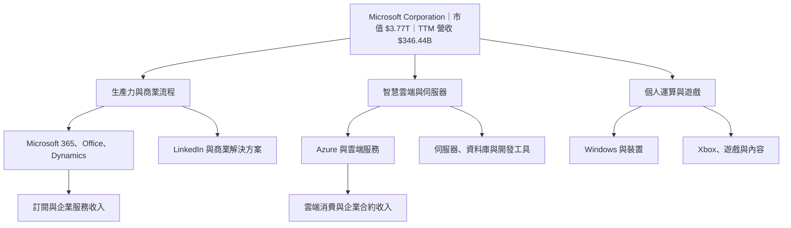
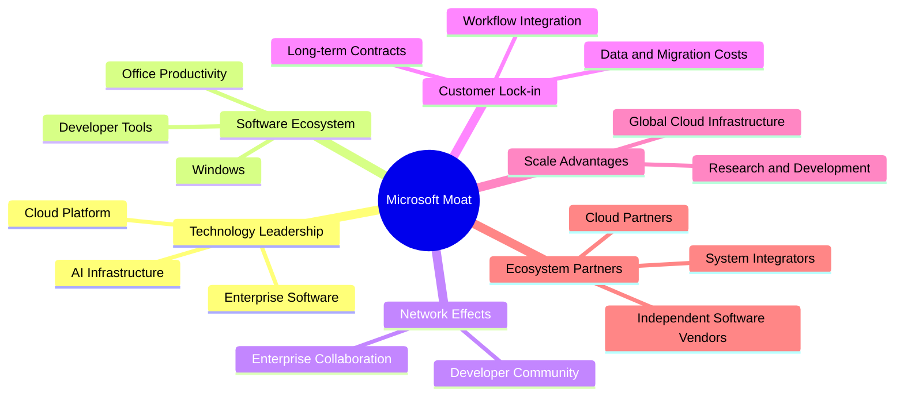
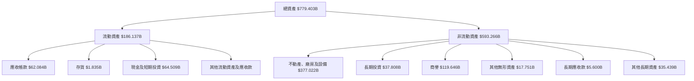
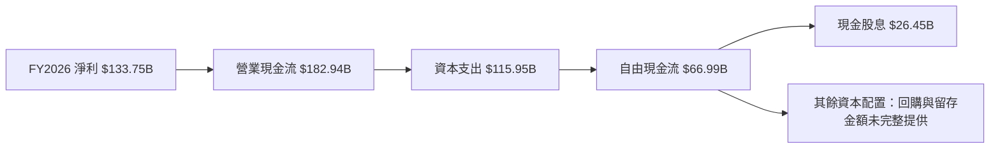
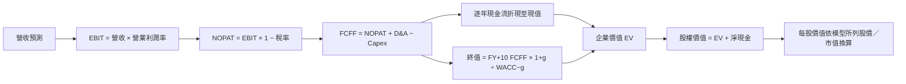
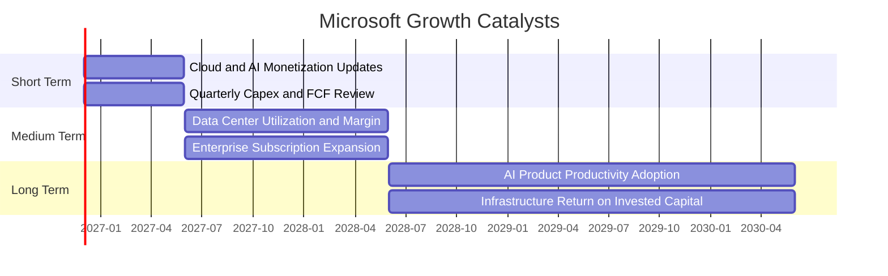
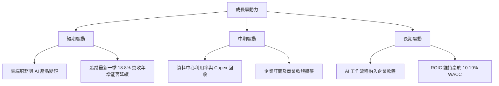
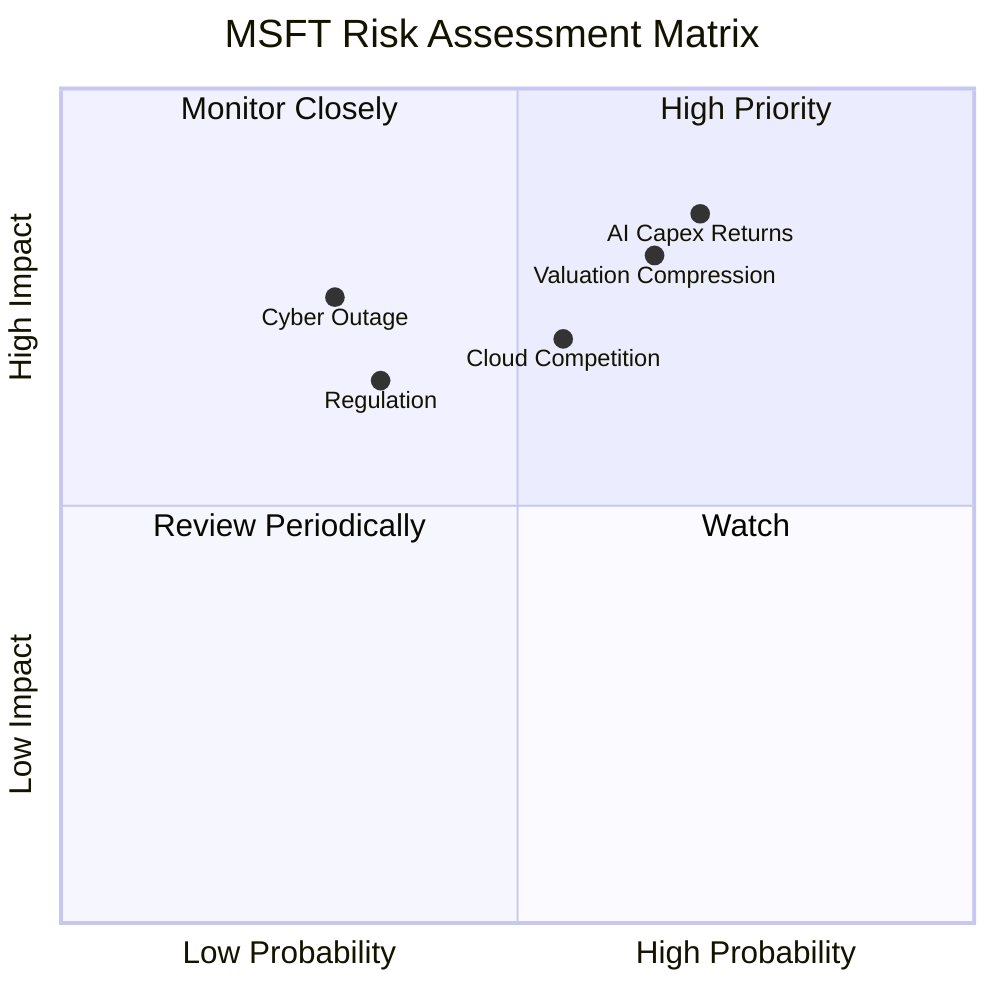
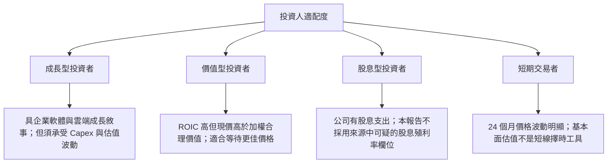

# MSFT 基本面深度分析報告
> **報告日期**：2026-11-19 ｜ **語言**：繁體中文 ｜ **數據來源**：SEC 申報資料 (XBRL)、Yahoo Finance、Finviz、StockAnalysis、Roic.ai ｜ **分析師**：CFA 級機構研究

## 目錄

| # | 章節 | 核心結論 |
|---|------|----------|
| 1 | 執行摘要 | 減碼；加權合理價值 $435.60，MOS -16.7% |
| 2 | 公司概覽與商業模式 | 企業軟體、生態系與客戶鎖定構成主要護城河 |
| 3 | 損益表深度分析 | TTM 營收 $346.44B，TTM 成長 17.9%；營業利益率 47.1% |
| 4 | 資產負債表分析 | 依一致口徑為淨現金 $29.03B；營運資金數據需留意來源差異 |
| 5 | 現金流量深度分析 | TTM FCF $59.96B，資本支出高增壓低自由現金流 |
| 6 | 獲利能力與資本效率 | ROIC 29.7% 高於 WACC 10.19%，仍創造經濟價值 |
| 7 | 相對估值分析 | 估值低於自身五年中位數，但相對同業並不便宜 |
| 8 | DCF 內在價值評估 | 基準 DCF $366.67；加權合理價值 $435.60 |
| 9 | 成長催化劑 | AI、雲端、訂閱服務為潛在增長來源；TAM 數字未提供 |
| 10 | 風險矩陣 | AI 資本支出回報、競爭、監管與估值為主要風險 |
| 11 | 投資建議 | 依 MOS 評級減碼；等待估值與現金流風險報酬改善 |

## 1. 執行摘要

### 1.0 一頁式投資儀表板（Portfolio Manager 30 秒速讀）

| 項目 | 內容 |
|------|------|
| **投資論點（3 句）** | ① TTM 營收 $346.44B、年增 17.9%，雲端與企業軟體需求支撐成長。② TTM 營業利益率 47.1%、ROIC 29.7% 對比 WACC 10.19%，營運模式仍有高資本回報。③ TTM FCF $59.96B，但 FCF Yield 僅 1.59%，且資本支出 TTM 達 $135.92B，市場價格對長期成長與資本回報要求高。 |
| **綜合評分** | **7.8/10**（引用 1.1 評分卡） |
| **財務健康** | 🟢 依一致口徑淨現金 $29.03B；Piotroski F-Score 6/9，流動比率與來源口徑需審慎核對 |
| **ROIC vs WACC** | 29.7% vs 10.19%（創造價值，差距 19.51 個百分點） |
| **FCF 趨勢** | 近年資本支出上升，FY2026 FCF $66.99B、TTM FCF $59.96B；FCF Yield 1.59% |
| **估值** | Forward P/E 21.0x ｜ EV/EBITDA 18.6x ｜ FCF Yield 1.59% |
| **DCF 內在價值（基準）** | $366.67 ｜ 現價相對 DCF 溢價 38.6% |
| **安全邊際（MOS）** | **-16.7%＝($435.60 − $508.29) ÷ $435.60**（基準：加權合理價值）｜ 🔴 無安全邊際 |
| **預期報酬（基準情境 12M）** | 以加權合理價值衡量的上行空間 **-14.3%**；並非保證的 12 個月報酬 |
| **關鍵風險（前二）** | AI 基礎設施資本支出未能轉化為足夠現金流；高成長預期與高估值使折現率上升時估值承壓 |
| **評級 + 信心度** | 🟠 **減碼** ｜ 信心：中 |

MSFT 的品質與估值訊號分化：TTM ROIC 29.7% 明顯高於 10.19% WACC，營業利益率 47.1%，反映主業具有高獲利與價值創造能力；但 TTM FCF Yield 僅 1.59%，基準 DCF 每股價值 $366.67，低於 2026-11-18 收盤價 $508.29。依規則 20，加權合理價值 $435.60 對應 MOS -16.7%，評級為減碼；因此公司基本面優質並不等同於現價具備足夠風險報酬。

### 1.1 綜合評分卡（全報告唯一）

| 維度 | 評分（1–10） | 主要依據（引用數字與其來源章節） |
|------|--------------|----------------------------------|
| 成長性 | 8.0 | TTM 營收成長 17.9%，最新一季年增 18.8%（第 3 章） |
| 獲利能力 | 9.5 | TTM 營業利益率 47.1%、ROIC 29.7% vs WACC 10.19%、F-Score 6/9（第 3、6 章） |
| 財務健康 | 8.0 | 淨現金 $29.03B、現金及短期投資 $64.51B；CCC -67 天，但來源中債務數字有差異（第 4 章） |
| 估值 | 4.0 | MOS -16.7%；P/E 26.5x 低於自身五年中位數 31.5x，但同業估值相對偏高（第 7、8 章） |
| 護城河 | 9.5 | TTM 營業利益率 47.1%、毛利率 67.7%、企業軟體與雲端生態系具高轉換成本（第 2 章） |
| 管理層與資本配置 | 8.0 | FY2026 SBC $12.40B，約佔營收 3.7%；近年 Capex 大增，投資回報仍須持續驗證（第 3、5 章） |
| **綜合評分** | **7.8** | 六項算術平均：(8.0 + 9.5 + 8.0 + 4.0 + 9.5 + 8.0) ÷ 6 = 7.833，四捨五入為 7.8 |

### 1.2 五大投資論點 + 三大核心風險

| 類型 | 項目 | 具體依據 | 信心度 |
|------|------|----------|--------|
| 🟢 **投資論點①** | 企業軟體與雲端需求延續 | TTM 營收 $346.44B、TTM 成長 17.9%；最新一季營收年增 18.8% | 🟢 高 |
| 🟢 **投資論點②** | 高營業槓桿 | TTM 營業利益率 47.1%，最新一季營業利益率 49.8%（SEC 10-Q 指標）；規模經濟支撐盈利 | 🟢 高 |
| 🟢 **投資論點③** | 資本回報高於資本成本 | ROIC 29.7% 對比 WACC 10.19%，差距 19.51 個百分點 | 🟢 高 |
| 🟢 **投資論點④** | 現金流仍有規模 | TTM 營業現金流 $195.88B，即使 Capex 達 $135.92B，仍產生 $59.96B FCF | 🟢 高 |
| 🟢 **投資論點⑤** | 工作資本結構有利現金週轉 | 最新 TTM CCC -67 天，供應商付款期限高於應收與存貨週期 | 🟡 中 |
| 🟡 **風險①** | AI 與資料中心投入回報不確定 | TTM Capex $135.92B，約為 TTM 營收 39.2%；投資回收期可能長於市場預期 | 🔴 高衝擊 |
| 🔴 **風險②** | 現價高於估值基準 | 現價 $508.29 高於加權合理價值 $435.60，MOS -16.7%；基準 DCF $366.67 | 🔴 高衝擊 |
| 🟡 **風險③** | 財務來源口徑出現重大差異 | VERIFIED 統一計算的總債務 $35.48B；其他市場資料另列 $133.93B，應核對租賃、借款與口徑 | 🟡 中 |

### 1.3 快速統計卡片

| 指標 | 公司實際值（期間） | 同業中位數 | 狀態 |
|------|--------------------|------------|------|
| 營收成長（TTM） | **17.9%** | — | 🟢 |
| 營收成長（最新一季年增） | **18.8%** | 24.7% | 🟡 |
| 毛利率（TTM） | **67.7%** | 60.9% | 🟢 |
| 營業利益率（TTM） | **47.1%** | — | 🟢 |
| ROIC（TTM） | **29.7%** | — | 🟢 |
| Forward P/E | **21.0x** | 18.3x | 🟡 |
| FCF Yield（TTM） | **1.59%** | — | 🔴 |
| Piotroski F-Score | **6 / 9** | — | 🟡 |

### 1.4 投資結論

```text
╔══════════════════════════════════════════════════════════════════╗
║                    📊 投資結論摘要                               ║
╠══════════════════════════════════════════════════════════════════╣
║  評級：減碼（依加權合理價值 MOS -16.7%）                          ║
║  價格（2026-11-18 收盤）：$508.29                                ║
║  DCF 內在價值（基準）：$366.67（現價溢價 38.6%）                 ║
║  安全邊際 MOS：-16.7%（＝($435.60−$508.29)÷$435.60）            ║
║  加權合理價值（8.8）：$435.60                                    ║
║  DCF 情境價值：                                                   ║
║    悲觀情境：$174.00（-65.8%）                                   ║
║    基準情境：$366.67（-27.9%）                                   ║
║    樂觀情境：$707.27（+39.1%）                                   ║
║  綜合評分：7.8/10（引用 1.1）                                    ║
║  適合投資人：重視企業軟體與雲端長期成長、可承受估值波動者        ║
╚══════════════════════════════════════════════════════════════════╝
```

## 2. 公司概覽與商業模式

### 2.1 業務結構與收入來源

收入按業務板塊的金額與佔比未提供，因此不對 Microsoft Cloud、Productivity and Business Processes、Intelligent Cloud、More Personal Computing 等板塊自行分配比例。公司總市值約 $3.77T，TTM 營收 $346.44B；以下業務節點依公司業務描述列示，並非財務分部占比。



核心收入模型涵蓋軟體授權、訂閱、雲端消費、企業支援服務、遊戲與裝置。訂閱及雲端模式有助於形成經常性收入，但不同產品的利潤率和資本需求差異很大；目前缺少分部收入與分部營業利益數據，無法定量拆解 AI 或 Azure 對整體增長與利潤率的貢獻。

### 2.2 市場份額

市場份額數據未提供，故不繪製份額圖，也不估算各業務市佔率。相對規模方面，MSFT TTM 營收 $346.44B，最新一季營收年增 18.8%；同業數據中 Alphabet、Amazon、Oracle 最新一季營收年增分別為 24.7%、12.1%、29.6%，但業務組合並不完全可比。

### 2.3 競爭護城河分析



### 2.4 護城河強度

| 護城河項目 | 強度（強／中／弱） | 證據（引用數字或事實） | 會削弱它的情況 |
|------------|--------------------|------------------------|----------------|
| 技術領先 | 強 | FY2026 研發費用 $35.56B；TTM 營業利益率 47.1%，足以支撐持續產品研發 | AI 產品難以形成差異化、雲端效能或成本落後 |
| 軟體生態系統 | 強 | Office、Windows、開發工具與企業服務可跨產品整合；公司業務涵蓋多種企業軟體 | 開源工具與低成本替代品降低轉換成本 |
| 網路效應 | 中 | 企業協作與開發者生態系可提升產品互通價值，但本次資料未提供使用者或開發者規模 | 企業逐步採用多雲、跨平台替代方案 |
| 客戶鎖定 | 強 | 企業工作流程、資料與管理工具相互整合，遷移通常涉及成本與營運風險；量化客戶留存率未提供 | 產品相容性改善、合約到期後客戶重新議價 |
| 規模效應 | 強 | TTM 營收 $346.44B、TTM 營業利益 $163.19B（StockAnalysis），具備資本投入能力 | 資料中心投資回報低於資本成本或資產利用率下降 |
| 生態夥伴 | 中 | 企業軟體與雲端服務依賴整合商、開發者與 ISV；夥伴營收及依賴度數字未提供 | 夥伴轉向競爭平台或平台規則受到監管限制 |

1.1「護城河」評分為 9.5，主要依據是 TTM 67.7% 毛利率、47.1% 營業利益率及企業軟體的跨產品整合；扣分因素是缺少市占率、客戶留存與分部經濟性數字。

## 3. 損益表深度分析

### 3.1 年度收入成長趨勢（近4年）

年度營收由 FY2023 $211.91B 增至 FY2026 $331.84B；FY2026 年增 17.8%，三年 CAGR 約 16.1%。成長延續且高於 FY2023 的基期增幅，但未來能否維持取決於雲端與 AI 需求轉化為付費收入的速度。

```text
╔══════════════════════════════════════════════════════════════════╗
║          Microsoft 年度收入趨勢（FY2023-FY2026）                 ║
╠══════════════════════════════════════════════════════════════════╣
║  FY2023  $211.91B  ██████████████████░░░░░░░░░░░  YoY: —        ║
║  FY2024  $245.12B  █████████████████████░░░░░░░░  YoY: +15.7%   ║
║  FY2025  $281.72B  ████████████████████████░░░░░  YoY: +14.9%   ║
║  FY2026  $331.84B  ████████████████████████████░  YoY: +17.8%   ║
╠══════════════════════════════════════════════════════════════════╣
║  FY2023-FY2026 三年收入 CAGR：約 16.1%                           ║
╚══════════════════════════════════════════════════════════════════╝
```

CAGR 算式：\((331.84 ÷ 211.91)^{1/3} - 1 \approx 16.1\%\)。年度收入數據來自 SEC 申報資料彙整。

### 3.2 季度收入趨勢分析

| 季度 | 營收 | QoQ 成長 | YoY 成長 | 備註 |
|------|------|----------|----------|------|
| 2025-12-31 | $81.27B | N/A | 16.7% | YoY 依 StockAnalysis 季度資料 |
| 2026-03-31 | $82.89B | 2.0% | 18.3% | QoQ=(82.89÷81.27)-1 |
| 2026-06-30 | $90.01B | 8.6% | 17.8% | QoQ=(90.01÷82.89)-1 |
| 2026-09-30 | $92.28B | 2.5% | 18.8% | 最新一季年增率，不是 TTM 成長率 |

QoQ 未做季節性調整，FY2026 Q4 的 8.6% 增幅可能包含季節性及大型合約認列影響，不宜直接年化。最新一季營收年增 18.8%，與 TTM 成長 17.9% 接近，顯示近期動能仍在，但無法僅憑總營收判斷 AI 產品的單獨貢獻。

### 3.3 利潤率演變分析

| 利潤率指標 | FY2023 | FY2024 | FY2025 | FY2026 | 趨勢 | 評估 |
|------------|--------|--------|--------|--------|------|------|
| **毛利率** | 68.9% | 69.8% | 68.8% | 67.9% | 高位回落 | 🟡 |
| **營業利益率** | 41.8% | 44.6% | 45.6% | 46.8% | 逐年改善 | 🟢 |
| **淨利率** | 34.1% | 36.0% | 36.1% | 40.3% | FY2026 明顯上升 | 🟢 |

毛利率依年度毛利除以年度營收計算；FY2026 TTM 毛利率另由資料列示為 67.7%。營業利益率改善快於毛利率，反映營業費用占營收比例下降或營收規模擴大帶來營業槓桿；毛利率下滑則與產品組合、雲端基礎設施成本及折舊增加相容，但缺少分部毛利資料，無法確認各因素的實際貢獻。FY2026 淨利率提升亦可能受非營業項目與稅務影響，應避免將單年淨利改善全部視為營運獲利能力上升。

### 3.4 費用結構分析

費用項目金額未提供完整的 FY2026 損益表拆分，因此不繪製費用結構圓餅圖，以免把不完整項目誤作全額占比。可確認 FY2026 研發費用為 $35.56B，約為營收 $331.84B 的 10.7%；研發投入支撐產品迭代，但其投資回報仍須由未來收入增長與營業利潤率驗證。

### 3.5 季度 EPS 趨勢與盈餘品質（Quality of Earnings）

| 季度 | EPS 實際 | EPS 年增 | 市場預期／盈餘表現 |
|------|---------|---------|-------------------|
| 2025-12-31 | $5.16 | 59.75% | EPS Est. N/A，無法判定超預期或不及預期 |
| 2026-03-31 | $4.27 | 23.41% | EPS Est. N/A，無法判定超預期或不及預期 |
| 2026-06-30 | $4.81 | 31.74% | EPS Est. N/A，無法判定超預期或不及預期 |
| 2026-09-30 | $4.92 | 32.26% | EPS Est. N/A，無法判定超預期或不及預期 |

四季 EPS 估計值均缺漏，故不能以資料中的「nan」標記或表面符號推斷 beat/miss。季度實際 EPS 及成長率取 StockAnalysis；淨利與 EPS 成長顯示盈餘增速高於營收增速，但股數、非營業項目與稅務的逐季拆分不完整。

| 盈餘品質項目 | 數值／佔比 | 評估 |
|--------------|-----------|------|
| 股權薪酬 SBC / 營收 | FY2026：$12.40B ÷ $331.84B = **3.7%** | 🟡 SBC 是股東經濟成本，可能稀釋每股價值；但資料顯示稀釋股數未增加 |
| SBC / 營業現金流 | FY2026：$12.40B ÷ $182.94B = **6.8%** | 🟢 對營業現金流占比可控，但不能視為零成本 |
| FCF / 淨利 | TTM：$59.96B ÷ $142.63B = **42.0%** | 🔴 資本支出上升壓低現金轉換；GAAP 獲利明顯高於當期 FCF |
| 一次性／非經常性損益 | N/A（缺少足以拆分的資料） | 無法確認是否有一次性項目顯著推高或壓低本期盈餘 |
| 有效稅率異常 | DCF 採用有效稅率 19.4%；各季有效稅率未提供 | 🟡 無法確認季度淨利增長是否受稅率變動帶動 |
| 資本化支出 vs 費用化 | TTM Capex $135.92B；SBC 為非現金費用但具稀釋成本 | 🟡 資料未提供資本化政策細項；需追蹤資本支出與折舊及雲端收入回收 |

TTM FCF 對淨利轉換率偏低的主要可觀察原因是 Capex 高：TTM 營業現金流 $195.88B，減去 Capex $135.92B 後為 $59.96B。FY2026 年度 FCF $66.99B，低於 FY2025 的 $71.61B。故 GAAP 淨利有營業現金流支撐，但現階段「可供股東自由運用」的現金受資料中心投資壓縮；若投資能提升雲端服務收入與後續 FCF，則短期轉換率偏低可接受，反之會成為估值風險。

## 4. 資產負債表分析

### 4.1 資產結構分解

以下採 StockAnalysis 2026-09-30 資產負債表資料。非流動資產以總資產減流動資產計算；明細為來源列示的資產項目。



資產高度集中於固定資產、商譽及雲端基礎設施。PP&E 由 FY2025 的 $229.79B 增至 2026-09 的 $377.02B，顯示資本投入規模上升；若利用率與雲端收入同步提升，資產擴張可支持成長，否則折舊及資本報酬將壓低未來 ROIC。

### 4.2 流動性與營運資金分析

| 流動性指標 | 最新可用值 | 評估 |
|------------|------------|------|
| 流動比率 | 1.225（市場資料彙整）；FY2026 期末流動資產 $207.71B、流動負債 $168.82B | 🟡 高於 1，但短期資產緩衝並非極高 |
| 速動比率 | 1.068（市場資料彙整） | 🟡 仍高於 1 |
| 現金及短期投資 | $64.51B（2026-09-30） | 🟢 提供流動性緩衝 |

不同來源的流動比率與資產負債表日期並非完全一致，故不以混合期間重算。營運資金天數依 QUALITY FIGURES 原值列示：

| 指標 | 最新 TTM | 一年前 TTM | 變化 | 解讀 |
|------|----------|------------|------|------|
| DSO 應收帳款天數 | 65 天 | 66 天 | -1 天 | 🟢 收款天數微降，未見明顯收款惡化 |
| DIO 存貨天數 | 6 天 | 4 天 | +2 天 | 🟡 存貨天數上升，但絕對值仍低 |
| DPO 應付帳款天數 | 139 天 | 130 天 | +9 天 | 🟢 付款週期延長，有利短期營運資金 |
| CCC 現金轉換週期 | -67 天 | -59 天 | -8 天 | 🟢 負 CCC 擴大，現金收付時點對營運有利 |

CCC = DSO + DIO − DPO；最新值 65 + 6 − 139 = -68 天，與品質指標原值 -67 天的差異來自天數四捨五入，本文依規則照抄 -67 天。CCC 延長為負值可能與訂閱預收、企業合約與供應商付款條件有關，但不應把供應商付款期限延長永久視為可持續優勢。

### 4.3 債務結構分析

SEC 彙整的 VERIFIED 數據列示總債務 $35.48B、現金及短期投資 $64.51B、淨現金 $29.03B。其他合併資料另有總債務 $56.83B 或 $133.93B 等不同口徑，可能涉及租賃、長短期負債或資料日期差異。以下財務健康判斷採用一致的 VERIFIED 口徑，不把不同來源的負債和現金拼接計算。

```text
╔══════════════════════════════════════════════════════════════════╗
║                   Microsoft 債務健康診斷                         ║
╠══════════════════════════════════════════════════════════════════╣
║  總債務：        $35.48B   ██░░░░░░░░░░░░░░░░░░░  VERIFIED口徑   ║
║  現金+短期投資： $64.51B   ████████████████████░  2026-09-30     ║
║  淨現金：        $29.03B   █████████░░░░░░░░░░░░  🟢             ║
║                                                                  ║
║  Debt/EBITDA：N/A（債務與 EBITDA 口徑期別不一致，不混算）         ║
║  Interest Coverage：N/A（利息費用明細未提供）                    ║
║  流動比率：1.225（市場彙整口徑）                                 ║
║  需追蹤：總債務來源口徑差異、資料中心投資與負債變化               ║
╚══════════════════════════════════════════════════════════════════╝
```

### 4.4 股東權益趨勢

| 財年 | 股東權益 | YoY 變化 |
|------|----------|----------|
| FY2023 | $206.22B | — |
| FY2024 | $268.48B | +30.2% |
| FY2025 | $343.48B | +27.9% |
| FY2026 | $442.39B | +28.8% |

```text
╔══════════════════════════════════════════════════════════════════╗
║                 Microsoft 股東權益趨勢                           ║
╠══════════════════════════════════════════════════════════════════╣
║  FY2023  $206.22B  █████████░░░░░░░░░░░░░░                      ║
║  FY2024  $268.48B  ████████████░░░░░░░░░░                      ║
║  FY2025  $343.48B  ████████████████░░░░░░                      ║
║  FY2026  $442.39B  ████████████████████                        ║
╚══════════════════════════════════════════════════════════════════╝
```

股東權益增加與淨利留存、資產擴張相容，但本次資料未提供完整的回購金額與其他綜合損益拆分，因此不把權益變動單獨歸因於某一資本配置項目。

## 5. 現金流量深度分析

### 5.1 現金流量瀑布圖

FY2026 年度資料可用於展示淨利、營業現金流、資本支出及 FCF。股息金額已提供；回購及期末淨現金變化缺少同口徑完整拆分，故不填入推測數字。



營業現金流高於淨利，代表應計項目與非現金費用對現金流有正向影響；但 Capex 占用大量營業現金流，FY2026 FCF 低於 FY2025。股息只是 FCF 的一部分，不能據此推定其餘資金全數用於回購。

### 5.2 FCF 轉換率趨勢

| 財年／期間 | FCF | 淨利 | FCF / 淨利 |
|------------|-----|------|------------|
| FY2023 | $59.48B | $72.36B | 82.2% |
| FY2024 | $74.07B | $88.14B | 84.0% |
| FY2025 | $71.61B | $101.83B | 70.3% |
| FY2026 | $66.99B | $133.75B | 50.1% |
| TTM 至 2026-09-30 | $59.96B | $142.63B | 42.0% |

FCF 轉換率連續下降與資本支出大幅增加相符。這不必然意味核心獲利轉差，但代表現階段每一元 GAAP 淨利所能轉化的自由現金下降；投資者應要求未來營收、利用率與雲端毛利能補償新增資產投入。

### 5.3 自由現金流趨勢

| 期間 | FCF | FCF Yield |
|------|-----|-----------|
| FY2023 | $59.48B | N/A |
| FY2024 | $74.07B | N/A |
| FY2025 | $71.61B | N/A |
| FY2026 | $66.99B | N/A |
| TTM 至 2026-09-30 | $59.96B | 1.59% |

```text
╔══════════════════════════════════════════════════════════════════╗
║                自由現金流：年度實際與最新 TTM                    ║
╠══════════════════════════════════════════════════════════════════╣
║  FY2023  $59.48B  ██████████████████░░░░░░░░░  FCF Yield：N/A   ║
║  FY2024  $74.07B  ██████████████████████░░░░░  FCF Yield：N/A   ║
║  FY2025  $71.61B  █████████████████████░░░░░░  FCF Yield：N/A   ║
║  FY2026  $66.99B  ████████████████████░░░░░░░  FCF Yield：N/A   ║
║  TTM     $59.96B  ██████████████████░░░░░░░░░  Yield：1.59%     ║
╚══════════════════════════════════════════════════════════════════╝
```

### 5.4 資本配置評估

| 資本配置項目 | FY2026 | 評估 |
|--------------|--------|------|
| 資本支出 | $115.95B | 🟡 高額投資擴充雲端與資料中心能力；回報週期及利用率是關鍵 |
| 現金股息 | $26.45B | 🟢 低於 FY2026 FCF $66.99B，支付能力有現金流支撐 |
| SBC | $12.40B | 🟡 約佔 FY2026 營收 3.7%，雖未見稀釋股數增加，仍是股東成本 |
| 股票回購 | N/A | 資料未提供完整 FY2026 回購金額 |
| 留存現金及其他投資 | N/A | 無法以現有數據拆分 |

## 6. 獲利能力與資本效率

### 6.1 ROE / ROA / ROIC 趨勢

| 指標 | 最新 TTM | 歷史趨勢可用性 | 評估 |
|------|----------|----------------|------|
| ROE | 30.3%（品質指標、closing balances） | 歷史可比同口徑未提供 | 🟢 |
| ROA | TTM 值未列於 QUALITY FIGURES；市場彙整列 14.4% | 口徑不同，未形成連續序列 | 🟢 |
| ROIC | 29.7% | 近年連續可比數據未提供；Roic.ai 歷史表列部分較早年度數值 | 🟢 |

其他市場資料列 ROE 34.2%，與品質指標依期末資產負債表計算的 ROE 30.3% 不同。本節以 QUALITY FIGURES 的 30.3% 作為杜邦分析一致口徑，不混用不同來源指標。可比歷史序列缺漏，不虛構年別 ROIC／ROA／ROE 趨勢。

### 6.2 ROIC vs WACC 分析（核心價值創造判斷）

```text
╔══════════════════════════════════════════════════════════════════╗
║                  ROIC vs WACC 深度分析                           ║
╠══════════════════════════════════════════════════════════════════╣
║  WACC（採資本成本資料的已計算值）：10.19%                         ║
║  ├── 無風險利率 Rf：5.07%                                        ║
║  ├── ERP：5.00%                                                   ║
║  ├── Beta 原始值 1.04；採用調整後 Beta 1.03                      ║
║  ├── 股權成本 Ke：5.07% + 1.03 × 5.00% = 10.22%                 ║
║  ├── 稅前債務成本：8.60%；有效稅率 19.4%                         ║
║  ├── 資本權重：股權 99.1%，債務 0.9%                             ║
║  └── WACC：10.19%                                                 ║
║                                                                  ║
║  ROIC：29.7%（TTM，稅後營業利益 ÷ 投入資本，照錄）                ║
║  EVA spread：29.7% − 10.19% = +19.51 個百分點                    ║
║  ROIC / WACC：29.7% ÷ 10.19% = 2.91 倍                           ║
║                                                                  ║
║  ROIC 29.7%  ▓▓▓▓▓▓▓▓▓▓▓▓▓▓▓▓▓▓▓▓▓▓▓▓▓▓▓▓▓▓  🟢              ║
║  WACC 10.19%  ▓▓▓▓▓▓▓▓▓▓░░░░░░░░░░░░░░░░░░░░                    ║
║  結論：現有資本回報高於資本成本，創造股東經濟價值               ║
╚══════════════════════════════════════════════════════════════════╝
```

Beta 調整依據為 \((2/3 × 1.04) + (1/3 × 1)=1.03\)。債務成本稅後值為 \(8.60\%×(1-19.4\%)=6.93\%\)。權重與成本皆直接採用資本成本數據，不另建 WACC。ROIC 與 WACC 差距雖大，但新增資料中心資本的邊際回報未必等於歷史平均 ROIC；若新增投資回報下降，未來 EVA 會收窄。

### 6.3 杜邦三因素分解

| 因素 | 數值（TTM） | 解讀 |
|------|-------------|------|
| 淨利率 | 41.2% | 高淨利率是 ROE 的主要支撐 |
| 資產週轉率 | 0.44 | 大型資產基礎、雲端基礎設施投入降低短期週轉率 |
| 權益乘數 | 1.66 | 槓桿不高，ROE 並非主要由財務槓桿推升 |
| **ROE** | **30.3%** | 41.2% × 0.44 × 1.66 = 30.1%，與提供的 30.3% 有四捨五入差異 |

杜邦因素依 QUALITY FIGURES 原值照錄。乘積與報表 ROE 有約 0.2 個百分點差異，為來源四捨五入或分母口徑造成；不重算或調整原始指標。高淨利率而非高槓桿是 ROE 的主要驅動因素。

### 6.4 財務體質：Piotroski F-Score

Piotroski F-Score 為 **6 / 9**。九項測試的結果依 QUALITY FIGURES 原值列示：

| 測試 | 結果 | 解讀 |
|------|------|------|
| ROA > 0 | ✅ 通過 | 盈利為正 |
| 營業現金流 > 0 | ✅ 通過 | TTM 營業現金流為正 |
| ROA 高於一年前 | ✅ 通過 | 資產盈利能力改善 |
| 營業現金流 > 淨利 | ✅ 通過 | 營業現金流高於淨利，有利於應計品質 |
| 長期負債 ÷ 總資產低於一年前 | ✅ 通過 | 相對負債比下降 |
| 流動比率高於一年前 | ❌ 未通過 | 流動性比率未改善 |
| 稀釋股數未增加 | ✅ 通過 | 沒有通過「股數增加」測試 |
| 毛利率高於一年前 | ❌ 未通過 | 可能反映產品組合、雲端成本或資本密集度上升 |
| 資產週轉率高於一年前 | ❌ 未通過 | 資產增加快於收入效率提升，與資本投入增加相符 |

F-Score 6/9 表示基本面訊號偏正面但不全面。未通過的資產週轉率與毛利率測試值得與高 Capex 一起追蹤；若資產投入無法帶動雲端及 AI 收入，這些指標可能從暫時性投資階段訊號轉為結構性回報下降。

## 7. 相對估值分析

### 7.1 同業估值比較表格

同業倍數按 Peer multiples 原值；公司估值按市場資料。Forward P/E 同業中位數依 GOOG 18.3x、AMZN 24.5x、ORCL 10.3x 計算為 18.3x。

| 估值指標 | **MSFT** | **GOOG** | **AMZN** | **ORCL** | MSFT 評估 |
|----------|----------|---------|---------|---------|-----------|
| **Trailing P/E** | 26.5x | 14.6x | 21.6x | 17.9x | 🔴 高於三家同業 |
| **Forward P/E** | 21.0x | 18.3x | 24.5x | 10.3x | 🟡 高於同業中位數 18.3x |
| **P/S Ratio** | 10.9x | 7.3x | 3.6x | 4.9x | 🔴 顯著高於同業 |
| **EV/EBITDA** | 18.7x | 18.0x | 16.8x | 14.0x | 🟡 高於同業中位數 16.8x |
| **最新一季營收年增** | 18.8% | 24.7% | 12.1% | 29.6% | 🟡 成長高於 AMZN，低於 GOOG、ORCL |
| **毛利率 TTM** | 67.7% | 60.9% | 51.4% | 64.0% | 🟢 高於所列同業 |

Microsoft 的毛利率優勢與企業軟體組合相符，但 P/S 及 Trailing P/E 高於所列同業。高估值需要以更高或更持久的成長、較佳利潤率或更低風險溢酬支持；同業業務組成不同，倍數比較只作估值交叉檢驗。

### 7.2 歷史估值區間分析

```text
╔══════════════════════════════════════════════════════════════════╗
║           MSFT 五年 TTM P/E 區間與目前位置                       ║
╠══════════════════════════════════════════════════════════════════╣
║  五年低點       20.8x                                         ║
║  目前           26.5x   ●                                     ║
║  五年中位數     31.5x                                         ║
║  五年高點       37.8x                                         ║
║  目前百分位     14%（程式計算）                                ║
╚══════════════════════════════════════════════════════════════════╝
```

自身歷史對照顯示，P/E 低於五年中位數且目前處於歷史區間第 14 百分位；P/S 10.9x 對比中位數 12.0x、百分位 38%；EV/EBITDA 18.6x 對比中位數 24.3x、百分位 10%。這代表相對自身過去估值已收斂，但不等於相對當前現金流便宜，尤其 FCF Yield 只有 1.59%。

### 7.3 情境價值（Bear / Base / Bull）

下列情境、概率與價格全部照錄 DCF MODEL。情境條件是估值假設，不是確定預測。

| 情境 | 第 1 年營收成長 | 期末營業利潤率 | WACC | 每股價值 | 相對現價 | 機率 | 會發生的條件 |
|------|----------------|----------------|------|----------|----------|------|--------------|
| 🔴 悲觀 | 9.0% | 38.8% | 11.19% | $174.00 | -65.8% | 25% | 雲端與 AI 變現低於預期、競爭或資本成本上升，利潤率收縮 |
| 🟡 基準 | 17.9% | 45.6% | 10.19% | $366.67 | -27.9% | 50% | 成長由 TTM 17.9% 起步並逐步減速，利潤率回落至歷史中位數 |
| 🟢 樂觀 | 26.9% | 50.2% | 9.19% | $707.27 | +39.1% | 25% | AI 與雲端收入加速、規模效應推升利潤率且折現率下降 |

### 7.4 相對估值隱含價格區間

```text
╔══════════════════════════════════════════════════════════════════╗
║             估值方法回推每股價值與現價                           ║
╠══════════════════════════════════════════════════════════════════╣
║  $366.67 ── $441.63 ── $459.63 ── $508.29 ── $636.12            ║
║   基準DCF    Forward P/E  EV/EBITDA     現價      分析師共識      ║
╚══════════════════════════════════════════════════════════════════╝
```

| 方法 | 每股價值 | 較現價 | 依據 |
|------|----------|--------|------|
| DCF（基準） | $366.67 | -27.9% | 10 年 FCFF、WACC 10.19%、永續成長 3.0% |
| 同業 Forward P/E | $441.63 | -13.1% | 同業中位數 18.3x × Forward EPS $24.20 |
| 同業 EV/EBITDA | $459.63 | -9.6% | 同業中位數 16.8x × TTM EBITDA，加回淨現金 |
| 分析師共識目標價 | $636.12 | +25.1% | 54 位分析師平均目標價 |

相對估值方法高於 DCF 基準，但仍低於現價；分析師共識高於現價，顯示賣方預期與現金流折現模型有明顯差距。

## 8. DCF 內在價值評估（Discounted Cash Flow）

### 8.0 估值推理鏈（Thinking Logic）

**Step 1 — 價值來源。** MSFT 的價值主要來自企業生產力軟體、雲端與伺服器服務，以及個人運算與遊戲等既有業務；各板塊營收占比未提供，不能量化拆分。模型主導變數是長期營收增長與營業利潤率，終值現值占企業價值 66.8%，因此永續成長與折現率亦十分敏感。

**Step 2 — 模型選擇。**

| 決策點 | 本報告採用 | 理由（含數字） | 曾考慮但否決 | 否決理由 |
|--------|-----------|----------------|--------------|----------|
| 現金流定義 | FCFF | 以 WACC 折現，得到企業價值；公式為 NOPAT + D&A − Capex | FCFE | 欠缺完整股利、借款與淨借款路徑 |
| 預測期 N | 10 年 | DCF MODEL 固定為 10 年，讓營收增長與利潤率逐步收斂 | 5 年 | 雲端與 AI 投資回收期可能跨越較長週期；模型已指定 10 年 |
| 終值方法 | Gordon Growth | DCF MODEL 指定永續成長率 3.0% | 退出倍數 | 模型未提供可用退出倍數；不得自行新增 |
| EBIT 基礎 | GAAP | DCF MODEL 明列 GAAP EBIT，且 SBC 已作費用處理 | 非 GAAP EBIT | 另加回 SBC 會改變模型基礎 |

**Step 3 — 關鍵假設推導鏈。**

- **營收成長**：錨點＝TTM 營收年增 17.9% → 調整＝FY+1 沿用近年動能，其後線性降至 FY+10 的 3.0%，反映基期擴大與成熟化 → **FY+1 採用 17.9%，FY+10 採用 3.0%** → 曾考慮全期維持 17.9%，但否決，因十年持續高增長會忽略規模擴大後的自然減速。
- **期末營業利潤率**：錨點＝TTM 47.1%，模型期末採歷史五年中位數 45.6% → 調整＝接受長期營運槓桿可能被雲端折舊與競爭部分抵銷 → **FY+10 採用 45.6%** → 曾考慮維持 47.1%，但否決，因模型採歷史中位數作收斂錨點。
- **永續成長率 g**：錨點＝模型採用 3.0% → 調整＝以成熟期名目增長假設作長期延伸，並確保低於 WACC 10.19% → **採用 3.0%** → 否決高於 3.0% 的替代假設，因長期高增長將增加終值依賴。
- **預測期 N**：錨點＝模型固定 10 年 → 調整＝不自行改動模型給定預測期限 → **採用 10 年** → 否決 5 年，因會改變既定模型、終值起算年份及現值。
- **Capex／營收**：錨點＝TTM Capex $135.92B ÷ TTM 營收 $346.44B = 39.2% → 調整＝模型逐步退坡，FY+10 降至 12.2%，即 D&A 的 1.1 倍附近 → **FY+1 39.2%，FY+10 12.2%** → 否決永遠維持 39.2%，因成熟後資本支出強度若不下降，FCF 無法充分轉化。
- **EBIT 與 SBC**：錨點＝GAAP EBIT 已包含 SBC 費用 → 調整＝按模型採固定股數，不再扣除 SBC、不再另計稀釋 → **採組合 (A)** → 否決額外扣 SBC，因會重複計算股權薪酬成本。
- **年稀釋率**：錨點＝模型採用固定股數及「稀釋股數未增加」測試通過 → **採用 0%** → 否決另加稀釋率，因會與 GAAP EBIT 已費用化 SBC 的處理重複。
- **WACC**：錨點＝資本成本資料計算的 WACC 10.19% → **採用 10.19%** → 否決另行估算 WACC，因本報告須使用統一資本成本數值。
- **D&A／營收、有效稅率**：錨點與採用值分別為 11.1% 與 19.4%，照模型原值使用；資料未提供足以另做逐年調整的依據。
- **營運資金變動**：DCF MODEL 明確未建模；不以零以外的推估值補入，也不假設營運資金變動對估值無影響。

**Step 4 — 最脆弱的一環。** Capex／營收從 FY+1 的 39.2% 降至 FY+10 的 12.2%，同時營業利潤率維持在 45.6%；若 AI 與雲端基礎設施需要長期高投入，FCFF 可能低於模型，價值將向悲觀情境 $174.00 靠近。

**Step 5 — 計算路徑圖。**



### 8.1 模型假設總表（Model Inputs）

| 假設項目 | 採用值 | 依據／來源 | 敏感度 |
|----------|--------|-------------|--------|
| 預測期長度 N | 10 年 | DCF MODEL 固定輸入 | 🟡 中 |
| 營收成長 | FY+1 17.9%，線性降至 FY+10 3.0% | TTM vs prior TTM 成長 17.9%；終年採模型設定 | 🔴 高 |
| 營業利潤率 | FY+1 47.1% → FY+10 45.6% | TTM 營業利益率與最近五個財年中位數，依模型設定 | 🔴 高 |
| 有效稅率 | 19.4% | 最新年度有效稅率 | 🟢 低 |
| Capex / 營收 | FY+1 39.2% → FY+10 12.2% | TTM Capex／營收比率，逐步降至模型指定水準 | 🔴 高 |
| D&A / 營收 | 11.1% | TTM D&A 比率 | 🟢 低 |
| 營運資金變動 | 未建模 | DCF MODEL 明列 working capital is not modelled | 🟢 低 |
| EBIT 基礎 | GAAP EBIT | DCF MODEL 明列 GAAP EBIT | 🟡 中 |
| SBC 處理 | GAAP EBIT 已費用化，不再扣 SBC | DCF MODEL 指定組合 (A) | 🟡 中 |
| 年稀釋率 | 0%；固定股數處理 | 組合 (A)，模型不再增加股數 | 🟡 中 |
| 永續成長率 g | 3.0% | DCF MODEL 原值；低於 WACC 10.19% | 🔴 高 |
| 終值方法 | Gordon Growth | DCF MODEL 提供終值計算 | 🔴 高 |
| WACC | 10.19% | Cost of capital 原值 | 🔴 高 |

模型使用 **FCFF = NOPAT + D&A − Capex**，未扣 ΔWC，且未再扣 SBC。本模型採用 **(A) GAAP EBIT + 固定股數**，故 SBC 影響已計入一次。股數與換算採 DCF MODEL 所列「股權價值 × 價格 ÷ 市值」公式，並非改用未四捨五入市場股數另算。

### 8.2 折現率推導（WACC）

10 年期美債利率日期在資本成本資料中未列明；本節照錄 5.07%，不另假設日期。規模／國別溢酬不適用於美國大型成熟企業，採 0%。

```text
╔══════════════════════════════════════════════════════════════════╗
║                    WACC 推導（折現率）                           ║
╠══════════════════════════════════════════════════════════════════╣
║  股權成本 Ke（CAPM）：                                            ║
║  ├── 無風險利率 Rf：5.07%                                        ║
║  ├── ERP：5.00%                                                   ║
║  ├── Beta 原始 1.04；調整後採用 1.03                             ║
║  ├── 規模／國別溢酬：0.00%                                       ║
║  └── Ke = 5.07% + 1.03 × 5.00% = 10.22%                         ║
║                                                                  ║
║  債務成本：                                                       ║
║  ├── 稅前 Kd：8.60%                                               ║
║  ├── 有效稅率：19.4%                                              ║
║  └── 稅後 Kd = 8.60% × (1 − 19.4%) = 6.93%                       ║
║                                                                  ║
║  資本結構：                                                       ║
║  ├── 股權權重：99.1%；債務權重：0.9%                             ║
║  └── WACC = 99.1%×10.22% + 0.9%×6.93% = 10.19%                  ║
╚══════════════════════════════════════════════════════════════════╝
```

**逐步演算：**

1. **Ke（CAPM）** = 5.07% + 1.03 × 5.00% + 0.00% = **10.22%**。
2. **稅前 Kd**：利息費用與平均計息負債的獨立金額未提供；採資本成本資料列示的稅前債務成本 **8.60%**，不自行反推分母。
3. **稅後 Kd** = 8.60% × (1 − 19.4%) = **6.93%**。
4. **權重**：採用成本資本資料提供的股權權重 **99.1%**、債務權重 **0.9%**，兩者相加為 100%。市值資料約 $3.77T，負債資料的口徑存在差異，故不以不一致的資料重建權重。
5. **WACC** = 99.1% × 10.22% + 0.9% × 6.93% = 10.12802% + 0.06237% = **10.19%**（四捨五入至小數點後兩位）。

本節 WACC 與第 6.2 節完全一致。稅前 Kd 的原始利息費用、平均計息負債及權重所用精確市值未提供，故以上採用已計算的資本成本輸入，不宣稱能從其他混合口徑數據獨立複算。

### 8.3 逐年自由現金流預測（基準情境）

金額單位為 $B；表格逐年照錄 DCF MODEL。表中稅率 19.4%，D&A／營收 11.1%；Capex 隨模型設定由 39.2% 逐年退坡。ΔWC 未建模，故不加列估算值。

| 年度 | FY+1 | FY+2 | FY+3 | FY+4 | FY+5 | FY+6 | FY+7 | FY+8 | FY+9 | FY+10 |
|------|------|------|------|------|------|------|------|------|------|-------|
| 營收 | 408.51 | 474.92 | 544.25 | 614.69 | 684.06 | 749.93 | 809.71 | 860.83 | 900.92 | 927.95 |
| 營收 YoY | 17.9% | 16.3% | 14.6% | 12.9% | 11.3% | 9.6% | 8.0% | 6.3% | 4.7% | 3.0% |
| 營業利潤率 | 47.1% | 46.9% | 46.8% | 46.6% | 46.4% | 46.3% | 46.1% | 46.0% | 45.8% | 45.6% |
| EBIT（GAAP） | 192.42 | 222.92 | 254.57 | 286.51 | 317.72 | 347.07 | 373.41 | 395.56 | 412.50 | 423.35 |
| − 稅 | (37.32) | (43.24) | (49.38) | (55.57) | (61.63) | (67.32) | (72.43) | (76.72) | (80.01) | (82.11) |
| = NOPAT | 155.10 | 179.69 | 205.20 | 230.94 | 256.09 | 279.75 | 300.98 | 318.84 | 332.49 | 341.24 |
| + D&A | 45.16 | 52.50 | 60.17 | 67.96 | 75.62 | 82.91 | 89.51 | 95.17 | 99.60 | 102.59 |
| − Capex | (160.27) | (172.04) | (180.78) | (185.69) | (186.07) | (181.43) | (171.53) | (156.47) | (136.66) | (112.84) |
| = FCFF | **39.99** | **60.15** | **84.58** | **113.20** | **145.64** | **181.23** | **218.96** | **257.53** | **295.43** | **330.98** |
| 折現因子 | 0.908 | 0.824 | 0.748 | 0.678 | 0.616 | 0.559 | 0.507 | 0.460 | 0.418 | 0.379 |
| FCFF 現值 PV | **36.30** | **49.54** | **63.23** | **76.80** | **89.68** | **101.27** | **111.04** | **118.53** | **123.41** | **125.47** |

預測期 PV 合計：  
**$36.30 + $49.54 + $63.23 + $76.80 + $89.68 + $101.27 + $111.04 + $118.53 + $123.41 + $125.47 = $895.27B。**

**逐步演算（FY+1）：**

1. 營收 = $346.44B × (1 + 17.9%) = **$408.51B**。
2. EBIT = $408.51B × 47.1% = **$192.42B**。
3. 稅 = $192.42B × 19.4% = **$37.32B**。
4. NOPAT = $192.42B − $37.32B = **$155.10B**。
5. D&A = $408.51B × 11.1% = **$45.16B**。
6. Capex = $408.51B × 39.2% = **$160.27B**。
7. ΔWC = **未建模**，依 DCF MODEL 不納入計算。
8. FCFF = $155.10B + $45.16B − $160.27B = **$39.99B**。
9. 折現因子 = 1 ÷ (1 + 10.19%)¹ = **0.908**；PV = $39.99B × 0.908 = **$36.30B**。

**合理性自檢：**

- 預測 FY+1 至 FY+10 FCFF CAGR 約 **26.5%**；歷史 FY2023 至 FY2026 FCF CAGR 約 **4.0%**。差異主要來自模型假設 Capex／營收率大幅下降，不能只視為營收增長的結果。
- FY+10 FCFF 利潤率 = $330.98B ÷ $927.95B = **35.7%**；目前 TTM FCF 利潤率 = $59.96B ÷ $346.44B = **17.3%**。同業最佳 FCF 利潤率數據未提供，不作比較。
- 模型各年度 FCFF 均為正；FY+1 FCFF 僅 $39.99B，原因是首年 Capex 高於 NOPAT 與 D&A 合計。

```text
╔══════════════════════════════════════════════════════════════════╗
║            自由現金流：歷史實際 vs 模型預測                      ║
╠══════════════════════════════════════════════════════════════════╣
║  FY2024(實)  $74.07B  ███████████████░░░░░  YoY: +24.5%         ║
║  FY2025(實)  $71.61B  ██████████████░░░░░░  YoY: -3.3%          ║
║  FY2026(實)  $66.99B  █████████████░░░░░░░  YoY: -6.4%          ║
║  FY+1 (預)   $39.99B  ████████░░░░░░░░░░░░  模型值             ║
║  FY+10(預)  $330.98B  ████████████████████  模型值             ║
╠══════════════════════════════════════════════════════════════════╣
║  ⚠️ 預測期 FCFF CAGR 約 26.5%，遠高於歷史 FY23-FY26 約 4.0%     ║
║  主要差異來自 Capex 強度假設退坡；此為估值最重要的可質疑來源    ║
╚══════════════════════════════════════════════════════════════════╝
```

### 8.4 終值計算（Terminal Value）

**適用性檢查：** WACC 10.19% vs g 3.0% → WACC > g？✅

DCF MODEL 提供 Gordon Growth 終值；未提供退出倍數，因此不新增退出倍數估值。

| 方法 | 計算式 | 終值 TV | TV 現值 | 佔總 EV 比重 |
|------|--------|---------|---------|--------------|
| Gordon Growth | $330.98B × (1 + 3.0%) ÷ (10.19% − 3.0%) | $4,744.42B | $1,798.63B | 66.8% |
| 退出倍數法 | N/A（模型未提供退出倍數，不另建模型） | N/A | N/A | N/A |

**逐步演算：**

1. FY+N FCFF = FY+10 FCFF **$330.98B**。
2. 分子 = $330.98B × (1 + 3.0%) = **$340.91B**（依未四捨五入模型值計算，模型列示終值以其原始精度計算）。
3. 分母 = 10.19% − 3.0% = **7.19%**；TV = **$4,744.42B**（照錄模型）。
4. PV(TV) = $4,744.42B × 0.379 = **$1,798.63B**（折現因子及終值採模型原精度）。
5. 終值佔比 = $1,798.63B ÷ $2,693.90B = **66.8%**。

終值占比尚未超過 75% 警示線，但仍超過 EV 的三分之二，估值對第 10 年後現金流假設高度敏感。

### 8.5 企業價值 → 每股內在價值（Bridge）

```text
╔══════════════════════════════════════════════════════════════════╗
║              企業價值 → 每股內在價值 橋接表                      ║
╠══════════════════════════════════════════════════════════════════╣
║  預測期 FCF 現值合計             +$895.27B                        ║
║  終值現值 PV(TV)                 +$1,798.63B                      ║
║  = 企業價值 EV                    $2,693.90B                      ║
║  + 淨現金                        +$29.03B                         ║
║  = 股權價值                       $2,722.93B                      ║
║  每股價值依模型公式換算           $366.67                         ║
║  當前股價（2026-11-18 收盤）      $508.29                         ║
║  折溢價（現價÷DCF內在價值−1）     +38.6%（溢價）                  ║
╚══════════════════════════════════════════════════════════════════╝
```

**逐步演算：**

1. EV = $895.27B + $1,798.63B = **$2,693.90B**。
2. 股權價值 = $2,693.90B + $29.03B 淨現金 = **$2,722.93B**。
3. 每股內在價值：模型公式為 equity value × 價格 ÷ market cap，模型輸出 **$366.67**。該模型使用的精確市場市值與價格換算底數未完整列示，故照錄模型結果，不以四捨五入後的市值另算。
4. 折溢價 = $508.29 ÷ $366.67 − 1 = **+38.6%**，代表現價相對基準 DCF 溢價。
5. 本節不計算 MOS；MOS 僅以 8.8 加權合理價值為分母。

股權價值橋接採「淨現金」$29.03B，對應現金減債務後的淨額；現金 $64.51B 與債務 $35.48B 為來源列示值。模型股數固定處理，符合 GAAP EBIT 已扣 SBC 的組合 (A)。

### 8.6 敏感性分析（WACC × 永續成長率）

下表每股價值照錄 DCF MODEL；括號為相對 2026-11-18 收盤價 $508.29 的上行空間。百分比依輸出數值計算並四捨五入至小數一位。

| g（列）／WACC（欄） | 8.19% | 9.19% | **10.19%（基準）** | 11.19% | 12.19% |
|-----------|------|------|------------------|-------|-------|
| **2.0%** | $474.39（-6.7%） | $394.55（-22.4%） | $335.01（-34.1%） | $289.08（-43.1%） | $252.72（-50.3%） |
| **2.5%** | $505.61（-0.5%） | $415.59（-18.2%） | $349.81（-31.2%） | $299.84（-41.0%） | $260.74（-48.7%） |
| **3.0%** | $542.84（+6.8%） | $440.02（-13.4%） | **$366.67（-27.9%）** | $311.91（-38.6%） | $269.64（-47.0%） |
| **3.5%** | $588.02（+15.7%） | $468.76（-7.8%） | $386.04（-24.1%） | $325.55（-35.9%） | $279.57（-45.0%） |
| **4.0%** | $644.00（+26.7%） | $503.03（-1.0%） | $408.55（-19.6%） | $341.09（-32.9%） | $290.70（-42.8%） |

**矩陣複算說明：**程式已提供各格結果；但未提供每個 WACC 下的逐年折現現值明細，因此不另重建預測期 PV 或重算矩陣格，以免改造唯一指定模型。基準格與 8.5 基準價值一致，均為 $366.67。

**三情境 DCF：**

| 情境 | 營收假設 | 期末營業利潤率 | 永續成長 g | WACC | 每股內在價值 | 相對現價 | 機率 |
|------|----------|----------------|------------|------|--------------|----------|------|
| 🔴 悲觀 | 第 1 年成長 9.0% | 38.8% | 依 DCF MODEL 情境輸入 | 11.19% | $174.00 | -65.8% | 25% |
| 🟡 基準 | 第 1 年成長 17.9% | 45.6% | 依 DCF MODEL 情境輸入 | 10.19% | $366.67 | -27.9% | 50% |
| 🟢 樂觀 | 第 1 年成長 26.9% | 50.2% | 依 DCF MODEL 情境輸入 | 9.19% | $707.27 | +39.1% | 25% |
| **機率加權** | — | — | — | — | **$403.65** | **-20.6%** | **100%** |

DCF MODEL 未提供各情境逐年營收、FY+10 FCFF、終值與折現的中間值，且要求不得另建模型，因此無法在不杜撰中間數字的前提下列出完整情境算式。可以複核其概率加權：$174.00 × 25% + $366.67 × 50% + $707.27 × 25% = $403.6525 ≈ **$403.65**。

**敏感度結論：**

- g 由 2.0% 升至 3.0%（WACC 10.19%）：每股價值由 $335.01 變為 $366.67，增加 **$31.66，約 +9.4%**。
- WACC 由 9.19% 升至 10.19%（g 3.0%）：每股價值由 $440.02 變為 $366.67，下降 **$73.35，約 -16.7%**。
- 期末營業利潤率每 +1 個百分點：DCF MODEL 未提供該單變數敏感度值，**N/A**，不以情境差額冒充單一變數敏感度。
- 在已提供矩陣中，WACC 的 1 個百分點變動對基準價值的影響大於 g 上升 1 個百分點；與 8.0 所述「折現率與終值假設是重要主導因子」一致。

### 8.7 反推 DCF（Reverse DCF：市場在預期什麼）

Reverse DCF 僅逐次放開一個變數，其餘維持基準；程式提供的已求解變數如下。其餘變數的精確固定數值沿用 8.1：WACC 10.19%、稅率 19.4%、預測期 10 年、D&A／營收 11.1%、營運資金未建模、Capex 按基準路徑、固定股數組合 (A)。

| 求解的變數（一次一個） | 其餘變數設定 | 市場隱含值（令 DCF = 現價） | 公司歷史實際 | 判斷 |
|------------------------|--------------|------------------------------|--------------|------|
| FY+1 營收成長率 | 利潤率、g 與其他輸入固定為基準值 | 26.0% | TTM 成長 17.9%；近三年營收 CAGR 約 16.1% | 🔴 高於近期實際增長 |
| 固定營業利潤率 | 營收成長與其他輸入固定為基準值 | 60.4% | TTM 營業利益率 47.1% | 🔴 顯著高於目前利潤率 |
| 永續成長率 g | 未計算 | N/A | — | 模型未提供解 |
| 預測期長度 N | 未計算 | N/A | — | 模型未提供解 |

Reverse DCF 提供的兩個市場隱含值不是同時成立的預測，而是「一次只放開一個變數」的獨立解。模型未附 0.5 個百分點級距的迭代軌跡、每次試算的 FY+10 營收與 FCFF，因此不自行補造收斂表。結論是：若成長路徑與其他基準輸入不變，現價需要較基準更高的單年成長或大幅更高的固定營業利潤率才能被該 DCF 解釋。

### 8.8 估值三角驗證與安全邊際

| 估值方法 | 隱含每股價值 | 上行空間（÷現價） | 權重 | 說明 |
|----------|--------------|-------------------|------|------|
| DCF（基準） | $366.67 | -27.9% | 40% | 10 年 FCFF，WACC 10.19%、g 3.0% |
| 同業 Forward P/E | $441.63 | -13.1% | 25% | 同業中位數 Forward P/E 18.3x × Forward EPS $24.20 |
| 同業 EV/EBITDA | $459.63 | -9.6% | 25% | 同業中位數 EV/EBITDA 16.8x，加回淨現金 |
| 分析師共識目標價 | $636.12 | +25.1% | 10% | 54 位分析師平均目標價 |
| **加權合理價值** | **$435.60** | **-14.3%** | **100%** | — |

加權算式：  
**$366.67 × 40% + $441.63 × 25% + $459.63 × 25% + $636.12 × 10% = $435.60**（未四捨五入前依程式精度計算；列示數值可能有尾差）。

此估值方法組合對應盈利型公司；程式列出的四種方法均保留，未新增或刪除方法。

```text
╔══════════════════════════════════════════════════════════════════╗
║                  估值區間與安全邊際                              ║
╠══════════════════════════════════════════════════════════════════╣
║  $174.00 ─ $366.67 ─ [$435.60] ─ $508.29 ─ $707.27              ║
║  悲觀DCF     基準DCF   加權合理值    現價       樂觀DCF           ║
║                                                                  ║
║  MOS = ($435.60 − $508.29) ÷ $435.60 = -16.7%                  ║
║  上行空間 = ($435.60 − $508.29) ÷ $508.29 = -14.3%             ║
║  DCF折溢價 = $508.29 ÷ $366.67 − 1 = +38.6%                    ║
║                                                                  ║
║  按 MOS ≥ 10% 的價格上限：$435.60 × 90% = $392.04               ║
║  建議買入區間：低於 $392.04；區間下限依投資者風險承受度設定      ║
║  合理持有觀察區：$392.04–$435.60                                 ║
║  高於加權合理價值：審慎評估減碼，不以樂觀情境作合理價值基準      ║
╚══════════════════════════════════════════════════════════════════╝
```

MOS 評級依門檻為減碼，未作質化上調或下調。上方買入參考價以 MOS 10% 所需價格作機械計算，並非公司短期價格預測。

> 🔎 **程式複算（Python，依本節各項自動重算）**
>
> 加權合理價值 = $366.67 × 40% + $441.63 × 25% + $459.63 × 25% + $636.12 × 10% = **$435.60**（權重合計 100%）
>
> 以價格 $508.29 計：MOS = **-16.7%**，上行空間 = **-14.3%**
>
> ✅ 與本節所寫數值一致。

### 8.9 DCF 模型的局限與失效條件

- **終值依賴度**：終值現值佔 EV **66.8%**，價值重要部分來自 FY+10 之後的現金流。
- **最脆弱假設**：Capex／營收由 39.2% 降至 12.2%；若長期維持高資本密集度，基準 FCF 會低於模型。悲觀情境價值為 **$174.00**，但該情境同時調整成長、利潤率與 WACC，不能把價值差額單獨歸因於 Capex。
- **利潤率假設**：FY+10 營業利潤率維持 45.6%，若雲端成本、價格競爭或折舊使營業利益率大幅收縮，DCF 價值下降。
- **模型缺項**：營運資金變動未建模；退出倍數、逐情境現金流、單一利潤率敏感度及 Reverse DCF 迭代路徑未提供。
- **現金流基準**：TTM FCF $59.96B、FCF Yield 1.59%，而 Capex 高；若公司尚處高再投資期，DCF 假設的資本支出退坡尤其需要驗證。
- **第 10 章連結**：AI 變現低於預期會影響營收成長與 Capex 回收；競爭加劇會影響營業利潤率；利率上升會提高折現率並壓低終值現值。

### 8.10 複算檢核表（Audit Trail）

| # | 檢核項目 | 檢查方式 | 結果 |
|---|----------|----------|------|
| 1 | 所有高／中敏感度輸入都有四段式推導 | 對照 8.0 Step 3 | ⚠️ 已涵蓋主要輸入；部分未提供的敏感度細節無法補全 |
| 2 | 每個假設都有來歷 | 對照 8.1 依據欄 | ✅ |
| 3 | WACC 五步算式與權重 | 成本與權重計算 | ✅ 權重 99.1% + 0.9% = 100%；採用 WACC 10.19% |
| 4 | Kd 分母與權重 D 同一範圍 | 核對計息負債明細 | ⚠️ 利息費用、平均計息負債及一致口徑市值未完整提供；採用已計算輸入 |
| 5 | WACC 與第 6.2 節同值 | 兩節比對 | ✅ 10.19% |
| 6 | 年度數等於 N 且無省略 | 核對 8.1 與 8.3 | ✅ 10 年完整列示 |
| 7 | FY+1 FCFF 與 PV 算式 | $155.10 + $45.16 − $160.27；折現因子 0.908 | ✅ |
| 8 | 預測期 PV 加總 | 十年 PV 加總 | ✅ $895.27B |
| 9 | WACC > g | 10.19% > 3.0% | ✅ |
| 10 | 終值以 FY+10 FCFF 折現 10 期 | 對照 DCF MODEL | ✅ |
| 11 | EV 與淨現金橋接 | $895.27 + $1,798.63 + $29.03 | ✅ |
| 12 | SBC 組合相容 | GAAP EBIT、無額外扣 SBC、固定股數 | ✅ 組合 (A) |
| 13 | 矩陣基準格等於 8.5 | 10.19%／3.0% 格 | ✅ $366.67 |
| 14 | 敏感度矩陣效度 | 矩陣來源已提供有效格 | ✅ |
| 15 | 三情境機率及加權 | 25% + 50% + 25% | ✅ 加權值 $403.65 |
| 16 | Reverse DCF 逐列只放開一變數並有迭代軌跡 | 檢查模型輸出 | ⚠️ 求解值有提供，迭代軌跡未提供 |
| 17 | MOS 分母、DCF 折溢價基準 | 對照 1.0、8.5、8.8 | ✅ MOS 用 $435.60；DCF 溢價用 $366.67 |
| 18 | 報告完整輸出至第 11 章 | 檢查章節 | ✅ |
| 19 | 加權合理價值無事後微調 | 檢查權重與總和 | ✅ $435.60 |
| 20 | 評級符合 MOS 門檻 | MOS -16.7% | ✅ 減碼 |

資料缺少部分逐情境現金流、退出倍數、精確計息負債明細及 Reverse DCF 試算軌跡；本報告標示未提供，沒有用自行估算填補。

## 9. 成長催化劑

### 9.1 催化劑時間軸

催化劑的具體財報指引與產品量化里程碑未提供，以下只列觀察期間，不代表管理層承諾的日期。



### 9.2 TAM 市場規模分析

**N/A（TAM 數據未提供）**。可觀察到的公司基礎為 TTM 營收 $346.44B、TTM 年增 17.9%，最新一季營收年增 18.8%；這些數字顯示公司仍在擴張，但不能替代雲端、AI、企業軟體等市場的 TAM 或滲透率。

### 9.3 成長驅動力結構圖



成長催化劑的財務驗證點不是產品發布數量，而是營收增長能否延續、資本支出能否帶動現金流、ROIC 是否維持高於 WACC。

## 10. 風險矩陣

### 10.1 風險評分矩陣

概率與衝擊位置為研究判斷，不是歷史統計估計。



### 10.2 風險清單詳細分析

| # | 風險項目 | 發生機率 | 財務衝擊 | 風險評分 | 緩解措施 |
|---|----------|----------|----------|----------|----------|
| 1 | 🔴 AI／資料中心投資回報不足 | 中高（研究判斷） | 高；FY2026 Capex $115.95B、TTM Capex $135.92B，若收入與現金流未匹配，FCF、ROIC 下降 | 🔴 8.5/10 | 每季比較 Capex 增速、雲端收入增速、FCF 與 ROIC；檢視容量利用率 |
| 2 | 🔴 估值收縮 | 中高（研究判斷） | 高；基準 DCF $366.67，低於現價 $508.29；WACC 上升會壓低終值 | 🔴 8.0/10 | 價格相對加權合理價值與 DCF 的變化；逐季更新 WACC 及 FCF |
| 3 | 🟠 雲端與 AI 競爭加劇 | 中（研究判斷） | 中高；若收入增長低於模型 FY+1 17.9%，會降低現金流與長期估值 | 🟠 7.0/10 | 追蹤雲端及相關業務成長、毛利率、客戶轉換與合約指標 |
| 4 | 🟡 監管與反壟斷 | 中（研究判斷） | 中高；可能限制綑綁銷售、平台策略或增加合規成本 | 🟡 6.5/10 | 追蹤監管判決與產品分銷規則變更，評估對商業模式影響 |
| 5 | 🟡 服務中斷與網路安全 | 低中（研究判斷） | 高；重大故障可能影響客戶信任、服務收入與合約續約 | 🟡 6.5/10 | 觀察重大故障頻率、復原時間與客戶影響；資料未提供故障率基線 |
| 6 | 🟡 來源口徑及報表比較風險 | 中（資料品質） | 中；債務數據在 $35.48B、$56.83B、$133.93B 間不一致 | 🟡 5.5/10 | 以 SEC 10-Q／10-K 逐項核對債務、租賃與現金分類 |

## 11. 投資建議

### 11.1 最終評級與評分

MOS -16.7% 落在規則 20 的減碼區間，因此最終評級為 **減碼**，未作質化調整。1.1 綜合評分為 **7.8/10**，六項分數為成長性 8.0、獲利能力 9.5、財務健康 8.0、估值 4.0、護城河 9.5、管理層與資本配置 8.0：公司品質高，但目前估值與 FCF Yield 對新資金的風險報酬不具吸引力。

### 11.2 合理價值與隱含報酬率

| 估值依據 | 每股價值 | 相對現價 | 機率／權重 |
|----------|----------|----------|------------|
| 加權合理價值 | $435.60 | -14.3% 上行空間 | 方法權重 100% |
| 悲觀 DCF | $174.00 | -65.8% | 25% |
| 基準 DCF | $366.67 | -27.9% | 50% |
| 樂觀 DCF | $707.27 | +39.1% | 25% |
| 機率加權 DCF（情境參考） | $403.65 | -20.6% | 100% |

MOS 仍以加權合理價值 $435.60 為基準，為 -16.7%；情境機率加權 DCF $403.65 只作參考，不取代 8.8 加權合理價值。

### 11.3 買入時機與觸發因素

```text
╔══════════════════════════════════════════════════════════════════╗
║                  ✅ 買入觸發因素 Checklist                       ║
╠══════════════════════════════════════════════════════════════════╣
║  立即買入觸發條件（需重新評估多項）：                            ║
║  ☐ 股價回到約 $392.04 或以下，達加權合理價值約 10% MOS           ║
║  ☐ TTM FCF 回升，且 FCF Yield 高於目前 1.59%                     ║
║  ☐ 營收成長延續，同時 Capex 占營收比例開始下降                   ║
║                                                                  ║
║  加碼觸發條件（出現以下任一，並經估值重估）：                    ║
║  ☐ 最新一季營收年增維持在 17.9% TTM 成長附近或更高               ║
║  ☐ ROIC 維持高於 WACC 10.19%，且新增投資回報可被驗證              ║
║  ☐ FCF 回升至 FY2026 $66.99B 以上並持續改善                      ║
║                                                                  ║
║  減碼／停損觸發條件（出現以下任一）：                             ║
║  ☐ 連續兩季營收年增低於 10%，而 Capex 仍高                       ║
║  ☐ TTM 營業利益率由 47.1% 收縮超過 3 個百分點                    ║
║  ☐ FCF 轉負，或 ROIC 跌至 WACC 10.19% 以下                       ║
╚══════════════════════════════════════════════════════════════════╝
```

$392.04 為加權合理價值 $435.60 的 90%，即達 10% MOS 的機械參考上限，不代表預測股價會跌至該位置。投資者應用實際財報重新估算合理價值，而非僅依價格觸發交易。

### 11.4 投資人適配度分析



### 11.5 每季財報監控清單（Quarterly Watch List）

| 監控指標 | 最新基準 | 加碼訊號 | 減碼訊號 |
|----------|----------|----------|----------|
| 營收成長 | TTM 17.9%；最新一季 YoY 18.8% | 最新一季維持約 18% 且能由分部數據驗證 | 連續兩季低於 10% |
| 營業利益率 | TTM 47.1%；最新一季 49.8%（VERIFIED 季度口徑） | 維持高位且未以一次性項目支撐 | TTM 下降超過 3 個百分點 |
| 資本支出 | TTM $135.92B；FY2026 $115.95B | Capex 增速低於相關雲端收入增速 | 投資維持高位但收入及 FCF 下滑 |
| FCF | TTM $59.96B；FY2026 $66.99B | TTM 回升並高於 FY2026 水準 | FCF 轉負或現金轉換率低於 40% |
| FCF Yield | 1.59% | 價格回落或 FCF 增長使殖利率提高 | FCF 下修而倍數維持高位 |
| 應收、存貨與應付天數 | DSO 65、DIO 6、DPO 139、CCC -67 天 | CCC 維持負值且 DSO 不持續上升 | DSO 連續上升、CCC 快速轉正 |
| 研發與 SBC | FY2026 R&D $35.56B；SBC $12.40B | 產品收入增速能補償研發與薪酬成本 | SBC／營收上升且稀釋股數增加 |
| 財務指引 | 未提供可引用管理層指引 | 管理層上修營收或利潤率且財報實現 | 指引下修、Capex 上修而收入未同步 |

### 11.6 反面論證：什麼會證明論點錯誤（What Would Change My Mind）

```text
╔══════════════════════════════════════════════════════════════════╗
║              ⚠️ 論點失效條件（Disconfirming Evidence）           ║
╠══════════════════════════════════════════════════════════════════╣
║  本投資論點在下列情況成立時應重新檢視或退出：                    ║
║  ☐ 最新一季營收年增連續兩季低於 10%                              ║
║  ☐ TTM 營業利益率由 47.1% 下滑超過 3 個百分點                    ║
║  ☐ TTM FCF 轉負，或 FCF／淨利轉換率連續兩季低於 40%              ║
║  ☐ ROIC 跌破 WACC 10.19%，且兩季內未恢復                         ║
║  ☐ Capex／營收長期高於模型終年 12.2% 假設，卻沒有相應收入回收    ║
║  ☐ 稀釋股數增加，同時 SBC／營收高於 FY2026 的約 3.7%             ║
║  ☐ 債務按 SEC 申報資料核對後顯著高於本報告採用口徑               ║
╚══════════════════════════════════════════════════════════════════╝
```

> **免責聲明**：本報告為 AI 自動生成，僅供研究參考，不構成投資建議。投資有風險，入市需謹慎。

---

## 資料與來源

| 項目 | 內容 |
|------|------|
| 價格 | 508.29 USD，2026-11-18 收盤（Yahoo Finance 日線） |
| 財務報表 | SEC 10-Q filed 2026-10-28，最新季度 2026-09-30（FY2027 Q1） |
| 有回應的資料來源 | SEC 申報資料 (XBRL)、Yahoo Finance、Finviz、StockAnalysis、Roic.ai |
| 由程式計算 | TTM 數字、WACC、DCF 模型、估值方法與權重、加權合理價值、MOS、評級門檻、F-Score、杜邦分解、營運資金天數、綜合評分 |
| 撰寫模型 | openai / gpt-6-luna |

> 本區塊由產生報告的程式依實際取得的資料填寫，非模型撰寫。「由程式計算」的數字不是模型的估計；其餘判斷（評分、情境、策略）是模型的分析。
