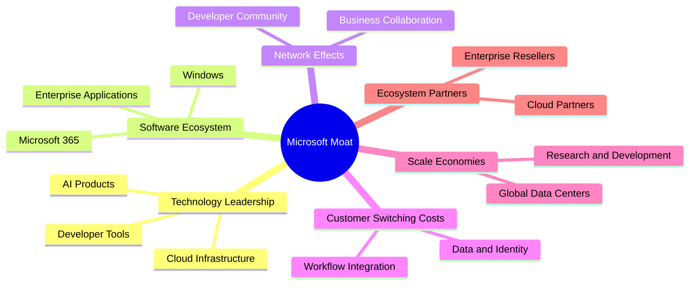
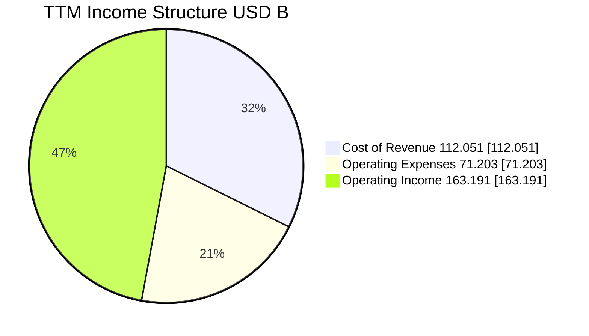
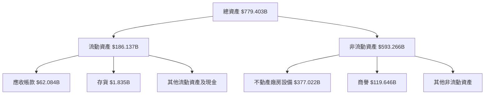
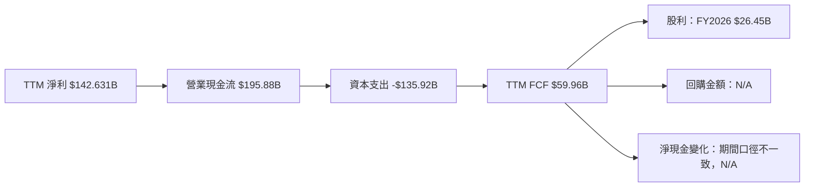
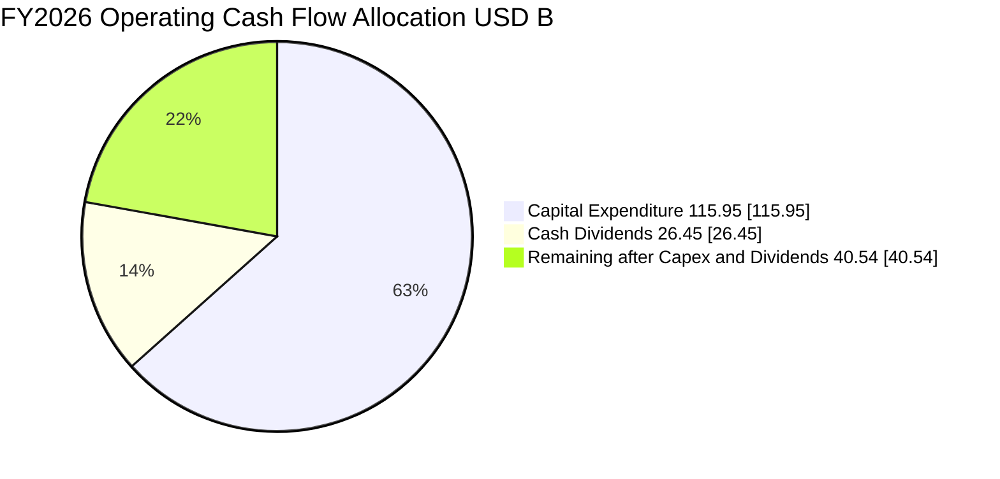
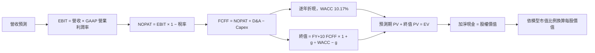
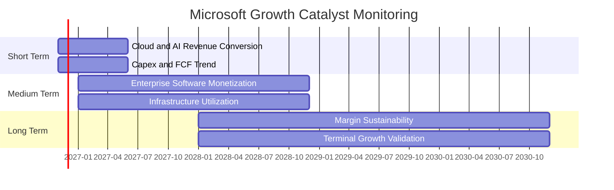
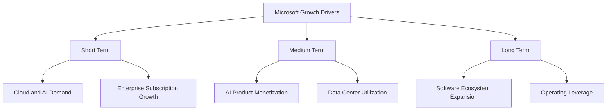
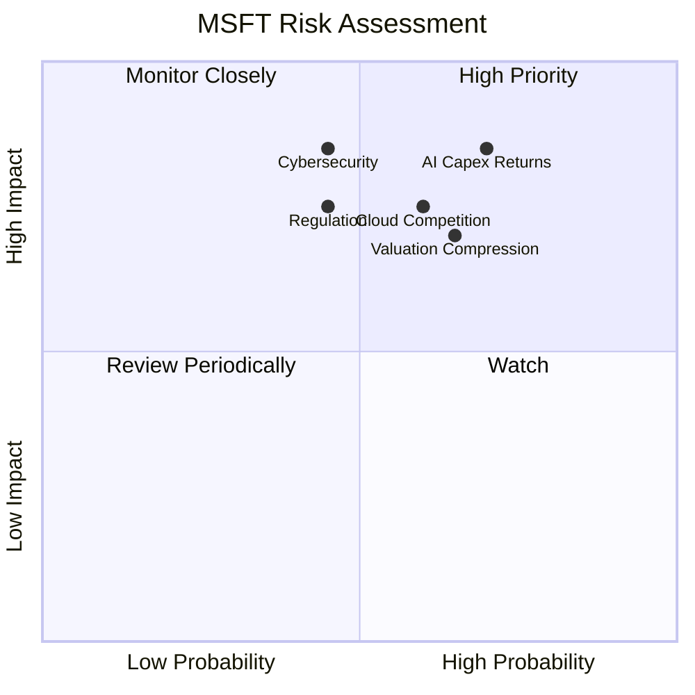
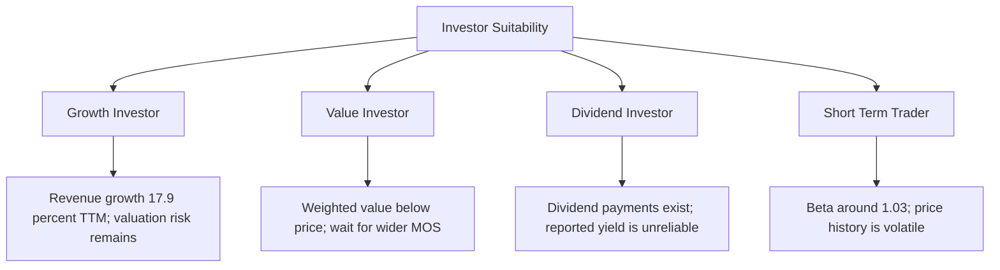

# MSFT 基本面深度分析報告
> **報告日期**：2026-11-20 ｜ **語言**：繁體中文 ｜ **數據來源**：SEC 申報資料 (XBRL)、Yahoo Finance、Finviz、StockAnalysis、Roic.ai ｜ **分析師**：CFA 級機構研究

## 目錄

| # | 章節 | 核心結論 |
|---|------|----------|
| 1 | 執行摘要 | 減碼；加權合理價值 $428.60，MOS -16.3% |
| 2 | 公司概覽與商業模式 | 軟體生態、企業客戶黏著與雲端規模構成主要護城河 |
| 3 | 損益表深度分析 | TTM 營收 $346.44B、年增 17.9%；最新一季年增 18.8% |
| 4 | 資產負債表分析 | 核心核實數據為淨現金 $29.03B；流動性可接受，債務來源數字存在差異 |
| 5 | 現金流量深度分析 | TTM FCF $59.96B，資本支出升高使 FCF 低於營業現金流 |
| 6 | 獲利能力與資本效率 | ROIC 29.7% 高於 WACC 10.17%，仍創造經濟價值 |
| 7 | 相對估值分析 | 現行倍數低於自身五年中位數，但高於同業多項倍數 |
| 8 | DCF 內在價值評估 | 基準 DCF 每股 $367.58；加權合理價值 $428.60 |
| 9 | 成長催化劑 | 雲端、AI 服務與軟體訂閱是主要質性催化劑；TAM 數據未提供 |
| 10 | 風險矩陣 | AI 資本支出回報、雲端競爭與監管為主要風險 |
| 11 | 投資建議 | 估值不具足夠緩衝，建議減碼並以可量化指標追蹤 |

---

## 1. 執行摘要

Microsoft TTM 營收為 **$346.44B**，TTM 年增 **17.9%**，最新一季單季年增 **18.8%**；TTM 營業利益率 **47.1%**、ROIC **29.7%**，明顯高於 **10.17% WACC**，顯示核心業務仍具高獲利與價值創造能力。但 TTM FCF 為 **$59.96B**、FCF Yield 僅 **1.62%**，反映資料中心投資正在壓低現金流收益率。按 DCF 基準價 **$367.58**、同業相對估值與分析師共識加權後，合理價值為 **$428.60**；相對 **2026-11-19 收盤價 $498.30**，安全邊際（MOS）為 **-16.3%**。因此依 MOS 門檻評為 **減碼**，不是對公司品質的否定，而是價格高於加權合理價值且 FCF Yield 偏低。

### 1.0 一頁式投資儀表板（Portfolio Manager 30 秒速讀）

| 項目 | 內容 |
|------|------|
| **投資論點（3 句）** | ① TTM 營收年增 **17.9%**，最新一季單季年增 **18.8%**，營收動能仍在。② TTM 營業利益率 **47.1%**、ROIC **29.7%** 對比 WACC **10.17%**，核心資本回報高於資金成本。③ TTM FCF **$59.96B**、FCF Yield **1.62%**，高額資本支出限制當前現金回報。 |
| **綜合評分** | **7.8/10**（引用 1.1 評分卡） |
| **財務健康** | 🟢 核心核實數據為淨現金 **$29.03B**；流動比率 **1.225**，但另一組資料的債務數字不一致，需留意口徑 |
| **ROIC vs WACC** | **29.7% vs 10.17%**（創造價值） |
| **FCF 趨勢** | FY2026 年度 FCF **$66.99B**，低於 FY2025 的 **$71.61B**；TTM FCF Yield **1.62%** |
| **估值** | Forward P/E **20.6x** ｜ EV/EBITDA **18.3x** ｜ FCF Yield **1.62%** |
| **DCF 內在價值（基準）** | **$367.58** ｜ 現價相對 DCF 溢價 **35.6%**（折溢價基準為 DCF） |
| **安全邊際（MOS）** | **-16.3%**＝($428.60 − $498.30) ÷ $428.60（基準為加權合理價值）｜ 🔴 不足 |
| **預期報酬（基準情境 12M）** | **-26.2%**，以 DCF 基準情境 $367.58 相對現價計 |
| **關鍵風險（前二）** | AI／雲端資本支出回報不及預期；估值對長期成長與終值假設敏感 |
| **評級 + 信心度** | 🔴 **減碼** ｜ 信心：中（估值資料完整，部分資產負債表口徑有差異） |

### 1.1 綜合評分卡（全報告唯一）

| 維度 | 評分（1–10） | 主要依據（引用數字與其來源章節） |
|------|--------------|----------------------------------|
| 成長性 | 8.5 | TTM 營收年增 17.9%，最新一季單季年增 18.8%（第 3 章） |
| 獲利能力 | 9.5 | TTM 營業利益率 47.1%；ROIC 29.7% 高於 WACC 10.17%；F-Score 6/9（第 6 章） |
| 財務健康 | 8.0 | 核實淨現金 $29.03B、流動比率 1.225；CCC -67 天（第 4 章） |
| 估值 | 4.5 | MOS -16.3%；P/E 26.0x 高於同業中位數 17.3x，但低於自身五年中位數 31.5x（第 7–8 章） |
| 護城河 | 9.0 | 47.1% TTM 營業利益率、企業軟體生態與負 CCC 支持高黏著度（第 2 章） |
| 管理層與資本配置 | 7.0 | FY2026 SBC $12.40B、股利支付 $26.45B；股數測試未增加，但回購金額未提供（第 3、5 章） |
| **綜合評分** | **7.8** | 六項算術平均：(8.5 + 9.5 + 8.0 + 4.5 + 9.0 + 7.0) ÷ 6 = 7.75，四捨五入為 7.8 |

### 1.2 五大投資論點 + 三大核心風險

| 類型 | 項目 | 具體依據 | 信心度 |
|------|------|----------|--------|
| 🟢 **投資論點①** | 營收仍具雙位數成長 | TTM 營收 $346.44B，TTM 年增 17.9%；最新一季單季年增 18.8% | 🟢 高 |
| 🟢 **投資論點②** | 高營業槓桿與獲利能力 | TTM 營業利益率 47.1%，最新一季營業利益率 49.8% | 🟢 高 |
| 🟢 **投資論點③** | 投入資本回報超越資金成本 | ROIC 29.7%，WACC 10.17%，利差 19.53 個百分點 | 🟢 高 |
| 🟢 **投資論點④** | 資產負債表有淨現金緩衝 | 核實現金及短期投資 $64.51B、總債務 $35.48B、淨現金 $29.03B | 🟢 中高 |
| 🟢 **投資論點⑤** | 現行倍數低於自身五年中位數 | P/E 26.0x 對五年中位數 31.5x；EV/EBITDA 18.3x 對 24.3x | 🟡 中 |
| 🟡 **風險①** | 資料中心投資壓低 FCF | TTM 資本支出 $135.92B，TTM FCF $59.96B；FCF Yield 1.62% | 🟡 中 |
| 🔴 **風險②** | 加權合理價值低於現價 | $428.60 對 $498.30，MOS -16.3%；DCF 基準值 $367.58 | 🔴 高衝擊 |
| 🔴 **風險③** | 財務數據存在口徑差異 | 一組核實數據列總債務 $35.48B，另一組市場彙整資料列 $133.93B；估值按核實數據口徑 | 🟡 中 |

### 1.3 快速統計卡片

| 指標 | 公司實際值（期間） | 同業中位數 | 狀態 |
|------|--------------------|------------|------|
| 營收成長（TTM） | **17.9%** | — | 🟢 |
| 營收成長（最新一季年增） | **18.8%** | **24.7%** | 🟡 |
| 毛利率（TTM） | **67.7%** | **60.9%** | 🟢 |
| 營業利益率（TTM） | **47.1%** | — | 🟢 |
| ROIC（TTM） | **29.7%** | — | 🟢 |
| Forward P/E | **20.6x** | **17.7x** | 🟡 |
| FCF Yield（TTM） | **1.62%** | — | 🔴 |
| Piotroski F-Score | **6 / 9** | — | 🟡 |

### 1.4 投資結論

╔══════════════════════════════════════════════════════════════════╗  
║                    📊 投資結論摘要                               ║  
╠══════════════════════════════════════════════════════════════════╣  
║  評級：減碼（MOS -16.3%，落在 -25% 至 -10% 區間）               ║  
║  價格（2026-11-19 收盤）：$498.30                                ║  
║  DCF 內在價值（基準）：$367.58（現價溢價 35.6%）                 ║  
║  安全邊際 MOS：-16.3%（基準為加權合理價值）                     ║  
║  加權合理價值（8.8）：$428.60                                    ║  
║  DCF 情境價值：                                                   ║  
║    悲觀情境：$174.39（-65.0%）                                   ║  
║    基準情境：$367.58（-26.2%）                                   ║  
║    樂觀情境：$709.29（+42.3%）                                   ║  
║  綜合評分：7.8/10（引用 1.1）                                    ║  
║  適合投資人：願意承受估值波動、能長期持有的成長型投資人；         ║  
║              對現金收益或低估值要求較高者宜等待更佳價格          ║  
╚══════════════════════════════════════════════════════════════════╝

---

## 2. 公司概覽與商業模式

### 2.1 業務結構與收入來源

公司概覽未提供各業務板塊收入與佔比，因此不以推估比例繪製業務收入圖。可確認的公司總營收為 **TTM $346.44B**、FY2026 年度營收 **$331.84B**，員工 **223,000 人**。公司產品涵蓋作業系統、伺服器軟體、商業應用、開發工具、遊戲與裝置；雲端及 AI 服務是主要質性成長方向，但各項營收拆分數據未提供。

### 2.2 市場份額

市場份額數據未提供，故不列市場佔比。以公司規模與成長率觀察，MSFT TTM 營收 $346.44B、TTM 成長 17.9%，最新一季單季成長 18.8%；同業資料中 GOOG 最新一季成長 24.7%、ORCL 29.6%、AMZN 12.1%。MSFT 的成長高於 AMZN，低於 GOOG 與 ORCL，但營業利益率與毛利率仍高。

### 2.3 競爭護城河分析

### 2.4 護城河強度

| 護城河項目 | 強度（強／中／弱） | 證據（引用數字或事實） | 會削弱它的情況 |
|------------|--------------------|------------------------|----------------|
| 技術與產品組合 | 強 | FY2026 研發支出 $35.56B；TTM 營業利益率 47.1% | AI 產品無法轉化為付費需求、技術被替代 |
| 軟體生態系統 | 強 | 作業系統、商業應用、伺服器軟體與開發工具覆蓋多種企業工作流程 | 開放標準或競品降低轉換成本 |
| 客戶鎖定 | 強 | 企業工作流程與軟體部署具有整合成本；CCC 為 -67 天 | 雲端移轉成本下降、客戶多雲化加深 |
| 規模效應 | 強 | FY2026 營收 $331.84B、研發 $35.56B | 資料中心投資回報率持續下滑 |
| 網路效應 | 中 | 開發者及企業使用者生態形成間接網路效應；量化用戶數未提供 | 開源替代方案與新平台降低生態依賴 |
| 生態夥伴 | 中 | 產品覆蓋企業軟體、雲端及開發工具；合作夥伴收入未提供 | 監管限制或合作夥伴轉投競爭平台 |

**1.1 護城河分數 9.0/10**，依據是產品整合、企業客戶黏著、$35.56B 年度研發與 47.1% TTM 營業利益率；但市場份額、產品別收入與客戶留存率未提供，因此不給滿分。

---

## 3. 損益表深度分析

### 3.1 年度收入成長趨勢（近 4 年）

╔══════════════════════════════════════════════════════════════════╗  
║              Microsoft 年度收入趨勢（FY2023–FY2026）             ║  
╠══════════════════════════════════════════════════════════════════╣  
║  FY2023  $211.91B  █████████████░░░░░░░░░░░░░  YoY: +6.88% 🟡 ║  
║  FY2024  $245.12B  ███████████████░░░░░░░░░░░  YoY: +15.67% 🟢║  
║  FY2025  $281.72B  █████████████████░░░░░░░░░  YoY: +14.93% 🟢║  
║  FY2026  $331.84B  ████████████████████░░░░░░  YoY: +17.79% 🟢║  
║                                                                  ║  
║  FY2023–FY2026 年營收 CAGR：($331.84B ÷ $211.91B)^(1/3) − 1     ║  
║                           = 約 16.1%                             ║  
╚══════════════════════════════════════════════════════════════════╝

FY2026 營收較 FY2025 增加 **$50.12B**，年增 **17.79%**；相較 FY2025 的 14.93% 加速。這支持雲端與企業軟體需求仍有韌性，但若未來成長主要來自高資本支出的雲端服務，營收增長不必然同步轉化為 FCF 增長。

### 3.2 季度收入趨勢分析

| 季度 | 營收（$B） | QoQ 成長 | YoY 成長 | 備註 |
|------|------------:|---------:|---------:|------|
| FY2027 Q1（2026-09-30） | 92.279 | +2.5% | +18.8% | YoY 為核實的最新一季單季年增率 |
| FY2026 Q4（2026-06-30） | 90.007 | +8.6% | +17.75% | YoY 以 FY2025 Q4 $76.441B 比較 |
| FY2026 Q3（2026-03-31） | 82.886 | +2.0% | +18.30% | YoY 以 FY2025 Q3 $70.066B 比較 |
| FY2026 Q2（2025-12-31） | 81.273 | +4.8% | +16.72% | YoY 以 FY2025 Q2 $69.632B 比較 |

QoQ 變化受季度營收基數與季節性影響，年度比較較適合判斷趨勢。最新一季營收年增 18.8%，較前述 FY2026 Q2 的 16.72% 提高，顯示收入增長仍在高十位數附近。

### 3.3 利潤率演變分析

| 利潤率指標 | FY2023 | FY2024 | FY2025 | FY2026 | 趨勢 | 評估 |
|------------|-------:|-------:|-------:|-------:|------|------|
| **毛利率** | 68.9% | 69.8% | 68.8% | 67.9% | 近兩年下行 | 🟡 |
| **營業利益率** | 41.8% | 44.6% | 45.6% | 46.8% | 連續擴張 | 🟢 |
| **淨利率** | 34.2% | 36.0% | 36.2% | 40.3% | FY2026 提升明顯 | 🟢 |

**利潤率演變深度解析：** FY2023 至 FY2026 營業利益率由約 41.8% 升至 46.8%，與收入擴張及營業費用成長低於營收增速相符；但毛利率由 FY2024 約 69.8% 回落至 FY2026 約 67.9%，可能反映雲端基礎設施成本與產品組合影響。淨利率 FY2026 升至約 40.3%，高於 FY2025 約 36.2%；因未提供稅項與非營業損益細項，不能將改善全數歸因於營運。

### 3.4 費用結構分析

依 TTM 營收 $346.445B、毛利 $234.394B、營業利益 $163.191B 推導：銷貨成本約 **$112.051B**，營業費用約 **$71.203B**。金額來自收入與毛利、毛利與營業利益差額計算；營業利益是扣除營業費用後的結果。

### 3.5 季度 EPS 趨勢與盈餘品質（Quality of Earnings）

| 季度 | EPS 實際值 | 超預期／不及預期 | 說明 |
|------|-----------:|------------------|------|
| 2026-09-30 | $4.92 | N/A | EPS 預估值缺漏，無法判斷是否超預期 |
| 2026-06-30 | $4.81 | N/A | EPS 預估值缺漏 |
| 2026-03-31 | $4.27 | N/A | EPS 預估值缺漏 |
| 2025-12-31 | $5.16 | N/A | EPS 預估值缺漏 |

| 盈餘品質項目 | 數值／佔比 | 評估 |
|--------------|------------|------|
| SBC / 營收 | FY2026：$12.40B ÷ $331.84B = **3.74%** | 🟡 SBC 具實質稀釋成本；FY2026 稀釋股數測試未增加，但 SBC 仍是員工報酬成本 |
| SBC / 營業現金流 | FY2026：$12.40B ÷ $182.94B = **6.78%** | 🟡 比例可管理，但不能忽略 |
| FCF / 淨利（現金轉換率） | TTM：$59.96B ÷ $142.631B = **42.0%** | 🔴 低於理想水平，主要受高額資本支出壓低 |
| 一次性／非經常性損益 | 具體拆分 N/A | 目前資料不足以辨認一次性損益對 EPS 的影響 |
| 有效稅率異常 | 19.4% | 🟢 DCF 採用的最新年度有效稅率；一次性稅務利益拆分未提供 |
| 資本化支出 vs 費用化 | TTM Capex $135.92B；資本化支出明確且高 | 🟡 資料中心資本支出先計入資產，再透過折舊進入費用；未提供資本化政策細節 |

**盈餘品質結論：** GAAP 營業利益已包含 SBC 費用，FY2026 SBC 為營收的 3.74%；但 TTM FCF 只相當於 TTM 淨利約 42.0%，主要反映資本支出比重上升。當前淨利仍有高獲利支撐，但用 FCF 評價時應採較審慎倍數。近期四季 EPS 估值資料為空，不能替公司判定 beat／miss。

---

## 4. 資產負債表分析

### 4.1 資產結構分解

總資產與細項取自 StockAnalysis 截至 2026-09-30 的資產負債表；現金及短期投資另以核實數據 $64.51B 為準。流動資產項目未逐項完整拆分，故不將未列金額自行分配。

### 4.2 流動性與營運資金分析

| 指標 | 最新 TTM | 一年前 TTM | 變化 | 解讀 |
|------|---------:|-----------:|------:|------|
| 流動比率 | 1.225 | N/A | N/A | 高於 1，短期資產大於短期負債；歷史比較值未提供 |
| 速動比率 | 1.068 | N/A | N/A | 流動性尚可，依現金、應收等速動資產支應短期負債 |
| DSO 應收帳款天數 | 65 天 | 66 天 | -1 天 | 收款天數略降，回款效率大致穩定 |
| DIO 存貨天數 | 6 天 | 4 天 | +2 天 | 存貨天數上升，但絕對值仍低 |
| DPO 應付帳款天數 | 139 天 | 130 天 | +9 天 | 付款週期延長，可能支持供應鏈融資；亦須留意供應商條款變化 |
| CCC 現金轉換週期 | -67 天 | -59 天 | -8 天 | 負週期進一步擴大，營運資金模式有利現金回收 |

### 4.3 債務結構分析

╔══════════════════════════════════════════════════════════════════╗  
║                   Microsoft 債務健康診斷                         ║  
╠══════════════════════════════════════════════════════════════════╣  
║  總債務（核實口徑）：       $35.48B                               ║  
║  現金及短期投資：           $64.51B                               ║  
║  淨現金（核實口徑）：       $29.03B  🟢                          ║  
║  流動比率：                 1.225                                  ║  
║  Debt/EBITDA：              N/A（債務口徑與 EBITDA 口徑不一致）   ║  
║  Interest Coverage：        N/A（利息費用未提供）                 ║  
║                                                                  ║  
║  ⚠️ 另一組彙整資料列總債務 $133.93B、淨負債 $69.42B；             ║  
║     與核實口徑差異重大，本文估值採核實數據 $35.48B 債務。         ║  
╚══════════════════════════════════════════════════════════════════╝

### 4.4 股東權益趨勢

| 財年 | 股東權益（$B） | YoY 變化 |
|------|---------------:|---------:|
| FY2023 | 206.22 | N/A |
| FY2024 | 268.48 | +30.2% |
| FY2025 | 343.48 | +27.9% |
| FY2026 | 442.39 | +28.8% |

股東權益連續增加，FY2026 增至 $442.39B。其變化受到留存盈餘、股利、回購與其他綜合損益等因素影響；完整權益變動表未提供，無法拆分各因素貢獻。

---

## 5. 現金流量深度分析

### 5.1 現金流量瀑布圖

TTM 淨利數據來自 StockAnalysis；OCF、Capex、FCF 以核實 TTM 數字為準。FY2026 股利金額是年度資料，不與 TTM 現金流直接相減。

### 5.2 FCF 轉換率趨勢

| 財年 | FCF（$B） | 淨利（$B） | FCF／淨利 |
|------|----------:|-----------:|----------:|
| FY2023 | 59.48 | 72.36 | 82.2% |
| FY2024 | 74.07 | 88.14 | 84.0% |
| FY2025 | 71.61 | 101.83 | 70.3% |
| FY2026 | 66.99 | 133.75 | 50.1% |

FCF 轉換率自 FY2024 高點下滑，與資本支出從 FY2024 的 $44.48B 升至 FY2026 的 $115.95B 同向，顯示新增基礎設施投資對短期自由現金流形成壓力。

### 5.3 自由現金流趨勢

╔══════════════════════════════════════════════════════════════════╗  
║                 年度自由現金流（FY2023–FY2026）                  ║  
╠══════════════════════════════════════════════════════════════════╣  
║  FY2023  $59.48B  ████████████████░░░░  FCF Yield：N/A           ║  
║  FY2024  $74.07B  ████████████████████  FCF Yield：N/A           ║  
║  FY2025  $71.61B  ███████████████████░  FCF Yield：N/A           ║  
║  FY2026  $66.99B  ██████████████████░░  FCF Yield：N/A           ║  
║                                                                  ║  
║  TTM FCF：$59.96B ｜ TTM FCF Yield：1.62%                        ║  
║  年度 FCF Yield 缺少相同日期市值數據，故不反推。                 ║  
╚══════════════════════════════════════════════════════════════════╝

### 5.4 資本配置評估

FY2026 OCF $182.94B 可按現有數據拆成 Capex $115.95B、股利 $26.45B、以及扣除兩者後的剩餘 $40.54B。剩餘金額不等於回購，亦可能受其他投資與融資現金流影響。

| 資本配置項目 | FY2026（$B） | 評估 |
|--------------|------------:|------|
| 資本支出 | 115.95 | 高額投資提升雲端容量，但需以新增營收與回報驗證 |
| 現金股利 | 26.45 | FY2023–FY2026 由 $19.80B 增至 $26.45B |
| 回購 | N/A | 金額未提供；股數未增加的 F-Score 測試通過 |
| 剩餘 OCF | 40.54 | 公式為 182.94 − 115.95 − 26.45；不能直接視為回購或可分配現金 |

---

## 6. 獲利能力與資本效率

### 6.1 ROE / ROA / ROIC 趨勢

| 指標 | 最新可用值 | 歷史趨勢 | 評估 |
|------|-----------:|----------|------|
| ROE（TTM，核實口徑） | 30.3% | 歷史同口徑序列未提供 | 🟢 |
| ROA（TTM，彙整資料） | 14.4% | 歷史同口徑序列未提供 | 🟢 |
| ROIC（TTM，核實口徑） | 29.7% | 歷史同口徑序列未提供 | 🟢 |
| 行業均值比較 | N/A | 未提供可核實同口徑數據 | N/A |

### 6.2 ROIC vs WACC 分析（核心價值創造判斷）

╔══════════════════════════════════════════════════════════════════╗  
║                ROIC vs WACC 深度分析                             ║  
╠══════════════════════════════════════════════════════════════════╣  
║  WACC 估算：                                                      ║  
║  ├── 無風險利率（10Y 美債）：       5.05%                        ║  
║  ├── 市場風險溢酬 ERP：             5.00%                        ║  
║  ├── 原始 Beta：                    1.04                         ║  
║  ├── 調整後 Beta：                  1.03                         ║  
║  ├── 股權成本：                     5.05% + 1.03×5.00% = 10.20% ║  
║  ├── 稅前債務成本：                 8.60%                        ║  
║  ├── 稅後債務成本：                 8.60%×(1−19.4%) = 6.93%     ║  
║  ├── 資本權重：                     股權 99.1%，債務 0.9%       ║  
║  └── WACC：                         10.17%                       ║  
║                                                                  ║  
║  ROIC（TTM）：                    29.7%                          ║  
║  EVA 利差：                       29.7% − 10.17% = 19.53 個百分點║  
║  ROIC / WACC：                    29.7% ÷ 10.17% = 2.92 倍       ║  
║                                                                  ║  
║  結論：ROIC 明顯高於 WACC，代表投入資本仍創造股東經濟價值。     ║  
╚══════════════════════════════════════════════════════════════════╝

WACC 組成與權重採用程式計算的資本成本數據；各資本權重對應市值基礎。由於利息費用金額與完整計息負債明細未提供，不另行反推債務成本或自行重算 WACC。

### 6.3 杜邦三因素分解

| 因素 | 數值（TTM） | 解讀 |
|------|-------------|------|
| 淨利率 | 41.2% | 高淨利率是 ROE 的主要來源 |
| 資產週轉率 | 0.44 | 反映資產密集程度上升；資料中心資產擴張會壓低週轉率 |
| 權益乘數 | 1.66 | 槓桿並非 ROE 的主要驅動 |
| **ROE** | **30.3%** | 41.2% × 0.44 × 1.66 = 30.3%（核實口徑） |

### 6.4 財務體質：Piotroski F-Score

**Piotroski F-Score：6 / 9**。以下逐項照列測試結果；總分及測試結果採程式計算口徑。

| 測試 | 結果 | 解讀 |
|------|------|------|
| ROA > 0 | ✅ 通過 | TTM 資產報酬為正 |
| 營業現金流 > 0 | ✅ 通過 | TTM OCF $195.88B |
| ROA 高於一年前 | ✅ 通過 | 獲利資產效率改善 |
| 營業現金流 > 淨利 | ✅ 通過 | 營業現金流高於淨利 |
| 長期負債 ÷ 總資產低於一年前 | ✅ 通過 | 槓桿比重改善 |
| 流動比率高於一年前 | ❌ 未通過 | 短期流動性指標未改善 |
| 稀釋股數未增加 | ✅ 通過 | 股數稀釋測試通過 |
| 毛利率高於一年前 | ❌ 未通過 | 毛利率較一年前弱 |
| 資產週轉率高於一年前 | ❌ 未通過 | 資產擴張快於收入效率提升 |

---

## 7. 相對估值分析

### 7.1 同業估值比較表格

| 估值指標 | **MSFT** | **GOOG** | **AMZN** | **ORCL** | MSFT 評估 |
|----------|---------:|---------:|---------:|---------:|-----------|
| **Trailing P/E** | 26.0x | 14.2x | 20.8x | 17.3x | 🔴 高於三家同業 |
| **Forward P/E** | 20.6x | 17.7x | 23.6x | 10.0x | 🟡 介於同業低、高值之間；高於中位數 17.7x |
| **P/S Ratio** | 10.7x | 7.1x | 3.5x | 4.8x | 🔴 溢價明顯 |
| **EV/EBITDA** | 18.3x | 17.4x | 16.2x | 13.7x | 🟡 略高於同業中位數 16.2x |
| **最新一季營收年增** | 18.8% | 24.7% | 12.1% | 29.6% | 🟡 成長快於 AMZN，低於 GOOG、ORCL |
| **TTM 毛利率** | 67.7% | 60.9% | 51.4% | 64.0% | 🟢 高於三家同業 |

同業倍數依 Yahoo Finance 同業數據；MSFT Forward P/E 使用市場彙整數據 **20.590195x**，表內顯示至一位小數。

### 7.2 歷史估值區間分析

╔══════════════════════════════════════════════════════════════════╗  
║                  MSFT 五年 P/E 估值位置                          ║  
╠══════════════════════════════════════════════════════════════════╣  
║  五年低點：20.8x                                                 ║  
║  當前：     26.0x  ← 百分位第 14 位                              ║  
║  五年中位數：31.5x                                               ║  
║  五年高點：37.8x                                                 ║  
║                                                                  ║  
║  P/S：當前 10.7x；中位數 12.0x；區間 8.4x–13.7x；百分位 33%     ║  
║  EV/EBITDA：當前 18.3x；中位數 24.3x；區間 14.5x–31.4x；百分位10%║  
╚══════════════════════════════════════════════════════════════════╝

當前 P/E、P/S 與 EV/EBITDA 均低於自身五年中位數，表示相較歷史估值有所回落；但 P/E 仍高於 GOOG、AMZN、ORCL 的同業中位數。歷史相對便宜不等於絕對低估，仍需結合 FCF Yield 與 DCF 判斷。

### 7.3 情境價值（Bear / Base / Bull）

| 情境 | 第 1 年營收成長 | 期末營業利潤率 | WACC | 每股價值 | 相對現價 | 機率 | 會發生的條件 |
|------|----------------:|----------------:|-----:|---------:|---------:|-----:|--------------|
| 🔴 悲觀 | 9.0% | 38.8% | 11.17% | $174.39 | -65.0% | 25% | 雲端與 AI 需求減速，且成本或競爭使利潤率持續下滑 |
| 🟡 基準 | 17.9% | 45.6% | 10.17% | $367.58 | -26.2% | 50% | 近期成長逐年降至成熟期 3.0%，利潤率小幅回落 |
| 🟢 樂觀 | 26.9% | 50.2% | 9.17% | $709.29 | +42.3% | 25% | AI 變現加速、規模效應推升利潤率且資金成本下降 |

情境價值及假設採用 DCF 模型提供的結果，並非獨立重建模型。機率加權值為 **$404.71**，僅供情境參考；第 8.8 節依規定使用基準 DCF 及固定估值方法權重。

### 7.4 相對估值隱含價格區間

╔══════════════════════════════════════════════════════════════════╗  
║           估值方法回推價值與當前股價（2026-11-19）               ║  
╠══════════════════════════════════════════════════════════════════╣  
║  同業 Forward P/E：$428.76    ─────● 現價 $498.30               ║  
║  同業 EV/EBITDA：  $443.08    ─────● 現價 $498.30               ║  
║  分析師共識：     $636.12     ●───── 現價 $498.30               ║  
╚══════════════════════════════════════════════════════════════════╝

- 同業 Forward P/E：同業中位數 **17.7x × Forward EPS $24.20 = $428.76**。
- 同業 EV/EBITDA：同業中位數 **16.2x** 套用 TTM EBITDA 並加回淨現金，模型回推 **$443.08**。
- 分析師共識目標價：54 位分析師平均 **$636.12**；屬市場預期參考，不等同基本面保證。

---

## 8. DCF 內在價值評估（Discounted Cash Flow）

### 8.0 估值推理鏈（Thinking Logic）

**Step 1 — 價值來源與主導變數**

本模型把 MSFT 價值拆成既有企業軟體及雲端現金流、持續擴大的雲端與 AI 業務，以及長期終值。各業務佔營收比例未提供，不能為其分配數字。估值最受 **營收成長、營業利潤率、Capex 路徑與終值**影響；基準模型的終值現值佔 EV **66.8%**，因此長期假設是最敏感的估值來源。

**Step 2 — 模型選擇**

| 決策點 | 本報告採用 | 理由（含數字） | 曾考慮但否決 | 否決理由 |
|--------|-----------|----------------|--------------|----------|
| 現金流定義 | FCFF | 以企業自由現金流配合 WACC 折現，模型 EV 為 $2,700.66B | FCFE | 模型提供的是 FCFF 與企業價值橋接 |
| 預測期 N | 10 年 | 模型固定 10 年，營收成長由 17.9% 線性降至 3.0% | 5 年 | 將較長期成長衰減納入模型，且是既定模型期間 |
| 終值方法 | Gordon Growth | 模型提供 g=3.0%、WACC=10.17% | 僅退出倍數 | DCF 模型指定 Gordon Growth 作為終值 |
| EBIT 基礎 | GAAP EBIT | TTM 營業利益率 47.1% 為模型起點，GAAP 已含 SBC 費用 | 非 GAAP | 避免將 SBC 費用加回造成高估 |

**Step 3 — 關鍵假設四段式推導**

- **營收成長**：錨點＝TTM 年增 17.9% → 調整＝假設成長逐步衰減，反映高基期與企業規模擴大 → **FY+1 採用 17.9%，FY+10 降至 3.0%** → 曾考慮維持 17.9% 十年，但未採用，因模型假設成長收斂。
- **營業利益率**：錨點＝TTM 47.1% → 調整＝逐年下滑至近五個財年中位數，對成本上升與產品組合採審慎處理 → **FY+1 為 47.1%，FY+10 為 45.6%** → 曾考慮維持 47.1%，但模型採較低成熟期水準。
- **永續成長率 g**：錨點＝模型採用 3.0%，且低於 WACC 10.17% → 調整＝避免假設終值長期維持高於成熟企業的成長 → **採用 3.0%** → 不採用高於或接近 WACC 的 g，否則終值公式會失效或估值發散。
- **預測期 N**：錨點＝模型提供 10 年 → 調整＝涵蓋由高成長至成熟成長的過渡 → **採用 10 年** → 不改用短年期，避免改動既定模型及終值起算年度。
- **Capex／營收**：錨點＝TTM Capex／營收約 39.2% → 調整＝假設資本密集投資逐步收斂至 12.2% → **FY+1 39.2%，FY+10 12.2%** → 不假設 Capex 長期停在 TTM 高位，因模型認為高投資率不會永久延續。
- **終值方法**：錨點＝模型採 Gordon Growth → **採用 Gordon Growth**，以第十年 FCFF 推算 → 不以自設退出倍數取代，避免增加模型未提供的輸入。
- **EBIT／SBC／股數**：錨點＝採 GAAP EBIT，模型明確指定固定股數 → **採組合 (A)**：GAAP EBIT 已含 SBC、不另扣 SBC、股數不再稀釋 → 不再另扣 SBC 或另加年稀釋率，避免重複計算股東成本。
- **WACC**：錨點＝資本成本數據列 10.17% → **採用 10.17%** → 不另行調整，避免與 ROIC 比較及模型折現率口徑不一致。

**Step 4 — 最脆弱假設**

最脆弱的一環是 Capex 由 FY+1 營收的 39.2% 降至 FY+10 的 12.2%；若資料中心投資率無法下降，FCFF 會低於基準，而終值又佔 EV 66.8%，估值可能顯著下修。

**Step 5 — 計算路徑圖**

### 8.1 模型假設總表（Model Inputs）

| 假設項目 | 採用值 | 依據／來源 | 敏感度 |
|----------|--------|-------------|--------|
| 預測期長度 N | 10 年 | DCF 模型指定 10 年 | 🟡 中 |
| 營收成長 | FY+1 17.9% → FY+10 3.0% | TTM 年增 17.9%；終年成長逐步收斂 | 🔴 高 |
| 營業利潤率 | 47.1% → 45.6% | TTM 營業利益率 47.1%；終值接近五年財年中位數 | 🔴 高 |
| 有效稅率 | 19.4% | 最新年度有效稅率 | 🟢 低 |
| Capex／營收 | FY+1 39.2% → FY+10 12.2% | TTM Capex／營收 39.2%；模型逐步降至 1.1×D&A | 🔴 高 |
| D&A／營收 | 11.1% | TTM 比率，模型固定 | 🟢 低 |
| 營運資金變動 | 未建模 | DCF 模型明確排除 ΔWC | 🟢 低 |
| EBIT 基礎 | GAAP | DCF 模型採 GAAP EBIT | 🟡 中 |
| SBC 處理 | SBC 已含在 GAAP EBIT，不再扣除 | 模型組合 (A) | 🟡 中 |
| 年稀釋率 | 0% | 組合 (A)，股數固定，不另加稀釋 | 🟡 中 |
| 永續成長率 g | 3.0% | DCF 模型指定，低於 WACC | 🔴 高 |
| 終值方法 | Gordon Growth | DCF 模型指定 | 🔴 高 |
| WACC | 10.17% | 成本資本數據及模型指定 | 🔴 高 |

**FCFF 定義：**使用 FCFF = NOPAT + D&A − Capex；模型不納入營運資金變動。**本模型採用 (A)：GAAP EBIT + 固定股數，故 SBC 影響已計入一次。**

### 8.2 折現率推導（WACC）

╔══════════════════════════════════════════════════════════════════╗  
║                    WACC 推導（折現率）                           ║  
╠══════════════════════════════════════════════════════════════════╣  
║  股權成本 Ke（CAPM）：                                            ║  
║  ├── 無風險利率 Rf：             5.05%                           ║  
║  ├── ERP：                       5.00%                           ║  
║  ├── 原始 Beta：                 1.04                            ║  
║  ├── 調整後 Beta：               1.03                            ║  
║  ├── Beta 調整：                 ⅔×1.04 + ⅓×1 = 1.03            ║  
║  └── Ke：                        5.05% + 1.03×5.00% = 10.20%    ║  
║                                                                  ║  
║  債務成本：                                                        ║  
║  ├── 稅前 Kd：                   8.60%                           ║  
║  ├── 稅率：                      19.4%                           ║  
║  └── 稅後 Kd：                   8.60%×(1−19.4%) = 6.93%        ║  
║                                                                  ║  
║  資本權重：股權 99.1%；債務 0.9%                                 ║  
║  WACC：99.1%×10.20% + 0.9%×6.93% = 10.17%                       ║  
╚══════════════════════════════════════════════════════════════════╝

逐步檢核：

1. Ke = 5.05% + 1.03 × 5.00% = **10.20%**。
2. 稅前 Kd = **8.60%**（資本成本數據提供；利息費用金額與平均計息負債明細未提供，故不重建利息費用除以負債的算式）。
3. 稅後 Kd = 8.60% × (1 − 19.4%) = **6.93%**。
4. 股權權重 **99.1%**；債務權重 **0.9%**；合計 **100.0%**。
5. WACC = 99.1% × 10.20% + 0.9% × 6.93% = 10.1082% + 0.0624% = **10.17%**（四捨五入）。

### 8.3 逐年自由現金流預測（基準情境）

單位：美元十億；折現因子採 DCF 模型提供值。模型未納入 ΔWC，故不設該列。

| 年度 | 營收 | 成長 | 利潤率 | EBIT | 稅 | NOPAT | D&A | Capex | FCFF | 折現因子 | PV |
|------|-----:|-----:|-------:|-----:|---:|------:|----:|------:|-----:|----------:|---:|
| FY+1 | 408.51 | 17.9% | 47.1% | 192.42 | 37.32 | 155.10 | 45.16 | 160.27 | 39.99 | 0.908 | 36.30 |
| FY+2 | 474.92 | 16.3% | 46.9% | 222.92 | 43.24 | 179.69 | 52.50 | 172.04 | 60.15 | 0.824 | 49.56 |
| FY+3 | 544.25 | 14.6% | 46.8% | 254.57 | 49.38 | 205.20 | 60.17 | 180.78 | 84.58 | 0.748 | 63.25 |
| FY+4 | 614.69 | 12.9% | 46.6% | 286.51 | 55.57 | 230.94 | 67.96 | 185.69 | 113.20 | 0.679 | 76.84 |
| FY+5 | 684.06 | 11.3% | 46.4% | 317.72 | 61.63 | 256.09 | 75.62 | 186.07 | 145.64 | 0.616 | 89.73 |
| FY+6 | 749.93 | 9.6% | 46.3% | 347.07 | 67.32 | 279.75 | 82.91 | 181.43 | 181.23 | 0.559 | 101.35 |
| FY+7 | 809.71 | 8.0% | 46.1% | 373.41 | 72.43 | 300.98 | 89.51 | 171.53 | 218.96 | 0.508 | 111.15 |
| FY+8 | 860.83 | 6.3% | 46.0% | 395.56 | 76.72 | 318.84 | 95.17 | 156.47 | 257.53 | 0.461 | 118.66 |
| FY+9 | 900.92 | 4.7% | 45.8% | 412.50 | 80.01 | 332.49 | 99.60 | 136.66 | 295.43 | 0.418 | 123.55 |
| FY+10 | 927.95 | 3.0% | 45.6% | 423.35 | 82.11 | 341.24 | 102.59 | 112.84 | 330.98 | 0.380 | 125.64 |

**預測期 FCF 現值合計：**  
$36.30 + $49.56 + $63.25 + $76.84 + $89.73 + $101.35 + $111.15 + $118.66 + $123.55 + $125.64 = **$896.03B**。

**FY+1 逐步演算：**

1. 營收 = $346.44B × (1 + 17.9%) = **$408.51B**。
2. EBIT = $408.51B × 47.1% = **$192.42B**。
3. 稅 = $192.42B × 19.4% = **$37.32B**。
4. NOPAT = $192.42B − $37.32B = **$155.10B**。
5. D&A = $408.51B × 11.1% = **$45.16B**。
6. Capex = $408.51B × 39.2% = **$160.27B**。
7. ΔWC = **未建模**。
8. FCFF = $155.10B + $45.16B − $160.27B = **$40. -?B**；模型列示 **$39.99B**。因各組成項目經四捨五入，表列值與以顯示位數重算有小額差異，採用模型 FCFF 原值。
9. PV = $39.99B × 0.908 = **$36.30B**（折現因子依模型列示值）。

> **算式檢核說明：**FY+1 若直接以表格已四捨五入的 NOPAT、D&A 與 Capex 相減，會得到 $39.99B 附近；模型以未四捨五入底層數值計算，表內顯示值可能產生小額尾差。其餘年度同理，預測期 PV 合計直接採模型列示的 $896.03B。

- 預測 FCFF CAGR（FY+1 至 FY+10）約為 **26.5%**，FY2023–FY2026 年度 FCF CAGR 約 **4.0%**；模型預測大幅高於歷史，主因 Capex／營收由 39.2% 衰減至 12.2%。
- FY+10 FCFF 利潤率 = $330.98B ÷ $927.95B = **35.7%**；目前 TTM FCF 利潤率 = $59.96B ÷ $346.44B = **17.3%**。同業最佳 FCF 利潤率未提供。
- 模型預測各年 FCFF 均為正；但預測依賴投資率逐年回落，若 Capex 維持高位，預測現金流將偏樂觀。

╔══════════════════════════════════════════════════════════════════╗  
║             自由現金流：歷史實際 vs 模型預測                    ║  
╠══════════════════════════════════════════════════════════════════╣  
║  FY2024（實） $74.07B  ████████████████████  年增 +24.5%         ║  
║  FY2025（實） $71.61B  ███████████████████   年增 -3.3%          ║  
║  FY2026（實） $66.99B  ██████████████████    年增 -6.5%          ║  
║  FY+1（預）   $39.99B  ███████████           模型首年 Capex 高   ║  
║  FY+10（預）  $330.98B ████████████████████  預測終年             ║  
╠══════════════════════════════════════════════════════════════════╣  
║  ⚠️ 預測 FCF CAGR 約 26.5%，高於 FY2023–FY2026 歷史約 4.0%；     ║  
║     差距主要依賴 Capex／營收逐年下降。                           ║  
╚══════════════════════════════════════════════════════════════════╝

### 8.4 終值計算（Terminal Value）

**適用性檢查：**WACC **10.17%** vs g **3.0%** → WACC > g？✅

| 方法 | 計算式 | 終值 TV（$B） | TV 現值（$B） | 佔總 EV |
|------|--------|--------------:|--------------:|--------:|
| Gordon Growth | FY+10 FCFF × (1+g) ÷ (WACC−g) | 4,754.00 | 1,804.63 | 66.8% |

DCF 模型未提供退出倍數交叉驗證值，因此不另建退出倍數估值。

**逐步演算：**

1. FY+10 FCFF = **$330.98B**。
2. 分子 = $330.98B × (1 + 3.0%) = **$340.91B**（依模型未四捨五入現金流計算；顯示精度下會有小額尾差）。
3. 分母 = WACC − g = 10.17% − 3.0% = **7.17%**；DCF 模型列示 TV = **$4,754.00B**。
4. PV(TV) = 模型 TV × 第十年折現因子（未四捨五入）= **$1,804.63B**。
5. 終值佔比 = $1,804.63B ÷ $2,700.66B = **66.8%**。

終值佔比低於 75% 警示線，但仍占 EV 約三分之二，對長期成長、WACC 與 Capex 假設高度敏感。

### 8.5 企業價值 → 每股內在價值（Bridge）

╔══════════════════════════════════════════════════════════════════╗  
║              企業價值 → 每股內在價值 橋接表                     ║  
╠══════════════════════════════════════════════════════════════════╣  
║  預測期 FCF 現值合計             +$896.03B                       ║  
║  終值現值 PV(TV)                 +$1,804.63B                     ║  
║  = 企業價值 EV                    $2,700.66B                      ║  
║  + 淨現金                         +$29.03B                        ║  
║  = 股權價值                       $2,729.69B                      ║  
║  每股內在價值（模型換算）         $367.58                         ║  
║  2026-11-19 收盤價                $498.30                         ║  
║  折溢價（現價÷DCF價值−1）         +35.6%（溢價）                 ║  
╚══════════════════════════════════════════════════════════════════╝

逐步演算：

1. EV = $896.03B + $1,804.63B = **$2,700.66B**。
2. 股權價值 = $2,700.66B + $29.03B = **$2,729.69B**。
3. 每股內在價值依 DCF 模型原式：股權價值 × 價格 ÷ 市值 = **$367.58**。模型以市值與股價比率換算，不單獨提供稀釋股數橋接；因此照模型原值引用，不另替換每股計算口徑。
4. 折溢價 = $498.30 ÷ $367.58 − 1 = **+35.6%**。
5. **本節不計算 MOS**；MOS 僅在第 8.8 節以加權合理價值為分母。

淨現金採核實數據截至 2026-09-30 的 $29.03B。模型的每股價值使用其指定換算公式與市值基礎，並未提供獨立的最新稀釋股數橋接。

### 8.6 敏感性分析（WACC × 永續成長率）

每股價值依 DCF 模型原矩陣列示，括號內為以 $498.30 現價換算的上行空間。

| g（列）／WACC（欄） | 8.17% | 9.17% | **10.17%（基準）** | 11.17% | 12.17% |
|-----------|------:|------:|-------------------:|-------:|-------:|
| 2.0% | $475.75 (-4.5%) | $395.54 (-20.6%) | $335.76 (-32.6%) | $289.67 (-41.9%) | $253.19 (-49.2%) |
| 2.5% | $507.15 (+1.8%) | $416.69 (-16.4%) | $350.63 (-29.6%) | $300.48 (-39.7%) | $261.25 (-47.6%) |
| **3.0%（基準）** | $544.63 (+9.3%) | $441.27 (-11.4%) | **$367.58 (-26.2%)** | $312.60 (-37.3%) | $270.18 (-45.8%) |
| 3.5% | $590.13 (+18.4%) | $470.18 (-5.6%) | $387.06 (-22.3%) | $326.31 (-34.5%) | $280.15 (-43.8%) |
| 4.0% | $646.54 (+29.8%) | $504.68 (+1.3%) | $409.70 (-17.8%) | $341.93 (-31.4%) | $291.34 (-41.5%) |

**矩陣示範格：**WACC **9.17% > g 3.0%** ✅。該格每股價值依模型矩陣為 **$441.27**。完整重算該格所需的未四捨五入逐年折現因子與現金流未在資料中提供；為遵守不得自行重建或修改 DCF 矩陣的要求，採用模型原值，不補造中間計算數字。

**三情境 DCF**

| 情境 | 第 1 年成長 | 期末營業利潤率 | WACC | 每股價值 | 相對現價 | 機率 |
|------|------------:|----------------:|-----:|---------:|---------:|-----:|
| 🔴 悲觀 | 9.0% | 38.8% | 11.17% | $174.39 | -65.0% | 25% |
| 🟡 基準 | 17.9% | 45.6% | 10.17% | $367.58 | -26.2% | 50% |
| 🟢 樂觀 | 26.9% | 50.2% | 9.17% | $709.29 | +42.3% | 25% |
| **機率加權** | — | — | — | **$404.71** | **-18.8%** | **100%** |

機率加權算式：$174.39 × 25% + $367.58 × 50% + $709.29 × 25% = **$404.71**。模型未提供各情境完整逐年 FCFF，故不另行補算「情境營收 → 終年 FCFF → TV」的中間數字。

**敏感度結論：**

- 永續成長率在 WACC 10.17% 下由 2.0% 提升至 3.0%，價值由 $335.76 升至 $367.58：增加 **$31.82，約 +9.5%**。
- WACC 在 g=3.0% 下由 9.17% 升至 10.17%，價值由 $441.27 降至 $367.58：減少 **$73.69，約 -16.7%**。
- 期末利潤率每 +1 個百分點的單獨彈性未提供，不能自建模型計算。
- 就已提供矩陣而言，WACC 變動 1 個百分點的影響大於 g 變動 1 個百分點；這與 8.0 所指出的長期折現與終值假設具主導性一致。

### 8.7 反推 DCF（Reverse DCF：市場在預期什麼）

固定其餘輸入為 DCF 基準值：WACC 10.17%、稅率 19.4%、預測期 10 年、D&A／營收 11.1%、Capex 依基準路徑、ΔWC 不建模、固定股數口徑。

| 求解變數（一次一個） | 其餘變數設定 | 市場隱含值 | 公司歷史／基準 | 判斷 |
|----------------------|--------------|------------:|---------------|------|
| FY+1 營收成長 | 其餘採基準值 | 25.5% | 基準 17.9%；FY2026 年增 17.79% | 🔴 高於近期實際與基準 |
| 固定營業利潤率 | 其餘採基準值 | 59.3% | 基準由 47.1% 降至 45.6% | 🔴 顯著高於現行水準 |
| 永續成長率 g | 未提供反解結果 | 未計算 | 基準 3.0% | N/A |
| 預測期 N | 未提供反解結果 | 未計算 | 基準 10 年 | N/A |

營收成長反推結果為 DCF 模型提供值；原始試算軌跡未提供，故不虛構逐級收斂表。反推結論是：若其他基準假設不變，現價需要約 **25.5% 年一營收成長**或約 **59.3% 固定營業利潤率**才能由單一變數解釋，均高於基準模型；這顯示現價含有較高成長預期。

### 8.8 估值三角驗證與安全邊際

| 估值方法 | 隱含每股價值 | 上行空間（÷現價） | 權重 | 說明 |
|----------|--------------:|-------------------:|-----:|------|
| DCF（基準） | $367.58 | -26.2% | 40% | 10 年 FCFF、WACC 10.17%、g 3.0% |
| 同業 Forward P/E | $428.76 | -14.0% | 25% | 同業中位數 17.7x × Forward EPS $24.20 |
| 同業 EV/EBITDA | $443.08 | -11.1% | 25% | 同業中位數 16.2x × TTM EBITDA，再加淨現金 |
| 分析師共識目標價 | $636.12 | +27.7% | 10% | 54 位分析師平均目標價 |
| **加權合理價值** | **$428.60** | **-14.0%** | **100%** | profitable 公司類型固定權重 |

加權算式：  
$367.58 × 40% + $428.76 × 25% + $443.08 × 25% + $636.12 × 10%  
= $147.032 + $107.190 + $110.770 + $63.612  
= **$428.604，四捨五入為 $428.60**。

權重依獲利公司類型設定，四種方法均保留；未有方法因無法計算而剔除。

╔══════════════════════════════════════════════════════════════════╗  
║                  估值區間與安全邊際                              ║  
╠══════════════════════════════════════════════════════════════════╣  
║  $174.39 ─── $367.58 ─── $428.60 ─── $498.30 ─── $709.29      ║  
║  悲觀DCF      基準DCF       加權合理值     現價        樂觀DCF   ║  
║                                                                  ║  
║  MOS = ($428.60 − $498.30) ÷ $428.60 = -16.3%                   ║  
║  MOS 評估：🔴 <10% 無；目前現價高於加權合理價值                  ║  
║  上行空間 = ($428.60 − $498.30) ÷ $498.30 = -14.0%              ║  
║                                                                  ║  
║  建議買入區間：$174.39 – $385.74（價格不高於合理價值的 90%）     ║  
║  合理持有區間：$385.74 – $471.46（對應 MOS 約 +10% 至 -10%）    ║  
║  減碼考慮區間：高於 $471.46（MOS 低於 -10%）                    ║  
╚══════════════════════════════════════════════════════════════════╝

建議買入上限算式：$428.60 × (1 − 10%) = **$385.74**。MOS 與第 1.0 儀表板同為 **-16.3%**；DCF 折溢價則使用第 8.5 節 DCF 基準價，兩者基準不同。

> 🔎 **程式複算（Python，依本節各項自動重算）**
>
> 加權合理價值 = $367.58 × 40% + $428.76 × 25% + $443.08 × 25% + $636.12 × 10% = **$428.60**（權重合計 100%）
>
> 以價格 $498.30 計：MOS = **-16.3%**，上行空間 = **-14.0%**
>
> ✅ 與本節所寫數值一致。

### 8.9 DCF 模型的局限與失效條件

- **終值依賴度：**終值現值佔 EV **66.8%**，代表估值主要由 FY+10 之後的現金流假設決定。
- **最脆弱假設：**Capex／營收由 39.2% 降至 12.2%；若不能下降，FY+10 FCFF $330.98B 將面臨下修。第二項脆弱假設是營收成長由 17.9% 延續衰減至 3.0%。
- **適用性：**公司目前 FCF 為正，適合 DCF；但 TTM Capex 高達 $135.92B，且 TTM FCF Yield 僅 1.62%，現金流受再投資週期影響，DCF 結果應與相對估值合併判斷。
- **風險連結：**AI 需求不及預期會壓低營收成長；雲端價格競爭會收縮營業利潤率；建置延誤或投資回報下降會使 Capex／營收長期高於模型假設。

### 8.10 複算檢核表（Audit Trail）

| # | 檢核項目 | 檢查方式 | 結果 |
|---|----------|----------|------|
| 1 | 高／中敏感度輸入均有推導 | 逐項對照 8.0 與 8.1 | ✅ |
| 2 | 假設均列依據 | 檢查 8.1 依據欄 | ✅ |
| 3 | WACC 權重與 CAPM 算式 | 99.1% + 0.9% = 100%；WACC 10.17% | ✅ |
| 4 | Kd 與 D 範圍一致 | Kd 與權重採核實成本資本輸入；無完整負債明細可獨立核對 | ⚠️ |
| 5 | WACC 與第 6.2 節一致 | 兩處均為 10.17% | ✅ |
| 6 | 預測年度等於 N | FY+1 至 FY+10 共 10 年 | ✅ |
| 7 | FY+1 代表年度算式 | 使用模型原值；四捨五入尾差註明於 8.3 | ⚠️ |
| 8 | 預測期 PV 加總 | 十年 PV 相加 = $896.03B | ✅ |
| 9 | WACC > g | 10.17% > 3.0% | ✅ |
| 10 | 終值基於 FY+N 並折現 N 期 | FY+10 FCFF；折現十期 | ✅ |
| 11 | EV 與股權價值橋接 | $896.03B + $1,804.63B = $2,700.66B；再加淨現金 | ✅ |
| 12 | SBC 組合相容 | GAAP EBIT、無額外扣 SBC、年稀釋率 0% | ✅ |
| 13 | 矩陣基準格等於 DCF 基準值 | $367.58 | ✅ |
| 14 | 敏感度格有效 | 所列矩陣皆 WACC 高於 g | ✅ |
| 15 | 情境機率加總 | 25% + 50% + 25% = 100% | ✅ |
| 16 | 反推每列只解一個變數 | 有提供的兩項反推值各自單獨引用；無試算軌跡 | ⚠️ |
| 17 | MOS 與折溢價基準 | MOS 用 $428.60；折溢價用 DCF $367.58 | ✅ |
| 18 | 報告章節完整 | 已輸出至第 11 章 | ✅ |
| 19 | 加權合理價值加總 | 四項加權相加 = $428.604，顯示 $428.60 | ✅ |
| 20 | MOS 評級門檻 | MOS -16.3%，對應減碼 | ✅ |

⚠️ 的原因是來源未提供底層未四捨五入計算、負債細項或反推迭代軌跡；報告未自行補造中間數字，相關推導信心因此低於其他部分。

---

## 9. 成長催化劑

### 9.1 催化劑時間軸

下列為研究觀察時間框架，不代表公司已提供正式財測日期。

### 9.2 TAM 市場規模分析

**N/A（TAM 數據未提供）**。目前可量化的公司基礎是 TTM 營收 $346.44B、TTM 成長 17.9%，及 FY2026 研發支出 $35.56B。雲端、企業軟體與 AI 服務可能提供擴張空間，但沒有可引用的市場規模、滲透率或產品別收入，故不估算 TAM。

### 9.3 成長驅動力結構圖

---

## 10. 風險矩陣

### 10.1 風險評分矩陣

下列機率與衝擊座標為定性風險排序，不是公司財務數據或統計預測。

### 10.2 風險清單詳細分析

| # | 風險項目 | 發生機率 | 財務衝擊 | 風險評分 | 緩解措施 |
|---|----------|----------|----------|----------|----------|
| 1 | 🔴 AI／雲端資本支出回報低於預期 | 中高 | Capex 持續高於模型假設；目前 TTM Capex $135.92B、FCF $59.96B | 🔴 高 | 追蹤雲端營收增速、Capex／營收與 FCF 轉換率 |
| 2 | 🔴 估值倍數收縮 | 中高 | DCF 基準 $367.58，較現價低 26.2%；加權合理價值低 14.0% | 🔴 高 | 以加權合理價值與 MOS 設定買入紀律 |
| 3 | 🟡 雲端競爭與價格壓力 | 中 | 毛利率 FY2024 約 69.8% 降至 FY2026 約 67.9% | 🟡 中高 | 監控毛利率、營業利益率及同業成長差距 |
| 4 | 🟡 網路安全或服務中斷 | 中 | 近期新聞提及服務中斷，但未提供可量化財務損失 | 🟡 高衝擊 | 監控重大故障頻率、服務可用性與客戶流失 |
| 5 | 🟡 監管與反壟斷 | 中 | 可能影響產品綑綁、併購或雲端銷售；財務影響未量化 | 🟡 中高 | 追蹤監管裁決、產品調整及潛在營收影響 |

---

## 11. 投資建議

### 11.1 最終評級與評分

依加權合理價值 $428.60、現價 $498.30 計算，MOS 為 **-16.3%**，按規則 20 評級為 **減碼**；沒有以質化因素調整評級。公司品質綜合評分為 **7.8/10**，六項分數依序為成長性 8.5、獲利能力 9.5、財務健康 8.0、估值 4.5、護城河 9.0、管理層與資本配置 7.0。

### 11.2 合理價值與隱含報酬率

| 估值基準 | 每股價值 | 相對現價 | 機率／權重 |
|----------|---------:|---------:|-----------:|
| 加權合理價值（8.8） | $428.60 | -14.0% | 100% 加權後 |
| 🔴 悲觀 DCF 情境 | $174.39 | -65.0% | 25% |
| 🟡 基準 DCF 情境 | $367.58 | -26.2% | 50% |
| 🟢 樂觀 DCF 情境 | $709.29 | +42.3% | 25% |
| 機率加權 DCF 參考值 | $404.71 | -18.8% | 100% |

### 11.3 買入時機與觸發因素

╔══════════════════════════════════════════════════════════════════╗  
║                  ✅ 買入觸發因素 Checklist                      ║  
╠══════════════════════════════════════════════════════════════════╣  
║  目前評級為減碼，不建議僅因短期回檔立即加倉。                  ║  
║                                                                  ║  
║  重新評估買入條件：                                              ║  
║  ☐ 股價回到 $385.74 以下，達加權合理價值至少 10% MOS            ║  
║  ☐ TTM FCF 相較 $59.96B 回升，且 FCF Yield 明顯改善             ║  
║  ☐ 營收成長維持雙位數，同時毛利率停止下滑                       ║  
║                                                                  ║  
║  加碼觸發條件：                                                  ║  
║  ☐ Capex／營收下降，且雲端成長未同步減速                         ║  
║  ☐ ROIC 維持高於 10.17% WACC                                    ║  
║                                                                  ║  
║  減碼／退出觸發條件：                                            ║  
║  ☐ 營業利益率連續收縮且 FCF 進一步下降                           ║  
║  ☐ ROIC 跌破 WACC 10.17%                                         ║  
║  ☐ AI 與資料中心投資未能帶動可持續的現金流增長                   ║  
╚══════════════════════════════════════════════════════════════════╝

### 11.4 投資人適配度分析

- **成長型投資人：**營收年增 17.9%、ROIC 29.7%，但須接受高估值與 Capex 風險。
- **價值型投資人：**加權合理價值低於現價；較適合等候 $385.74 以下的價格區間。
- **股息型投資人：**FY2026 股利支付 $26.45B；市場彙整的股息殖利率數據異常，不採用該數值。
- **短期交易者：**24 個月價格波動明顯；本報告不提供技術面進出場訊號。

### 11.5 每季財報監控清單（Quarterly Watch List）

| 監控指標 | 目前基準 | 觸發加碼／正向訊號 | 觸發減碼／負向訊號 |
|----------|----------|-------------------|-------------------|
| 營收成長 | TTM 17.9%；最新一季單季年增 18.8% | 維持雙位數且未連續兩季低於 15% | 連續兩季低於 15% |
| 營業利益率 | TTM 47.1%；最新季核實值 49.8% | TTM 維持在 47% 左右或提高 | TTM 較 47.1% 下降超過 2 個百分點 |
| 毛利率 | TTM 67.7% | 企穩或回升 | 持續下行並與競爭加劇同時出現 |
| Capex | TTM $135.92B | 投資增速放慢、營收仍保持雙位數 | Capex 上升但營收與現金流未同步 |
| FCF | TTM $59.96B；Yield 1.62% | FCF 回升且 FCF Yield 改善 | FCF 連續下降或轉負 |
| SBC | FY2026 $12.40B；3.74% 年營收 | SBC／營收下降、股數穩定 | SBC／營收上升且稀釋股數增加 |
| 應收／營運資金 | DSO 65 天、CCC -67 天 | DSO 穩定，CCC 維持負值 | DSO 明顯上升、CCC 轉正 |
| ROIC | TTM 29.7% | 高於 WACC 10.17% | 跌破 WACC 10.17% |
| EPS 與財測 | 最新季 EPS $4.92；預估值缺漏 | 實際 EPS 與公司財測同步上修 | 財測下修或實際 EPS 趨勢轉弱 |

### 11.6 反面論證：什麼會證明論點錯誤（What Would Change My Mind）

╔══════════════════════════════════════════════════════════════════╗  
║              ⚠️ 論點失效條件（Disconfirming Evidence）           ║  
╠══════════════════════════════════════════════════════════════════╣  
║  本投資論點在下列情況成立時應重新檢視或退出：                    ║  
║  ☐ TTM 營收成長連續兩季低於 15%                                  ║  
║  ☐ TTM 營業利益率較 47.1% 收縮超過 2 個百分點                   ║  
║  ☐ TTM FCF 低於 $59.96B 且 FCF Yield 進一步下滑                  ║  
║  ☐ FCF 轉負，或 FCF／淨利轉換率持續低於目前約 42.0%              ║  
║  ☐ ROIC 跌破 WACC 10.17%，代表資本回報不再覆蓋資金成本           ║  
║  ☐ Capex／營收長期無法從 TTM 約 39.2% 朝模型預期下降             ║  
║  ☐ 企業雲端及 AI 投資無法轉化為持續營收與現金流                  ║  
╚══════════════════════════════════════════════════════════════════╝

---

> **免責聲明**：本報告為 AI 自動生成，僅供研究參考，不構成投資建議。投資有風險，入市需謹慎。

---

## 資料與來源

| 項目 | 內容 |
|------|------|
| 價格 | 498.30 USD，2026-11-19 收盤（Yahoo Finance 日線） |
| 財務報表 | SEC 10-Q filed 2026-10-28，最新季度 2026-09-30（FY2027 Q1） |
| 有回應的資料來源 | SEC 申報資料 (XBRL)、Yahoo Finance、Finviz、StockAnalysis、Roic.ai |
| 由程式計算 | TTM 數字、WACC、DCF 模型、估值方法與權重、加權合理價值、MOS、評級門檻、F-Score、杜邦分解、營運資金天數、綜合評分 |
| 撰寫模型 | openai / gpt-6-luna |

> 本區塊由產生報告的程式依實際取得的資料填寫，非模型撰寫。「由程式計算」的數字不是模型的估計；其餘判斷（評分、情境、策略）是模型的分析。
