# MSFT 基本面深度分析報告
> **報告日期**：2026-11-21 ｜ **語言**：繁體中文 ｜ **數據來源**：SEC 申報資料 (XBRL)、Yahoo Finance、Finviz、StockAnalysis、Roic.ai ｜ **分析師**：CFA 級機構研究

---

## 目錄

| # | 章節 | 核心結論 |
|---|------|----------|
| 1 | 執行摘要 | 減碼；加權合理價值 $425.22；MOS -13.9% |
| 2 | 公司概覽與商業模式 | 軟體、雲端與生態系統形成多層護城河；分部營收占比未提供 |
| 3 | 損益表深度分析 | TTM 營收 $346.44B、年增 17.9%；TTM 營業利益率 47.1% |
| 4 | 資產負債表分析 | 核心口徑為淨現金 $29.03B；其他資料源的債務口徑不一致 |
| 5 | 現金流量深度分析 | TTM FCF $59.96B；AI／資料中心資本支出使現金轉換承壓 |
| 6 | 獲利能力與資本效率 | ROIC 29.7% 高於 WACC 10.03%，仍創造股東價值 |
| 7 | 相對估值分析 | 估值低於自身五年中位數，但高於多數同業倍數 |
| 8 | DCF 內在價值評估 | DCF 基準價值 $376.55；加權合理價值 $425.22 |
| 9 | 成長催化劑 | 雲端、AI、Microsoft 365 等為主要驅動；TAM 數字未提供 |
| 10 | 風險矩陣 | AI 資本支出回報、競爭與高估值為主要風險 |
| 11 | 投資建議 | 依 MOS 評級減碼；以估值回落與現金流改善作為再評估條件 |

---

## 1. 執行摘要

截至 2026-11-20 收盤，MSFT 股價為 **$484.52**。TTM 營收 **$346.44B**、年增 **17.9%**，最新一季營收年增 **18.8%**；TTM 營業利益率 **47.1%**、ROIC **29.7%**，均顯示核心經營能力仍具韌性。然而，TTM FCF 為 **$59.96B**、FCF Yield 僅 **1.67%**，而基準 DCF 每股價值 **$376.55**，低於現價 **22.3%**。估值方法加權後合理價值為 **$425.22**，MOS **-13.9%**，依評級門檻為 **減碼**；因此，基本面品質與估值吸引力並不相同，前者高、後者偏弱。

### 1.0 一頁式投資儀表板（Portfolio Manager 30 秒速讀）

| 項目 | 內容 |
|------|------|
| **投資論點（3 句）** | ① TTM 營收年增 **17.9%**，最新一季年增 **18.8%**，核心業務仍在擴張。② TTM 營業利益率 **47.1%**、ROIC **29.7%**，高於 **10.03%** WACC。③ TTM FCF **$59.96B**，但資本支出達 **$135.92B**，FCF Yield 只有 **1.67%**。 |
| **綜合評分** | **7.8/10**（引用 1.1 評分卡） |
| **財務健康** | 🟢 最新計算口徑淨現金 **$29.03B**，但流動比率僅 **1.225**，且資料源債務口徑有差異。 |
| **ROIC vs WACC** | **29.7% vs 10.03%**；ROIC 高出 **19.67 個百分點**，創造股東價值。 |
| **FCF 趨勢** | TTM FCF **$59.96B**；最新季度 Capex 高，FCF Yield **1.67%**，需確認 AI 投資能否轉化為現金流。 |
| **估值** | Forward P/E **20.0x** ｜ EV/EBITDA **17.8x** ｜ FCF Yield **1.67%** |
| **DCF 內在價值（基準）** | **$376.55** ｜ 現價相對 DCF 溢價 **28.7%**（現價÷DCF−1） |
| **安全邊際（MOS）** | **-13.9%＝($425.22−$484.52)÷$425.22**；🔴 小於 10%，沒有安全邊際 |
| **預期報酬（基準情境 12M）** | **-22.3%**（以 DCF 基準情境 $376.55 相對現價計） |
| **關鍵風險（前二）** | AI／資料中心資本支出回報不確定；高估值可能在成長或利率預期轉弱時收縮。 |
| **評級 + 信心度** | 🟠 **減碼** ｜ 信心：中（模型與資料口徑限制使估值信心低於營運判斷） |

### 1.1 綜合評分卡（全報告唯一）

| 維度 | 評分（1–10） | 主要依據（引用數字與其來源章節） |
|------|--------------|----------------------------------|
| 成長性 | 8.5 | TTM 營收年增 **17.9%**，最新一季年增 **18.8%**（第 3 章） |
| 獲利能力 | 9.0 | TTM 營業利益率 **47.1%**、ROIC **29.7%**，高於 WACC **10.03%**；F-Score **6/9**（第 6 章） |
| 財務健康 | 8.0 | 淨現金 **$29.03B**；流動比率 **1.225**；CCC **-67 天**（第 4 章） |
| 估值 | 5.0 | 加權合理價值 **$425.22**，MOS **-13.9%**；現價高於 DCF 基準值 **$376.55**（第 8 章） |
| 護城河 | 9.0 | 多產品與雲端平台的企業整合、TTM 毛利率 **67.7%**、營業利益率 **47.1%**（第 2 章） |
| 管理層與資本配置 | 7.5 | FY2026 SBC **$12.40B**、股利支付 **$26.45B**；Capex 升至 **$115.95B**，回報有待驗證（第 5 章） |
| **綜合評分** | **7.8** | 六項算術平均 **(8.5+9.0+8.0+5.0+9.0+7.5)÷6 = 7.8** |

### 1.2 五大投資論點 + 三大核心風險

| 類型 | 項目 | 具體依據 | 信心度 |
|------|------|----------|--------|
| 🟢 **投資論點①** | 雲端與企業軟體具持續成長空間 | TTM 營收 **$346.44B**、年增 **17.9%**；最新季度年增 **18.8%**。收入基礎擴大且仍有雙位數成長，支持中期盈利擴張。 | 🟢 高 |
| 🟢 **投資論點②** | 高營業槓桿與獲利能力 | TTM 營業利益率 **47.1%**，最新季度營業利益率 **49.8%**；若產品組合維持高毛利，能吸收部分雲端投資成本。 | 🟢 高 |
| 🟢 **投資論點③** | 資本回報高於資金成本 | ROIC **29.7%** 對 WACC **10.03%**，差 **19.67pp**；目前投資仍有正經濟利潤。 | 🟢 高 |
| 🟢 **投資論點④** | 資產負債表提供投資彈性 | 最新核心口徑現金及短期投資 **$64.51B**、總債務 **$35.48B**、淨現金 **$29.03B**。 | 🟢 中高 |
| 🟢 **投資論點⑤** | 負營運資金週期支撐現金效率 | CCC **-67 天**，較一年前 **-59 天**更負；供應商付款時點與預收／應付款項有助營運融資。 | 🟢 中高 |
| 🟡 **風險①** | AI 資本支出回收不如預期 | TTM Capex **$135.92B**，高於 TTM FCF **$59.96B**；若算力使用率或定價未達預期，FCF 可能長期受壓。 | 🟡 中 |
| 🔴 **風險②** | 現價高於多數估值錨點 | 現價 **$484.52** 高於加權合理價值 **$425.22**，MOS **-13.9%**；基準 DCF 價值 **$376.55**。 | 🔴 高 |
| 🟡 **風險③** | 同業與資料口徑不一致 | 資產負債表不同來源分別顯示總債務 **$35.48B** 與 **$133.93B**；估值橋接採用已核驗口徑，但應追蹤租賃與債務分類差異。 | 🟡 中 |

### 1.3 快速統計卡片

| 指標 | 公司實際值（期間） | 同業中位數 | 狀態 |
|------|--------------------|------------|------|
| 營收成長（TTM） | **17.9%** | — | 🟢 |
| 營收成長（最新一季年增） | **18.8%** | **24.7%** | 🟡 |
| 毛利率（TTM） | **67.7%** | **60.9%** | 🟢 |
| 營業利益率（TTM） | **47.1%** | — | 🟢 |
| ROIC（TTM） | **29.7%** | — | 🟢 |
| Forward P/E | **20.0x** | **17.3x** | 🟡 |
| FCF Yield（TTM） | **1.67%** | — | 🔴 |
| Piotroski F-Score | **6 / 9** | — | 🟡 |

### 1.4 投資結論

```text
╔══════════════════════════════════════════════════════════════════╗
║                    📊 投資結論摘要                               ║
╠══════════════════════════════════════════════════════════════════╣
║  評級：減碼（依 MOS 門檻；未作質化上／下調）                     ║
║  價格（2026-11-20 收盤）：$484.52                               ║
║  DCF 內在價值（基準）：$376.55（現價溢價 28.7%）                ║
║  安全邊際 MOS：-13.9%（＝($425.22−$484.52)÷$425.22）           ║
║  加權合理價值（8.8）：$425.22                                    ║
║  DCF 情境價值：                                                   ║
║    悲觀情境：$178.21（相對現價 -63.2%）                         ║
║    基準情境：$376.55（相對現價 -22.3%）                         ║
║    樂觀情境：$729.21（相對現價 +50.5%）                         ║
║  綜合評分：7.8/10（引用 1.1）                                    ║
║  適合投資人：長期成長型投資者；估值敏感者宜等待更佳進場點       ║
╚══════════════════════════════════════════════════════════════════╝
```

---

## 2. 公司概覽與商業模式

### 2.1 業務結構與收入來源

公司總營收及市值有可引用數字，但分部營收與各業務占比未提供，因此不以估計值填入分部金額或比例。Microsoft 的主要業務包括 Productivity and Business Processes、Intelligent Cloud、More Personal Computing；服務型收入包括雲端服務、訂閱軟體與支援服務。

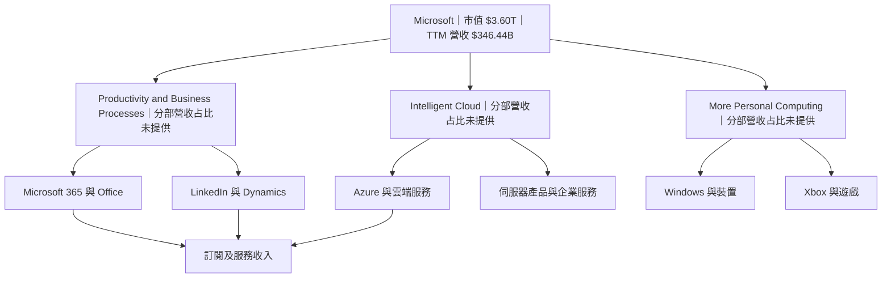

### 2.2 市場份額

市場份額數據未提供，故不呈現市占比例或圓餅圖。就規模而言，Microsoft TTM 營收 **$346.44B**、年增 **17.9%**；其最新一季年增 **18.8%**，低於 Google（GOOG）同季年增 **24.7%**，但高於 Amazon（AMZN）的 **12.1%**。這些增速僅比較整體公司營收，不能直接解讀為特定市場份額變化。

### 2.3 競爭護城河分析

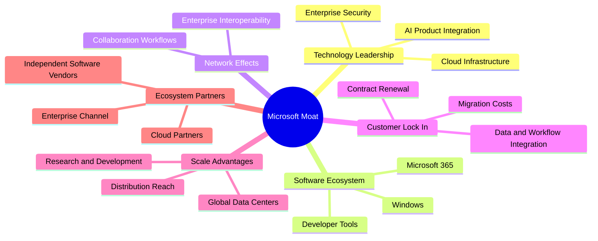

### 2.4 護城河強度

| 護城河項目 | 強度（強／中／弱） | 證據（引用數字或事實） | 會削弱它的情況 |
|------------|--------------------|------------------------|----------------|
| 技術與產品整合 | 強 | TTM 營收 **$346.44B**、營業利益率 **47.1%**；軟體與雲端服務可在企業工作流程中整合。 | AI 產品效能或成本落後；企業客戶將工作負載移至多雲或開源方案。 |
| 軟體生態系統 | 強 | Microsoft 365、Windows、Azure、開發者工具與企業應用互相支援；具跨產品銷售與續約特性。 | 競爭者以低價或更開放標準削弱整合優勢。 |
| 客戶鎖定與轉換成本 | 強 | 企業部署、資料、身份管理與工作流程整合，通常提高遷移成本；CCC **-67 天**亦反映營運模式具有現金效率。 | 長期合約到期後客戶削減席位、重新議價或轉移工作負載。 |
| 規模效應 | 強 | TTM 營收 **$346.44B**；FY2026 研發費用 **$35.56B**，可支持大規模產品研發與基礎設施投入。 | 資料中心折舊、能源與算力成本增速高於收入增速。 |
| 網路效應 | 中 | 開發者、企業客戶、合作夥伴與平台工具相互補足，但未提供可量化活躍用戶或網路效應指標。 | 生態系統碎片化、開源工具普及或平台規則變化。 |
| 生態夥伴 | 中 | 企業軟體商、系統整合商與雲端合作夥伴可擴大銷售與部署。 | 夥伴轉向競爭雲端、監管限制綑綁銷售。 |

**1.1 護城河評分為 9.0/10**，理由是企業軟體與雲端服務具整合、規模和轉換成本支撐，並與 **47.1%** TTM 營業利益率相符；但個別產品市占、留存率與分部利潤率未提供，故不給滿分。

---

## 3. 損益表深度分析

### 3.1 年度收入成長趨勢（近 4 年）

FY2023 至 FY2026 營收由 **$211.91B** 升至 **$331.84B**，三年 CAGR 約 **16.1%**；成長主要由雲端與企業訂閱等業務推動，但資料未提供各分部貢獻，不能將全部增長歸因於單一產品。

```text
╔══════════════════════════════════════════════════════════════════╗
║              Microsoft 年度收入趨勢（FY2023–FY2026）            ║
╠══════════════════════════════════════════════════════════════════╣
║  FY2023  $211.91B  █████████████░░░░░░░░░░░  YoY:  —            ║
║  FY2024  $245.12B  ███████████████░░░░░░░░░  YoY: +15.7% 🟢    ║
║  FY2025  $281.72B  █████████████████░░░░░░░  YoY: +14.9% 🟢    ║
║  FY2026  $331.84B  ████████████████████░░░░  YoY: +17.8% 🟢    ║
║                                                                  ║
║  3 年累計 CAGR：約 +16.1%                                        ║
╚══════════════════════════════════════════════════════════════════╝
```

算式：FY2023–FY2026 CAGR = \((331.84÷211.91)^{1/3}−1\) ≈ **16.1%**。FY2026 的 **17.8%** 年增高於前兩年，與雲端、訂閱及企業軟體需求相符；若成長延續，可支撐營業利益額增長，但資料中心投資回報將決定現金流品質。

### 3.2 季度收入趨勢分析

| 季度 | 營收 | QoQ 成長 | YoY 成長 | 備註 |
|------|------:|---------:|---------:|------|
| 2025-12-31 | $81.27B | N/A | 16.7% | YoY 採同季去年營收 $69.62B 計算，與財務數據中的季度增速序列一致。 |
| 2026-03-31 | $82.89B | 2.0% | 18.3% | 營收較前季增加，反映需求延續。 |
| 2026-06-30 | $90.01B | 8.6% | 17.8% | FY2026 Q4 營收明顯高於前季。 |
| 2026-09-30 | $92.28B | 2.5% | 18.8% | 最新季年增率為單季數字，不應視為 TTM 成長率。 |

QoQ 公式：\((本季營收÷前季營收)-1\)。例如最新季為 \((92.28÷90.01)-1\) ≈ **2.5%**。年度比較按 SEC／StockAnalysis 季度序列呈現；由於部分原始季度清單與季度增速欄位的期別標示不完全一致，逐季 YoY 應以同一期季報的 SEC 數字核對。

### 3.3 利潤率演變分析

| 利潤率指標 | FY2023 | FY2024 | FY2025 | FY2026 | 趨勢 | 評估 |
|------------|-------:|-------:|-------:|-------:|------|------|
| **毛利率** | 68.9% | 69.8% | 68.8% | 67.9% | 高位略降 | 🟡 |
| **營業利益率** | 41.8% | 44.6% | 45.6% | 46.8% | 持續提升 | 🟢 |
| **淨利率** | 34.2% | 36.0% | 36.1% | 40.3% | FY2026 上升 | 🟢 |

年度利潤率為毛利、營業利益及淨利除以年度營收計算；TTM 毛利率另有 **67.7%**，TTM 營業利益率以核驗數字為 **47.1%**。FY2026 營業利益率上升，代表營收增長快於營業費用；但毛利率從 FY2024 高點回落，可能與雲端基礎設施成本及產品組合變動有關。分部毛利與成本明細不足，無法精確分拆價格、組合與單位成本的貢獻。

### 3.4 費用結構分析

FY2026 營收 **$331.84B**、毛利 **$225.47B**、營業利益 **$155.24B**、研發費用 **$35.56B**。依披露數字可將收入拆成銷貨成本、研發、其他營業費用及營業利益；「其他營業費用」為差額推導項，含銷管等項目，並非單一財報科目。

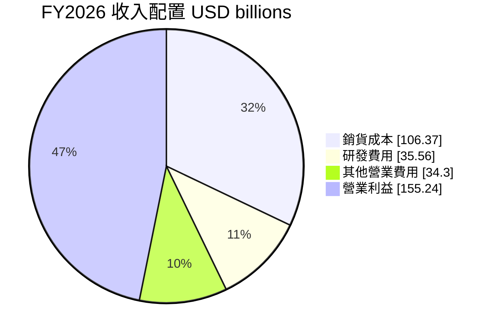

```text
╔══════════════════════════════════════════════════════════════════╗
║                  FY2026 收入與費用結構（$B）                     ║
╠══════════════════════════════════════════════════════════════════╣
║  營收       331.84  ████████████████████                         ║
║  毛利       225.47  ██████████████                               ║
║  研發        35.56  ███                                          ║
║  營業利益   155.24  █████████                                    ║
║  營業利益率  46.8%                                               ║
╚══════════════════════════════════════════════════════════════════╝
```

### 3.5 季度 EPS 趨勢與盈餘品質（Quality of Earnings）

最近四季披露 EPS：**$5.16、$4.27、$4.81、$4.92**（按報表列示季度由早至晚）。該四季 EPS 預估值均為 nan，故「超預期／不及預期」無法判定；不能把實際 EPS 年增直接當作超預期。

| 盈餘品質項目 | 數值／佔比 | 評估 |
|--------------|-----------|------|
| 股權薪酬 SBC / 營收 | 最近四季 SBC 約 **$12.55B÷$346.44B=3.6%** | 🟡 對股東有稀釋成本；FY2026 SBC **$12.40B**，稀釋股數測試未增加，但 SBC 仍是經濟成本。 |
| SBC / 營業現金流 | 約 **$12.55B÷$195.88B=6.4%** | 🟡 比例可控，但 OCF 含非現金 SBC 加回，不能忽略其對每股價值的影響。 |
| FCF / 淨利（現金轉換率） | 約 **$59.96B÷$142.63B=42.0%** | 🔴 Capex 高使 FCF 顯著低於淨利；不代表會計盈餘失真，但代表當期投資後現金留存較少。 |
| 一次性／非經常性損益 | N/A（未提供可核實拆分） | 無法確認一次性項目對季度 EPS 的影響。 |
| 有效稅率 | **19.4%**（最新年度） | 🟢 未見可據以判斷的異常稅務利益；該稅率用於 DCF。 |
| 資本化支出 vs 費用化 | TTM Capex **$135.92B**；FY2026 R&D **$35.56B** | 🟡 資料中心支出資本化後透過折舊逐期費用化；若資產使用期或利用率假設偏樂觀，短期利潤可能高於完整經濟成本。 |

**盈餘品質結論：**GAAP 營業利益已包含 SBC 費用，獲利並非單靠調整後指標支撐；但 FCF 僅相當於淨利約 **42.0%**，核心原因是高 Capex。估值應更重視投資回報和未來 FCF，而非只看 EPS 增速。

---

## 4. 資產負債表分析

### 4.1 資產結構分解

最新可用資產明細為 2026-09-30。總資產 **$779.40B**、流動資產 **$186.14B**；部分項目為逐項列示，未將缺漏項目反推成配平數字。

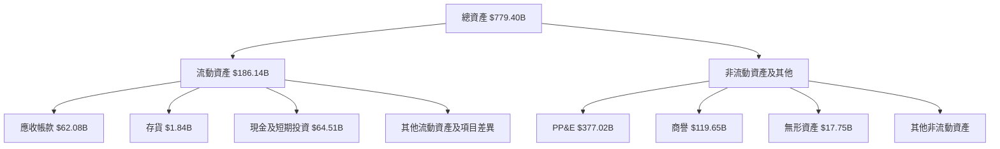

### 4.2 流動性與營運資金分析

| 流動性指標 | 最新值 | 歷史比較 | 評估 |
|------------|-------:|----------|------|
| 流動比率 | **1.225** | FY2026 流動資產 **$207.71B**、流動負債 **$168.82B** | 🟡 高於 1，但較一年前比較偏弱的 F-Score 流動比率測試提示流動性相對下降。 |
| 速動比率 | **1.068** | N/A（未提供同口徑歷史序列） | 🟢 可覆蓋流動負債，但不宜只靠單一比率判斷。 |
| 現金及短期投資 | **$64.51B** | FY2026 年末為 **$76.84B** | 🟡 現金與短期投資較 FY2026 年末低，可能反映投資與資本配置需求。 |

| 指標 | 最新 TTM | 一年前 TTM | 變化 | 解讀 |
|------|----------:|----------:|------:|------|
| DSO 應收帳款天數 | **65 天** | **66 天** | **-1 天** | 收款速度略改善，並未顯示應收帳款週期惡化。 |
| DIO 存貨天數 | **6 天** | **4 天** | **+2 天** | 存貨天數增加，但絕對值仍低；需分辨硬體與雲端設備備貨影響。 |
| DPO 應付帳款天數 | **139 天** | **130 天** | **+9 天** | 付款週期延長有助營運融資，但需監測供應商付款條件與關係。 |
| CCC 現金轉換週期 | **-67 天** | **-59 天** | **-8 天** | 負週期擴大，營運資金對現金流有利；不能等同終端需求改善。 |

### 4.3 債務結構分析

核驗口徑列示總債務 **$35.48B**、現金及短期投資 **$64.51B**、淨現金 **$29.03B**。其他合併資料表列示總債務 **$133.93B**、淨負債 **$69.42B**，與核驗口徑明顯不同；可能涉及租賃／債務分類或資料期別差異，未有一致的負債明細前不混用。估值 DCF 橋接依核驗口徑採用淨現金。

```text
╔══════════════════════════════════════════════════════════════════╗
║                 Microsoft 債務健康診斷                           ║
╠══════════════════════════════════════════════════════════════════╣
║  總債務（核驗口徑）： $35.48B   ████░░░░░░░░░░░░░░░              ║
║  現金+短期投資：      $64.51B   ███████░░░░░░░░░░░░              ║
║  淨現金：             $29.03B   🟢 正淨現金                       ║
║  流動比率：           1.225     🟡 高於 1                         ║
║  Debt/EBITDA：        N/A（債務口徑不一致，且無同口徑 EBITDA）    ║
║  Interest Coverage：  N/A（利息費用與同口徑營業利潤未提供）     ║
╚══════════════════════════════════════════════════════════════════╝
```

### 4.4 股東權益趨勢

| 財年 | 股東權益 | YoY |
|------|---------:|----:|
| FY2023 | $206.22B | — |
| FY2024 | $268.48B | 30.2% |
| FY2025 | $343.48B | 27.9% |
| FY2026 | $442.39B | 28.8% |

```text
╔══════════════════════════════════════════════════════════════════╗
║                   股東權益趨勢（$B）                             ║
╠══════════════════════════════════════════════════════════════════╣
║  FY2023  206.22  █████████                                      ║
║  FY2024  268.48  ████████████                                   ║
║  FY2025  343.48  ███████████████                                ║
║  FY2026  442.39  ████████████████████                           ║
╚══════════════════════════════════════════════════════════════════╝
```

權益增加反映累積獲利與資本留存，但不能單獨視為每股股東回報；回購與股數變化、資產收購及未實現損益亦會影響權益。

---

## 5. 現金流量深度分析

### 5.1 現金流量瀑布圖

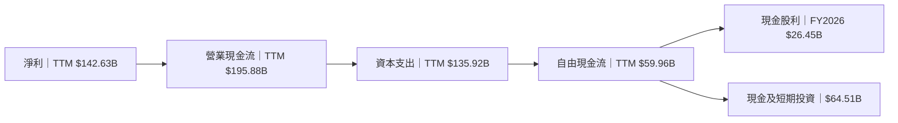

FY2026 現金股利與 TTM FCF 期間不同，圖中只表示現金流項目關係，不代表同一期間的完整資金分配；回購金額與淨現金變化拆分未提供。

### 5.2 FCF 轉換率趨勢

| 財年 | FCF | 淨利 | FCF／淨利 |
|------|----:|----:|----------:|
| FY2023 | $59.48B | $72.36B | 82.2% |
| FY2024 | $74.07B | $88.14B | 84.0% |
| FY2025 | $71.61B | $101.83B | 70.3% |
| FY2026 | $66.99B | $133.75B | 50.1% |
| TTM 至 2026-09-30 | $59.96B | $142.63B | 42.0% |

FCF 轉換率下行主要與 Capex 快速增加一致。FY2026 OCF 升至 **$182.94B**，但 Capex 升至 **$115.95B**，使 FCF 降至 **$66.99B**；這反映資本投入加速，不足以單獨判斷投資回報失敗，但需要持續追蹤算力利用率與雲端收入增長。

### 5.3 自由現金流趨勢

```text
╔══════════════════════════════════════════════════════════════════╗
║                 自由現金流趨勢（FY，$B）                         ║
╠══════════════════════════════════════════════════════════════════╣
║  FY2023  $59.48B  ████████████████                              ║
║  FY2024  $74.07B  ████████████████████                          ║
║  FY2025  $71.61B  ███████████████████                           ║
║  FY2026  $66.99B  ██████████████████                            ║
║  TTM     $59.96B  ████████████████  FCF Yield: 1.67%             ║
╚══════════════════════════════════════════════════════════════════╝
```

FY2023 至 FY2026 FCF 由 **$59.48B** 增至 **$66.99B**，但成長明顯落後淨利；最新 TTM FCF **$59.96B** 亦低於 FY2026 全年值，顯示高資本支出的現金流壓力尚未解除。

### 5.4 資本配置評估

| 資本配置項目 | 數值 | 解讀 |
|--------------|-----:|------|
| FY2026 Capex | **$115.95B** | 資料中心與其他資本投入需求高；未提供細項拆分。 |
| FY2026 現金股利 | **$26.45B** | 延續股東現金回饋；應與長期投資回報一併評估。 |
| FY2026 SBC | **$12.40B** | 對股東具稀釋成本，即使現金流量表將其加回。 |
| FY2026 回購 | N/A | 未提供可核實回購金額。 |
| 留存／現金變化 | N/A | 缺少同期間完整回購、併購與融資現金流拆分。 |

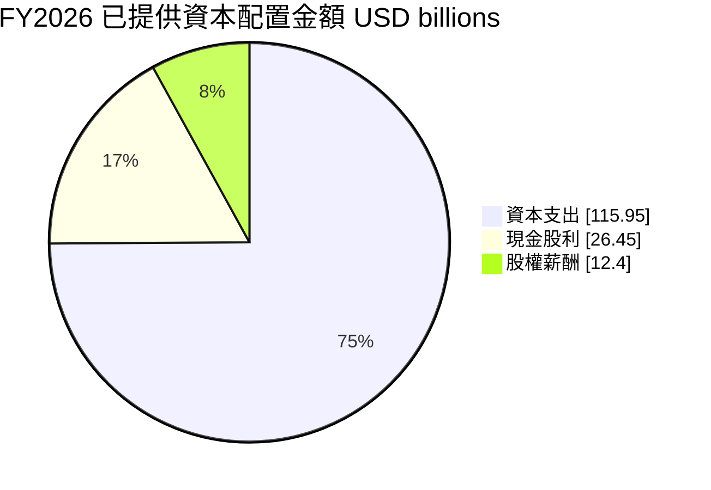

該圓餅圖僅呈現已提供的三項金額，並非互斥或完整資金用途構成；SBC 不等同現金支出，故不能解讀為完整資本配置比例。

---

## 6. 獲利能力與資本效率

### 6.1 ROE / ROA / ROIC 趨勢

| 指標 | 最新值 | 可比歷史值 | 評估 |
|------|-------:|------------|------|
| ROE（核驗品質指標） | **30.3%** | N/A（未提供同一計算口徑歷史序列） | 🟢 高回報；與杜邦拆解相符。 |
| ROA | **14.4%** | N/A（未提供同口徑歷史序列） | 🟢 資產盈利能力良好。 |
| ROIC（TTM） | **29.7%** | Roic.ai 顯示的歷史資料採不同定義／期間，無法直接拼接 | 🟢 明顯高於 WACC。 |

另一財務資料表列 ROE **34.2%**，與品質指標 ROE **30.3%** 不一致。本報告杜邦與評分採用明確列出的 QUALITY FIGURES **30.3%**；不以不同來源值混算。無行業均值資料，故不做行業均值比較。

### 6.2 ROIC vs WACC 分析（核心價值創造判斷）

```text
╔══════════════════════════════════════════════════════════════════╗
║                ROIC vs WACC 深度分析                            ║
╠══════════════════════════════════════════════════════════════════╣
║  資金成本（核驗輸入）：                                          ║
║  ├── 無風險利率（10Y 美債）：  4.91%                             ║
║  ├── 市場風險溢酬 ERP：        5.00%                             ║
║  ├── 原始 Beta：               1.04                              ║
║  ├── 調整後 Beta：             1.03（⅔×1.04 + ⅓×1.00）           ║
║  ├── 股權成本 Ke：             10.06%                            ║
║  ├── 稅前債務成本：            8.60%                             ║
║  ├── 資本權重 E / D：          99.0% / 1.0%                      ║
║  └── WACC：                    10.03%                            ║
║                                                                  ║
║  ROIC（TTM）：                 29.7%                              ║
║  ROIC − WACC：                 29.7% − 10.03% = 19.67pp          ║
║                                                                  ║
║  ROIC  29.7%  ▓▓▓▓▓▓▓▓▓▓▓▓▓▓▓▓▓▓▓▓▓▓▓▓▓▓▓▓░░░░  🟢             ║
║  WACC  10.03% ▓▓▓▓▓▓▓▓▓▓░░░░░░░░░░░░░░░░░░░░░░                 ║
║                                                                  ║
║  結論：ROIC 約為 WACC 的 2.96 倍，仍在創造股東價值。            ║
╚══════════════════════════════════════════════════════════════════╝
```

其中 ROIC／WACC 比率：**29.7%÷10.03%≈2.96**。成本資本輸入依程式計算的 WACC 採用 **10.03%**；由於來源僅提供已計算成本資本項目，不能用顯示到兩位小數的組成項目反造一個替代 WACC。ROIC 高於 WACC 的幅度顯著，代表目前經營資產回報大於資金成本；若未來 Capex 報酬率下滑，該差距可能收窄。

### 6.3 杜邦三因素分解

| 因素 | 數值（TTM） | 解讀 |
|------|-------------|------|
| 淨利率 | **41.2%** | 高淨利率是 ROE 的主要來源。 |
| 資產週轉率 | **0.44** | 每單位資產產生約 0.44 倍營收，反映大型資本與無形資產基礎。 |
| 權益乘數 | **1.66** | 槓桿並非 ROE 主因。 |
| **ROE** | **30.3%** | **41.2% × 0.44 × 1.66 = 30.1%**；資料列示 ROE **30.3%**，差異來自輸入小數精度。 |

### 6.4 財務體質：Piotroski F-Score

| 測試 | 結果 | 解讀 |
|------|------|------|
| ROA > 0 | ✅ 通過 | 正資產報酬。 |
| 營業現金流 > 0 | ✅ 通過 | TTM OCF **$195.88B**。 |
| ROA 高於一年前 | ✅ 通過 | 獲利效率改善。 |
| 營業現金流 > 淨利（應計品質） | ✅ 通過 | OCF 高於同期淨利。 |
| 長期負債 ÷ 總資產低於一年前 | ✅ 通過 | 相對槓桿指標改善。 |
| 流動比率高於一年前 | ❌ 未通過 | 流動性相較一年前下降。 |
| 稀釋股數未增加 | ✅ 通過 | 該項測試通過；不代表 SBC 沒有經濟成本。 |
| 毛利率高於一年前 | ❌ 未通過 | 毛利率比較未改善，與資本密集型雲端組合相符。 |
| 資產週轉率高於一年前 | ❌ 未通過 | 資產投入擴大可能暫時壓低周轉率。 |

**Piotroski F-Score：6 / 9。** 三項未通過指標分別提示流動性、毛利率與資產周轉需監控；得分整體支持財務品質尚佳，但並非所有效率指標都在同步改善。

---

## 7. 相對估值分析

### 7.1 同業估值比較表格

| 估值指標 | **MSFT** | **GOOG** | **AMZN** | **ORCL** | MSFT 評估 |
|----------|---------:|---------:|---------:|---------:|-----------|
| **Trailing P/E** | 25.3x | 13.8x | 20.0x | 15.9x | 🔴 高於三家同業；反映較高盈利品質預期。 |
| **Forward P/E** | 20.0x | 17.3x | 22.6x | 9.2x | 🟡 高於同業中位數 **17.3x**，但低於 AMZN。 |
| **P/S Ratio** | 10.4x | 6.9x | 3.3x | 4.4x | 🔴 顯著高於同業；市場為較高利潤率支付溢價。 |
| **EV/EBITDA** | 17.8x | 17.0x | 15.6x | 12.9x | 🟡 高於同業中位數 **15.6x**。 |
| **最新季度營收 YoY** | 18.8% | 24.7% | 12.1% | 29.6% | 🟡 MSFT 成長穩健，但非同業最快。 |
| **毛利率（TTM）** | 67.7% | 60.9% | 51.4% | 64.0% | 🟢 高於三家同業。 |

同業倍數來自 Yahoo Finance 同業倍數資料。MSFT 的高 P/S 與毛利率差異相符，但估值容錯率較低：若營收增速、利潤率或 AI 投資回報低於市場預期，倍數可能下修。

### 7.2 歷史估值區間分析

```text
╔══════════════════════════════════════════════════════════════════╗
║               MSFT 五年估值區間（TTM 倍數）                       ║
╠══════════════════════════════════════════════════════════════════╣
║  P/E        20.8x ├────────● 25.3x──────────┤ 37.8x             ║
║             五年中位數 31.5x｜現值百分位 14%                     ║
║  P/S         8.4x ├──────● 10.4x────────────┤ 13.7x             ║
║             五年中位數 12.0x｜現值百分位 33%                     ║
║  EV/EBITDA  14.5x ├──● 17.8x────────────────┤ 31.4x             ║
║             五年中位數 24.3x｜現值百分位 10%                     ║
╚══════════════════════════════════════════════════════════════════╝
```

當前 P/E、P/S、EV/EBITDA 均低於自身五年中位數，尤其 EV/EBITDA 位於自身歷史 **10 百分位**。這支持「相對自身歷史較便宜」的判斷，但不代表絕對估值低：公司目前 FCF Yield 僅 **1.67%**，且估值仍高於多數同業。

### 7.3 情境價值（Bear / Base / Bull，照抄 DCF MODEL 的 Scenarios）

| 情境 | 第 1 年營收成長 | 期末營業利潤率 | WACC | 每股價值 | 相對現價 | 機率 | 會發生的條件 |
|------|----------------:|----------------:|-----:|----------:|----------:|-----:|--------------|
| 🔴 悲觀 | 9.0% | 38.8% | 11.03% | **$178.21** | **-63.2%** | 25% | 雲端增長顯著放緩、資本支出回收率偏低，營業利潤率下滑且資金成本升高。 |
| 🟡 基準 | 17.9% | 45.6% | 10.03% | **$376.55** | **-22.3%** | 50% | 營收增速逐步降至 3.0%，長期利潤率回歸模型採用的歷史中位數。 |
| 🟢 樂觀 | 26.9% | 50.2% | 9.03% | **$729.21** | **+50.5%** | 25% | AI 與雲端收入加速、資本利用效率提升、營業槓桿擴大且折現率下降。 |

### 7.4 相對估值隱含價格區間

```text
╔══════════════════════════════════════════════════════════════════╗
║              相對估值與基準估值每股價值                          ║
╠══════════════════════════════════════════════════════════════════╣
║  $376.55 ── $417.71 ── $426.23 ── $484.52 ───────── $636.12      ║
║  DCF        同業 P/E   同業 EV/EBITDA   現價         共識目標價    ║
╚══════════════════════════════════════════════════════════════════╝
```

| 方法 | 每股價值 | 方法依據 |
|------|---------:|----------|
| DCF（基準） | **$376.55** | 10 年 FCFF、WACC **10.03%**、終值成長率 **3.0%**。 |
| 同業 Forward P/E | **$417.71** | 同業 Forward P/E 中位數 **17.3x** × MSFT Forward EPS **$24.20**。 |
| 同業 EV/EBITDA | **$426.23** | 同業 EV/EBITDA 中位數 **15.6x** × TTM EBITDA，再加淨現金。 |
| 分析師共識目標價 | **$636.12** | 54 位分析師平均目標價；僅作參考。 |

兩種同業估值推得 **$417.71–$426.23**，彼此接近且低於現價。分析師共識 **$636.12** 明顯較高，顯示市場分析師預期與基準 DCF 差距大，不能僅以共識值作為合理價值錨點。

---

## 8. DCF 內在價值評估（Discounted Cash Flow）

### 8.0 估值推理鏈（Thinking Logic）

**Step 1 — 價值由哪些變數決定？**  
模型以 TTM 營收 **$346.44B** 為起點，透過未分部的企業軟體、雲端與個人運算業務形成現金流底盤；分部占比未提供，因此無法拆出各項營收占比。估值主要由營收增長路徑、營業利潤率及終值折現假設決定。終值現值占企業價值 **67.4%**，故終值成長與折現率是關鍵敏感因子。

**Step 2 — 模型選擇**

| 決策點 | 本報告採用 | 理由（含數字） | 曾考慮但否決 | 否決理由 |
|--------|-----------|----------------|--------------|----------|
| 現金流定義 | FCFF | 以 WACC 折現後得企業價值，再加淨現金橋接股權價值。 | FCFE | 資本結構與利息處理不作逐年預測，FCFF 較適合模型設定。 |
| 預測期 N | **10 年** | 模型固定 10 年，涵蓋由 TTM 增長逐步降至成熟增速的期間。 | 5 年 | 資料所附模型已採 10 年，且高成長與終值交界需較長過渡期。 |
| 終值方法 | Gordon Growth | 終值成長 **3.0%**，低於 WACC **10.03%**。 | 只採退出倍數 | DCF 模型提供 Gordon Growth 基準，退出倍數未提供 DCF 終值所需的基準假設。 |
| EBIT 基礎 | GAAP EBIT | EBIT 已含 SBC 費用，避免漏計股東薪酬成本。 | 非 GAAP EBIT | 會加回 SBC，需另行扣回或稀釋，模型未採此組合。 |

**Step 3 — 主要假設推導鏈**

- **營收增長路徑**：錨點＝TTM 營收年增 **17.9%**；模型以該增速作第 1 年起點，因成熟後增速必須逐步收斂，採線性降至第 10 年 **3.0%**；曾考慮全期維持 17.9%，但否決，因會忽略基期擴大與長期成熟。
- **預測期 N**：錨點＝模型固定 **10 年**；調整＝以十年呈現高增長逐步轉入成熟期；採用 **10 年**；曾考慮縮短期限，但會使較多價值落入終值、降低過渡期可讀性。
- **期末營業利潤率**：錨點＝TTM **47.1%**；模型由第 1 年 **47.1%** 緩降至第 10 年 **45.6%**，即低 **1.5pp**；採用模型值；曾考慮長期持平於 47.1%，但模型依據為近五財年中位數，故採回歸而非永久維持高點。
- **永續成長率 g**：錨點＝長期成熟企業需要低於經濟長期名目增長上限；採用 **3.0%**，且低於 WACC **10.03%**；曾考慮更高 g，但終值對 g 高度敏感，故不提高。
- **Capex／營收**：錨點＝TTM Capex **$135.92B**、TTM 營收 **$346.44B**，比率約 **39.2%**；模型由第 1 年 **39.2%** 降至第 10 年 **12.2%**，依據為回落至約 D&A 的 1.1 倍；曾考慮維持 39.2%，但會假設高投入比例永久持續。
- **D&A／營收**：錨點＝TTM **11.1%**；模型固定 **11.1%**。屬低敏感度輸入，不另改動。
- **有效稅率**：錨點＝最新年度有效稅率 **19.4%**；模型採 **19.4%**。
- **SBC 與股數處理**：錨點＝GAAP EBIT 已將 SBC 作為費用；模型採 **GAAP EBIT + 固定股數**，年稀釋率 **0%**，不另扣 SBC。這是「組合 A」，SBC 影響已計入一次。
- **WACC**：錨點＝成本資本計算值 **10.03%**，採用核驗 WACC；未另改折現率。其組成詳見 8.2。
- **營運資金**：模型明確不建模營運資金變化；不以缺漏資料自行建立 ΔWC 假設。

**Step 4 — 最脆弱假設**  
最脆弱之處是高資本支出比率能否如模型假設逐步回落至營收的 **12.2%**；若高 Capex 延續，FCFF 將低於基準路徑，估值下移，並可能使價值低於基準 DCF **$376.55**。

**Step 5 — 計算路徑圖**

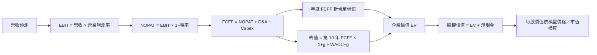

### 8.1 模型假設總表（Model Inputs）

| 假設項目 | 採用值 | 依據／來源 | 敏感度 |
|----------|--------|-------------|--------|
| 預測期長度 N | **10 年** | DCF 模型設定；由當前增長過渡至成熟期。 | 🟡 中 |
| 營收增長 | 第 1 年 **17.9%**，第 10 年 **3.0%**，線性下降 | TTM 對前 TTM 成長 **17.9%**；終點採成熟增速假設。 | 🔴 高 |
| 營業利潤率（GAAP EBIT） | 第 1 年 **47.1%** 至第 10 年 **45.6%** | TTM 利潤率與近五財年中位數。 | 🔴 高 |
| 有效稅率 | **19.4%** | 最新年度有效稅率。 | 🟢 低 |
| Capex／營收 | 第 1 年 **39.2%** 至第 10 年 **12.2%** | TTM 比率起點；逐步降至約 D&A 的 1.1 倍。 | 🔴 高 |
| D&A／營收 | **11.1%** | TTM 比率，模型持平。 | 🟢 低 |
| 營運資金變動 | **未建模** | 模型明確不含 working capital；無法另行造值。 | 🟢 低 |
| EBIT 基礎 | **GAAP** | DCF 模型採 GAAP EBIT。 | 🟡 中 |
| SBC 處理 | 不再扣 SBC；固定股數 | GAAP EBIT 已含 SBC，避免重複扣除。 | 🟡 中 |
| 年稀釋率 | **0%** | 模型組合 A；維持固定股數。 | 🟡 中 |
| 永續成長率 g | **3.0%** | DCF 模型設定，且低於 WACC。 | 🔴 高 |
| 終值方法 | Gordon Growth | DCF 模型使用 Gordon Growth。 | 🔴 高 |
| WACC | **10.03%** | 成本資本計算輸入；詳見 8.2。 | 🔴 高 |

模型使用 FCFF：**FCFF = NOPAT + D&A − Capex**；營運資金未建模。SBC 採 **(A) GAAP EBIT + 固定股數**，因此不再列 −SBC，也不增加年稀釋率。

### 8.2 折現率推導（WACC）

```text
╔══════════════════════════════════════════════════════════════════╗
║                    WACC 推導（折現率）                           ║
╠══════════════════════════════════════════════════════════════════╣
║  股權成本 Ke（CAPM）：                                           ║
║  ├── 無風險利率 Rf（10Y 美債）：      4.91%                     ║
║  ├── 市場風險溢酬 ERP：               5.00%                     ║
║  ├── 原始 Beta（Yahoo Finance）：      1.04                      ║
║  ├── 調整後 Beta：                    1.03                      ║
║  ├── 規模／國別溢酬：                 0.00%                     ║
║  └── Ke = 4.91% + 1.03×5.00% = 10.06%                           ║
║                                                                  ║
║  債務成本：                                                       ║
║  ├── 稅前 Kd：                        8.60%                     ║
║  ├── 有效稅率：                       19.4%                     ║
║  └── 稅後 Kd = 8.60%×(1−19.4%) = 6.93%                           ║
║                                                                  ║
║  資本結構權重：E 99.0%／D 1.0%                                  ║
║  核驗 WACC（採用）：10.03%                                       ║
╚══════════════════════════════════════════════════════════════════╝
```

逐步演算：

1. **Ke（CAPM）** = **4.91% + 1.03 × 5.00% + 0.00% = 10.06%**。原始 Beta 為 **1.04**，調整方式為 **⅔×1.04+⅓×1.00=1.03**。無風險利率資料標示為 10Y 美債 **4.91%**，未提供觀測日期；ERP **5.00%** 為成本資本模型假設。
2. **稅前 Kd** = **8.60%**。其來源定義為利息除以債務；利息費用與同範圍平均計息負債明細未提供，故不能另行重建。
3. **稅後 Kd** = **8.60% × (1−19.4%) = 6.93%**。
4. **權重**：採用資本成本輸入的 **E 99.0%、D 1.0%**，合計 **100.0%**。市值及計息債務細項口徑沒有提供足以獨立重建該精確權重的完整資料。
5. 按顯示至兩位小數的成本輸入計算，**99.0%×10.06%+1.0%×6.93%=10.0287%≈10.03%**。本報告與第 6.2 節均採用 **10.03%**，不另計替代 WACC。

### 8.3 逐年自由現金流預測（基準情境）

金額單位：美元十億。模型表格採用程式計算值；比例顯示精度有限，故個別數字以未四捨五入輸入計算，顯示值可能有小額四捨五入差異。ΔWC 未建模，依模型定義不另列；FCFF 依 **NOPAT + D&A − Capex** 計算。

| 年度 | FY+1 | FY+2 | FY+3 | FY+4 | FY+5 | FY+6 | FY+7 | FY+8 | FY+9 | FY+10 |
|------|-----:|-----:|-----:|-----:|-----:|-----:|-----:|-----:|-----:|------:|
| 營收 | 408.51 | 474.92 | 544.25 | 614.69 | 684.06 | 749.93 | 809.71 | 860.83 | 900.92 | 927.95 |
| 營收 YoY | 17.9% | 16.3% | 14.6% | 12.9% | 11.3% | 9.6% | 8.0% | 6.3% | 4.7% | 3.0% |
| 營業利潤率 | 47.1% | 46.9% | 46.8% | 46.6% | 46.4% | 46.3% | 46.1% | 46.0% | 45.8% | 45.6% |
| EBIT（GAAP） | 192.42 | 222.92 | 254.57 | 286.51 | 317.72 | 347.07 | 373.41 | 395.56 | 412.50 | 423.35 |
| − 稅 | (37.32) | (43.24) | (49.38) | (55.57) | (61.63) | (67.32) | (72.43) | (76.72) | (80.01) | (82.11) |
| = NOPAT | 155.10 | 179.69 | 205.20 | 230.94 | 256.09 | 279.75 | 300.98 | 318.84 | 332.49 | 341.24 |
| + D&A | 45.16 | 52.50 | 60.17 | 67.96 | 75.62 | 82.91 | 89.51 | 95.17 | 99.60 | 102.59 |
| − Capex | (160.27) | (172.04) | (180.78) | (185.69) | (186.07) | (181.43) | (171.53) | (156.47) | (136.66) | (112.84) |
| **= FCFF** | **39.99** | **60.15** | **84.58** | **113.20** | **145.64** | **181.23** | **218.96** | **257.53** | **295.43** | **330.98** |
| 折現因子 @10.03% | 0.909 | 0.826 | 0.751 | 0.682 | 0.620 | 0.564 | 0.512 | 0.465 | 0.423 | 0.384 |
| **FCFF 現值 PV** | **36.35** | **49.68** | **63.49** | **77.23** | **90.30** | **102.12** | **112.14** | **119.87** | **124.97** | **127.24** |

預測期現值逐項加總：  
**$36.35+$49.68+$63.49+$77.23+$90.30+$102.12+$112.14+$119.87+$124.97+$127.24 = $903.39B**；模型以未四捨五入數字列示 **$903.40B**，差異低於 1%。

**FY+1 逐步演算：**

1. 營收 = TTM 營收 **$346.44B × (1+17.9%)**；模型未四捨五入結果列示 **$408.51B**。
2. EBIT = **$408.51B × 47.1%**；模型列示 **$192.42B**（輸入比率採未四捨五入精度）。
3. 稅 = **$192.42B × 19.4% = $37.32B**。
4. NOPAT = **$192.42B−$37.32B = $155.10B**。
5. D&A = **$408.51B × 11.1%**；模型列示 **$45.16B**。
6. Capex = **$408.51B × 39.2%**；模型列示 **$160.27B**。
7. ΔWC = **未建模**，不在模型 FCFF 公式中另扣。
8. FCFF = **$155.10B+$45.16B−$160.27B = $39.99B**。
9. 折現因子 = **1÷(1+10.03%)¹ = 0.909**；PV = **$39.99B×0.909 ≈ $36.35B**（使用未四捨五入折現因子）。

**合理性自檢：**

- FY+1 至 FY+10 FCFF 由 **$39.99B** 升至 **$330.98B**，端點年化約 **26.5%**；歷史 FY2023 至 FY2026 FCF 由 **$59.48B** 至 **$66.99B**，三年 CAGR 約 **4.0%**。預測顯著高於歷史，主要依賴 Capex／營收從 **39.2%** 降至 **12.2%**。
- FY+10 FCFF 利潤率 = **$330.98B÷$927.95B≈35.7%**，高於目前 TTM FCF／營收 **$59.96B÷$346.44B≈17.3%**；同業最佳 FCFF 利潤率未提供，不能判斷是否超越同業。
- 模型預測各年 FCFF 均為正；FY+1 現金流仍受高 Capex 壓低。

```text
╔══════════════════════════════════════════════════════════════════╗
║            自由現金流：歷史實際 vs 模型預測（$B）               ║
╠══════════════════════════════════════════════════════════════════╣
║  FY2024（實）  $74.07B   █████                                   ║
║  FY2025（實）  $71.61B   █████                                   ║
║  FY2026（實）  $66.99B   █████                                   ║
║  FY+1（預）    $39.99B   ███                                     ║
║  FY+10（預）  $330.98B   ████████████████████                    ║
╠══════════════════════════════════════════════════════════════════╣
║  預測依賴 Capex／營收率由 39.2% 逐步回落至 12.2%；為主要風險。  ║
╚══════════════════════════════════════════════════════════════════╝
```

### 8.4 終值計算（Terminal Value）

**適用性檢查：WACC 10.03% vs g 3.0% → WACC > g？✅**

| 方法 | 計算式 | 終值 TV | TV 現值 | 佔總 EV 比重 |
|------|--------|---------:|--------:|--------------:|
| Gordon Growth | FCFF(FY+10) × (1+g) ÷ (WACC−g) | **$4,848.32B** | **$1,863.90B** | **67.4%** |
| 退出倍數法 | N/A（DCF 模型未提供該終值方法輸出） | N/A | N/A | N/A |

逐步演算（Gordon Growth）：

1. FY+10 FCFF = **$330.98B**。
2. 分子 = **$330.98B×(1+3.0%)=$340.91B**。
3. 分母 = **10.03%−3.0%=7.03%**；以列示後數值重算，TV 約 **$4,849B**；模型精確輸出 **$4,848.32B**，差異來自模型使用未四捨五入的底層參數。
4. PV(TV) = 模型輸出 **$1,863.90B**。因折現因子表列為三位小數，直接用已四捨五入因子乘 TV 不會完全重現；模型採用未四捨五入折現因子。
5. 終值佔比 = **$1,863.90B÷$2,767.30B=67.4%**。

終值佔比未超過 75%，但仍占企業價值約三分之二，估值對長期增長率與 WACC 敏感。DCF 模型未提供退出倍數終值，故不另造一個退出倍數。

### 8.5 企業價值 → 每股內在價值（Bridge）

```text
╔══════════════════════════════════════════════════════════════════╗
║              企業價值 → 每股內在價值 橋接表                      ║
╠══════════════════════════════════════════════════════════════════╣
║  預測期 FCF 現值合計              +$903.40B                       ║
║  終值現值 PV(TV)                +$1,863.90B                       ║
║  ─────────────────────────────────────────────                  ║
║  = 企業價值 EV                   $2,767.30B                       ║
║  + 淨現金                         +$29.03B                        ║
║  = 股權價值                      $2,796.33B                       ║
║  ─────────────────────────────────────────────                  ║
║  每股內在價值（模型輸出）         $376.55                         ║
║  2026-11-20 收盤價                $484.52                         ║
║  折溢價（現價÷DCF價值−1）         +28.7% 溢價                     ║
╚══════════════════════════════════════════════════════════════════╝
```

逐步演算：

1. EV = **$903.40B+$1,863.90B=$2,767.30B**。
2. 股權價值 = **$2,767.30B+$29.03B=$2,796.33B**。
3. 每股內在價值依模型原公式 **股權價值×股價÷市值**，模型輸出 **$376.55**。股數與市值精確底層值未提供，故不以外部股份數據替代或重建。
4. 折溢價 = **$484.52÷$376.55−1=+28.7%**。
5. 本節不計算 MOS；MOS 只在 8.8 以加權合理價值作分母。

模型股數採固定股數組合 A；現金與債務橋接以已核驗淨現金 **$29.03B** 表示，未另外混用其他資料源總債務口徑。

### 8.6 敏感性分析（WACC × 永續成長率）

下表每格及情境均照 DCF 模型輸出。括號為相對現價 **$484.52** 的上行／下行空間；基準格為 **WACC 10.03%、g 3.0%**。

| g（列）／WACC（欄） | 8.03% | 9.03% | **10.03%（基準）** | 11.03% | 12.03% |
|-----------|------:|------:|-------------------:|-------:|-------:|
| **2.0%** | $489.14（+1.0%） | $405.31（-16.3%） | $343.16（-29.2%） | $295.45（-39.0%） | $257.81（-46.8%） |
| **2.5%** | $522.47（+7.8%） | $427.59（-11.7%） | $358.75（-25.9%） | $306.73（-36.7%） | $266.19（-45.1%） |
| **3.0%（基準）** | $562.42（+16.1%） | $453.57（-6.4%） | **$376.55（-22.3%）** | $319.41（-34.1%） | $275.50（-43.1%） |
| **3.5%** | $611.18（+26.1%） | $484.24（-0.1%） | $397.07（-18.0%） | $333.78（-31.1%） | $285.91（-41.0%） |
| **4.0%** | $672.05（+38.7%） | $521.01（+7.5%） | $421.00（-13.1%） | $350.19（-27.7%） | $297.61（-38.6%） |

矩陣示範：選格 **WACC 9.03% > g 3.0% ✅**。該格每股價值為模型輸出 **$453.57**；由於模型未提供該格重新計算的逐年 PV 合計、終值及折現因子的未四捨五入明細，不能在不另建模型的情況下可靠重現完整 EV 橋接。此處照抄模型矩陣值，不杜撰中間值。

**三情境 DCF：**

| 情境 | 第 1 年成長 | 期末營業利潤率 | WACC | 每股價值 | 相對現價 | 主觀機率 |
|------|------------:|---------------:|-----:|---------:|---------:|---------:|
| 🔴 悲觀 | 9.0% | 38.8% | 11.03% | **$178.21** | **-63.2%** | 25% |
| 🟡 基準 | 17.9% | 45.6% | 10.03% | **$376.55** | **-22.3%** | 50% |
| 🟢 樂觀 | 26.9% | 50.2% | 9.03% | **$729.21** | **+50.5%** | 25% |
| **機率加權** | — | — | — | **$415.13** | **-14.3%** | **100%** |

情境完整逐年營收與 FCFF 未由模型提供，故不自行補造「第 10 年營收／FCFF／終值」鏈條。加權檢核：**$178.21×25%+$376.55×50%+$729.21×25%=$415.13**。該機率加權價值為情境參考，不替代 8.8 固定權重的加權合理價值。

**敏感度結論：**

- **g 每增加 1pp**，以基準 WACC 下 **g 2.0% 的 $343.16** 與 **g 3.0% 的 $376.55** 比較：增加 **$33.39**，約 **9.7%**。
- **WACC 每增加 1pp**，在 g=3.0% 下由 **$376.55** 降至 **$319.41**：減少 **$57.14**，約 **15.2%**。
- **期末營業利潤率每 +1pp** 的每股變動未在敏感度矩陣中提供，無法量化；DCF 模型僅提供三情境不同利潤率下的整體估值。
- 就可量化兩項比較，WACC 變動影響大於 g 變動；8.0 指出的估值主導因素為終值與折現假設，方向一致。

### 8.7 反推 DCF（Reverse DCF：市場在預期什麼）

模型直接提供的反推結果只有營收年增與固定營業利潤率兩項；其餘變數未提供解，照規則不自行求解。

| 求解的變數（一次一個） | 其餘變數設定 | 市場隱含值（令 DCF = 現價） | 公司歷史／基準 | 判斷 |
|------------------------|--------------|------------------------------:|----------------|------|
| 第 1 年營收成長 | 其他基準輸入固定 | **24.1%** | 基準 **17.9%** | 🔴 現價要求更高起始成長 |
| 固定營業利潤率 | 其他基準輸入固定 | **56.7%** | 基準由 **47.1%** 降至 **45.6%** | 🔴 高於目前及基準利潤率 |
| 永續成長率 g | 未提供求解值 | 未計算 | — | N/A |
| 預測期 N | 未提供求解值 | 未計算 | 基準 N=10 年 | N/A |

反推結論：按模型其他基準輸入不變，市場價格需要第 1 年營收成長約 **24.1%**，或固定營業利潤率達 **56.7%**；兩者均高於模型基準，代表現價較基準 DCF 要求更樂觀的經營結果。逐點試算軌跡未提供，故不編造疊代數列或誤差小於 1% 的中間值。

### 8.8 估值三角驗證與安全邊際

| 估值方法 | 隱含每股價值 | 上行空間（÷現價） | 權重 | 說明 |
|----------|--------------:|-------------------:|------:|------|
| DCF（基準） | **$376.55** | **-22.3%** | 40% | 10 年 FCFF、WACC 10.03%、g 3.0%。 |
| 同業 Forward P/E | **$417.71** | **-13.8%** | 25% | 同業中位數 **17.3x** × Forward EPS **$24.20**。 |
| 同業 EV/EBITDA | **$426.23** | **-12.0%** | 25% | 同業中位數 **15.6x** × TTM EBITDA，再加淨現金。 |
| 分析師共識目標價 | **$636.12** | **+31.3%** | 10% | 54 位分析師平均目標價。 |
| **加權合理價值** | **$425.22** | **-12.2%** | **100%** | 盈利型公司固定權重；所列方法均可計算，無方法剔除。 |

逐步演算：  
**$376.55×40%+$417.71×25%+$426.23×25%+$636.12×10%**  
**=$150.62+$104.4275+$106.5575+$63.612=$425.217≈$425.22**。  
權重合計：**40%+25%+25%+10%=100%**。各相對估值使用同業中位數倍數，不以 MSFT 自身現行倍數回推。

```text
╔══════════════════════════════════════════════════════════════════╗
║                  估值區間與安全邊際                              ║
╠══════════════════════════════════════════════════════════════════╣
║  $178.21 ───── $376.55 ───── $425.22 ───── $484.52 ───── $729.21║
║  悲觀DCF       基準DCF      加權合理值       現價        樂觀DCF  ║
║                                                                  ║
║  MOS = ($425.22−$484.52)÷$425.22 = -13.9%                       ║
║  MOS 評估：🟠 -25% 至 -10%，對應「減碼」                         ║
║  上行空間 = ($425.22−$484.52)÷$484.52 = -12.2%                  ║
║                                                                  ║
║  MOS 買入參考上限（MOS=10%）：$382.70                            ║
║  計算：$425.22×(1−10%)=$382.698≈$382.70                          ║
║  低於現價的參考價位不代表現價具買入吸引力。                     ║
╚══════════════════════════════════════════════════════════════════╝
```

依門檻，MOS **-13.9%** 落於 **-25% 至 -10%**，評級為 **減碼**。

> 🔎 **程式複算（Python，依本節各項自動重算）**
>
> 加權合理價值 = $376.55 × 40% + $417.71 × 25% + $426.23 × 25% + $636.12 × 10% = **$425.22**（權重合計 100%）
>
> 以價格 $484.52 計：MOS = **-13.9%**，上行空間 = **-12.2%**
>
> ✅ 與本節所寫數值一致。

### 8.9 DCF 模型的局限與失效條件

- **終值依賴度：**終值現值占 EV **67.4%**，代表約三分之二企業價值取決於 FY+10 之後的持續經營假設。
- **最脆弱假設：**Capex／營收從 **39.2%** 降至 **12.2%**。若下降較慢，FCFF 低於基準；但缺少模型重跑結果，不能虛構對應每股價值。
- **高資本支出情境：**TTM Capex **$135.92B**、FCF **$59.96B**；當公司仍處於 AI／資料中心投入期，單純線性外推資本效率可能低估長期投資需求。
- **營運資金與股數：**營運資金未建模、固定股數且年稀釋率 0%；若 CCC、應收款或股數後續出現明顯惡化，模型現金流與每股價值會高估。
- **與第 10 章風險連結：**AI 收入變現不足會壓低營收增長；算力供給過剩或價格競爭會壓低營業利潤率；能源與資料中心支出超預算會推高 Capex／營收；利率升高則提高 WACC。

### 8.10 複算檢核表（Audit Trail）

| # | 檢核項目 | 檢查方式 | 結果 |
|---|----------|----------|------|
| 1 | 所有高／中敏感度輸入均有推導說明 | 對照 8.0 與 8.1 | ⚠️ 主要輸入已說明；模型未提供的替代情境細項不臆造。 |
| 2 | 每個假設都有來歷 | 檢查 8.1 依據欄 | ✅ |
| 3 | WACC 算式與顯示精度一致 | 以核驗 WACC 及權重為準；使用顯示輸入計算約 10.03% | ✅ |
| 4 | Kd 分母與債務權重口徑可獨立重建 | 缺少利息與平均計息負債明細、期末計息負債範圍 | ⚠️ 採用核驗 WACC；不能重建負債範圍 |
| 5 | WACC 與第 6.2 節同值 | 兩處皆 **10.03%** | ✅ |
| 6 | 逐年表格年度數等於 N，無省略 | FY+1 至 FY+10 共 10 年 | ✅ |
| 7 | FY+1 算式可複算 | 以模型列示數字示範，留有四捨五入差異 | ✅（未四捨五入輸入） |
| 8 | 預測期 PV 加總 | 列示年度 PV 相加 **$903.39B**；模型值 **$903.40B** | ✅（差異低於 1%） |
| 9 | WACC > g | **10.03% > 3.0%** | ✅ |
| 10 | 終值基於 FY+10 並折現 10 期 | 採模型終值與 PV 輸出 | ✅ |
| 11 | EV 至每股價值橋接 | EV、淨現金、股權價值均按模型列示 | ⚠️ 每股公式底層市值／股數未提供 |
| 12 | SBC 組合相容 | GAAP EBIT、無 −SBC 列、固定股數 | ✅ |
| 13 | 矩陣基準格等於 DCF 基準值 | 10.03%／3.0% 為 **$376.55** | ✅ |
| 14 | 矩陣示範格有效 | 選用 WACC **9.03% > 3.0%** | ✅ |
| 15 | 三情境機率與加權值 | 25%+50%+25%=100%；加權 **$415.13** | ✅ |
| 16 | 反推變數與疊代軌跡 | 僅引用已提供解；無逐點試算軌跡 | ⚠️ 不補造試算值 |
| 17 | MOS 與折溢價基準正確 | MOS 用 $425.22；折溢價用 $376.55 | ✅ |
| 18 | 完整至第 11 章 | 章節 1–11 均列出 | ✅ |
| 19 | 加權合理價值為加權和 | 算式得 **$425.217≈$425.22** | ✅ |
| 20 | 評級符合 MOS 門檻 | MOS **-13.9%** 對應減碼 | ✅ |

---

## 9. 成長催化劑

### 9.1 催化劑時間軸

下列為研究追蹤期間的分析性分類，不是公司財測或管理層承諾。

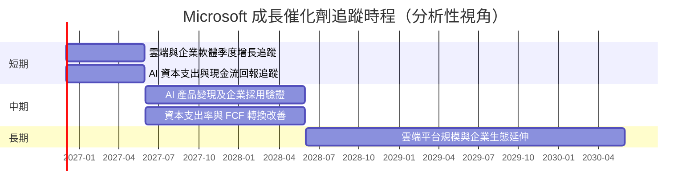

### 9.2 TAM 市場規模分析

**N/A（TAM 數據未提供）**。可量化的公司基礎是 TTM 營收 **$346.44B**、TTM 年增 **17.9%**；雲端與 AI 是重要成長方向，但缺乏可引用的市場規模、產品滲透率與分部收入，因此不估算 TAM 或市場滲透率。

### 9.3 成長驅動力結構圖

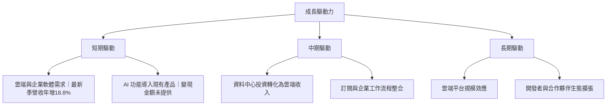

---

## 10. 風險矩陣

### 10.1 風險評分矩陣

機率與衝擊座標為研究判斷，不是財務報表數值；未提供可量化發生率，故不把座標冒充為統計機率。

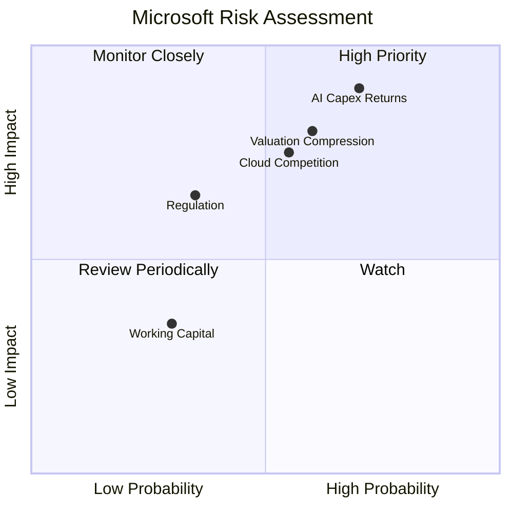

### 10.2 風險清單詳細分析

| # | 風險項目 | 發生機率 | 財務衝擊 | 風險評分 | 緩解措施 |
|---|----------|----------|----------|----------|----------|
| 1 | 🔴 **AI／資料中心 Capex 回收不佳** | 中高（定性判斷） | 高；TTM Capex **$135.92B**，高於 FCF **$59.96B**，若回報不足會壓低 FCF | 🔴 高 | 追蹤 Azure／AI 相關收入增速、Capex／營收與 FCF；避免只看營收而忽略回報。 |
| 2 | 🔴 **估值倍數收縮** | 中高（定性判斷） | 高；加權合理價值 **$425.22** 低於現價 **$484.52**，MOS **-13.9%** | 🔴 高 | 以估值區間分批管理部位；營收增速或利潤率下滑時重新檢查倍數。 |
| 3 | 🟡 **雲端與 AI 競爭加劇** | 中（定性判斷） | 中高；最新季度營收增速 **18.8%**，低於 GOOG **24.7%** 及 ORCL **29.6%**，但該比較為公司整體而非雲端分部 | 🟡 中高 | 季度檢查雲端分部成長、客戶續約、價格及利用率；避免把整體公司增長直接當作雲端市占。 |
| 4 | 🟡 **營運資金／供應商付款依賴** | 中（定性判斷） | 中；DPO **139 天**，CCC **-67 天**，若付款週期逆轉可能降低現金效率 | 🟡 中 | 監測 DSO、DPO、CCC 變化及主要供應商付款條件。 |
| 5 | 🟡 **資料口徑與債務分類差異** | 中（定性判斷） | 中；總債務來源值分別為 **$35.48B** 與 **$133.93B** | 🟡 中 | 以 SEC 申報資料逐項核對短債、長債、融資租賃與租賃負債，確保估值橋接與槓桿指標口徑一致。 |

---

## 11. 投資建議

### 11.1 最終評級與評分

依加權合理價值 **$425.22** 與現價 **$484.52** 計得 MOS **-13.9%**，按規則 20 評級為 **減碼**，未作質化調整。公司品質綜合評分為 **7.8/10**，六項分數為成長性 **8.5**、獲利能力 **9.0**、財務健康 **8.0**、估值 **5.0**、護城河 **9.0**、管理層與資本配置 **7.5**；評分反映基本面高品質，但估值限制了風險報酬。

### 11.2 合理價值與隱含報酬率

| 價值參考 | 每股價值 | 相對現價 | 機率 |
|----------|---------:|---------:|-----:|
| 加權合理價值 | **$425.22** | **-12.2%** | 固定方法權重 |
| DCF 悲觀情境 | **$178.21** | **-63.2%** | 25% |
| DCF 基準情境 | **$376.55** | **-22.3%** | 50% |
| DCF 樂觀情境 | **$729.21** | **+50.5%** | 25% |
| DCF 機率加權參考 | **$415.13** | **-14.3%** | 100% |

加權合理價值是本報告 MOS 基準；DCF 情境為獨立模型情境，不能替代固定權重估值結果。

### 11.3 買入時機與觸發因素

```text
╔══════════════════════════════════════════════════════════════════╗
║                  ✅ 買入觸發因素 Checklist                      ║
╠══════════════════════════════════════════════════════════════════╣
║  重新評估／建立部位前，優先確認：                                ║
║  ☐ 股價回到加權合理價值以下，並檢查營收與利潤率假設仍成立       ║
║  ☐ Capex／營收率連續下降，且非單純延後必要資本投入              ║
║  ☐ TTM FCF 回升並逐步改善 FCF／淨利轉換率                       ║
║                                                                  ║
║  加碼觸發條件：                                                  ║
║  ☐ 雲端／AI 相關增長轉化為更高 FCF，而非僅擴大資本支出           ║
║  ☐ 營業利益率維持在 45.6% 以上且 ROIC 持續高於 10.03%           ║
║                                                                  ║
║  減碼／退出觸發條件：                                            ║
║  ☐ 營業利益率持續低於 45.6%，且營收增長同步放緩                 ║
║  ☐ Capex 長期高於營業現金流增量，FCF 持續下滑                   ║
║  ☐ ROIC 跌至 WACC 10.03% 以下，代表價值創造能力反轉             ║
╚══════════════════════════════════════════════════════════════════╝
```

MOS 為負時，依加權合理價值推得 **MOS=10% 對應價格約 $382.70**，可作為估值條件參考，不是保證成交或必然反彈的價格。

### 11.4 投資人適配度分析

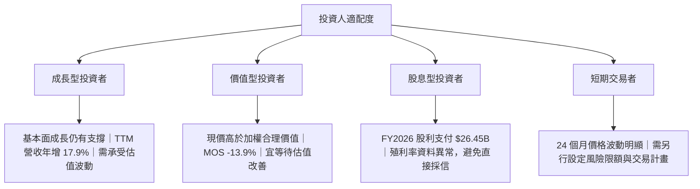

股息殖利率資料列為 **81.0%**，與其他財務欄位及支付率資訊顯然不具可比性，可能存在資料欄位錯置，因此不以該數字評價股息吸引力。FY2026 現金股利支付 **$26.45B** 可作現金回饋規模參考。

### 11.5 每季財報監控清單（Quarterly Watch List）

| 監控指標 | 基準／目前數值 | 觸發加碼或正向訊號 | 觸發減碼或負向訊號 |
|----------|----------------|--------------------|--------------------|
| 總營收年增 | 最新季度 **18.8%**；TTM **17.9%** | 單季年增維持高十位數，且收入質量未惡化 | 連續兩季低於 **15%**，需檢查雲端與訂閱需求 |
| 營業利益率 | TTM **47.1%**；最新季度核驗值 **49.8%** | TTM 維持 **45.6%** 以上 | TTM 低於 **45.6%** 或連續收縮 |
| Capex | TTM **$135.92B** | Capex 增長伴隨更快收入與 FCF 增長 | Capex／營收長期維持約 **39.2%**，且 FCF 未改善 |
| 營業現金流 | TTM **$195.88B** | OCF 增長足以覆蓋投入並支持 FCF 回升 | OCF 增長停滯且資本支出持續上升 |
| FCF | TTM **$59.96B**；FCF Yield **1.67%** | FCF 轉換率回升、FCF Yield 改善 | FCF 連續兩季下降或轉負 |
| DSO／DIO／DPO／CCC | **65／6／139／-67 天** | CCC 維持負值且 DSO 不上升 | DSO 持續增加、DPO 快速回落或 CCC 轉正 |
| SBC | 最近四季約 **$12.55B**；約為營收 **3.6%** | SBC／營收下降且股數不增加 | SBC／營收升高或稀釋股數轉為增加 |
| 資本回報 | ROIC **29.7%**；WACC **10.03%** | ROIC 維持顯著高於 WACC | ROIC 跌至 WACC 以下 |
| 資本負債口徑 | 核驗淨現金 **$29.03B** | SEC 明細與資料庫口徑一致 | 債務口徑差異持續擴大或槓桿快速上升 |

### 11.6 反面論證：什麼會證明論點錯誤（What Would Change My Mind）

```text
╔══════════════════════════════════════════════════════════════════╗
║              ⚠️ 論點失效條件（Disconfirming Evidence）           ║
╠══════════════════════════════════════════════════════════════════╣
║  本投資論點在下列情況成立時應重新檢視或退出：                    ║
║  ☐ 總營收年增連續兩季低於 15%，且雲端／企業收入同步放緩         ║
║  ☐ TTM 營業利益率跌破 45.6%，並非短期產品組合波動               ║
║  ☐ TTM FCF 轉負，或 FCF／淨利低於目前約 42.0% 且續降            ║
║  ☐ ROIC 跌破 WACC 10.03%，代表新增投資不再創造價值              ║
║  ☐ Capex／營收長期接近 39.2%，同時 FCF 未隨收入規模改善         ║
║  ☐ SBC／營收高於目前約 3.6%，且稀釋股數開始增加                 ║
║  ☐ DSO 持續上升、CCC 轉正，顯示收款或供應商融資條件惡化         ║
╚══════════════════════════════════════════════════════════════════╝
```

> **免責聲明**：本報告為 AI 自動生成，僅供研究參考，不構成投資建議。投資有風險，入市需謹慎。

---

## 資料與來源

| 項目 | 內容 |
|------|------|
| 價格 | 484.52 USD，2026-11-20 收盤（Yahoo Finance 日線） |
| 財務報表 | SEC 10-Q filed 2026-10-28，最新季度 2026-09-30（FY2027 Q1） |
| 有回應的資料來源 | SEC 申報資料 (XBRL)、Yahoo Finance、Finviz、StockAnalysis、Roic.ai |
| 由程式計算 | TTM 數字、WACC、DCF 模型、估值方法與權重、加權合理價值、MOS、評級門檻、F-Score、杜邦分解、營運資金天數、綜合評分 |
| 撰寫模型 | openai / gpt-6-luna |

> 本區塊由產生報告的程式依實際取得的資料填寫，非模型撰寫。「由程式計算」的數字不是模型的估計；其餘判斷（評分、情境、策略）是模型的分析。
