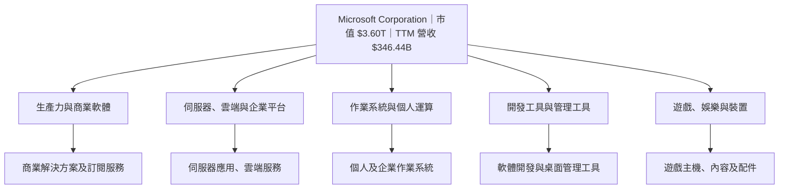
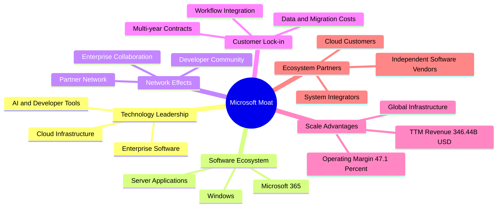
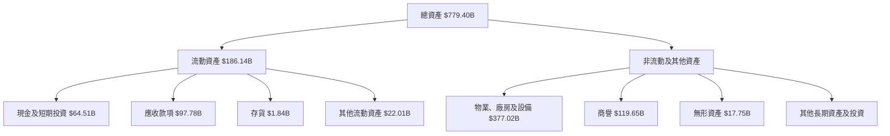
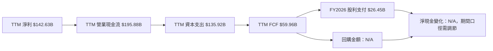
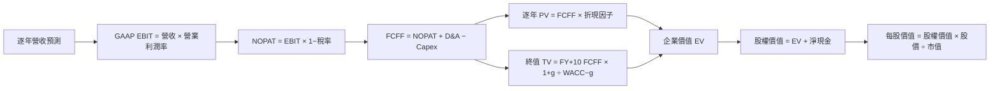
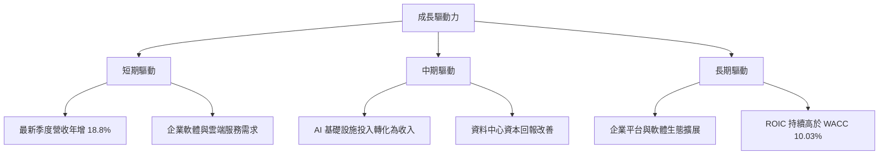
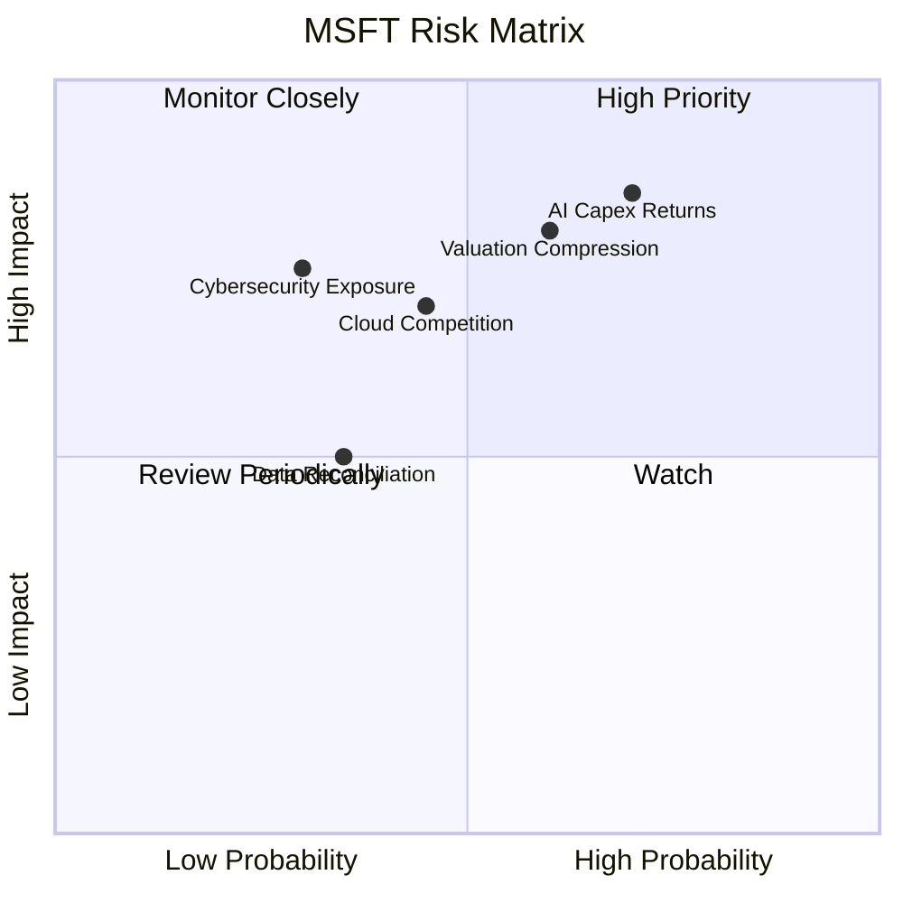
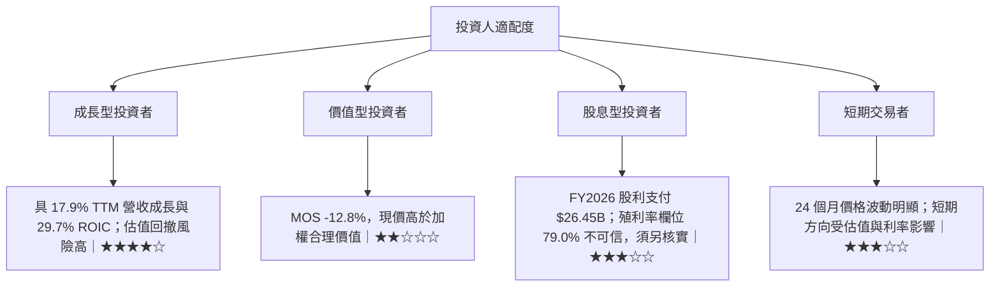

# MSFT 基本面深度分析報告
> **報告日期**：2026-11-21 ｜ **語言**：繁體中文 ｜ **數據來源**：SEC 申報資料 (XBRL)、Yahoo Finance、Finviz、StockAnalysis、Roic.ai ｜ **分析師**：CFA 級機構研究

## 目錄

| # | 章節 | 核心結論 |
|---|------|----------|
| 1 | 執行摘要 | 評級減碼；加權合理價值 $429.43；MOS -12.8% |
| 2 | 公司概覽與商業模式 | 多產品平台與企業客戶生態形成護城河；各業務營收占比未提供 |
| 3 | 損益表深度分析 | TTM 營收 $346.44B，TTM 年增 17.9%；TTM 營業利益率 47.1% |
| 4 | 資產負債表分析 | 依 SEC／計算口徑淨現金 $29.03B；流動比率與營運資金數據需留意 |
| 5 | 現金流量深度分析 | TTM FCF $59.96B；高資本支出使 FCF 低於營業現金流 |
| 6 | 獲利能力與資本效率 | ROIC 29.7% 高於 WACC 10.03%，仍在創造股東價值 |
| 7 | 相對估值分析 | P/E、EV/EBITDA 低於自身五年中位數，但高於所列同業多數倍數 |
| 8 | DCF 內在價值評估 | 基準 DCF $376.55；加權合理價值 $429.43，現價高於兩者 |
| 9 | 成長催化劑 | 雲端、AI 及企業軟體需求是質化催化劑；TAM 與分部營收數據未提供 |
| 10 | 風險矩陣 | AI 資本支出回收、估值與競爭、資料口徑不一致為主要風險 |
| 11 | 投資建議 | 現價 $484.52 不具足夠估值緩衝；依 MOS 門檻評為減碼 |

---

## 1. 執行摘要

### 1.0 一頁式投資儀表板（Portfolio Manager 30 秒速讀）

| 項目 | 內容 |
|------|------|
| **投資論點（3 句）** | ① TTM 營收 $346.44B、年增 17.9%，且最新一季年增 18.8%，成長仍具韌性。② TTM 營業利益率 47.1%、ROIC 29.7% 對比 WACC 10.03%，目前資本回報高於資金成本。③ TTM FCF 為 $59.96B，但資本支出達 $135.92B、FCF Yield 僅 1.67%，投資強度使現金回報受到壓縮。 |
| **綜合評分** | **7.6/10**（引用 1.1 六項算術平均） |
| **財務健康** | 🟢 淨現金 $29.03B；惟不同資料欄位的總債務與淨現金口徑不一致，須以 SEC 與計算口徑核對。 |
| **ROIC vs WACC** | **29.7% vs 10.03%**；利差 19.67 個百分點，現階段創造股東價值。 |
| **FCF 趨勢** | TTM FCF $59.96B；年度 FCF 從 FY2025 $71.61B 降至 FY2026 $66.99B，TTM FCF Yield 1.67%。 |
| **估值** | Forward P/E 20.02x ｜ EV/EBITDA 17.85x ｜ FCF Yield 1.67%。 |
| **DCF 內在價值（基準）** | **$376.55**；現價相對 DCF 溢價 **28.7%**（現價 ÷ DCF − 1）。 |
| **安全邊際（MOS）** | **-12.8%**＝($429.43 − $484.52) ÷ $429.43；🔴 <10% 無安全邊際。基準為第 8.8 節加權合理價值。 |
| **預期報酬（基準情境 12M）** | DCF 基準情境為 **-22.3%**，即 $376.55 相對 $484.52；並非另行設定的 12 個月預測。 |
| **關鍵風險（前二）** | AI／雲端資本支出未能轉化為足夠現金流；高估值對成長或折現率變化敏感。 |
| **評級 + 信心度** | **🟠 減碼** ｜ 信心：中（基本面數據充足，但估值與部分資料欄位存在口徑差異）。 |

### 1.1 綜合評分卡（全報告唯一）

| 維度 | 評分（1–10） | 主要依據（引用數字與其來源章節） |
|------|--------------|----------------------------------|
| 成長性 | 8.5 | TTM 營收年增 17.9%、最新一季年增 18.8%（第 3 章）。 |
| 獲利能力 | 9.0 | TTM 營業利益率 47.1%、ROIC 29.7% 高於 WACC 10.03%、F-Score 6/9（第 3、6 章）。 |
| 財務健康 | 8.0 | 計算口徑淨現金 $29.03B；流動比率 1.225；CCC -67 天（第 4 章）。 |
| 估值 | 4.0 | 加權合理價值 $429.43，MOS -12.8%；P/E 仍低於自身五年中位數，但現價高於合理價值（第 7、8 章）。 |
| 護城河 | 9.0 | TTM 營收 $346.44B、營業利益率 47.1%，企業軟體與多產品生態支持高轉換成本（第 2 章）。 |
| 管理層與資本配置 | 7.0 | FY2026 SBC $12.40B、股利支付 $26.45B；稀釋股數測試通過，但 TTM Capex $135.92B 提升投資回收要求（第 3、5 章）。 |
| **綜合評分** | **7.6** | 六項算術平均：(8.5 + 9.0 + 8.0 + 4.0 + 9.0 + 7.0) ÷ 6 = 7.58，四捨五入為 7.6。 |

### 1.2 五大投資論點 + 三大核心風險

| 類型 | 項目 | 具體依據 | 信心度 |
|------|------|----------|--------|
| 🟢 **投資論點①** | 收入動能仍在 | TTM 營收 $346.44B、年增 17.9%；最新一季營收 $92.28B、年增 18.8%。 | 🟢 高 |
| 🟢 **投資論點②** | 高營業獲利能力 | TTM 營業利益率 47.1%，最新一季為 49.8%（依 VERIFIED FIGURES 的最新季度欄位）。 | 🟢 高 |
| 🟢 **投資論點③** | 資本回報高於資金成本 | ROIC 29.7% 對 WACC 10.03%，利差 19.67 個百分點。 | 🟢 高 |
| 🟢 **投資論點④** | 經常性軟體收入與客戶黏著 | 產品包括作業系統、伺服器、商業解決方案、開發工具及雲端服務；跨產品整合有助延長客戶關係。分部營收金額未提供。 | 🟡 中 |
| 🟢 **投資論點⑤** | 現金流與資產負債表提供緩衝 | TTM OCF $195.88B、淨現金 $29.03B；但 TTM FCF $59.96B 顯示投資支出高。 | 🟢 高 |
| 🟡 **風險①** | AI／資料中心投資回報不確定 | TTM Capex $135.92B，約為 TTM 營收的 39.2%；若新增算力利用率或定價不如預期，FCF 會受壓。 | 🟡 中 |
| 🔴 **風險②** | 估值仍高於模型合理價值 | 現價 $484.52 高於 DCF $376.55；加權合理價值 $429.43，MOS -12.8%。 | 🔴 高衝擊 |
| 🟡 **風險③** | 財務資料欄位口徑不一致 | VERIFIED FIGURES 顯示總債務 $35.48B、淨現金 $29.03B；另有彙整欄位顯示總債務 $133.93B、淨負債 $69.42B。本文估值與核心指標採計算口徑，但需回看原始申報。 | 🟡 中 |

### 1.3 快速統計卡片

| 指標 | 公司實際值（期間） | 同業中位數 | 狀態 |
|------|--------------------|------------|------|
| 營收成長（TTM） | **17.9%** | — | 🟢 |
| 營收成長（最新一季年增） | **18.8%** | 24.7% | 🟡 |
| 毛利率（TTM） | **67.7%** | 60.9% | 🟢 |
| 營業利益率（TTM） | **47.1%** | — | 🟢 |
| ROIC（TTM） | **29.7%** | — | 🟢 |
| Forward P/E | **20.018377x** | 17.3x | 🟡 |
| FCF Yield（TTM） | **1.67%** | — | 🔴 |
| Piotroski F-Score | **6 / 9** | — | 🟡 |

*同業中位數僅就有提供的三家公司計算：最新一季營收成長中位數為 24.7%；毛利率中位數為 60.9%；Forward P/E 中位數為 17.3x。*

### 1.4 投資結論

```text
╔══════════════════════════════════════════════════════════════════╗
║                    📊 投資結論摘要                               ║
╠══════════════════════════════════════════════════════════════════╣
║  評級：減碼（依規則 20；MOS -12.8%）                            ║
║  價格（2026-11-20 收盤）：$484.52                                ║
║  DCF 內在價值（基準）：$376.55（現價溢價 28.7%）                 ║
║  安全邊際 MOS：-12.8%（＝(加權合理價值−現價)÷加權合理價值）    ║
║  加權合理價值（8.8）：$429.43                                    ║
║  DCF 情境價值：                                                  ║
║    悲觀情境：$178.21（-63.2%）                                   ║
║    基準情境：$376.55（-22.3%）                                   ║
║    樂觀情境：$729.21（+50.5%）                                   ║
║  綜合評分：7.6/10（引用 1.1）                                    ║
║  適合投資人：重視大型平台企業、能承受估值波動的長線投資人；      ║
║  不適合以低估值或高現金殖利率為首要條件的投資人。               ║
╚══════════════════════════════════════════════════════════════════╝
```

---

## 2. 公司概覽與商業模式

### 2.1 業務結構與收入來源

財務資料沒有列出各事業群營收與占比，因此不以推估比例繪製營收拆分圖。下圖呈現已知產品類型與總營收錨點；營收分部金額與占比為 **N/A（分部數據未提供）**。



商業模式結合企業訂閱、授權、雲端服務及消費者產品。訂閱與企業服務通常有助於提高收入可見度；但沒有各業務營收、毛利或訂閱數資料，無法量化哪一板塊對近期增長的貢獻最大。

### 2.2 市場份額

市場份額數據未提供，亦沒有足以引用的年份與來源數字，因此不提供市占率圖表。以規模與增長看，MSFT TTM 營收 $346.44B、年增 17.9%，最新一季年增 18.8%；其規模大於所列同業的可比資訊未提供，故不以未核實的市占率作結論。

### 2.3 競爭護城河分析



### 2.4 護城河強度

| 護城河項目 | 強度（強／中／弱） | 證據（引用數字或事實） | 會削弱它的情況 |
|------------|--------------------|------------------------|----------------|
| 技術與產品組合 | 強 | 產品涵蓋作業系統、伺服器、商業解決方案、開發工具、遊戲與裝置；TTM 營收 $346.44B。 | 技術替代加速、產品創新失速、雲端競爭導致差異化下降。 |
| 軟體生態系統 | 強 | 企業產品可跨作業系統、商業應用、開發及管理工具整合。 | 客戶轉向開放標準或多雲架構，降低綁定效益。 |
| 網路效應 | 中至強 | 企業協作、開發工具與合作夥伴互補；具體活躍用戶及合作夥伴數未提供。 | 競品建立更具吸引力的開發者或工作流程平台。 |
| 客戶鎖定 | 強 | 企業流程、資料與既有系統整合增加轉換成本；DSO 65 天、CCC -67 天（第 4 章）。 | 大型企業採購議價增強，或遷移工具降低轉換成本。 |
| 規模效應 | 強 | TTM 營業利益率 47.1%、TTM 營業現金流 $195.88B。 | AI 基礎設施折舊與維運成本長期高於新增收入。 |
| 生態夥伴 | 中至強 | 產品涵蓋開發工具、伺服器及商業平台，具有多層合作空間；量化夥伴數未提供。 | 夥伴同時支持競爭平台，或自建替代服務。 |

1.1「護城河」評分為 **9.0/10**，依據是廣泛產品組合、47.1% TTM 營業利益率與大規模現金流；未給滿分是因各業務收入、客戶留存及市場份額資料缺漏。

---

## 3. 損益表深度分析

### 3.1 年度收入成長趨勢（近 4 年）

收入數據來自年度損益表。CAGR 以 FY2023 至 FY2026 三年區間計算。

```text
╔══════════════════════════════════════════════════════════════════╗
║              Microsoft 年度收入趨勢（FY2023-FY2026）             ║
╠══════════════════════════════════════════════════════════════════╣
║  FY2023  $211.91B  █████████████░░░░░░░░░░░░  YoY: +6.9%  🟢   ║
║  FY2024  $245.12B  ███████████████░░░░░░░░░░  YoY: +15.7% 🟢   ║
║  FY2025  $281.72B  █████████████████░░░░░░░  YoY: +14.9% 🟢   ║
║  FY2026  $331.84B  ████████████████████░░░░░  YoY: +17.8% 🟢   ║
╠══════════════════════════════════════════════════════════════════╣
║  3年累計 CAGR：(331.84 ÷ 211.91)^(1/3) − 1 = 約 16.1%            ║
╚══════════════════════════════════════════════════════════════════╝
```

FY2026 營收年增 17.8%，高於 FY2025 的 14.9%。該加速與雲端、商業軟體及 AI 相關需求相容，但目前資料未提供分部營收，不能將全部增長歸因於單一產品線。TTM 營收成長 17.9% 與 FY2026 年增率接近，顯示近期增長並非只由單一季度造成。

### 3.2 季度收入趨勢分析

| 季度 | 營收（$B） | QoQ 成長 | YoY 成長 | 備註 |
|------|------------:|---------:|---------:|------|
| 2025-12-31 | 81.27 | N/A | 16.72% | QoQ 比較季度未列入完整前一季序列；YoY 依 StockAnalysis。 |
| 2026-03-31 | 82.89 | +1.99% | 18.30% | QoQ = 82.89 ÷ 81.27 − 1。 |
| 2026-06-30 | 90.01 | +8.59% | 17.75% | QoQ = 90.01 ÷ 82.89 − 1；季節性與企業採購時點可能影響單季變化。 |
| 2026-09-30 | 92.28 | +2.52% | 18.80% | 最新季度 YoY，不是 TTM 成長率。 |

最新季度營收年增 18.8%，與 TTM 年增 17.9%方向一致。季增率波動較大，尤其 2026-06-30 季增 8.59%，不宜把單季增幅直接外推為全年趨勢。

### 3.3 利潤率演變分析

下表以年度損益表中的毛利、營業利益、淨利除以同年度收入計算；TTM 營業利益率則引用計算口徑 47.1%。

| 利潤率指標 | FY2023 | FY2024 | FY2025 | FY2026 | 趨勢 | 評估 |
|------------|--------:|--------:|--------:|--------:|------|------|
| **毛利率** | 68.9% | 69.8% | 68.8% | 67.9% | 近兩年回落，FY2026 較 FY2024 低約 1.9 個百分點 | 🟡 |
| **營業利益率** | 41.8% | 44.6% | 45.6% | 46.8% | 持續提升，反映營收規模擴張下營業費用槓桿 | 🟢 |
| **淨利率** | 34.2% | 36.0% | 36.1% | 40.3% | FY2026 上升，需留意稅項及非營業項目影響 | 🟢 |

**利潤率演變深度解析：**營業利益率由 FY2023 的 41.8% 升至 FY2026 的 46.8%，表示營業利益增長快於收入；FY2026 營業利益 $155.24B，較 FY2025 $128.53B 增長約 20.8%，高於收入約 17.8% 的增長。毛利率同期下降，可能反映產品組合、雲端基礎設施成本或服務交付成本增加；由於分部成本資料缺漏，無法拆解各因素的量化貢獻。淨利率 FY2026 升至約 40.3%，也應與有效稅率及非營業損益一併觀察，不宜將單年改善完全視為營運趨勢。

### 3.4 費用結構分析

分部費用明細未完整提供，故不以無法對應的項目繪製圓餅圖。已知 FY2026 研發費用為 $35.56B，占年度營收約 10.7%（$35.56B ÷ $331.84B）；FY2026 營業利益為 $155.24B。銷售與管理費用的完整金額與費用占比未提供。

### 3.5 季度 EPS 趨勢與盈餘品質（Quality of Earnings）

| 季度 | EPS 實際值 | EPS 年增率 | 超預期／不及預期 |
|------|-----------:|-----------:|------------------|
| 2025-12-31 | $5.16 | +59.75% | N/A（EPS Est 為缺值，不能判斷預期差） |
| 2026-03-31 | $4.27 | +23.41% | N/A（EPS Est 為缺值） |
| 2026-06-30 | $4.81 | +31.74% | N/A（EPS Est 為缺值） |
| 2026-09-30 | $4.92 | +32.26% | N/A（EPS Est 為缺值） |

最近四季 EPS Estimates 均為缺值，不能可靠分類為超預期或不及預期。最新季度淨利年增 32.0%、EPS 年增 32.3%，顯示盈餘增速高於收入增速；但季度比較會受稅項、其他收益及股數影響。

| 盈餘品質項目 | 數值／佔比 | 評估 |
|--------------|-----------|------|
| 股權薪酬 SBC / 營收 | 約 **3.6%**；以最近四季 SBC $12.55B ÷ TTM 營收 $346.44B 計 | 🟡 SBC 為實質股東成本；雖然稀釋股數測試通過，仍須觀察回購是否抵銷薪酬授股。 |
| SBC / 營業現金流 | 約 **6.4%**；$12.55B ÷ $195.88B | 🟡 SBC 占 OCF 不高，但不是零成本。 |
| FCF / 淨利（現金轉換率） | 約 **42.0%**；TTM FCF $59.96B ÷ TTM 淨利 $142.63B | 🔴 現金轉換低於淨利，主要需留意資本支出強度。 |
| 一次性／非經常性損益 | N/A（缺少可核對的完整調節表） | 無法判定本期淨利受一次性項目影響程度。 |
| 有效稅率異常 | WACC／DCF 採用最新年度有效稅率 19.4% | 🟢 模型依指定稅率；季度有效稅率明細未提供，不能排除季度波動。 |
| 資本化支出 vs 費用化 | TTM Capex $135.92B；資本化支出約為 TTM 營收 39.2% | 🟡 資料未提供資本化政策變動，不能判定是否透過資本化遞延費用。 |

最近四季 SBC $12.55B 的計算為 $3.22B + $3.08B + $3.12B + $3.13B；該計算採所列季度現金流欄位。年度 SBC 從 FY2023 $9.61B 增至 FY2026 $12.40B，約增加 29.0%，同期間收入增加約 56.6%，SBC 相對營收比重下降。整體而言，GAAP 獲利有營業現金流支持，但 TTM FCF 只有淨利約 42.0%，說明目前的經濟盈餘受高資本支出壓低；估值上應以 FCF 而非淨利單獨衡量。

---

## 4. 資產負債表分析

### 4.1 資產結構分解

最新 TTM 資產負債表資料列示總資產 $779.40B、流動資產 $186.14B。以下為有提供金額的主要項目，不將其視為完整資產加總。



*資產子項可能因表格分類及合併口徑不完全等同總資產；依規則不以差額反推未列項目。*

### 4.2 流動性與營運資金分析

| 指標 | 最新 TTM | 一年前 TTM | 變化 | 解讀 |
|------|----------|------------|------|------|
| DSO 應收帳款天數 | 65 天 | 66 天 | -1 天 | 收款天數略降，應收回收效率大致穩定。 |
| DIO 存貨天數 | 6 天 | 4 天 | +2 天 | 存貨天數上升，但仍低；存貨占此類軟體平台企業營運資產較小。 |
| DPO 應付帳款天數 | 139 天 | 130 天 | +9 天 | 付款週期拉長，有助營運資金；需監察供應商付款條件是否可持續。 |
| CCC 現金轉換週期 | -67 天 | -59 天 | -8 天 | CCC 更負，代表營運收款與付款時點提供資金緩衝；不能單獨視為永久現金流來源。 |

流動比率為 1.225、速動比率為 1.068；短期償付能力有緩衝，但並非極高。QUALITY FIGURES 的營運資金天數採期末餘額除以 TTM 流量，與傳統平均餘額計算法可能不同。

### 4.3 債務結構分析

依 VERIFIED FIGURES，現金及短期投資 $64.51B、總債務 $35.48B，淨現金為 $29.03B。其他彙整財務欄位另列總債務 $133.93B、淨負債 $69.42B，彼此不一致；下圖依指定估值口徑展示，不把兩種口徑混合計算。

```text
╔══════════════════════════════════════════════════════════════════╗
║                   Microsoft 債務健康診斷                         ║
╠══════════════════════════════════════════════════════════════════╣
║  總債務：        $35.48B   ███████░░░░░░░░░░░░░  計算口徑       ║
║  現金及短期投資：$64.51B   █████████████░░░░░░░  計算口徑       ║
║  淨現金：        $29.03B   ██████░░░░░░░░░░░░░░  🟢             ║
║                                                                  ║
║  Debt / EBITDA：依同一組 VERIFIED FIGURES 債務 $35.48B ÷        ║
║                  TTM EBITDA $205.79B ≈ 0.17x                    ║
║  利息保障倍數：  N/A（利息費用及一致口徑分母未提供）             ║
║  資料提醒：另一彙整欄位列債務 $133.93B，須回查原始申報口徑。    ║
╚══════════════════════════════════════════════════════════════════╝
```

### 4.4 股東權益趨勢

| 財年 | 股東權益（$B） | YoY 變化 |
|------|----------------:|---------:|
| FY2023 | 206.22 | — |
| FY2024 | 268.48 | +30.2% |
| FY2025 | 343.48 | +27.9% |
| FY2026 | 442.39 | +28.8% |

```text
╔══════════════════════════════════════════════════════════════════╗
║                  股東權益趨勢（年度）                            ║
╠══════════════════════════════════════════════════════════════════╣
║  FY2023  $206.22B  █████████░░░░░░░░░░░░░                      ║
║  FY2024  $268.48B  ████████████░░░░░░░░░                        ║
║  FY2025  $343.48B  ████████████████░░░░                         ║
║  FY2026  $442.39B  ████████████████████                         ║
╚══════════════════════════════════════════════════════════════════╝
```

股東權益三年增長超過一倍，與留存獲利及資產規模擴張相容；但股東權益增長不等於每股價值同比增長，仍須扣除稀釋及資本回報要求。

---

## 5. 現金流量深度分析

### 5.1 現金流量瀑布圖

淨利、股利與資本支出有年度數字；回購及期末現金變化的完整同期間調節表未提供，因此不以數字填入未核實項目。



### 5.2 FCF 轉換率趨勢

| 財年 | FCF（$B） | 淨利（$B） | FCF / 淨利 | 趨勢 |
|------|----------:|-----------:|-----------:|------|
| FY2023 | 59.48 | 72.36 | 82.2% | 🟡 |
| FY2024 | 74.07 | 88.14 | 84.0% | 🟢 |
| FY2025 | 71.61 | 101.83 | 70.3% | 🟡 |
| FY2026 | 66.99 | 133.75 | 50.1% | 🔴 |
| TTM 至 2026-09-30 | 59.96 | 142.63 | 42.0% | 🔴 |

FY2026 後 FCF／淨利比率下滑，核心差異是資本支出快速增加：FY2026 Capex $115.95B，高於 FY2025 $64.55B。TTM Capex 已達 $135.92B，反映資料中心與其他長期資產投入提高；未來必須用新增營收與現金流驗證投資報酬。

### 5.3 自由現金流趨勢

```text
╔══════════════════════════════════════════════════════════════════╗
║              自由現金流：歷史實際 vs TTM                         ║
╠══════════════════════════════════════════════════════════════════╣
║  FY2023  $59.48B  ████████████████░░░░░░░░  FCF/NI: 82.2%       ║
║  FY2024  $74.07B  ████████████████████░░░░  FCF/NI: 84.0%       ║
║  FY2025  $71.61B  ███████████████████░░░░░  FCF/NI: 70.3%       ║
║  FY2026  $66.99B  ██████████████████░░░░░░  FCF/NI: 50.1%       ║
║  TTM     $59.96B  ████████████████░░░░░░░░  Yield: 1.67%        ║
╠══════════════════════════════════════════════════════════════════╣
║  TTM FCF 定義：營業現金流 $195.88B − Capex $135.92B = $59.96B   ║
╚══════════════════════════════════════════════════════════════════╝
```

### 5.4 資本配置評估

| 項目 | 金額 | 判讀 |
|------|-----:|------|
| FY2026 資本支出 | $115.95B | FY2025 的 $64.55B 大幅增加；擴建資產有助支援雲端與 AI，但提高折舊及現金回收壓力。 |
| FY2026 股利支付 | $26.45B | 股利支付金額具體；資料另列股利殖利率 79.0%，與其他欄位顯然不相容，本文不採用該殖利率。 |
| FY2026 SBC | $12.40B | 是薪酬成本，應納入稀釋與資本配置評估。 |
| 股票回購 | N/A | 資料未提供可核對的回購金額。 |
| 留存現金／淨現金變化 | N/A | 缺少同期間完整資金用途調節。 |

Capex、股利、SBC 與回購並非可直接以同一年度現金流加總的互斥分類，因此不以圓餅圖呈現。FY2026 FCF $66.99B 足以覆蓋當年股利 $26.45B，但不應據此假定未來 Capex 維持不變。

---

## 6. 獲利能力與資本效率

### 6.1 ROE / ROA / ROIC 趨勢

| 指標 | FY2023 | FY2024 | FY2025 | 最新 TTM | 評估 |
|------|-------:|-------:|-------:|---------:|------|
| ROE | N/A | N/A | N/A | **30.3%（QUALITY FIGURES）** | 杜邦表同為 30.3%；其他彙整欄位列 TTM ROE 34.2%，口徑不同，採指定品質指標。 |
| ROA | N/A | N/A | N/A | 14.4% | 絕對回報良好；歷年同口徑序列未提供。 |
| ROIC | N/A | N/A | N/A | **29.7%** | 明顯高於 WACC 10.03%，具價值創造。 |

未提供完整、同口徑的歷年 ROIC／ROA 序列與行業平均數，故不填補估計比較值。

### 6.2 ROIC vs WACC 分析（核心價值創造判斷）

**ROIC 29.7% 高於 WACC 10.03%，差額為 19.67 個百分點；以指定 ROIC 口徑衡量，公司目前創造而非摧毀股東價值。**

```text
╔══════════════════════════════════════════════════════════════════╗
║                ROIC vs WACC 深度分析                            ║
╠══════════════════════════════════════════════════════════════════╣
║  WACC（直接採用 Cost of capital 輸入）：10.03%                   ║
║  ├── 無風險利率（10Y 美債）：             4.91%                  ║
║  ├── 市場風險溢酬 ERP：                    5.00%                  ║
║  ├── Beta（調整後）：                      1.03                   ║
║  ├── 股權成本：4.91% + 1.03 × 5.00% =     10.06%                 ║
║  ├── 稅前債務成本：                        8.60%                  ║
║  ├── 稅後債務成本：8.60% × (1−19.4%) =     6.93%                  ║
║  ├── 資本權重：股權 99.0%，債務 1.0%                              ║
║  └── WACC：99.0%×10.06% + 1.0%×6.93% =         10.03%            ║
║                                                                  ║
║  ROIC（TTM）：                              29.7%                 ║
║  EVA 利差：29.7% − 10.03% =                 +19.67pp              ║
║                                                                  ║
║  ROIC  29.7%  ▓▓▓▓▓▓▓▓▓▓▓▓▓▓▓▓▓▓▓▓▓░░░░  🟢                     ║
║  WACC  10.03% ▓▓▓▓▓▓▓░░░░░░░░░░░░░░░░░░  ──                     ║
╚══════════════════════════════════════════════════════════════════╝
```

Cost of capital 輸入列示原始 Beta 1.04，使用調整後 Beta 1.03；調整方式為 `⅔ × 1.04 + ⅓ = 1.0267`，四捨五入為 1.03。股權成本與 WACC 採用已列示的 10.06% 與 10.03%，不另行替換。稅前債務成本直接引用 8.60%；利息費用金額及平均計息負債的完整原始數據未列出，故無法從披露欄位獨立重算其分子、分母。

### 6.3 杜邦三因素分解

| 因素 | 數值（TTM） | 解讀 |
|------|-------------|------|
| 淨利率 | 41.2% | 高淨利率是 ROE 的主要來源之一。 |
| 資產週轉率 | 0.44 | 每單位資產產生的收入有限於資本密集型擴張期；大型固定資產投入會壓低週轉率。 |
| 權益乘數 | 1.66 | 槓桿並非 ROE 的主要支撐；回報主要來自獲利能力。 |
| **ROE** | **30.3%** | 41.2% × 0.44 × 1.66 = 約 30.1%；資料公布值為 30.3%，差異來自未四捨五入的底層數值。 |

### 6.4 財務體質：Piotroski F-Score

Piotroski F-Score 為 **6/9**。以下逐項照錄品質指標結果。

| 測試 | 結果 | 解讀 |
|------|------|------|
| ROA > 0 | ✅ 通過 | TTM 資產回報為正。 |
| 營業現金流 > 0 | ✅ 通過 | TTM OCF $195.88B。 |
| ROA 高於一年前 | ✅ 通過 | 年增方向符合獲利改善。 |
| 營業現金流 > 淨利（應計品質） | ✅ 通過 | 現金流大於淨利，支持盈餘品質；惟 FCF 因高 Capex 顯著較低。 |
| 長期負債 ÷ 總資產低於一年前 | ✅ 通過 | 負債相對資產的趨勢測試通過。 |
| 流動比率高於一年前 | ❌ 未通過 | 流動比率未改善，須留意短期流動性相對變化。 |
| 稀釋股數未增加 | ✅ 通過 | 指標測試通過；不代表 SBC 沒有經濟成本。 |
| 毛利率高於一年前 | ❌ 未通過 | 毛利率比較未通過，與資料所示 FY2024 以後毛利率回落相符。 |
| 資產週轉率高於一年前 | ❌ 未通過 | 可能與資產投資擴張先於收入貢獻有關。 |

---

## 7. 相對估值分析

### 7.1 同業估值比較表格

同業倍數來自 Yahoo Finance Peer multiples；本公司採財務數據列示倍數。GOOG、AMZN、ORCL 是參照同業，不代表業務完全可比。

| 估值指標 | **MSFT** | **GOOG** | **AMZN** | **ORCL** | MSFT 評估 |
|----------|---------:|--------:|--------:|--------:|-----------|
| **Trailing P/E** | 25.2881x | 13.8x | 20.0x | 15.9x | 🔴 高於三家同業；需由較高利潤率與增長支撐。 |
| **Forward P/E** | 20.018377x | 17.3x | 22.6x | 9.2x | 🟡 接近 AMZN，但高於 GOOG、ORCL；同業中位數 17.3x。 |
| **P/S Ratio** | 10.38589x | 6.9x | 3.3x | 4.4x | 🔴 明顯高於同業；市場對 MSFT 的盈利能力與平台品質給予溢價。 |
| **EV / EBITDA** | 17.847x | 17.4x | 16.2x | 13.7x | 🟡 高於三家同業；同業中位數 16.2x。 |
| **最新一季營收年增** | 18.8% | 24.7% | 12.1% | 29.6% | 🟡 增長不及 GOOG、ORCL；高於 AMZN。 |
| **毛利率（TTM）** | 67.7% | 60.9% | 51.4% | 64.0% | 🟢 高於所列三家。 |

### 7.2 歷史估值區間分析

```text
╔══════════════════════════════════════════════════════════════════╗
║               MSFT 五年估值位置（TTM 倍數）                      ║
╠══════════════════════════════════════════════════════════════════╣
║  P/E        20.8x ├────────────● 25.3x────────────┤ 37.8x       ║
║                           中位數 31.5x；目前百分位 14%          ║
║                                                                  ║
║  P/S         8.4x ├────────● 10.4x───────────────┤ 13.7x       ║
║                           中位數 12.0x；目前百分位 33%          ║
║                                                                  ║
║  EV/EBITDA  14.5x ├──────● 17.8x─────────────────┤ 31.4x       ║
║                           中位數 24.3x；目前百分位 10%          ║
╚══════════════════════════════════════════════════════════════════╝
```

三項倍數皆低於自身五年中位數，尤其 EV/EBITDA 位於歷史區間較低位置；但低於自身歷史不等於絕對便宜，因為 DCF 基準仍低於現價。

### 7.3 情境價值（Bear / Base / Bull，照抄 DCF MODEL）

| 情境 | 第 1 年營收成長 | 期末營業利潤率 | WACC | 每股價值 | 相對現價 | 機率 | 會發生的條件 |
|------|----------------:|---------------:|-----:|---------:|---------:|-----:|--------------|
| 🔴 悲觀 | 9.0% | 38.8% | 11.03% | $178.21 | -63.2% | 25% | 雲端／AI 成長放緩、價格競爭與基礎設施成本壓低成熟期利潤率，且折現率上升。 |
| 🟡 基準 | 17.9% | 45.6% | 10.03% | $376.55 | -22.3% | 50% | 營收由 TTM 成長率起步、逐步減速，營業利潤率向模型成熟期水準收斂。 |
| 🟢 樂觀 | 26.9% | 50.2% | 9.03% | $729.21 | +50.5% | 25% | 雲端與 AI 變現超預期，營收增長加速、規模效應推升利潤率，資金成本下降。 |

### 7.4 相對估值隱含價格區間

```text
╔══════════════════════════════════════════════════════════════════╗
║              相對估值方法隱含每股價值                            ║
╠══════════════════════════════════════════════════════════════════╣
║  $376.55 DCF ── $417.71 Forward P/E ── $443.08 EV/EBITDA         ║
║                                        │                         ║
║                           現價 $484.52 ───── 分析師 $636.12     ║
╚══════════════════════════════════════════════════════════════════╝
```

| 方法 | 每股價值 | 相對現價 | 依據 |
|------|---------:|---------:|------|
| DCF（基準） | $376.55 | -22.3% | 10 年 FCFF、WACC 10.03%、永續成長率 3.0%。 |
| 同業 Forward P/E | $417.71 | -13.8% | GOOG、AMZN、ORCL 同業中位數 Forward P/E 17.3x × Forward EPS $24.20。 |
| 同業 EV/EBITDA | $443.08 | -8.6% | 同業 EV/EBITDA 中位數 16.2x × TTM EBITDA，再加淨現金。 |
| 分析師共識目標價 | $636.12 | +31.3% | 54 位分析師平均目標價；參考性較高，非基本面保證。 |

---

## 8. DCF 內在價值評估（Discounted Cash Flow）

### 8.0 估值推理鏈（Thinking Logic）

**Step 1 — 價值由哪些變數決定？**  
本 DCF 的價值由既有軟體與企業服務現金流底盤、雲端及 AI 相關成長，以及終值現金流共同決定。可量化的分母是公司 TTM 營收 $346.44B；各業務占比未提供，不能用虛構占比拆成兩條成長曲線。10.03% 的 WACC、3.0% 永續成長率與第 10 年後現金流的終值，對估值具重要影響；敏感度矩陣顯示提高 WACC 或降低 g 均會降低每股價值。

**Step 2 — 模型選擇**

| 決策點 | 本報告採用 | 理由（含數字） | 曾考慮但否決 | 否決理由 |
|--------|-----------|----------------|--------------|----------|
| 現金流定義 | FCFF | 與 WACC 折現並推導企業價值一致；財務資料有 OCF 與 Capex。 | FCFE | 資本結構與融資現金流未納入模型。 |
| 預測期 N | 10 年 | DCF MODEL 固定 10 年；企業軟體與雲端平台具有較長商業可見度，但遠期不確定性較高。 | 5 年 | 將中長期現金流提前交由終值表示，對長週期投資的描述較粗。 |
| 終值方法 | Gordon Growth | 指定終值成長率 3.0% 小於 WACC 10.03%。 | 退出倍數 | DCF 模型未提供退出倍數終值與相應橋接數字，不另建模型。 |
| EBIT 基礎 | GAAP EBIT | 模型 EBIT 為 GAAP，已將 SBC 作為費用處理。 | 非 GAAP EBIT | 加回 SBC 後需另行扣回，資料模型未採用此路徑。 |

**Step 3 — 關鍵假設推導鏈**

- **營收成長路徑**：錨點＝TTM 營收年增 17.9%、最新季度年增 18.8% → 調整＝以 TTM 成長作第一年起點，之後線性遞減至成熟期 3.0% → **採用第 1 年 17.9%、第 10 年 3.0%** → 曾考慮將 17.9% 延續整個預測期，但否決，因長期增速維持高位會忽略基期擴大與市場成熟。
- **預測期 N**：錨點＝DCF MODEL 設定 10 年 → 調整＝不改動程式模型期限 → **採用 10 年** → 曾考慮 5 年，但否決以遵守既有模型且保留逐年漸進衰減期。
- **營業利潤率**：錨點＝TTM GAAP 營業利益率 47.1% → 調整＝以模型所列近五個財年中位數作成熟期錨點 → **第 1 年 47.1% 線性降至第 10 年 45.6%** → 曾考慮長期維持 47.1%，但否決，因模型採用的五年中位數較能反映利潤率回歸。
- **Capex／營收**：錨點＝TTM Capex／營收 39.2% → 調整＝模型由目前高投資強度逐步退回 1.1 倍 D&A 的成熟基準 → **第 1 年 39.2%、第 10 年 12.2%** → 曾考慮維持 39.2%，但否決，因長期現金流不應假定資本支出占營收永遠不變；此為高敏感假設。
- **永續成長率 g**：錨點＝模型採 3.0% 長期成長假設 → 調整＝保持低於 10.03% WACC，避免 Gordon Growth 分母失效 → **採用 3.0%** → 曾考慮更高的長期成長率，但未採用；成熟期長期成長高於 3.0% 需要額外可驗證依據。
- **有效稅率**：錨點＝最新年度有效稅率 19.4% → **採用 19.4%**，模型各年固定。
- **D&A／營收**：錨點＝TTM 11.1% → **採用 11.1%**，模型固定。
- **ΔWC／營收增額**：資料模型未建模營運資金變動；**採用模型設定：不另列 ΔWC**，這不是對實際營運資金變化為零的判斷。
- **EBIT 基礎與 SBC**：採 GAAP EBIT；SBC 已作費用，不在 FCFF 再扣一次。
- **年稀釋率**：模型採固定股數、年稀釋率 0%；以當期股數口徑換算，SBC 費用已反映於 GAAP EBIT。
- **終值方法**：錨點＝WACC 10.03%、g 3.0% → **採 Gordon Growth**；未採退出倍數作 DCF 終值，因 DCF MODEL 沒有該方法的終值計算結果。
- **WACC**：錨點＝資本成本欄提供 10.03% → **採 10.03%**，與第 6.2 節一致；不另行自建折現率。

**Step 4 — 最脆弱假設**  
最脆弱環節是 Capex／營收由 39.2% 降至 12.2% 的速度；若資本密集度維持較高，FCFF 低於基準預測，估值方向向下。模型基準每股價值 $376.55；其 WACC／g 敏感度與三情境的下行值顯示估值不確定性很大。

**Step 5 — 計算路徑圖**



### 8.1 模型假設總表（Model Inputs）

| 假設項目 | 採用值 | 依據／來源 | 敏感度 |
|----------|--------|-------------|--------|
| 預測期長度 **N** | 10 年 | DCF MODEL 固定期限；模型逐年列出 FY+1 至 FY+10。 | 🟡 中 |
| 營收成長 | 第 1 年 17.9% → 第 10 年 3.0% | TTM 年增 17.9% 起步，逐年線性遞減至模型終點。 | 🔴 高 |
| 營業利潤率 | 第 1 年 47.1% → 第 10 年 45.6% | TTM 47.1%，模型逐步回落至過去五財年中位數。 | 🔴 高 |
| 有效稅率 | 19.4% | 最新年度有效稅率。 | 🟢 低 |
| Capex / 營收 | 第 1 年 39.2% → 第 10 年 12.2% | TTM 比率起點，逐步回落至 1.1 × D&A。 | 🟡 中 |
| D&A / 營收 | 11.1% | TTM 數值，模型固定。 | 🟢 低 |
| 營運資金變動 | 未建模 | DCF MODEL 明定 working capital is not modelled；不反推比率。 | 🟢 低 |
| EBIT 基礎 | GAAP | DCF MODEL 明定 GAAP EBIT。 | 🟡 中 |
| SBC 處理 | 組合 (A)：GAAP EBIT、固定股數、不另扣 SBC | GAAP EBIT 已包含 SBC 費用；模型不另稀釋股數。 | 🟡 中 |
| 年稀釋率 | 0% | 組合 (A) 固定股數假設；稀釋股數資料另有 7.43B 股。 | 🟡 中 |
| 永續成長率 g | 3.0% | DCF MODEL 指定；低於 WACC。 | 🔴 高 |
| 終值方法 | Gordon Growth | DCF MODEL 提供終值及 PV；退出倍數終值未提供。 | 🔴 高 |
| WACC | 10.03% | Cost of capital 區塊指定，與第 6.2 節相同。 | 🔴 高 |

**FCFF 定義：**本模型採 FCFF＝NOPAT + D&A − Capex；不含 ΔWC 列。**本模型採用 (A)，故 SBC 影響已計入一次**：使用 GAAP EBIT、不再扣 SBC，並採固定股數。

### 8.2 折現率推導（WACC）

```text
╔══════════════════════════════════════════════════════════════════╗
║                    WACC 推導（折現率）                           ║
╠══════════════════════════════════════════════════════════════════╣
║  股權成本 Ke（CAPM）：                                           ║
║  ├── 無風險利率 Rf（10Y 美債）：       4.91%                     ║
║  ├── 市場風險溢酬 ERP：                 5.00%                     ║
║  ├── 原始 Beta：                        1.04                      ║
║  ├── 調整 Beta：⅔×1.04 + ⅓ = 1.0267 → 1.03                      ║
║  ├── 規模／國別溢酬：                    0.00%（未另加）           ║
║  └── Ke = 4.91% + 1.03×5.00% =        10.06%                     ║
║                                                                  ║
║  債務成本 Kd：                                                   ║
║  ├── 稅前 Kd（已列示）：                8.60%                     ║
║  ├── 有效稅率：                         19.4%                     ║
║  └── 稅後 Kd = 8.60%×(1−19.4%) =        6.93%                     ║
║                                                                  ║
║  資本權重（成本資本資料）：股權 99.0%；債務 1.0%                  ║
║  └── WACC = 99.0%×10.06% + 1.0%×6.93% = 10.03%                  ║
╚══════════════════════════════════════════════════════════════════╝
```

**逐步演算與輸入限制：**

1. **Ke（CAPM）**＝Rf + β × ERP + 溢酬  
   ＝4.91% + 1.03 × 5.00% + 0.00%  
   ＝**10.06%**（依來源已列示數值；以未四捨五入 Beta 計算）。

2. **稅前 Kd**＝**8.60%（直接引用資本成本資料）**。利息費用金額及平均計息負債明細未提供，故不能從本報告可見的原始數字重建此比率。

3. **稅後 Kd**＝8.60% × (1 − 19.4%)＝**6.93%**。

4. **權重**＝股權 99.0%、債務 1.0%；兩者合計 100.0%。成本資本資料使用市值／債務權重；未提供計息負債逐項明細，無法以各項短期借款、長期債務及租賃逐筆核對。

5. **WACC**＝99.0% × 10.06% + 1.0% × 6.93%  
   ＝9.9594% + 0.0693%  
   ＝10.0287%  
   ＝**10.03%**。

無風險利率日期為成本資本資料所列最新輸入；資料沒有明確提供該 10 年期殖利率的觀測日期。ERP 5.00% 為假設輸入。未加規模或國別溢酬，因公司為美國大型上市公司，且資料未提供額外溢酬依據。WACC 與第 6.2 節相同。

### 8.3 逐年自由現金流預測（基準情境）

單位：$B；折現因子依模型顯示三位小數。ΔWC 未建模；不另加估計行。模型預測期為 10 年。

| 年度 | FY+1 | FY+2 | FY+3 | FY+4 | FY+5 | FY+6 | FY+7 | FY+8 | FY+9 | FY+10 |
|------|-----:|-----:|-----:|-----:|-----:|-----:|-----:|-----:|-----:|------:|
| 營收 | 408.51 | 474.92 | 544.25 | 614.69 | 684.06 | 749.93 | 809.71 | 860.83 | 900.92 | 927.95 |
| 營收 YoY | 17.9% | 16.3% | 14.6% | 12.9% | 11.3% | 9.6% | 8.0% | 6.3% | 4.7% | 3.0% |
| 營業利潤率 | 47.1% | 46.9% | 46.8% | 46.6% | 46.4% | 46.3% | 46.1% | 46.0% | 45.8% | 45.6% |
| 營業利益 EBIT（GAAP） | 192.42 | 222.92 | 254.57 | 286.51 | 317.72 | 347.07 | 373.41 | 395.56 | 412.50 | 423.35 |
| − 稅 | (37.32) | (43.24) | (49.38) | (55.57) | (61.63) | (67.32) | (72.43) | (76.72) | (80.01) | (82.11) |
| = NOPAT | 155.10 | 179.69 | 205.20 | 230.94 | 256.09 | 279.75 | 300.98 | 318.84 | 332.49 | 341.24 |
| + D&A | 45.16 | 52.50 | 60.17 | 67.96 | 75.62 | 82.91 | 89.51 | 95.17 | 99.60 | 102.59 |
| − Capex | (160.27) | (172.04) | (180.78) | (185.69) | (186.07) | (181.43) | (171.53) | (156.47) | (136.66) | (112.84) |
| **= FCFF** | **39.99** | **60.15** | **84.58** | **113.20** | **145.64** | **181.23** | **218.96** | **257.53** | **295.43** | **330.98** |
| 折現因子 @10.03% | 0.909 | 0.826 | 0.751 | 0.682 | 0.620 | 0.564 | 0.512 | 0.465 | 0.423 | 0.384 |
| **FCFF 現值 PV** | **36.35** | **49.68** | **63.49** | **77.23** | **90.30** | **102.12** | **112.14** | **119.87** | **124.97** | **127.24** |

預測期現值依顯示值逐項加總：

`$36.35 + $49.68 + $63.49 + $77.23 + $90.30 + $102.12 + $112.14 + $119.87 + $124.97 + $127.24 = $903.39B`

模型提供未四捨五入的預測期 PV 合計 **$903.40B**；與顯示列加總相差 $0.01B，低於 1% 顯示精度容許差異。

**逐步演算（FY+1）：**

1. 營收＝$346.44B × (1 + 17.9%)＝**$408.51B**。
2. EBIT＝$408.51B × 47.1%＝**$192.42B**。
3. 稅＝$192.42B × 19.4%＝**$37.32B**。
4. NOPAT＝$192.42B − $37.32B＝**$155.10B**。
5. D&A＝$408.51B × 11.1%＝**$45.16B**。
6. Capex＝$408.51B × 39.2%＝**$160.27B**。
7. ΔWC＝**未建模**；模型不提供該項輸入，故不在 FCFF 中另扣。
8. FCFF＝$155.10B + $45.16B − $160.27B＝**$39.99B**。
9. 折現因子＝1 ÷ (1 + 10.03%)¹＝**0.909**；PV＝$39.99B × 0.909＝**$36.35B**。

**合理性自檢：**

- 模型 FY+1 至 FY+10 FCFF 由 $39.99B 升至 $330.98B；資料未提供整段歷史同口徑 FCF CAGR，因此歷史 FCF CAGR 比較為 N/A。FY2023 至 FY2026 年度 FCF 從 $59.48B 到 $66.99B，並非與模型長期增幅同一期間。
- FY+10 FCF 利潤率＝$330.98B ÷ $927.95B＝約 **35.7%**；目前 TTM FCF 利潤率＝$59.96B ÷ $346.44B＝約 **17.3%**。同業最佳 FCF 利潤率未提供，不能聲稱超越同業。
- 模型各年 FCFF 為正；FY+1 Capex 高於 NOPAT 加 D&A，FCFF 仍為正，但低於後續年份。

```text
╔══════════════════════════════════════════════════════════════════╗
║            自由現金流：歷史實際 vs 模型預測                      ║
╠══════════════════════════════════════════════════════════════════╣
║  FY2024(實)  $74.07B  ███████░░░░░░░░░░░░░  FCF/NI: 84.0%       ║
║  FY2025(實)  $71.61B  ███████░░░░░░░░░░░░░  FCF/NI: 70.3%       ║
║  FY2026(實)  $66.99B  ██████░░░░░░░░░░░░░░  FCF/NI: 50.1%       ║
║  FY+1 (預)   $39.99B  ████░░░░░░░░░░░░░░░░  FCFF               ║
║  FY+10(預)  $330.98B  ████████████████████  FCFF               ║
╠══════════════════════════════════════════════════════════════════╣
║  ⚠️ 預測遠期 FCF 對 Capex／營收由 39.2% 降至 12.2% 高度敏感。  ║
╚══════════════════════════════════════════════════════════════════╝
```

### 8.4 終值計算（Terminal Value）

適用性檢查：**WACC 10.03% vs g 3.0% → WACC > g？✅**

| 方法 | 計算式 | 終值 TV | TV 現值 | 佔總 EV 比重 |
|------|--------|---------:|--------:|-------------:|
| Gordon Growth | FCFF(FY+10) × (1+g) ÷ (WACC − g) | $4,848.32B | $1,863.90B | 67.4% |
| 退出倍數法 | N/A（DCF MODEL 未提供退出倍數終值計算） | N/A | N/A | N/A |

**逐步演算：**

1. FY+10 FCFF＝**$330.98B**，取自 8.3。
2. 分子＝$330.98B × (1 + 3.0%)＝**$340.9094B**。
3. 分母＝10.03% − 3.0%＝**7.03%**；TV＝$340.9094B ÷ 7.03%＝約 **$4,848.32B**。
4. PV(TV)＝$4,848.32B ÷ (1 + 10.03%)¹⁰＝**$1,863.90B**。模型顯示的折現因子 0.384 為三位小數；PV 計算使用未四捨五入因子。
5. 終值佔比＝$1,863.90B ÷ $2,767.30B＝**67.4%**。

終值占 EV 67.4%，尚未高於 75% 警示線，但仍約占企業價值三分之二，遠期成長、資本支出與折現率變化均會顯著影響估值。因未提供 DCF 退出倍數終值，不另從同業倍數自建第二終值。

### 8.5 企業價值 → 每股內在價值（Bridge）

```text
╔══════════════════════════════════════════════════════════════════╗
║              企業價值 → 每股內在價值 橋接表                      ║
╠══════════════════════════════════════════════════════════════════╣
║  預測期 FCF 現值合計              +$903.40B                      ║
║  終值現值 PV(TV)                +$1,863.90B                      ║
║  ─────────────────────────────────────────────                  ║
║  = 企業價值 EV                   $2,767.30B                      ║
║  + 淨現金                        +$29.03B                        ║
║  = 股權價值                      $2,796.33B                      ║
║  每股價值（按模型市值換算）       $376.55                         ║
║  當前股價（2026-11-20 收盤）      $484.52                         ║
║  折溢價（現價÷DCF內在價值−1）     +28.7%（溢價）                  ║
╚══════════════════════════════════════════════════════════════════╝
```

**逐步演算：**

1. EV＝預測期 PV 合計 $903.40B + PV(TV) $1,863.90B＝**$2,767.30B**。
2. 股權價值＝EV $2,767.30B + 淨現金 $29.03B＝**$2,796.33B**。
3. 每股 DCF 價值＝股權價值 × 最新收盤價 ÷ 市值  
   ＝$2,796.33B × $484.52 ÷ $3,600B  
   ＝**$376.55**（依模型原列每股結果；輸入以展示精度列示，底層未四捨五入值造成小幅尾差）。
4. DCF 折溢價＝$484.52 ÷ $376.55 − 1＝**+28.7% 溢價**。DCF 相對現價的上行空間則為 **-22.3%**，分母是現價，定義不同。
5. **本節不計算 MOS**；安全邊際只在 8.8 以加權合理價值為分母計算一次。

現金及短期投資、債務與淨現金採 VERIFIED FIGURES 的最新計算口徑；顯示淨現金 $29.03B。模型每股換算採其指定的股權價值 × 價格 ÷ 市值公式；市值與股數均以顯示精度呈現，故不能用已四捨五入的數字要求每股結果完全零尾差。

### 8.6 敏感性分析（WACC × 永續成長率）

以下每股數值照錄 DCF MODEL。括號內為相對 2026-11-20 收盤價 $484.52 的上行空間，計算為 `(格內價值 ÷ 484.52) − 1`。

| g（列）／WACC（欄） | 8.03% | 9.03% | **10.03%（基準）** | 11.03% | 12.03% |
|-----------|------:|------:|------------------:|-------:|-------:|
| **2.0%** | $489.14 (+1.0%) | $405.31 (-16.3%) | $343.16 (-29.2%) | $295.45 (-39.0%) | $257.81 (-46.8%) |
| **2.5%** | $522.47 (+7.8%) | $427.59 (-11.8%) | $358.75 (-26.0%) | $306.73 (-36.7%) | $266.19 (-45.1%) |
| **3.0%（基準）** | $562.42 (+16.1%) | $453.57 (-6.4%) | **$376.55 (-22.3%)** | $319.41 (-34.1%) | $275.50 (-43.1%) |
| **3.5%** | $611.18 (+26.1%) | $484.24 (-0.1%) | $397.07 (-18.1%) | $333.78 (-31.1%) | $285.91 (-41.0%) |
| **4.0%** | $672.05 (+38.7%) | $521.01 (+7.5%) | $421.00 (-13.1%) | $350.19 (-27.7%) | $297.61 (-38.6%) |

基準格為 WACC 10.03%、g 3.0%、每股 $376.55。示範非基準格的差異方向：WACC 9.03%、g 3.0% 時，模型價值 $453.57；相較基準 $376.55 增加 `$453.57 − $376.55 = $77.02`，約增 20.5%。完整重算矩陣每格的逐年折現需使用模型未四捨五入的底層資料；此處直接保留程式計算矩陣，不另建或改寫模型輸入。

**三情境 DCF（依模型輸出）**

| 情境 | 第 1 年營收成長 | 期末營業利潤率 | g | WACC | 每股內在價值 | 相對現價 | 主觀機率 |
|------|----------------:|---------------:|---:|-----:|--------------:|---------:|---------:|
| 🔴 悲觀 | 9.0% | 38.8% | 3.0%（基準 g） | 11.03% | $178.21 | -63.2% | 25% |
| 🟡 基準 | 17.9% | 45.6% | 3.0% | 10.03% | $376.55 | -22.3% | 50% |
| 🟢 樂觀 | 26.9% | 50.2% | 3.0%（基準 g） | 9.03% | $729.21 | +50.5% | 25% |
| **機率加權** | — | — | — | — | **$415.13** | **-14.3%** | **100%** |

機率加權核對：`$178.21 × 25% + $376.55 × 50% + $729.21 × 25% = $415.13`（依模型輸出四捨五入）。情境完整逐年營收及 FCFF 路徑未列於來源模型，故不自行重建中間數字。

**敏感度結論（根據矩陣）：**

- g 每增加 1 個百分點，基準 WACC 下價值由 g=2.5% 的 $358.75 升至 g=3.5% 的 $397.07：增加 **$38.32／約 10.7%**。
- WACC 每增加 1 個百分點，基準 g 下價值由 WACC 9.03% 的 $453.57 降至 11.03% 的 $319.41：減少 **$134.16／約 29.6%**。
- 期末營業利潤率每增加 1 個百分點的獨立敏感度：**N/A（模型未提供該項敏感度矩陣）**。
- 就已提供的 WACC × g 矩陣而言，折現率變動帶來的估值變化較大；8.0 指出的終值與長期假設敏感性方向一致。

### 8.7 反推 DCF（Reverse DCF：市場在預期什麼）

模型提供的反推結果僅包含兩項變數；其他未知數不得從單一股價方程式同時推算。

| 求解的變數（一次一個） | 其餘變數設定 | 市場隱含值 | 公司歷史／基準實際 | 判斷 |
|------------------------|--------------|------------:|--------------------|------|
| 第 1 年營收成長 | 其餘輸入固定於基準模型 | 24.1% | 基準起點 17.9%；最新季度 YoY 18.8% | 🔴 高於現有增速，價格隱含更快增長。 |
| 固定營業利潤率 | 其餘輸入固定於基準模型 | 56.7% | 目前 TTM 47.1% | 🔴 明顯高於現況；若以持續固定利潤率實現，要求高。 |
| 永續成長率 g | 未計算 | N/A | 基準 g 3.0% | N/A（模型未提供該反推解）。 |
| 預測期長度 N | 未計算 | N/A | 基準 10 年 | N/A（模型未提供該反推解）。 |

已提供的反推結果只能作為模型輸出引用，沒有試算軌跡與各次迭代的營收、FCFF、每股價值，故無法以資料本身重現所謂收斂過程，也不虛構試算點。模型指出，要令基準 DCF 接近現價，營收第一年成長需達 24.1%，或固定營業利潤率需達 56.7%；兩者都高於基準模型假設，反映現價對未來業績已有較高要求。

### 8.8 估值三角驗證與安全邊際

| 估值方法 | 隱含每股價值 | 上行空間（÷現價） | 權重 | 說明 |
|----------|--------------:|-------------------:|-----:|------|
| DCF（基準） | $376.55 | -22.3% | 40% | 10 年 FCFF、WACC 10.03%、g 3.0%。 |
| 同業 Forward P/E | $417.71 | -13.8% | 25% | 同業中位數 17.3x × Forward EPS $24.20。 |
| 同業 EV/EBITDA | $443.08 | -8.6% | 25% | 同業中位數 16.2x × TTM EBITDA，加回淨現金。 |
| 分析師共識目標價 | $636.12 | +31.3% | 10% | 54 位分析師平均目標價。 |
| **加權合理價值** | **$429.43** | **-11.4%** | **100%** | 盈利型公司固定方法權重。 |

**逐步演算（權重外顯）：**

`$376.55 × 40% + $417.71 × 25% + $443.08 × 25% + $636.12 × 10%`

`= $150.6200 + $104.4275 + $110.7700 + $63.6120`

`= $429.4295 ≈ $429.43`

權重合計為 `40% + 25% + 25% + 10% = 100%`。公司類型為盈利型；四種方法均依固定權重納入，沒有剔除方法。上行空間為 `($429.43 − $484.52) ÷ $484.52 = -11.4%`。

```text
╔══════════════════════════════════════════════════════════════════╗
║                  估值區間與安全邊際                              ║
╠══════════════════════════════════════════════════════════════════╣
║  $178.21 ───── $376.55 ───── [$429.43] ───── $484.52 ─── $729.21║
║  悲觀DCF        基準DCF       加權合理值        現價       樂觀DCF║
║                                                                  ║
║  安全邊際 MOS = (加權合理價值 − 現價) ÷ 加權合理價值             ║
║              = ($429.43 − $484.52) ÷ $429.43 = -12.8%           ║
║  MOS 評估：🔴 <10% 無安全邊際                                    ║
║  上行空間 = ($429.43 − $484.52) ÷ $484.52 = -11.4%               ║
║                                                                  ║
║  建議買入區間（MOS ≥ 10%）：$N/A – $386.49                       ║
║  合理持有參考區間：$386.49 – $472.37                              ║
║  減碼區間參考：高於 $472.37；現價 $484.52 已進入此區間            ║
╚══════════════════════════════════════════════════════════════════╝
```

買入上限計算：`$429.43 × (1 − 10%) = $386.487 ≈ $386.49`。`$N/A` 代表未設定最低買入價格，不是可交易價位。減碼門檻採 MOS = -10% 對應價格：`$429.43 × 1.10 = $472.373 ≈ $472.37`。現價高於此門檻，與減碼評級一致。

> 🔎 **程式複算（Python，依本節各項自動重算）**
>
> 加權合理價值 = $376.55 × 40% + $417.71 × 25% + $443.08 × 25% + $636.12 × 10% = **$429.43**（權重合計 100%）
>
> 以價格 $484.52 計：MOS = **-12.8%**，上行空間 = **-11.4%**
>
> ✅ 與本節所寫數值一致。

### 8.9 DCF 模型的局限與失效條件

- **終值依賴度：**終值現值佔 EV **67.4%**，約三分之二企業價值由 FY+10 之後的假設決定。
- **最脆弱假設：**Capex／營收由 39.2% 下降至 12.2%；若下降速度不如模型，FCFF 及 DCF 價值下修。其次是營收成長遞減路徑，最新季度增長 18.8% 不能保證十年延續。
- **模型適用性：**公司目前 FCF 為正，並有 $195.88B TTM OCF 支持，DCF 可作參考；但大型資本支出及未列營運資金變動會降低精確度。可與同業 P/E、EV/EBITDA 交叉檢驗，分部數據若可取得則可用 SOTP。
- **與第 10 章風險的連結：**AI 變現放緩會衝擊營收成長率；算力供給過剩或價格競爭會增加 Capex／壓縮營業利潤率；無風險利率上升則透過 WACC 降低折現價值。
- **反面論證：**若營收增長、利潤率及現金流持續超過基準，估值可向樂觀情境靠近；若 ROIC 降至 WACC 以下、FCF 轉負或利潤率大幅收縮，則模型基準可能仍偏樂觀。

### 8.10 複算檢核表（Audit Trail）

| # | 檢核項目 | 檢查方式 | 結果 |
|---|----------|----------|------|
| 1 | 所有 🔴高／🟡中敏感度假設有推導說明 | 對照 8.0 Step 3 與 8.1 | ✅ 已列明；DCF 模型輸出限制部分未提供替代試算。 |
| 2 | 每個假設都有來歷 | 核對 8.1 依據欄 | ✅ 未提供項目標示未建模或 N/A。 |
| 3 | WACC 五步算式及相乘相加 | 99.0% × 10.06% + 1.0% × 6.93% | ✅ 得 10.0287%，四捨五入 10.03%。 |
| 4 | Kd 分母與權重 D 範圍一致 | 核對原始計息負債明細 | ⚠️ Kd 直接引用；利息與計息負債明細未提供，無法獨立核驗。 |
| 5 | WACC 與第 6.2 節相同 | 兩處比對 | ✅ 10.03%。 |
| 6 | 逐年表格年度數與 N 相同 | FY+1 至 FY+10 共十年 | ✅ 無省略年度。 |
| 7 | FY+1 FCFF 與 PV 可複算 | 155.10 + 45.16 − 160.27；乘 0.909 | ✅ 得 39.99 與 36.35。 |
| 8 | 預測期 PV 加總 | 顯示年度 PV 合計 903.39；模型未四捨五入合計 903.40 | ✅ 差額 $0.01B，低於 1%。 |
| 9 | WACC > g | 10.03% > 3.0% | ✅ |
| 10 | 終值以 FY+10 FCFF 為基礎、折現十期 | 330.98 × 1.03 ÷ 7.03%；除以 1.1003¹⁰ | ✅ |
| 11 | EV 至每股價值橋接 | 903.40 + 1,863.90 = 2,767.30；加淨現金 | ✅ 模型每股結果按指定市值換算；顯示輸入有四捨五入尾差。 |
| 12 | SBC 組合相容 | GAAP EBIT；不另扣 SBC；固定股數 | ✅ 組合 (A)。 |
| 13 | 敏感度矩陣基準格等於 8.5 | 比對基準 WACC、g | ✅ $376.55。 |
| 14 | 矩陣有效格 WACC > g | 最低 WACC 8.03% 均高於最高 g 4.0% | ✅ |
| 15 | 三情境機率及加權 | 25% + 50% + 25% | ✅ 合計 100%；加權值 $415.13。 |
| 16 | 反推每列只放開一個變數 | 模型提供兩個反推解 | ⚠️ 只有解值，未提供試算軌跡；其餘變數未計算。 |
| 17 | MOS／折溢價基準一致 | MOS 以 8.8 加權值；DCF 折溢價以 8.5 | ✅ 儀表板 MOS -12.8%；DCF 溢價 +28.7%。 |
| 18 | 報告完整至第 11 章 | 檢查章節 | ✅ |
| 19 | 加權合理價值為方法加權總和 | 逐項乘權重後加總 | ✅ $429.43，未事後調整。 |
| 20 | 評級符合 MOS 門檻 | MOS -12.8% | ✅ 減碼，未作質化調級。 |

---

## 9. 成長催化劑

### 9.1 催化劑時間軸

明確的產品推出時間表、公司財測或已公告商業化日期未提供，因此不以臆測日期製作 Mermaid gantt。可追蹤的時間順序如下：

| 時間範圍 | 可能催化劑 | 可驗證指標 |
|---------|-----------|------------|
| 短期：未來數季 | 雲端與企業軟體需求、AI 相關服務變現 | 季營收年增率、營業利益率、資本支出與 FCF |
| 中期：1–3 年 | AI 基礎設施投入轉化為商業服務收入 | Capex 增速是否低於相關收入增速、FCF 轉換率 |
| 長期：3 年以上 | 企業平台、開發工具與生產力軟體生態延伸 | ROIC 是否維持高於 10.03% WACC、毛利率是否止跌 |

### 9.2 TAM 市場規模分析

**N/A（TAM 數據未提供）**。不以外部未核實數字填補市場規模。成長空間可從現有業績觀察：TTM 營收 $346.44B、年增 17.9%，最新季度年增 18.8%；要判斷 AI 或雲端的新增市場滲透率，仍需公司披露的分部收入、訂單或市場規模資料。

### 9.3 成長驅動力結構圖



---

## 10. 風險矩陣

### 10.1 風險評分矩陣

下圖機率與衝擊座標為研究判斷的定性定位，不是公司財務事實數字。



### 10.2 風險清單詳細分析

| # | 風險項目 | 發生機率 | 財務衝擊 | 風險評分 | 緩解措施 |
|---|----------|----------|----------|----------|----------|
| 1 | 🔴 **AI／雲端投資回收低於預期** | 中高（主觀估計 35%–50%） | 高；Capex 已達 TTM $135.92B，若收入變現不足，FCF 進一步受壓 | 🔴 8.5/10 | 逐季比較 Capex、雲端營收成長、營業利益率與 FCF；若 Capex 上升而 FCF 持續下降，降低估值假設。 |
| 2 | 🔴 **估值倍數收縮** | 中高（主觀估計 35%–50%） | 高；DCF 基準 $376.55、加權合理價值 $429.43，均低於現價 $484.52 | 🔴 8.0/10 | 以 MOS 與同業倍數交叉監控；避免只依賴分析師目標價。 |
| 3 | 🟡 **雲端與企業軟體競爭加劇** | 中（主觀估計 25%–40%） | 中高；可能壓低價格、毛利率及營業利益率 | 🟡 7.0/10 | 追蹤營業利益率、毛利率及最新季度成長；目前 TTM 毛利率 67.7%。 |
| 4 | 🟡 **資本成本上升** | 中（主觀估計 25%–40%） | 高；WACC 每上升，DCF 價值下移，敏感度矩陣顯示幅度顯著 | 🟡 7.0/10 | 定期更新 10 年期殖利率、ERP 與 WACC；基準 WACC 10.03%。 |
| 5 | 🟡 **資料欄位口徑不一致** | 中（主觀估計 20%–35%） | 中；總債務欄位出現 $35.48B 與 $133.93B 兩種值，可能影響淨現金與槓桿判讀 | 🟡 6.5/10 | 以 SEC 10-Q／10-K 原始財報核對負債分類，估值時保持同一口徑。 |
| 6 | 🟡 **網路安全、合規與營運中斷** | 低至中（主觀估計 15%–30%） | 高；若發生可能造成客戶流失、訴訟或服務中斷；財務衝擊金額未提供 | 🟡 6.5/10 | 追蹤重大事故、監管申報、客戶續約及安全投入；避免將此風險量化為無來源的收入損失。 |

---

## 11. 投資建議

### 11.1 最終評級與評分

加權合理價值 $429.43，對 2026-11-20 收盤價 $484.52 的 MOS 為 -12.8%；依規則 20，評級為 **減碼**，未作質化調整。公司品質綜合評分為 **7.6/10**，引用 1.1；主要扣分來自估值 4.0 分，而非營運獲利或財務健康。

### 11.2 合理價值與隱含報酬率

| 估值項目 | 每股價值 | 相對現價 | 機率 | 說明 |
|----------|---------:|---------:|-----:|------|
| 加權合理價值 | $429.43 | -11.4% | — | 8.8 節四種估值方法加權。 |
| DCF 悲觀情境 | $178.21 | -63.2% | 25% | 營收第 1 年成長 9.0%、期末營業利潤率 38.8%、WACC 11.03%。 |
| DCF 基準情境 | $376.55 | -22.3% | 50% | 營收第 1 年成長 17.9%、期末營業利潤率 45.6%、WACC 10.03%。 |
| DCF 樂觀情境 | $729.21 | +50.5% | 25% | 營收第 1 年成長 26.9%、期末營業利潤率 50.2%、WACC 9.03%。 |
| DCF 機率加權（參考） | $415.13 | -14.3% | 100% | 情境機率加權；依指定方法，8.8 合理價值仍使用基準 DCF 而非機率加權 DCF。 |

### 11.3 買入時機與觸發因素

```text
╔══════════════════════════════════════════════════════════════════╗
║                  ✅ 買入觸發因素 Checklist                      ║
╠══════════════════════════════════════════════════════════════════╣
║  立即買入觸發條件（多數符合）：                                  ║
║  ☐ 股價降至 $386.49 以下，對應加權合理價值至少 10% MOS           ║
║  ☐ 最新季度營收年增率維持在 18.8% 左右或更高                     ║
║  ☐ Capex 增速放緩且 TTM FCF 由 $59.96B 回升                      ║
║                                                                  ║
║  加碼觸發條件（出現以下任一，仍須先檢查估值）：                  ║
║  ☐ ROIC 維持高於 WACC 10.03%，且新增投資帶來可見現金流           ║
║  ☐ 毛利率止跌、營業利益率維持在 TTM 47.1% 附近                   ║
║  ☐ FCF／淨利比率從 TTM 約 42.0% 回升                             ║
║                                                                  ║
║  減碼／停損觸發條件（出現以下任一）：                            ║
║  ☐ 股價高於 $472.37 且合理價值沒有同步上修                       ║
║  ☐ ROIC 跌至 WACC 10.03% 以下                                    ║
║  ☐ FCF 轉負、或營業利益率較 TTM 47.1% 收縮逾 3 個百分點          ║
║  ☐ 連續兩季營收年增低於 10%，且 Capex 仍高於收入增幅             ║
╚══════════════════════════════════════════════════════════════════╝
```

### 11.4 投資人適配度分析



### 11.5 每季財報監控清單（Quarterly Watch List）

| 監控指標 | 目前基準 | 觸發加碼／改善門檻 | 觸發減碼／警戒門檻 |
|----------|----------|------------------|------------------|
| 營收年增率 | TTM 17.9%；最新季度 18.8% | 最新季度維持 ≥18% 且營收增長不只依賴單一季度 | 連續兩季 <10% |
| 營業利益率 | TTM 47.1%；最新季度資料列 49.8% | TTM 穩定或上升，成本投入轉化為營業槓桿 | TTM 低於 44.1%（相對 47.1% 收縮 3 個百分點） |
| 毛利率 | TTM 67.7% | 停止下降並與營收增長同步 | 持續下滑且不能由產品組合解釋 |
| 資本支出 | TTM $135.92B；Capex／營收 39.2% | Capex 占比下降而收入增長維持 | Capex 持續增長、FCF 同時下滑 |
| FCF | TTM $59.96B；Yield 1.67% | FCF 增長快於 Capex、FCF Yield 改善 | FCF 轉負，或兩季連續低於前期 |
| FCF／淨利 | TTM 約 42.0% | 回升至 50% 以上 | 低於 35% 且資本支出無明確回收證據 |
| ROIC vs WACC | 29.7% vs 10.03% | ROIC 維持高於 WACC | ROIC ≤10.03% |
| SBC | 最近四季估算 $12.55B，約占 TTM 營收 3.6% | SBC／營收下降且稀釋股數保持穩定 | SBC／營收持續上升並伴隨股數稀釋 |
| 財測與資本回報 | 公司財測明細未提供 | 管理層上修收入且 Capex 回收更清楚 | 上修 Capex、下修收入或利潤率 |

### 11.6 反面論證：什麼會證明論點錯誤（What Would Change My Mind）

```text
╔══════════════════════════════════════════════════════════════════╗
║              ⚠️ 論點失效條件（Disconfirming Evidence）           ║
╠══════════════════════════════════════════════════════════════════╣
║  本投資論點在下列情況成立時應重新檢視或退出：                    ║
║  ☐ 營收年增連續兩季低於 10%，與目前 17.9% TTM 成長明顯背離       ║
║  ☐ TTM 營業利益率低於 44.1%，較 47.1% 收縮超過 3 個百分點        ║
║  ☐ FCF 轉負，或 FCF／淨利長期低於 35%                             ║
║  ☐ ROIC 跌破 WACC 10.03%，顯示新增資本不再創造經濟價值           ║
║  ☐ Capex／營收長期維持約 39.2%，但新增收入與 FCF 沒有改善         ║
║  ☐ SBC／營收高於目前約 3.6% 且稀釋股數開始持續增加               ║
║  ☐ 債務核對確認淨負債而非淨現金，且利息負擔顯著高於目前模型假設   ║
╚══════════════════════════════════════════════════════════════════╝
```

> **免責聲明**：本報告為 AI 自動生成，僅供研究參考，不構成投資建議。投資有風險，入市需謹慎。

---

## 資料與來源

| 項目 | 內容 |
|------|------|
| 價格 | 484.52 USD，2026-11-20 收盤（Yahoo Finance 日線） |
| 財務報表 | SEC 10-Q filed 2026-10-28，最新季度 2026-09-30（FY2027 Q1） |
| 有回應的資料來源 | SEC 申報資料 (XBRL)、Yahoo Finance、Finviz、StockAnalysis、Roic.ai |
| 由程式計算 | TTM 數字、WACC、DCF 模型、估值方法與權重、加權合理價值、MOS、評級門檻、F-Score、杜邦分解、營運資金天數、綜合評分 |
| 撰寫模型 | openai / gpt-6-luna |

> 本區塊由產生報告的程式依實際取得的資料填寫，非模型撰寫。「由程式計算」的數字不是模型的估計；其餘判斷（評分、情境、策略）是模型的分析。
