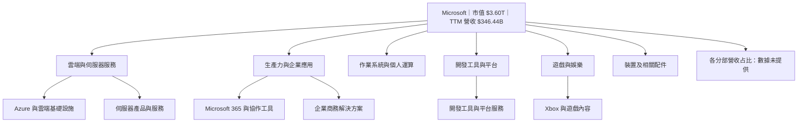
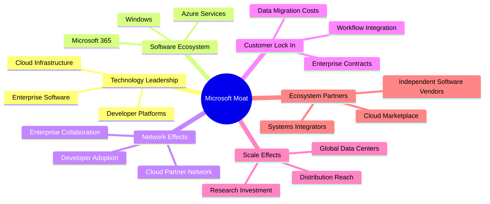
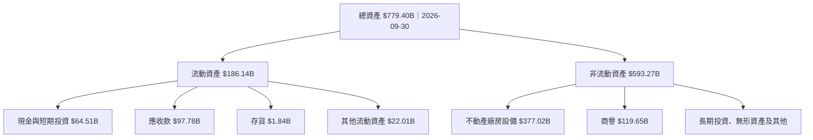
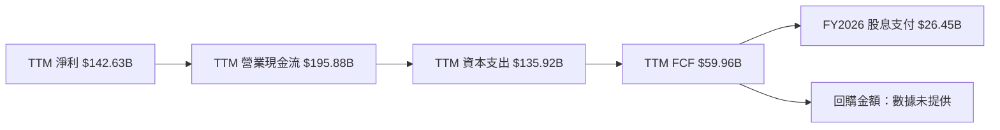
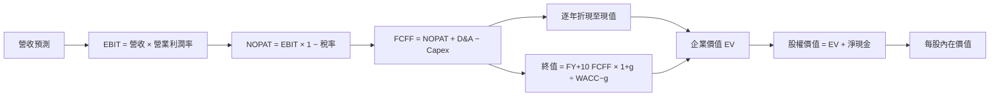
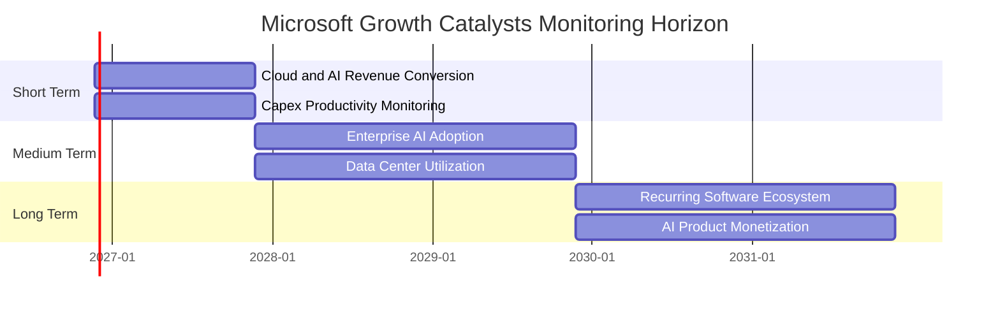
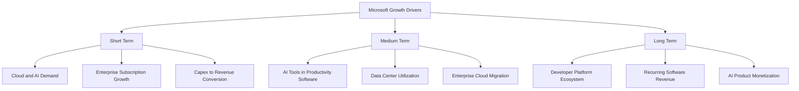
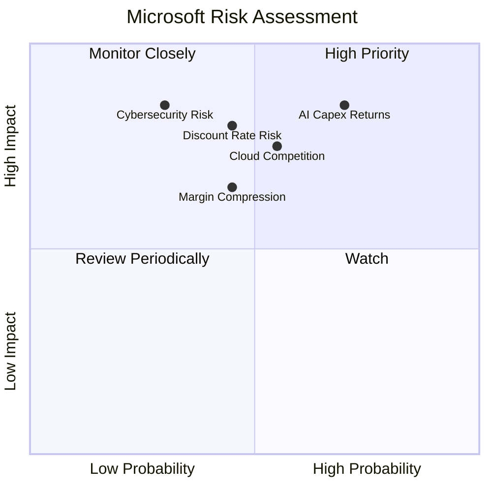
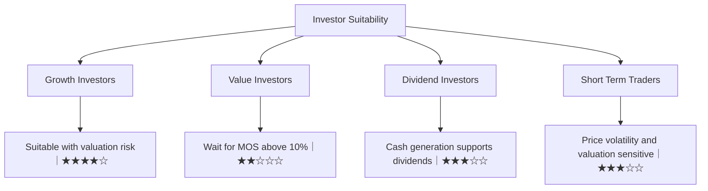

# MSFT 基本面深度分析報告
> **報告日期**：2026-11-22 ｜ **語言**：繁體中文 ｜ **數據來源**：SEC 申報資料 (XBRL)、Yahoo Finance、Finviz、StockAnalysis、Roic.ai ｜ **分析師**：CFA 級機構研究

## 目錄

| # | 章節 | 核心結論 |
|---|------|----------|
| 1 | 執行摘要 | 減碼；加權合理價值 $425.20，MOS -14.0% |
| 2 | 公司概覽與商業模式 | 雲端、企業軟體與生態系統構成主要護城河；業務分部收入占比未提供 |
| 3 | 損益表深度分析 | TTM 營收 $346.44B、年增 17.9%；TTM 營業利益率 47.1% |
| 4 | 資產負債表分析 | VERIFIED 資料顯示淨現金 $29.03B；流動性充足，債務口徑存在來源差異 |
| 5 | 現金流量深度分析 | TTM FCF $59.96B，但資本支出增加使現金轉換承壓 |
| 6 | 獲利能力與資本效率 | ROIC 29.7% 高於 WACC 10.03%，創造股東價值 |
| 7 | 相對估值分析 | 公司估值低於自身五年中位數，但高於同業倍數 |
| 8 | DCF 內在價值評估 | 基準 DCF $376.55；加權合理價值 $425.20，MOS -14.0% |
| 9 | 成長催化劑 | AI、雲端與企業軟體需求是主要成長來源；TAM 數字未提供 |
| 10 | 風險矩陣 | AI 資本支出回報、競爭及估值折現率為主要風險 |
| 11 | 投資建議 | 現價高於加權合理價值；等待估值回落並追蹤資本支出效率 |

---

## 1. 執行摘要

### 1.0 一頁式投資儀表板（Portfolio Manager 30 秒速讀）

| 項目 | 內容 |
|------|------|
| **投資論點（3 句）** | ① TTM 營收 $346.44B、年增 17.9%，最新一季營收年增 18.8%，顯示核心需求仍具韌性。② TTM ROIC 29.7% 對比 WACC 10.03%，資本回報高於資本成本。③ TTM FCF 為 $59.96B，但 FCF Yield 僅 1.67%，且 DCF 基準價值低於現價。 |
| **綜合評分** | **7.5/10**（引用 1.1 評分卡） |
| **財務健康** | 🟢 VERIFIED 資料為淨現金 $29.03B；流動比率 1.225，短期償債能力尚可 |
| **ROIC vs WACC** | **29.7% vs 10.03%**；高於資本成本，創造股東價值 |
| **FCF 趨勢** | 年度 FCF 由 FY2025 $71.61B 降至 FY2026 $66.99B；最新 TTM FCF $59.96B，FCF Yield **1.67%** |
| **估值** | Forward P/E **20.02x** ｜ EV/EBITDA **17.83x** ｜ FCF Yield **1.67%** |
| **DCF 內在價值（基準）** | **$376.55** ｜ 現價較 DCF 折價／溢價：**溢價 28.7%**（現價 ÷ DCF − 1） |
| **安全邊際（MOS）** | **-14.0%**＝($425.20 − $484.52) ÷ $425.20；🔴低於 10%，沒有安全邊際 |
| **預期報酬（基準情境 12M）** | 以加權合理價值衡量：**-12.2%** 上行空間 |
| **關鍵風險（前二）** | AI／資料中心資本支出高於現金回報；AI 商業化和競爭導致成長或利潤率低於模型 |
| **評級 + 信心度** | **🟠 減碼** ｜ 信心：中 |

> 依加權合理價值計算，MOS 為 -14.0%，依規則 20 對應「減碼」。DCF 模型的基準價值 $376.55、相對現價低 22.3%；另一方面，ROIC 29.7% 高於 WACC 10.03%，且最新一季營收年增 18.8%。估值方法加權後價值為 $425.20，仍低於 2026-11-20 收盤價 $484.52，因此結論是減碼，而非因公司品質良好就忽略估值。

### 1.1 綜合評分卡（全報告唯一）

| 維度 | 評分（1–10） | 主要依據（引用數字與其來源章節） |
|------|--------------|----------------------------------|
| 成長性 | 8 | TTM 營收年增 17.9%，最新一季年增 18.8%（第 3 章） |
| 獲利能力 | 9 | TTM 營業利益率 47.1%、ROIC 29.7%，Piotroski F-Score 6/9（第 3、6 章） |
| 財務健康 | 8 | 淨現金 $29.03B；流動比率 1.225；CCC -67 天（第 4 章） |
| 估值 | 4 | MOS -14.0%；P/E 低於自身五年中位數，但公司倍數高於同業（第 7、8 章） |
| 護城河 | 9 | TTM 毛利率 67.7%、營業利益率 47.1%，企業軟體與雲端平台具高轉換成本（第 2 章） |
| 管理層與資本配置 | 7 | FY2026 SBC $12.40B、股數近年大致穩定；但 FY2026 Capex $115.95B，投資回報需持續驗證（第 5 章） |
| **綜合評分** | **7.5** | 六項算術平均：**(8 + 9 + 8 + 4 + 9 + 7) ÷ 6 = 7.5** |

### 1.2 五大投資論點 + 三大核心風險

| 類型 | 項目 | 具體依據 | 信心度 |
|------|------|----------|--------|
| 🟢 **投資論點①** | 營收成長具延續性 | TTM 營收 $346.44B、年增 17.9%；FY2026 年營收 $331.84B，較 FY2025 $281.72B 增長約 17.8% | 🟢 高 |
| 🟢 **投資論點②** | 高資本報酬 | ROIC 29.7%，高於 WACC 10.03%，利差 19.67 個百分點 | 🟢 高 |
| 🟢 **投資論點③** | 營業獲利率高 | TTM 營業利益率 47.1%；最新季度營業利益率 49.8%，反映高毛利軟體與雲端收入比重 | 🟢 高 |
| 🟢 **投資論點④** | 現金流規模仍大 | TTM 營業現金流 $195.88B，扣除 Capex 後 FCF $59.96B | 🟢 中高 |
| 🟢 **投資論點⑤** | 流動性與營運資金模式有利 | 淨現金 $29.03B；CCC -67 天，供應商付款週期長於應收與存貨週期 | 🟢 中高 |
| 🟡 **風險①** | AI 基建投資可能回收期拉長 | TTM Capex $135.92B，FCF Yield 僅 1.67%；新增運算資產若未帶動相稱收入，FCF 可能受壓 | 🟡 中高 |
| 🔴 **風險②** | 現價高於合理價值區間 | 加權合理價值 $425.20，低於現價 $484.52；MOS -14.0% | 🔴 高 |
| 🟡 **風險③** | 盈餘估計資料不完整 | 最近四季 EPS 預估值為 N/A，無法判斷每季是否超／不及預期；分析師目標價均值 $636.12 與基準 DCF 差距大 | 🟡 中 |

### 1.3 快速統計卡片

同業中位數為 GOOG、AMZN、ORCL 三者的中位數，僅在有對應資料時列示。

| 指標 | 公司實際值（期間） | 同業中位數 | 狀態 |
|------|--------------------|------------|------|
| 營收成長（TTM） | **17.9%** | — | 🟢 |
| 營收成長（最新一季年增） | **18.8%** | **24.7%** | 🟡 |
| 毛利率（TTM） | **67.7%** | **60.9%** | 🟢 |
| 營業利益率（TTM） | **47.1%** | — | 🟢 |
| ROIC（TTM） | **29.7%** | — | 🟢 |
| Forward P/E | **20.02x** | **17.3x** | 🟡 |
| FCF Yield（TTM） | **1.67%** | — | 🔴 |
| Piotroski F-Score | **6 / 9** | — | 🟡 |

### 1.4 投資結論

```text
╔══════════════════════════════════════════════════════════════════╗
║                    📊 投資結論摘要                               ║
╠══════════════════════════════════════════════════════════════════╣
║  評級：🟠 減碼（MOS -14.0%，符合規則 20）                        ║
║  價格（2026-11-20 收盤）：$484.52                                ║
║  DCF 內在價值（基準）：$376.55（現價溢價 28.7%）                ║
║  安全邊際 MOS：-14.0%                                            ║
║  加權合理價值（8.8）：$425.20                                    ║
║  DCF 情境價值：                                                   ║
║    悲觀情境：$178.21（-63.2%）                                   ║
║    基準情境：$376.55（-22.3%）                                   ║
║    樂觀情境：$729.21（+50.5%）                                   ║
║  綜合評分：7.5/10（引用 1.1）                                    ║
║  適合投資人：長線成長型投資者；價值型投資者宜等待估值回落        ║
╚══════════════════════════════════════════════════════════════════╝
```

---

## 2. 公司概覽與商業模式

### 2.1 業務結構與收入來源

Microsoft 提供作業系統、伺服器與雲端服務、企業生產力軟體、開發工具、遊戲與裝置。公司市值約 **$3.60T**，TTM 營收 **$346.44B**。可用資料未列出最新分部營收及各分部占比，因此不將分部比例或金額自行估算。



### 2.2 市場份額

市場份額數據未提供，故不列出市場占比或圓餅圖。相對規模方面，Microsoft TTM 營收 $346.44B，最新一季營收年增 18.8%；同業資料顯示 GOOG、AMZN、ORCL 最新一季年增率分別為 24.7%、12.1%、29.6%。這些公司業務組合不同，成長率只能作方向性比較，不能直接解讀為市場份額變化。

### 2.3 競爭護城河分析



### 2.4 護城河強度

| 護城河項目 | 強度（強／中／弱） | 證據（引用數字或事實） | 會削弱它的情況 |
|------------|--------------------|------------------------|----------------|
| 技術與平台 | 強 | TTM 毛利率 67.7%、營業利益率 47.1%；企業軟體與雲端業務可共用研發及基礎設施 | 雲端效能／價格競爭，或 AI 產品變現不足 |
| 軟體生態系統 | 強 | Windows、生產力軟體、伺服器與雲端產品形成企業工作流程整合 | 客戶改採多雲、開源或跨平台方案 |
| 網路效應 | 中至強 | 開發者、合作夥伴、企業使用者互相提高平台價值；缺少可量化網路效應資料 | 開發者與客戶轉向競爭平台 |
| 客戶鎖定 | 強 | 企業軟體整合、資料移轉與員工訓練形成轉換成本；DSO 65 天 | 產品價格上升超過替代成本或服務品質下降 |
| 規模效應 | 強 | FY2026 研發費用 $35.56B；大規模資本投入可支援雲端與 AI 基建 | Capex 長期高於新增現金流回報 |
| 生態夥伴 | 中至強 | 企業軟體、系統整合商與雲端市場平台具協同效應；合作收入明細未提供 | 夥伴轉投多雲或自建平台 |

1.1「護城河」評分為 **9/10**，依據是高毛利率、高營業利益率、軟體整合與企業轉換成本；扣分原因是分部收入和客戶留存等直接量化資料未提供。

---

## 3. 損益表深度分析

### 3.1 年度收入成長趨勢（近 4 年）

FY2023–FY2026 營收分別為 $211.91B、$245.12B、$281.72B、$331.84B；YoY 依次約為 6.9%、15.7%、14.9%、17.8%。三年 CAGR 為：

\[
(331.84 \div 211.91)^{1/3}-1 \approx 16.1\%
\]

```text
╔══════════════════════════════════════════════════════════════════╗
║       Microsoft 年度收入趨勢（FY2023–FY2026，USD）              ║
╠══════════════════════════════════════════════════════════════════╣
║  FY2023  $211.91B  █████████████░░░░░░░░░░░  YoY: +6.9%  🟡   ║
║  FY2024  $245.12B  ███████████████░░░░░░░░░  YoY:+15.7%  🟢   ║
║  FY2025  $281.72B  █████████████████░░░░░░  YoY:+14.9%  🟢   ║
║  FY2026  $331.84B  ████████████████████░░░  YoY:+17.8%  🟢   ║
╠══════════════════════════════════════════════════════════════════╣
║  三年營收 CAGR：約 16.1%                                         ║
╚══════════════════════════════════════════════════════════════════╝
```

FY2026 增長加速至約 17.8%，與雲端、企業訂閱及 AI 相關需求相符；但缺少分部營收拆分，不能將全部增長歸因於單一產品線。

### 3.2 季度收入趨勢分析

下表 QoQ 以相鄰季度營收計算；YoY 使用同季年增率。2025-09-30 季營收取 StockAnalysis 季度資料。

| 季度 | 營收（$B） | QoQ | YoY | 備註 |
|------|------------:|----:|----:|------|
| 2025-12-31 | 81.27 | 4.6% | 16.7% | 對照 2025-09-30 的 $77.67B |
| 2026-03-31 | 82.89 | 2.0% | 18.3% | 年增高於前季 |
| 2026-06-30 | 90.01 | 8.6% | 17.8% | 季度收入增加 |
| 2026-09-30 | 92.28 | 2.5% | 18.8% | 最新季營收年增率，不是 TTM 成長率 |

最新季度營收 QoQ 增長 2.5%、YoY 增長 18.8%。QoQ 會受季節性與產品交付時點影響，判斷趨勢應以 YoY 與連續季度表現為主。

### 3.3 利潤率演變分析

| 利潤率指標 | FY2023 | FY2024 | FY2025 | FY2026 | 趨勢 | 評估 |
|------------|-------:|-------:|-------:|-------:|------|------|
| **毛利率** | 68.9% | 69.8% | 68.8% | 67.9% | 高位回落；FY2026 毛利率較 FY2024 低約 1.8 個百分點 | 🟡 |
| **營業利益率** | 41.8% | 44.6% | 45.6% | 46.8% | 連續改善，營業利益增速高於營收 | 🟢 |
| **淨利率** | 34.2% | 36.0% | 36.1% | 40.3% | FY2026 擴大，部分反映淨利成長快於營收 | 🟢 |

以上年度比率由各年度報表營收與利潤計算，與 TTM 指標期間不同。TTM 毛利率為 67.7%、營業利益率為 47.1%、淨利率為 41.2%。營業利益率上升而毛利率略降，顯示營業費用相對營收的控制或規模效應抵銷了部分毛利壓力；但資料不足以拆解雲端折舊、AI 基建與產品組合各自的貢獻。

### 3.4 費用結構分析

可取得的費用資料包括 FY2026 研發費用 **$35.56B**，約為該年營收 $331.84B 的 **10.7%**。銷售與行銷、一般管理、各分部成本等完整費用拆分未提供，因此不繪製會暗示總體比例的圓餅圖。研發投入支撐雲端、AI 與軟體平台更新，但回報仍須以增量營收、營業利潤及資本回報驗證。

### 3.5 季度 EPS 趨勢與盈餘品質（Quality of Earnings）

最近四季 EPS 實際值為 $4.92、$4.81、$4.27、$5.16；季度估計值均為 N/A，無法判定是否超預期或不及預期。依年度／TTM 與最新季度資料，EPS 年增表現仍有增長，但不應把實際成長誤稱為盈餘超預期。

| 盈餘品質項目 | 數值／佔比 | 評估 |
|--------------|-----------|------|
| 股權薪酬 SBC / 營收 | 最近四季 SBC 合計約 $12.55B ÷ TTM 營收 $346.44B = **約 3.6%** | 🟡 仍是實質股東成本；稀釋股數測試未增加，代表回購等因素可能抵銷部分稀釋 |
| SBC / 營業現金流 | 約 $12.55B ÷ $195.88B = **約 6.4%** | 🟡 占比不至於主導現金流，但不能因非現金費用而忽略其經濟成本 |
| FCF / 淨利（現金轉換率） | $59.96B ÷ TTM 淨利 $142.63B = **42.0%** | 🔴 資本支出提高壓低自由現金流轉換 |
| 一次性／非經常性損益 | N/A（未提供足以拆分的明細） | 無法量化一次性項目對盈餘的影響 |
| 有效稅率異常 | 19.4%（最新年度有效稅率） | 🟢 沒有提供顯示稅率顯著偏離的佐證；預測仍採 19.4% |
| 資本化支出 vs 費用化 | TTM Capex $135.92B；FY2026 Capex $115.95B；資本化明細 N/A | 🟡 AI／資料中心投資先以資本支出體現在現金流，未來折舊費用可能增加 |

**盈餘品質結論：**GAAP 營業利益已將 SBC 列為費用，故 DCF 不再重複扣除 SBC；但 FCF 僅為淨利的約 42.0%，主因是資本支出負擔較高。盈餘具有較高的應計品質（營業現金流高於淨利的 F-Score 測試通過），但現階段淨利轉為股東可分配現金的比例低於淨利本身所顯示的獲利能力。

---

## 4. 資產負債表分析

### 4.1 資產結構分解

以 StockAnalysis 的 2026-09-30 資產資料呈現：總資產 $779.40B、流動資產 $186.14B，非流動資產差額為 $593.27B。此處為資料來源披露值相減，並非對資產細項作估算。



細項依 StockAnalysis TTM 資產表；部分細項相加可能因報表分類、四捨五入與未列示項目而與非流動資產合計有差異。

### 4.2 流動性與營運資金分析

| 指標 | 最新 TTM | 一年前 TTM | 變化 | 解讀 |
|------|----------|------------|------|------|
| DSO 應收帳款天數 | 65 天 | 66 天 | -1 天 | 收款天數略降，短期沒有顯示應收帳款周轉惡化 |
| DIO 存貨天數 | 6 天 | 4 天 | +2 天 | 存貨天數增加，但仍低；不應單憑此判定庫存積壓 |
| DPO 應付帳款天數 | 139 天 | 130 天 | +9 天 | 對供應商付款期延長，對營運現金有利；需留意是否為條款變化 |
| CCC 現金轉換週期 | -67 天 | -59 天 | -8 天 | 現金在支付供應商前回收；負 CCC 有利於營運資金效率 |

流動比率 **1.225**、速動比率 **1.068**，短期資產略高於流動負債。營運資金天數顯示公司可在付款前收回客戶現金；但 DPO 增加 9 天可能同時反映供應商付款安排，應觀察其是否可持續。

### 4.3 債務結構分析

不同資料欄位的總債務口徑不一致：VERIFIED 財務指標列總債務 $35.48B、現金及短期投資 $64.51B、淨現金 $29.03B；合併的市場資料另列總債務 $133.93B、淨負債 $69.42B。估值與 WACC 依 VERIFIED 指標使用 **$35.48B**；不將兩個口徑混合。

```text
╔══════════════════════════════════════════════════════════════════╗
║                Microsoft 債務健康診斷                            ║
╠══════════════════════════════════════════════════════════════════╣
║  總債務（VERIFIED）：      $35.48B                               ║
║  現金及短期投資：          $64.51B                               ║
║  淨現金：                  $29.03B  🟢                           ║
║  流動比率：                1.225x   🟢                           ║
║  速動比率：                1.068x   🟢                           ║
║  DSO / DIO / DPO：         65 / 6 / 139 天                      ║
║  CCC：                     -67 天                                ║
║  Debt/EBITDA、利息保障倍數：N/A（同口徑計算所需細項未提供）      ║
╚══════════════════════════════════════════════════════════════════╝
```

### 4.4 股東權益趨勢

| 財年 | 股東權益（$B） | YoY |
|------|---------------:|----:|
| FY2023 | 206.22 | — |
| FY2024 | 268.48 | 30.2% |
| FY2025 | 343.48 | 27.9% |
| FY2026 | 442.39 | 28.8% |

```text
股東權益（$B）
FY2023  206.22  █████████
FY2024  268.48  ████████████
FY2025  343.48  ███████████████
FY2026  442.39  ████████████████████
```

權益增長與獲利累積一致，但 FY2026 資產規模也明顯增加；評估資產回報應同時看 ROIC、資產周轉率與投入資本，而不只看權益金額。

---

## 5. 現金流量深度分析

### 5.1 現金流量瀑布圖

現有資料未提供同一口徑的 TTM 淨利後續完整資本配置及回購明細，因此圖中只展示有來源的現金流數字，不推算淨現金變化。



### 5.2 FCF 轉換率趨勢

| 財年 | FCF（$B） | 淨利（$B） | FCF / 淨利 |
|------|---------:|-----------:|-----------:|
| FY2023 | 59.48 | 72.36 | 82.2% |
| FY2024 | 74.07 | 88.14 | 84.0% |
| FY2025 | 71.61 | 101.83 | 70.3% |
| FY2026 | 66.99 | 133.75 | 50.1% |
| 最新 TTM | 59.96 | 142.63 | 42.0% |

年度 FCF 自 FY2024 高點 $74.07B 下降至 FY2026 $66.99B，儘管淨利上升。主要值得關注的是 Capex 擴大：FY2024 $44.48B、FY2025 $64.55B、FY2026 $115.95B。其背後可能包含資料中心與 AI 基礎設施投入；這些支出需在未來轉化為營收與現金流，否則淨利增長將無法同步轉成股東可用現金。

### 5.3 自由現金流趨勢

```text
╔══════════════════════════════════════════════════════════════════╗
║                 自由現金流與現金殖利率                           ║
╠══════════════════════════════════════════════════════════════════╣
║  FY2023  $59.48B  ████████████████░░░░  FCF Yield：N/A          ║
║  FY2024  $74.07B  ████████████████████  FCF Yield：N/A          ║
║  FY2025  $71.61B  ███████████████████  FCF Yield：N/A           ║
║  FY2026  $66.99B  ██████████████████░  FCF Yield：N/A           ║
║  TTM     $59.96B  ████████████████░░░░  FCF Yield：1.67%        ║
╚══════════════════════════════════════════════════════════════════╝
```

年度 FCF 與 TTM FCF 的期間不同，且資料來源列示的年度及 TTM 資本支出有所差異；不將其視為同一期間連續值。TTM FCF Yield 1.67% 代表以現金流衡量，現價對自由現金流的估值不低。

### 5.4 資本配置評估

| 項目 | FY2026 金額 | 評估 |
|------|------------:|------|
| 資本支出 | $115.95B | 佔 FY2026 營收約 34.9%；投入規模大，回報週期需追蹤 |
| 股息支付 | $26.45B | 約為 FY2026 FCF $66.99B 的 39.5% |
| SBC | $12.40B | 約為 FY2026 營收的 3.7%；雖為非現金費用，仍是股東成本 |
| 回購 | N/A | 數據未提供，不能判斷回購抵銷稀釋的程度 |
| 留存現金／併購 | N/A | 未提供完整配置拆分 |

不繪製資本配置圓餅圖：現有資料沒有完整回購、留存現金與併購支出拆分，若畫成占比會造成不完整配置的誤導。

---

## 6. 獲利能力與資本效率

### 6.1 ROE / ROA / ROIC 趨勢

| 指標 | FY2026／最新 TTM | 可用歷史資料 | 評估 |
|------|----------------:|-------------|------|
| ROE | VERIFIED TTM **30.3%** | 市場資料另列 34.2%，口徑不一致 | 🟢 以 QUALITY FIGURES 的 30.3% 為主 |
| ROA | 市場資料 TTM **14.4%** | 歷史同口徑序列未提供 | 🟢 |
| ROIC | VERIFIED TTM **29.7%** | 10 年歷史含不同計算口徑，不能直接串接 | 🟢 高於資本成本 |
| WACC | **10.03%** | 由成本資本資料採用 | — |

未提供可完全同口徑的多年 ROE／ROA／ROIC 序列或行業均值，故不填補歷史欄與行業比較欄。ROE 的外部欄位出現 30.3% 與 34.2% 差異，本文以程式計算的 QUALITY FIGURES 30.3% 為準。

### 6.2 ROIC vs WACC 分析（核心價值創造判斷）

```text
╔══════════════════════════════════════════════════════════════════╗
║                ROIC vs WACC 深度分析                            ║
╠══════════════════════════════════════════════════════════════════╣
║  WACC（採用 VERIFIED 成本資本資料）：                            ║
║  ├── 無風險利率（10Y 美債）：       4.91%                        ║
║  ├── 市場風險溢酬 ERP：             5.00%                        ║
║  ├── 原始 Beta：                    1.04                         ║
║  ├── 調整後 Beta：                  1.03                         ║
║  ├── 股權成本：                     10.06%                       ║
║  ├── 稅前債務成本：                 8.60%                        ║
║  ├── 資本結構 E / D：               99.0% / 1.0%                 ║
║  └── WACC：                         10.03%                       ║
║                                                                  ║
║  ROIC（TTM）：                      29.7%                        ║
║  ROIC - WACC：                      +19.67 個百分點              ║
║  ROIC / WACC：                      約 2.96x                     ║
║                                                                  ║
║  ROIC 29.7%  ▓▓▓▓▓▓▓▓▓▓▓▓▓▓▓▓▓▓▓▓▓▓▓▓▓▓▓▓▓▓▓▓▓▓▓▓▓░░░░░░░  🟢║
║  WACC 10.03% ▓▓▓▓▓▓▓▓▓▓▓▓▓░░░░░░░░░░░░░░░░░░░░░░░░░░░░░░  ─ ║
╠══════════════════════════════════════════════════════════════════╣
║  結論：ROIC 顯著高於 WACC，現階段創造而非摧毀股東價值。          ║
╚══════════════════════════════════════════════════════════════════╝
```

計算採官方提供的調整後 Beta 1.03；資本成本資料內已列股權成本 10.06%、稅前債務成本 8.60%、稅率 19.4%、權重 99.0%／1.0% 與 WACC 10.03%。WACC 算式為：

\[
0.99 \times 10.06\% + 0.01 \times [8.60\% \times (1-19.4\%)]
= 9.9594\% + 0.0693\% = 10.0287\% \approx 10.03\%
\]

ROIC 高於 WACC 19.67 個百分點，表明已投入資本仍產生正經濟利潤。風險在於新增資料中心資本若回報率低於既有業務，未來公司整體 ROIC 可能下滑。

### 6.3 杜邦三因素分解

| 因素 | 數值（TTM） | 解讀 |
|------|-------------|------|
| 淨利率 | 41.2% | 高淨利率是 ROE 的重要來源 |
| 資產週轉率 | 0.44 | 資產規模擴大，周轉效率相對低於輕資產軟體公司 |
| 權益乘數 | 1.66 | 槓桿有限，不是 ROE 的主要支撐 |
| **ROE** | **30.3%** | **41.2% × 0.44 × 1.66 = 30.1%，未四捨五入底層資料計算值為 30.3%** |

ROE 主要由高淨利率與資產周轉共同推動，1.66 倍權益乘數顯示財務槓桿不是主要驅動力。因公布值已各自四捨五入，展示值相乘與官方 ROE 有小幅尾差。

### 6.4 財務體質：Piotroski F-Score

Piotroski F-Score 為 **6/9**，逐項照列品質指標結果：

| 測試 | 結果 | 解讀 |
|------|------|------|
| ROA > 0 | ✅ 通過 | 公司保持正獲利 |
| 營業現金流 > 0 | ✅ 通過 | 營運產生正現金 |
| ROA 高於一年前 | ✅ 通過 | 資產獲利能力改善 |
| 營業現金流 > 淨利 | ✅ 通過 | 現金流支持盈餘品質 |
| 長期負債 ÷ 總資產低於一年前 | ✅ 通過 | 槓桿相對資產下降 |
| 流動比率高於一年前 | ❌ 未通過 | 流動性相較前一年未改善 |
| 稀釋股數未增加 | ✅ 通過 | 股數稀釋測試通過 |
| 毛利率高於一年前 | ❌ 未通過 | 毛利率受成本／產品組合因素壓力 |
| 資產週轉率高於一年前 | ❌ 未通過 | 新增資產尚未完全轉化為營收 |

6/9 顯示基本財務體質穩健，但流動比率、毛利率與資產周轉率三項未通過，與高額資本投資後的折舊及資產利用效率監控相呼應。

---

## 7. 相對估值分析

### 7.1 同業估值比較表格

同業估值採用 Yahoo Finance 對應 Peer multiples；同業中位數為 GOOG、AMZN、ORCL 三家公司中位數。Microsoft 的本公司估值取題列市場資料與 VERIFIED 倍數。

| 估值指標 | **MSFT** | **GOOG** | **AMZN** | **ORCL** | 本公司評估 |
|----------|---------:|---------:|---------:|--------:|-----------|
| **Trailing P/E** | 25.3x | 13.8x | 20.0x | 15.9x | 🔴 高於三家同業 |
| **Forward P/E** | 20.0x | 17.3x | 22.6x | 9.2x | 🟡 同業中位數 17.3x，MSFT 有溢價 |
| **P/S Ratio** | 10.4x | 6.9x | 3.3x | 4.4x | 🔴 明顯高於同業中位數 4.4x |
| **EV/EBITDA** | 17.8x | 17.0x | 15.6x | 12.9x | 🟡 高於同業中位數 15.6x |
| **最新一季營收年增** | 18.8% | 24.7% | 12.1% | 29.6% | 🟡 增長在同業範圍內，非最高 |
| **毛利率（TTM）** | 67.7% | 60.9% | 51.4% | 64.0% | 🟢 高於三家同業 |

Microsoft 的毛利率較高，能支持一定品質溢價；但 P/S 10.4x 相較同業中位數 4.4x 溢價顯著。相對估值不等於絕對便宜，尤其 FCF Yield 僅 1.67%。

### 7.2 歷史估值區間分析

| 倍數 | 現值 | 五年中位數 | 五年區間 | 現值百分位 |
|------|-----:|-----------:|---------:|-----------:|
| P/E | 25.3x | 31.5x | 20.8x–37.8x | 14% |
| P/S | 10.4x | 12.0x | 8.4x–13.7x | 33% |
| EV/EBITDA | 17.8x | 24.3x | 14.5x–31.4x | 10% |

```text
╔══════════════════════════════════════════════════════════════════╗
║              MSFT 歷史估值區間（五年）                           ║
╠══════════════════════════════════════════════════════════════════╣
║  P/E        20.8x ├──────● 25.3x────────────┤ 37.8x   中位31.5x ║
║  P/S         8.4x ├────────● 10.4x───────┤ 13.7x    中位12.0x ║
║  EV/EBITDA  14.5x ├──● 17.8x────────────────┤ 31.4x 中位24.3x ║
╠══════════════════════════════════════════════════════════════════╣
║  現值百分位：P/E 14%｜P/S 33%｜EV/EBITDA 10%                    ║
╚══════════════════════════════════════════════════════════════════╝
```

相對自身歷史，三個倍數均低於五年中位數，表示估值已從歷史高位回落；但這並不推翻 DCF 顯示現價高於合理價值的結論。

### 7.3 情境價值（Bear / Base / Bull）

情境及價值照模型輸出；情境條件屬於分析解讀，不代表公司正式財測。

| 情境 | 第 1 年營收成長 | 期末營業利潤率 | WACC | 每股價值 | 相對現價 | 機率 | 會發生的條件 |
|------|----------------:|----------------:|-----:|---------:|---------:|-----:|--------------|
| 🔴 悲觀 | 9.0% | 38.8% | 11.03% | $178.21 | -63.2% | 25% | 雲端／AI 成長降速，競爭與成本壓力使長期利潤率下降，資本成本上升 |
| 🟡 基準 | 17.9% | 45.6% | 10.03% | $376.55 | -22.3% | 50% | 營收增速按模型逐年降至 3.0%，營業利潤率收斂至模型期末值 |
| 🟢 樂觀 | 26.9% | 50.2% | 9.03% | $729.21 | +50.5% | 25% | AI 與雲端需求維持高增長，規模效應推升利潤率且折現率下降 |

### 7.4 相對估值隱含價格區間

```text
╔══════════════════════════════════════════════════════════════════╗
║                 相對估值隱含價格與現價                           ║
╠══════════════════════════════════════════════════════════════════╣
║  $376.55       $417.65       $426.23         $484.52             ║
║    DCF        Forward P/E     EV/EBITDA        現價               ║
╠══════════════════════════════════════════════════════════════════╣
║  Forward P/E：同業中位數 17.3x × Forward EPS $24.20 = $417.65   ║
║  EV/EBITDA：同業中位數 15.6x × TTM EBITDA，加回淨現金 = $426.23 ║
║  DCF：10 年 FCFF、WACC 10.03%、永續成長率 3.0% = $376.55       ║
╚══════════════════════════════════════════════════════════════════╝
```

相對估值使用 GOOG、AMZN、ORCL 的同業中位數倍數，不用 MSFT 自身倍數回推。兩項相對估值均低於現價，約落在 $417.65–$426.23；分析師共識目標價 $636.12 不屬於相對倍數估值，而在第 8.8 節按指定權重納入交叉驗證。

---

## 8. DCF 內在價值評估（Discounted Cash Flow）

### 8.0 估值推理鏈（Thinking Logic：在算之前先想清楚）

**核心命題：**Microsoft 的價值來自既有企業軟體與雲端現金流、雲端／AI 基建所支撐的第二成長曲線，以及 AI 產品變現帶來的增量選擇權；財務數據未提供各分部營收占比，故不把任何一項拆出虛構的營收權重。模型顯示，營收增速、Capex／營收及終值成長率共同左右價值，且終值占企業價值 67.4%，所以長期假設對估值影響尤其大。

| 決策點 | 本報告採用 | 理由（含數字） | 曾考慮但否決 | 否決理由 |
|--------|-----------|----------------|--------------|----------|
| 現金流定義 | FCFF | 對應 WACC 折現與企業價值估算 | FCFE | 債務與現金橋接由模型統一處理 |
| 預測期 N | 10 年 | 模型固定 10 年，讓目前高成長逐年收斂至成熟期 | 5 年 | 雲端與 AI 投資回收期較長，5 年較難呈現收斂過程；不更改程式模型 |
| 終值方法 | Gordon Growth | 模型使用永續成長率 3.0% | 退出倍數 | 模型未提供退出倍數終值；不得自行補入 |
| EBIT 基礎 | GAAP EBIT | 47.1% TTM 營業利益率為模型起點 | 非 GAAP EBIT | 非 GAAP 會造成 SBC 處理與模型不一致 |

**關鍵假設推導鏈：**

- **營收成長**：錨點＝TTM 成長 17.9%、最新季度 YoY 18.8% → 由於高基期與成熟業務規模，模型將增速線性降至 3.0% → **第 1 年採用 17.9%、第 10 年 3.0%** → 不採全期固定 17.9%，因其未反映增長逐步成熟。
- **營業利潤率**：錨點＝TTM 47.1% → 模型期末向最近五個財年中位數收斂 → **第 1 年 47.1%、第 10 年 45.6%** → 不假設持續擴張至 50% 以上，因資料沒有支持長期利潤率再擴張的明確證據。
- **Capex／營收**：錨點＝TTM 約 39.2%（依模型輸入）→ 模型假設建置期支出率隨時間下降，最終向 D&A 的 1.1 倍收斂 → **第 1 年 39.2%、第 10 年 12.2%** → 不假設短期即回到歷史低資本支出比例，因 AI／資料中心投資仍高。
- **永續成長率 g**：錨點＝長期名目經濟增長假設，沒有公司專屬長期預測資料 → 取 3.0%，低於 WACC 10.03% → **採用 3.0%** → 不採高於 3.0% 的永久增長，避免終值佔比進一步膨脹。
- **預測期 N**：錨點＝公司當前 TTM 營收 $346.44B、TTM 成長 17.9% → 10 年內逐年放緩，反映企業雲端仍成長但公司規模已大 → **採用 10 年** → 不縮短成 5 年，因會改變終值起算年度；本報告不另建模型。
- **EBIT、SBC 與股數**：錨點＝GAAP 營業利益已含 SBC 費用；最近四季 SBC 約 $12.55B → **採組合 (A)：GAAP EBIT + 固定股數，年稀釋率 0%** → 不再從 FCFF 扣 SBC，也不再增加稀釋股數，避免重複計入成本。
- **WACC**：錨點＝成本資本資料提供 WACC 10.03% → 依照本報告 8.2 採用 → **10.03%** → 不另行改算不同 WACC，避免與 ROIC／DCF 使用口徑不一致。

**最脆弱的一環：**Capex／營收從模型第 1 年 39.2% 降至第 10 年 12.2%，若資料中心投資強度長期高於假設，FCFF 與內在價值將低於基準；敏感度矩陣亦顯示折現率與長期成長假設會明顯改變每股價值。



### 8.1 模型假設總表（Model Inputs）

| 假設項目 | 採用值 | 依據／來源 | 敏感度 |
|----------|--------|-------------|--------|
| 預測期長度 **N** | 10 年 | DCF 模型設定；以十年呈現增速及資本支出收斂 | 🟡 中 |
| 營收成長（首末年） | FY+1 17.9% → FY+10 3.0% | 首年錨定 TTM 成長 17.9%，之後線性下降 | 🔴 高 |
| 營業利潤率（首末年） | 47.1% → 45.6% | TTM 47.1%；期末向最近五個財年中位數收斂 | 🔴 高 |
| 有效稅率 | 19.4% | 最新年度有效稅率 | 🟢 低 |
| Capex／營收 | 39.2% → 12.2% | TTM 約 39.2%，模型逐年收斂至 1.1 倍 D&A | 🔴 高 |
| D&A／營收 | 11.1% | TTM D&A 占營收比；模型固定 | 🟢 低 |
| 營運資金變動 ΔWC | 不建模 | DCF 模型明列 working capital is not modelled；無增量比率可引用 | 🟢 低 |
| EBIT 基礎 | GAAP EBIT | 與已含 SBC 的會計營業利益口徑一致 | 🟡 中 |
| SBC 處理 | 組合 (A)：GAAP EBIT、不再扣 SBC | SBC 已包含在 GAAP EBIT；固定股數 | 🟡 中 |
| 年稀釋率 | 0% | 組合 (A) 設定；模型固定股數、不再稀釋 | 🟡 中 |
| 永續成長率 g | 3.0% | 模型假設；低於 WACC 10.03% | 🔴 高 |
| 終值方法 | Gordon Growth | 模型提供 Gordon Growth 終值 | 🔴 高 |
| WACC | 10.03% | 成本資本資料提供，詳見 8.2 | 🔴 高 |

本模型採用 **(A) GAAP EBIT + 固定股數**，因此 SBC 影響已透過費用計入一次；不再額外扣 SBC，也不另加股數稀釋。FCFF 定義為 **NOPAT + D&A − Capex**；模型沒有營運資金變動項，故不新增 ΔWC 數字。

### 8.2 折現率推導（WACC）

```text
╔══════════════════════════════════════════════════════════════════╗
║                    WACC 推導（折現率）                           ║
╠══════════════════════════════════════════════════════════════════╣
║  股權成本 Ke（CAPM）：                                           ║
║  ├── 無風險利率 Rf（10Y 美債）：      4.91%                      ║
║  ├── 市場風險溢酬 ERP：               5.00%                      ║
║  ├── 原始 Beta（Yahoo Finance）：      1.04                       ║
║  ├── 調整後 Beta：                    1.03                       ║
║  ├── 規模／國別溢酬：                 0.00%（未另加）            ║
║  └── Ke = 4.91% + 1.03 × 5.00% = 10.06%                         ║
║                                                                  ║
║  債務成本 Kd：                                                   ║
║  ├── 稅前 Kd（成本資本資料）：        8.60%                      ║
║  ├── 有效稅率：                       19.4%                      ║
║  └── 稅後 Kd = 8.60% × (1 − 19.4%) = 6.93%                     ║
║                                                                  ║
║  資本結構（成本資本資料）：                                      ║
║  ├── 股權權重 E：                     99.0%                      ║
║  ├── 債務權重 D：                     1.0%                       ║
║  └── WACC = 99.0%×10.06% + 1.0%×6.93% = 10.03%                 ║
╚══════════════════════════════════════════════════════════════════╝
```

逐步演算：

1. **Ke（CAPM）**＝Rf + β × ERP＝4.91% + 1.03 × 5.00%＝**10.06%**（採用來源所列成本股權 10.06%）。
2. **稅前 Kd**＝成本資本資料直接列示 **8.60%**。利息費用與同一範圍的平均計息負債絕對值未完整提供，故不反推利息金額。
3. **稅後 Kd**＝8.60% × (1 − 19.4%)＝8.60% × 80.6%＝**6.9316%**。
4. **權重**：成本資本資料列股權／債務權重為 **99.0%／1.0%**，合計 100%。其資本結構以市值／債務口徑計，未使用帳面股東權益替代市值。
5. **WACC**＝99.0% × 10.06% + 1.0% × 6.9316%＝9.9594% + 0.069316%＝**10.028716% ≈ 10.03%**。

調整後 Beta 依來源定義為 ⅔ × 原始 Beta + ⅓；報價與財報均為美元，不涉及匯率換算。資料未附無風險利率觀測日細節，僅列 10Y Treasury 4.91%。第 6.2 節與本節使用同一 WACC 10.03%。

### 8.3 逐年自由現金流預測（基準情境）

金額單位為 USD billions；以下逐年數字照 DCF 模型列示。因模型未建模營運資金，沒有 ΔWC 列。股數不再稀釋，故年稀釋率採 0%。

| 年度 | FY+1 | FY+2 | FY+3 | FY+4 | FY+5 | FY+6 | FY+7 | FY+8 | FY+9 | FY+10 |
|------|-----:|-----:|-----:|-----:|-----:|-----:|-----:|-----:|-----:|------:|
| 營收 | 408.51 | 474.92 | 544.25 | 614.69 | 684.06 | 749.93 | 809.71 | 860.83 | 900.92 | 927.95 |
| 營收 YoY | 17.9% | 16.3% | 14.6% | 12.9% | 11.3% | 9.6% | 8.0% | 6.3% | 4.7% | 3.0% |
| 營業利潤率 | 47.1% | 46.9% | 46.8% | 46.6% | 46.4% | 46.3% | 46.1% | 46.0% | 45.8% | 45.6% |
| 營業利益 EBIT（GAAP） | 192.42 | 222.92 | 254.57 | 286.51 | 317.72 | 347.07 | 373.41 | 395.56 | 412.50 | 423.35 |
| − 稅 | (37.32) | (43.24) | (49.38) | (55.57) | (61.63) | (67.32) | (72.43) | (76.72) | (80.01) | (82.11) |
| = NOPAT | 155.10 | 179.69 | 205.20 | 230.94 | 256.09 | 279.75 | 300.98 | 318.84 | 332.49 | 341.24 |
| + D&A | 45.16 | 52.50 | 60.17 | 67.96 | 75.62 | 82.91 | 89.51 | 95.17 | 99.60 | 102.59 |
| − Capex | (160.27) | (172.04) | (180.78) | (185.69) | (186.07) | (181.43) | (171.53) | (156.47) | (136.66) | (112.84) |
| **= FCFF** | **39.99** | **60.15** | **84.58** | **113.20** | **145.64** | **181.23** | **218.96** | **257.53** | **295.43** | **330.98** |
| 折現因子 @10.03% | 0.909 | 0.826 | 0.751 | 0.682 | 0.620 | 0.564 | 0.512 | 0.465 | 0.423 | 0.384 |
| **FCFF 現值 PV** | **36.35** | **49.68** | **63.49** | **77.23** | **90.30** | **102.12** | **112.14** | **119.87** | **124.97** | **127.24** |

預測期現值合計：

\[
36.35+49.68+63.49+77.23+90.30+102.12+112.14+119.87+124.97+127.24
=\mathbf{903.39B}
\]

模型列示的合計為 **$903.40B**，差異為 $0.01B，屬逐年四捨五入尾差。

**FY+1 逐步演算示例：**

1. 營收：模型表列 FY+1 營收 **$408.51B**。模型明列成長率 17.9%，但以表列 TTM 基數 $346.44B 直接相乘會得到 $408.65B；說明模型使用的底層未四捨五入起點或輸入存在約 $0.14B 差異，本文依規定照抄模型輸出，不以自行推算值取代。
2. **EBIT**＝營收 × 營業利潤率；表列值為 **$192.42B**。
3. **稅**＝模型表列 **$37.32B**；以已四捨五入 EBIT 乘 19.4% 會得到 $37.33B，$0.01B 差異反映底層未四捨五入數值。
4. **NOPAT**＝EBIT − 稅＝$192.42B − $37.32B＝**$155.10B**。
5. **D&A**＝模型表列 **$45.16B**。
6. **Capex**＝模型表列 **$160.27B**。
7. **ΔWC**＝模型未建模，故不列數值。
8. **FCFF**＝NOPAT + D&A − Capex＝$155.10B + $45.16B − $160.27B＝**$39.99B**。
9. **折現因子**＝模型表列 0.909；PV＝$39.99B × 0.909＝**$36.35B**（依未四捨五入折現因子計算）。

**合理性自檢：**

- 模型 FCFF 由 FY+1 $39.99B 增至 FY+10 $330.98B；十年間年化約 **23.6%**。歷史 FY2023–FY2026 FCF 由 $59.48B 至 $66.99B，三年 CAGR 約 **4.0%**。兩者差距大，主要由模型假設 Capex／營收大幅下降帶動，屬基準模型的重要風險。
- FY+10 FCF 利潤率＝$330.98B ÷ $927.95B＝**35.7%**；目前 TTM FCF 利潤率＝$59.96B ÷ $346.44B＝**17.3%**。可用同業只提供毛利率，沒有同口徑 FCF 利潤率，故同業最佳比較 N/A。
- 模型所有年度 FCFF 均為正；但現金流增長仰賴 Capex 占營收從 39.2% 逐步降至 12.2%。

```text
╔══════════════════════════════════════════════════════════════════╗
║            自由現金流：歷史實際 vs 模型預測                      ║
╠══════════════════════════════════════════════════════════════════╣
║  FY2024(實)  $74.07B  ███████░░░░░░░░░░░  FCF                    ║
║  FY2025(實)  $71.61B  ███████░░░░░░░░░░░  FCF                    ║
║  FY2026(實)  $66.99B  ██████░░░░░░░░░░░░  FCF                    ║
║  FY+1 (預)   $39.99B  ████░░░░░░░░░░░░░░  FCF                    ║
║  FY+10(預)  $330.98B  ████████████████████ FCF                   ║
╠══════════════════════════════════════════════════════════════════╣
║  模型 FCF 成長遠高於歷史；主要依賴 Capex/營收下降至 12.2%。     ║
╚══════════════════════════════════════════════════════════════════╝
```

### 8.4 終值計算（Terminal Value）

**適用性檢查：**`WACC 10.03% vs g 3.0% → WACC > g？✅`

| 方法 | 計算式 | 終值 TV | TV 現值 | 佔總 EV 比重 |
|------|--------|---------:|--------:|-------------:|
| Gordon Growth | FY+10 FCFF × (1+g) ÷ (WACC−g) | $4,848.32B | $1,863.90B | 67.4% |
| 退出倍數法 | N/A（模型未提供退出倍數終值） | N/A | N/A | N/A |

**逐步演算：**

1. FY+N FCFF＝FY+10 **$330.98B**。
2. 分子＝$330.98B × (1 + 3.0%)；依模型輸出採用未四捨五入底層 FCFF。
3. 分母＝10.03% − 3.0%＝**7.03%**；模型終值列示 **$4,848.32B**。
4. PV(TV)＝模型終值折現至第 10 年後，列示 **$1,863.90B**。
5. 終值占比＝$1,863.90B ÷ EV $2,767.30B＝**67.4%**。

用展示至兩位小數的 FY+10 FCFF 與四捨五入折現因子重算，與模型值會有尾差；依要求保留模型輸出，不另行改寫其數字。終值占 EV 67.4%，雖未超過 75%，估值仍高度依賴長期假設。

### 8.5 企業價值 → 每股內在價值（Bridge）

```text
╔══════════════════════════════════════════════════════════════════╗
║              企業價值 → 每股內在價值 橋接表                      ║
╠══════════════════════════════════════════════════════════════════╣
║  預測期 FCF 現值合計             +$903.40B                        ║
║  終值現值 PV(TV)               +$1,863.90B                       ║
║  = 企業價值 EV                  $2,767.30B                       ║
║  + 淨現金                         +$29.03B                        ║
║  = 股權價值                     $2,796.33B                       ║
║  每股內在價值（模型列示）          $376.55                        ║
║  2026-11-20 收盤價                 $484.52                        ║
║  DCF 折溢價（現價÷DCF−1）            +28.7% 溢價                  ║
╚══════════════════════════════════════════════════════════════════╝
```

1. **EV**＝$903.40B + $1,863.90B＝**$2,767.30B**。
2. **股權價值**＝EV $2,767.30B + 淨現金 $29.03B＝**$2,796.33B**。
3. **每股內在價值**＝模型直接列示 **$376.55**；模型使用「股權價值 × 股價 ÷ 市值」方式換算。由於模型沒有列出與該公式完全對應的未四捨五入稀釋股數，不能用 7.43B 股重算後取代該值。
4. **折溢價**＝$484.52 ÷ $376.55 − 1＝**28.7% 溢價**。
5. **本節不計算 MOS**：MOS 只在 8.8 以加權合理價值作分母。

股權價值橋接採用模型提供的淨現金 $29.03B；其來源口徑是現金及短期投資 $64.51B 減總債務 $35.48B。請注意模型列示的 EV、淨現金與每股價值含底層未四捨五入股數／折現數值；每股價值按規定照抄模型輸出。

### 8.6 敏感性分析（WACC × 永續成長率）

下表每格括號為相對現價 $484.52 的上行空間；數值照模型敏感度矩陣。

| g（列）／WACC（欄） | 8.03% | 9.03% | **10.03%（基準）** | 11.03% | 12.03% |
|-----------|------:|------:|-------------------:|-------:|-------:|
| 2.0% | $489.14（+0.95%） | $405.31（-16.3%） | $343.16（-29.2%） | $295.45（-39.0%） | $257.81（-46.8%） |
| 2.5% | $522.47（+7.8%） | $427.59（-11.8%） | $358.75（-26.0%） | $306.73（-36.7%） | $266.19（-45.1%） |
| **3.0%（基準）** | $562.42（+16.1%） | $453.57（-6.4%） | **$376.55（-22.3%）** | $319.41（-34.1%） | $275.50（-43.1%） |
| 3.5% | $611.18（+26.1%） | $484.24（-0.1%） | $397.07（-18.1%） | $333.78（-31.1%） | $285.91（-41.0%） |
| 4.0% | $672.05（+38.7%） | $521.01（+7.5%） | $421.00（-13.1%） | $350.19（-27.7%） | $297.61（-38.6%） |

**矩陣格重算示範限制：**模型已提供完整矩陣，但未提供非基準格的逐年折現因子、各年現值及未四捨五入現金流；依規則不得另建 DCF 或補造中間數字。因此矩陣直接照抄，不以不完整資料重算代表格。

**三情境 DCF**

| 情境 | 營收成長假設（第 1 年） | 期末營業利潤率 | 永續成長 g | WACC | 每股內在價值 | 相對現價 | 主觀機率 |
|------|------------------------:|----------------:|------------:|-----:|--------------:|----------:|----------:|
| 🔴 悲觀 | 9.0% | 38.8% | DCF 模型情境未另列 | 11.03% | $178.21 | -63.2% | 25% |
| 🟡 基準 | 17.9% | 45.6% | 3.0% | 10.03% | $376.55 | -22.3% | 50% |
| 🟢 樂觀 | 26.9% | 50.2% | DCF 模型情境未另列 | 9.03% | $729.21 | +50.5% | 25% |
| **機率加權** | — | — | — | — | **$415.13** | **-14.3%** | **100%** |

悲觀、樂觀情境的單獨 g 及逐年 FCFF 中間值未在模型輸出中列示，故不以自行重建的推導鏈取代模型值。機率加權值核對：

\[
\$178.21 \times 25\%+\$376.55 \times 50\%+\$729.21 \times 25\%
=\$44.5525+\$188.275+\$182.3025=\$415.13
\]

**敏感度結論：**

- **g 每 +1pp**：基準 g=3.0% 時，矩陣沒有完全對稱的 2.0%／4.0%比較。基準 WACC 10.03% 下，g 2.0% 對應 $343.16、g 4.0% 對應 $421.00；價值增加 **$77.84**，相對 $343.16 約 **+22.7%**，為跨 2pp 變動。
- **WACC 每 +1pp**：g=3.0% 下，WACC 9.03% $453.57、10.03% $376.55、11.03% $319.41；由 10.03% 升至 11.03% 下降 **$57.14**，約 **-15.2%**。
- **期末營業利潤率每 +1pp**：模型未提供基準情境下單獨改變利潤率的敏感度格，N/A；不從不同營收成長、WACC 的情境中反推。
- **主導變數**：已提供的矩陣顯示 WACC 與 g 均具明顯敏感度；8.0 的主導假設還包括 Capex／營收下降。該項未有單變數矩陣，故無法排序其彈性，這是模型可稽核性的限制。

### 8.7 反推 DCF（Reverse DCF：市場在預期什麼）

模型反推結果只提供兩個單變數解；其他變數固定在基準假設，逐列僅放開一個變數。

| 求解的變數（一次一個） | 其餘變數設定 | 市場隱含值（令 DCF = 現價） | 公司歷史實際／基準 | 判斷 |
|------------------------|--------------|------------------------------:|-------------------|------|
| 第 1 年營收成長率 | 利潤率、WACC、稅率、Capex、g 等固定基準 | 24.1% | TTM 成長 17.9%；基準模型 17.9% | 🔴 高於現有增長基礎 |
| 固定營業利潤率 | 其他變數固定基準 | 56.7% | TTM 47.1%；基準期末 45.6% | 🔴 明顯高於現有利潤率 |
| 永續成長率 g | N/A（模型未提供解） | N/A | 基準 3.0% | 未計算 |
| 預測期長度 N | N/A（模型未提供解） | N/A | 基準 10 年 | 未計算 |

模型只提供反推解，沒有逐點迭代軌跡，也沒有逐年反推現金流供展示；不以杜撰試算點補足。反推結果的方向性含義清楚：在其他基準假設不變時，要讓 $484.52 現價由 DCF 支持，須有 **24.1% 第一年營收成長**或 **56.7% 固定營業利潤率**的單一條件成立。兩者均高於目前 17.9% TTM 成長、47.1% TTM 營業利潤率，市場價格因此包含較高的成長或獲利預期。

### 8.8 估值三角驗證與安全邊際

| 估值方法 | 隱含每股價值 | 上行空間（÷現價） | 權重 | 說明 |
|----------|--------------:|-------------------:|------:|------|
| DCF（基準） | $376.55 | -22.3% | 40% | 10 年 FCFF、WACC 10.03%、終值成長 3.0% |
| 同業 Forward P/E | $417.65 | -13.8% | 25% | 同業中位數 17.3x × Forward EPS $24.20 |
| 同業 EV/EBITDA | $426.23 | -12.0% | 25% | 同業中位數 15.6x × TTM EBITDA，加回淨現金 |
| 分析師共識目標價 | $636.12 | +31.3% | 10% | 54 位分析師平均目標價，作為參考而非主要估值 |
| **加權合理價值** | **$425.20** | **-12.2%** | **100%** | — |

逐步演算：

\[
\$376.55 \times 40\%+\$417.65 \times 25\%+\$426.23 \times 25\%+\$636.12 \times 10\%
\]
\[
=\$150.62+\$104.4125+\$106.5575+\$63.612=\mathbf{\$425.202}\approx\mathbf{\$425.20}
\]

權重合計 40% + 25% + 25% + 10% = **100%**。此權重對應公司類型為 **profitable**；四種方法均有資料，因此沒有剔除方法。

\[
MOS=(\$425.20-\$484.52)\div \$425.20=-\$59.32\div \$425.20=\mathbf{-14.0\%}
\]

\[
上行空間=(\$425.20-\$484.52)\div \$484.52=-\$59.32\div \$484.52=\mathbf{-12.2\%}
\]

```text
╔══════════════════════════════════════════════════════════════════╗
║                  估值區間與安全邊際                              ║
╠══════════════════════════════════════════════════════════════════╣
║  $178.21 ───── $376.55 ───── $425.20 ───── $484.52 ───── $729.21║
║  悲觀 DCF       基準 DCF       加權合理值       現價       樂觀 DCF║
║                                                                  ║
║  安全邊際 MOS = (425.20 − 484.52) ÷ 425.20 = -14.0%             ║
║  MOS 評估：🔴 低於 10%，沒有安全邊際                            ║
║  上行空間 = (425.20 − 484.52) ÷ 484.52 = -12.2%                 ║
║                                                                  ║
║  建議買入區間：價格不高於 $382.68                                ║
║  合理持有區間：約 $382.68 – $467.72                              ║
║  減碼考慮區間：約 $467.72 – $531.50                              ║
╚══════════════════════════════════════════════════════════════════╝
```

買入區間上限按 MOS 至少 10% 推導：價格上限＝$425.20 × (1 − 10%)＝**$382.68**。當前 $484.52 落在 MOS 約 -10% 至 -25% 對應區間，符合減碼評級。

> 🔎 **程式複算（Python，依本節各項自動重算）**
>
> 加權合理價值 = $376.55 × 40% + $417.65 × 25% + $426.23 × 25% + $636.12 × 10% = **$425.20**（權重合計 100%）
>
> 以價格 $484.52 計：MOS = **-14.0%**，上行空間 = **-12.2%**
>
> ✅ 與本節所寫數值一致。

### 8.9 DCF 模型的局限與失效條件

- **終值依賴度：**終值 PV 占企業價值 **67.4%**，代表估值很大部分由第 10 年以後的假設決定。
- **最脆弱的假設：**Capex／營收由 39.2% 下降至 12.2%；若持續高於模型路徑，FCFF 會低於基準。基準每股價值 $376.55，已低於現價 $484.52。
- **營運資金：**模型不計 ΔWC；若營收增長需要更多應收或其他營運資金投入，模型可能高估現金流。
- **SBC 與股數：**採 GAAP EBIT 且固定股數，雖避免重複扣除 SBC，仍假設 SBC 經濟成本已完全反映於 GAAP 利潤且不需額外股數稀釋。
- **模型可複算性：**模型逐年數字以兩位小數呈現，部分列與其顯示假設直接相乘有 $0.01B 至 $0.14B 尾差；逐年未四捨五入底層輸入未提供，故未改寫模型數字。
- **失效條件：**若 Capex 長期高於營收 25% 左右，或 ROIC 回落至 WACC 附近，基準 DCF 的現金流與價值推論需重估。這些是投資監控門檻，不是公司預測。
- **與風險矩陣連結：**AI 資本回報不足直接影響 Capex／營收與 FCFF；競爭加劇影響營收成長與營業利潤率；利率上升則提高 WACC。

### 8.10 複算檢核表（Audit Trail）

| # | 檢核項目 | 檢查方式 | 結果 |
|---|----------|----------|------|
| 1 | 所有高／中敏感度輸入有推導說明 | 對照 8.0 與 8.1；已提供方向、錨點與否決理由，部分未披露底層試算 | ✅* |
| 2 | 每個假設都有來歷 | 8.1 依據欄皆填來源或模型設定 | ✅ |
| 3 | WACC 算式及權重 | 99.0% + 1.0% = 100%；按提供輸入計算約 10.03% | ✅ |
| 4 | Kd 分母與權重 D 口徑一致 | 稅前 Kd 使用來源列示值；利息金額及平均計息負債細項未提供 | ⚠️ |
| 5 | WACC 與第 6.2 節同值 | 兩節均為 10.03% | ✅ |
| 6 | 年度數量等於 N 且無省略 | FY+1 至 FY+10 共 10 年 | ✅ |
| 7 | FY+1 FCFF 與 PV | FCFF 表列運算 $155.10 + $45.16 − $160.27 = $39.99 | ✅ |
| 8 | 預測期 PV 加總 | 表列相加 $903.39B，模型合計 $903.40B，差 $0.01B | ✅（四捨五入尾差） |
| 9 | WACC > g | 10.03% > 3.0% | ✅ |
| 10 | 終值以 FY+10 現金流、折現 10 期 | 模型終值與 PV 照列；未四捨五入底層值未提供 | ✅* |
| 11 | EV 與股權價值橋接 | $903.40B + $1,863.90B = $2,767.30B；加淨現金 $29.03B = $2,796.33B | ✅ |
| 12 | SBC 組合合法 | GAAP EBIT；無 −SBC 列；年稀釋率 0% | ✅ |
| 13 | 矩陣基準格等於 DCF 基準值 | g 3.0%、WACC 10.03% 為 $376.55 | ✅ |
| 14 | 矩陣有效性 | 所有 WACC 均高於 g 最高值 4.0% | ✅ |
| 15 | 三情境機率與加權結果 | 25% + 50% + 25% = 100%；模型加權值 $415.13 | ✅ |
| 16 | 反推每列只放開一個變數 | 模型提供兩個單變數解；沒有迭代軌跡 | ⚠️ |
| 17 | MOS 分母與折溢價基準 | MOS 用 $425.20；DCF 折溢價用 $376.55 | ✅ |
| 18 | 完整到第 11 章 | 報告章節完整列至第 11 章 | ✅ |
| 19 | 加權價值等於方法加權總和 | 四項加權合計 $425.202，列示 $425.20 | ✅ |
| 20 | 評級與 MOS 門檻一致 | MOS -14.0%，評級為減碼 | ✅ |

\*模型未提供未四捨五入底層輸入及完整迭代軌跡，故逐項只能核對公布值；FY+1 營收按公布基數與成長率相乘存在小幅差異，已在 8.3 揭露，沒有擅自修正模型輸出。第 4、16 項因底層資料不足，降低 DCF 精確度信心。

---

## 9. 成長催化劑

### 9.1 催化劑時間軸

下列為研究監控期限，不代表公司已公布的產品上市或財測日期。



### 9.2 TAM 市場規模分析

**N/A（TAM 數據未提供）。**公司 TTM 營收 $346.44B、年增 17.9%，且最新一季年增 18.8%，顯示可服務市場仍能支撐較快增長；但沒有可引用的市場規模、份額及年份資料，不量化 TAM 或滲透率。

### 9.3 成長驅動力結構圖



催化劑能否變成股東價值，應以增量收入、營業利潤率、Capex／營收與 FCF 同步改善為準，而不只看 AI 相關產品採用或投資金額。

---

## 10. 風險矩陣

### 10.1 風險評分矩陣

下列機率與衝擊座標為分析師定性估計，不是公司指引或歷史統計。



### 10.2 風險清單詳細分析

| # | 風險項目 | 發生機率 | 財務衝擊 | 風險評分 | 緩解措施 |
|---|----------|----------|----------|----------|----------|
| 1 | 🔴 **AI／資料中心投資回報低於預期** | 中高（分析估計 55–70%） | 高；Capex 高企可能壓低 FCF，模型 TTM FCF Yield 僅 1.67% | 🔴 8/10 | 每季追蹤 Capex、FCF、雲端成長及新增折舊；若 Capex 上升但現金流連續兩季走弱，降低估值假設 |
| 2 | 🔴 **雲端與 AI 競爭加劇** | 中高（分析估計 45–65%） | 高；可能使營收成長低於模型第 1 年 17.9%，或利潤率下滑 | 🔴 7/10 | 比較季度營收成長與營業利益率，檢查價格競爭與產品組合 |
| 3 | 🟡 **折現率及估值風險** | 中（分析估計 35–55%） | 高；WACC 上升 1pp 時，基準 g 下 DCF 由 $376.55 降至 $319.41 | 🔴 7/10 | 以 WACC／g 敏感度區間管理部位，不依賴單一目標價 |
| 4 | 🟡 **利潤率回落** | 中（分析估計 35–50%） | 中高；TTM 營業利益率 47.1%，模型期末降至 45.6% | 🟡 6/10 | 追蹤毛利率、營業費用增速與新基建折舊 |
| 5 | 🟡 **資安、監管與平台責任** | 低至中（分析估計 20–40%） | 潛在高衝擊；財務數據未提供可量化損失基準 | 🟡 6/10 | 監控重大事故、監管裁決、客戶續約及相關費用披露 |

---

## 11. 投資建議

### 11.1 最終評級與評分

評級為 **減碼**：加權合理價值 $425.20 相對 2026-11-20 收盤價 $484.52，MOS 為 -14.0%，落在減碼門檻；沒有因質化因素調整評級。公司品質的綜合評分為 **7.5/10**，六項分數依序為成長性 8、獲利能力 9、財務健康 8、估值 4、護城河 9、管理層與資本配置 7；評分不取代估值評級。

### 11.2 合理價值與隱含報酬率

| 估值基準 | 每股價值 | 相對現價 $484.52 | 機率 |
|----------|---------:|----------------:|-----:|
| 加權合理價值 | $425.20 | -12.2% | — |
| 悲觀 DCF 情境 | $178.21 | -63.2% | 25% |
| 基準 DCF 情境 | $376.55 | -22.3% | 50% |
| 樂觀 DCF 情境 | $729.21 | +50.5% | 25% |
| DCF 機率加權參考值 | $415.13 | -14.3% | 100% |

加權合理價值 $425.20 是本報告 MOS 與減碼門檻的基準；DCF 機率加權值 $415.13 僅作情境參考，不取代 8.8 指定的加權合理價值。

### 11.3 買入時機與觸發因素

```text
╔══════════════════════════════════════════════════════════════════╗
║                  ✅ 買入觸發因素 Checklist                      ║
╠══════════════════════════════════════════════════════════════════╣
║  重新評估買入條件（多數符合）：                                  ║
║  ☐ 股價降至 $382.68 或以下，對 $425.20 合理價值具 ≥10% MOS      ║
║  ☐ TTM 營收成長維持接近或高於 17.9%，且營業利益率穩定            ║
║  ☐ FCF 隨 Capex 增長回升，FCF Yield 明顯高於目前 1.67%          ║
║                                                                  ║
║  加碼觸發條件（出現以下任一後再核對估值）：                      ║
║  ☐ 股價回落至買入區間，且 ROIC 仍高於 WACC 10.03%               ║
║  ☐ 資本支出增長開始轉化為 FCF 增長，並連續兩季得到驗證          ║
║                                                                  ║
║  減碼／退出觸發條件（出現以下任一）：                            ║
║  ☐ 營收成長連續兩季低於 10%                                     ║
║  ☐ 營業利益率較 TTM 47.1% 收縮超過 3 個百分點                   ║
║  ☐ FCF 連續兩季低於零，或 ROIC 降至 WACC 10.03% 以下            ║
╚══════════════════════════════════════════════════════════════════╝
```

### 11.4 投資人適配度分析



| 投資人類型 | 適配度 | 原因 |
|------------|--------|------|
| 成長型投資者 | 高 | TTM 營收年增 17.9%、ROIC 29.7%；但需承受現價低於估值模型的風險回報不對稱 |
| 價值型投資者 | 低至中 | 現價高於加權合理價值，MOS -14.0%；等待 $382.68 或以下較符合至少 10% MOS |
| 股息型投資者 | 中 | FY2026 股息支付 $26.45B，具現金流支撐；股息殖利率欄位 81.0% 與其他資料明顯不一致，故不採用該數值 |
| 短期交易者 | 中 | 近一年價格區間 $347.87–$558.07，價格波動明顯；基本面估值不等同短線交易訊號 |

### 11.5 每季財報監控清單（Quarterly Watch List）

| 監控指標 | 最新基準 | 加碼／維持條件 | 減碼／重估條件 |
|----------|----------|----------------|----------------|
| 營收 YoY | 最新季度 18.8% | 維持兩位數增長 | 連續兩季低於 10% |
| TTM 營業利益率 | 47.1%；最新季度 49.8% | 維持約 47% 或以上 | 較 TTM 基準下降超過 3 個百分點 |
| Capex | TTM $135.92B | 投資增加同時營收、FCF 改善 | Capex 上升但 FCF 連續兩季下降 |
| FCF | TTM $59.96B；Yield 1.67% | FCF 增長且 Yield 隨估值回落改善 | FCF 轉負或持續低於淨利增長 |
| 毛利率 | TTM 67.7% | 毛利率穩定或回升 | 連續兩季下降且營業利益率同步收縮 |
| 營運資金 | CCC -67 天 | DSO 約 65 天、CCC 維持負值 | DSO 明顯上升或 CCC 轉正並擴大 |
| SBC | 最近四季估算約 $12.55B；約營收 3.6% | 股數維持穩定且 SBC 占比不升 | SBC 占營收持續上升或稀釋股數增加 |
| AI／雲端變現 | 分部細項數據未提供 | 財報披露增量收入並改善 FCF | 投資加速而收入、利潤及現金流沒有對應改善 |
| 財測與 EPS surprise | 最近四季 EPS 估計值 N/A | 財報恢復可核對一致預期並達成指引 | 財測下修或實際結果連續低於指引 |

### 11.6 反面論證：什麼會證明論點錯誤（What Would Change My Mind）

```text
╔══════════════════════════════════════════════════════════════════╗
║              ⚠️ 論點失效條件（Disconfirming Evidence）           ║
╠══════════════════════════════════════════════════════════════════╣
║  本投資論點在下列情況成立時應重新檢視或退出：                    ║
║  ☐ 營收 YoY 連續兩季低於 10%，顯著低於 TTM 17.9%                 ║
║  ☐ TTM 營業利益率由 47.1% 收縮超過 3 個百分點                   ║
║  ☐ FCF 連續兩季為負，或 TTM FCF 持續低於目前 $59.96B            ║
║  ☐ ROIC 跌至 WACC 10.03% 以下，資本回報優勢消失                 ║
║  ☐ Capex/營收長期無法從模型首年 39.2% 向下收斂，且 FCF 無增長   ║
║  ☐ 應收天數顯著高於目前 65 天，並伴隨營收增長放緩               ║
║  ☐ 股價仍高於合理價值，且實際增長／利潤率低於模型基準           ║
╚══════════════════════════════════════════════════════════════════╝
```

---

> **免責聲明**：本報告為 AI 自動生成，僅供研究參考，不構成投資建議。投資有風險，入市需謹慎。

---

## 資料與來源

| 項目 | 內容 |
|------|------|
| 價格 | 484.52 USD，2026-11-20 收盤（Yahoo Finance 日線） |
| 財務報表 | SEC 10-Q filed 2026-10-28，最新季度 2026-09-30（FY2027 Q1） |
| 有回應的資料來源 | SEC 申報資料 (XBRL)、Yahoo Finance、Finviz、StockAnalysis、Roic.ai |
| 由程式計算 | TTM 數字、WACC、DCF 模型、估值方法與權重、加權合理價值、MOS、評級門檻、F-Score、杜邦分解、營運資金天數、綜合評分 |
| 撰寫模型 | openai / gpt-6-luna |

> 本區塊由產生報告的程式依實際取得的資料填寫，非模型撰寫。「由程式計算」的數字不是模型的估計；其餘判斷（評分、情境、策略）是模型的分析。
