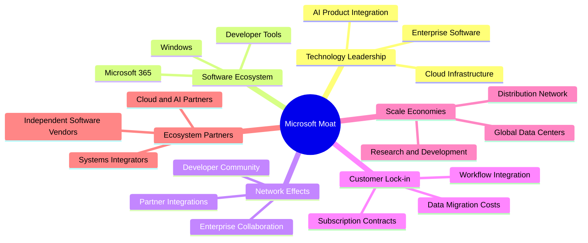
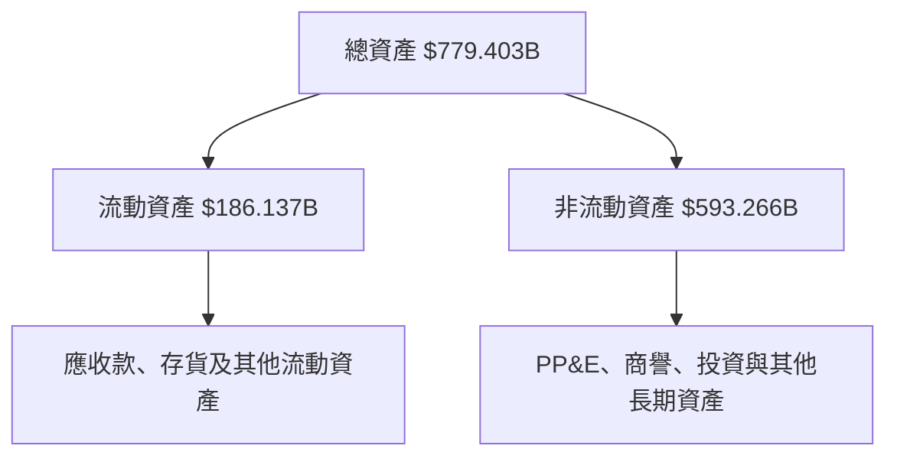
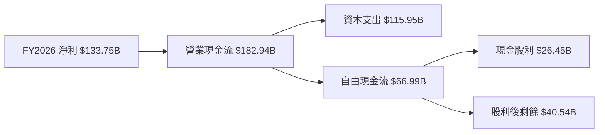
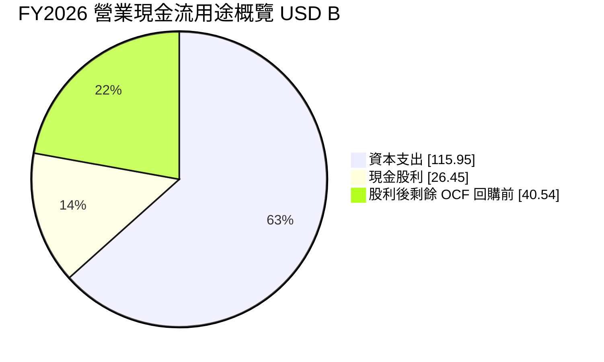
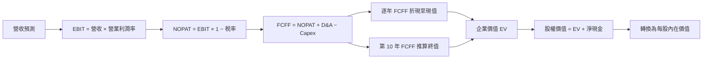
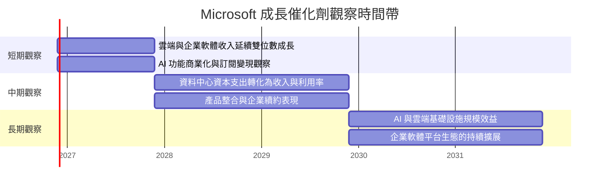
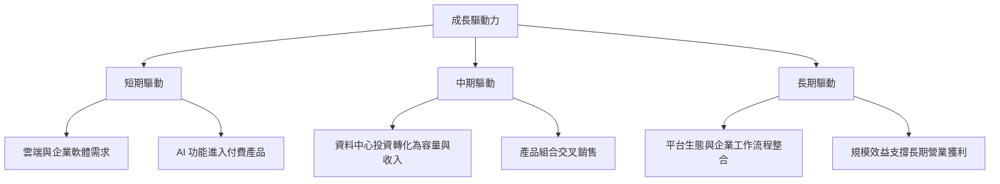
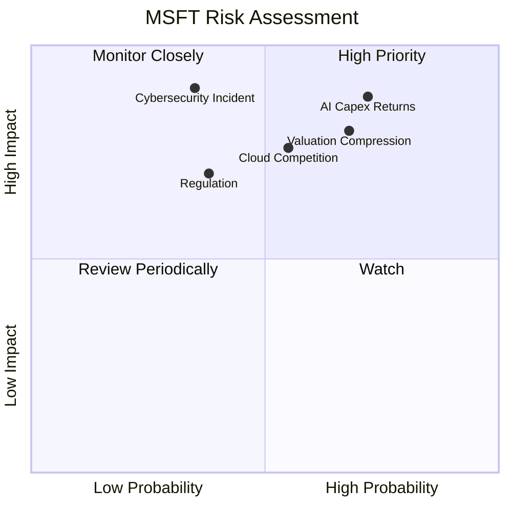
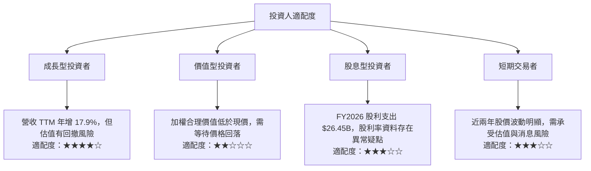

# MSFT 基本面深度分析報告
> **報告日期**：2026-11-24 ｜ **語言**：繁體中文 ｜ **數據來源**：SEC 申報資料 (XBRL)、Yahoo Finance、Finviz、StockAnalysis、Roic.ai ｜ **分析師**：CFA 級機構研究

---

## 目錄

| # | 章節 | 核心結論 |
|---|------|----------|
| 1 | 執行摘要 | 減碼；加權合理價值 $434.72，MOS -13.3% |
| 2 | 公司概覽與商業模式 | 企業軟體、雲端與生態系帶來高轉換成本；分部營收占比未提供 |
| 3 | 損益表深度分析 | TTM 營收 $346.44B、YoY +17.9%；TTM 營業利益率 47.1% |
| 4 | 資產負債表分析 | 最新標準化資料顯示淨現金 $29.03B；流動性尚可，來源間債務數據不一致 |
| 5 | 現金流量深度分析 | TTM FCF $59.96B；資本支出升高使現金轉換承壓 |
| 6 | 獲利能力與資本效率 | ROIC 29.7% 高於 WACC 10.04%，仍在創造股東價值 |
| 7 | 相對估值分析 | 估值低於自身五年中位數，但相對同業仍有溢價 |
| 8 | DCF 內在價值評估 | 基準 DCF 每股 $376.13；加權合理價值 $434.72 |
| 9 | 成長催化劑 | Azure、AI 與 Microsoft 365 為主要質化催化劑；TAM 數字未提供 |
| 10 | 風險矩陣 | AI 資本支出回收、競爭、估值與監管為主要風險 |
| 11 | 投資建議 | 目前估值不具足夠安全邊際；以 $350–$391 作為分批留意區間 |

---

## 1. 執行摘要

### 1.0 一頁式投資儀表板（Portfolio Manager 30 秒速讀）

| 項目 | 內容 |
|------|------|
| **投資論點（3 句）** | ① TTM 營收 $346.44B、TTM 年增 17.9%，最新一季年增 18.8%，企業雲端與軟體需求仍支撐成長。② TTM 營業利益率 47.1%、ROIC 29.7% 高於 WACC 10.04%，目前資本回報仍高於資金成本。③ TTM FCF $59.96B、FCF Yield 1.64%，但 Capex 已達 $135.92B，未來現金回報須證明能跟上 AI 基建投入。 |
| **綜合評分** | **7.8/10**（引用 1.1 六項評分平均） |
| **財務健康** | 🟢 淨現金 $29.03B、流動比率 1.225；但不同資料來源對債務口徑有明顯差異 |
| **ROIC vs WACC** | 29.7% vs 10.04%；創造股東價值，差距 +19.66 個百分點 |
| **FCF 趨勢** | FY2026 年度 FCF $66.99B，低於 FY2025 的 $71.61B；TTM FCF Yield 1.64% |
| **估值** | Forward P/E 20.35x ｜ EV/EBITDA 18.14x ｜ FCF Yield 1.64% |
| **DCF 內在價值（基準）** | $376.13 ｜現價相對 DCF 折溢價 **+30.9%**（現價高於 DCF 價值） |
| **安全邊際（MOS）** | **-13.3%**＝($434.72 − $492.50) ÷ $434.72；基準為 **8.8 加權合理價值**，不是 DCF 單一估值｜🔴 <10% 無 |
| **預期報酬（基準情境 12M）** | 以 DCF 基準情境衡量：($376.13 ÷ $492.50) − 1 = **-23.6%**；該模型情境並非 12 個月目標價 |
| **關鍵風險（前二）** | AI 基建支出增長快於現金回收；成長與利潤率預期未達估值隱含要求 |
| **評級 + 信心度** | 🟠 **減碼** ｜信心：中（估值與基礎財務數據清楚，但部分債務與模型輸入存在口徑差異） |

### 1.1 綜合評分卡（全報告唯一）

| 維度 | 評分（1–10） | 主要依據（引用數字與其來源章節） |
|------|--------------|----------------------------------|
| 成長性 | 8.5 | TTM 營收年增 17.9%、最新一季年增 18.8%，見第 3 章 |
| 獲利能力 | 9.0 | TTM 營業利益率 47.1%、ROIC 29.7% 對 WACC 10.04%，見第 6 章 |
| 財務健康 | 8.0 | 淨現金 $29.03B、流動比率 1.225、F-Score 6/9；但債務來源口徑不一致，見第 4、6 章 |
| 估值 | 5.5 | MOS -13.3%；P/E 25.7x 低於五年中位數 31.5x，但加權合理價值仍低於現價，見第 7、8 章 |
| 護城河 | 9.0 | 企業軟體生態、雲端服務、產品整合與高營業利益率提供支持；市場份額量化資料未提供，見第 2 章 |
| 管理層與資本配置 | 7.0 | FY2026 SBC $12.40B、Capex $115.95B、股利 $26.45B；高投入的回報仍需驗證，見第 3、5 章 |
| **綜合評分** | **7.8** | 六項算術平均：(8.5 + 9.0 + 8.0 + 5.5 + 9.0 + 7.0) ÷ 6 = 7.83，四捨五入至一位小數 |

### 1.2 五大投資論點 + 三大核心風險

| 類型 | 項目 | 具體依據 | 信心度 |
|------|------|----------|--------|
| 🟢 **投資論點①** | 大型企業軟體與雲端需求持續 | TTM 營收 $346.44B、年增 17.9%；最新一季營收年增 18.8%，成長沒有只靠單一季度拉動 | 🟢 高 |
| 🟢 **投資論點②** | 高營業獲利與資本回報 | TTM 營業利益率 47.1%、ROIC 29.7%，高於 10.04% WACC | 🟢 高 |
| 🟢 **投資論點③** | 現金流與資產負債表具韌性 | TTM OCF $195.88B、淨現金 $29.03B，能支持持續投資與股利 | 🟢 高 |
| 🟢 **投資論點④** | 股價估值低於公司自身五年中位數 | P/E 25.7x 對五年中位數 31.5x；EV/EBITDA 18.1x 對 24.3x | 🟡 中 |
| 🟢 **投資論點⑤** | 現有平台具有交叉銷售與產品整合條件 | Windows、Microsoft 365、Azure、開發工具與商業應用形成互補；此判斷屬質化，未提供分部營收比重 | 🟡 中 |
| 🟡 **風險①** | AI 與資料中心投入高，資本回收有時間差 | TTM Capex $135.92B，約為 TTM 營收 39.2%；若利用率或定價未跟上，FCF 可能受壓 | 🟡 中 |
| 🔴 **風險②** | 估值要求持續高成長 | 基準 DCF $376.13，低於 $492.50 現價；反推 DCF 要求第一年營收成長 24.6%，高於基準 17.9% | 🔴 高 |
| 🟡 **風險③** | 債務與現金流口徑資料不一致 | 標準化數據顯示總債務 $35.48B、淨現金 $29.03B；其他合併來源顯示總債務 $133.93B，需以 SEC 申報逐項核對 | 🟡 中 |

### 1.3 快速統計卡片

| 指標 | 公司實際值（期間） | 同業中位數 | 狀態 |
|------|--------------------|------------|------|
| 營收成長（TTM） | **17.9%** | — | 🟢 |
| 營收成長（最新一季年增） | **18.8%** | 24.7% | 🟡 |
| 毛利率（TTM） | **67.7%** | 60.9% | 🟢 |
| 營業利益率（TTM） | **47.1%** | — | 🟢 |
| ROIC（TTM） | **29.7%** | — | 🟢 |
| Forward P/E | **20.35x** | 18.3x | 🟡 |
| FCF Yield（TTM） | **1.64%** | — | 🔴 |
| Piotroski F-Score | **6 / 9** | — | 🟡 |

> 同業中位數依 GOOG、AMZN、ORCL 的 Peer multiples 計算；最新一季營收成長中位數為 24.7%，毛利率中位數為 60.9%，Forward P/E 中位數為 18.3x。

### 1.4 投資結論

╔══════════════════════════════════════════════════════════════════╗  
║　　　　　　　　　　　📊 投資結論摘要　　　　　　　　　　　　　　　║  
╠══════════════════════════════════════════════════════════════════╣  
║ 評級：減碼（規則 20；加權合理價值 MOS -13.3%）　　　　　　　　　║  
║ 價格（2026-11-23 收盤）：$492.50　　　　　　　　　　　　　　　　║  
║ DCF 內在價值（基準）：$376.13（現價溢價 +30.9%）　　　　　　　　║  
║ 安全邊際 MOS：-13.3%（＝($434.72−$492.50)÷$434.72）　　　　　║  
║ 加權合理價值（8.8）：$434.72　　　　　　　　　　　　　　　　　　║  
║ DCF 情境價值：悲觀 $178.03（-63.9%）　　　　　　　　　　　　　║  
║　　　　　　　基準 $376.13（-23.6%）　　　　　　　　　　　　　║  
║　　　　　　　樂觀 $728.27（+47.9%）　　　　　　　　　　　　　║  
║ 綜合評分：7.8/10（引用 1.1）　　　　　　　　　　　　　　　　　　║  
║ 適合投資人：長期成長型、能承受估值波動且以分批布局為主者　　　║  
╚══════════════════════════════════════════════════════════════════╝  

---

## 2. 公司概覽與商業模式

### 2.1 業務結構與收入來源

財務數據未提供 Microsoft 各分部、子業務的最新營收及占比，因此依規則不繪製含推估占比的業務收入圖。公司業務涵蓋作業系統、伺服器應用、商業解決方案、開發工具、雲端服務、遊戲與設備；其收入模式包括軟體授權、訂閱、雲端使用量及相關服務，但各類收入金額未提供。

已知整體營收規模為 TTM $346.44B，TTM 年增 17.9%；這反映大型企業軟體與雲端需求仍在擴張，但無法據此判定 Azure、Microsoft 365 或其他單一業務對增長的貢獻。

### 2.2 市場份額

市場份額數據未提供，故不呈現市場份額圖表或占比。Microsoft 的 TTM 營收為 $346.44B，最新一季營收年增 18.8%；相較 GOOG、AMZN、ORCL 的最新一季營收成長率 24.7%、12.1%、29.6%，Microsoft 位於區間中段。這些數字是公司整體成長率，不能直接視為特定產品市場份額變化。

### 2.3 競爭護城河分析

護城河的主要經濟機制是產品整合、企業工作流程依賴與雲端規模效益。FY2026 研發費用 $35.56B，支持持續產品與平台投資；但現有數據沒有客戶流失率、續約率、雲端分部營收或市場份額，因而不能直接量化轉換成本強度。

### 2.4 護城河強度

| 護城河項目 | 強度（強／中／弱） | 證據（引用數字或事實） | 會削弱它的情況 |
|------------|--------------------|------------------------|----------------|
| 技術與研發 | 強 | FY2026 研發費用 $35.56B；TTM 營業利益率 47.1% | 研發投資無法轉化為可付費產品，或技術差距持續縮小 |
| 軟體生態系統 | 強 | Windows、Microsoft 365、伺服器與開發工具形成跨產品組合；具體產品營收未提供 | 客戶轉向跨平台、開源或更低成本替代品 |
| 網路效應 | 中 | 企業協作、開發工具與合作夥伴可增加平台價值；量化網路效應數據未提供 | 使用者與開發者轉向競爭平台 |
| 客戶鎖定 | 強 | 多產品整合可能增加工作流程遷移成本；續約與流失數據未提供 | 互通性提高、雲端遷移簡化或企業降低供應商集中度 |
| 規模效應 | 強 | TTM 營收 $346.44B、營業利益率 47.1%，支持研發與基礎設施投入 | 資料中心利用率不足，或資本支出增長快於收入與現金流 |
| 生態夥伴 | 中 | 公司業務包含商業解決方案、開發工具與服務夥伴；量化夥伴貢獻未提供 | 夥伴轉向多雲、競爭平台或自建服務 |

1.1 的「護城河」評分為 9.0/10，主要依據為 47.1% TTM 營業利益率與多產品企業軟體生態；由於市場份額、續約與客戶集中度數據缺漏，並未評為滿分。

---

## 3. 損益表深度分析

### 3.1 年度收入成長趨勢（近4年）

╔══════════════════════════════════════════════════════════════════╗  
║　　　　 Microsoft 年度收入趨勢（FY2023–FY2026）　　　　　　　　　　　║  
╠══════════════════════════════════════════════════════════════════╣  
║ FY2023　$211.91B　█████████████░░░░░░░░░　YoY：+15.67%　🟢　║  
║ FY2024　$245.12B　███████████████░░░░░░░　YoY：+15.67%　🟢　║  
║ FY2025　$281.72B　█████████████████░░░░░　YoY：+14.93%　🟢　║  
║ FY2026　$331.84B　████████████████████░░░　YoY：+17.79%　🟢　║  
║　　　　　　　　　　　　　　　　　　　　　　　　　　　　　　　　　║  
║ FY2023–FY2026 三年收入 CAGR：(331.84÷211.91)^(1/3)−1 = 16.1% ║  
╚══════════════════════════════════════════════════════════════════╝  

FY2026 收入年增 17.79%，較 FY2025 的 14.93% 加速。年度收入基礎持續擴大，表示增長並非單純低基期反彈；但未提供分部收入，無法將加速幅度精確拆分為雲端、AI、訂閱或其他產品貢獻。

### 3.2 季度收入趨勢分析

QoQ 以相鄰列示季度計算；YoY 為同季度對比，與 TTM 年增率分開標示。

| 財季結束日 | 營收（$B） | QoQ 成長 | YoY 成長 | 備註 |
|-------------|------------|----------|----------|------|
| 2025-12-31 | 81.27 | N/A（前一季未列示） | 16.72% | 仍維持雙位數成長 |
| 2026-03-31 | 82.89 | +1.98% | 18.30% | 年增加快，季度環比增長較溫和 |
| 2026-06-30 | 90.01 | +8.59% | 17.75% | QoQ 增幅較大，含季節性與合約認列影響的可能性 |
| 2026-09-30 | 92.28 | +2.52% | 18.80% | 最新季度年增率高於前兩季 |

### 3.3 利潤率演變分析

以下年度毛利率、營業利益率與淨利率依各年度披露的毛利、營業利益、淨利除以收入計算。

| 利潤率指標 | FY2023 | FY2024 | FY2025 | FY2026 | 趨勢 | 評估 |
|------------|--------|--------|--------|--------|------|------|
| **毛利率** | 68.9% | 69.7% | 68.8% | 68.0% | FY2024 見高後回落 | 🟡 |
| **營業利益率** | 41.8% | 44.6% | 45.6% | 46.8% | 連續改善 | 🟢 |
| **淨利率** | 34.1% | 36.0% | 36.2% | 40.3% | FY2026 明顯提高 | 🟢 |

**利潤率演變深度解析：**

- FY2023 至 FY2026 營業利益率由 41.8% 升至 46.8%，收入由 $211.91B 升至 $331.84B。收入擴張搭配費用控制，使營業利益增速高於收入，呈現營業槓桿。
- 毛利率由 FY2024 的 69.7% 回落至 FY2026 的 68.0%。這可能反映服務與雲端基建的成本組合變化，但缺少分部毛利及成本明細，不能將其歸因於單一產品。
- FY2026 淨利率升至 40.3%，但年度淨利 $133.75B 與 TTM 淨利 $142.63B 的期間不同；評估獲利延續性應同時看營業利益與現金流，而不只看淨利增長。

### 3.4 費用結構分析

費用結構的完整明細（銷售、管理、研發、利息及其他項目）未提供，故不繪製費用占比圓餅圖。已知 FY2026 研發費用為 $35.56B，約為當年度營收 $331.84B 的 10.7%；這代表公司維持相當規模的研發投入，但不能用單一費用項目推定完整成本結構。

### 3.5 季度 EPS 趨勢與盈餘品質（Quality of Earnings）

最近四個已列示季度 EPS 實際值為 $4.92、$4.81、$4.27、$5.16；EPS 預估與 surprise 數據為 N/A，因此不判定超預期或不及預期。

| 盈餘品質項目 | 數值/佔比 | 評估 |
|--------------|-----------|------|
| 股權薪酬 SBC / 營收 | FY2026：$12.40B ÷ $331.84B = **3.74%** | 🟡 對現金支出不是即時負擔，但對股東有稀釋成本 |
| SBC / 營業現金流 | FY2026：$12.40B ÷ $182.94B = **6.78%** | 🟡 SBC 相對現金流不算主導，但不可視為零成本 |
| FCF / 淨利（現金轉換率） | TTM：$59.96B ÷ $142.63B = **42.0%** | 🔴 低於 100%，主要需關注 Capex 高企造成的現金轉換壓力 |
| 一次性/非經常性損益 | N/A（未提供足以辨認的明細） | 無法判斷近期淨利是否受一次性項目顯著影響 |
| 有效稅率異常 | 19.4%（最新年度有效稅率） | 🟢 未見數據顯示需以極端稅率解釋獲利；未提供多年可比稅率序列 |
| 資本化支出 vs 費用化 | TTM Capex $135.92B；資本化明細 N/A | 高額資本投入會提高短期現金流壓力；無法量化資本化政策變化 |

**盈餘品質結論：**營業利益率與營業現金流均為正，Piotroski 測試亦有 6 項通過，但 TTM FCF 僅相當於 TTM 淨利的 42.0%，且 TTM Capex 高達 $135.92B。因而 GAAP 淨利具經營基礎，然而目前現金流轉換偏弱，若高額投資不能帶來持續營收與利用率提升，GAAP 盈餘所代表的可分配現金會低於表面獲利所暗示的程度。

---

## 4. 資產負債表分析

### 4.1 資產結構分解

以 StockAnalysis 2026-09-30 資產負債表列示總資產 $779.403B、流動資產 $186.137B；非流動資產為兩者差額 $593.266B。非流動資產細項未在同一口徑下完整列示，故不強行拆分比例。

### 4.2 流動性與營運資金分析

標準化流動比率為 1.225，速動比率為 1.068。流動資產高於流動負債，但緩衝並非極厚；營運資金天數顯示公司能以負 CCC 維持供應商融資效益。

| 指標 | 最新 TTM | 一年前 TTM | 變化 | 解讀 |
|------|----------|------------|------|------|
| DSO 應收帳款天數 | 65 天 | 66 天 | -1 天 | 收款天數略降，未顯示應收回款惡化 |
| DIO 存貨天數 | 6 天 | 4 天 | +2 天 | 存貨天數增加，須持續檢查是否反映備貨或需求變化 |
| DPO 應付帳款天數 | 139 天 | 130 天 | +9 天 | 付款週期延長，短期支持營運資金；須觀察是否可持續 |
| CCC 現金轉換週期 | -67 天 | -59 天 | -8 天 | 現金轉換週期進一步為負，對現金周轉有利，但部分由 DPO 增長造成 |

### 4.3 債務結構分析

不同來源對總債務的數值並不一致：標準化 SEC／價格計算值為 $35.48B，較寬口徑合併市場資料列出 $133.93B。以下按本報告應優先引用的標準化數值呈現；在逐項對照短期借款、長期借款與租賃負債前，不以不同來源混算利息覆蓋率或 Debt/EBITDA。

╔══════════════════════════════════════════════════════════════════╗  
║　　　　　　　　　Microsoft 債務健康診斷　　　　　　　　　　　　　　　║  
╠══════════════════════════════════════════════════════════════════╣  
║ 總債務：　　　　$35.48B　（標準化數值）　　　　　　　　　　　　　║  
║ 現金及短期投資：$64.51B　（2026-09-30）　　　　　　　　　　　　║  
║ 淨現金：　　　　$29.03B　（= $64.51B − $35.48B）　🟢　　　　　║  
║ Debt/EBITDA：　N/A（債務與 EBITDA 口徑未能一致核對）　　　　　　║  
║ 利息保障倍數： N/A（利息費用明細未提供）　　　　　　　　　　　　║  
║ 備註：其他資料來源總債務 $133.93B，未與標準化口徑混用。　　　　║  
╚══════════════════════════════════════════════════════════════════╝  

### 4.4 股東權益趨勢

╔══════════════════════════════════════════════════════════════════╗  
║　　　　　　　Microsoft 歷年股東權益變化（年度）　　　　　　　　　　║  
╠══════════════════════════════════════════════════════════════════╣  
║ FY2023　$206.22B　█████████░░░░░░░░░░░░░　　　　　　　　　　　　║  
║ FY2024　$268.48B　████████████░░░░░░░░░░░　　　　　　　　　　　║  
║ FY2025　$343.48B　████████████████░░░░░　　　　　　　　　　　║  
║ FY2026　$442.39B　████████████████████░　　　　　　　　　　　║  
╚══════════════════════════════════════════════════════════════════╝  

FY2023 至 FY2026 股東權益增加，與累積獲利及資產擴張相符；股東權益增加本身不等同資本回報提高，仍需搭配 ROIC、現金流與資本支出回報判讀。

---

## 5. 現金流量深度分析

### 5.1 現金流量瀑布圖

FY2026 年度資料顯示 OCF $182.94B、Capex $115.95B、FCF $66.99B、現金股利 $26.45B。回購金額與期間內淨現金變化未提供，不納入圖表。

### 5.2 FCF 轉換率趨勢

以下年度比率以披露的年度 FCF 除以年度淨利計算；TTM 數值使用標準化 TTM FCF 與 StockAnalysis TTM 淨利。

| 期間 | FCF（$B） | 淨利（$B） | FCF / 淨利 | 評估 |
|------|-----------|------------|------------|------|
| FY2023 | 59.48 | 72.36 | 82.2% | 🟡 |
| FY2024 | 74.07 | 88.14 | 84.0% | 🟡 |
| FY2025 | 71.61 | 101.83 | 70.3% | 🟡 |
| FY2026 | 66.99 | 133.75 | 50.1% | 🔴 |
| 最新 TTM | 59.96 | 142.63 | 42.0% | 🔴 |

FY2026 至最新 TTM 的現金轉換率下降，與 Capex 大幅提升一致。年度 FCF 由 FY2025 的 $71.61B 降至 FY2026 的 $66.99B；TTM FCF 更低，反映目前基建投入期對自由現金流的壓力。

### 5.3 自由現金流趨勢

╔══════════════════════════════════════════════════════════════════╗  
║　　　　　　　自由現金流趨勢（年度實際與最新 TTM）　　　　　　　　　　║  
╠══════════════════════════════════════════════════════════════════╣  
║ FY2023　$59.48B　████████████████░░░░　FCF Yield：N/A　　　　　║  
║ FY2024　$74.07B　████████████████████　FCF Yield：N/A　　　　　║  
║ FY2025　$71.61B　███████████████████░　FCF Yield：N/A　　　　　║  
║ FY2026　$66.99B　██████████████████░░　FCF Yield：N/A　　　　　║  
║ TTM　　 $59.96B　████████████████░░░░　FCF Yield：1.64%　　　║  
║ 年度 Yield 未提供，避免以不同日期市值回推。　　　　　　　　　　　║  
╚══════════════════════════════════════════════════════════════════╝  

### 5.4 資本配置評估

FY2026 營業現金流 $182.94B 中，Capex $115.95B、股利 $26.45B，計算後股利支付後、回購前的剩餘為 $40.54B。回購金額未提供，因此下圖只呈現可由年度數據核對的 OCF 用途，不代表完整資本配置。

| 資本配置項目 | FY2026 數值 | 評估 |
|--------------|------------|------|
| 資本支出 | $115.95B | 🟡 投資規模大；需確認資料中心與 AI 投資的利用率及增量回報 |
| 現金股利 | $26.45B | 🟢 相對 OCF 可負擔 |
| 股利後剩餘 OCF | $40.54B | 🟡 未扣回購及其他融資活動，不能直接等同可自由分配金額 |
| 股票回購 | N/A | 未提供可核對金額，不能假設回購規模 |
| FY2026 SBC | $12.40B | 🟡 SBC 不等同現金流出，但仍是股東經濟稀釋成本 |

---

## 6. 獲利能力與資本效率

### 6.1 ROE / ROA / ROIC 趨勢

| 指標 | 最新數值 | 期間／來源口徑 | 評估 |
|------|----------|----------------|------|
| ROE | 30.3% | TTM，QUALITY FIGURES 口徑 | 🟢 |
| ROA | 14.4% | TTM，市場數據口徑 | 🟢 |
| ROIC | 29.7% | TTM，稅後營業利益 ÷（權益 + 債務 − 現金） | 🟢 |

不同來源的 ROE 數值有差異：標準化品質數據為 30.3%，市場資料另列 34.2%。本報告品質分析與杜邦分解採用明確指定的 30.3%，不將兩種口徑混用。歷史 ROE、ROA 與可比較同業均值未提供，故不填入推估數值。

### 6.2 ROIC vs WACC 分析（核心價值創造判斷）

╔══════════════════════════════════════════════════════════════════╗  
║　　　　　　　　ROIC vs WACC 深度分析　　　　　　　　　　　　　　　　║  
╠══════════════════════════════════════════════════════════════════╣  
║ 無風險利率 Rf（10Y 美債）：　　　　　　　　　4.92%　　　　　　　║  
║ 市場風險溢酬 ERP：　　　　　　　　　　　　　5.00%　　　　　　　║  
║ Beta（調整後）：　　　　　　　　　　　　　　1.03　　　　　　　║  
║ 股權成本 Ke：4.92% + 1.03 × 5.00%　　　　　= 10.07%　　　　　 ║  
║ 稅前債務成本：　　　　　　　　　　　　　　　8.60%　　　　　　　║  
║ 有效稅率：　　　　　　　　　　　　　　　　　19.4%　　　　　　　║  
║ 資本權重 E / D：　　　　　　　　　　　　　　99.0% / 1.0%　　　║  
║ 採用 WACC：　　　　　　　　　　　　　　　　 10.04%　　　　　　║  
║　　　　　　　　　　　　　　　　　　　　　　　　　　　　　　　　　║  
║ TTM ROIC：　　　　　　　　　　　　　　　　　29.7%　　　　　　　║  
║ ROIC − WACC：29.70% − 10.04%　　　　　　　　= +19.66 pp　　　 ║  
║ ROIC / WACC：29.70% ÷ 10.04%　　　　　　　　= 2.96 倍　　　　 ║  
║　　　　　　　　　　　　　　　　　　　　　　　　　　　　　　　　　║  
║ ROIC　29.7%　▓▓▓▓▓▓▓▓▓▓▓▓▓▓▓▓▓░░░　　　　　　　║  
║ WACC　10.04%　▓▓▓▓▓░░░░░░░░░░░░░░　　　　　　　 ║  
║ 判斷：目前 ROIC 顯著高於資金成本，仍在創造經濟價值。　　　　　 ║  
╚══════════════════════════════════════════════════════════════════╝  

其中調整後 Beta 為 1.03，依指定口徑由原始 Beta 1.04 調整：`⅔ × 1.04 + ⅓ × 1.00 = 1.0267 ≈ 1.03`。稅後債務成本按指定輸入估算為 `8.60% × (1 − 19.4%) = 6.93%`。採用 WACC 10.04%，與第 8.2 節一致。債務利息金額及可核對的計息負債細項未提供，因此不以未核對的財報債務數字重建 WACC。

### 6.3 杜邦三因素分解

| 因素 | 數值（TTM） | 解讀 |
|------|-------------|------|
| 淨利率 | 41.2% | 高淨利率是 ROE 的重要來源 |
| 資產週轉率 | 0.44 | 資產規模龐大，收入相對資產的週轉率低於高週轉型企業 |
| 權益乘數 | 1.66 | 有一定財務槓桿，但不是 ROE 的主要來源 |
| **ROE** | **30.3%** | 41.2% × 0.44 × 1.66 = 30.1%，與列示 30.3% 的小差異來自未四捨五入原始輸入 |

依指定品質數據，ROE 主要由高淨利率與資產報酬驅動，不是單靠槓桿撐起。列示到一位小數的三項因素相乘與程式未四捨五入的 ROE 有約 0.2 個百分點的呈現差異。

### 6.4 財務體質：Piotroski F-Score

Piotroski F-Score 為 **6 / 9**。

| 測試 | 結果 | 解讀 |
|------|------|------|
| ROA > 0 | ✅ 通過 | 公司維持正資產報酬 |
| 營業現金流 > 0 | ✅ 通過 | TTM 營業現金流為正 |
| ROA 高於一年前 | ✅ 通過 | 資產獲利能力較一年前改善 |
| 營業現金流 > 淨利（應計品質） | ✅ 通過 | 品質指標判定現金流高於淨利 |
| 長期負債 ÷ 總資產低於一年前 | ✅ 通過 | 長期負債相對資產比例改善 |
| 流動比率高於一年前 | ❌ 未通過 | 流動比率未較去年改善 |
| 稀釋股數未增加 | ✅ 通過 | 測試期間稀釋股數未增加 |
| 毛利率高於一年前 | ❌ 未通過 | 毛利率未改善，與投入成本或產品組合變化相符 |
| 資產週轉率高於一年前 | ❌ 未通過 | 資產增加未同步帶動週轉率提高，需追蹤新資產利用率 |

六項通過說明獲利與資產負債表多數訊號尚可；三項未通過集中於流動性、毛利率與資產週轉，與高 Capex 階段的資產先行投入特性一致，但也要求未來收入和現金流兌現投資。

---

## 7. 相對估值分析

### 7.1 同業估值比較表格

| 估值指標 | **MSFT** | **GOOG** | **AMZN** | **ORCL** | MSFT 評估 |
|----------|---------|---------|---------|---------|-----------|
| **Trailing P/E** | 25.7x | 14.6x | 20.6x | 15.9x | 🔴 高於三家同業；需以更高成長與利潤率支撐 |
| **Forward P/E** | 20.35x | 18.3x | 23.4x | 10.3x | 🟡 高於同業中位數 18.3x |
| **P/S Ratio** | 10.6x | 7.3x | 3.5x | 4.9x | 🔴 市銷率溢價明顯 |
| **EV/EBITDA** | 18.1x | 18.0x | 16.1x | 14.0x | 🟡 略高於同業中位數 16.1x |
| **最新一季營收年增** | 18.8% | 24.7% | 12.1% | 29.6% | 🟡 成長居中，不足以單獨解釋所有估值溢價 |
| **毛利率（TTM）** | 67.7% | 60.9% | 51.4% | 64.0% | 🟢 高於三家同業 |

Microsoft 的利潤率高於同業，支持部分估值溢價；不過 Forward P/E 高於同業中位數 18.3x，且 P/S 10.6x 高於同業。就市場定價而言，投資人仍在為更穩定的企業收入與平台品質付溢價。

### 7.2 歷史估值區間分析

╔══════════════════════════════════════════════════════════════════╗  
║　　　　　　　　　MSFT 五年 P/E 歷史區間　　　　　　　　　　　　　　　║  
╠══════════════════════════════════════════════════════════════════╣  
║ 五年低位 20.8x ├──────── 現值 25.7x ────┼ 中位數 31.5x　　　║  
║ 五年高位 37.8x　　　　　　　　　　　　　　　　　　　　　　　　　║  
║ 當前歷史百分位：14%　　　　　　　　　　　　　　　　　　　　　　　║  
║　　　　　　　　　　　　　　　　　　　　　　　　　　　　　　　　　║  
║ P/S：現值 10.6x｜五年中位數 12.0x｜區間 8.4x–13.7x｜百分位 33% ║  
║ EV/EBITDA：18.1x｜五年中位數 24.3x｜區間 14.5x–31.4x｜百分位 10% ║  
╚══════════════════════════════════════════════════════════════════╝  

相對自身歷史，P/E 與 EV/EBITDA 位於偏低位置，P/S 亦低於五年中位數；但「低於歷史中位數」不等於低估，仍須結合現金流、再投資需求與未來成長檢驗。

### 7.3 情境價值（Bear / Base / Bull，照抄 DCF MODEL 的 Scenarios）

| 情境 | 第 1 年營收成長 | 期末營業利潤率 | WACC | 每股價值 | 相對現價 | 機率 | 會發生的條件 |
|------|----------------|----------------|------|----------|----------|------|--------------|
| 🔴 悲觀 | 9.0% | 38.8% | 11.04% | $178.03 | -63.9% | 25% | 雲端／AI 變現較慢、成本投入持續、營業利潤率向下收縮 |
| 🟡 基準 | 17.9% | 45.6% | 10.04% | $376.13 | -23.6% | 50% | TTM 成長延續後逐步放緩，營業利潤率向五年中位數收斂 |
| 🟢 樂觀 | 26.9% | 50.2% | 9.04% | $728.27 | +47.9% | 25% | AI 與雲端需求加速、規模效益抵銷資本成本並推升利潤率 |

### 7.4 相對估值隱含價格區間

╔══════════════════════════════════════════════════════════════════╗  
║　　　　　　　　相對估值與參考價值（每股）　　　　　　　　　　　　　║  
╠══════════════════════════════════════════════════════════════════╣  
║ 同業 Forward P/E：$442.22 ── 現價 $492.50 ── 共識 $637.36　║  
║ 同業 EV/EBITDA：　$439.90　　　　　　　　　　　　　　　　　　　║  
║ 依據：Forward P/E 使用同業中位數 18.3x × Forward EPS $24.20。 ║  
║ 依據：EV/EBITDA 使用同業中位數 16.1x × TTM EBITDA，並加淨現金。║  
╚══════════════════════════════════════════════════════════════════╝  

---

## 8. DCF 內在價值評估（Discounted Cash Flow）

### 8.0 估值推理鏈（Thinking Logic：在算之前先想清楚）

**Step 1 — 價值由哪些變數決定？**

本模型以整體公司 FCFF 評估，價值主要來自既有企業軟體與雲端現金流底盤、雲端及 AI 相關成長，以及第 10 年後的終值。各分部營收占比未提供，因此不能把 Azure、Microsoft 365 或 AI 的收入權重自行填入。對估值最具主導性的變數是折現率、終值成長與資本支出逐步下降的假設；敏感性矩陣顯示 WACC 變動的估值影響大於同幅度的永續成長變化。

**Step 2 — 模型選擇**

| 決策點 | 本報告採用 | 理由（含數字） | 曾考慮但否決 | 否決理由 |
|--------|-----------|----------------|--------------|----------|
| 現金流定義 | FCFF | 使用 WACC 10.04% 折現，先算 EV 再加淨現金 | FCFE | 債務口徑需與企業價值橋接一致 |
| 預測期 N | 10 年 | DCF MODEL 固定 10 年；有助逐步反映成長與 Capex 收斂 | 5 年 | 會更早依賴終值，無法沿用既定模型 |
| 終值方法 | Gordon Growth | 終值成長率 3.0%，低於 WACC 10.04% | 只用退出倍數 | 模型提供的基準方法為 Gordon Growth；未提供退出倍數輸入 |
| EBIT 基礎 | GAAP | EBIT 已含 SBC 費用 | 非 GAAP | 避免把 SBC 加回後漏計股東成本 |

**Step 3 — 關鍵假設推導鏈**

- **營收成長**：錨點為 TTM 年增 17.9%；模型將第一年採 17.9%，並線性降至第 10 年 3.0% → 採用值完全沿用模型 → 曾考慮採用較高且持續的成長率，但未有分部營收或管理層財測支持，故不採用。
- **期末營業利潤率**：錨點為 TTM 47.1%；模型第 10 年採 45.6%，即逐步回落 1.5 個百分點 → 理由為成熟化與歷史五年中位數收斂 → 曾考慮維持 47.1%，但模型依歷史中位數收斂而採 45.6%。
- **永續成長率 g**：錨點為模型採用的 3.0%；此值低於 WACC 10.04%，避免終值公式失效 → 採用 3.0% → 未採用高於 3.0% 的長期成長假設，以降低終值對過高永續成長的依賴。
- **預測期 N**：錨點為模型設定 10 年 → 採用 10 年 → 不改為較短預測期，以免改動程式生成的模型架構。
- **Capex / 營收**：錨點為 TTM 39.2%；模型由第 1 年 39.2% 逐步降至第 10 年 12.2%，並以 1.1 倍 D&A 為下限規則 → 代表投入強度逐步正常化 → 不採用未來持續維持 39.2%，因模型假設長期 Capex 負擔下降。
- **EBIT 基礎與 SBC**：採 GAAP EBIT；其已將 SBC 費用化。依模型組合 (A)，FCFF 不另扣 SBC，股數不再逐年稀釋 → 已反映一次 → 不採用「再扣 SBC」或「再增加年稀釋率」的組合。
- **年稀釋率**：模型設定股數固定，年稀釋率 0%；錨點為組合 (A) 的處理方式 → 未採用額外稀釋率，以免同一 SBC 成本重複計價。
- **終值方法**：採 Gordon Growth，使用第 10 年 FCFF 與 3.0% 永續成長率；未採用退出倍數法作主終值，因模型沒有提供該方法的基準輸入。
- **WACC**：採用成本資本數據列示的 10.04%；其 CAPM 股權成本為 10.07%、股權／債務權重為 99.0%／1.0% → 不自行替換為其他 WACC，以維持與指定模型一致。

**Step 4 — 最脆弱環節**

最脆弱假設是 Capex 率由 39.2% 逐步降至 12.2%；若 AI 與雲端基建支出長期維持高位，基準 FCF 將偏高，估值可能向悲觀情境 $178.03 靠近。

**Step 5 — 計算路徑圖**

### 8.1 模型假設總表（Model Inputs）

| 假設項目 | 採用值 | 依據 / 來源 | 敏感度 |
|----------|--------|-------------|--------|
| 預測期長度 N | 10 年 | DCF MODEL 設定；FY+1 至 FY+10 | 🟡 中 |
| 營收成長 | FY+1 17.9%，FY+10 3.0%，線性遞減 | TTM 年增 17.9%；第 10 年採模型成熟化假設 | 🔴 高 |
| 營業利潤率 | FY+1 47.1% → FY+10 45.6% | TTM 47.1%；期末收斂至模型採用的近五年中位數 | 🔴 高 |
| 有效稅率 | 19.4% | 最新年度有效稅率 | 🟢 低 |
| Capex / 營收 | FY+1 39.2% → FY+10 12.2% | TTM Capex / Revenue；逐步降至模型下限規則 | 🔴 高 |
| D&A / 營收 | 11.1% | DCF MODEL 的 TTM 比率，維持不變 | 🟢 低 |
| 營運資金變動 | 未建模 | DCF MODEL 明確未建模營運資金 | 🟡 中 |
| EBIT 基礎 | GAAP EBIT | 模型使用 GAAP 營業利益 | 🟡 中 |
| 股權薪酬 SBC 處理 | 組合 (A)：不另扣 SBC | GAAP EBIT 已含 SBC 費用；固定股數 | 🟡 中 |
| 年稀釋率（股數） | 0% | 組合 (A) 設定 | 🟡 中 |
| 永續成長率 g | 3.0% | DCF MODEL；小於 WACC 10.04% | 🔴 高 |
| 終值方法 | Gordon Growth | DCF MODEL 採用；未提供退出倍數基準 | 🔴 高 |
| WACC | 10.04% | Cost of capital 指定值，見 8.2 | 🔴 高 |

本模型採用 **(A) GAAP EBIT + 固定股數**，故 SBC 影響已計入一次。FCFF 定義為 `NOPAT + D&A − Capex`；營運資金變動不在模型內，不能在預測表中另造 ΔWC 數值。

### 8.2 折現率推導（WACC）

╔══════════════════════════════════════════════════════════════════╗  
║　　　　　　　　　WACC 推導（折現率）　　　　　　　　　　　　　　　　║  
╠══════════════════════════════════════════════════════════════════╣  
║ 股權成本 Ke（CAPM）：　　　　　　　　　　　　　　　　　　　　　　║  
║ 無風險利率 Rf：4.92%　　　　　　　　　　　　　　　　　　　　　　║  
║ 市場風險溢酬 ERP：5.00%　　　　　　　　　　　　　　　　　　　　║  
║ 原始 Beta：1.04；調整後 Beta：1.03　　　　　　　　　　　　　　　║  
║ Ke = 4.92% + 1.03 × 5.00% = 10.07%　　　　　　　　　　　　　　║  
║ 規模／國別溢酬：0.00%（成本資本輸入未列額外溢酬）　　　　　　　║  
║　　　　　　　　　　　　　　　　　　　　　　　　　　　　　　　　　║  
║ 稅前 Kd：8.60%（成本資本輸入；利息金額未提供）　　　　　　　　　║  
║ 有效稅率：19.4%　　　　　　　　　　　　　　　　　　　　　　　　║  
║ 稅後 Kd = 8.60% × (1 − 19.4%) = 6.93%　　　　　　　　　　　　║  
║　　　　　　　　　　　　　　　　　　　　　　　　　　　　　　　　　║  
║ 股權／債務權重：99.0% / 1.0%　　　　　　　　　　　　　　　　　║  
║ WACC = 99.0% × 10.07% + 1.0% × 6.93% = 10.04%　　　　　　　　║  
╚══════════════════════════════════════════════════════════════════╝  

**逐步演算（WACC）：**

1. **Ke（CAPM）** = 4.92% + 1.03 × 5.00% = **10.07%**。Rf 日期未在成本資本資料中列明，故不另行指定日期；ERP 5.00% 為成本資本模型採用假設值。
2. **稅前 Kd** = **8.60%**。利息費用金額與同口徑平均計息負債金額未提供，不能用未核對的總負債反推。
3. **稅後 Kd** = 8.60% × (1 − 19.4%) = **6.93%**。
4. **權重** = 股權 99.0%、債務 1.0%；兩者相加為 100.0%。指定資料未提供可直接核驗的精確市值與完整同口徑計息負債，因此沿用成本資本區塊列示權重。
5. **WACC** = 99.0% × 10.07% + 1.0% × 6.93% = 9.9693% + 0.0693% = **10.0386% ≈ 10.04%**。

WACC 與第 6.2 節採用同一數值。由於成本資本資料沒有提供計息負債範圍與平均餘額明細，不能假裝已用 SEC 資產負債表完整重算 Kd；此為模型可稽核性的限制。

### 8.3 逐年自由現金流預測（基準情境）

金額單位為 $B；折現因子依模型原值列示三位小數。以下逐年數字按 DCF MODEL 原值引用。因模型輸入及中間數值以未四捨五入底層數據計算，展示值相乘可能有小幅尾差。

| 年度 | 成長率 | 營收 | 營業利潤率 | EBIT | 稅 | NOPAT | D&A | Capex | FCFF | 折現因子 | PV |
|------|--------|------|------------|------|----|-------|-----|-------|------|----------|----|
| FY+1 | 17.9% | 408.51 | 47.1% | 192.42 | 37.32 | 155.10 | 45.16 | 160.27 | 39.99 | 0.909 | 36.34 |
| FY+2 | 16.3% | 474.92 | 46.9% | 222.92 | 43.24 | 179.69 | 52.50 | 172.04 | 60.15 | 0.826 | 49.68 |
| FY+3 | 14.6% | 544.25 | 46.8% | 254.57 | 49.38 | 205.20 | 60.17 | 180.78 | 84.58 | 0.751 | 63.48 |
| FY+4 | 12.9% | 614.69 | 46.6% | 286.51 | 55.57 | 230.94 | 67.96 | 185.69 | 113.20 | 0.682 | 77.21 |
| FY+5 | 11.3% | 684.06 | 46.4% | 317.72 | 61.63 | 256.09 | 75.62 | 186.07 | 145.64 | 0.620 | 90.28 |
| FY+6 | 9.6% | 749.93 | 46.3% | 347.07 | 67.32 | 279.75 | 82.91 | 181.43 | 181.23 | 0.563 | 102.09 |
| FY+7 | 8.0% | 809.71 | 46.1% | 373.41 | 72.43 | 300.98 | 89.51 | 171.53 | 218.96 | 0.512 | 112.09 |
| FY+8 | 6.3% | 860.83 | 46.0% | 395.56 | 76.72 | 318.84 | 95.17 | 156.47 | 257.53 | 0.465 | 119.81 |
| FY+9 | 4.7% | 900.92 | 45.8% | 412.50 | 80.01 | 332.49 | 99.60 | 136.66 | 295.43 | 0.423 | 124.90 |
| FY+10 | 3.0% | 927.95 | 45.6% | 423.35 | 82.11 | 341.24 | 102.59 | 112.84 | 330.98 | 0.384 | 127.17 |

預測期 FCF 現值合計（按表列 PV 逐項相加）：

`36.34 + 49.68 + 63.48 + 77.21 + 90.28 + 102.09 + 112.09 + 119.81 + 124.90 + 127.17 = 903.05B`

**逐步演算（FY+1，依模型列示值）：**

1. **營收**：基期 TTM 營收 $346.44B；模型列示 FY+1 營收 **$408.51B**。以已四捨五入的 17.9% 直接乘基期會有小幅尾差，故以模型列示值為準。
2. **EBIT**：$408.51B × 約 47.1% = 模型列示 **$192.42B**。
3. **稅**：$192.42B × 約 19.4% = 模型列示 **$37.32B**。
4. **NOPAT**：$192.42B − $37.32B = **$155.10B**。
5. **D&A**：模型列示 **$45.16B**。
6. **Capex**：模型列示 **$160.27B**。
7. **ΔWC**：**未建模**，模型 FCFF 定義不含營運資金變動。
8. **FCFF**：$155.10B + $45.16B − $160.27B = **$39.99B**。
9. **折現因子與 PV**：模型列示折現因子 0.909、PV $36.34B；因表格數值已四捨五入，直接使用已圓整的 `39.99 × 0.909` 會有約 $0.01B 尾差，模型 PV 以未四捨五入底層數值計算。

**合理性自檢：**

- FY+1 至 FY+10 FCFF CAGR：`(330.98 ÷ 39.99)^(1/9) − 1 ≈ 26.5%`；FY2023–FY2026 年度 FCF CAGR：`(66.99 ÷ 59.48)^(1/3) − 1 ≈ 4.0%`。預測遠快於歷史，主要來自 Capex 率下降與營收擴大，假設相當重要。
- FY+10 FCF 利潤率：`330.98 ÷ 927.95 = 35.7%`；目前 TTM FCF 利潤率：`59.96 ÷ 346.44 = 17.3%`。同業最佳 FCF 利潤率未提供，不能進行數值對比。
- 預測年度 FCFF 均為正；但 FY+1 FCFF $39.99B 低於目前 TTM FCF $59.96B，反映模型第一年 Capex 負擔仍高。

╔══════════════════════════════════════════════════════════════════╗  
║　　　　　自由現金流：歷史實際 vs 模型預測（$B）　　　　　　　　　　　║  
╠══════════════════════════════════════════════════════════════════╣  
║ FY2024（實）　$74.07　██████████████░░░░░░　YoY：+24.5%　　　　║  
║ FY2025（實）　$71.61　██████████████░░░░░░　YoY：-3.3%　　　　 ║  
║ FY2026（實）　$66.99　█████████████░░░░░░░　YoY：-6.5%　　　　 ║  
║ FY+1（預）　　$39.99　████████░░░░░░░░░░░░　模型 FCFF　　　　　 ║  
║ FY+10（預）　$330.98　████████████████████　模型 FCFF　　　　　 ║  
║ ⚠️ 預測期間 FCFF CAGR 約 26.5%，高於 FY2023–FY2026 約 4.0%。　║  
╚══════════════════════════════════════════════════════════════════╝  

### 8.4 終值計算（Terminal Value）

**適用性檢查**：`WACC 10.04% vs g 3.0% → WACC > g？✅`

| 方法 | 計算式 | 終值 TV | TV 現值 | 佔總 EV 比重 |
|------|--------|---------|---------|--------------|
| Gordon Growth | FY+10 FCFF × (1+g) ÷ (WACC−g) | 模型列示 $4,843.89B | 模型列示 $1,861.11B | 67.3% |
| 退出倍數法 | N/A | N/A | N/A | N/A |

模型主終值按指定輸出列示如下：

1. **FY+N 的 FCFF** = FY+10 FCFF **$330.98B**。
2. **分子** = `$330.98B × (1 + 3.0%)`；模型採用未四捨五入底層值後列示 TV。
3. **分母** = `10.04% − 3.0% = 7.04%`；DCF MODEL 列示 **TV $4,843.89B**。
4. **PV(TV)**：DCF MODEL 列示 **$1,861.11B**，以第 10 年折現因子折現。
5. **終值佔比**：模型列示 `PV(TV) ÷ EV = 67.3%`。

**模型核對提示：**若僅用表內已四捨五入數字直接計算，`330.98 × 1.03 ÷ 0.0704 = 4,842.18B`，與模型列示 TV $4,843.89B 相差約 $1.71B；此外，`4,843.89 × 0.384` 與列示 PV(TV) 也會因折現因子僅保留三位小數而有尾差。依規則照錄模型輸出，不以自行重算值替換；這代表底層未四捨五入輸入未完整公開，精確複算性受限。模型未提供退出倍數法輸入，故不自行補造。

### 8.5 企業價值 → 每股內在價值（Bridge）

╔══════════════════════════════════════════════════════════════════╗  
║　　　　　　企業價值 → 每股內在價值橋接表　　　　　　　　　　　　　　║  
╠══════════════════════════════════════════════════════════════════╣  
║ 預測期 FCF 現值合計　　　　　　+$903.05B　　　　　　　　　　　　 ║  
║ 終值現值 PV(TV)　　　　　　　　+$1,861.11B　　　　　　　　　　　 ║  
║ 企業價值 EV　　　　　　　　　　$2,764.17B　　　　　　　　　　　 ║  
║ 加：淨現金　　　　　　　　　　　+$29.03B　　　　　　　　　　　　 ║  
║ 股權價值　　　　　　　　　　　　$2,793.19B（模型列示）　　　　　　║  
║ 每股內在價值　　　　　　　　　　$376.13　　　　　　　　　　　　　║  
║ 2026-11-23 收盤價　　　　　　　 $492.50　　　　　　　　　　　　　║  
║ 現價相對 DCF 折溢價　　　　　　 +30.9%　　　　　　　　　　　　　 ║  
╚══════════════════════════════════════════════════════════════════╝  

**逐步演算與橋接核對：**

1. **EV**：預測期 PV 合計 $903.05B，加模型列示 PV(TV) $1,861.11B，模型 EV 列示 $2,764.17B。表列數直接相加為 $2,764.16B，與模型列示相差 $0.01B，屬模型未四捨五入底層數的尾差。
2. **股權價值**：`EV + 淨現金 = 2,764.17 + 29.03 = 2,793.20B`；模型列示股權價值 $2,793.19B，相差 $0.01B。
3. **每股內在價值**：模型指定轉換方式為股權價值 × 價格 ÷ 市值，列示 **$376.13**。市值與股數的完整精確未四捨五入輸入未提供，無法以顯示值獨立精確重建。
4. **折溢價**：`現價 ÷ DCF 內在價值 − 1 = 492.50 ÷ 376.13 − 1 = +30.9%`。另，模型列示的「-23.6% vs price」是價值相對現價的報酬差，不是本報告定義的折溢價。
5. **本節不計算 MOS**：安全邊際僅在 8.8 以加權合理價值為分母計算。

股數處理採用 DCF MODEL 規定的組合 (A)：GAAP EBIT 已含 SBC 費用，固定股數、不另加稀釋。模型提供的每股轉換公式使用市場價格與市值比率，不是以顯示股權價值除以未四捨五入稀釋股數；此與輸出模型公式一致，但精確股數未作為該模型橋接的獨立輸入呈列。現金與債務採 2026-09-30 標準化數值淨現金 $29.03B。

### 8.6 敏感性分析（WACC × 永續成長率）

下表每股價值照錄模型矩陣；括號為依現價 $492.50 計算的上行空間。基準格為 WACC 10.04%、g 3.0%。

| g（列）／WACC（欄） | 8.04% | 9.04% | **10.04%（基準）** | 11.04% | 12.04% |
|-----------|------|------|------------------|-------|-------|
| 2.0% | $488.51（-0.8%） | $404.85（-17.8%） | $342.82（-30.4%） | $295.18（-40.1%） | $257.59（-47.7%） |
| 2.5% | $521.74（+5.9%） | $427.08（-13.3%） | $358.37（-27.2%） | $306.44（-37.8%） | $265.96（-46.0%） |
| **3.0%（基準）** | $561.57（+14.0%） | $452.99（-8.0%） | **$376.13（-23.6%）** | $319.09（-35.2%） | $275.26（-44.1%） |
| 3.5% | $610.18（+23.9%） | $483.58（-1.8%） | $396.60（-19.5%） | $333.43（-32.3%） | $285.64（-42.0%） |
| 4.0% | $670.83（+36.2%） | $520.24（+5.6%） | $420.47（-14.6%） | $349.80（-29.0%） | $297.31（-39.6%） |

**逐步演算（有效非基準格：WACC 11.04% > g 3.0% ✅）**

- 模型矩陣列示此格每股價值 **$319.09**。
- 按模型規則，FCFF 預測不變，折現率改為 11.04%；各年 PV 與終值 PV 的精確未四捨五入拆分未提供，因此不虛構中間值。
- 矩陣結果相對現價：`319.09 ÷ 492.50 − 1 = -35.2%`。

**三情境 DCF（照錄模型結果）**

| 情境 | 營收成長假設 | 期末營業利潤率 | 永續成長 g | WACC | 每股內在價值 | 相對現價 | 機率 |
|------|--------------|----------------|------------|------|--------------|----------|------|
| 🔴 悲觀 | 第 1 年 9.0% | 38.8% | N/A（情境模型未另列） | 11.04% | $178.03 | -63.9% | 25% |
| 🟡 基準 | 第 1 年 17.9% | 45.6% | 3.0% | 10.04% | $376.13 | -23.6% | 50% |
| 🟢 樂觀 | 第 1 年 26.9% | 50.2% | N/A（情境模型未另列） | 9.04% | $728.27 | +47.9% | 25% |
| **機率加權** | — | — | — | — | **$414.64** | **-15.8%** | 100% |

DCF MODEL 只提供三情境假設與每股結果，未提供各情境 FY+10 營收、FCFF、終值中間數，故不能在不另建模型的情況下完整重建情境算式。其機率加權值可複算：`$178.03 × 25% + $376.13 × 50% + $728.27 × 25% = $414.64`。

**敏感度結論：**

- g 每提高 1 個百分點（3.0% 至 4.0%，WACC 10.04%）：`$376.13 → $420.47`，增加 **$44.34 / 11.8%**。
- WACC 每提高 1 個百分點（10.04% 至 11.04%，g 3.0%）：`$376.13 → $319.09`，下降 **$57.04 / 15.2%**。
- 期末營業利潤率每增加 1 個百分點：**N/A（敏感度數值未提供）**。
- 在模型提供的測試範圍內，WACC 變動的估值影響大於 g 同幅度調整；因此 8.0 所指的主要脆弱因素應包括資本成本與再投資假設，而非只聚焦營收成長。

### 8.7 反推 DCF（Reverse DCF：市場在預期什麼）

反推模型固定其餘假設，只一次解一個變數；模型已提供兩項解值，其餘未列變數不補造。

| 求解的變數（一次一個） | 其餘變數設定 | 市場隱含值（令 DCF = 現價） | 公司歷史實際 | 判斷 |
|------------------------|--------------|------------------------------|--------------|------|
| 第 1 年營收成長 | 其餘採基準模型 | 24.6% | TTM 成長 17.9% | 🔴 高於目前成長 6.7 個百分點 |
| 固定營業利潤率 | 其餘採基準模型 | 57.6% | TTM 47.1% | 🔴 顯著高於目前利潤率 |
| 永續成長率 g | 未提供解值 | 未計算 | — | N/A |
| 預測期長度 N | 未提供解值 | 未計算 | — | N/A |

模型列示的兩項反推結果為：第一年營收成長 24.6%（基準 17.9%），或固定營業利潤率 57.6%（基準由 47.1% 向 45.6% 收斂）。反推的試算軌跡與各變數獨立求解細節未提供，因此不虛構試算列。

**反推結論：**若其他基準假設不變，現價要由模型支持，營收成長須顯著高於當前 TTM 17.9%，或利潤率須高於當前 47.1%。這不是不可能，但對未來營運成果要求偏高，且必須由持續收入成長與高資本支出回報共同支撐。

### 8.8 估值三角驗證與安全邊際

| 估值方法 | 隱含每股價值 | 上行空間（÷現價） | 權重 | 說明 |
|----------|--------------|-------------------|------|------|
| DCF（基準） | $376.13 | -23.6% | 40% | 10 年 FCFF、WACC 10.04%、永續成長 3.0% |
| 同業 Forward P/E | $442.22 | -10.2% | 25% | 同業中位數 Forward P/E 18.3x × Forward EPS $24.20 |
| 同業 EV/EBITDA | $439.90 | -10.7% | 25% | 同業中位數 EV/EBITDA 16.1x，並加回淨現金 |
| 分析師共識目標價 | $637.36 | +29.4% | 10% | 54 位分析師平均目標價，參考權重 |
| **加權合理價值** | **$434.72** | **-11.7%** | **100%** | 依獲利型公司固定估值權重計算 |

**逐步演算（權重外顯）：**

`$376.13 × 40% + $442.22 × 25% + $439.90 × 25% + $637.36 × 10%`  
`= $150.452 + $110.555 + $109.975 + $63.736`  
`= $434.718 ≈ $434.72`

權重對應獲利型公司估值方法；本次列出的四種方法均有數值，沒有剔除項目。

╔══════════════════════════════════════════════════════════════════╗  
║　　　　　　　　估值區間與安全邊際　　　　　　　　　　　　　　　　║  
╠══════════════════════════════════════════════════════════════════╣  
║ $178.03 ─── $376.13 ─── $434.72 ─── $492.50 ─── $728.27　　　║  
║ 悲觀 DCF　　 基準 DCF　　 加權合理值　　 現價　　　 樂觀 DCF　　 ║  
║　　　　　　　　　　　　　　　　　　　　　　　　　　　　　　　　　║  
║ 安全邊際 MOS = (加權合理價值 − 現價) ÷ 加權合理價值　　　　　　║  
║ = ($434.72 − $492.50) ÷ $434.72 = -13.3%　　　　　　　　　 ║  
║ MOS 評估：🔴 無充足安全邊際　　　　　　　　　　　　　　　　　　║  
║ 上行空間 = ($434.72 − $492.50) ÷ $492.50 = -11.7%　　　　　 ║  
║　　　　　　　　　　　　　　　　　　　　　　　　　　　　　　　　　║  
║ 建議買入區間：$350 – $391（以 MOS 至少 10% 作為上緣條件）　　║  
║ 合理持有區間：$391 – $435　　　　　　　　　　　　　　　　　　　║  
║ 減碼考慮區間：高於 $435；目前股價已高於加權合理價值　　　　　　║  
╚══════════════════════════════════════════════════════════════════╝  

建議買入上限的計算為：`$434.72 × (1 − 10%) = $391.25`，約為 $391；上限低於現價，與減碼評級一致。

> 🔎 **程式複算（Python，依本節各項自動重算）**
>
> 加權合理價值 = $376.13 × 40% + $442.22 × 25% + $439.90 × 25% + $637.36 × 10% = **$434.72**（權重合計 100%）
>
> 以價格 $492.50 計：MOS = **-13.3%**，上行空間 = **-11.7%**
>
> ✅ 與本節所寫數值一致。

### 8.9 DCF 模型的局限與失效條件

- **終值依賴度：**終值現值占企業價值 67.3%，估值仍高度依賴第 10 年後現金流與永續成長率，但尚未超過 75%。
- **最脆弱假設：**Capex／營收由 FY+1 的 39.2% 降至 FY+10 的 12.2%；若投資強度未下降，FCFF 將低於基準。其次是 WACC；WACC 從 10.04% 升至 11.04% 時，基準每股價值由 $376.13 降至 $319.09。
- **模型適用性：**公司目前仍有正 FCF，但 TTM Capex $135.92B、FCF Yield 1.64%，處於高再投資期。DCF 適合提供框架，不應作唯一估值工具；需與同業倍數、現金流趨勢及資本支出回報並用。
- **與第 10 章風險矩陣連結：**AI 建置成本超支影響 Capex／營收；雲端競爭影響營收成長與營業利潤率；利率上升影響 WACC；監管與產品限制可能影響永續成長。
- **輸入透明度限制：**營運資金未建模、情境表缺少中間現金流、精確股數與市值底層輸入未完整列示；模型列值存在由四捨五入造成的小額不一致，詳見 8.4–8.5。

### 8.10 複算檢核表（Audit Trail）

| # | 檢核項目 | 檢查方式 | 結果 |
|---|----------|----------|------|
| 1 | 所有高／中敏感度輸入都有四段式推導 | 對照 8.0 Step 3、8.1 | ⚠️ 已交代主要假設；模型缺少替代假設的可量化底層資料 |
| 2 | 每個假設都有來歷 | 核對 8.1 依據欄 | ✅ |
| 3 | WACC 五步算式齊全且相乘相加正確 | 權重 99%+1%；重算 WACC | ✅ |
| 4 | Kd 分母與債務權重範圍一致 | 利息費用與計息債務明細未提供 | ⚠️ 沿用指定 WACC；無法獨立核對負債範圍 |
| 5 | WACC 與第 6.2 節同值 | 均為 10.04% | ✅ |
| 6 | 逐年表格年度數等於 N，無省略 | FY+1 至 FY+10，共 10 年 | ✅ |
| 7 | FY+1 算式可複算 | 已列模型數字；圓整輸入有小額尾差 | ⚠️ 底層未圓整值未提供 |
| 8 | 預測期 PV 逐項相加 | 10 個 PV 相加 | ✅ $903.05B |
| 9 | WACC > g | 10.04% > 3.0% | ✅ |
| 10 | 終值以 FY+N 為基礎並折現 N 期 | FY+10 FCFF，折現 10 年 | ✅ |
| 11 | EV 至每股價值橋接無跳步 | EV、淨現金與每股轉換核對 | ⚠️ 表列值有 $0.01B 尾差；精確股數／市值輸入未列 |
| 12 | SBC 組合相容 | GAAP + 無 −SBC 列 + 固定股數 | ✅ 組合 (A) |
| 13 | 敏感性基準格等於 8.5 | 10.04%、3.0% 均為 $376.13 | ✅ |
| 14 | 矩陣有效格 WACC > g | 矩陣所有格均 WACC 高於 g | ✅ |
| 15 | 三情境機率相加及加權 | 25%+50%+25%；加權 $414.64 | ✅ |
| 16 | 反推每列只放開一個變數且有試算軌跡 | 只列模型提供的兩項求解值 | ⚠️ 求解試算軌跡未提供 |
| 17 | MOS 基準為 8.8 加權價值，折溢價基準為 DCF | MOS -13.3%；DCF 折溢價 +30.9% | ✅ |
| 18 | 完整輸出至第 11 章 | 章節檢查 | ✅ |
| 19 | 加權合理價值為各方法價值×權重之和 | 計算得到 $434.718 | ✅ 四捨五入 $434.72 |
| 20 | 評級符合 MOS 門檻 | MOS -13.3%，規則對應減碼 | ✅ |

修正與限制說明：模型列示 EV、PV(TV)、股權價值與每股價值存在小額尾差，且未提供底層未四捨五入輸入；本報告保留指定模型數值並明確揭露，而不以自行重算值替換。反推 DCF 試算軌跡缺漏，故不補造試算點。

---

## 9. 成長催化劑

### 9.1 催化劑時間軸

具體產品上線日期與管理層財測時間未提供，以下時間帶為觀察分類，不代表公司已公布的時程。

### 9.2 TAM 市場規模分析

**N/A（TAM 數據未提供）**。已知 TTM 營收 $346.44B、TTM 年增 17.9%，但沒有可引用的市場總規模、年份與來源，故不估算 TAM 或滲透率。投資人應關注後續是否有可核對的雲端、AI 服務營收與分部成長披露。

### 9.3 成長驅動力結構圖

上述為質化驅動架構，沒有分部收入、AI 營收或客戶使用量數字，不表示各驅動項目已產生可量化的獨立收入。

---

## 10. 風險矩陣

### 10.1 風險評分矩陣

下列座標為分析師定性評估，**不是**公司財務數據或統計機率；機率與衝擊軸僅供風險排序。

### 10.2 風險清單詳細分析

| # | 風險項目 | 發生機率 | 財務衝擊 | 風險評分 | 緩解措施 |
|---|----------|----------|----------|----------|----------|
| 1 | 🔴 **AI／資料中心資本回報低於預期** | 中高（分析師質化判斷） | Capex 已為 TTM $135.92B；若現金回收慢，FCF Yield 1.64% 可能延續低位 | 🔴 高 | 追蹤 Capex、營收增長、FCF 與資產利用率；若 Capex 持續高企而 FCF 轉負，重估 |
| 2 | 🔴 **估值收縮** | 中高（分析師質化判斷） | 加權合理價值 $434.72，較現價低 11.7%（以現價作分母）；基準 DCF $376.13 | 🔴 高 | 分批投資；要求估值回到 $391 左右或以下再評估加碼 |
| 3 | 🟠 **雲端與 AI 競爭加劇** | 中（分析師質化判斷） | 最新一季公司營收年增 18.8%，低於 ORCL 29.6% 與 GOOG 24.7%；若差距延續，成長溢價可能收窄 | 🟠 中高 | 按季比較成長率、毛利率、企業續約與服務變現 |
| 4 | 🟡 **利率上升推高折現率** | 中（分析師質化判斷） | WACC 由 10.04% 升至 11.04% 時，基準 DCF 由 $376.13 降至 $319.09 | 🟠 中高 | 以 WACC 敏感性矩陣做估值壓力測試，避免只依賴單一折現率 |
| 5 | 🟠 **網路安全、監管與資料治理事件** | 中（分析師質化判斷） | 未提供可量化事件概率；重大事件可能影響企業客戶信任、成本及產品銷售 | 🟠 中高 | 追蹤 SEC 申報風險揭露、重大事件公告、監管處分與資安成本 |

---

## 11. 投資建議

### 11.1 最終評級與評分

以加權合理價值 $434.72、現價 $492.50 計算，MOS 為 -13.3%，依評級門檻為**減碼**；沒有另作一級質化調整。公司品質的綜合評分為 **7.8/10**，六項分數依序為成長性 8.5、獲利能力 9.0、財務健康 8.0、估值 5.5、護城河 9.0、管理層與資本配置 7.0；此分數不取代 MOS 導出的評級。

### 11.2 合理價值與隱含報酬率

| 估值項目 | 每股價值 | 相對 2026-11-23 收盤價 $492.50 | 權重／機率 |
|----------|----------|-------------------------------|------------|
| 加權合理價值 | $434.72 | -11.7% 上行空間 | 估值方法加權 |
| DCF 悲觀情境 | $178.03 | -63.9% | 25% |
| DCF 基準情境 | $376.13 | -23.6% | 50% |
| DCF 樂觀情境 | $728.27 | +47.9% | 25% |
| DCF 機率加權值 | $414.64 | -15.8% | 100% |

加權合理價值 $434.72 是 MOS 與規則評級的依據；DCF 情境用來呈現營運與折現假設範圍，不應將樂觀情境視為基準目標價。

### 11.3 買入時機與觸發因素

╔══════════════════════════════════════════════════════════════════╗  
║　　　　　　　　✅ 買入觸發因素 Checklist　　　　　　　　　　　　　　║  
╠══════════════════════════════════════════════════════════════════╣  
║ 立即買入觸發條件（多數符合）：　　　　　　　　　　　　　　　　　　║  
║ □ 股價回落至 $391 左右或以下，對 $434.72 合理價值形成至少 10%║  
║ □ 最新季度營收年增維持在 17.9% TTM 成長附近或更高　　　　　　　║  
║ □ TTM 營業利益率維持在 47.1% 附近，且毛利率不再持續下滑　　　　║  
║　　　　　　　　　　　　　　　　　　　　　　　　　　　　　　　　　║  
║ 加碼觸發條件（出現以下任一並確認基本面）：　　　　　　　　　　　║  
║ □ FCF 恢復增長，且 Capex 增長低於營業現金流增長　　　　　　　 ║  
║ □ AI／雲端服務成長可由分部披露驗證，並非只靠總營收推論　　　　　║  
║ □ 股價進入 $350–$391 區間，基本面未出現惡化　　　　　　　　　　║  
║　　　　　　　　　　　　　　　　　　　　　　　　　　　　　　　　　║  
║ 減碼／停損觸發條件（出現以下任一）：　　　　　　　　　　　　　　║  
║ □ TTM 營業利益率由 47.1% 收縮超過 3 個百分點　　　　　　　　 ║  
║ □ FCF 持續下降或轉負，且 Capex 未見回收改善　　　　　　　　　　║  
║ □ ROIC 下滑至 WACC 10.04% 附近或以下　　　　　　　　　　　　　║  
║ □ 核心營收年增連續兩季低於 10%　　　　　　　　　　　　　　　　║  
╚══════════════════════════════════════════════════════════════════╝  

### 11.4 投資人適配度分析

股息殖利率資料來源列示 81.0%，與股利支付率 19.0% 及公司現金股利規模不易相互驗證，因此不以該殖利率作投資依據；股息型投資人應自行核實最新每股股利與市場價格。

### 11.5 每季財報監控清單（Quarterly Watch List）

| 指標 | 目前基準 | 觸發加碼／正向訊號 | 觸發減碼／負向訊號 |
|------|----------|--------------------|--------------------|
| 營收成長 | TTM +17.9%；最新一季 YoY +18.8% | YoY 維持約 18% 或提升 | 連續兩季低於 10% |
| 營業利益率 | TTM 47.1%；最新一季 49.8% | TTM 維持 47.1% 以上 | TTM 較目前收縮超過 3 個百分點 |
| 毛利率 | TTM 67.7% | 毛利率穩定或改善 | 連續兩季下滑且營業利益率同步收縮 |
| Capex | TTM $135.92B；約營收 39.2% | Capex 增幅放緩，營收與 OCF 仍增長 | Capex 維持高位但 FCF 繼續下降 |
| 自由現金流 | TTM $59.96B；Yield 1.64% | FCF 回升並提高現金轉換率 | FCF 轉負或連續下降 |
| ROIC | TTM 29.7% | 維持高於 WACC 10.04% | 跌至 WACC 10.04% 或以下 |
| 應收與現金轉換週期 | DSO 65 天；CCC -67 天 | DSO 穩定、CCC 維持負值 | DSO 快速上升或 CCC 明顯轉正 |
| AI／雲端分部成長 | 分部數字未提供 | 公司披露可核對的收入、增速或使用量 | 只有高支出，沒有可驗證收入與現金流改善 |
| SBC | FY2026 $12.40B，占收入 3.74% | SBC 占比下降或稀釋股數維持穩定 | SBC 占比擴大並伴隨股數增加 |
| 管理層財測 | 未提供未來財測 | 成長預測被實際營收與利潤率支持 | 財測下修或實際結果連續低於財測 |

### 11.6 反面論證：什麼會證明論點錯誤（What Would Change My Mind）

╔══════════════════════════════════════════════════════════════════╗  
║　　　　　⚠️ 論點失效條件（Disconfirming Evidence）　　　　　　　　║  
╠══════════════════════════════════════════════════════════════════╣  
║ 本投資論點在下列任一情況成立時應重新檢視：　　　　　　　　　　　║  
║ □ 公司營收年增連續兩季低於 10%，顯著低於目前 TTM 17.9%　　　　║  
║ □ TTM 營業利益率較 47.1% 收縮超過 3 個百分點　　　　　　　　 ║  
║ □ TTM FCF 轉負，或 FCF／淨利持續低於目前約 42.0%　　　　　　 ║  
║ □ ROIC 跌破 WACC 10.04%，顯示資本回報不再覆蓋資金成本　　　　 ║  
║ □ Capex 長期維持接近 TTM 營收 39.2%，而營收與 OCF 未同步增長　║  
║ □ AI 與雲端投資未能在後續財報中帶來可驗證的收入或毛利改善　　　║  
╚══════════════════════════════════════════════════════════════════╝  

> **免責聲明**：本報告為 AI 自動生成，僅供研究參考，不構成投資建議。投資有風險，入市需謹慎。

---

## 資料與來源

| 項目 | 內容 |
|------|------|
| 價格 | 492.50 USD，2026-11-23 收盤（Yahoo Finance 日線） |
| 財務報表 | SEC 10-Q filed 2026-10-28，最新季度 2026-09-30（FY2027 Q1） |
| 有回應的資料來源 | SEC 申報資料 (XBRL)、Yahoo Finance、Finviz、StockAnalysis、Roic.ai |
| 由程式計算 | TTM 數字、WACC、DCF 模型、估值方法與權重、加權合理價值、MOS、評級門檻、F-Score、杜邦分解、營運資金天數、綜合評分 |
| 撰寫模型 | openai / gpt-6-luna |

> 本區塊由產生報告的程式依實際取得的資料填寫，非模型撰寫。「由程式計算」的數字不是模型的估計；其餘判斷（評分、情境、策略）是模型的分析。
