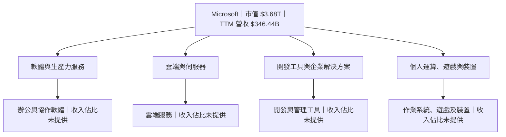
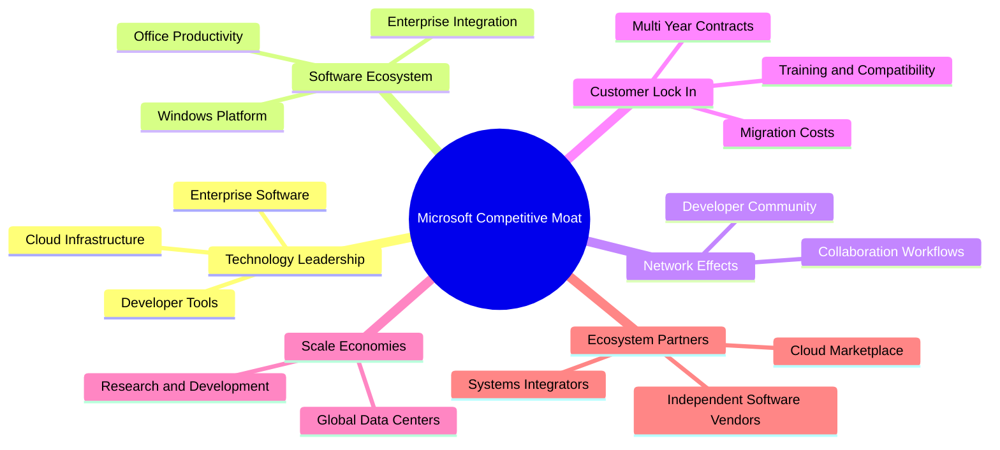
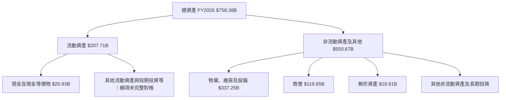
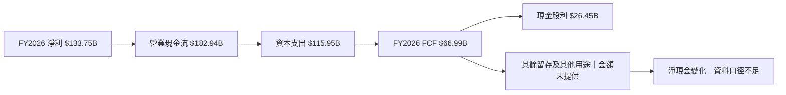
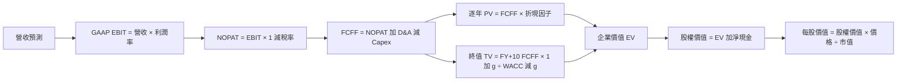
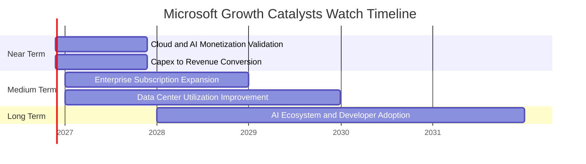
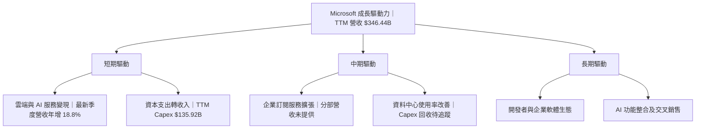
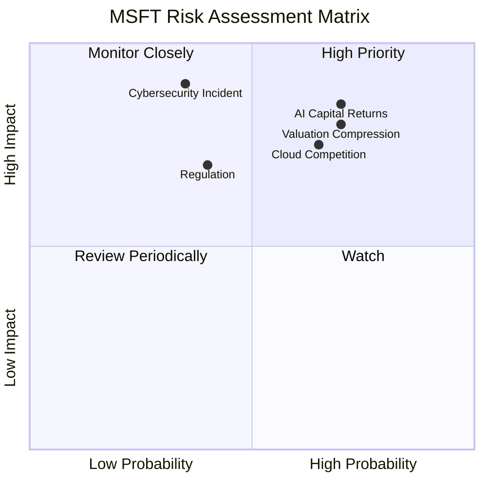
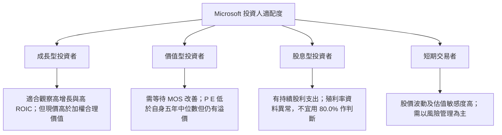

# MSFT 基本面深度分析報告

> **報告日期**：2026-11-25 ｜ **語言**：繁體中文 ｜ **數據來源**：SEC 申報資料 (XBRL)、Yahoo Finance、Finviz、StockAnalysis、Roic.ai ｜ **分析師**：CFA 級機構研究  
> **價格基準**：2026-11-24 收盤價 **$496.13**。美元金額以 USD 計；B 為十億美元。

## 目錄

| # | 章節 | 核心結論 |
|---|------|----------|
| 1 | 執行摘要 | 減碼；加權合理價值 $432.70；MOS -14.7% |
| 2 | 公司概覽與商業模式 | 軟體、雲端與企業生態提供高轉換成本；分部營收資料未提供 |
| 3 | 損益表深度分析 | TTM 營收 $346.44B、年增 17.9%；TTM 營業利益率 47.1% |
| 4 | 資產負債表分析 | VERIFIED figures 顯示淨現金 $29.03B；現金轉換週期 -67 天 |
| 5 | 現金流量深度分析 | TTM FCF $59.96B；高資本支出令 FCF 低於營業現金流 |
| 6 | 獲利能力與資本效率 | ROIC 29.7% 高於 WACC 10.02%，仍在創造股東價值 |
| 7 | 相對估值分析 | 估值低於自身五年中位數，但高於同業部分倍數 |
| 8 | DCF 內在價值評估 | DCF 基準 $377.02；加權合理價值 $432.70 |
| 9 | 成長催化劑 | 雲端、AI、企業軟體可支撐增長；TAM 數據未提供 |
| 10 | 風險矩陣 | AI 資本支出回報、雲端競爭及估值壓縮為主要風險 |
| 11 | 投資建議 | 依 MOS 評級減碼；留意約 $389.43 以下的 10% MOS 價位 |

## 1. 執行摘要

### 1.0 一頁式投資儀表板

| 項目 | 內容 |
|------|------|
| **投資論點（3 句）** | ① TTM 營收 $346.44B、年增 17.9%，最新單季年增 18.8%，業務增長仍具韌性。② TTM 營業利益率 47.1%、ROIC 29.7% 對比 WACC 10.02%，顯示資本回報仍高於資金成本。③ TTM FCF 為 $59.96B、FCF Yield 1.63%，而現價高於加權合理價值，估值限制短期回報。 |
| **綜合評分** | **7.6/10**（引用 1.1 評分卡） |
| **財務健康** | 🟢 VERIFIED figures 顯示淨現金 $29.03B；Piotroski F-Score 6/9，流動比率年度比較未通過。 |
| **ROIC vs WACC** | 29.7% vs 10.02%；🟢 ROIC 高於 WACC 19.68 個百分點，創造經濟價值。 |
| **FCF 趨勢** | FY2026 年 FCF $66.99B，低於 FY2025 的 $71.61B；TTM FCF $59.96B，FCF Yield 1.63%。資本支出快速增加是主要壓力。 |
| **估值** | Forward P/E 20.50x ｜ EV/EBITDA 18.2x ｜ FCF Yield 1.63% |
| **DCF 內在價值（基準）** | $377.02 ｜現價相對 DCF 溢價 **31.6%**（現價 ÷ DCF 價值 − 1） |
| **安全邊際（MOS）** | **-14.7%**＝($432.70 − $496.13) ÷ $432.70｜🔴 加權合理價值低於現價 |
| **預期報酬（基準情境 12M）** | DCF 基準情境相對現價 **-24.0%**；此為模型情境價值的價格差，不是保證的 12 個月報酬。 |
| **關鍵風險（前二）** | AI／資料中心資本支出回報低於預期；雲端業務成長與定價競爭加劇。 |
| **評級 + 信心度** | 🟠 **減碼**（MOS 對應規則 20）；信心：中。DCF 終值佔 EV 67.4%，估值對長期假設敏感。 |

### 1.1 綜合評分卡

| 維度 | 評分（1–10） | 主要依據（引用數字與其來源章節） |
|------|--------------|----------------------------------|
| 成長性 | 8.0 | TTM 營收成長 17.9%，最新一季年增 18.8%（第 3 章）；FY2026 年營收年增 17.8%。 |
| 獲利能力 | 9.0 | TTM 營業利益率 47.1%、ROIC 29.7% 高於 WACC 10.02%、F-Score 6/9（第 3、6 章）。 |
| 財務健康 | 8.5 | VERIFIED figures 淨現金 $29.03B；CCC -67 天；但 F-Score 的流動比率比較未通過（第 4、6 章）。 |
| 估值 | 4.0 | MOS -14.7%；DCF $377.02 低於現價；但 P/E 25.9x 低於自身五年中位數 31.5x（第 7、8 章）。 |
| 護城河 | 9.0 | TTM 毛利率 67.7%、營業利益率 47.1%，兼具企業軟體生態與高轉換成本（第 2、3 章）。 |
| 管理層與資本配置 | 7.0 | FY2026 SBC $12.40B、股利支出 $26.45B；稀釋股數測試通過，但資本支出升至 $115.95B（第 3、5 章）。 |
| **綜合評分** | **7.6** | 六項算術平均：(8.0 + 9.0 + 8.5 + 4.0 + 9.0 + 7.0) ÷ 6 = 7.58，四捨五入為 7.6。 |

### 1.2 五大投資論點 + 三大核心風險

| 類型 | 項目 | 具體依據 | 信心度 |
|------|------|----------|--------|
| 🟢 **投資論點①** | 企業軟體與雲端帶動持續成長 | TTM 營收 $346.44B，TTM 年增 17.9%；最新一季年增 18.8%。 | 🟢 高 |
| 🟢 **投資論點②** | 高營業槓桿與利潤率 | TTM 營業利益率 47.1%，最新季度營業利益率 49.8%（VERIFIED latest quarter）。 | 🟢 高 |
| 🟢 **投資論點③** | 投資回報高於資金成本 | ROIC 29.7%，WACC 10.02%，利差 19.68 個百分點。 | 🟢 高 |
| 🟢 **投資論點④** | 淨現金及負營運資金週期 | 淨現金 $29.03B；CCC -67 天，供應商付款週期長於收款及存貨週期。 | 🟢 高 |
| 🟢 **投資論點⑤** | 自身歷史估值不在高分位 | P/E 25.9x，低於五年中位數 31.5x；EV/EBITDA 18.2x，低於五年中位數 24.3x。 | 🟡 中 |
| 🟡 **風險①** | AI 投資回報及資本密集度 | TTM Capex $135.92B，約為 TTM 營收的 39.2%；若新增算力不能轉為收入，FCF 可能持續受壓。 | 🟡 中 |
| 🔴 **風險②** | 市場價格高於估值基準 | 加權合理價值 $432.70，低於現價 $496.13；MOS -14.7%。 | 🔴 高 |
| 🟡 **風險③** | 同業競爭及雲端價格壓力 | GOOG、ORCL 最新季度營收成長分別為 24.7%、29.6%；若 MSFT 成長放緩，估值溢價難以維持。 | 🟡 中 |

### 1.3 快速統計卡片

| 指標 | 公司實際值（期間） | 同業中位數 | 狀態 |
|------|--------------------|------------|------|
| 營收成長（TTM） | **17.9%** | — | 🟢 |
| 營收成長（最新一季年增） | **18.8%** | 24.7% | 🟡 |
| 毛利率（TTM） | **67.7%** | 60.9% | 🟢 |
| 營業利益率（TTM） | **47.1%** | — | 🟢 |
| ROIC（TTM） | **29.7%** | — | 🟢 |
| Forward P/E | **20.5x** | 18.1x | 🟡 |
| FCF Yield（TTM） | **1.63%** | — | 🔴 |
| Piotroski F-Score | **6 / 9** | — | 🟡 |

> 同業中位數依 GOOG、AMZN、ORCL 的 Peer multiples 計算；季度營收成長中位數為 24.7%。

### 1.4 投資結論

╔══════════════════════════════════════════════════════════════════╗  
║                    📊 投資結論摘要                               ║  
╠══════════════════════════════════════════════════════════════════╣  
║  評級：減碼（MOS = -14.7%，符合規則 20）                         ║  
║  價格（2026-11-24 收盤）：$496.13                                ║  
║  DCF 內在價值（基準）：$377.02（現價溢價 31.6%）                 ║  
║  安全邊際 MOS：-14.7%（＝(加權合理價值−現價)÷加權合理價值）     ║  
║  加權合理價值（8.8）：$432.70                                    ║  
║  DCF 情境價值：                                                   ║  
║    悲觀情境：$178.41（相對現價 -64.0%）                          ║  
║    基準情境：$377.02（相對現價 -24.0%）                          ║  
║    樂觀情境：$730.27（相對現價 +47.2%）                          ║  
║  綜合評分：7.6/10（引用 1.1）                                    ║  
║  適合投資人：已持有且重視高品質企業的長線投資者；新資金宜等待估值║  
║  回落或現金流轉化改善後再評估。                                  ║  
╚══════════════════════════════════════════════════════════════════╝

## 2. 公司概覽與商業模式

### 2.1 業務結構與收入來源

公司總營收 TTM 為 $346.44B，FY2026 年度營收 $331.84B，市值 $3.68T。財務資料未提供 Productivity and Business Processes、Intelligent Cloud、More Personal Computing 等分部營收及佔比，因此不以推估比例繪製分部圖；下圖僅呈現已知公司層級數據與業務類型，不代表收入比例。

業務模式由軟體授權、訂閱服務、雲端使用量與企業支援服務共同構成。訂閱與雲端服務若持續提高收入比重，能增加收入可預測性；但分部收入資料未提供，無法量化各業務的營收貢獻或利潤差異。

### 2.2 市場份額

市場份額數據未提供，故不繪製市占率圖表，也不填入未經來源支持的比例。MSFT TTM 營收 $346.44B、年增 17.9%，規模顯著；同業最新季度營收成長中位數為 24.7%，顯示其規模優勢並不代表每個競爭市場都具較快增速。

### 2.3 競爭護城河分析

### 2.4 護城河強度

| 護城河項目 | 強度（強／中／弱） | 證據（引用數字或事實） | 會削弱它的情況 |
|------------|--------------------|------------------------|----------------|
| 技術與產品能力 | 強 | FY2026 研發支出 $35.56B；TTM 營業利益率 47.1%。 | AI 或雲端產品性能、成本效益落後主要競爭者。 |
| 軟體生態系統 | 強 | 多元產品涵蓋作業系統、企業應用、開發工具、雲端與遊戲；營收來源分散於多類產品。 | 客戶由整合平台轉向更低成本或開放替代方案。 |
| 網路效應 | 中至強 | 協作、開發與企業工作流程互通能提高採用價值；量化使用者資料未提供。 | 互通標準改變，或新平台快速建立替代生態。 |
| 客戶鎖定 | 強 | 企業系統遷移、員工訓練及相容性形成轉換成本；CCC -67 天反映營運模式議價能力，但不是直接的客戶留存指標。 | 雲端多供應商策略降低轉換障礙，或監管要求促進互通。 |
| 規模效應 | 強 | TTM 營收 $346.44B、FY2026 Capex $115.95B，具全球投入能力。 | 算力投資回報不足，或固定成本增加快於營收。 |
| 生態夥伴 | 中至強 | 產品涉及企業客戶、開發者、系統整合商及軟體供應商；夥伴營收與數量未提供。 | 競爭平台提供更具吸引力的分潤或部署模式。 |

1.1「護城河」評分為 **9.0/10**，依據是廣泛的軟體生態、企業轉換成本及 47.1% TTM 營業利益率；未評滿分是因市場份額、客戶留存和分部經濟性資料不足以量化驗證。

## 3. 損益表深度分析

### 3.1 年度收入成長趨勢（近 4 年）

年度營收以財務資料所列 FY2023–FY2026 為準。FY2026 年增率按年度營收計算；金額採 $B、成長率取一位小數。

╔══════════════════════════════════════════════════════════════════╗  
║              Microsoft 年度收入趨勢（FY2023-FY2026）             ║  
╠══════════════════════════════════════════════════════════════════╣  
║  FY2023  $211.91B  █████████████░░░░░░░░░░░  YoY：+14.9% 🟢     ║  
║  FY2024  $245.12B  ███████████████░░░░░░░░░  YoY：+15.7% 🟢     ║  
║  FY2025  $281.72B  █████████████████░░░░░░░  YoY：+14.9% 🟢     ║  
║  FY2026  $331.84B  ████████████████████░░░░░  YoY：+17.8% 🟢     ║  
╠══════════════════════════════════════════════════════════════════╣  
║  FY2023–FY2026 CAGR = (331.84 ÷ 211.91)^(1÷3) − 1 = 16.1%       ║  
╚══════════════════════════════════════════════════════════════════╝

FY2026 營收成長加速至 17.8%，較 FY2025 的 14.9% 高 2.9 個百分點；與 TTM 成長 17.9% 接近。收入增加可能受雲端、訂閱服務及企業軟體需求推動，但分部營收未提供，無法把增量精確歸因至特定業務。

### 3.2 季度收入趨勢分析

QoQ 為該季相對前一季；YoY 採資料所列同季年增率。最近四季資料包括 2025-12-31 至 2026-09-30。

| 季度 | 營收（$B） | QoQ 成長 | YoY 成長 | 備註 |
|------|-----------:|---------:|---------:|------|
| 2025-12-31 | 81.27 | N/A（此前季度未列於季度摘要表） | 16.72% | 季營收較 2025-09-30 的 $77.67B 增加。 |
| 2026-03-31 | 82.89 | 2.0% | 18.30% | QoQ = (82.89 ÷ 81.27) − 1。 |
| 2026-06-30 | 90.01 | 8.6% | 17.75% | 財年第四季營收上升；季度營收有季節性，不宜將 QoQ 直接年化。 |
| 2026-09-30 | 92.28 | 2.5% | 18.80% | YoY 18.8% 為單季成長率，不是 TTM 成長率。 |

最新季度的營收年增率高於 TTM 成長率 0.9 個百分點，表示近期成長尚未明顯降速。2026-09-30 季度營業利益為 $45.92B、淨利 $36.63B；與前季相比，營業利益 QoQ 增加約 13.1%，但季度利潤受收入結構與費用時點影響。

### 3.3 利潤率演變分析

| 利潤率指標 | FY2023 | FY2024 | FY2025 | FY2026 | 趨勢 | 評估 |
|------------|-------:|-------:|-------:|-------:|------|------|
| **毛利率** | 68.9% | 69.8% | 68.8% | 68.0% | 近兩年回落 | 🟡 |
| **營業利益率** | 41.8% | 44.6% | 45.6% | 46.8% | 逐年擴張 | 🟢 |
| **淨利率** | 34.2% | 36.0% | 36.1% | 40.3% | FY2026 明顯提升 | 🟢 |

計算方式：FY2026 毛利率 = $225.47B ÷ $331.84B = 68.0%；營業利益率 = $155.24B ÷ $331.84B = 46.8%；淨利率 = $133.75B ÷ $331.84B = 40.3%。FY2026 年毛利率低於 FY2025 的 68.8%，但營業利益率仍上升約 1.2 個百分點，反映營業費用增速相對收入較低、營業槓桿改善。毛利率回落可能與產品組合及基礎設施成本相關，但分部成本資料未提供，無法確認單一原因。

**資料口徑提示：**年度財報序列所算 FY2026 營業利益率為 46.8%；VERIFIED TTM 統計為 47.1%，兩者因期間口徑不同，不互相替代。另一般財務摘要列示最新季度營業利益率 47.1%，而 VERIFIED latest quarter 為 49.8%；本文以指定 VERIFIED figures 的 49.8% 作為該項季度指標，並不以摘要欄位覆蓋它。

### 3.4 費用結構分析

費用金額資料中，FY2026 的毛利、營業利益及研發支出均有提供，但銷售與管理費用、其他營業費用明細未完整提供；因此不繪製會讓費用分類無法加總的圓餅圖。

╔══════════════════════════════════════════════════════════════════╗  
║ FY2026 已披露的部分費用／損益觀察                              ║  
╠══════════════════════════════════════════════════════════════════╣  
║ 營收 $331.84B｜毛利 $225.47B｜營業利益 $155.24B                 ║  
║ 研發支出 $35.56B，占營收 10.7%                                  ║  
║ 毛利減營業利益 $70.23B，包含未細分營業費用，非單一費用科目      ║  
╚══════════════════════════════════════════════════════════════════╝

FY2026 研發支出由 FY2025 的 $32.49B 增至 $35.56B，年增 9.4%，低於同期營收 17.8% 的增速，研發費用佔營收比例因而下降；但這不能單獨證明所有成本控制改善，需配合完整費用科目判讀。

### 3.5 季度 EPS 趨勢與盈餘品質（Quality of Earnings）

#### 過去四季 EPS 表現

| 季度 | EPS 實際值 | YoY 成長 | 超預期／不及預期 |
|------|-----------:|---------:|------------------|
| 2025-12-31 | $5.16 | 59.75% | N/A（EPS 預估與驚喜值缺失） |
| 2026-03-31 | $4.27 | 23.41% | N/A（EPS 預估與驚喜值缺失） |
| 2026-06-30 | $4.81 | 31.74% | N/A（EPS 預估與驚喜值缺失） |
| 2026-09-30 | $4.92 | 32.26% | N/A（EPS 預估與驚喜值缺失） |

資料庫列出的四季 EPS estimate 均為 NaN，故不能判斷超預期或不及預期，也不能杜撰原因。EPS YoY 增長則依 StockAnalysis 季度資料引用，最新季度年增 32.26%。

#### 盈餘品質量化

| 盈餘品質項目 | 數值／佔比 | 評估 |
|--------------|-----------|------|
| 股權薪酬 SBC / 營收 | FY2026：$12.40B ÷ $331.84B = **3.7%** | 🟡 SBC 是實際股東成本；若回購僅抵消稀釋，並非完全等同於創造每股價值。 |
| SBC / 營業現金流 | FY2026：$12.40B ÷ $182.94B = **6.8%** | 🟡 比重可觀，但低於營業現金流一成。 |
| FCF / 淨利（現金轉換率） | TTM：$59.96B ÷ $142.63B = **42.0%** | 🔴 低於 100%；主要需結合 TTM Capex $135.92B 判斷，並非僅由應計項目造成。 |
| 一次性／非經常性損益 | N/A（缺少足夠分項資料） | 無法判斷是否有一次性損益美化或壓低當期盈餘。 |
| 有效稅率異常 | 最近年度有效稅率 19.4% | 🟢 DCF 採 19.4%；未有充分證據認定異常，但歷年稅率會波動。 |
| 資本化支出 vs 費用化 | FY2026 Capex $115.95B；資本化政策明細 N/A | Capex 代表大量投入先列資產並於未來折舊，若投資回報不足，經濟成本會晚於現金流出體現。 |

TTM FCF 轉換率僅 42.0%，而 FY2026 年度 FCF $66.99B；資料中年度 FCF 與 TTM FCF 期間不同，不應混為一談。當前 FCF 轉換主要受資料中心等資本支出增加壓抑；GAAP 營業利益已將 SBC 列為費用，但 FCF 本身仍受資本投資週期影響。整體盈餘有高毛利與經營獲利支撐，現金轉化暫時較弱，未能僅憑資料確認一次性收益影響。

## 4. 資產負債表分析

### 4.1 資產結構分解

以下採 FY2026 年度資產負債表總資產 $758.38B；各細項來自年度資產負債表資料，數字為已列資料，不代表所有項目均已完整呈現。

### 4.2 流動性與營運資金分析

VERIFIED figures 的流動資產及負債指標與營運資金天數依指定來源引用。另一年度摘要列示 FY2026 流動比率約 1.23；由於兩者口徑或期末日不同，不以衍生計算覆蓋 QUALITY figures。

| 指標 | 最新 TTM | 一年前 TTM | 變化 | 解讀 |
|------|---------:|----------:|------:|------|
| DSO 應收帳款天數 | 65 天 | 66 天 | -1 天 | 收款週期略縮短，收款效率沒有惡化跡象。 |
| DIO 存貨天數 | 6 天 | 4 天 | +2 天 | 存貨天數增加，但絕對值仍低；需注意硬體與設備備貨變化。 |
| DPO 應付帳款天數 | 139 天 | 130 天 | +9 天 | 付款期延長，可能反映規模、採購安排或供應商條件；不能單憑天數認定議價力提升。 |
| CCC 現金轉換週期 | -67 天 | -59 天 | -8 天 | 負週期進一步擴大，企業先收現、後付款的營運特性有利現金流。 |

最新 TTM 流動資產資料可得值為 $186.14B，總資產 $779.40B（季度餘額口徑）；FY2026 年報則列流動資產 $207.71B、總資產 $758.38B。因報表日期不同，應以相同期間比較，不能把兩組數字混算。

### 4.3 債務結構分析

**債務口徑注意：**VERIFIED figures 計算的總債務 $35.48B、現金及短期投資 $64.51B、淨現金 $29.03B，優先作為本報告的財務健康及 DCF 淨現金依據。資料其他部分另列總債務 $133.93B 及淨負債 $69.42B，與 VERIFIED 口徑不一致；下圖不混用後者計算淨現金，也不推導未提供的 Debt/EBITDA 或利息保障倍數。

╔══════════════════════════════════════════════════════════════════╗  
║                   Microsoft 債務健康診斷                        ║  
╠══════════════════════════════════════════════════════════════════╣  
║  總債務（VERIFIED）：       $35.48B                              ║  
║  現金及短期投資：           $64.51B                              ║  
║  淨現金：                   $29.03B  🟢                          ║  
║  Debt/EBITDA：              N/A（資料口徑不一致，未採用）         ║  
║  利息保障倍數：             N/A（利息費用未提供）                 ║  
║  流動性觀察：               FY2026 流動比率約 1.23                ║  
╚══════════════════════════════════════════════════════════════════╝

### 4.4 股東權益趨勢

| 財年 | 股東權益（$B） | YoY 變化 |
|------|---------------:|---------:|
| FY2023 | 206.22 | — |
| FY2024 | 268.48 | +30.2% |
| FY2025 | 343.48 | +27.9% |
| FY2026 | 442.39 | +28.8% |

股東權益三年持續增加，FY2023–FY2026 CAGR 約 29.0%。其中淨利留存是重要來源；股利與回購等資本配置、其他綜合損益及併購會影響權益變動，完整權益變動表未在此提供，故不將成長全部歸因於單一因素。

## 5. 現金流量深度分析

### 5.1 現金流量瀑布圖

可用資料支持 FY2026 淨利、營業現金流、Capex、FCF、股利；回購支出及淨現金變化未提供，因此不以未披露金額填補瀑布。

### 5.2 FCF 轉換率趨勢

| 財年 | 淨利（$B） | FCF（$B） | FCF／淨利 | 評估 |
|------|-----------:|---------:|----------:|------|
| FY2023 | 72.36 | 59.48 | 82.2% | 現金轉換尚可。 |
| FY2024 | 88.14 | 74.07 | 84.0% | 相對穩定。 |
| FY2025 | 101.83 | 71.61 | 70.3% | FCF 增幅落後淨利，資本投入增加。 |
| FY2026 | 133.75 | 66.99 | 50.1% | 淨利快速上升，但高 Capex 壓低 FCF。 |

FY2026 營業現金流 $182.94B，較 FY2025 $136.16B 增長 34.4%；Capex 同期由 $64.55B 升至 $115.95B，增長 79.6%。因此 FCF 由 $71.61B 降至 $66.99B，下降 6.5%。經營現金生成改善，但當期現金被大規模資本投資吸收；投資的關鍵問題是未來資料中心利用率與雲端收入能否覆蓋折舊及資金成本。

### 5.3 自由現金流趨勢

╔══════════════════════════════════════════════════════════════════╗  
║                 自由現金流趨勢（年度）                           ║  
╠══════════════════════════════════════════════════════════════════╣  
║  FY2023  $59.48B  ████████████████░░░░░  YoY：資料未提供        ║  
║  FY2024  $74.07B  ████████████████████░  YoY：+24.5%             ║  
║  FY2025  $71.61B  ███████████████████░░  YoY：-3.3%              ║  
║  FY2026  $66.99B  ██████████████████░░░  YoY：-6.5%              ║  
╠══════════════════════════════════════════════════════════════════╣  
║  TTM FCF：$59.96B｜TTM FCF Yield：1.63%                           ║  
║  年度 FCF 回落與 Capex 增長快於營收及營業現金流相關。             ║  
╚══════════════════════════════════════════════════════════════════╝

年度 FCF 的下降不等於核心獲利同步走弱，但會降低股東可分配現金及 FCF Yield。FY2026 年股利支付 $26.45B，約占年度 FCF 39.5%；該比例尚未包含回購等其他資本配置。

### 5.4 資本配置評估

FY2026 已知資本配置項目：Capex $115.95B、股利 $26.45B、研發費用 $35.56B、SBC $12.40B。研發費用為損益表支出，與現金資本配置不同；各項可能重疊於不同財務報表位置，不適合繪製加總為 100% 的資本配置圓餅圖。回購金額、併購支出及留存現金用途未完整提供。

| 配置項目 | FY2026 數值 | 解讀 |
|----------|-----------:|------|
| 資本支出 | $115.95B | 占營收約 34.9%；大幅擴張基礎設施，提升未來供給能力，也形成回報風險。 |
| 現金股利 | $26.45B | 對股東提供持續現金回饋；以年度 FCF 計約 39.5%。 |
| 研發費用 | $35.56B | 占營收 10.7%；支援產品迭代與技術投入。 |
| SBC | $12.40B | 非現金薪酬，但會造成經濟稀釋成本。 |
| 股票回購 | N/A | 資料未提供可一致核對的年度回購金額。 |

## 6. 獲利能力與資本效率

### 6.1 ROE／ROA／ROIC 趨勢

| 指標 | 最新資料 | 歷史資料 | 評估 |
|------|---------:|---------|------|
| ROE | QUALITY figures：30.3%（TTM，期末餘額杜邦口徑） | 其他資料摘要列示 34.2%，口徑不同 | 以指定 QUALITY figure 30.3% 作杜邦分析；年度口徑不可直接混用。 |
| ROA | 14.4%（另一財務摘要） | Piotroski 測試顯示 TTM ROA 高於一年前 | 🟢 資產獲利為正且改善。 |
| ROIC | 29.7%（TTM） | Roic.ai 顯示長期資本回報有波動；期間與定義未完整對齊 | 🟢 高於資金成本。 |

沒有可比的行業均值資料，故不列行業均值欄。ROIC 採 VERIFIED figures 的明確定義：稅後營業利益 ÷（權益 + 債務 − 現金）。

### 6.2 ROIC vs WACC 分析（核心價值創造判斷）

╔══════════════════════════════════════════════════════════════════╗  
║                 ROIC vs WACC 深度分析                           ║  
╠══════════════════════════════════════════════════════════════════╣  
║  資本成本（VERIFIED Cost of capital）：                           ║  
║  ├── 無風險利率 Rf（10Y 美債）：       4.90%                     ║  
║  ├── 市場風險溢酬 ERP：                5.00%                     ║  
║  ├── Beta（raw）：                     1.04                      ║  
║  ├── Beta used（adjusted）：            1.03                      ║  
║  ├── 股權成本 Ke：                     10.05%                    ║  
║  ├── 稅前債務成本：                    8.60%                     ║  
║  ├── 有效稅率：                        19.4%                     ║  
║  ├── 股權／債務權重：                  99.0%／1.0%               ║  
║  └── ✅ WACC：                         10.02%                    ║  
║                                                                  ║  
║  ROIC（TTM）：                         29.7%                     ║  
║  EVA spread：29.7% − 10.02% =          +19.68 個百分點           ║  
║  ROIC / WACC：29.7% ÷ 10.02% =         2.96 倍                   ║  
╚══════════════════════════════════════════════════════════════════╝

CAPM 的 Beta 調整方式：adjusted Beta = ⅔ × 1.04 + ⅓ × 1 = 1.0267，四捨五入為 1.03。股權成本的檢核為：

$$K_e = 4.90\% + 1.03 \times 5.00\% = 10.05\%$$

WACC 依提供的已計算資本權重與成本：

$$WACC = 99.0\% \times 10.05\% + 1.0\% \times 8.60\% \times (1-19.4\%)$$
$$= 9.9495\% + 0.0693\% = 10.0188\% \approx 10.02\%$$

VERIFIED figures 未提供各組成權重所用的市值與與成本計算一致的計息負債明細；因此直接採用資料列示的 99.0%／1.0% 及 10.02%，不以其他債務口徑重建 WACC。ROIC 比 WACC 高 19.68 個百分點，代表目前投入資本的經營回報高於資金成本，創造而非摧毀股東價值。需注意，這是歷史 TTM 回報，不保證新增 AI 基建也能取得同等回報。

### 6.3 杜邦三因素分解

| 因素 | 數值（TTM） | 解讀 |
|------|-------------|------|
| 淨利率 | 41.2% | 高淨利率是 ROE 的主要來源，反映軟體與服務的獲利結構。 |
| 資產週轉率 | 0.44 | 資產週轉率相對低於淨利率對 ROE 的貢獻；新建資料中心等資產投入會擴大資產基礎。 |
| 權益乘數 | 1.66 | 財務槓桿並非極端；ROE 不主要依賴高槓桿。 |
| **ROE** | **30.3%** | **41.2% × 0.44 × 1.66 = 30.1%**，與 QUALITY figures 報列 30.3% 有四捨五入及底層精度差異；應以來源列示的 ROE 30.3% 為準。 |

### 6.4 財務體質：Piotroski F-Score

Piotroski F-Score 為 **6/9**；九項測試均有列示。

| 測試 | 結果 | 解讀 |
|------|------|------|
| ROA > 0 | ✅ 通過 | 公司持續有正資產報酬。 |
| 營業現金流 > 0 | ✅ 通過 | TTM 營業現金流 $195.88B。 |
| ROA 高於一年前 | ✅ 通過 | 資產獲利能力改善。 |
| 營業現金流 > 淨利 | ✅ 通過 | 來源期間與口徑下營業現金流高於淨利，支持應計品質。 |
| 長期負債 ÷ 總資產低於一年前 | ✅ 通過 | 相對負債負擔改善。 |
| 流動比率高於一年前 | ❌ 未通過 | 短期流動性相對一年前下降，雖不等同流動性危機，仍需追蹤。 |
| 稀釋股數未增加 | ✅ 通過 | 稀釋股數測試通過，代表期間淨股數未增加。 |
| 毛利率高於一年前 | ❌ 未通過 | 毛利率相對一年前下降，可能受成本或產品組合影響。 |
| 資產週轉率高於一年前 | ❌ 未通過 | 資產基礎增加可能快於收入，需觀察新增資產利用率。 |

6/9 顯示經營及現金流基礎良好，但毛利率、資產週轉及流動比率三項未通過；其中資產週轉下降與高 Capex 投資期相符，後續應以新增產能的收入轉化驗證。

## 7. 相對估值分析

### 7.1 同業估值比較表格

同業數據取 Yahoo Finance Peer multiples；中位數按 GOOG、AMZN、ORCL 三家公司計算。MSFT 本身數字按提供的市場估值及 VERIFIED multiples 引用。

| 估值指標 | **MSFT** | **GOOG** | **AMZN** | **ORCL** | MSFT 評估 |
|----------|---------:|--------:|--------:|--------:|-----------|
| **Trailing P/E** | 25.9x | 14.4x | 20.4x | 17.2x | 🔴 高於三家同業；需由更高獲利穩定性支撐。 |
| **Forward P/E** | 20.5x | 18.1x | 23.1x | 9.9x | 🟡 高於同業中位數 18.1x，低於 AMZN。 |
| **P/S Ratio** | 10.7x | 7.2x | 3.4x | 4.8x | 🔴 顯著高於同業中位數 4.8x，市場給予品質溢價。 |
| **EV/EBITDA** | 18.2x | 17.8x | 15.9x | 13.6x | 🟡 高於同業中位數 15.9x。 |
| **最新季度營收 YoY** | 18.8% | 24.7% | 12.1% | 29.6% | 🟡 增速高於 AMZN、低於 GOOG 與 ORCL。 |
| **毛利率（TTM）** | 67.7% | 60.9% | 51.4% | 64.0% | 🟢 高於三家同業，提供估值溢價的基本面依據。 |

Peer multiples 顯示 MSFT 並非絕對低估：其 P/S、Trailing P/E 及 EV/EBITDA 高於同業中位數。產品組合和毛利率有助解釋溢價，但若增長降至同業以下，估值收斂風險將增加。

### 7.2 歷史估值區間分析

╔══════════════════════════════════════════════════════════════════╗  
║                MSFT 五年歷史估值區間（TTM）                      ║  
╠══════════════════════════════════════════════════════════════════╣  
║ P/E：       20.8x ───── ●25.9x ───── 中位數 31.5x ───── 37.8x   ║  
║ P/E 百分位：目前第 14 百分位                                     ║  
║ P/S：       8.4x ───── ●10.7x ─── 中位數 12.0x ───── 13.7x     ║  
║ P/S 百分位：目前第 33 百分位                                     ║  
║ EV/EBITDA：14.5x ─ ●18.2x ───── 中位數 24.3x ───── 31.4x      ║  
║ EV/EBITDA 百分位：目前第 10 百分位                               ║  
╚══════════════════════════════════════════════════════════════════╝

估值相對自身五年歷史處於偏低位置，尤其 EV/EBITDA 為第 10 百分位；但「低於自身歷史」不等於低於內在價值。DCF 與加權估值仍低於市價，顯示獲利品質與市場估值位置需分開判斷。

### 7.3 情境價值（Bear / Base / Bull）

以下情境完全引用 DCF MODEL 的 Scenarios。基準期末營業利潤率 45.6% 是十年模型 FY+10 假設；悲觀、樂觀情境的終值營業利潤率及 WACC 亦依模型原值引用。

| 情境 | 第 1 年營收成長 | 期末營業利潤率 | WACC | 每股價值 | 相對現價 | 機率 | 會發生的條件 |
|------|----------------:|---------------:|-----:|---------:|---------:|-----:|--------------|
| 🔴 悲觀 | 9.0% | 38.8% | 11.02% | $178.41 | -64.0% | 25% | 雲端與 AI 需求放緩、資本投資回報不足，且競爭壓縮營業利潤率。 |
| 🟡 基準 | 17.9% | 45.6% | 10.02% | $377.02 | -24.0% | 50% | TTM 增速作為起點並逐步衰減，利潤率向長期歷史中位數收斂。 |
| 🟢 樂觀 | 26.9% | 50.2% | 9.02% | $730.27 | +47.2% | 25% | AI 需求與雲端變現超出基準，且更低風險折現率與營業槓桿同時成立。 |

情境機率是模型列示權重，不是客觀事件機率。樂觀情境需要增長、利潤率與 WACC 同時優於基準，具有多項條件疊加特徵。

### 7.4 相對估值隱含價格區間

╔══════════════════════════════════════════════════════════════════╗  
║               估值方法隱含每股價值（美元）                       ║  
╠══════════════════════════════════════════════════════════════════╣  
║ $377.02 ───── $432.70 ───── $496.13 ───── $637.36 ───── $730.27║  
║ 基準 DCF       加權合理值      現價       分析師共識      樂觀 DCF ║  
╚══════════════════════════════════════════════════════════════════╝

| 方法 | 隱含每股價值 | 依據 |
|------|-------------:|------|
| DCF（基準） | $377.02 | 十年 FCFF、WACC 10.02%、永續成長率 3.0%。 |
| 同業 Forward P/E | $437.68 | GOOG、AMZN、ORCL 同業 Forward P/E 中位數 18.1x × Forward EPS $24.20。 |
| 同業 EV/EBITDA | $434.96 | 同業 EV/EBITDA 中位數 15.9x × TTM EBITDA，再加淨現金。 |
| 分析師共識目標價 | $637.36 | 54 位分析師平均目標價；屬參考值，不代表已實現的基本面現金流。 |

## 8. DCF 內在價值評估（Discounted Cash Flow）

### 8.0 估值推理鏈（Thinking Logic）

**Step 1 — 價值來源與主導變數**

MSFT 價值主要來自企業軟體與生產力工具的現金流底盤、雲端／AI 基礎設施的增長，以及開發者與企業生態延伸的產品價值；但分部營收比重未提供，不能把上述業務各自填入營收佔比。估值主導變數是長期 FCFF，尤其終值中的永續成長率與折現率：基準模型終值現值占 EV 67.4%，而敏感度表在 WACC 10.02% 時，g 由 2.0% 升至 4.0%，每股價值由 $343.55 升至 $421.60。

**Step 2 — 模型選擇**

| 決策點 | 本報告採用 | 理由（含數字） | 曾考慮但否決 | 否決理由 |
|--------|-----------|----------------|--------------|----------|
| 現金流定義 | FCFF | 以 EBIT 稅後、加回 D&A、減 Capex 計算，對應 WACC 折現得 EV。 | FCFE | 模型指定 FCFF 及 WACC，改用 FCFE 會改變模型口徑。 |
| 預測期 N | 10 年 | 模型指定十年；營收增速由 17.9% 線性降至 3.0%。 | 縮短至 5 年 | 會將更多價值壓至終值，且不符合既定模型。 |
| 終值方法 | Gordon Growth | 3.0% 永續成長低於 10.02% WACC，公式有效。 | 只用退出倍數 | DCF 模型未提供退出倍數法的終值數值，不自行改造模型。 |
| EBIT 基礎 | GAAP EBIT | DCF 註明使用 GAAP EBIT。 | 非 GAAP EBIT | 沒有模型支持加回 SBC。 |

**Step 3 — 假設推導鏈**

下列說明解釋模型設定及替代假設的限制；模型數值不另行調整。

- **營收增長**：錨點＝TTM 年增 17.9%，最新季度年增 18.8% → 調整＝以 TTM 增速起步，逐年線性降至 3.0%，反映成熟化 → **採用模型逐年成長率 17.9% 降至 3.0%** → 曾考慮全期維持 17.9%，但十年不衰減會忽略基數變大及市場成熟，模型未採用。
- **期末營業利潤率**：錨點＝TTM 47.1%；FY2022–FY2026 年度營業利益率約由 42.1% 上升至 46.8% → 調整＝在 FY+10 收斂至近五年中位數 45.6% → **採用 45.6%** → 曾考慮維持 47.1%，但模型以歷史中位數作較審慎的期末錨點。
- **永續成長率 g**：錨點＝模型指定 3.0%；長期成熟企業需低於 WACC → 調整＝無額外上調 → **採用 3.0%** → 不採用 4.0% 作基準，因 4.0% 會提高終值權重及估值敏感度。
- **預測期 N**：錨點＝模型指定 10 年 → 調整＝無 → **採用 10 年** → 未改成更短預測期，以免與模型計算結果不一致。
- **Capex／營收**：錨點＝TTM Capex／營收 39.2% → 調整＝假設比率逐步降至 1.1×D&A，即 12.2% → **FY+1 39.2% 線性降至 FY+10 12.2%** → 曾考慮長期維持 39.2%，但會把當前建設高峰外推十年，與模型的成熟化設定不同。
- **EBIT、SBC 與股數**：錨點＝模型以 GAAP EBIT，且聲明股數不再稀釋 → **採用組合 (A)：GAAP EBIT + 固定股數、不另扣 SBC、年稀釋率 0%** → 不採非 GAAP 加回或另加稀釋，避免重複扣除；SBC 費用已計入 GAAP EBIT。
- **有效稅率、D&A／營收**：錨點＝有效稅率 19.4%、D&A／營收 11.1%（TTM）；模型沿用該比率。
- **營運資金**：模型明確不建模營運資金；不自行加上 ΔWC 列或估算數字。
- **WACC**：錨點＝資本成本區塊列示 10.02% → 調整＝依指定值不作變更 → **採用 10.02%** → 不另用其他債務口徑重算，以維持與 ROIC 比較及模型一致。

**Step 4 — 最脆弱假設**

最脆弱的一環是長期現金流及終值假設：終值 PV 占 EV 67.4%；在基準 WACC 10.02% 下，g 由 3.0% 降至 2.0%，每股價值由 $377.02 降至 $343.55，若資本支出又高於模型淡出路徑，價值可能進一步下降。

**Step 5 — 計算路徑圖**

### 8.1 模型假設總表（Model Inputs）

| 假設項目 | 採用值 | 依據／來源 | 敏感度 |
|----------|--------|-------------|--------|
| 預測期長度 N | 10 年 | DCF MODEL 固定假設；跨越多個年度營收成長衰減。 | 🟡 中 |
| 營收成長 | FY+1 17.9%，FY+10 3.0%，逐年線性衰減 | TTM 年增 17.9% 起步；期末值為模型假設。 | 🔴 高 |
| 營業利潤率 | FY+1 47.1% → FY+10 45.6% | TTM 營業利潤率及近五年中位數。 | 🔴 高 |
| 有效稅率 | 19.4% | 最近年度有效稅率。 | 🟢 低 |
| Capex／營收 | FY+1 39.2% → FY+10 12.2% | TTM 比率淡出至 D&A 的 1.1 倍。 | 🔴 高 |
| D&A／營收 | 11.1% | TTM 比率，模型固定。 | 🟢 低 |
| 營運資金變動 | 未建模 | DCF MODEL 明列 working capital is not modelled；不另行估算。 | 🟢 低 |
| EBIT 基礎 | GAAP | 模型以 GAAP EBIT 預測。 | 🟡 中 |
| SBC 處理 | 組合 (A)：已含於 GAAP EBIT、不另扣 | 模型明列 SBC 已是費用、股數不再稀釋。 | 🟡 中 |
| 年稀釋率 | 0%（固定股數） | 與組合 (A) 相容；按模型固定股數處理。 | 🟡 中 |
| 永續成長率 g | 3.0% | DCF MODEL 假設，低於 WACC 10.02%。 | 🔴 高 |
| 終值方法 | Gordon Growth | DCF MODEL 公式為 FCFF×(1+g)/(WACC−g)。 | 🔴 高 |
| WACC | 10.02% | Cost of capital 的指定 WACC。 | 🔴 高 |

本模型採用 **(A) GAAP EBIT + 固定股數**，故 SBC 影響已計入一次；FCFF 不再扣 SBC、股數不逐年放大。FCFF 定義依模型為 `NOPAT + D&A − Capex`，營運資金不建模。

### 8.2 折現率推導（WACC）

╔══════════════════════════════════════════════════════════════════╗  
║                    WACC 推導（折現率）                           ║  
╠══════════════════════════════════════════════════════════════════╣  
║  股權成本 Ke（CAPM）：                                           ║  
║  ├── 無風險利率 Rf：                  4.90%                     ║  
║  ├── 市場風險溢酬 ERP：               5.00%                     ║  
║  ├── 原始 Beta：                      1.04                      ║  
║  ├── 調整後 Beta：                    1.03                      ║  
║  ├── 規模／國別溢酬：                 0.00%（未另加）           ║  
║  └── Ke = 4.90% + 1.03 × 5.00% =     10.05%                    ║  
║                                                                  ║  
║  債務成本：                                                      ║  
║  ├── 稅前 Kd：                        8.60%                     ║  
║  ├── 有效稅率：                      19.4%                     ║  
║  └── 稅後 Kd = 8.60% × (1−19.4%) =    6.93%                     ║  
║                                                                  ║  
║  資本權重：股權 99.0%｜債務 1.0%                                ║  
║  ✅ WACC = 99.0%×10.05% + 1.0%×6.93% = 10.02%                  ║  
╚══════════════════════════════════════════════════════════════════╝

WACC 五步複核：

1. **Ke（CAPM）**  
   $$K_e = 4.90\% + 1.03 \times 5.00\% = 10.05\%$$

2. **稅前 Kd**  
   Cost of capital 已列稅前債務成本 8.60%；利息費用及平均計息負債金額未提供，故不能獨立重算 `利息費用 ÷ 平均計息負債`，直接採用列示值。

3. **稅後 Kd**  
   $$K_d(1-T)=8.60\% \times (1-19.4\%)=8.60\% \times 80.6\%=6.9316\%\approx6.93\%$$

4. **權重**  
   股權權重 99.0%，債務權重 1.0%，合計 100.0%。資本成本資料未列出與 8.60% 同範圍的債務餘額及市值權重推導明細，故不虛構 E、D 金額；權重直接引用指定值。

5. **WACC**  
   $$WACC=99.0\%\times10.05\%+1.0\%\times6.93\%=9.9495\%+0.0693\%=10.0188\%\approx10.02\%$$

資料未提供 Rf 的精確觀察日期與 ERP 的外部來源，故按成本資本資料列示值使用；規模／國別溢酬未提供，採 0.00% 額外溢酬。此 WACC 與第 6.2 節完全相同。

### 8.3 逐年自由現金流預測（基準情境）

單位為 $B；折現因子採三位小數，金額採兩位小數。ΔWC 未列於模型，SBC 不另扣除。

| 年度 | FY+1 | FY+2 | FY+3 | FY+4 | FY+5 | FY+6 | FY+7 | FY+8 | FY+9 | FY+10 |
|------|-----:|-----:|-----:|-----:|-----:|-----:|-----:|-----:|-----:|------:|
| 營收 | 408.51 | 474.92 | 544.25 | 614.69 | 684.06 | 749.93 | 809.71 | 860.83 | 900.92 | 927.95 |
| 營收 YoY | 17.9% | 16.3% | 14.6% | 12.9% | 11.3% | 9.6% | 8.0% | 6.3% | 4.7% | 3.0% |
| 營業利潤率 | 47.1% | 46.9% | 46.8% | 46.6% | 46.4% | 46.3% | 46.1% | 46.0% | 45.8% | 45.6% |
| EBIT（GAAP） | 192.42 | 222.92 | 254.57 | 286.51 | 317.72 | 347.07 | 373.41 | 395.56 | 412.50 | 423.35 |
| − 稅（19.4%） | (37.32) | (43.24) | (49.38) | (55.57) | (61.63) | (67.32) | (72.43) | (76.72) | (80.01) | (82.11) |
| NOPAT | 155.10 | 179.69 | 205.20 | 230.94 | 256.09 | 279.75 | 300.98 | 318.84 | 332.49 | 341.24 |
| + D&A | 45.16 | 52.50 | 60.17 | 67.96 | 75.62 | 82.91 | 89.51 | 95.17 | 99.60 | 102.59 |
| − Capex | (160.27) | (172.04) | (180.78) | (185.69) | (186.07) | (181.43) | (171.53) | (156.47) | (136.66) | (112.84) |
| **FCFF** | **39.99** | **60.15** | **84.58** | **113.20** | **145.64** | **181.23** | **218.96** | **257.53** | **295.43** | **330.98** |
| 折現因子 | 0.909 | 0.826 | 0.751 | 0.682 | 0.620 | 0.564 | 0.512 | 0.466 | 0.423 | 0.385 |
| **FCFF 現值 PV** | **36.35** | **49.69** | **63.50** | **77.25** | **90.33** | **102.16** | **112.19** | **119.93** | **125.04** | **127.33** |

> 8.3 原始 DCF MODEL 列示 FY+10 PV 為 **127.33**，而依展示的四捨五入折現因子 0.385 直接相乘會得到約 127.43。後續 EV 及估值均依規則原值引用模型合計 **$903.78B**，不以表內四捨五入欄位重算替換。

**逐步演算（FY+1 代表年度）**

1. 營收：`346.44 × (1 + 17.9%) = 408.51B`。
2. EBIT：`408.51 × 47.1% = 192.42B`。
3. 稅：`192.42 × 19.4% = 37.32B`。
4. NOPAT：`192.42 − 37.32 = 155.10B`。
5. D&A：`408.51 × 11.1% = 45.16B`。
6. Capex：按模型 FY+1 Capex／營收假設 39.2%，`408.51 × 39.2% = 160.27B`。
7. ΔWC：模型未建模，故不列數值、不從其他項目反推。
8. FCFF：`155.10 + 45.16 − 160.27 = 39.99B`。
9. 折現及現值：`1 ÷ (1+10.02%)^1 ≈ 0.909`；`39.99 × 0.909 ≈ 36.35B`，採模型原始精度列示 PV。

預測期現值合計依模型原值為 **$903.78B**；以表格已四捨五入 PV 加總則為：

`36.35 + 49.69 + 63.50 + 77.25 + 90.33 + 102.16 + 112.19 + 119.93 + 125.04 + 127.33 = 903.77B`

與模型精度合計 $903.78B 相差 $0.01B，屬中間值四捨五入尾差。

**合理性自檢**

- FY+1 至 FY+10 FCFF 由 $39.99B 增至 $330.98B；預測期 FCFF CAGR = `(330.98 ÷ 39.99)^(1÷9) − 1 = 26.5%`。FY2023–FY2026 年度 FCF 由 $59.48B 降至 $66.99B，期間 CAGR 約 4.0%；預測增長顯著高於歷史，主要隱含 Capex／營收從 39.2% 下滑至 12.2%。
- FY+10 FCFF 利潤率 = `330.98 ÷ 927.95 = 35.7%`；目前 TTM FCF 利潤率 = `59.96 ÷ 346.44 = 17.3%`。同業「最佳」FCF 利潤率未提供，故不比較。
- 模型各年 FCFF 均為正；但早期資本支出高，FY+1 FCFF 僅 $39.99B，終值及後期現金流對估值更重要。

╔══════════════════════════════════════════════════════════════════╗  
║            自由現金流：歷史實際 vs 模型預測                      ║  
╠══════════════════════════════════════════════════════════════════╣  
║  FY2024（實） $74.07B █████░░░░░░░░░░░░░░░ YoY：+24.5%          ║  
║  FY2025（實） $71.61B █████░░░░░░░░░░░░░░░ YoY：-3.3%           ║  
║  FY2026（實） $66.99B ████░░░░░░░░░░░░░░░░ YoY：-6.5%          ║  
║  FY+1（預）   $39.99B ██░░░░░░░░░░░░░░░░░░ 模型預測             ║  
║  FY+10（預）  $330.98B ████████████████████ 模型預測             ║  
╠══════════════════════════════════════════════════════════════════╣  
║  ⚠️ 十年預測 FCFF CAGR 26.5%，高於歷史 FCF 增速；關鍵依賴 Capex ║  
║  比率正常化，若投入強度未下降，基準估值偏高。                    ║  
╚══════════════════════════════════════════════════════════════════╝

### 8.4 終值計算（Terminal Value）

**適用性檢查：**`WACC 10.02% vs g 3.0% → WACC > g？✅`

| 方法 | 計算式 | 終值 TV | TV 現值 | 佔總 EV 比重 |
|------|--------|--------:|--------:|-------------:|
| Gordon Growth | `330.98 × (1 + 3.0%) ÷ (10.02% − 3.0%)` | $4,853.30B | $1,867.04B | 67.4% |
| 退出倍數法 | N/A（DCF MODEL 未提供此法結果與 FY+10 EBITDA 估值倍數） | N/A | N/A | N/A |

逐步演算：

1. FY+10 FCFF = **$330.98B**。
2. 分子：`330.98 × (1 + 3.0%) = 340.9094B`。
3. 分母：`10.02% − 3.0% = 7.02%`；`340.9094 ÷ 7.02% = 4,856.83B`。模型原列 TV **$4,853.30B**；差異來自未展示的未四捨五入底層數值，依規則 19 後續採模型原值。
4. PV(TV)：DCF MODEL 列示 `$4,853.30B × terminal discount factor = $1,867.04B`；顯示折現因子 0.385 為三位小數，不能用該四捨五入值重建精確 PV。
5. 終值占比：`1,867.04 ÷ 2,770.82 = 67.4%`。

終值現值低於 EV 的 75% 警示門檻，但仍占 67.4%，代表估值高度受長期假設影響。退出倍數法因資料未提供而不另行補造。

### 8.5 企業價值 → 每股內在價值（Bridge）

╔══════════════════════════════════════════════════════════════════╗  
║              企業價值 → 每股內在價值橋接表                      ║  
╠══════════════════════════════════════════════════════════════════╣  
║  預測期 FCF 現值合計             +$903.78B                      ║  
║  終值現值 PV(TV)                 +$1,867.04B                    ║  
║  = 企業價值 EV                   $2,770.82B                     ║  
║  + 淨現金                        +$29.03B                       ║  
║  = 股權價值                      $2,799.85B                     ║  
║  每股內在價值（模型列示）         $377.02                        ║  
║  現價（2026-11-24）              $496.13                        ║  
║  DCF 折溢價                      +31.6% 溢價                    ║  
╚══════════════════════════════════════════════════════════════════╝

逐步演算：

1. **EV**：`903.78 + 1,867.04 = 2,770.82B`。
2. **股權價值**：`2,770.82 + 29.03 = 2,799.85B`。該橋接採用 VERIFIED figures 的淨現金，等價於現金及短期投資減總債務。
3. **每股內在價值**：模型原式為 `股權價值 × 價格 ÷ 市值`，並列示每股 **$377.02**。按財務資料的 7.43B 股粗略相除會受股數、價格與市值底層精度差異影響，因此引用模型原值，不另以不同分母替換。
4. **折溢價**：`496.13 ÷ 377.02 − 1 = 31.6%`，現價相對 DCF 基準值為溢價。
5. **本節不計算 MOS**；安全邊際只以第 8.8 節加權合理價值為分母。

淨現金取自 2026-09-30 最新 TTM 資料。模型採 GAAP EBIT、固定股數（組合 A），不再逐年增加稀釋股數。

### 8.6 敏感性分析（WACC × 永續成長率）

以下矩陣逐格引用 DCF MODEL。上行空間以現價 $496.13 作分母，為四捨五入值。

| g（列）／WACC（欄） | 8.02% | 9.02% | **10.02%（基準）** | 11.02% | 12.02% |
|-----------|------:|------:|------------------:|-------:|-------:|
| 2.0% | $489.85（-1.3%） | $405.82（-18.2%） | $343.55（-30.8%） | $295.76（-40.4%） | $258.05（-48.0%） |
| 2.5% | $523.28（+5.5%） | $428.17（-13.3%） | $359.18（-27.6%） | $307.06（-38.1%） | $266.45（-46.3%） |
| 3.0% | $563.36（+13.6%） | $454.22（-8.4%） | **$377.02（-24.0%）** | $319.77（-35.5%） | $275.78（-44.4%） |
| 3.5% | $612.31（+23.4%） | $484.99（-2.2%） | $397.61（-19.9%） | $334.17（-32.6%） | $286.21（-42.3%） |
| 4.0% | $673.41（+35.7%） | $521.88（+5.2%） | $421.60（-15.0%） | $350.62（-29.3%） | $297.94（-39.9%） |

**矩陣示範格：WACC = 9.02%、g = 3.0%，WACC > g ✅**  
此格的預測期 PV、TV、EV 及每股價值依模型敏感度矩陣列示為 **$454.22／股**。DCF MODEL 未提供該敏感度點的未四捨五入年度折現因子明細，不能在不另建模型的情況下獨立複算完整 PV 組成；因此不杜撰中間值，直接引用該格原值。

**三情境 DCF**

| 情境 | 第 1 年成長 | 期末營業利潤率 | 永續成長 g | WACC | 每股價值 | 相對現價 | 機率 |
|------|------------:|---------------:|-----------:|-----:|---------:|---------:|-----:|
| 🔴 悲觀 | 9.0% | 38.8% | DCF 情境表未另列 | 11.02% | $178.41 | -64.0% | 25% |
| 🟡 基準 | 17.9% | 45.6% | 3.0% | 10.02% | $377.02 | -24.0% | 50% |
| 🟢 樂觀 | 26.9% | 50.2% | DCF 情境表未另列 | 9.02% | $730.27 | +47.2% | 25% |
| **機率加權** | — | — | — | — | **$415.68** | **-16.2%** | **100%** |

DCF MODEL 僅列三情境的假設摘要及每股結果，未列各情境 FY+10 營收、FCFF、TV 中間值；依照禁止自建模型的要求，不以未提供資料推導或冒充情境演算鏈。機率加權複核：

`178.41 × 25% + 377.02 × 50% + 730.27 × 25% = 415.68`（以未四捨五入的模型值計算；展示值的尾差依模型精度）。

**敏感度結論**

- g 每提高 1 個百分點（2.0% 至 3.0%，WACC 10.02%）：每股價值由 $343.55 升至 $377.02，增加 **$33.47，約 +9.7%**。
- WACC 每提高 1 個百分點（9.02% 至 10.02%，g 3.0%）：每股價值由 $454.22 降至 $377.02，減少 **$77.20，約 -17.0%**。
- 期末營業利潤率每 +1 個百分點的獨立敏感度：**N/A（矩陣及 DCF MODEL 未提供該項單變數敏感度）**。
- 可量化的矩陣變動中，WACC 變動的絕對影響最大；這與 8.0 指出估值對長期折現與終值敏感的方向一致。

### 8.7 反推 DCF（Reverse DCF）

市場反推結果直接引用 DCF MODEL。該模型只提供兩個反推解，未提供其他變數的求解軌跡或完整固定輸入逐項複算表，因此不填補未計算項目。

| 求解的變數（一次一個） | 其餘變數設定 | 市場隱含值 | 公司歷史實際／基準 | 判斷 |
|------------------------|--------------|-------------:|--------------------|------|
| Year-1 營收成長 | 其他變數固定為基準情境 | 24.7% | 基準 17.9%；TTM 實際 17.9% | 🔴 現價要求首年成長高於目前 TTM。 |
| 固定營業利潤率 | 其他變數固定為基準情境 | 57.8% | 基準營業利潤率由 47.1% 降至 45.6% | 🔴 高於目前及基準模型利潤率。 |
| 永續成長率 g | 未計算 | 未計算 | 基準 3.0% | N/A（模型未提供）。 |
| 預測期長度 N | 未計算 | 未計算 | 基準 10 年 | N/A（模型未提供）。 |

DCF MODEL 對營收成長及利潤率的市場隱含值是分別單變數求解，不能把兩者同時視為市場必須達成的共同條件。資料未提供反推試算軌跡，故不宣稱特定迭代步長或誤差收斂結果。反推結果指出：若只依基準模型的其他輸入，現價要求首年營收成長 24.7% 或固定營業利潤率 57.8%，兩者均高於當前基準，顯示估值對增長與利潤率維持能力的要求偏高。

### 8.8 估值三角驗證與安全邊際

| 估值方法 | 隱含每股價值 | 上行空間（÷現價） | 權重 | 說明 |
|----------|--------------:|------------------:|-----:|------|
| DCF（基準） | $377.02 | -24.0% | 40% | 十年 FCFF、WACC 10.02%、g 3.0%。 |
| 同業 Forward P/E | $437.68 | -11.8% | 25% | 同業中位數 18.1x × Forward EPS $24.20。 |
| 同業 EV/EBITDA | $434.96 | -12.3% | 25% | 同業中位數 15.9x × TTM EBITDA，加淨現金。 |
| 分析師共識目標價 | $637.36 | +28.5% | 10% | 54 位分析師平均目標價。 |
| **加權合理價值** | **$432.70** | **-12.8%** | **100%** | 四種方法按公司類型權重加總。 |

加權合理價值算式：

`377.02 × 40% + 437.68 × 25% + 434.96 × 25% + 637.36 × 10%`
`= 150.808 + 109.420 + 108.740 + 63.736`
`= 432.704 ≈ $432.70`

權重合計 40% + 25% + 25% + 10% = 100%。公司類型為 profitable；估值方法及權重均依程式規則固定。沒有額外估值方法被加入或刪除。

- **MOS**：`(432.70 − 496.13) ÷ 432.70 = -14.7%`。
- **上行空間**：`(432.70 − 496.13) ÷ 496.13 = -12.8%`。
- **折溢價相對 DCF 基準值**：`496.13 ÷ 377.02 − 1 = +31.6%`。

╔══════════════════════════════════════════════════════════════════╗  
║                  估值區間與安全邊際                              ║  
╠══════════════════════════════════════════════════════════════════╣  
║  $178.41 ─── $377.02 ─── $432.70 ─── $496.13 ─── $730.27       ║  
║  悲觀情境     基準 DCF    加權合理值      現價      樂觀情境      ║  
║                                                                  ║  
║  MOS = (432.70 − 496.13) ÷ 432.70 = -14.7%                      ║  
║  評估：🔴 負 MOS；現價高於加權合理價值                           ║  
║  上行空間 = (432.70 − 496.13) ÷ 496.13 = -12.8%                 ║  
║                                                                  ║  
║  10% MOS 價位：432.70 × (1 − 10%) = $389.43                      ║  
║  建議買入區間：資料支持的 MOS ≥10% 上限為約 $389.43；下限 N/A    ║  
╚══════════════════════════════════════════════════════════════════╝

評級依 MOS 為 **減碼**，不作質化上調或下調。買入區間上限按 MOS 至少 10% 計算；下限沒有模型支持的估值數據，不虛構。

> 🔎 **程式複算（Python，依本節各項自動重算）**
>
> 加權合理價值 = $377.02 × 40% + $437.68 × 25% + $434.96 × 25% + $637.36 × 10% = **$432.70**（權重合計 100%）
>
> 以價格 $496.13 計：MOS = **-14.7%**，上行空間 = **-12.8%**
>
> ✅ 與本節所寫數值一致。

### 8.9 DCF 模型的局限與失效條件

- **終值依賴度**：PV(TV) 佔 EV 67.4%，估值主要受 FY+10 之後的現金流、WACC 及 g 影響。
- **最脆弱假設**：一是 Capex／營收由 FY+1 的 39.2% 降至 FY+10 的 12.2%；若資料中心擴建長期維持高強度，FY+10 FCFF 會低於基準。二是 WACC 及永續成長率；基準 WACC 下 g 由 3.0% 降至 2.0%，每股價值減少 $33.47。
- **適用性**：MSFT TTM FCF 為正 $59.96B，具備 DCF 使用條件；但正處於高再投資期，當前 Capex 達 TTM 營收 39.2%，以單一基準 DCF 評價的可靠性低於資本支出較穩定時。相對估值及實際投資回報也應一併追蹤。
- **與第 10 章連結**：AI 需求或雲端利用率低於預期會影響收入成長與 Capex 回收；能源、晶片及建設成本上升會影響 Capex／營收與利潤率；競爭和監管則可能影響成長率、長期利潤率與 WACC。

### 8.10 複算檢核表（Audit Trail）

| # | 檢核項目 | 檢查方式 | 結果 |
|---|----------|----------|------|
| 1 | 高／中敏感度輸入均有推導說明 | 對照 8.0 Step 3 與 8.1 | ✅ |
| 2 | 假設均列依據或明示未提供 | 檢查 8.1 依據欄 | ✅ |
| 3 | WACC 五步及加權算式 | 依已列成本、權重、稅率複核 | ✅（Kd 原始利息及負債分母未提供，未冒充獨立重算） |
| 4 | Kd 分母與 D 權重同範圍 | 審核資本成本來源及負債範圍 | ⚠️ 成本來源未提供可核對的負債明細；採用指定 99%／1% 權重。 |
| 5 | WACC 與第 6.2 節同值 | 比對 10.02% | ✅ |
| 6 | 年度數等於 N 且無省略年度 | FY+1 至 FY+10 共 10 年 | ✅ |
| 7 | FY+1 代表年度演算 | 以列示營收、利潤率及成本核對 | ✅（中間值採模型精度） |
| 8 | 預測期 PV 合計 | 模型合計與展示值相加 | ✅（尾差 $0.01B） |
| 9 | WACC > g | 10.02% > 3.0% | ✅ |
| 10 | 終值使用 FY+N 現金流並折現 N 期 | 以 FY+10、模型 TV 與 PV 核對 | ✅（底層未四捨五入值不可見） |
| 11 | EV 至股權及每股橋接 | 903.78 + 1,867.04 = 2,770.82；再加淨現金 | ✅（每股值依模型原值引用） |
| 12 | SBC 組合相容 | GAAP EBIT、無 −SBC 列、固定股數 | ✅（組合 A） |
| 13 | 矩陣基準格等於 DCF 基準值 | 10.02%／3.0% 為 $377.02 | ✅ |
| 14 | 矩陣有效性 | 所列 WACC 均高於 g | ✅ |
| 15 | 三情境機率合計 | 25% + 50% + 25% | ✅ |
| 16 | 反推每列只解一個變數 | 只呈現模型提供的兩個單變數結果 | ✅（未提供疊代軌跡，已明示） |
| 17 | MOS 與折溢價分母一致 | MOS 用加權合理值；折溢價用 DCF 值 | ✅ |
| 18 | 報告涵蓋至第 11 章 | 全章節檢查 | ✅ |
| 19 | 加權合理價值無事後調整 | 四項加權合計 $432.70 | ✅ |
| 20 | 評級符合 MOS 門檻 | MOS -14.7%，落於 -25% 至 -10% | ✅ 減碼 |

## 9. 成長催化劑

### 9.1 催化劑時間軸

財務資料沒有提供可確定日期的產品發布或管理層財測；以下時間軸表示需要在後續財報驗證的催化劑，不是已確認事件日期。

- **短期**：觀察最新季度營收年增 18.8% 能否延續，以及 TTM Capex $135.92B 是否帶來雲端與相關服務收入增量。
- **中期**：資料中心建設與算力供應逐步轉為使用量收入，可使 Capex／營收下降而不損害營收增長。
- **長期**：企業軟體與開發者生態擴展提高續約及交叉銷售；資料尚無法量化其增量貢獻。

### 9.2 TAM 市場規模分析

**N/A（TAM 數據未提供）**。MSFT TTM 營收 $346.44B、TTM 成長 17.9%，代表營運規模仍在擴大；但沒有帶來源與年份的雲端、AI 或企業軟體 TAM 金額，也未提供各市場對應收入，故不計滲透率或填入估算市場規模。

### 9.3 成長驅動力結構圖

## 10. 風險矩陣

### 10.1 風險評分矩陣

機率與衝擊座標屬分析師定性評估，不是財報直接數字；所有座標以英文標籤符合圖表語法限制。

### 10.2 風險清單詳細分析

| # | 風險項目 | 發生機率 | 財務衝擊 | 風險評分 | 緩解措施 |
|---|----------|----------|----------|----------|----------|
| 1 | 🔴 **AI／資料中心資本支出回報不佳** | 中高（分析師估計） | 高；若 Capex 持續高於收入成長，FCF 可進一步低於 TTM $59.96B | 🔴 8.5/10（分析師判斷） | 每季追蹤 Capex、雲端收入增長、FCF 及資產週轉；避免以營收成長單獨判斷回報。 |
| 2 | 🔴 **雲端及企業軟體競爭** | 中高（分析師估計） | 高；當前最新季度成長 18.8%，低於 GOOG 24.7%、ORCL 29.6% | 🔴 8.0/10（分析師判斷） | 追蹤雲端分部成長、客戶續約、定價與毛利；分部資料未提供，後續需從財報補充。 |
| 3 | 🔴 **估值倍數收縮** | 中高（分析師估計） | 高；加權合理價值 $432.70，MOS -14.7%；DCF 基準價 $377.02 | 🔴 8.0/10（分析師判斷） | 以 MOS、Forward P/E、FCF Yield 及利潤率作估值紀律，避免單靠分析師目標價。 |
| 4 | 🟡 **網路安全或服務中斷** | 中（分析師估計） | 高；可能影響客戶信任、服務連續性與法律成本，損失金額資料未提供 | 🟡 7.5/10（分析師判斷） | 監控重大事故披露、服務可用度與資安支出；不對未發生事故量化損失。 |
| 5 | 🟡 **監管與競爭法限制** | 中（分析師估計） | 中高；可能限制產品綁售、併購或資料使用方式 | 🟡 6.5/10（分析師判斷） | 追蹤監管決策、訴訟進度及產品政策變動，評估對銷售與成本的影響。 |

風險分數是風險排序工具，不是公司財報指標。最直接的財務風險是資本投入未能轉化為 FCF；最直接的估值風險則是市場對高品質企業的估值溢價收斂。

## 11. 投資建議

### 11.1 最終評級與評分

依加權合理價值 $432.70、現價 $496.13 計算的 MOS 為 -14.7%，落在規則 20 的減碼區間，因此評級為 **減碼**，不作一級質化調整。綜合評分為 **7.6/10**；分項沿用 1.1：成長性 8.0、獲利能力 9.0、財務健康 8.5、估值 4.0、護城河 9.0、管理層與資本配置 7.0。

### 11.2 合理價值與隱含報酬率

| 估值基準 | 每股價值 | 相對現價 | 機率／權重 | 解讀 |
|----------|---------:|---------:|-----------:|------|
| 加權合理價值 | $432.70 | -12.8% | 估值權重合計 100% | MOS -14.7%，為評級依據。 |
| DCF 悲觀情境 | $178.41 | -64.0% | 25% | 低成長、低期末利潤率及較高 WACC。 |
| DCF 基準情境 | $377.02 | -24.0% | 50% | 延用指定十年 FCFF 基準假設。 |
| DCF 樂觀情境 | $730.27 | +47.2% | 25% | 成長、利潤率及 WACC 同時有利。 |
| DCF 機率加權參考值 | $415.68 | -16.2% | 100% | 情境參考值，不取代第 8.8 節按固定權重計算的 $432.70。 |

### 11.3 買入時機與觸發因素

╔══════════════════════════════════════════════════════════════════╗  
║                  ✅ 買入觸發因素 Checklist                      ║  
╠══════════════════════════════════════════════════════════════════╣  
║  重新評估新增部位：                                              ║  
║  ☐ 股價回到約 $389.43 或以下，對 $432.70 加權合理價值形成 ≥10% MOS║  
║  ☐ TTM FCF 從 $59.96B 回升，且 FCF Yield 高於目前 1.63%          ║  
║  ☐ Capex／營收自 TTM 約 39.2% 回落，同時營收成長仍接近 17.9%     ║  
║                                                                  ║  
║  加碼觸發條件：                                                  ║  
║  ☐ ROIC 持續高於 WACC 10.02%，且新增投資帶動 FCF 改善           ║  
║  ☐ 毛利率止跌，最新季度營收年增率維持在高十位數                  ║  
║                                                                  ║  
║  減碼／風險控制觸發條件：                                        ║  
║  ☐ 連續兩季營收成長低於 10%，且雲端或企業業務增長同步放緩        ║  
║  ☐ TTM FCF 進一步低於 $59.96B，且 Capex 未呈現回報改善           ║  
║  ☐ ROIC 跌至 WACC 10.02% 以下，或營業利益率明顯收縮              ║  
╚══════════════════════════════════════════════════════════════════╝

$389.43 為以加權合理價值計算 10% MOS 的估值門檻，不是價格預測；市場波動與基本面變化均可能令合理價值改變。

### 11.4 投資人適配度分析

### 11.5 每季財報監控清單（Quarterly Watch List）

| 追蹤指標 | 最新基準 | 加碼／改善訊號 | 減碼／警示訊號 |
|----------|---------|----------------|----------------|
| 營收成長 | TTM 17.9%；最新一季 YoY 18.8% | 單季 YoY 維持高十位數，並由主要雲端／企業業務帶動 | 連續兩季低於 10%，或較同業持續失速 |
| 營業利益率 | TTM 47.1%；VERIFIED 最新季度 49.8% | 維持高位且未靠一次性項目支撐 | 較 TTM 基準下降 3 個百分點以上並持續 |
| Capex／營收 | TTM $135.92B／$346.44B = 39.2% | Capex 比率下降、營收及 FCF 仍增長 | Capex 增速持續高於營收，FCF 同時走弱 |
| TTM FCF | $59.96B | 回升並改善 FCF Yield 1.63% | 持續下滑或轉負 |
| 毛利率 | TTM 67.7% | 毛利率回升並維持產品定價 | 連續下降且營業利益率亦收縮 |
| SBC | FY2026 $12.40B；3.7% FY2026 營收 | SBC／營收下降且稀釋股數不增加 | SBC 增速長期高於營收，或股數持續稀釋 |
| 資產週轉 | DuPont TTM 0.44 | 新建資產投入後週轉率改善 | Capex 增加但資產週轉率持續下降 |
| ROIC vs WACC | 29.7% vs 10.02% | 利差維持正值且新增投資回報可驗證 | ROIC 跌破 10.02% |
| EPS 與財測 | 最新季度 EPS $4.92，年增 32.26%；預估值缺失 | 後續季度能維持每股盈餘增長且現金同步改善 | EPS 增長由一次性項目帶動、FCF 不跟進 |
| 估值／MOS | MOS -14.7% | 股價回落至約 $389.43 或合理價值上升 | 價格上升但基本面與估值方法未同步改善 |

### 11.6 反面論證：什麼會證明論點錯誤（What Would Change My Mind）

╔══════════════════════════════════════════════════════════════════╗  
║              ⚠️ 論點失效條件（Disconfirming Evidence）            ║  
╠══════════════════════════════════════════════════════════════════╣  
║  ☐ 營收成長連續兩季低於 10%，與目前 TTM 17.9% 明顯脫鉤          ║  
║  ☐ TTM 營業利益率由 47.1% 收縮超過 3 個百分點並持續              ║  
║  ☐ TTM FCF 由 $59.96B 進一步下降，或連續兩季 FCF 為負            ║  
║  ☐ ROIC 跌破 WACC 10.02%，代表新增及既有資本回報不足以覆蓋成本  ║  
║  ☐ Capex／營收長期維持約 39.2%，但營收與現金流未同步加速        ║  
║  ☐ F-Score 由 6/9 降至 4/9 以下，且現金流與資產效率同步惡化      ║  
║  ☐ SBC／營收高於 FY2026 的 3.7%，並伴隨稀釋股數持續增加          ║  
╚══════════════════════════════════════════════════════════════════╝

> **免責聲明**：本報告為 AI 自動生成，僅供研究參考，不構成投資建議。投資有風險，入市需謹慎。

---

## 資料與來源

| 項目 | 內容 |
|------|------|
| 價格 | 496.13 USD，2026-11-24 收盤（Yahoo Finance 日線） |
| 財務報表 | SEC 10-Q filed 2026-10-28，最新季度 2026-09-30（FY2027 Q1） |
| 有回應的資料來源 | SEC 申報資料 (XBRL)、Yahoo Finance、Finviz、StockAnalysis、Roic.ai |
| 由程式計算 | TTM 數字、WACC、DCF 模型、估值方法與權重、加權合理價值、MOS、評級門檻、F-Score、杜邦分解、營運資金天數、綜合評分 |
| 撰寫模型 | openai / gpt-6-luna |

> 本區塊由產生報告的程式依實際取得的資料填寫，非模型撰寫。「由程式計算」的數字不是模型的估計；其餘判斷（評分、情境、策略）是模型的分析。
