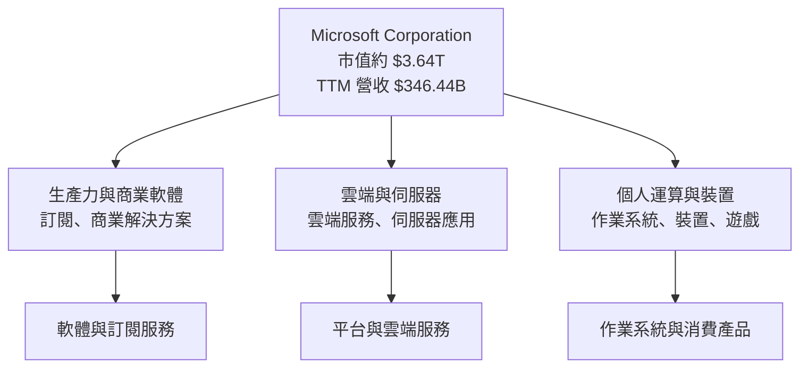
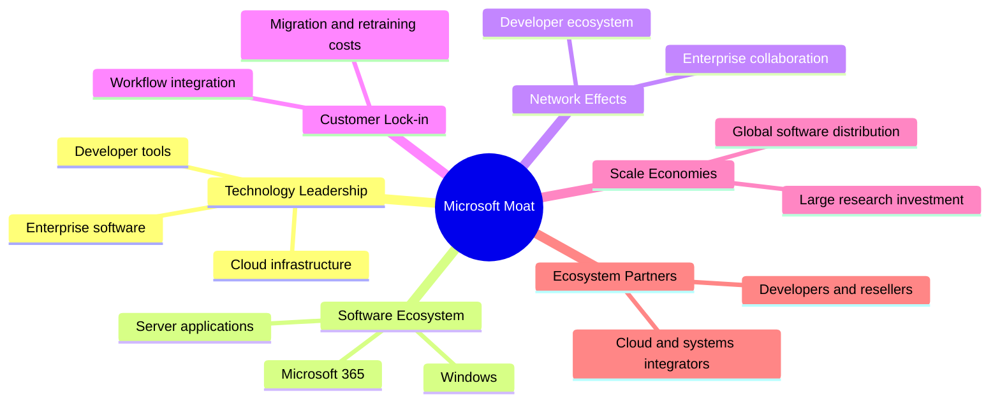
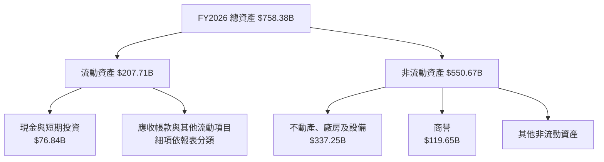
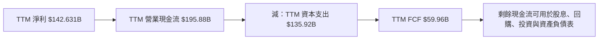
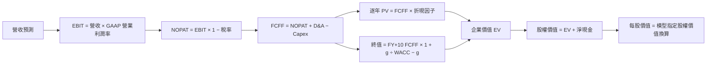
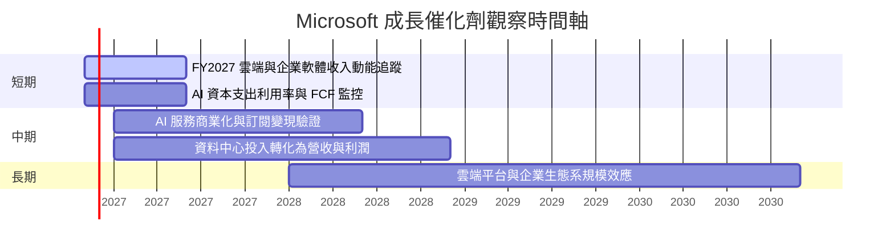
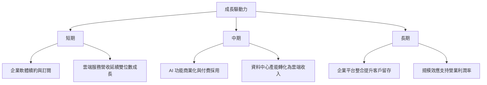
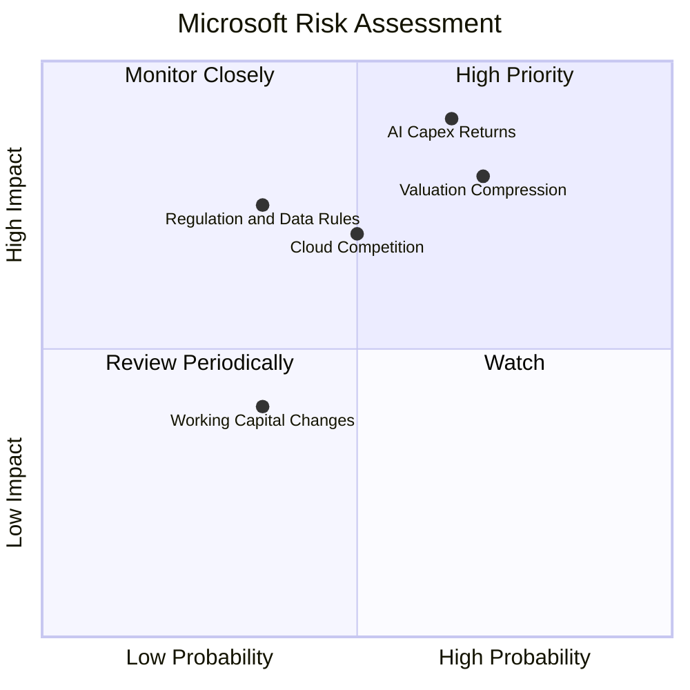
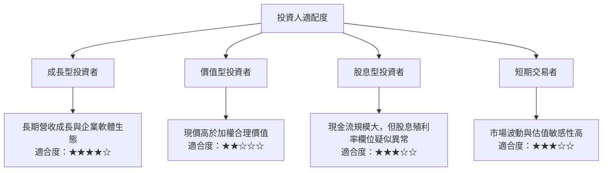

# MSFT 基本面深度分析報告
> **報告日期**：2026-11-26 ｜ **語言**：繁體中文 ｜ **數據來源**：SEC 申報資料 (XBRL)、Yahoo Finance、Finviz、StockAnalysis、Roic.ai ｜ **分析師**：CFA 級機構研究

## 目錄

| # | 章節 | 核心結論 |
|---|------|----------|
| 1 | 執行摘要 | 減碼；加權合理價值 $428.80，MOS -14.3% |
| 2 | 公司概覽與商業模式 | 多元企業軟體與雲端生態系提供高轉換成本；分部營收明細未提供 |
| 3 | 損益表深度分析 | TTM 營收 $346.44B、成長 17.9%；TTM 營業利益率 47.1% |
| 4 | 資產負債表分析 | 淨現金 $29.03B；CCC 為 -67 天 |
| 5 | 現金流量深度分析 | TTM FCF $59.96B，但高資本支出使 FCF yield 僅 1.65% |
| 6 | 獲利能力與資本效率 | ROIC 29.7% 高於 WACC 9.97%，仍創造經濟價值 |
| 7 | 相對估值分析 | 本益比低於自身五年中位數，但相對同業溢價仍高 |
| 8 | DCF 內在價值評估 | 基準 DCF 每股 $380.73；加權合理價值 $428.80 |
| 9 | 成長催化劑 | 雲端、AI 與訂閱服務具推動力；TAM 數據未提供 |
| 10 | 風險矩陣 | AI 資本支出回報、估值壓縮與監管為主要風險 |
| 11 | 投資建議 | 依 MOS 評級減碼；需觀察資本支出回報與 FCF 修復 |

## 1. 執行摘要

MSFT 的 TTM 營收為 **$346.44B**，TTM 年增 **17.9%**，最新季度年增 **18.8%**；TTM 營業利益率 **47.1%**、ROIC **29.7%**，相較 WACC **9.97%** 高出 **19.73 個百分點**，顯示主業仍能創造價值。不過 TTM FCF 為 **$59.96B**、FCF yield 僅 **1.65%**，基準 DCF 每股價值 **$380.73**，低於 2026-11-25 收盤價 **$489.93**；估值方法加權後合理價值 **$428.80**、MOS **-14.3%**，依規則 20 評級為**減碼**。

### 1.0 一頁式投資儀表板（Portfolio Manager 30 秒速讀）

| 項目 | 內容 |
|------|------|
| **投資論點（3 句）** | ① TTM 營收年增 17.9%，最新季度年增 18.8%，需求動能仍在。② ROIC 29.7% 高於 WACC 9.97%，營運回報超過資本成本。③ TTM FCF $59.96B，但資本支出 $135.92B、FCF yield 1.65%，現價高於加權合理價值。 |
| **綜合評分** | **7.7/10**（引用 1.1 評分卡） |
| **財務健康** | 🟢 淨現金 $29.03B；流動比率 1.225，流動性尚可，但低於一年前的比較表現未提供。 |
| **ROIC vs WACC** | **29.7% vs 9.97%**；創造價值，利差 19.73 個百分點。 |
| **FCF 趨勢** | 年度 FCF 自 FY2025 $71.61B 降至 FY2026 $66.99B；TTM FCF $59.96B，FCF yield 1.65%。 |
| **估值** | Forward P/E 20.24x ｜ EV/EBITDA 18.0x ｜ FCF Yield 1.65% |
| **DCF 內在價值（基準）** | **$380.73** ｜ 依折溢價定義，現價較 DCF 高 **28.7%**（第 8 章） |
| **安全邊際（MOS）** | **-14.3%＝($428.80 − $489.93) ÷ $428.80**（加權合理價值基準）｜ 🔴 <10% 無 |
| **預期報酬（基準情境 12M）** | DCF 基準情境相對現價 **-22.3%**；此為模型情境比較，不是 12 個月保證報酬。 |
| **關鍵風險（前二）** | AI／資料中心投資回報低於資本支出；高估值倍數收縮。 |
| **評級 + 信心度** | **🔴 減碼** ｜ 信心：中（估值模型輸入敏感，且資本支出回報尚需驗證） |

### 1.1 綜合評分卡（全報告唯一）

| 維度 | 評分（1–10） | 主要依據（引用數字與其來源章節） |
|------|--------------|----------------------------------|
| 成長性 | 8.5 | TTM 營收年增 17.9%、最新季度年增 18.8%（第 3 章）。 |
| 獲利能力 | 9.0 | TTM 營業利益率 47.1%、ROIC 29.7%、Piotroski F-Score 6/9（第 3、6 章）。 |
| 財務健康 | 8.0 | 淨現金 $29.03B、流動比率 1.225、CCC -67 天（第 4 章）。 |
| 估值 | 3.0 | MOS -14.3%；P/E 25.6x，雖低於五年中位數 31.5x，仍高於同業中位數 16.3x（第 7、8 章）。 |
| 護城河 | 9.5 | 多產品協同與企業客戶轉換成本；TTM 營收 $346.44B、營業利益率 47.1%（第 2 章）。 |
| 管理層與資本配置 | 8.0 | 稀釋股數變化測試通過；FY2026 SBC $12.40B、股息支出 $26.45B；但 Capex FY2026 升至 $115.95B（第 3、5 章）。 |
| **綜合評分** | **7.7** | 六項算術平均：\((8.5+9.0+8.0+3.0+9.5+8.0)÷6=7.67\)，四捨五入至一位小數。 |

### 1.2 五大投資論點 + 三大核心風險

| 類型 | 項目 | 具體依據 | 信心度 |
|------|------|----------|--------|
| 🟢 **投資論點①** | 雲端與企業軟體需求仍有成長 | TTM 營收 $346.44B、年增 17.9%；最新季度營收年增 18.8%。 | 🟢 高 |
| 🟢 **投資論點②** | 高資本回報創造價值 | ROIC 29.7%，比 WACC 9.97% 高 19.73 個百分點。 | 🟢 高 |
| 🟢 **投資論點③** | 營運現金流規模大 | TTM OCF $195.88B；即使 Capex 達 $135.92B，TTM FCF 仍有 $59.96B。 | 🟢 高 |
| 🟢 **投資論點④** | 現金轉換週期為負 | CCC -67 天，供應商付款期限高於收款與存貨週期合計；但較一年前 -59 天略延長。 | 🟢 中高 |
| 🟢 **投資論點⑤** | 資產負債表有淨現金 | 現金與短期投資 $64.51B、總債務 $35.48B，淨現金 $29.03B。 | 🟢 高 |
| 🟡 **風險①** | AI 投資回報不及資本支出增速 | TTM Capex $135.92B，占 TTM 營收約 39.2%；若新增產能利用率不足，FCF 受壓。 | 🟡 中 |
| 🔴 **風險②** | 現價高於估值基準 | 加權合理價值 $428.80，現價 $489.93，MOS -14.3%；DCF 基準 $380.73。 | 🔴 高 |
| 🟡 **風險③** | 競爭與監管風險 | 企業軟體與雲端市場存在大型競爭者，監管、資料主權與跨境資料規範可能影響產品組合與成本。 | 🟡 中 |

### 1.3 快速統計卡片

| 指標 | 公司實際值（期間） | 同業中位數 | 狀態 |
|------|--------------------|------------|------|
| 營收成長（TTM） | **17.9%** | — | 🟢 |
| 營收成長（最新一季年增） | **18.8%** | 24.7% | 🟡 |
| 毛利率（TTM） | **67.7%** | 60.9% | 🟢 |
| 營業利益率（TTM） | **47.1%** | — | 🟢 |
| ROIC（TTM） | **29.7%** | — | 🟢 |
| Forward P/E | **20.24x** | 17.7x | 🟡 |
| FCF Yield（TTM） | **1.65%** | — | 🔴 |
| Piotroski F-Score | **6 / 9** | — | 🟡 |

### 1.4 投資結論

```text
╔══════════════════════════════════════════════════════════════════╗
║                    📊 投資結論摘要                               ║
╠══════════════════════════════════════════════════════════════════╣
║  評級：減碼（MOS -14.3%，符合規則 20）                            ║
║  價格（2026-11-25 收盤）：$489.93                                ║
║  DCF 內在價值（基準）：$380.73（現價溢價 28.7%）                ║
║  安全邊際 MOS：-14.3%（＝(加權合理價值−現價)÷加權合理價值）     ║
║  加權合理價值（8.8）：$428.80                                    ║
║  DCF 情境價值：                                                   ║
║    悲觀情境：$179.98（-63.3%）                                   ║
║    基準情境：$380.73（-22.3%）                                   ║
║    樂觀情境：$738.53（+50.7%）                                   ║
║  綜合評分：7.7/10（引用 1.1）                                    ║
║  適合投資人：重視長期企業軟體成長、可承受估值波動的投資人；      ║
║              現價不適合只因公司品質高而忽略估值的投資人。        ║
╚══════════════════════════════════════════════════════════════════╝
```

## 2. 公司概覽與商業模式

### 2.1 業務結構與收入來源

可取得的公司摘要指出，Microsoft 提供作業系統、伺服器應用、商業解決方案、開發工具、管理工具、遊戲及裝置等產品。公司市值約 **$3.64T**，TTM 營收 **$346.44B**。財務資料沒有提供最新分部營收及各分部占比，因此不推算雲端、生產力與個人運算等板塊的營收比例。



### 2.2 市場份額

市場份額及可引用的分部市占數據未提供，因此不繪製比例圖。以規模與成長來看，Microsoft TTM 營收 **$346.44B**、年增 **17.9%**；最新季度年增 **18.8%**，與 GOOG、AMZN、ORCL 同業最新季度年增率相比，低於 GOOG 的 24.7% 與 ORCL 的 29.6%，高於 AMZN 的 12.1%。

### 2.3 競爭護城河分析



### 2.4 護城河強度

| 護城河項目 | 強度（強／中／弱） | 證據（引用數字或事實） | 會削弱它的情況 |
|------------|--------------------|------------------------|----------------|
| 技術與產品組合 | 強 | 產品涵蓋作業系統、伺服器、商業應用、開發工具與雲端服務；TTM 營業利益率 47.1%。 | 技術替代、AI 開源工具降低差異化或產品創新失速。 |
| 軟體生態系統 | 強 | 企業工作流程橫跨辦公軟體、作業系統、伺服器與開發工具，切換需重新整合與培訓。 | 企業採用跨平台或雲端原生方案，降低平台綁定。 |
| 客戶鎖定 | 強 | B2B 軟體與雲端服務整合可提高遷移成本；CCC 為 -67 天，反映供應鏈與商業模式的營運優勢之一。 | 客戶多雲策略、合約議價或監管要求削弱綁定。 |
| 規模效應 | 強 | TTM 營收 $346.44B，且年度 R&D FY2026 為 $35.56B。 | 資料中心投資回收不佳、固定成本增速高於營收。 |
| 網路效應與夥伴 | 中至強 | 開發工具、企業客戶及系統整合夥伴有助於擴大產品採用；可用數字未提供。 | 競爭平台吸引開發者與合作夥伴轉移。 |

護城河評分 **9.5/10**（見 1.1）：產品互補、企業整合與規模有助維持 47.1% 的 TTM 營業利益率，但可量化的市占與分部留存數據未提供。

## 3. 損益表深度分析

### 3.1 年度收入成長趨勢（近 4 年）

FY2023 至 FY2026 營收分別為 **$211.91B、$245.12B、$281.72B、$331.84B**。FY2023 至 FY2026 三年 CAGR 約 **16.1%**。

```text
╔══════════════════════════════════════════════════════════════════╗
║        Microsoft 年度收入趨勢（FY2023–FY2026）                    ║
╠══════════════════════════════════════════════════════════════════╣
║  FY2023  $211.91B  █████████████░░░░░░░░░░░  YoY: —             ║
║  FY2024  $245.12B  ███████████████░░░░░░░░░  YoY: +15.7% 🟢     ║
║  FY2025  $281.72B  █████████████████░░░░░░░  YoY: +14.9% 🟢     ║
║  FY2026  $331.84B  ████████████████████░░░░  YoY: +17.8% 🟢     ║
║                                                                  ║
║  FY2023–FY2026 三年營收 CAGR：約 16.1%                           ║
╚══════════════════════════════════════════════════════════════════╝
```

FY2026 營收成長較 FY2025 加快，TTM 營收成長也達 **17.9%**。這顯示企業軟體與雲端需求維持擴張；但缺少分部營收，無法量化各產品線對加速的貢獻。

### 3.2 季度收入趨勢分析

以下 QoQ 按季度連續營收計算；最新季度 YoY 使用單季年增率。單位：$B。

| 季度 | 營收 | QoQ | YoY | 備註 |
|------|------:|----:|----:|------|
| 2025-12-31 | 81.273 | 4.6% | 16.72% | QoQ 比較 2025-09-30 的 $77.673B。 |
| 2026-03-31 | 82.886 | 2.0% | 18.30% | 年增率高於前一季。 |
| 2026-06-30 | 90.007 | 8.6% | 17.75% | 季度營收增加；年增維持雙位數。 |
| 2026-09-30 | 92.279 | 2.5% | **18.8%** | 最新季度年增率；此為單季 YoY，不是 TTM。 |

季度營收呈上升走勢，但季度間 QoQ 易受季節性和合約認列時間影響，投資判斷應以單季 YoY 及 TTM 變化共同觀察。

### 3.3 利潤率演變分析

年度利潤率依年度財報營收與利潤金額計算，與 TTM 指標期間不同。

| 利潤率指標 | FY2023 | FY2024 | FY2025 | FY2026 | 趨勢 | 評估 |
|------------|-------:|-------:|-------:|-------:|------|------|
| **毛利率** | 68.9% | 69.8% | 68.8% | 67.9% | FY2024 見高後回落 | 🟡 |
| **營業利益率** | 41.8% | 44.6% | 45.6% | 46.8% | 連續改善 | 🟢 |
| **淨利率** | 34.2% | 36.0% | 36.1% | 40.3% | FY2026 明顯提升 | 🟢 |

TTM 毛利率為 **67.7%**、營業利益率為 **47.1%**。年度毛利率從 FY2024 的 69.8% 降至 FY2026 的 67.9%，反映成本／產品組合可能有所變化，但可用資料不足以拆出雲端基礎設施成本、硬體組合與訂閱價格的各自影響。相對地，年度營業利益率從 FY2023 的 41.8% 升至 FY2026 的 46.8%，顯示營收擴張與營業費用控制共同帶來營業槓桿。FY2026 淨利率上升至 40.3%，但缺少稅項及非經常性項目拆分，不能將全部增幅視為可持續營運改善。

### 3.4 費用結構分析

分部或費用類別完整數據未提供，不繪製費用結構圓餅圖。已知 FY2026 R&D 為 **$35.56B**，約為 FY2026 營收 $331.84B 的 **10.7%**；Capex 為 **$115.95B**，屬現金流量表資本支出，並非損益表營業費用。

```text
╔══════════════════════════════════════════════════════════════════╗
║                 FY2026 已知投入項目                              ║
╠══════════════════════════════════════════════════════════════════╣
║  營收          $331.84B                                          ║
║  研發費用       $35.56B   約營收 10.7%                           ║
║  資本支出      $115.95B   現金流出，不等同當期費用               ║
║  其他費用項目   數據未提供，故不推算                             ║
╚══════════════════════════════════════════════════════════════════╝
```

### 3.5 季度 EPS 趨勢與盈餘品質（Quality of Earnings）

| 季度 | EPS 實際值 | EPS YoY | 超預期／不及預期 |
|------|-----------:|--------:|-----------------|
| 2025-12-31 | $5.16 | 59.75% | N/A：EPS 預估值缺漏 |
| 2026-03-31 | $4.27 | 23.41% | N/A：EPS 預估值缺漏 |
| 2026-06-30 | $4.81 | 31.74% | N/A：EPS 預估值缺漏 |
| 2026-09-30 | $4.92 | 32.26% | N/A：EPS 預估值缺漏 |

無法根據現有資料判斷最近四季 EPS 是否超出分析師預期：EPS estimate 欄位均缺漏，不能把空值解讀成 beat 或 miss。最新季度 EPS 年增 32.26%，同季營收年增 18.8%，顯示盈餘增速高於收入增速；但無法將差異歸因於單一因素。

| 盈餘品質項目 | 數值／佔比 | 評估 |
|--------------|------------|------|
| 股權薪酬 SBC / 營收 | TTM SBC 約 $12.55B ÷ $346.44B = **3.6%** | 🟡 有持續股東稀釋成本；SBC 不應因為非現金就忽略。 |
| SBC / 營業現金流 | $12.55B ÷ $195.88B = **6.4%** | 🟡 OCF 有相當部分是以非現金薪酬加回支撐。 |
| FCF / 淨利（現金轉換率） | $59.96B ÷ $142.631B = **42.0%** | 🔴 Capex 高使 FCF 低於淨利；不能只看 EPS 評估可分配現金。 |
| 一次性／非經常性損益 | N/A：缺少明細 | 無法判斷季度淨利波動是否受一次性項目影響。 |
| 有效稅率異常 | 19.4%（最新年度有效稅率） | 🟢 未有證據顯示模型稅率由明顯異常稅務利益推動；季度稅項拆分未提供。 |
| 資本化支出 vs 費用化 | TTM Capex $135.92B；TTM D&A／營收 11.1% | 🟡 資本密集投資會在當期現金流扣除、在後續期間折舊；資本化明細未提供。 |

**盈餘品質結論**：GAAP 盈利有營業現金流支撐，TTM OCF $195.88B 高於淨利 $142.631B；但資本支出 $135.92B 使 FCF／淨利僅 42.0%。因此 GAAP 淨利可反映應計獲利，卻不等同當期可自由分配的經濟現金。SBC 佔營收約 3.6%，會降低股東每股收益的含金量；估值應同時看 FCF 與股數變化。

## 4. 資產負債表分析

### 4.1 資產結構分解

以下採 FY2026 年度資產負債表：總資產 **$758.38B**、流動資產 **$207.71B**；非流動資產為兩者差額 **$550.67B**。



注意：現金與短期投資及 PPE、商譽數字來自不同資料表列示口徑；圖中不把個別子項再加總為資產總額，以避免跨來源分類差異造成錯誤。

### 4.2 流動性與營運資金分析

| 指標 | 最新 TTM | 一年前 TTM | 變化 | 解讀 |
|------|---------:|-----------:|-----:|------|
| 流動比率 | 1.225 | N/A | N/A | 流動資產高於流動負債，但比較基期比率未提供。 |
| DSO 應收帳款天數 | 65 天 | 66 天 | -1 天 | 收款週期略縮短，變化幅度小。 |
| DIO 存貨天數 | 6 天 | 4 天 | +2 天 | 存貨天數增加，需留意產品組合與庫存變化；增幅本身尚不足以判斷庫存壓力。 |
| DPO 應付帳款天數 | 139 天 | 130 天 | +9 天 | 付款週期延長，可能有利短期營運資金，但持續延長可能受供應商條款影響。 |
| CCC 現金轉換週期 | -67 天 | -59 天 | -8 天 | 仍為負值；應收與存貨週期合計低於應付週期，現金週期較一年前更有利。 |

上述天數由應收、存貨與應付餘額除以 TTM 流量換算，不能單獨視為客戶付款或供應商條款的因果證明。

### 4.3 債務結構分析

```text
╔══════════════════════════════════════════════════════════════════╗
║                 Microsoft 債務健康診斷                           ║
╠══════════════════════════════════════════════════════════════════╣
║  總債務：          $35.48B                                        ║
║  現金+短期投資：   $64.51B                                        ║
║  淨現金：          $29.03B    🟢 緩衝能力良好                     ║
║  債務 / EBITDA：   N/A（以一致的 TTM EBITDA 口徑未提供）          ║
║  利息保障倍數：    N/A（利息費用與 EBIT 同口徑數據未提供）        ║
║  流動比率：        1.225                                          ║
╚══════════════════════════════════════════════════════════════════╝
```

債務採 VERIFIED FIGURES 中總債務 **$35.48B**，與另一合併市場資料欄位的 $133.93B 不一致；本報告依指定優先順序使用 SEC／程式計算核心數值，不混合兩種口徑。淨現金 $29.03B 是現金與短期投資減總債務的既定值。

### 4.4 股東權益趨勢

| 財年 | 股東權益 | YoY |
|------|---------:|----:|
| FY2023 | $206.22B | — |
| FY2024 | $268.48B | +30.2% |
| FY2025 | $343.48B | +27.9% |
| FY2026 | $442.39B | +28.8% |

```text
╔══════════════════════════════════════════════════════════════════╗
║                 股東權益變化（年度）                             ║
╠══════════════════════════════════════════════════════════════════╣
║  FY2023  $206.22B  █████████░░░░░░░░░░░░░░░░                    ║
║  FY2024  $268.48B  █████████████░░░░░░░░░░░░                    ║
║  FY2025  $343.48B  █████████████████░░░░░░░░                    ║
║  FY2026  $442.39B  ██████████████████████░░░░                    ║
╚══════════════════════════════════════════════════════════════════╝
```

股東權益逐年增加，反映留存盈餘等因素累積；股東權益上升不等同每股價值同比增加，仍須搭配股數與資本回報分析。

## 5. 現金流量深度分析

### 5.1 現金流量瀑布圖

淨利取 TTM $142.631B；TTM OCF、Capex 與 FCF 依指定定義列示。股息與回購的 TTM 合計資料未提供，因此不將現金流瀑布延伸至未核實的資本配置金額。



### 5.2 FCF 轉換率趨勢

| 財年 | FCF | 淨利 | FCF／淨利 |
|------|----:|-----:|----------:|
| FY2023 | $59.48B | $72.36B | 82.2% |
| FY2024 | $74.07B | $88.14B | 84.0% |
| FY2025 | $71.61B | $101.83B | 70.3% |
| FY2026 | $66.99B | $133.75B | 50.1% |
| TTM 至 2026-09-30 | $59.96B | $142.631B | 42.0% |

FY2026 及 TTM 轉換率下降，主要是資本支出快速增加；FY2026 Capex 為 $115.95B，較 FY2025 $64.55B 明顯上升。若新增資料中心產能轉化為後續雲端與 AI 收入，短期 FCF 壓力可能是成長投資；若產能利用不足，則會拖累現金回報。

### 5.3 自由現金流趨勢

| 財年／期間 | FCF | YoY | FCF Yield |
|------------|----:|----:|----------:|
| FY2023 | $59.48B | — | N/A |
| FY2024 | $74.07B | +24.5% | N/A |
| FY2025 | $71.61B | -3.3% | N/A |
| FY2026 | $66.99B | -6.5% | N/A |
| TTM 至 2026-09-30 | **$59.96B** | N/A | **1.65%** |

```text
╔══════════════════════════════════════════════════════════════════╗
║                    自由現金流歷史                                ║
╠══════════════════════════════════════════════════════════════════╣
║  FY2023  $59.48B  ██████████████████░░                          ║
║  FY2024  $74.07B  ██████████████████████░                       ║
║  FY2025  $71.61B  █████████████████████░                        ║
║  FY2026  $66.99B  ████████████████████░                         ║
║  TTM     $59.96B  ██████████████████░░  FCF Yield 1.65%         ║
╚══════════════════════════════════════════════════════════════════╝
```

### 5.4 資本配置評估

回購金額未提供，故不繪製包含回購比例的 pie chart。

| 配置項目 | 可用數據 | 評估 |
|----------|----------|------|
| 資本支出 | FY2026 $115.95B；TTM $135.92B | 大額投入資料中心與基礎設施的方向符合雲端擴張，但回報須以營收、利用率及 FCF 驗證。 |
| 股息 | FY2026 現金股息 $26.45B | FY2026 股息支出約為 FCF 的 39.5%，但單年度比例受高 Capex 影響。 |
| 股票回購 | N/A：金額未提供 | 不推算回購收益率或淨股數回報。 |
| SBC | FY2026 $12.40B；TTM 估算約 $12.55B | 需要納入每股經濟回報考量；稀釋股數未增加測試通過。 |
| 留存現金／其他投資 | N/A：明細未提供 | 不虛構現金流分配比例。 |

## 6. 獲利能力與資本效率

### 6.1 ROE / ROA / ROIC 趨勢

| 指標 | FY2026／TTM 可用值 | 一年前／歷史值 | 評估 |
|------|------------------:|---------------:|------|
| ROE | TTM **30.3%** | N/A：品質指標定義下歷史序列未提供 | 🟢 高回報；與另一彙整欄位 34.2% 口徑不同，採品質指標區塊值。 |
| ROA | TTM **14.4%** | N/A | 🟢 資產獲利能力高。 |
| ROIC | TTM **29.7%** | N/A | 🟢 明顯高於 9.97% WACC。 |

沒有可靠同業 ROIC、ROE、ROA 中位數資料，故不填行業均值。

### 6.2 ROIC vs WACC 分析（核心價值創造判斷）

```text
╔══════════════════════════════════════════════════════════════════╗
║                ROIC vs WACC 深度分析                            ║
╠══════════════════════════════════════════════════════════════════╣
║  WACC（採用程式計算成本資本資料）：                              ║
║  ├── 無風險利率（10Y 美債）：       4.85%                        ║
║  ├── 市場風險溢酬 ERP：             5.00%                        ║
║  ├── 原始 Beta：                    1.04                         ║
║  ├── 調整後 Beta：                  1.03                         ║
║  ├── 股權成本：                     10.00%                       ║
║  ├── 稅前債務成本：                 8.60%                        ║
║  ├── 資本權重 E / D：               99.0% / 1.0%                 ║
║  └── WACC：                         9.97%                        ║
║                                                                  ║
║  ROIC：                          29.70%                          ║
║  EVA 利差 = ROIC − WACC：         19.73 個百分點                 ║
║                                                                  ║
║  ROIC  29.70%  ▓▓▓▓▓▓▓▓▓▓▓▓▓▓▓▓▓▓▓▓▓▓▓▓▓▓▓▓▓▓▓▓▓▓▓▓ 🟢         ║
║  WACC   9.97%  ▓▓▓▓▓▓▓▓▓▓▓▓░░░░░░░░░░░░░░░░░░░░░░░ ──         ║
║                                                                  ║
║  結論：ROIC 約為 WACC 的 2.98 倍，當期仍在創造經濟價值。        ║
╚══════════════════════════════════════════════════════════════════╝
```

ROIC／WACC 倍數：\(29.7\%÷9.97\%=2.98\) 倍。WACC 依據成本資本資料直接採用，不另以另一組市值或負債口徑重估。

### 6.3 杜邦三因素分解

| 因素 | 數值（TTM） | 解讀 |
|------|-------------|------|
| 淨利率 | 41.2% | 高淨利率是 ROE 的主要來源之一。 |
| 資產週轉率 | 0.44 | 資產週轉較低，但可由高利潤率部分抵銷。 |
| 權益乘數 | 1.66 | 槓桿並非 ROE 的主要來源；資本結構相對克制。 |
| **ROE** | **30.3%** | 41.2% × 0.44 × 1.66 ≈ 30.1%，與列示 30.3% 的小差異來自原始數字四捨五入。 |

### 6.4 財務體質：Piotroski F-Score

**Piotroski F-Score：6 / 9**，依 TTM 至 2026-09-30 與 TTM 至 2025-09-30 比較；缺少輸入的測試不納入分母。

| 測試 | 結果 | 解讀 |
|------|------|------|
| ROA > 0 | ✅ 通過 | TTM 資產報酬為正。 |
| 營業現金流 > 0 | ✅ 通過 | TTM OCF $195.88B。 |
| ROA 高於一年前 | ✅ 通過 | 盈利相對資產改善。 |
| 營業現金流 > 淨利 | ✅ 通過 | OCF $195.88B 高於淨利 $142.631B。 |
| 長期負債／總資產低於一年前 | ✅ 通過 | 槓桿指標改善。 |
| 流動比率高於一年前 | ❌ 未通過 | 短期流動性相對比較期沒有改善。 |
| 稀釋股數未增加 | ✅ 通過 | 股數稀釋測試通過。 |
| 毛利率高於一年前 | ❌ 未通過 | 毛利率未呈現同比改善。 |
| 資產週轉率高於一年前 | ❌ 未通過 | 資產增長尚未轉化為更高周轉效率。 |

## 7. 相對估值分析

### 7.1 同業估值比較表格

| 估值指標 | **MSFT** | **GOOG** | **AMZN** | **ORCL** | MSFT 評估 |
|----------|---------:|---------:|---------:|---------:|-----------|
| **Trailing P/E** | 25.6x | 14.2x | 19.8x | 16.3x | 🔴 高於三家同業中位數 16.3x |
| **Forward P/E** | 20.24x | 17.7x | 22.4x | 9.4x | 🟡 高於同業中位數 17.7x |
| **P/S Ratio** | 10.5x | 7.1x | 3.3x | 4.5x | 🔴 高於同業中位數 4.5x |
| **EV/EBITDA** | 18.0x | 17.4x | 15.4x | 13.1x | 🟡 高於同業中位數 15.4x |
| 最新季度營收 YoY | 18.8% | 24.7% | 12.1% | 29.6% | 🟡 成長高於 AMZN、低於 GOOG 與 ORCL |
| TTM 毛利率 | 67.7% | 60.9% | 51.4% | 64.0% | 🟢 高於三家同業 |

估值數據使用指定同業倍數；各同業成長與毛利率僅作對照，不代表產品組合完全相同。MSFT 的高估值相對同業需由較高利潤率、產品生態與成長持續性支持。

### 7.2 歷史估值區間分析

```text
╔══════════════════════════════════════════════════════════════════╗
║               MSFT 五年估值區間（TTM）                           ║
╠══════════════════════════════════════════════════════════════════╣
║  P/E：       20.8x ─────● 25.6x────── 31.5x ─────── 37.8x       ║
║                         現值       五年中位數                    ║
║  百分位：    當前 14%                                            ║
║  P/S：        8.4x ─────● 10.5x───── 12.0x ─────── 13.7x        ║
║                         現值       五年中位數                    ║
║  EV/EBITDA： 14.5x ─────● 18.0x───── 24.3x ─────── 31.4x        ║
║                         現值       五年中位數                    ║
║  百分位：P/S 當前 33%；EV/EBITDA 當前 10%                       ║
╚══════════════════════════════════════════════════════════════════╝
```

三個倍數均低於各自五年中位數，P/E 與 EV/EBITDA 分別位於自身歷史第 14 與第 10 百分位。這代表估值相對自身近五年區間已收斂，但不等同絕對便宜：FCF yield 僅 1.65%，且股價仍高於本報告的加權合理價值。

### 7.3 情境價值（Bear / Base / Bull，照抄 DCF MODEL）

| 情境 | 第 1 年營收成長 | 期末營業利潤率 | WACC | 每股價值 | 相對現價 | 機率 | 會發生的條件 |
|------|----------------:|---------------:|-----:|---------:|---------:|-----:|--------------|
| 🔴 悲觀 | 9.0% | 38.8% | 10.97% | $179.98 | -63.3% | 25% | 雲端與 AI 成長放緩、投資利用率不足，利潤率下滑且折現率偏高。 |
| 🟡 基準 | 17.9% | 45.6% | 9.97% | $380.73 | -22.3% | 50% | 以 TTM 成長為起點，十年內逐步放緩，利潤率緩降至五年歷史中位數。 |
| 🟢 樂觀 | 26.9% | 50.2% | 8.97% | $738.53 | +50.7% | 25% | AI／雲端需求持續加速、規模效益推升利潤率，且資本成本下降。 |

上述每股價值、假設與機率均依 DCF 情境模型。情境機率為模型設定，不是統計預測。

### 7.4 相對估值隱含價格區間

```text
╔══════════════════════════════════════════════════════════════════╗
║                  相對估值每股價值比較                            ║
╠══════════════════════════════════════════════════════════════════╣
║  $380.73 ── $422.40 ── $428.70 ── $489.93 ── $637.36             ║
║   基準DCF    同業EV/EBITDA 同業Forward P/E  現價    分析師共識     ║
╚══════════════════════════════════════════════════════════════════╝
```

| 方法 | 每股價值 | 依據 |
|------|---------:|------|
| 同業 Forward P/E | $428.70 | GOOG、AMZN、ORCL 同業中位數 17.7x × Forward EPS $24.20。 |
| 同業 EV/EBITDA | $422.40 | 同業中位數 EV/EBITDA 15.4x × TTM EBITDA，再加淨現金。 |
| 分析師共識 | $637.36 | 54 位分析師平均目標價。 |

相對估值方法未使用 MSFT 自身當前倍數回推，以免機械地得到接近現價的結果。

## 8. DCF 內在價值評估（Discounted Cash Flow）

### 8.0 估值推理鏈（Thinking Logic）

**核心命題**：MSFT 的價值主要來自既有企業軟體與雲端現金流底盤，加上持續擴張的雲端／AI 服務；但分部營收占比未提供，不能將不同業務的營收份額拆分。估值主導變數是長期 FCFF，特別是高 Capex 之後的現金流利潤率與終值。

| 決策點 | 本報告採用 | 理由（含數字） | 曾考慮但否決 | 否決理由 |
|--------|-----------|----------------|--------------|----------|
| 現金流定義 | FCFF | 與 WACC 折現並先求企業價值一致；模型公式為 NOPAT + D&A − Capex。 | FCFE | 估值模型已固定使用 FCFF，改用 FCFE 會更換模型。 |
| 預測期 N | 10 年 | DCF 模型固定 10 年，營收成長由 17.9% 線性降至 3.0%。 | 5 年 | 會縮短模型已指定的成長收斂期間，不能替換原模型。 |
| 終值方法 | Gordon Growth | 模型提供永續成長 3.0%，WACC 9.97%，滿足 WACC > g。 | 退出倍數 | DCF 模型未提供退出倍數輸入，不能另建。 |
| EBIT 基礎 | GAAP EBIT | 47.1% TTM 營業利益率，SBC 已列為費用。 | 非 GAAP EBIT | 會加回已入帳費用，造成口徑改變。 |

**關鍵假設推導鏈：**

- **營收成長**：錨點＝TTM 年增 17.9% → 模型由此作為第 1 年起點，之後線性放緩至第 10 年 3.0% → **採用第 1 年 17.9%、第 10 年 3.0%** → 曾考慮維持 17.9% 至第十年，但否決，因長期高增長不應視為永久狀態。
- **期末營業利潤率**：錨點＝TTM 47.1%，五年財年中位數為模型指定的收斂基準 → 競爭、成本及成熟期組合可能抵銷部分規模效益 → **採用 45.6%** → 曾考慮固定 47.1%，但未反映模型指定的歷史中位數收斂。
- **永續成長率 g**：錨點＝模型設定 3.0%，且長期永續增長應低於 WACC → **採用 3.0%** → 不採用接近 9.97% 的高 g，因會大幅放大終值，且不符合長期成熟企業假設。
- **預測期 N**：錨點＝模型固定 10 年 → 以十年讓收入成長由 17.9% 線性收斂至 3.0% → **採用 10 年** → 不縮短或延長，避免偏離唯一指定模型。
- **Capex／營收**：錨點＝TTM 約 39.2% → 以資本支出率逐步收斂至 1.1 倍 D&A → **第 1 年 39.2%，第 10 年 12.2%** → 不把目前比率永續化，因其會令長期資本支出負擔過高。
- **D&A／營收**：錨點＝TTM 11.1% → **全期固定 11.1%**；不另設變化，因模型採固定比例。
- **有效稅率**：錨點＝最新年度有效稅率 19.4% → **全期採 19.4%**；財務數據未支持更精細的逐年稅率預測。
- **EBIT／SBC／股數**：錨點＝GAAP EBIT，且 SBC 已計入營業費用 → **採組合 (A)：GAAP EBIT、不另扣 SBC、固定股數（年稀釋率 0%）** → 不採用非 GAAP 加回後再扣回或股數稀釋組合，以免重複計算或漏算 SBC。
- **WACC**：錨點＝指定成本資本資料的 **9.97%** → 直接採用此值，不自行重估；理由是本模型要求統一使用該成本資本輸入 → 不另選其他折現率，以免與 ROIC 比較及 DCF 矩陣不一致。
- **營運資金**：模型註明不建模，FCFF 不含 ΔWC；因缺少一致的逐年營運資金預測，不能自行填數或反推。

**最脆弱的一環**：Capex／營收從第 1 年 39.2% 降至第 10 年 12.2%。若資料中心投資強度長期高於模型假設，FCFF 會低於預測，估值下行；DCF 敏感性矩陣亦顯示折現率及終值假設對價值影響顯著。



### 8.1 模型假設總表（Model Inputs）

| 假設項目 | 採用值 | 依據／來源 | 敏感度 |
|----------|--------|-------------|--------|
| 預測期長度 N | 10 年 | DCF 模型固定 10 年，營收成長逐年收斂 | 🟡 中 |
| 營收成長 | 第 1 年 17.9%，第 10 年 3.0% | TTM 年增 17.9%；線性淡出 | 🔴 高 |
| 營業利潤率 | 第 1 年 47.1% → 第 10 年 45.6% | TTM 47.1%；收斂至模型指定的近五年中位數 | 🔴 高 |
| 有效稅率 | 19.4% | 最新年度有效稅率 | 🟢 低 |
| Capex／營收 | 第 1 年 39.2% → 第 10 年 12.2% | TTM 起點；逐步收斂至 1.1 倍 D&A | 🔴 高 |
| D&A／營收 | 11.1% | TTM 比率，模型固定 | 🟢 低 |
| 營運資金變動／營收增額 | 未建模 | DCF 模型明示 working capital is not modelled | 🟢 低 |
| EBIT 基礎 | GAAP EBIT | 模型採用 GAAP EBIT | 🟡 中 |
| SBC 處理 | 已列入 GAAP 費用，不再扣除 | 符合組合 (A) | 🟡 中 |
| 年稀釋率 | 0%（模型固定股數） | 組合 (A)，SBC 已反映於費用 | 🟡 中 |
| 永續成長率 g | 3.0% | DCF 模型假設；低於 WACC 9.97% | 🔴 高 |
| 終值方法 | Gordon Growth | 模型列出永續成長終值 | 🔴 高 |
| WACC | 9.97% | 成本資本資料指定值 | 🔴 高 |

本模型採用 **(A) GAAP EBIT + 固定股數**，故 SBC 影響已計入一次。FCFF 定義依模型為 **NOPAT + D&A − Capex**；營運資金未建模，不擅自增加 ΔWC 項目。

### 8.2 折現率推導（WACC）

```text
╔══════════════════════════════════════════════════════════════════╗
║                    WACC 推導（折現率）                           ║
╠══════════════════════════════════════════════════════════════════╣
║  股權成本 Ke（CAPM）：                                           ║
║  ├── 無風險利率 Rf：               4.85%                        ║
║  ├── 市場風險溢酬 ERP：             5.00%                        ║
║  ├── 原始 Beta（Yahoo Finance）：   1.04                         ║
║  ├── 調整後 Beta：                  1.03                         ║
║  ├── Beta 調整：                    ⅔ × 1.04 + ⅓ × 1 = 1.03     ║
║  └── Ke = 4.85% + 1.03 × 5.00% = 10.00%                        ║
║                                                                  ║
║  債務成本 Kd：                                                    ║
║  ├── 稅前 Kd（指定值）：            8.60%                        ║
║  ├── 有效稅率：                     19.4%                        ║
║  └── 稅後 Kd = 8.60% × (1−19.4%) = 6.93%                       ║
║                                                                  ║
║  資本權重（指定值）：                                             ║
║  ├── 股權 E 權重：                  99.0%                        ║
║  ├── 債務 D 權重：                  1.0%                         ║
║  └── WACC = 99.0%×10.00% + 1.0%×6.93% = 9.97%                  ║
╚══════════════════════════════════════════════════════════════════╝
```

**逐步演算：**

1. \(K_e=R_f+\beta×ERP=4.85\%+1.03×5.00\%=10.00\%\)。
2. 稅前 \(K_d=8.60\%\)，採用成本資本資料直接提供值。平均計息負債及利息費用原始金額未提供，因此不反推負債分母。
3. 稅後 \(K_d=8.60\%×(1-19.4\%)=6.9316\%\)，列示為 6.93%。
4. 權重採指定市值權重：股權 99.0%、債務 1.0%，合計 \(99.0\%+1.0\%=100.0\%\)。市值為 $3.64T（2026-11-25 收盤資料）；精確計算使用程式所採未四捨五入權重。
5. \(WACC=99.0\%×10.00\%+1.0\%×6.9316\%=9.9000\%+0.069316\%=9.969316\%\)，列示 **9.97%**。

Rf 的觀察日期未隨殖利率另行提供，故不虛構日期；ERP 5.00% 是模型假設。未加規模或國別溢酬，因公司為美國大型企業且指定成本資本資料沒有此項。此 WACC 與第 6.2 節一致。

### 8.3 逐年自由現金流預測（基準情境）

單位：$B；折現因子依模型保留三位小數。營運資金不建模。

| 年度 | FY+1 | FY+2 | FY+3 | FY+4 | FY+5 | FY+6 | FY+7 | FY+8 | FY+9 | FY+10 |
|------|-----:|-----:|-----:|-----:|-----:|-----:|-----:|-----:|-----:|------:|
| 營收 | 408.51 | 474.92 | 544.25 | 614.69 | 684.06 | 749.93 | 809.71 | 860.83 | 900.92 | 927.95 |
| 營收 YoY | 17.9% | 16.3% | 14.6% | 12.9% | 11.3% | 9.6% | 8.0% | 6.3% | 4.7% | 3.0% |
| 營業利潤率 | 47.1% | 46.9% | 46.8% | 46.6% | 46.4% | 46.3% | 46.1% | 46.0% | 45.8% | 45.6% |
| EBIT | 192.42 | 222.92 | 254.57 | 286.51 | 317.72 | 347.07 | 373.41 | 395.56 | 412.50 | 423.35 |
| − 稅 | (37.32) | (43.24) | (49.38) | (55.57) | (61.63) | (67.32) | (72.43) | (76.72) | (80.01) | (82.11) |
| = NOPAT | 155.10 | 179.69 | 205.20 | 230.94 | 256.09 | 279.75 | 300.98 | 318.84 | 332.49 | 341.24 |
| + D&A | 45.16 | 52.50 | 60.17 | 67.96 | 75.62 | 82.91 | 89.51 | 95.17 | 99.60 | 102.59 |
| − Capex | (160.27) | (172.04) | (180.78) | (185.69) | (186.07) | (181.43) | (171.53) | (156.47) | (136.66) | (112.84) |
| **= FCFF** | **39.99** | **60.15** | **84.58** | **113.20** | **145.64** | **181.23** | **218.96** | **257.53** | **295.43** | **330.98** |
| 折現因子 | 0.909 | 0.827 | 0.752 | 0.684 | 0.622 | 0.565 | 0.514 | 0.468 | 0.425 | 0.387 |
| **FCFF 現值 PV** | **36.37** | **49.74** | **63.60** | **77.41** | **90.56** | **102.48** | **112.59** | **120.42** | **125.62** | **127.97** |

預測期現值加總（按模型列示值）：  
**$36.37 + $49.74 + $63.60 + $77.41 + $90.56 + $102.48 + $112.59 + $120.42 + $125.62 + $127.97 = $906.76B**。  
模型列示合計為 **$906.75B**；兩者相差 $0.01B，屬逐年 PV 四捨五入尾差，後續沿用模型合計。

**FY+1 逐步演算：**

1. 營收：\(346.44×(1+17.9\%)=408.51B\)。
2. EBIT：\(408.51×47.1\%=192.42B\)。
3. 稅：\(192.42×19.4\%=37.32B\)。
4. NOPAT：\(192.42-37.32=155.10B\)。
5. D&A：\(408.51×11.1\%=45.16B\)。
6. Capex：按模型第 1 年比率約 39.2%，\(408.51×39.2\%\approx160.27B\)；模型逐年數字照列。
7. ΔWC：未建模，模型 FCFF 不含此列。
8. FCFF：\(155.10+45.16-160.27=39.99B\)。
9. 折現因子：\(1÷(1+9.97\%)^1=0.909\)；PV：\(39.99×0.909\approx36.37B\)。

**合理性自檢：**

- 模型 FCFF 由 FY+1 $39.99B 增至 FY+10 $330.98B，九個年度間隔 CAGR 約 \( (330.98÷39.99)^{1/9}-1=26.5\%\)。年度 FCF 從 FY2023 $59.48B 到 FY2026 $66.99B 的三年 CAGR 約 4.0%；模型遠高於歷史，主因是假設 Capex／營收大幅回落，故預測偏樂觀且是重要風險。
- FY+10 FCFF 利潤率 \(330.98÷927.95=35.7\%\)；TTM FCF 利潤率 \(59.96÷346.44=17.3\%\)。同業最佳可比 FCF 利潤率未提供，不能判斷是否超越同業。
- 模型各年度 FCFF 均為正；但早期 FCFF 受高 Capex 壓低，價值主要仰賴後期現金流與終值。

```text
╔══════════════════════════════════════════════════════════════════╗
║            自由現金流：歷史實際 vs 模型預測                      ║
╠══════════════════════════════════════════════════════════════════╣
║  FY2024(實)  $74.07B   █████░░░░░░░░░░░░░░░░░░░░                 ║
║  FY2025(實)  $71.61B   █████░░░░░░░░░░░░░░░░░░░░                 ║
║  FY2026(實)  $66.99B   █████░░░░░░░░░░░░░░░░░░░░                 ║
║  FY+1 (預)   $39.99B   ███░░░░░░░░░░░░░░░░░░░░░                  ║
║  FY+10(預)  $330.98B   ████████████████████████                  ║
╠══════════════════════════════════════════════════════════════════╣
║  風險提示：預測 FCF CAGR 顯著高於 FY2023–FY2026 歷史 CAGR，      ║
║  主要依賴 Capex／營收逐步降至 12.2%。                            ║
╚══════════════════════════════════════════════════════════════════╝
```

### 8.4 終值計算（Terminal Value）

適用性檢查：**WACC 9.97% vs g 3.0% → WACC > g？✅**

| 方法 | 計算式 | 終值 TV | TV 現值 | 佔總 EV 比重 |
|------|--------|--------:|--------:|-------------:|
| Gordon Growth | $330.98B × 1.03 ÷ (9.97% − 3.0%) | $4,892.18B | $1,891.58B | 67.6% |
| 退出倍數法 | N/A：DCF 模型未提供退出倍數輸入 | N/A | N/A | N/A |

逐步演算：

1. FY+10 FCFF = **$330.98B**。
2. 分子：\(330.98×(1+3.0\%)=340.9094B\)。
3. 分母：\(9.97\%-3.0\%=6.97\%\)；\(340.9094÷6.97\%\approx4,892.18B\)。
4. PV(TV)：\(4,892.18×0.387\approx1,891.58B\)（模型採未四捨五入折現因子）。
5. 終值比重：\(1,891.58÷2,798.33=67.6\%\)。

終值占企業價值 **67.6%**，低於 75% 警戒線，但仍是估值主要組成部分；長期成長與折現率假設不宜忽略。

### 8.5 企業價值 → 每股內在價值（Bridge）

```text
╔══════════════════════════════════════════════════════════════════╗
║              企業價值 → 每股內在價值 橋接表                      ║
╠══════════════════════════════════════════════════════════════════╣
║  預測期 FCF 現值合計             +$906.75B                       ║
║  終值現值 PV(TV)                +$1,891.58B                      ║
║  = 企業價值 EV                    $2,798.33B                      ║
║  + 淨現金                         +$29.03B                        ║
║  = 股權價值                       $2,827.36B                      ║
║  每股內在價值（模型列示）          $380.73                         ║
║  當前股價（2026-11-25）            $489.93                         ║
║  折溢價＝現價÷DCF價值−1             +28.7%（溢價）                 ║
╚══════════════════════════════════════════════════════════════════╝
```

逐步演算：

1. EV：\(906.75+1,891.58=2,798.33B\)。
2. 股權價值：\(2,798.33+29.03=2,827.36B\)。
3. 每股內在價值依模型：股權價值 × 報價 ÷ 市值（美元）＝ **$380.73**。模型使用未四捨五入市值與股數換算；資料顯示市值 $3.64T 為四捨五入數，故不能用該簡化值替代模型結果。
4. DCF 折溢價：\((489.93÷380.73)-1=+28.7\%\)，表示現價較 DCF 基準內在價值溢價 28.7%。模型另列的 -22.3% 是以現價為分母的 DCF 基準下行幅度，兩者分母不同。
5. 本節不計算 MOS；安全邊際只在 8.8 以加權合理價值為分母計算一次。

### 8.6 敏感性分析（WACC × 永續成長率）

以下每股價值直接照 DCF 敏感性矩陣列示；括號為相對 $489.93 現價的上行空間，依 \((價值−現價)÷現價\) 計算。

| g／WACC | 7.97% | 8.97% | **9.97%（基準）** | 10.97% | 11.97% |
|---------|------:|------:|-------------------:|-------:|-------:|
| 2.0% | $495.40（+1.1%） | $409.85（-16.3%） | $346.60（-29.3%） | $298.13（-39.2%） | $259.94（-46.9%） |
| 2.5% | $529.65（+8.1%） | $432.68（-11.7%） | $362.52（-26.0%） | $309.63（-36.8%） | $268.48（-45.2%） |
| 3.0% | $570.79（+16.5%） | $459.32（-6.2%） | **$380.73（-22.3%）** | $322.57（-34.2%） | $277.97（-43.3%） |
| 3.5% | $621.14（+26.8%） | $490.84（+0.2%） | $401.75（-18.0%） | $337.25（-31.2%） | $288.58（-41.1%） |
| 4.0% | $684.17（+39.6%） | $528.71（+7.9%） | $426.29（-13.0%） | $354.03（-27.7%） | $300.51（-38.7%） |

敏感度範例：所選格 **WACC 10.97% > g 3.0% ✅**。該格 DCF 矩陣價值為 **$322.57**，相對現價 \(322.57÷489.93-1=-34.2\%\)。逐年現金流、終值及每股橋接的非基準 WACC 重算底稿未在模型輸出中提供，因此不另行虛構中間值。

**三情境 DCF（營運假設與折現率均有變動）**

| 情境 | 第 1 年營收成長 | 期末營業利潤率 | g | WACC | 每股內在價值 | 相對現價 | 機率 |
|------|----------------:|---------------:|--:|-----:|-------------:|---------:|-----:|
| 🔴 悲觀 | 9.0% | 38.8% | 3.0%（模型未另列情境 g，沿用基準） | 10.97% | $179.98 | -63.3% | 25% |
| 🟡 基準 | 17.9% | 45.6% | 3.0% | 9.97% | $380.73 | -22.3% | 50% |
| 🟢 樂觀 | 26.9% | 50.2% | 3.0%（模型未另列情境 g，沿用基準） | 8.97% | $738.53 | +50.7% | 25% |
| **機率加權** | — | — | — | — | **$419.99** | **-14.3%** | **100%** |

模型有提供每種情境的營收成長、期末利潤率、WACC 與價值，但沒有提供各情境逐年 FCFF／終值拆解，不能在不重建模型的情況下宣稱完整情境算式鏈。機率加權為：\(179.98×25\%+380.73×50\%+738.53×25\%=419.99\)（依未四捨五入模型值計算）。

**敏感度結論**：在基準 WACC 下，g 從 2.0% 升至 3.0%，價值由 $346.60 升至 $380.73，增 **$34.13／9.8%**；g 從 3.0% 升至 4.0%，價值由 $380.73 升至 $426.29，增 **$45.56／12.0%**。在 g=3.0% 下，WACC 從 9.97% 升至 10.97%，價值由 $380.73 降至 $322.57，減 **$58.16／15.3%**。第 8.0 節所指長期 FCFF／終值為主導因素，與矩陣對折現率及終值成長的高度敏感性一致；期末利潤率每 +1pp 的獨立敏感度未由模型提供，不自行推算。

### 8.7 反推 DCF（Reverse DCF：市場在預期什麼）

反推模型固定基準 WACC 9.97%、稅率 19.4%、Capex 路徑、預測期 10 年及模型股數口徑，只放開單一變數。以下只列模型已解出的項目。

| 求解的變數（一次一個） | 其餘變數設定 | 市場隱含值 | 公司歷史實際／基準 | 判斷 |
|------------------------|--------------|-------------:|-------------------:|------|
| 第 1 年營收成長 | 其他基準假設固定 | 24.1% | 基準 17.9%；TTM 實際 17.9% | 🔴 高於目前起點 6.2 個百分點 |
| 固定營業利潤率 | 其他基準假設固定 | 56.8% | TTM 47.1%；基準逐步降至 45.6% | 🔴 顯著高於目前利潤率 |
| 永續成長率 g | N/A：模型未提供求解值 | N/A | 基準 3.0% | 未計算 |
| 預測期 N | N/A：模型未提供求解值 | N/A | 基準 10 年 | 未計算 |

模型輸出沒有提供逐級試算的反推軌跡，也未提供反推 g 與 N 的解；因此不以臆造的中間試算值填表。反推結果表示若採基準模型的其他假設，現價隱含第 1 年營收成長 24.1% 或固定營業利潤率 56.8%，均高於目前基準；市場價格需要比基準更樂觀的營運表現來支持。

### 8.8 估值三角驗證與安全邊際

| 估值方法 | 隱含每股價值 | 上行空間（÷現價） | 權重 | 說明 |
|----------|--------------:|------------------:|-----:|------|
| DCF（基準） | $380.73 | -22.3% | 40% | 10 年 FCFF、WACC 9.97%、g 3.0%。 |
| 同業 Forward P/E | $428.70 | -12.5% | 25% | 同業中位數 17.7x × Forward EPS $24.20。 |
| 同業 EV/EBITDA | $422.40 | -13.8% | 25% | 同業中位數 15.4x × TTM EBITDA，加回淨現金。 |
| 分析師共識目標價 | $637.36 | +30.1% | 10% | 54 位分析師平均目標價；僅占一成權重。 |
| **加權合理價值** | **$428.80** | **-12.5%** | **100%** | 公司類型：盈利企業；權重依指定估值方法配置。 |

逐步演算：  
\[
380.73×40\%+428.70×25\%+422.40×25\%+637.36×10\%
=152.292+107.175+105.600+63.736
=428.803\approx \$428.80
\]
權重合計 \(40\%+25\%+25\%+10\%=100\%\)。所有指定方法均可計算，沒有剔除方法。

```text
╔══════════════════════════════════════════════════════════════════╗
║                  估值區間與安全邊際                              ║
╠══════════════════════════════════════════════════════════════════╣
║  $179.98 ── $380.73 ── $428.80 ── $489.93 ── $738.53             ║
║  悲觀DCF      基準DCF     加權合理值     現價       樂觀DCF       ║
║                                                                  ║
║  MOS = ($428.80 − $489.93) ÷ $428.80 = -14.3%                   ║
║  MOS 評估：🔴 <10% 無                                            ║
║  上行空間 = ($428.80 − $489.93) ÷ $489.93 = -12.5%             ║
║                                                                  ║
║  加權合理價值下 10% MOS 對應價格：$428.80×90% = $385.92         ║
║  現價低於加權合理價值並不成立；依規則評級為減碼。                ║
╚══════════════════════════════════════════════════════════════════╝
```

> 🔎 **程式複算（Python，依本節各項自動重算）**
>
> 加權合理價值 = $380.73 × 40% + $428.70 × 25% + $422.40 × 25% + $637.36 × 10% = **$428.80**（權重合計 100%）
>
> 以價格 $489.93 計：MOS = **-14.3%**，上行空間 = **-12.5%**
>
> ✅ 與本節所寫數值一致。

### 8.9 DCF 模型的局限與失效條件

- **終值依賴度**：PV(TV) 占 EV **67.6%**，估值主要受第十年後現金流假設影響。
- **最脆弱假設**：Capex／營收由第 1 年 39.2% 降至第 10 年 12.2%；若長期維持較高水準，FCFF 和內在價值會低於基準。其次，g 由 3.0% 下降至 2.0% 時，在基準 WACC 下每股價值降至 $346.60。
- **適用性**：公司目前 FCF 為正，DCF 可作估值工具；但處於高再投資期，近期 FCF 受 Capex 影響，應同時參考同業倍數，而非只看單一 DCF 數字。
- **與第 10 章的連結**：AI 投資回報不足會提高 Capex／營收並壓低 FCFF；監管或競爭加劇會壓低營收成長與利潤率；利率上升則使 WACC 上升、DCF 下修。

### 8.10 複算檢核表（Audit Trail）

| # | 檢核項目 | 結果 |
|---|----------|------|
| 1 | 所有高／中敏感度輸入有推導鏈 | ⚠️ 已列主要錨點與調整；部分模型未提供替代值的數值試算。 |
| 2 | 假設有來歷 | ✅ 假設與來源在 8.1、8.2 說明。 |
| 3 | WACC 權重與公式 | ✅ 權重 99% + 1% = 100%；WACC 9.97%。 |
| 4 | Kd 分母與債務權重口徑 | ⚠️ 稅前 Kd 與權重直接採成本資本資料；平均計息負債原始分母未提供，未反推。 |
| 5 | WACC 與第 6.2 節一致 | ✅ 均為 9.97%。 |
| 6 | 逐年欄位等於 N、沒有省略 | ✅ FY+1 至 FY+10 共 10 年。 |
| 7 | FY+1 現金流代表演算 | ✅ FCFF $39.99B、PV $36.37B。 |
| 8 | 預測期 PV 加總 | ✅ 各項相加 $906.76B；與模型合計 $906.75B 差 $0.01B，為四捨五入尾差。 |
| 9 | WACC > g | ✅ 9.97% > 3.0%。 |
| 10 | 終值以 FY+10 FCFF 計算並折現 10 期 | ✅ 使用 FY+10 FCFF $330.98B、模型 PV(TV) $1,891.58B。 |
| 11 | EV 至每股橋接 | ⚠️ EV 與股權價值可複算；每股模型換算依未四捨五入市值，公開呈現市值為 $3.64T。 |
| 12 | SBC 組合相容 | ✅ 組合 (A)：GAAP EBIT、不另扣 SBC、固定股數。 |
| 13 | 敏感性矩陣基準格與 DCF 基準價值一致 | ✅ $380.73。 |
| 14 | 敏感性矩陣有效格 | ✅ 所列 WACC 均高於 g。 |
| 15 | 情境機率加總 | ✅ 25% + 50% + 25% = 100%。 |
| 16 | 反推每列只放開一個變數 | ✅ 僅列模型已解出的營收成長與利潤率；未提供解者標 N/A。 |
| 17 | MOS 與折溢價分母 | ✅ MOS 以 $428.80 加權價值為分母；折溢價以 $380.73 DCF 為基準。 |
| 18 | 報告完整至第 11 章 | ✅ 完整列出 11 章。 |
| 19 | 加權合理價值加總 | ✅ 各方法乘權重合計 $428.803，列 $428.80。 |
| 20 | 評級符合 MOS 門檻 | ✅ MOS -14.3%，評級減碼。 |

需注意的限制：未提供 DCF 未四捨五入市值、逐年未四捨五入現值及反推 DCF 試算軌跡，因此相應項目保留模型列示值，不另造中間數據。

## 9. 成長催化劑

### 9.1 催化劑時間軸



時間軸是研究監控區間，不是公司公告的產品發布日期。

### 9.2 TAM 市場規模分析

N/A（TAM 數據未提供）。公司 TTM 營收為 **$346.44B**、成長 **17.9%**，最新季度年增 **18.8%**，顯示目前收入基礎仍在擴大；但缺少市場規模與可服務市場定義，無法計算滲透率或 TAM。

### 9.3 成長驅動力結構圖



## 10. 風險矩陣

### 10.1 風險評分矩陣

下列機率與衝擊座標為研究分析師的定性風險定位，不是財務報表數字或統計預測。



### 10.2 風險清單詳細分析

| # | 風險項目 | 發生機率 | 財務衝擊 | 風險評分 | 緩解措施 |
|---|----------|----------|----------|----------|----------|
| 1 | 🔴 **AI／資料中心投資回報不足** | 中高 | Capex TTM $135.92B；若收入未跟上，FCF 可能進一步下降 | 🔴 高 | 按季追蹤 Capex／營收、雲端成長與 FCF；評估新增資產利用率與投資回收。 |
| 2 | 🔴 **估值倍數收縮** | 中高 | 現價 $489.93 高於加權合理價值 $428.80；MOS -14.3% | 🔴 高 | 分批控制曝險，使用加權合理價值與 DCF 情境作風險基準。 |
| 3 | 🟡 **雲端與企業軟體競爭** | 中 | 最新季度營收年增 18.8%；同業 GOOG、ORCL 同季年增分別 24.7%、29.6% | 🟡 中高 | 監控收入增速相對同業、客戶續約、產品組合與毛利率。 |
| 4 | 🟡 **監管、資料與跨境政策** | 中 | 可能增加合規成本、限制產品捆綁或跨境資料部署；財務影響未量化 | 🟡 中 | 追蹤監管案件、產品拆分要求、資料主權與出口管制變動。 |
| 5 | 🟡 **FCF 轉換率下滑** | 中 | TTM FCF／淨利 42.0%，低於 FY2024 的 84.0% | 🟡 中高 | 監控 FCF、Capex、OCF 與淨利轉換；若 Capex 高但營收與利用率未改善，調降估值假設。 |

## 11. 投資建議

### 11.1 最終評級與評分

依加權合理價值 **$428.80** 與 2026-11-25 收盤價 **$489.93** 計算，MOS 為 **-14.3%**，依規則 20 評級為**減碼**，未作質化調整。公司品質綜合評分為 **7.7/10**；六項分數為成長性 8.5、獲利能力 9.0、財務健康 8.0、估值 3.0、護城河 9.5、管理層與資本配置 8.0。

### 11.2 合理價值與隱含報酬率

| 估值基準 | 每股價值 | 相對現價 | 機率／權重 |
|----------|---------:|---------:|-----------:|
| 加權合理價值 | $428.80 | -12.5% 上行空間 | 估值方法權重合計 100% |
| 悲觀 DCF 情境 | $179.98 | -63.3% | 25% |
| 基準 DCF 情境 | $380.73 | -22.3% | 50% |
| 樂觀 DCF 情境 | $738.53 | +50.7% | 25% |
| DCF 機率加權情境價值 | $419.99 | -14.3% | 100% |

加權合理價值 $428.80 與 DCF 情境機率加權值 $419.99 是不同方法的結果；前者用於 MOS 與評級，後者只作 DCF 情境補充。

### 11.3 買入時機與觸發因素

```text
╔══════════════════════════════════════════════════════════════════╗
║                  ✅ 買入觸發因素 Checklist                      ║
╠══════════════════════════════════════════════════════════════════╣
║  現價評估：$489.93，高於加權合理價值 $428.80                     ║
║                                                                  ║
║  重新評估增持條件（多數符合）：                                  ║
║  ☐ 股價回落至約 $385.92 以下，對應加權合理價值約 10% MOS         ║
║  ☐ TTM 營收成長維持雙位數，營業利益率不低於 45.6%               ║
║  ☐ Capex 增速放緩且 FCF／淨利轉換率自 42.0% 回升                ║
║                                                                  ║
║  加碼觸發條件（出現以下任一後仍須確認估值）：                    ║
║  ☐ AI／雲端營收持續成長，且新增 Capex 帶動 FCF 回升             ║
║  ☐ 股價低於 $385.92，且基本面未惡化                              ║
║                                                                  ║
║  減碼／風險控制條件：                                            ║
║  ☐ TTM 營收成長連續兩季低於 10%                                 ║
║  ☐ TTM 營業利益率跌破 45.6%                                     ║
║  ☐ FCF 轉負，或 Capex 長期高於模型收斂路徑而無收入回報          ║
╚══════════════════════════════════════════════════════════════════╝
```

其中 $385.92 為加權合理價值乘以 90%：\(428.80×(1-10\%)=385.92\)，代表以合理價值為分母的 10% MOS 門檻，不是目標價保證。

### 11.4 投資人適配度分析



股息殖利率資料列示為 79.0%，與公司獲利及一般殖利率口徑明顯不相稱，故不採用作投資人適配依據；股息支付與殖利率須以可靠的每股股息及當期股價資料重新核對。

### 11.5 每季財報監控清單（Quarterly Watch List）

| 指標 | 現況／基準 | 加碼觀察門檻 | 減碼／重新估值門檻 |
|------|------------|--------------|-------------------|
| 營收成長 | TTM 17.9%；最新季度 YoY 18.8% | 單季 YoY 維持 15% 以上 | 連續兩季低於 10% |
| 營業利益率 | TTM 47.1%；模型 FY+10 45.6% | 維持 47% 左右或提高 | 低於 45.6% 並持續收縮 |
| Capex | TTM $135.92B | Capex 增速低於營收增速，且收入仍成長 | 資本支出持續攀升但收入增速下滑 |
| FCF | TTM $59.96B；yield 1.65% | FCF 年增轉正、現金轉換率回升 | FCF 轉負，或 FCF／淨利低於 30% |
| 應收帳款天數 DSO | 65 天 | 維持不高於 66 天 | 明顯高於 70 天並伴隨應收增加 |
| 存貨天數 DIO | 6 天 | 穩定於單位數 | 持續增加且營收減速 |
| DPO／CCC | DPO 139 天；CCC -67 天 | CCC 維持負值 | CCC 轉正或 DPO 快速縮短 |
| SBC | TTM 估算約 $12.55B；佔營收約 3.6% | SBC／營收穩定或下降 | SBC／營收升至 5% 以上且股數增加 |
| ROIC／WACC | 29.7%／9.97% | ROIC 持續高於 WACC | ROIC 跌至 9.97% 以下 |
| 財測 | 本期後續公司財測未提供 | 實際營收與利潤率不低於財測 | 多次下修收入或營業利潤率指引 |

門檻是本報告的監控規則，不是公司管理層財測。

### 11.6 反面論證：什麼會證明論點錯誤（What Would Change My Mind）

```text
╔══════════════════════════════════════════════════════════════════╗
║              ⚠️ 論點失效條件（Disconfirming Evidence）           ║
╠══════════════════════════════════════════════════════════════════╣
║  本投資論點在下列情況成立時應重新檢視或退出：                    ║
║  ☐ TTM 營收成長連續兩季低於 10%                                  ║
║  ☐ TTM 營業利益率持續跌破 45.6%                                  ║
║  ☐ FCF 轉負，或 FCF／淨利低於 30%                                ║
║  ☐ ROIC 跌破 WACC 9.97%                                          ║
║  ☐ Capex／營收長期未按模型由 39.2% 向 12.2% 收斂，且收入回報不足 ║
║  ☐ SBC／營收升至 5% 以上並伴隨稀釋股數增加                      ║
╚══════════════════════════════════════════════════════════════════╝
```

> **免責聲明**：本報告為 AI 自動生成，僅供研究參考，不構成投資建議。投資有風險，入市需謹慎。

---

## 資料與來源

| 項目 | 內容 |
|------|------|
| 價格 | 489.93 USD，2026-11-25 收盤（Yahoo Finance 即時報價（該交易日已收盤）） |
| 財務報表 | SEC 10-Q filed 2026-10-28，最新季度 2026-09-30（FY2027 Q1） |
| 有回應的資料來源 | SEC 申報資料 (XBRL)、Yahoo Finance、Finviz、StockAnalysis、Roic.ai |
| 由程式計算 | TTM 數字、WACC、DCF 模型、估值方法與權重、加權合理價值、MOS、評級門檻、F-Score、杜邦分解、營運資金天數、綜合評分 |
| 撰寫模型 | openai / gpt-6-luna |

> 本區塊由產生報告的程式依實際取得的資料填寫，非模型撰寫。「由程式計算」的數字不是模型的估計；其餘判斷（評分、情境、策略）是模型的分析。
