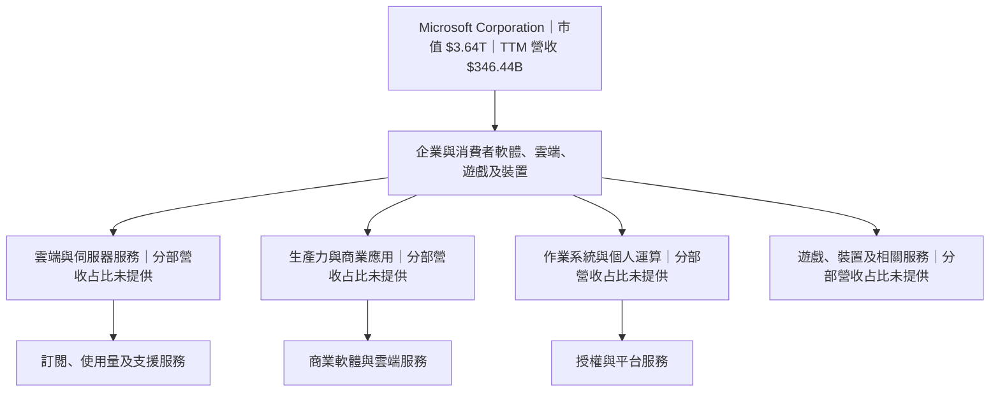
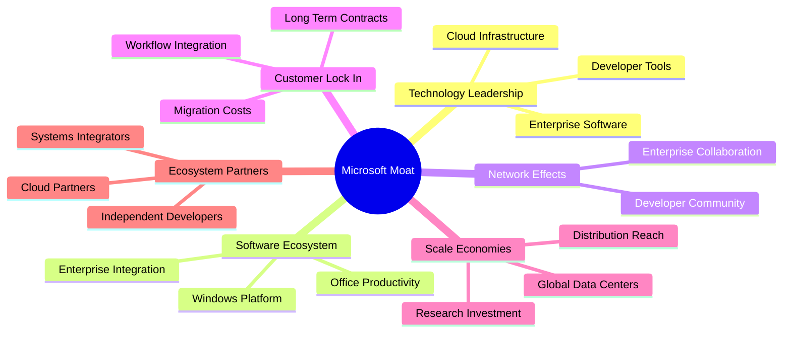
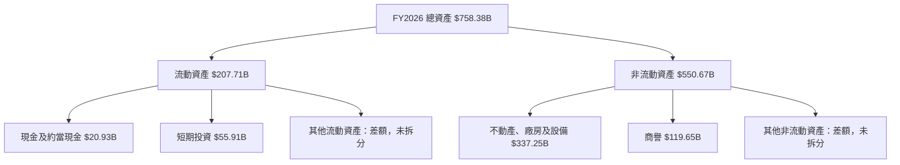
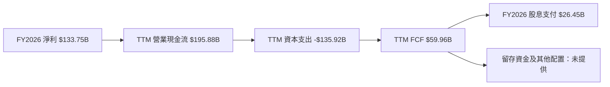
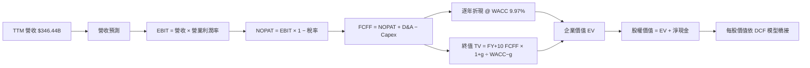
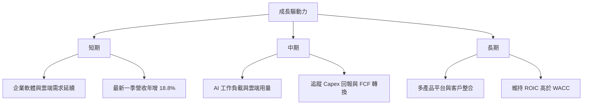
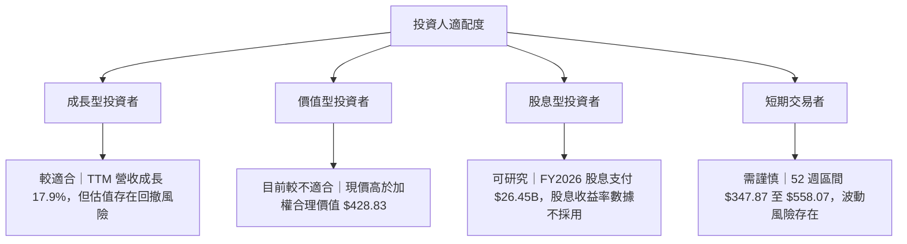

# MSFT 基本面深度分析報告
> **報告日期**：2026-11-27 ｜ **語言**：繁體中文 ｜ **數據來源**：SEC 申報資料 (XBRL)、Yahoo Finance、Finviz、StockAnalysis、Roic.ai ｜ **分析師**：CFA 級機構研究

## 目錄

| # | 章節 | 核心結論 |
|---|------|----------|
| 1 | 執行摘要 | 減碼；加權合理價值 $428.83，MOS -14.2% |
| 2 | 公司概覽與商業模式 | 多元軟體與雲端平台構成護城河；分部營收占比未提供 |
| 3 | 損益表深度分析 | TTM 營收 $346.44B、年增 17.9%；營業利益率 47.1% |
| 4 | 資產負債表分析 | VERIFIED 指標為淨現金 $29.03B；短期流動性尚可 |
| 5 | 現金流量深度分析 | TTM FCF $59.96B；資本支出升高壓低現金轉換 |
| 6 | 獲利能力與資本效率 | ROIC 29.7% 高於 WACC 9.97%，創造股東價值 |
| 7 | 相對估值分析 | 估值低於自身五年中位數，但高於所列同業倍數 |
| 8 | DCF 內在價值評估 | DCF 基準 $380.73；加權合理價值 $428.83 |
| 9 | 成長催化劑 | 雲端、AI 與企業軟體是主要質化驅動；TAM 數字未提供 |
| 10 | 風險矩陣 | AI 資本支出回報、估值與競爭是主要風險 |
| 11 | 投資建議 | 依 MOS 門檻為減碼；等待估值或基本面改善 |

---

## 1. 執行摘要

### 1.0 一頁式投資儀表板（Portfolio Manager 30 秒速讀）

| 項目 | 內容 |
|------|------|
| **投資論點（3 句）** | ① TTM 營收 $346.44B、成長 17.9%，反映企業軟體與雲端需求仍具韌性。② TTM 營業利益率 47.1%、ROIC 29.7% 對比 WACC 9.97%，顯示主業具有高資本回報。③ TTM FCF 為 $59.96B、FCF Yield 1.65%，資本支出升高使現金收益率低於盈餘表現所暗示的水準。 |
| **綜合評分** | **7.8/10**（引用 1.1 評分卡） |
| **財務健康** | 🟢 VERIFIED 指標顯示淨現金 $29.03B；Piotroski F-Score 6/9，仍有營運效率指標未通過 |
| **ROIC vs WACC** | **29.7% vs 9.97%**；利差 19.73 個百分點，創造價值 |
| **FCF 趨勢** | FY2026 年度 FCF $66.99B，低於 FY2025 的 $71.61B；TTM FCF Yield **1.65%** |
| **估值** | Forward P/E 20.24x ｜ EV/EBITDA 18.03x ｜ FCF Yield 1.65% |
| **DCF 內在價值（基準）** | **$380.73** ｜ 現價相對 DCF 溢價 **28.7%**（依現價÷DCF價值−1） |
| **安全邊際（MOS）** | **-14.2%**＝($428.83 − $489.93) ÷ $428.83；🔴 低於合理價值 |
| **預期報酬（基準情境 12M）** | **-22.3%**，採 DCF 基準情境 $380.73 相對現價計算；非 12 個月保證報酬 |
| **關鍵風險（前二）** | AI／資料中心資本支出未轉化為現金流；目前估值相對同業仍高 |
| **評級 + 信心度** | 🟠 **減碼** ｜ 信心：中 |

### 1.1 綜合評分卡（全報告唯一）

| 維度 | 評分（1–10） | 主要依據（引用數字與其來源章節） |
|------|--------------|----------------------------------|
| 成長性 | 8.5 | TTM 營收成長 17.9%、最新一季年增 18.8%（第 3 章） |
| 獲利能力 | 9.0 | TTM 營業利益率 47.1%、ROIC 29.7%；F-Score 6/9（第 3、6 章） |
| 財務健康 | 8.5 | VERIFIED 淨現金 $29.03B；CCC -67 天；流動比率 1.225（第 4 章） |
| 估值 | 4.0 | 加權合理價值 $428.83，MOS -14.2%；當前 P/E 低於自身五年中位數但高於所列同業（第 7、8 章） |
| 護城河 | 9.5 | TTM 毛利率 67.7%、營業利益率 47.1%，產品生態與企業客戶黏著度形成質化優勢（第 2 章） |
| 管理層與資本配置 | 7.0 | FY2026 SBC $12.40B、回購金額未提供；FY2026 Capex 顯著上升、年度 FCF 同比下降（第 5 章） |
| **綜合評分** | **7.8** | 六項算術平均：(8.5+9.0+8.5+4.0+9.5+7.0)÷6＝7.75，四捨五入至一位小數 |

### 1.2 五大投資論點 + 三大核心風險

| 類型 | 項目 | 具體依據 | 信心度 |
|------|------|----------|--------|
| 🟢 **投資論點①** | 營收維持雙位數成長 | TTM 營收 $346.44B，TTM 年增 17.9%；最新一季年增 18.8% | 🟢 高 |
| 🟢 **投資論點②** | 營運獲利率高 | TTM 營業利益率 47.1%，最新一季營業利益率 49.8%；規模與產品組合帶來營運槓桿 | 🟢 高 |
| 🟢 **投資論點③** | ROIC 明顯高於資本成本 | ROIC 29.7% vs WACC 9.97%，差距 19.73 個百分點 | 🟢 高 |
| 🟢 **投資論點④** | 營運資金具現金流優勢 | CCC -67 天；公司收款與付款週期使營運資金占用偏低 | 🟢 中 |
| 🟢 **投資論點⑤** | 歷史估值低於自身中位數 | P/E 25.6x 對五年中位數 31.5x；EV/EBITDA 18.0x 對 24.3x | 🟢 中 |
| 🟡 **風險①** | AI 基建資本支出回報不確定 | TTM Capex $135.92B、FCF $59.96B；建置成本已對現金流形成明顯壓力 | 🟡 中 |
| 🔴 **風險②** | 市場定價仍高於估值模型 | 現價 $489.93 高於 DCF $380.73，也高於加權合理價值 $428.83 | 🔴 高衝擊 |
| 🟡 **風險③** | 同業競爭及產品組合變化 | 同業最新一季營收成長介於 12.1% 至 29.6%；公司毛利率與成本可能受雲端／AI 組合影響 | 🟡 中 |

### 1.3 快速統計卡片

| 指標 | 公司實際值（期間） | 同業中位數 | 狀態 |
|------|--------------------|------------|------|
| 營收成長（TTM） | **17.9%** | — | 🟢 |
| 營收成長（最新一季年增） | **18.8%** | 24.7% | 🟡 |
| 毛利率（TTM） | **67.7%** | 60.9% | 🟢 |
| 營業利益率（TTM） | **47.1%** | — | 🟢 |
| ROIC（TTM） | **29.7%** | — | 🟢 |
| Forward P/E | **20.24x** | 17.7x | 🟡 |
| FCF Yield（TTM） | **1.65%** | — | 🔴 |
| Piotroski F-Score | **6 / 9** | — | 🟡 |

### 1.4 投資結論

```text
╔══════════════════════════════════════════════════════════════════╗
║                    📊 投資結論摘要                               ║
╠══════════════════════════════════════════════════════════════════╣
║  評級：減碼（MOS -14.2%，依規則 20）                             ║
║  價格（2026-11-25 收盤）：$489.93                                ║
║  DCF 內在價值（基準）：$380.73（現價溢價 28.7%）                 ║
║  安全邊際 MOS：-14.2%（＝(加權合理價值−現價)÷加權合理價值）     ║
║  加權合理價值（8.8）：$428.83                                    ║
║  DCF 情境價值：                                                   ║
║    悲觀情境：$179.98（-63.3%）                                   ║
║    基準情境：$380.73（-22.3%）                                   ║
║    樂觀情境：$738.53（+50.7%）                                   ║
║  綜合評分：7.8/10（引用 1.1）                                    ║
║  適合投資人：看重企業軟體與雲端長期成長、可承受估值波動者        ║
╚══════════════════════════════════════════════════════════════════╝
```

---

## 2. 公司概覽與商業模式

### 2.1 業務結構與收入來源

SEC 公司描述顯示，Microsoft 提供作業系統、伺服器應用、商業解決方案、開發工具、管理工具、遊戲及裝置等產品。分部營收與占比未提供，因此不推算各板塊比例。



### 2.2 市場份額

市場份額數據未提供，亦無法依營收直接推算市場占有率。Microsoft TTM 營收 $346.44B、年增 17.9%，最新一季年增 18.8%，顯示其規模與成長並存；但與 Alphabet、Amazon、Oracle 的市場份額比較需一致的市場定義與年份資料，現有資料不足以量化。

### 2.3 競爭護城河分析



### 2.4 護城河強度

| 護城河項目 | 強度（強／中／弱） | 證據（引用數字或事實） | 會削弱它的情況 |
|------------|--------------------|------------------------|----------------|
| 技術與平台 | 強 | TTM 營業利益率 47.1%；產品涵蓋作業系統、伺服器、開發及企業應用 | 開源替代、AI 平台轉移或雲端服務商品化 |
| 軟體生態系統 | 強 | 企業工作流程、開發工具及生產力應用組合形成整合價值；分部數字未提供 | 客戶轉向跨平台或低成本替代方案 |
| 客戶鎖定 | 強 | 長期部署、資料遷移與員工培訓形成轉換成本；量化續約率未提供 | 雲端遷移降低轉換成本、服務中斷或定價失衡 |
| 規模效應 | 強 | 市值 $3.64T、TTM 營收 $346.44B，可支持高額研發及基礎建設投入 | 資本支出增長快於雲端需求與現金回收 |
| 網路效應 | 中 | 開發者工具、企業協作與合作夥伴有互補性；活躍用戶數未提供 | 使用者與開發者轉向競爭平台 |
| 生態夥伴 | 中 | 公司產品可透過系統整合商與軟體開發者部署；合作收入未提供 | 夥伴多平台策略或自建產品替代 |

**護城河分數理由：**1.1 的護城河評分為 9.5/10，依據是多產品平台、企業轉換成本及 47.1% TTM 營業利益率；分部與客戶留存數據未提供，故不以市占率或續約率作進一步量化。

---

## 3. 損益表深度分析

### 3.1 年度收入成長趨勢（近4年）

年度收入以財報列示值為準；圖中長條為相對視覺化呈現，比例尺取整。

```text
╔══════════════════════════════════════════════════════════════════╗
║              Microsoft 年度收入趨勢（FY2023-FY2026）             ║
╠══════════════════════════════════════════════════════════════════╣
║  FY2023  $211.91B  █████████████░░░░░░░░░░░░░░  YoY：基期       ║
║  FY2024  $245.12B  ███████████████░░░░░░░░░░░░  YoY：+15.7% 🟢  ║
║  FY2025  $281.72B  █████████████████░░░░░░░░░░  YoY：+14.9% 🟢  ║
║  FY2026  $331.84B  ████████████████████░░░░░░░  YoY：+17.8% 🟢  ║
╠══════════════════════════════════════════════════════════════════╣
║  FY2023-FY2026 營收 CAGR：約 16.1%                               ║
╚══════════════════════════════════════════════════════════════════╝
```

FY2026 年營收 $331.84B，較 FY2025 增長 17.8%，高於 FY2025 的 14.9%。長期企業軟體訂閱與雲端服務的擴張是合理的質化解釋，但因未提供分部成長數字，不能將增長歸因於單一產品。

### 3.2 季度收入趨勢分析

| 季度 | 營收（$B） | QoQ 成長 | YoY 成長 | 備註 |
|------|-----------:|---------:|---------:|------|
| 2025-12-31 | 81.27 | N/A | 16.72% | YoY 依 StockAnalysis 季度列示 |
| 2026-03-31 | 82.89 | +1.98% | 18.30% | 季度營收較前季增加 |
| 2026-06-30 | 90.01 | +8.59% | 17.75% | 季節性與收入確認可能影響 QoQ |
| 2026-09-30 | 92.28 | +2.52% | 18.80% | 最新一季年增率為單季 YoY，非 TTM |

最新一季營收年增 18.8%，與 TTM 成長率 17.9% 相近，表示增長尚未顯示明顯失速；QoQ 變化則受季度季節性影響，不宜單獨外推全年。

### 3.3 利潤率演變分析

以下年度比率由各年度損益表金額計算，四捨五入至一位小數。

| 利潤率指標 | FY2023 | FY2024 | FY2025 | FY2026 | 趨勢 | 評估 |
|------------|-------:|-------:|-------:|-------:|------|------|
| **毛利率** | 68.9% | 69.8% | 68.8% | 67.9% | 近兩年回落 | 🟡 |
| **營業利益率** | 41.8% | 44.6% | 45.6% | 46.8% | 持續擴張 | 🟢 |
| **淨利率** | 34.1% | 36.0% | 36.1% | 40.3% | FY2026 上升 | 🟢 |

營業利益率由 FY2023 的 41.8% 升至 FY2026 的 46.8%，營收擴張快於營業費用是營運槓桿改善的可能來源。同期毛利率由 FY2024 的 69.8% 降至 FY2026 的 67.9%，可能反映雲端基礎建設及產品組合的成本壓力；財務資料沒有提供分部毛利或成本拆解，不能將其歸因於特定業務。FY2026 淨利率 40.3% 高於 TTM 淨利率 41.2% 的期間口徑不可直接比較；兩者期間不同，應避免視為趨勢矛盾。

### 3.4 費用結構分析

收入成本與營業費用金額未完整提供同一期間拆分，且資本支出不屬於損益費用，故不繪製費用占比圓餅圖。可確認 FY2026 研發費用為 $35.56B，約為年度營收 $331.84B 的 10.7%；該比率是依披露金額計算，研發投入有助於產品迭代，但短期會限制營業利益率擴張幅度。

### 3.5 季度 EPS 趨勢與盈餘品質（Quality of Earnings）

EPS 預估值在 EPS Beats/Misses 資料中均為 NaN，因此不能判斷過去四季是否超預期或不及預期。可觀察實際 EPS 及同比成長如下：

| 季度 | 實際 EPS | EPS YoY | 超預期／不及預期 |
|------|---------:|-------:|------------------|
| 2025-12-31 | $5.16 | +59.75% | N/A（預估值缺漏） |
| 2026-03-31 | $4.27 | +23.41% | N/A（預估值缺漏） |
| 2026-06-30 | $4.81 | +31.74% | N/A（預估值缺漏） |
| 2026-09-30 | $4.92 | +32.26% | N/A（預估值缺漏） |

| 盈餘品質項目 | 數值／佔比 | 評估 |
|--------------|-----------|------|
| 股權薪酬 SBC / 營收 | 約 3.6%；以已列四季 SBC 合計 $12.55B ÷ TTM 營收 $346.44B 計 | 🟡 具持續稀釋成本；GAAP 利潤已費用化 SBC，但股東仍承擔股數稀釋 |
| SBC / 營業現金流 | 約 6.4%；$12.55B ÷ $195.88B | 🟡 非主導現金流項目，但不可忽略 |
| FCF / 淨利（現金轉換率） | 約 42.0%；$59.96B ÷ TTM 淨利 $142.63B | 🔴 Capex 吸收大量營業現金流，現金轉換偏低 |
| 一次性／非經常性損益 | N/A（未提供足以量化的明細） | 不應假設當期盈餘由一次性收益美化 |
| 有效稅率異常 | 19.4%（最新年度有效稅率） | 🟢 未見資料顯示極端異常；年度稅務明細不足 |
| 資本化支出 vs 費用化 | TTM Capex $135.92B，約為 TTM 營收 39.2% | 🟡 資本投入高；資料不足以確認資本化政策是否改變 |

SBC 數值以最近四個季度已披露金額加總；因季度資料與 TTM 營收期間不同，比例應視為近似。FY2026 SBC 為 $12.40B。整體盈餘由持續經營收入與營業現金流支撐，但 TTM FCF 只相當於淨利約 42.0%，主要需要留意 Capex 對現金流的擠壓。估值不宜只依 GAAP EPS 成長外推，應同步追蹤資本支出與 FCF 回升。

---

## 4. 資產負債表分析

### 4.1 資產結構分解

最近年度總資產為 $758.38B；以下圖表只展示有披露數字的分類。現金與短期投資採 VERIFIED 指標 $64.51B；其他資產細項以 FY2026 年度資產負債表為準。



### 4.2 流動性與營運資金分析

| 指標 | 最新 TTM | 一年前 TTM | 變化 | 解讀 |
|------|----------|------------|------|------|
| DSO 應收帳款天數 | 65 天 | 66 天 | -1 天 | 收款週期略縮短，未顯示明顯惡化 |
| DIO 存貨天數 | 6 天 | 4 天 | +2 天 | 庫存天數上升，幅度有限；可能與產品組合或備貨有關，原因未能由現有數據確認 |
| DPO 應付帳款天數 | 139 天 | 130 天 | +9 天 | 付款週期延長，可能降低營運資金需求，但須關注供應商條款 |
| CCC 現金轉換週期 | -67 天 | -59 天 | -8 天 | 負 CCC 擴大；回款與付款時點有利於營運資金，但不代表沒有供應鏈風險 |

流動性指標：流動比率 1.225、速動比率 1.068；FY2026 流動資產 $207.71B、流動負債 $168.82B。比率高於 1 表示短期資產可覆蓋短期負債，但不應把帳面流動資產等同於可自由支配現金。

### 4.3 債務結構分析

不同資料來源的債務數字不一致：VERIFIED 指標為總債務 $35.48B、現金與短期投資 $64.51B、淨現金 $29.03B；其他市場資料列示總債務 $133.93B。依嚴格數據優先原則，本節引用 VERIFIED 指標，不將兩組口徑混用。

```text
╔══════════════════════════════════════════════════════════════════╗
║                   Microsoft 債務健康診斷                        ║
╠══════════════════════════════════════════════════════════════════╣
║  總債務：        $35.48B   ██░░░░░░░░░░░░░░░░░░  🟢             ║
║  現金+短期投資： $64.51B   ████████████████████  🟢             ║
║  淨現金：        $29.03B   █████████░░░░░░░░░░░  🟢             ║
║                                                                  ║
║  Debt/EBITDA：N/A（債務來源口徑與 EBITDA 口徑不一致）            ║
║  Interest Coverage：N/A（利息費用及對應債務口徑未完整提供）      ║
╚══════════════════════════════════════════════════════════════════╝
```

### 4.4 股東權益趨勢

| 財年 | 股東權益（$B） | YoY 成長 |
|------|---------------:|---------:|
| FY2023 | 206.22 | — |
| FY2024 | 268.48 | +30.2% |
| FY2025 | 343.48 | +27.9% |
| FY2026 | 442.39 | +28.8% |

```text
╔══════════════════════════════════════════════════════════════════╗
║              股東權益趨勢（FY2023-FY2026）                       ║
╠══════════════════════════════════════════════════════════════════╣
║  FY2023  $206.22B  █████████░░░░░░░░░░░░░░░░░░                  ║
║  FY2024  $268.48B  █████████████░░░░░░░░░░░░░░                  ║
║  FY2025  $343.48B  █████████████████░░░░░░░░░░                  ║
║  FY2026  $442.39B  ██████████████████████░░░░░░                  ║
╚══════════════════════════════════════════════════════════════════╝
```

---

## 5. 現金流量深度分析

### 5.1 現金流量瀑布圖

年度淨利採 FY2026 $133.75B；營業現金流與 Capex 採 VERIFIED TTM 值，期間不同，故以流程圖呈現，不將異期數字誤作精確瀑布加總。



### 5.2 FCF 轉換率趨勢

| 財年 | FCF（$B） | 淨利（$B） | FCF / 淨利 | 趨勢 |
|------|----------:|-----------:|-----------:|------|
| FY2023 | 59.48 | 72.36 | 82.2% | — |
| FY2024 | 74.07 | 88.14 | 84.0% | 改善 |
| FY2025 | 71.61 | 101.83 | 70.3% | 回落 |
| FY2026 | 66.99 | 133.75 | 50.1% | 進一步回落 |

FY2026 營業現金流 $182.94B，但 Capex 為 $115.95B，年度 FCF $66.99B。淨利增長快於自由現金流，反映投資資本支出增加，而非單純盈餘品質惡化；關鍵在於新增資料中心與設備能否帶來未來現金回報。

### 5.3 自由現金流趨勢

| 期間 | FCF（$B） | 變化 |
|------|----------:|-----:|
| FY2023 | 59.48 | — |
| FY2024 | 74.07 | +24.5% |
| FY2025 | 71.61 | -3.3% |
| FY2026 | 66.99 | -6.5% |
| TTM 至 2026-09-30 | 59.96 | TTM 口徑 |

```text
╔══════════════════════════════════════════════════════════════════╗
║               自由現金流趨勢（年度與 TTM）                       ║
╠══════════════════════════════════════════════════════════════════╣
║  FY2023  $59.48B  ████████████████░░░░  FCF Yield：N/A          ║
║  FY2024  $74.07B  ████████████████████  FCF Yield：N/A          ║
║  FY2025  $71.61B  ███████████████████░  FCF Yield：N/A          ║
║  FY2026  $66.99B  ██████████████████░░  FCF Yield：N/A          ║
║  TTM      $59.96B  ████████████████░░░░  FCF Yield：1.65%       ║
╚══════════════════════════════════════════════════════════════════╝
```

FY2026 年度 FCF 連續第二年下降，與 Capex 上升相伴；TTM FCF Yield 1.65% 表示股價已反映較高的未來增長預期，現金回報率本身不高。

### 5.4 資本配置評估

| 資本配置項目 | 可得數字 | 評估 |
|--------------|----------|------|
| 資本支出 | FY2026 $115.95B；TTM $135.92B | 🟡 投資規模大，需追蹤新增產能變現 |
| 股息 | FY2026 $26.45B | 🟢 持續現金回饋；與年度 FCF 同期比較約占 39.5% |
| 回購 | N/A（回購金額未提供） | 無法量化回購對股數及每股價值的貢獻 |
| 研發 | FY2026 $35.56B | 🟢 支持平台更新；研發回報週期較長 |
| 留存及其他投資 | N/A（完整用途拆分未提供） | 無法進一步分配 |

---

## 6. 獲利能力與資本效率

### 6.1 ROE / ROA / ROIC 趨勢

| 指標 | 可得期間與數值 | 評估 |
|------|----------------|------|
| ROE | TTM 30.3%（品質指標口徑）；另一資料來源列示 34.2% | 🟢 高；來源口徑不一致，本文採 VERIFIED TTM 30.3% |
| ROA | TTM 14.4% | 🟢 資產獲利能力良好 |
| ROIC | TTM 29.7% | 🟢 明顯高於 WACC 9.97% |
| FY2026 ROIC 歷史值 | N/A（未提供相同口徑年度序列） | 不以不一致的歷史序列推算 |

### 6.2 ROIC vs WACC 分析（核心價值創造判斷）

Cost of capital 的 WACC 為唯一採用折現率。Beta 使用調整後 1.03；原始 Yahoo Beta 為 1.04。債務成本資料提供稅前 8.60%，但利息費用及平均計息負債明細未提供，故不另行重建 Kd。

```text
╔══════════════════════════════════════════════════════════════════╗
║                ROIC vs WACC 深度分析                             ║
╠══════════════════════════════════════════════════════════════════╣
║  WACC 估算：                                                     ║
║  ├── 無風險利率（10Y美債）：  4.85%                              ║
║  ├── 市場風險溢酬 ERP：       5.00%                              ║
║  ├── 原始 Beta：              1.04                               ║
║  ├── 調整後 Beta：            1.03                               ║
║  ├── 股權成本：               10.00%                             ║
║  ├── 稅前債務成本：           8.60%                              ║
║  ├── 資本結構：股權 99.0%，債務 1.0%                             ║
║  └── ✅ 採用 WACC：           9.97%                              ║
║                                                                  ║
║  ROIC（TTM）：               29.7%                               ║
║  EVA 利差 = 29.7% - 9.97% = 19.73 個百分點                       ║
║                                                                  ║
║  ROIC 29.7%  ▓▓▓▓▓▓▓▓▓▓▓▓▓▓▓▓▓▓▓▓▓▓▓▓▓▓▓▓▓▓▓▓▓▓▓▓▓▓▓▓          ║
║  WACC  9.97% ▓▓▓▓▓▓▓▓▓▓▓▓▓▓░░░░░░░░░░░░░░░░░░░░░░░░          ║
║                                                                  ║
║  結論：ROIC 約為 WACC 的 2.98 倍，現有資本配置創造股東價值。     ║
╚══════════════════════════════════════════════════════════════════╝
```

ROIC 與 WACC 的差額是正值，代表每一單位投入資本產生的回報高於資本成本。但高 ROIC 不等同於任何價格都值得買入；現價與估值的落差仍由第 8 章評估。

### 6.3 杜邦三因素分解

| 因素 | 數值（TTM） | 解讀 |
|------|-------------|------|
| 淨利率 | 41.2% | 高淨利率是 ROE 的主要來源之一 |
| 資產週轉率 | 0.44 | 資產密集度上升時，週轉率可能受壓 |
| 權益乘數 | 1.66 | 槓桿並非 ROE 的主要支撐 |
| **ROE** | **30.3%** | 41.2% × 0.44 × 1.66 = 約 30.1%；與公布 30.3% 的差異來自四捨五入 |

### 6.4 財務體質：Piotroski F-Score

**Piotroski F-Score：6 / 9**。可判定的九項測試如下：

| 測試 | 結果 | 解讀 |
|------|------|------|
| ROA > 0 | ✅ 通過 | 公司持續獲利 |
| 營業現金流 > 0 | ✅ 通過 | 營運有正現金流 |
| ROA 高於一年前 | ✅ 通過 | 資產獲利能力改善 |
| 營業現金流 > 淨利（應計品質） | ✅ 通過 | 現金流有支持盈餘 |
| 長期負債 ÷ 總資產低於一年前 | ✅ 通過 | 槓桿相對改善 |
| 流動比率高於一年前 | ❌ 未通過 | 短期流動性比率未改善 |
| 稀釋股數未增加 | ✅ 通過 | 該測試按計算口徑通過 |
| 毛利率高於一年前 | ❌ 未通過 | 毛利率同比未改善，需追蹤雲端成本及產品組合 |
| 資產週轉率高於一年前 | ❌ 未通過 | 資產擴張可能快於收入周轉 |

---

## 7. 相對估值分析

### 7.1 同業估值比較表格

| 估值指標 | **MSFT** | **GOOG** | **AMZN** | **ORCL** | MSFT 評估 |
|----------|---------:|---------:|---------:|---------:|-----------|
| **Trailing P/E** | 25.6x | 14.2x | 19.8x | 16.3x | 🔴 高於三家同業 |
| **Forward P/E** | 20.24x | 17.7x | 22.4x | 9.4x | 🟡 高於同業中位數 17.7x |
| **P/S Ratio** | 10.5x | 7.1x | 3.3x | 4.5x | 🔴 高於同業中位數 4.5x |
| **EV/EBITDA** | 18.0x | 17.4x | 15.4x | 13.1x | 🔴 高於同業中位數 15.4x |
| 最新一季營收成長 | 18.8% | 24.7% | 12.1% | 29.6% | 🟡 高於 AMZN，低於 GOOG、ORCL |
| TTM 毛利率 | 67.7% | 60.9% | 51.4% | 64.0% | 🟢 高於所列同業 |

MSFT 的估值溢價需要由較高的營業利潤率、現金流穩定性及平台整合能力支撐。相對估值並不表示同業更具投資吸引力，因為企業成長結構和風險差異未在倍數中完整反映。

### 7.2 歷史估值區間分析

```text
╔══════════════════════════════════════════════════════════════════╗
║             MSFT 五年估值區間與目前位置                         ║
╠══════════════════════════════════════════════════════════════════╣
║  P/E        20.8x ├────────● 25.6x ─────────┤ 37.8x            ║
║                       五年中位數 31.5x｜目前百分位 14%           ║
║  P/S         8.4x ├──────● 10.5x ──────────┤ 13.7x             ║
║                       五年中位數 12.0x｜目前百分位 33%           ║
║  EV/EBITDA  14.5x ├──● 18.0x ──────────────┤ 31.4x             ║
║                       五年中位數 24.3x｜目前百分位 10%           ║
╚══════════════════════════════════════════════════════════════════╝
```

目前 P/E 與 EV/EBITDA 均低於五年中位數，但這只表示相對自身歷史較便宜，不足以證明低估；相對同業，MSFT 仍有倍數溢價。

### 7.3 情境價值（Bear / Base / Bull，照抄 DCF MODEL 的 Scenarios）

| 情境 | 第 1 年營收成長 | 期末營業利潤率 | WACC | 每股價值 | 相對現價 | 機率 | 會發生的條件 |
|------|----------------:|---------------:|-----:|---------:|---------:|-----:|--------------|
| 🔴 悲觀 | 9.0% | 38.8% | 10.97% | $179.98 | -63.3% | 25% | 雲端或 AI 成長顯著放緩，且資本支出與競爭壓縮利潤率 |
| 🟡 基準 | 17.9% | 45.6% | 9.97% | $380.73 | -22.3% | 50% | 成長逐年回落至長期水準，營業利潤率略收斂 |
| 🟢 樂觀 | 26.9% | 50.2% | 8.97% | $738.53 | +50.7% | 25% | AI 與雲端需求超預期、規模效應抵銷高資本支出 |

### 7.4 相對估值隱含價格區間

```text
╔══════════════════════════════════════════════════════════════════╗
║               相對估值與分析師目標價                             ║
╠══════════════════════════════════════════════════════════════════╣
║  $380.73 ─ $422.40 ─ $428.82 ─ $489.93 ───────── $637.36        ║
║  DCF       EV/EBITDA   Forward P/E   現價         分析師共識       ║
╚══════════════════════════════════════════════════════════════════╝
```

- **同業 Forward P/E：$428.82**＝同業中位數 17.7x × Forward EPS $24.20。
- **同業 EV/EBITDA：$422.40**＝同業中位數 15.4x × 公司 TTM EBITDA，再加淨現金。
- 相對估值方法使用 GOOG、AMZN、ORCL 同業倍數，不使用 MSFT 自身當前倍數。
- 分析師共識目標價 $637.36，為 54 位分析師平均值；此值較高，可能包含市場對未來成長的樂觀預期。

---

## 8. DCF 內在價值評估（Discounted Cash Flow）

### 8.0 估值推理鏈（Thinking Logic：在算之前先想清楚）

**核心命題：**MSFT 的價值主要由現有企業軟體與雲端現金流、AI／資料中心投資帶來的第二成長曲線，以及既有平台客戶黏著度構成。現有資料沒有分部營收占比，因此不能以某個分部占比作定量拆分。模型對價值最敏感的變數是 WACC、永續成長率與長期資本支出回落速度；敏感度矩陣顯示 WACC 與 g 的變化足以造成明顯估值差異。

| 決策點 | 本報告採用 | 理由（含數字） | 曾考慮但否決 | 否決理由 |
|--------|-----------|----------------|--------------|----------|
| 現金流定義 | FCFF | 以 WACC 折現後得到 EV；模型定義為 NOPAT + D&A − Capex | FCFE | 模型已固定 FCFF，資料未提供完整融資與股利預測 |
| 預測期 N | 10 年 | DCF 模型設定 10 年，將 TTM 成長率逐步淡化 | 5 年 | 無法捕捉模型中的長期成長與 Capex 下降路徑 |
| 終值方法 | Gordon Growth | DCF 模型以 3.0% 永續成長率計算 | 退出倍數 | DCF 模型未提供退出倍數終值，不自行增建模型 |
| EBIT 基礎 | GAAP EBIT | DCF 模型採 GAAP 營業利益率 | 非 GAAP EBIT | 避免把 SBC 加回而低估股東成本 |

**關鍵假設推導鏈：**

- **成長率**：錨點＝TTM 營收成長 17.9% → 採用 FY+1 17.9%，FY+10 逐步降至 3.0% → 替代方案曾考慮直接延續 17.9% 十年，但因基期擴大與長期成長收斂而否決。
- **期末營業利潤率**：錨點＝TTM 營業利益率 47.1%、五年歷史中位數由模型使用 → 採用 FY+10 45.6% → 替代方案曾考慮維持 47.1%，但未採用，因長期競爭與成本投入可能使利潤率回歸。
- **Capex／營收**：錨點＝TTM Capex／營收 39.2% → 模型採 FY+1 39.2% 線性降至 FY+10 12.2% → 未採用長期維持 39.2%，因其會持續壓低 FCFF；也未採用立即回到低資本密集度，避免過度樂觀。
- **預測期 N**：採 10 年，與模型固定設定一致 → 5 年會提前進入終值，15 年則缺乏可核對的年度業務假設，因此未採用。
- **永續成長率 g**：採 3.0%，低於 WACC 9.97%；相較更高永續成長假設，3.0% 較克制，也可避免終值以過高永續增長主導。
- **WACC**：採 9.97%，直接使用 Cost of capital 計算結果；不另以自訂風險溢酬改寫。
- **SBC／稀釋**：採組合 **(A)**：GAAP EBIT 已含 SBC 費用，因此 FCFF 不再扣 SBC，且年稀釋率為 0%，避免重複扣除或漏計模型設定中的成本。
- **營運資金變動**：模型未建模 ΔWC；不自行補入未提供的未來營運資金假設。

**最脆弱的一環：**Capex／營收由 39.2% 降至 12.2% 的速度；若資料中心投資長期維持高檔，FCFF 將低於基準預測，內在價值下修。



### 8.1 模型假設總表（Model Inputs）

| 假設項目 | 採用值 | 依據／來源 | 敏感度 |
|----------|--------|-------------|--------|
| 預測期長度 N | 10 年 | DCF MODEL 固定設定 | 🟡 中 |
| 營收成長 | FY+1 17.9%，FY+10 3.0%，線性淡化 | TTM vs prior TTM 成長 17.9%；終年 3.0% 為模型假設 | 🔴 高 |
| 營業利潤率 | FY+1 47.1% → FY+10 45.6% | TTM 47.1%，期末向最近五財年中位數收斂 | 🔴 高 |
| 有效稅率 | 19.4% | 最新年度有效稅率 | 🟢 低 |
| Capex／營收 | FY+1 39.2% → FY+10 12.2% | TTM 起點 39.2%，向模型設定終值淡化 | 🔴 高 |
| D&A／營收 | 11.1% | TTM 比率，模型固定 | 🟢 低 |
| ΔWC／營收增額 | 未建模 | DCF MODEL 未納入營運資金變動 | 🟢 低 |
| EBIT 基礎 | GAAP EBIT | DCF MODEL 說明 | 🟡 中 |
| SBC 處理 | GAAP EBIT 已含 SBC，不再扣除 | 採組合 (A) | 🟡 中 |
| 年稀釋率 | 0% | 固定股數組合 (A) | 🟡 中 |
| 永續成長率 g | 3.0% | DCF MODEL 假設，低於 WACC 9.97% | 🔴 高 |
| 終值方法 | Gordon Growth | DCF MODEL 提供之基準終值 | 🔴 高 |
| WACC | 9.97% | Cost of capital 區塊 | 🔴 高 |

### 8.2 折現率推導（WACC）

```text
╔══════════════════════════════════════════════════════════════════╗
║                    WACC 推導（折現率）                           ║
╠══════════════════════════════════════════════════════════════════╣
║  股權成本 Ke（CAPM）：                                           ║
║  ├── 無風險利率 Rf：               4.85%                         ║
║  ├── 市場風險溢酬 ERP：            5.00%                         ║
║  ├── 原始 Beta（Yahoo）：          1.04                          ║
║  ├── 調整後 Beta：                 1.03                          ║
║  ├── Beta 調整：                   ⅔×1.04 + ⅓×1.00 = 1.03       ║
║  └── Ke = 4.85% + 1.03×5.00% = 10.00%                           ║
║                                                                  ║
║  債務成本 Kd：                                                   ║
║  ├── 稅前 Kd：                     8.60%                         ║
║  ├── 有效稅率：                    19.4%                         ║
║  └── 稅後 Kd = 8.60%×(1−19.4%) = 6.93%                          ║
║                                                                  ║
║  資本結構（市值基礎，來源所列權重）：                             ║
║  ├── 股權權重 E：                  99.0%                         ║
║  ├── 債務權重 D：                  1.0%                          ║
║  └── WACC = 99.0%×10.00% + 1.0%×6.93% = 9.97%                   ║
╚══════════════════════════════════════════════════════════════════╝
```

逐步演算：

1. **Ke（CAPM）** = 4.85% + 1.03 × 5.00% = **10.00%**。
2. **稅前 Kd** = **8.60%**（來源提供的利息÷債務代理值；利息金額與平均計息負債明細未提供，不能獨立重算）。
3. **稅後 Kd** = 8.60% × (1 − 19.4%) = **6.93%**。
4. **權重**：股權 99.0% + 債務 1.0% = **100.0%**。市值及計息債務的詳細明細未提供，因此直接採用來源所列市場權重，不以帳面權益重算。
5. **WACC** = 99.0% × 10.00% + 1.0% × 6.93% = 9.900% + 0.0693% = 9.9693% ≈ **9.97%**。

Rf 的觀察日期未提供；ERP 為 Cost of capital 所列假設值；不另加規模或國別溢酬。第 6.2 節與本節採用相同 WACC 9.97%。

### 8.3 逐年自由現金流預測（基準情境）

以下表格逐年照錄 DCF MODEL。金額單位為 $B；折現因子與結果依模型顯示值。

| 年度 | FY+1 | FY+2 | FY+3 | FY+4 | FY+5 | FY+6 | FY+7 | FY+8 | FY+9 | FY+10 |
|------|-----:|-----:|-----:|-----:|-----:|-----:|-----:|-----:|-----:|------:|
| 營收 | 408.51 | 474.92 | 544.25 | 614.69 | 684.06 | 749.93 | 809.71 | 860.83 | 900.92 | 927.95 |
| 營收 YoY | 17.9% | 16.3% | 14.6% | 12.9% | 11.3% | 9.6% | 8.0% | 6.3% | 4.7% | 3.0% |
| 營業利潤率 | 47.1% | 46.9% | 46.8% | 46.6% | 46.4% | 46.3% | 46.1% | 46.0% | 45.8% | 45.6% |
| EBIT（GAAP） | 192.42 | 222.92 | 254.57 | 286.51 | 317.72 | 347.07 | 373.41 | 395.56 | 412.50 | 423.35 |
| − 稅 | (37.32) | (43.24) | (49.38) | (55.57) | (61.63) | (67.32) | (72.43) | (76.72) | (80.01) | (82.11) |
| = NOPAT | 155.10 | 179.69 | 205.20 | 230.94 | 256.09 | 279.75 | 300.98 | 318.84 | 332.49 | 341.24 |
| + D&A | 45.16 | 52.50 | 60.17 | 67.96 | 75.62 | 82.91 | 89.51 | 95.17 | 99.60 | 102.59 |
| − Capex | (160.27) | (172.04) | (180.78) | (185.69) | (186.07) | (181.43) | (171.53) | (156.47) | (136.66) | (112.84) |
| **= FCFF** | **39.99** | **60.15** | **84.58** | **113.20** | **145.64** | **181.23** | **218.96** | **257.53** | **295.43** | **330.98** |
| 折現因子 @9.97% | 0.909 | 0.827 | 0.752 | 0.684 | 0.622 | 0.565 | 0.514 | 0.468 | 0.425 | 0.387 |
| **FCFF 現值 PV** | **36.37** | **49.74** | **63.60** | **77.41** | **90.56** | **102.48** | **112.59** | **120.42** | **125.62** | **127.97** |

**預測期 FCF 現值合計：**

36.37 + 49.74 + 63.60 + 77.41 + 90.56 + 102.48 + 112.59 + 120.42 + 125.62 + 127.97 = **906.76B**；模型列示合計 **$906.75B**，差異約 0.01B，屬逐年四捨五入尾差。

**FY+1 逐步演算：**

1. 營收 = $346.44B × (1 + 17.9%) = **$408.51B**。
2. EBIT = $408.51B × 47.1% = **$192.42B**。
3. 稅 = $192.42B × 19.4% = **$37.32B**。
4. NOPAT = $192.42B − $37.32B = **$155.10B**。
5. D&A = $408.51B × 11.1% = **$45.16B**。
6. Capex = $408.51B × 39.2% = **$160.27B**。
7. ΔWC = **未建模**，不另加減。
8. FCFF = $155.10B + $45.16B − $160.27B = **$39.99B**。
9. 折現因子 = 1 ÷ (1 + 9.97%)¹ = **0.909**；PV 按模型未四捨五入折現因子計算，列示為 **$36.37B**。

**合理性自檢：**

- 歷史年度 FCF 從 FY2023 $59.48B 至 FY2026 $66.99B，三年 CAGR 約 4.0%；模型 FY+1 至 FY+10 的 FCFF 由 $39.99B 增至 $330.98B，增幅大幅高於歷史，主要依賴 Capex／營收從 39.2% 降至 12.2%。
- FY+10 FCFF 利潤率 = $330.98B ÷ $927.95B = **35.7%**；目前 TTM FCF 利潤率 = $59.96B ÷ $346.44B = **17.3%**。同業最佳值未提供，無法比較。
- 預測期間 FCFF 均為正值；但 FY+1 FCF 低於 TTM FCF 的主要原因是模型採用高額起始 Capex。

```text
╔══════════════════════════════════════════════════════════════════╗
║            自由現金流：歷史實際 vs 模型預測                      ║
╠══════════════════════════════════════════════════════════════════╣
║  FY2024（實） $74.07B  █████████░░░░░░░░░░░  YoY：+24.5%       ║
║  FY2025（實） $71.61B  █████████░░░░░░░░░░░  YoY：-3.3%        ║
║  FY2026（實） $66.99B  ████████░░░░░░░░░░░░  YoY：-6.5%        ║
║  FY+1（預）   $39.99B  █████░░░░░░░░░░░░░░░  模型值            ║
║  FY+10（預）  $330.98B ████████████████████  模型值            ║
╠══════════════════════════════════════════════════════════════════╣
║  預測現金流增長依賴長期 Capex 率下行；這是主要模型風險。         ║
╚══════════════════════════════════════════════════════════════════╝
```

### 8.4 終值計算（Terminal Value）

適用性檢查：**WACC 9.97% vs g 3.0% → WACC > g？✅**

| 方法 | 計算式 | 終值 TV | TV 現值 | 佔總 EV 比重 |
|------|--------|---------:|--------:|-------------:|
| Gordon Growth | FY+10 FCFF × (1+g) ÷ (WACC−g) | $4,892.18B | $1,891.58B | 67.6% |
| 退出倍數法 | N/A（DCF MODEL 未提供退出倍數終值） | N/A | N/A | N/A |

逐步演算（模型內部以未四捨五入數字計算，顯示值可能有尾差）：

1. FY+10 FCFF = **$330.98B**。
2. 分子 = $330.98B × (1 + 3.0%) = **$340.91B**。
3. 分母 = 9.97% − 3.0% = **6.97%**；TV = 模型計算 **$4,892.18B**。以表格四捨五入後的輸入重算，結果會有細微尾差。
4. PV(TV) = 模型終值按第 10 年折現，列示 **$1,891.58B**；模型折現因子顯示為 0.387，實際計算使用未四捨五入因子。
5. 終值佔比 = $1,891.58B ÷ $2,798.33B = **67.6%**。

終值現值占 EV 67.6%，低於 75% 警示線，但仍是估值的重要來源。退出倍數法所需終值倍數與模型計算未提供，依規則不自行建立。

### 8.5 企業價值 → 每股內在價值（Bridge）

```text
╔══════════════════════════════════════════════════════════════════╗
║              企業價值 → 每股內在價值 橋接表                      ║
╠══════════════════════════════════════════════════════════════════╣
║  預測期 FCF 現值合計            +$906.75B                        ║
║  終值現值 PV(TV)               +$1,891.58B                      ║
║  ─────────────────────────────────────────────                  ║
║  = 企業價值 EV                  $2,798.33B                      ║
║  + 淨現金                       +$29.03B                         ║
║  = 股權價值                     $2,827.36B                      ║
║  每股價值依 DCF MODEL：         $380.73                          ║
║  當前股價（2026-11-25 收盤）    $489.93                          ║
║  折溢價（現價÷內在價值−1）      +28.7%（溢價）                   ║
╚══════════════════════════════════════════════════════════════════╝
```

1. EV = $906.75B + $1,891.58B = **$2,798.33B**。
2. 股權價值 = $2,798.33B + $29.03B = **$2,827.36B**。
3. 每股內在價值按模型公式：股權價值 × 價格 ÷ 市值 = **$380.73**。模型採用價格與市值的比例橋接，不以未提供的另一組稀釋股數自行重算。
4. 折溢價 = $489.93 ÷ $380.73 − 1 = **+28.7%**。
5. 本節不計算 MOS；MOS 僅以 8.8 加權合理價值為分母。

**SBC 處理：**採組合 (A)，GAAP EBIT 已含 SBC，FCFF 不另扣 SBC，股數不逐年放大。現金與債務採 DCF MODEL 淨現金 $29.03B；其組成為現金及短期投資 $64.51B 減總債務 $35.48B。

### 8.6 敏感性分析（WACC × 永續成長率）

| g（列）／WACC（欄） | 7.97% | 8.97% | **9.97%（基準）** | 10.97% | 11.97% |
|-----------|------:|------:|------------------:|-------:|-------:|
| **2.0%** | $495.40（+1.1%） | $409.85（-16.3%） | $346.60（-29.3%） | $298.13（-39.2%） | $259.94（-46.9%） |
| **2.5%** | $529.65（+8.1%） | $432.68（-11.7%） | $362.52（-26.0%） | $309.63（-36.8%） | $268.48（-45.2%） |
| **3.0%** | $570.79（+16.5%） | $459.32（-6.2%） | **$380.73（-22.3%）** | $322.57（-34.2%） | $277.97（-43.3%） |
| **3.5%** | $621.14（+26.8%） | $490.84（+0.2%） | $401.75（-18.0%） | $337.25（-31.2%） | $288.58（-41.1%） |
| **4.0%** | $684.17（+39.6%） | $528.71（+7.9%） | $426.29（-13.0%） | $354.03（-27.7%） | $300.51（-38.7%） |

矩陣各格價值依 DCF MODEL 原值引用；括號上行空間以現價 $489.93 計算。敏感度原始模型未提供替代 WACC 下的年度 PV 明細，故不自行重建其他格子的分項演算。

**三情境 DCF**

| 情境 | 第 1 年營收成長 | 期末營業利潤率 | WACC | 每股內在價值 | 相對現價 | 機率 |
|------|----------------:|---------------:|-----:|--------------:|---------:|-----:|
| 🔴 悲觀 | 9.0% | 38.8% | 10.97% | $179.98 | -63.3% | 25% |
| 🟡 基準 | 17.9% | 45.6% | 9.97% | $380.73 | -22.3% | 50% |
| 🟢 樂觀 | 26.9% | 50.2% | 8.97% | $738.53 | +50.7% | 25% |
| **機率加權** | — | — | — | **$419.99** | **-14.3%** | **100%** |

機率加權算式 = $179.98 × 25% + $380.73 × 50% + $738.53 × 25% = **約 $419.99**（採用模型列示值；逐項四捨五入會有尾差）。模型未提供每個情境的 FY+10 營收、FCFF 與 TV 分解，因此不臆造情境中間值；上述每股價值與假設依 DCF MODEL 原值引用。

**敏感度結論：**

- g 由 2.5% 增至 3.5%，基準 WACC 9.97% 下價值由 $362.52 升至 $401.75，增加 **$39.23**，約 **10.8%**。
- WACC 由 8.97% 升至 10.97%，g 3.0% 下價值由 $459.32 降至 $322.57，減少 **$136.75**，約 **29.8%**。
- 期末營業利潤率每增加 1 個百分點的單獨敏感度：**N/A（DCF MODEL 未提供該變數敏感度）**。
- 依可觀察矩陣，WACC 的影響最大；這與 8.0 將折現率與長期現金流作為主要估值變數的判斷一致。

### 8.7 反推 DCF（Reverse DCF：市場在預期什麼）

| 求解的變數（一次一個） | 其餘變數設定 | 市場隱含值（令 DCF = 現價） | 公司歷史實際 | 判斷 |
|------------------------|--------------|------------------------------|--------------|------|
| 第 1 年營收成長 | 其餘基準輸入固定 | 24.1% | TTM 成長 17.9% | 🔴 高於目前增長 |
| 固定營業利潤率 | 其餘基準輸入固定 | 56.8% | TTM 47.1% | 🔴 顯著高於目前 |
| 永續成長率 g | 未提供解 | 未計算 | — | N/A |
| 高成長持續年數 N | 未提供解 | 未計算 | — | N/A |

DCF MODEL 的反推結果顯示，若其他假設維持基準值，要使 DCF 等於現價，第一年營收成長需達 24.1%，或固定營業利潤率需達 56.8%。兩個反推結果是各自單變數求解，不能同時視為市場必須達成的條件。模型未提供逐級試算軌跡或其餘兩項的解，故不補造迭代數字。

### 8.8 估值三角驗證與安全邊際

| 估值方法 | 隱含每股價值 | 上行空間（÷現價） | 權重 | 說明 |
|----------|--------------:|------------------:|-----:|------|
| DCF（基準） | $380.73 | -22.3% | 40% | 10 年 FCFF、WACC 9.97%、永續成長 3.0% |
| 同業 Forward P/E | $428.82 | -12.5% | 25% | 同業中位數 17.7x × Forward EPS $24.20 |
| 同業 EV/EBITDA | $422.40 | -13.8% | 25% | 同業中位數 15.4x × TTM EBITDA，加淨現金 |
| 分析師共識目標價 | $637.36 | +30.1% | 10% | 54 位分析師平均目標價 |
| **加權合理價值** | **$428.83** | **-12.5%** | **100%** | 公司類型：盈利型；依固定權重計算 |

逐步演算：

- 加權合理價值  
  = $380.73 × 40% + $428.82 × 25% + $422.40 × 25% + $637.36 × 10%  
  = $152.292 + $107.205 + $105.600 + $63.736  
  = $428.833 ≈ **$428.83**。
- 權重合計 = 40% + 25% + 25% + 10% = **100%**。
- MOS = ($428.83 − $489.93) ÷ $428.83 = **-14.2%**。
- 上行空間 = ($428.83 − $489.93) ÷ $489.93 = **-12.5%**。

```text
╔══════════════════════════════════════════════════════════════════╗
║                  估值區間與安全邊際                              ║
╠══════════════════════════════════════════════════════════════════╣
║  $179.98 ─── $380.73 ─── [$428.83] ─── $489.93 ─── $738.53      ║
║  悲觀DCF      基準DCF      加權合理值       現價       樂觀DCF     ║
║                                                                  ║
║  安全邊際 MOS = (加權合理價值 − 現價) ÷ 加權合理價值 = -14.2%   ║
║  MOS 評估：🔴 <10% 無                                            ║
║  上行空間 = (合理價值 − 現價) ÷ 現價 = -12.5%                   ║
║                                                                  ║
║  建議買入區間：不設定；規則 20 評級為減碼，非買入評級。          ║
║  合理持有區間：以加權合理價值 $428.83 為估值參考，不作保證區間。║
║  減碼考慮：現價 $489.93 高於加權合理價值 $428.83。               ║
╚══════════════════════════════════════════════════════════════════╝
```

MOS 評級依規則 20 為減碼（-25% 至 -10%）。未進行質化調整。

> 🔎 **程式複算（Python，依本節各項自動重算）**
>
> 加權合理價值 = $380.73 × 40% + $428.82 × 25% + $422.40 × 25% + $637.36 × 10% = **$428.83**（權重合計 100%）
>
> 以價格 $489.93 計：MOS = **-14.2%**，上行空間 = **-12.5%**
>
> ✅ 與本節所寫數值一致。

### 8.9 DCF 模型的局限與失效條件

- **終值依賴度：**終值現值占企業價值 67.6%，代表估值有相當部分取決於第 10 年後的成長與折現假設。
- **最脆弱假設：**Capex／營收由 FY+1 的 39.2% 降至 FY+10 的 12.2%；如果長期資本密集度高於模型路徑，FCFF 與內在價值將下修。第二項脆弱假設是 3.0% 永續成長率；敏感度矩陣顯示 g 提高能推升價值，但不消除高 WACC 下的估值壓力。
- **模型適用性：**公司仍有正 FCF，但 TTM FCF Yield 只有 1.65%，且 TTM Capex 達 $135.92B；DCF 對資本支出週期敏感。必要時應以同業倍數與分部估值交叉檢驗，但分部數據未提供。
- **風險連結：**AI／雲端需求低於預期會衝擊營收成長；資料中心投入回收較慢會衝擊 Capex 與 FCFF；資金成本上升會推高 WACC，進一步降低終值現值。

### 8.10 複算檢核表（Audit Trail）

| # | 檢核項目 | 檢查方式 | 結果 |
|---|----------|----------|------|
| 1 | 高／中敏感度輸入有推導理由 | 對照 8.0 與 8.1 | ✅ |
| 2 | 假設均有依據或明示缺漏 | 核對 8.1 | ✅ |
| 3 | WACC 五步與權重 | 來源權重 99%+1%；使用提供的 WACC | ⚠️ Kd 原始利息及平均負債明細缺漏，已註明不可獨立重算 |
| 4 | Kd 分母與 D 權重同口徑 | 核對債務範圍 | ⚠️ 原始計息負債明細不足，直接採來源權重與 WACC |
| 5 | WACC 與第 6.2 節一致 | 比對兩節 | ✅ 9.97% |
| 6 | 預測年度數等於 N | 10 年逐年列示 | ✅ |
| 7 | FY+1 FCFF 與 PV | 依模型公式檢查 | ✅（依未四捨五入折現因子） |
| 8 | 預測期 PV 加總 | 逐年列示加總 $906.76B；模型合計 $906.75B | ✅ 尾差約 $0.01B |
| 9 | WACC > g | 9.97% > 3.0% | ✅ |
| 10 | 終值以 FY+10 FCFF 折現 10 期 | 核對終值基期 | ✅ |
| 11 | EV 與股權價值橋接 | $906.75B+$1,891.58B=$2,798.33B；加淨現金=$2,827.36B | ✅ |
| 12 | SBC 組合相容 | GAAP EBIT、不另扣 SBC、年稀釋率 0% | ✅ 組合 (A) |
| 13 | 敏感性基準格等於 DCF 基準值 | 比對 8.5 與 8.6 | ✅ $380.73 |
| 14 | WACC > g 有效格 | 矩陣最低 WACC 7.97%，最高 g 4.0% | ✅ 全部有效 |
| 15 | 三情境機率合計 | 25%+50%+25% | ✅ 100% |
| 16 | 反推每列僅放開一個變數 | 依模型提供結果 | ⚠️ 兩項有解；逐級試算軌跡未提供，未自行補造 |
| 17 | MOS 與折溢價基準一致 | MOS 用 $428.83；折溢價用 $380.73 | ✅ |
| 18 | 報告完整至第 11 章 | 檢查章節 | ✅ |
| 19 | 加權合理價值等於加權總和 | 逐項乘權重相加 | ✅ $428.83 |
| 20 | 評級符合 MOS 門檻 | MOS -14.2% | ✅ 減碼 |

---

## 9. 成長催化劑

### 9.1 催化劑時間軸

財務資料未提供已確認的具體產品發布日期、合約起始日期或業務轉化里程碑，因此不以未核實日期製作 Gantt 圖。較可持續追蹤的時間框架如下：

| 時間框架 | 催化劑 | 可量化監控項目 |
|----------|--------|----------------|
| 短期：下一至數季 | 雲端與企業軟體需求延續 | 季度營收 YoY 是否維持接近最新一季 18.8% |
| 中期：未來數年 | AI 工作負載及資料中心投資變現 | Capex 增速、營業利益率與 FCF 是否同步改善 |
| 長期：多年 | 平台整合、訂閱與生態系擴張 | TTM 營收 CAGR、ROIC 是否維持高於 WACC |

### 9.2 TAM 市場規模分析

**N/A（TAM 數據未提供）。**公司 TTM 營收為 $346.44B、年增 17.9%，提供了企業規模與增長的可觀察錨點；但缺少可引用的 TAM、年份及市場滲透率，不能推算市場容量或滲透率。

### 9.3 成長驅動力結構圖



---

## 10. 風險矩陣

### 10.1 風險評分矩陣

未提供可量化的風險發生率或財務衝擊機率分布，因此不以未核實的數字繪製機率—衝擊象限圖。以下依分析判斷列出風險優先次序，機率為定性評估。

### 10.2 風險清單詳細分析

| # | 風險項目 | 發生機率 | 財務衝擊 | 風險評估 | 緩解措施 |
|---|----------|----------|----------|----------|----------|
| 1 | 🔴 AI／資料中心資本支出回報低於預期 | 中 | 高；TTM Capex $135.92B、FCF $59.96B | 🔴 高 | 追蹤季度 Capex、營業現金流、FCF 與營收成長是否同步 |
| 2 | 🔴 估值倍數收縮 | 中 | 高；現價 $489.93 高於加權合理價值 $428.83 | 🔴 高 | 以估值區間分批調整，不只依單季 EPS 變化做決策 |
| 3 | 🟡 雲端與 AI 同業競爭加劇 | 中 | 中至高；同業最新一季營收成長最高達 29.6% | 🟡 中高 | 監控收入增長、毛利率、客戶留存及產品定價能力 |
| 4 | 🟡 毛利率下降 | 中 | 中；TTM 毛利率 67.7%，Piotroski 毛利率測試未通過 | 🟡 中 | 追蹤雲端成本、產品組合及季度營業利益率 |
| 5 | 🟡 高利率推升折現率 | 中 | 高；WACC 9.97%，敏感度矩陣對 WACC 變動明顯 | 🟡 中高 | 定期更新市場利率與資本成本；避免只依終值估值 |

---

## 11. 投資建議

### 11.1 最終評級與評分

依 MOS -14.2%，規則 20 的評級為 **減碼**，未作一級質化調整。公司綜合評分為 **7.8/10**；六項分數為成長性 8.5、獲利能力 9.0、財務健康 8.5、估值 4.0、護城河 9.5、管理層與資本配置 7.0，引用第 1.1 節。

### 11.2 合理價值與隱含報酬率

| 價值參考 | 每股價值 | 相對現價 $489.93 | 機率／權重 |
|----------|---------:|-----------------:|-----------:|
| 加權合理價值 | $428.83 | -12.5% | 固定估值方法權重 100% |
| 🔴 悲觀 DCF | $179.98 | -63.3% | 25% |
| 🟡 基準 DCF | $380.73 | -22.3% | 50% |
| 🟢 樂觀 DCF | $738.53 | +50.7% | 25% |
| DCF 機率加權參考值 | $419.99 | -14.3% | 100% 情境機率加權 |

情境價值來自 DCF MODEL；加權合理價值為 8.8 的固定估值方法加權結果。兩者方法與用途不同，不應混為同一個目標價。

### 11.3 買入時機與觸發因素

```text
╔══════════════════════════════════════════════════════════════════╗
║                  ✅ 買入觸發因素 Checklist                      ║
╠══════════════════════════════════════════════════════════════════╣
║  重新評估／增加持倉前，建議多數條件同時出現：                    ║
║  ☐ 股價回落至或低於加權合理價值 $428.83                          ║
║  ☐ FCF Yield 較目前 1.65% 明顯改善                               ║
║  ☐ 營收成長維持雙位數，且 Capex 增速開始低於營收增速             ║
║  ☐ 毛利率及營業利益率不再惡化                                    ║
║                                                                  ║
║  加碼觸發條件：                                                  ║
║  ☐ FCF 連續兩季改善，且新增資本支出伴隨營收或利潤增長            ║
║  ☐ ROIC 持續高於 WACC 9.97%                                      ║
║                                                                  ║
║  減碼／重新檢視條件：                                            ║
║  ☐ 營收成長明顯低於近期 18.8% 的最新一季年增水平                 ║
║  ☐ 營業利益率從 TTM 47.1% 持續下滑                               ║
║  ☐ Capex 維持高檔而 FCF 持續下降                                 ║
╚══════════════════════════════════════════════════════════════════╝
```

### 11.4 投資人適配度分析



### 11.5 每季財報監控清單（Quarterly Watch List）

| 指標 | 最新參考值 | 觸發加碼的觀察方向 | 觸發減碼／重新評估的方向 |
|------|-----------:|-------------------|--------------------------|
| 營收成長 | 最新一季 YoY 18.8% | 維持雙位數並穩定 | 連續兩季顯著放緩 |
| 營業利益率 | TTM 47.1%；最新季度指標有來源差異 | 維持或擴張 | 連續收縮且無法由投資期解釋 |
| Capex | TTM $135.92B | 增長同步帶來營收與現金流回報 | Capex 高檔但營收／現金流轉弱 |
| FCF | TTM $59.96B | 連續改善、FCF Yield 提升 | FCF 持續下降或轉負 |
| 毛利率 | TTM 67.7% | 趨勢止跌 | 毛利率持續下滑 |
| 研發費用 | FY2026 $35.56B | 研發投入轉化為產品與收入 | 費用增加但營收、利潤率不改善 |
| 存貨 | 最新 TTM DIO 6 天 | 維持低庫存天數 | DIO 持續快速上升 |
| 財測 | 管理層財測數據未提供 | 財測維持或上修 | 財測下修或需求預期惡化 |

### 11.6 反面論證：什麼會證明論點錯誤（What Would Change My Mind）

```text
╔══════════════════════════════════════════════════════════════════╗
║              ⚠️ 論點失效條件（Disconfirming Evidence）           ║
╠══════════════════════════════════════════════════════════════════╣
║  本投資論點在下列情況成立時，應重新檢視估值與持倉：              ║
║  ☐ 最新一季營收年增率連續兩季低於 10%                            ║
║  ☐ TTM 營業利益率較目前 47.1% 下滑超過 3 個百分點                ║
║  ☐ TTM FCF 低於目前 $59.96B 且連續兩季下降                       ║
║  ☐ ROIC 跌至 WACC 9.97% 或以下                                   ║
║  ☐ Capex 維持高位，但營收成長與 FCF 均未改善                     ║
║  ☐ Piotroski F-Score 降至 4/9 或以下，且流動性進一步轉弱         ║
╚══════════════════════════════════════════════════════════════════╝
```

> **免責聲明**：本報告為 AI 自動生成，僅供研究參考，不構成投資建議。投資有風險，入市需謹慎。

---

## 資料與來源

| 項目 | 內容 |
|------|------|
| 價格 | 489.93 USD，2026-11-25 收盤（Yahoo Finance 日線） |
| 財務報表 | SEC 10-Q filed 2026-10-28，最新季度 2026-09-30（FY2027 Q1） |
| 有回應的資料來源 | SEC 申報資料 (XBRL)、Yahoo Finance、Finviz、StockAnalysis、Roic.ai |
| 由程式計算 | TTM 數字、WACC、DCF 模型、估值方法與權重、加權合理價值、MOS、評級門檻、F-Score、杜邦分解、營運資金天數、綜合評分 |
| 撰寫模型 | openai / gpt-6-luna |

> 本區塊由產生報告的程式依實際取得的資料填寫，非模型撰寫。「由程式計算」的數字不是模型的估計；其餘判斷（評分、情境、策略）是模型的分析。
