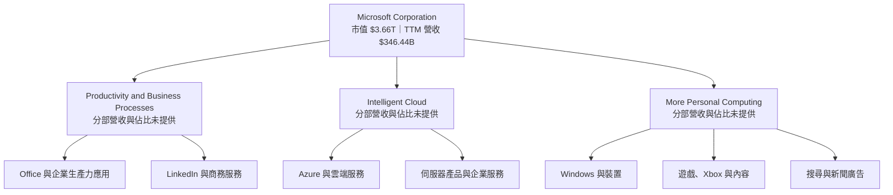
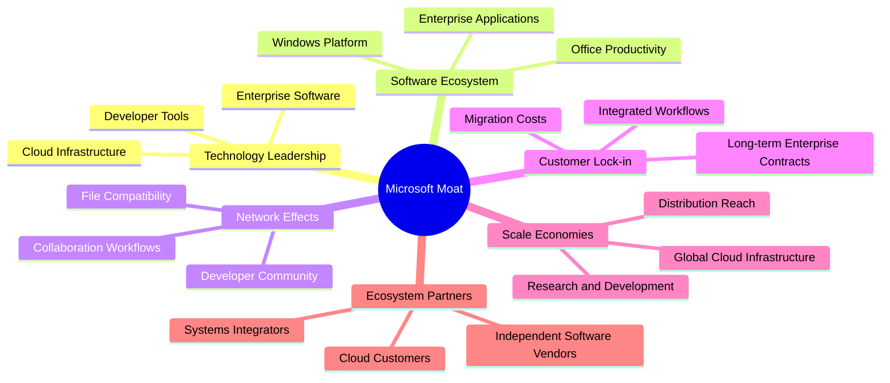
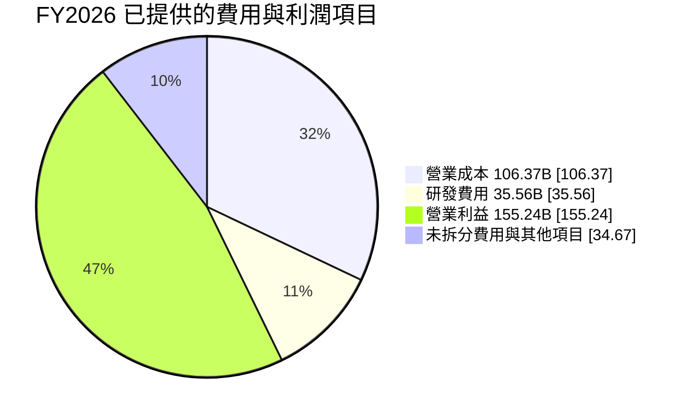
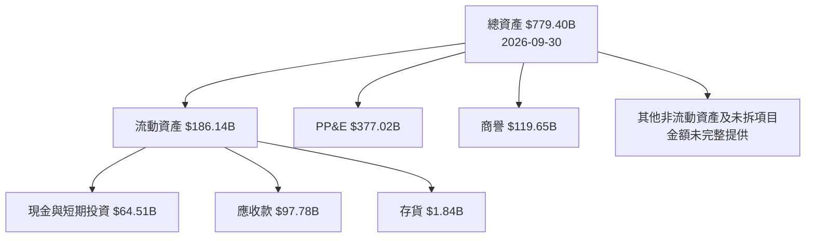
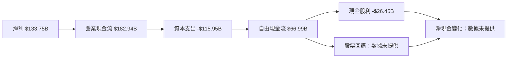
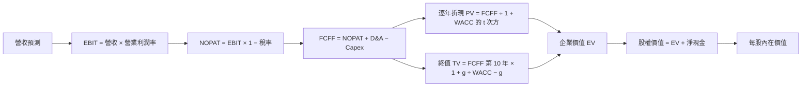
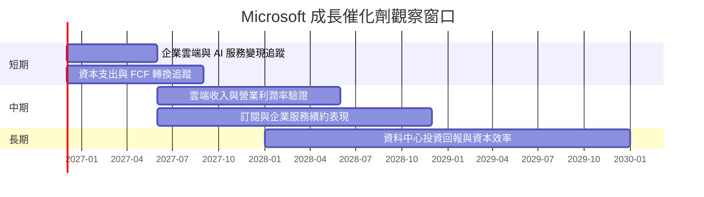
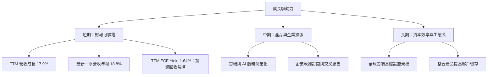
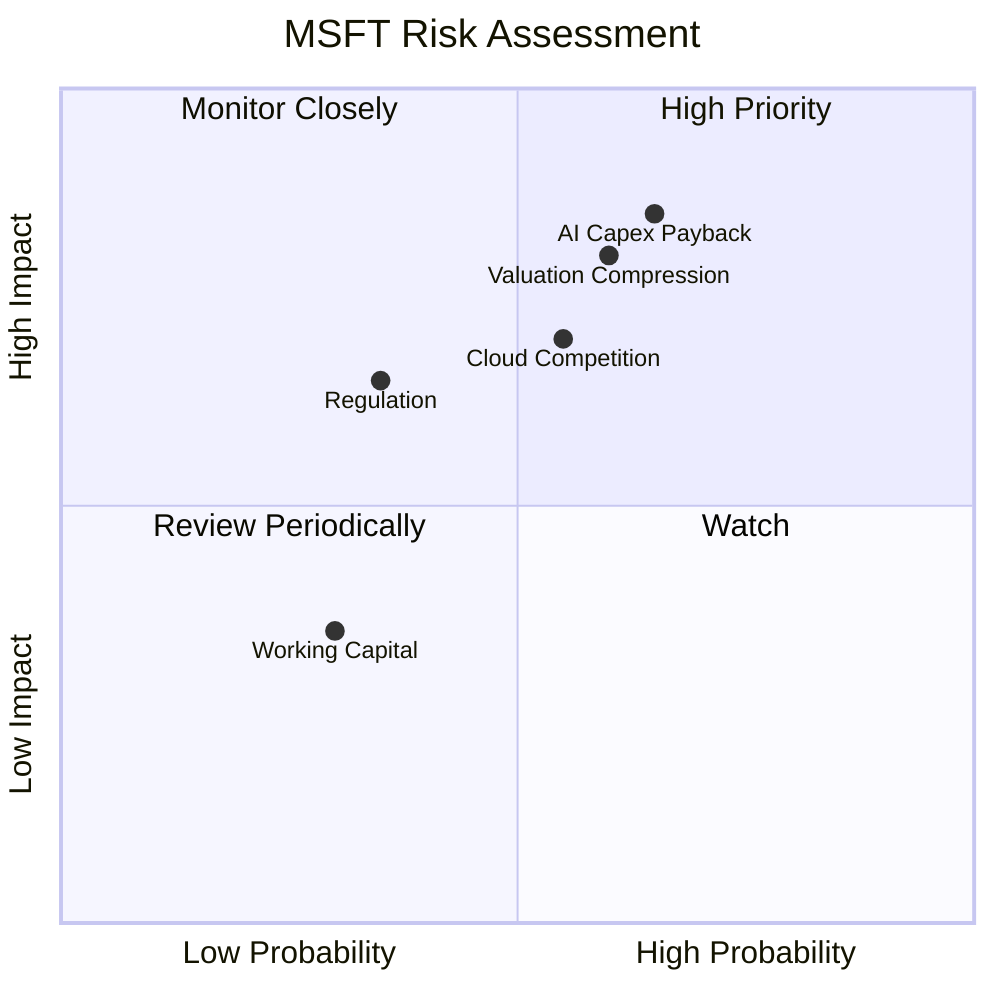
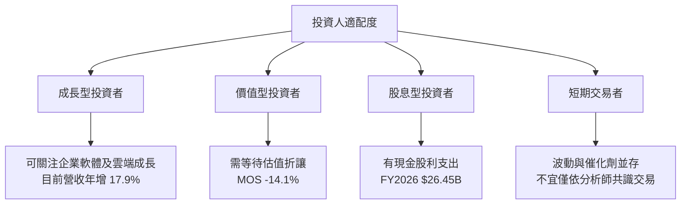

# MSFT 基本面深度分析報告
> **報告日期**：2026-11-28 ｜ **語言**：繁體中文 ｜ **數據來源**：SEC 申報資料 (XBRL)、Yahoo Finance、Finviz、StockAnalysis、Roic.ai ｜ **分析師**：CFA 級機構研究

## 目錄

| # | 章節 | 核心結論 |
|---|------|----------|
| 1 | 執行摘要 | 減碼；加權合理價值 $429.43，MOS -14.1% |
| 2 | 公司概覽與商業模式 | 多元企業軟體與雲端生態系構成護城河；分部營收明細未提供 |
| 3 | 損益表深度分析 | TTM 營收 $346.44B，TTM 成長 17.9%；營業利益率 47.1% |
| 4 | 資產負債表分析 | 淨現金 $29.03B；營運資金充足，但短期流動比率較一年前下降 |
| 5 | 現金流量深度分析 | TTM FCF $59.96B，資本支出上升使現金轉換承壓 |
| 6 | 獲利能力與資本效率 | ROIC 29.7% 高於 WACC 10.06%，仍創造股東價值 |
| 7 | 相對估值分析 | 估值低於自身五年中位數，但高於多數同業估值倍數 |
| 8 | DCF 內在價值評估 | 基準 DCF $372.74；加權合理價值 $429.43 |
| 9 | 成長催化劑 | 雲端、AI 與企業訂閱可能延續成長；TAM 數據未提供 |
| 10 | 風險矩陣 | AI 資本支出回報、競爭與估值風險為主要監控項目 |
| 11 | 投資建議 | 依 MOS 評級為減碼；等待價格回落或獲利兌現改善 |

---

## 1. 執行摘要

### 1.0 一頁式投資儀表板

| 項目 | 內容 |
|------|------|
| **投資論點（3 句）** | ① TTM 營收 $346.44B、年增 17.9%，最新一季年增 18.8%，顯示企業軟體與雲端需求仍有擴張。② TTM 營業利益率 47.1%、ROIC 29.7%，高於 WACC 10.06%，核心營運仍創造經濟價值。③ TTM FCF $59.96B、FCF Yield 1.64%，相對 $489.93 股價，現金流估值支撐有限。 |
| **綜合評分** | **7.8/10**（引用 1.1 評分卡） |
| **財務健康** | 🟢 現金及短期投資 $64.51B、淨現金 $29.03B；Piotroski F-Score 6/9。 |
| **ROIC vs WACC** | 29.7% vs 10.06%；利差 19.64 個百分點，創造價值。 |
| **FCF 趨勢** | FY2026 年度 FCF $66.99B，低於 FY2025 的 $71.61B；最新 TTM FCF Yield 1.64%。資本支出增加使現金流轉換受壓。 |
| **估值** | Forward P/E 20.36x ｜ EV/EBITDA 18.0x（自身歷史口徑）｜ FCF Yield 1.64%。 |
| **DCF 內在價值（基準）** | $372.74 ｜ 現價相對 DCF 的折溢價 **+31.4% 溢價**（現價 ÷ DCF − 1）。 |
| **安全邊際（MOS）** | **-14.1%**＝($429.43 − $489.93) ÷ $429.43；🟠 加權合理價值低於現價。 |
| **預期報酬（基準情境 12M）** | DCF 基準情境為 $372.74，相對現價 **-23.9%**；該情境不是外部 12 個月預測。 |
| **關鍵風險（前二）** | AI／資料中心資本支出未能及時轉化為 FCF；雲端與企業軟體競爭加劇。 |
| **評級 + 信心度** | 🟠 **減碼** ｜ 信心：中。估值方法加權結果低於現價，DCF 對終值與資本支出假設敏感。 |

### 1.1 綜合評分卡

| 維度 | 評分（1–10） | 主要依據（引用數字與其來源章節） |
|------|--------------|----------------------------------|
| 成長性 | 8.5 | TTM 營收成長 17.9%、最新一季年增 18.8%（第 3 章）；但未提供各業務分部成長拆分。 |
| 獲利能力 | 9.0 | TTM 營業利益率 47.1%、ROIC 29.7% 對 WACC 10.06%，F-Score 6/9（第 6 章）。 |
| 財務健康 | 8.5 | 淨現金 $29.03B、現金與短期投資 $64.51B；CCC -67 天，但流動比率趨勢未提供可比序列（第 4 章）。 |
| 估值 | 5.0 | 加權合理價值 $429.43、MOS -14.1%；P/E 仍低於自身五年中位數（第 7–8 章）。 |
| 護城河 | 9.0 | 多產品企業軟體、生態系與高轉換成本；財務表現為 TTM 毛利率 67.7%、營業利益率 47.1%（第 2–3 章）。 |
| 管理層與資本配置 | 7.0 | FY2026 SBC $12.40B，約占年度營收 3.7%；年度股利支付 $26.45B，稀釋股數測試通過（第 3、5 章）。 |
| **綜合評分** | **7.8** | 六項算術平均：$(8.5+9.0+8.5+5.0+9.0+7.0)÷6=7.83$，四捨五入至一位小數。 |

### 1.2 五大投資論點 + 三大核心風險

| 類型 | 項目 | 具體依據 | 信心度 |
|------|------|----------|--------|
| 🟢 **投資論點①** | 大型企業軟體與雲端收入基礎 | TTM 營收 $346.44B，TTM 年增 17.9%；最新季營收 $92.28B、年增 18.8%。 | 🟢 高 |
| 🟢 **投資論點②** | 高營業槓桿與獲利能力 | TTM 營業利益率 47.1%，最新一季報表營業利益 $45.915B。 | 🟢 高 |
| 🟢 **投資論點③** | 資本回報顯著高於資金成本 | ROIC 29.7% 對 WACC 10.06%，利差 19.64 個百分點。 | 🟢 高 |
| 🟢 **投資論點④** | 現金轉換週期為負 | CCC -67 天，較一年前 -59 天；供應商付款週期長於收款及存貨週期。 | 🟡 中 |
| 🟢 **投資論點⑤** | 估值低於自身五年中位數 | P/E 25.6x 對五年中位數 31.5x；EV/EBITDA 18.0x 對 24.3x。 | 🟡 中 |
| 🟡 **風險①** | AI 投資推高資本支出、壓低 FCF | TTM Capex $135.92B，約為 OCF $195.88B 的 69.4%；TTM FCF Yield 僅 1.64%。 | 🟡 中 |
| 🔴 **風險②** | 現價高於加權合理價值 | 現價 $489.93，高於加權合理價值 $429.43；MOS -14.1%。 | 🔴 高 |
| 🟡 **風險③** | 同業競爭與產品組合變化 | GOOG 最新季營收年增 24.7%、ORCL 29.6%；同業成長較快但業務組合不同。 | 🟡 中 |

### 1.3 快速統計卡片

| 指標 | 公司實際值（期間） | 同業中位數 | 狀態 |
|------|--------------------|------------|------|
| 營收成長（TTM） | **17.9%** | — | 🟢 |
| 營收成長（最新一季年增） | **18.8%** | 24.7% | 🟡 |
| 毛利率（TTM） | **67.7%** | 60.9% | 🟢 |
| 營業利益率（TTM） | **47.1%** | — | 🟢 |
| ROIC（TTM） | **29.7%** | — | 🟢 |
| Forward P/E | **20.36x** | 17.8x | 🟡 |
| FCF Yield（TTM） | **1.64%** | — | 🔴 |
| Piotroski F-Score | **6 / 9** | — | 🟡 |

*Forward P/E 同業中位數為 GOOG、AMZN、ORCL 之中位數；最新一季營收成長中位數為 24.7%。*

### 1.4 投資結論

```text
╔══════════════════════════════════════════════════════════════════╗
║                    📊 投資結論摘要                               ║
╠══════════════════════════════════════════════════════════════════╣
║  評級：減碼（依 MOS -14.1%，落於 -25% 至 -10% 區間）             ║
║  價格（2026-11-25 收盤）：$489.93                                ║
║  DCF 內在價值（基準）：$372.74（現價溢價 +31.4%）                ║
║  安全邊際 MOS：-14.1%（以加權合理價值 $429.43 為分母）           ║
║  加權合理價值（8.8）：$429.43                                    ║
║  DCF 情境價值：                                                  ║
║    悲觀情境：$176.48（-64.0%）                                   ║
║    基準情境：$372.74（-23.9%）                                   ║
║    樂觀情境：$721.37（+47.2%）                                   ║
║  綜合評分：7.8/10（引用 1.1）                                    ║
║  適合投資人：長期成長型投資人；價值型投資人宜等待估值回落         ║
╚══════════════════════════════════════════════════════════════════╝
```

---

## 2. 公司概覽與商業模式

### 2.1 業務結構與收入來源

公司資料概述 Microsoft 提供作業系統、伺服器應用、商務應用、開發工具、管理工具、遊戲與裝置等產品。分部營收及各業務佔比未提供，故不以估算比例製作營收拆分圖。



分部名稱及子業務根據公司業務概述整理；分部收入、服務收入比例及分部利潤資料未提供，圖中不填入推估金額。

### 2.2 市場份額

市場份額數據未提供，亦未提供可引用的市場規模與年份，因此不繪製市場份額圖。就規模與成長而言，Microsoft TTM 營收 $346.44B、年增 17.9%；最新一季營收年增 18.8%，在本報告可比較的 GOOG、AMZN、ORCL 中，低於 GOOG 的 24.7% 及 ORCL 的 29.6%，高於 AMZN 的 12.1%。

### 2.3 競爭護城河分析



### 2.4 護城河強度

| 護城河項目 | 強度（強／中／弱） | 證據（引用數字或事實） | 會削弱它的情況 |
|------------|--------------------|------------------------|----------------|
| 技術與產品組合 | 強 | 業務涵蓋作業系統、伺服器、開發工具、企業應用、雲端與遊戲；TTM 營業利益率 47.1%。 | 產品迭代落後、雲端服務性能或價格競爭力減弱。 |
| 軟體生態系統 | 強 | Office、Windows、伺服器及企業服務相互整合；企業遷移涉及流程與相容性成本。 | 開源替代品、跨平台工具降低轉換成本。 |
| 客戶鎖定 | 強 | 訂閱型企業軟體及基礎架構服務具長期部署特徵；DSO 為 65 天。 | 企業縮減授權、轉向多雲或替代供應商。 |
| 規模效應 | 強 | TTM 營收 $346.44B，TTM 營業現金流 $195.88B，足以支撐研發與基礎設施投資。 | 大型資料中心投資回報低於資金成本。 |
| 網路效應 | 中 | 檔案相容、企業協作與開發者工具增加產品使用價值；未提供用戶或開發者網路規模數字。 | 競品間相容性提升、用戶跨平台成本下降。 |
| 生態夥伴 | 中 | 公司服務涵蓋開發工具與企業平台，具整合商及軟體夥伴合作空間；夥伴數據未提供。 | 夥伴轉向競爭平台或降低對單一雲端的依賴。 |

1.1「護城河」評分為 **9.0/10**，依據是多產品企業生態系、47.1% TTM 營業利益率及 $346.44B TTM 營收；扣分主要來自分部與客戶留存數據未提供，無法直接量化各護城河的持續性。

---

## 3. 損益表深度分析

### 3.1 年度收入成長趨勢（近 4 年）

年度營收按財報數字列示；YoY 為依相鄰財年營收計算，CAGR 為 FY2023 至 FY2026 三年複合成長率。

```text
╔══════════════════════════════════════════════════════════════════╗
║              Microsoft 年度收入趨勢（FY2023-FY2026）              ║
╠══════════════════════════════════════════════════════════════════╣
║  FY2023  $211.91B  █████████████░░░░░░░░░░░░  YoY: +6.9%  🟡   ║
║  FY2024  $245.12B  ███████████████░░░░░░░░░░  YoY:+15.7%  🟢   ║
║  FY2025  $281.72B  █████████████████░░░░░░░░  YoY:+14.9%  🟢   ║
║  FY2026  $331.84B  ████████████████████░░░░░  YoY:+17.8%  🟢   ║
╠══════════════════════════════════════════════════════════════════╣
║  FY2023-FY2026 營收 CAGR：約 16.1%                                ║
╚══════════════════════════════════════════════════════════════════╝
```

計算：FY2024 成長率 = $245.12B ÷ $211.91B − 1 = 15.7%；FY2026 CAGR = $(331.84÷211.91)^{1/3}−1$，約 16.1%。近年增速回升，與雲端及企業服務需求成長方向一致；但分部營收數據不足，無法把整體增幅精確歸因至單一產品。

### 3.2 季度收入趨勢分析

| 季度 | 營收 | QoQ 成長 | YoY 成長 | 備註 |
|------|------|----------|----------|------|
| 2025-12-31 | $81.27B | 6.6% | 16.7% | QoQ 以 2025-09-30 $77.67B 為基期。 |
| 2026-03-31 | $82.89B | 2.0% | 18.3% | 季度營收續增；年增較前期加快。 |
| 2026-06-30 | $90.01B | 8.6% | 17.8% | QoQ 以 $82.89B 為基期。 |
| 2026-09-30 | $92.28B | 2.5% | 18.8% | 最新季；年增以同季 $77.67B 計算。 |

QoQ 依季度未調整季節性營收計算，代表相鄰財季變動，不等同年化成長率。最新一季營收年增 18.8%，代表增長仍廣泛存在，但缺少分部數據，無法驗證增量是否集中於雲端、AI 或其他產品。

### 3.3 利潤率演變分析

| 利潤率指標 | FY2023 | FY2024 | FY2025 | FY2026 | 趨勢 | 評估 |
|------------|--------|--------|--------|--------|------|------|
| **毛利率** | 68.9% | 69.8% | 68.8% | 67.9% | 近兩年回落 | 🟡 |
| **營業利益率** | 41.8% | 44.6% | 45.6% | 46.8% | 連續改善 | 🟢 |
| **淨利率** | 34.2% | 36.0% | 36.2% | 40.3% | FY2026 明顯提高 | 🟢 |

計算以年度毛利、營業利益、淨利除以同年度營收。毛利率由 FY2024 的約 69.8% 回落至 FY2026 的 67.9%，可能反映雲端基礎設施及資料中心成本較高、產品組合改變；但現有資料沒有分部毛利與成本拆分，無法將原因精確量化。營業利益率同期上升約 5.0 個百分點，顯示營業費用增長低於營收增長，或規模經濟抵銷部分毛利壓力。淨利率上升包含稅務及非營業項目影響，單靠現有資料不能判斷全部改善均為可持續營運成果。

### 3.4 費用結構分析



上圖以 FY2026 營收 $331.84B、毛利 $225.47B、營業利益 $155.24B、研發費用 $35.56B 推得營業成本 $106.37B（營收減毛利）及毛利以下未拆分項目 $34.67B（毛利減營業利益）。其中研發費用已包含在營業費用中，故不能把圓餅各項視為互斥的完整會計費用分類；圖僅呈現已知金額的規模，不作結構比例判讀。

```text
╔══════════════════════════════════════════════════════════════════╗
║ FY2026 核心損益項目（USD B）                                     ║
╠══════════════════════════════════════════════════════════════════╣
║ 營收       331.84  ██████████████████████████████                ║
║ 毛利       225.47  ████████████████████                          ║
║ 營業利益   155.24  ██████████████                                ║
║ 研發費用    35.56  ███                                           ║
╚══════════════════════════════════════════════════════════════════╝
```

### 3.5 季度 EPS 趨勢與盈餘品質（Quality of Earnings）

| 季度 | EPS 實際 | EPS YoY | 超預期／不及預期 |
|------|----------|---------|------------------|
| 2025-12-31 | $5.16 | 59.75% | N/A（EPS 預估值缺漏） |
| 2026-03-31 | $4.27 | 23.41% | N/A（EPS 預估值缺漏） |
| 2026-06-30 | $4.81 | 31.74% | N/A（EPS 預估值缺漏） |
| 2026-09-30 | $4.92 | 32.26% | N/A（EPS 預估值缺漏） |

過去四季 EPS 年增皆為正；2025-12-31 年增率較高，部分原因可能是比較基期及季度獲利組合，但財報資料未提供可拆解的 EPS bridge。分析師預估值為缺漏，因此不能判斷這四季究竟是超預期或不及預期。

| 盈餘品質項目 | 數值／佔比 | 評估 |
|--------------|-----------|------|
| 股權薪酬 SBC / 營收 | FY2026：$12.40B ÷ $331.84B = **3.7%** | 🟡 金額具實質性，對股東有稀釋成本；年度稀釋股數測試通過，但不代表 SBC 沒有經濟成本。 |
| SBC / 營業現金流 | FY2026：$12.40B ÷ $182.94B = **6.8%** | 🟡 SBC 是非現金費用，但應透過稀釋或費用化考量；DCF 採 GAAP EBIT，不另扣 SBC。 |
| FCF / 淨利（現金轉換率） | TTM：$59.96B ÷ $142.63B = **42.0%** | 🔴 低於 100%；主要需要關注高資本支出對 FCF 的壓制。 |
| 一次性／非經常性損益 | N/A（未提供完整非經常性項目明細） | 不足以判斷是否存在一次性項目對當期淨利的重大影響。 |
| 有效稅率異常 | 最新年度有效稅率 **19.4%** | 🟢 DCF 直接採用該值；未提供多年稅率明細以評估異常程度。 |
| 資本化支出 vs 費用化 | TTM Capex $135.92B；會計資本化明細 N/A | 🟡 投資支出高，但未提供資本化會計政策細節，無法判斷是否遞延費用。 |

**盈餘品質結論**：TTM OCF $195.88B 仍高於 TTM 淨利約 $142.63B，表示營運現金生成能力良好；但扣除 TTM Capex $135.92B 後，FCF 僅 $59.96B，現金轉換率約 42.0%。盈利含金量不宜只看淨利，資料中心資本支出是當前主要折扣因素；SBC 約占 FY2026 營收 3.7%，須視為股東經濟成本。

---

## 4. 資產負債表分析

### 4.1 資產結構分解

最新資產負債表資料的總資產 $779.40B、流動資產 $186.14B、PP&E $377.02B、商譽 $119.65B。因提供的資產細項未涵蓋全部項目，圖中不反推剩餘項目。



應收款 $97.78B 含應收帳款及其他應收款，不能與品質指標中的 DSO 直接混用；DSO 依品質指標口徑為 65 天。

### 4.2 流動性與營運資金分析

流動比率及速動比率資料顯示流動性可應付短期負債；但歷史比較不足。工作資本天數依品質指標原值引用如下：

| 指標 | 最新 TTM | 一年前 TTM | 變化 | 解讀 |
|------|----------|------------|------|------|
| DSO 應收帳款天數 | 65 天 | 66 天 | -1 天 | 收款時間略縮短，整體改善有限。 |
| DIO 存貨天數 | 6 天 | 4 天 | +2 天 | 存貨周轉略慢；對以軟體及服務為主的公司，金額仍相對有限。 |
| DPO 應付帳款天數 | 139 天 | 130 天 | +9 天 | 延長付款週期，可能反映供應商信用與規模議價；亦須監控是否持續依賴付款延長。 |
| CCC 現金轉換週期 | -67 天 | -59 天 | -8 天 | 負值擴大，現金通常先於供應商付款收回；但不代表沒有營運資金風險。 |

流動比率 1.225、速動比率 1.068（來源：市場資料彙整）；由於與最新季的財報口徑可能有差異，不與品質指標的天數混合計算。Piotroski 的「流動比率高於一年前」未通過，表示相對趨勢並非改善。

### 4.3 債務結構分析

核心分析採用經核實的最新季債務 $35.48B、現金與短期投資 $64.51B、淨現金 $29.03B。其他彙整資料中出現總債務 $133.93B 等不同口徑數字，與經核實債務資料不一致，故不混用。

```text
╔══════════════════════════════════════════════════════════════════╗
║                 Microsoft 債務健康診斷                           ║
╠══════════════════════════════════════════════════════════════════╣
║  總債務：       $35.48B   ████░░░░░░░░░░░░░░░░  🟢              ║
║  現金+短期投資：$64.51B   ███████░░░░░░░░░░░░░  🟢              ║
║  淨現金：       $29.03B   ██████████░░░░░░░░░░  🟢              ║
║                                                                  ║
║  Debt/EBITDA：N/A（債務與 EBITDA 的口徑有來源不一致）             ║
║  Interest Coverage：N/A（利息費用及利息保障倍數未提供）          ║
║  短期償債風險：低；仍須留意資本支出與債務口徑差異                  ║
╚══════════════════════════════════════════════════════════════════╝
```

### 4.4 股東權益趨勢

| 財年 | 股東權益 | YoY 變化 |
|------|----------|----------|
| FY2023 | $206.22B | — |
| FY2024 | $268.48B | +30.2% |
| FY2025 | $343.48B | +27.9% |
| FY2026 | $442.39B | +28.8% |

```text
╔══════════════════════════════════════════════════════════════════╗
║             股東權益趨勢（USD B）                                ║
╠══════════════════════════════════════════════════════════════════╣
║ FY2023  206.22  █████████░░░░░░░░░░░                             ║
║ FY2024  268.48  ████████████░░░░░░░░                             ║
║ FY2025  343.48  ███████████████░░░░░                             ║
║ FY2026  442.39  ████████████████████                             ║
╚══════════════════════════════════════════════════════════════════╝
```

FY2023 至 FY2026 股東權益持續增加，主要反映累積獲利及資本留存；完整的回購、其他綜合損益與權益變動明細未提供，不能將全部增量歸因於單一項目。

---

## 5. 現金流量深度分析

### 5.1 現金流量瀑布圖

FY2026 年度數字：淨利 $133.75B、OCF $182.94B、Capex $115.95B、FCF $66.99B、現金股利 $26.45B。回購與淨現金變動未提供，不以估算值填補。



### 5.2 FCF 轉換率趨勢

| 財年 | FCF | 淨利 | FCF / 淨利 |
|------|-----|------|------------|
| FY2023 | $59.48B | $72.36B | 82.2% |
| FY2024 | $74.07B | $88.14B | 84.0% |
| FY2025 | $71.61B | $101.83B | 70.3% |
| FY2026 | $66.99B | $133.75B | 50.1% |

FY2023–FY2024 轉換率約 82%–84%，其後降至 FY2026 的 50.1%，主要觀察點是資本支出上升：FY2026 Capex $115.95B，較 FY2025 $64.55B 大幅增加。這降低當期自由現金流，但若投資形成有效產能，未來現金流可能回升；其回報速度尚需後續財報驗證。

### 5.3 自由現金流趨勢

| 財年／期間 | FCF | 變化 |
|------------|-----|------|
| FY2023 | $59.48B | — |
| FY2024 | $74.07B | +24.5% |
| FY2025 | $71.61B | -3.3% |
| FY2026 | $66.99B | -6.5% |
| TTM 至 2026-09-30 | $59.96B | TTM FCF Yield 1.64% |

```text
╔══════════════════════════════════════════════════════════════════╗
║              FCF 歷史趨勢（年度，USD B）                         ║
╠══════════════════════════════════════════════════════════════════╣
║ FY2023  59.48  ████████████████░░░░  🟢                          ║
║ FY2024  74.07  ████████████████████  🟢                          ║
║ FY2025  71.61  ███████████████████░  🟡                          ║
║ FY2026  66.99  ██████████████████░░  🟡                          ║
║ TTM      59.96  ████████████████░░░░  Yield 1.64%                ║
╚══════════════════════════════════════════════════════════════════╝
```

FCF 下滑與資本支出快速增加同時發生。TTM 資本支出 $135.92B、OCF $195.88B；計算可得 Capex/OCF 約 69.4%，因此短期 FCF 對資本支出正常化高度敏感。

### 5.4 資本配置評估

| FY2026 資本配置項目 | 金額 | 解讀 |
|--------------------|------|------|
| 資本支出 | $115.95B | 年增；對應資料中心與基礎設施投資的可能性高，但詳細用途未提供。 |
| 現金股利 | $26.45B | 占 FY2026 FCF 約 39.5%。 |
| 股票回購 | N/A | 未提供年度回購金額，不繪製比例圖。 |
| 研發支出 | $35.56B | 約占 FY2026 營收 10.7%，支持產品與技術投入。 |
| 留存現金 | N/A | 未提供完整資本流向拆分。 |

不製作資本配置圓餅圖：回購及留存現金數據缺漏，若強行呈現會造成比例誤導。股利支付與 Capex 合計 $142.40B，超過 FY2026 FCF $66.99B；但公司可由營業現金流及既有現金資產支應，仍需監控負債、現金餘額與投資回報。

---

## 6. 獲利能力與資本效率

### 6.1 ROE / ROA / ROIC 趨勢

| 指標 | 可用數值 | 評估 |
|------|----------|------|
| ROIC（TTM） | 29.7% | 明顯高於 WACC 10.06%，資本配置具正向經濟利差。 |
| ROE（TTM，品質指標） | 30.3% | 依 DuPont 同一口徑引用。 |
| ROA（TTM） | 14.4% | 正值；Piotroski 測試亦顯示 ROA 高於一年前。 |
| 歷年 ROE／ROA／ROIC 同口徑序列 | N/A | 未提供可一致比較的歷年序列。 |
| 行業均值 | N/A | 未提供可靠同口徑行業資料，故不列。 |

### 6.2 ROIC vs WACC 分析（核心價值創造判斷）

```text
╔══════════════════════════════════════════════════════════════════╗
║                ROIC vs WACC 深度分析                            ║
╠══════════════════════════════════════════════════════════════════╣
║  WACC（程式計算，採指定資本成本資料）：10.06%                     ║
║  ├── 無風險利率（10Y 美債）：4.94%                               ║
║  ├── 股權風險溢酬 ERP：5.00%                                     ║
║  ├── 原始 Beta：1.04；採用調整後 Beta：1.03                     ║
║  ├── Ke = 4.94% + 1.03 × 5.00% = 10.09%                        ║
║  ├── 稅前債務成本：8.60%；有效稅率：19.4%                        ║
║  ├── 權重：股權 99.0%、債務 1.0%                                 ║
║  └── 採用 WACC：10.06%                                           ║
║                                                                  ║
║  ROIC（TTM）：29.7%                                               ║
║  EVA 利差 = ROIC − WACC = 29.7% − 10.06% = +19.64pp              ║
║                                                                  ║
║  ROIC  29.7%  ▓▓▓▓▓▓▓▓▓▓▓▓▓▓▓▓▓▓▓▓▓▓▓▓▓▓▓▓ 🟢                ║
║  WACC  10.06% ▓▓▓▓▓▓▓▓▓▓░░░░░░░░░░░░░░░░░░ ──                ║
╠══════════════════════════════════════════════════════════════════╣
║  結論：ROIC 高於 WACC 19.64 個百分點，現階段創造股東價值。       ║
╚══════════════════════════════════════════════════════════════════╝
```

WACC 組成採資本成本資料的原值；調整後 Beta = ⅔ × 1.04 + ⅓ = 1.03。因指定權重及成本數據四捨五入，不能以展示後的兩位小數逐項重算而取代程式提供的 WACC 10.06%。ROIC 以 TTM 稅後營業利益除以投入資本計算，與 WACC 相比仍有明顯正利差；這是營運價值創造判斷，不代表現價必然低估。

### 6.3 杜邦三因素分解

| 因素 | 數值（TTM） | 解讀 |
|------|-------------|------|
| 淨利率 | 41.2% | 高淨利率是 ROE 的主要來源之一。 |
| 資產週轉率 | 0.44 | 每單位資產帶來約 0.44 單位營收。 |
| 權益乘數 | 1.66 | 槓桿存在但不高，ROE 並非主要靠高槓桿撐起。 |
| **ROE** | **30.3%** | 品質指標原列：41.2% × 0.44 × 1.66 = 30.3%。 |

### 6.4 財務體質：Piotroski F-Score

**Piotroski F-Score：6 / 9**。下表逐項照列品質指標測試結果；九項均有結果。

| 測試 | 結果 | 解讀 |
|------|------|------|
| ROA > 0 | ✅ 通過 | 公司仍有正向資產報酬。 |
| 營業現金流 > 0 | ✅ 通過 | 營運活動持續產生現金。 |
| ROA 高於一年前 | ✅ 通過 | 資產獲利能力改善。 |
| 營業現金流 > 淨利（應計品質） | ✅ 通過 | 現金流高於淨利，支持盈餘品質。 |
| 長期負債 ÷ 總資產低於一年前 | ✅ 通過 | 相對負債負擔降低。 |
| 流動比率高於一年前 | ❌ 未通過 | 流動性指標相對走弱，須追蹤短期資產與負債變化。 |
| 稀釋股數未增加 | ✅ 通過 | 該測試期股數未增加；仍不消除 SBC 的經濟成本。 |
| 毛利率高於一年前 | ❌ 未通過 | 毛利率趨勢承壓，可能與產品組合或基礎設施成本有關。 |
| 資產週轉率高於一年前 | ❌ 未通過 | 資產增長可能暫時快於收入，與資本投資擴張一致。 |

---

## 7. 相對估值分析

### 7.1 同業估值比較表格

公司估值取市場估值資料；同業倍數、成長率及毛利率取指定同業資料。公司 P/E 與其他市場來源口徑略有差異，本表以市場估值欄的公司數據列示。

| 估值指標 | **MSFT** | **GOOG** | **AMZN** | **ORCL** | MSFT 評估 |
|----------|---------|---------|---------|---------|-----------|
| **Trailing P/E** | 25.72x | 14.2x | 20.5x | 16.8x | 🟡 高於三家同業 |
| **Forward P/E** | 20.36x | 17.8x | 23.3x | 9.7x | 🟡 高於同業中位數 17.8x |
| **P/S Ratio** | 10.56x | 7.1x | 3.4x | 4.7x | 🔴 顯著高於同業中位數 4.7x |
| **EV/EBITDA** | 18.15x | 17.5x | 16.0x | 13.4x | 🟡 高於同業中位數 16.0x |
| **最新一季營收 YoY** | 18.8% | 24.7% | 12.1% | 29.6% | 🟡 增速居中 |
| **TTM 毛利率** | 67.7% | 60.9% | 51.4% | 64.0% | 🟢 高於三家同業 |

同業中位數計算：Trailing P/E 16.8x、Forward P/E 17.8x、P/S 4.7x、EV/EBITDA 16.0x。MSFT 倍數溢價反映其較高毛利率、獲利品質與多產品企業平台，但 TTM FCF Yield 僅 1.64%，代表市價仍預先反映相當的長期成長。

### 7.2 歷史估值區間分析

| 倍數 | 現值 | 五年中位數 | 五年區間 | 現值百分位 |
|------|------|------------|----------|------------|
| P/E | 25.6x | 31.5x | 20.8x–37.8x | 14% |
| P/S | 10.5x | 12.0x | 8.4x–13.7x | 33% |
| EV/EBITDA | 18.0x | 24.3x | 14.5x–31.4x | 10% |

```text
╔══════════════════════════════════════════════════════════════════╗
║              MSFT 五年估值區間與目前位置                         ║
╠══════════════════════════════════════════════════════════════════╣
║ P/E        20.8x ├──── 現值 25.6x ───── 中位數 31.5x ───┤ 37.8x ║
║                         現值百分位：14%                          ║
║ P/S         8.4x ├──── 現值 10.5x ── 中位數 12.0x ─────┤ 13.7x ║
║                         現值百分位：33%                          ║
║ EV/EBITDA  14.5x ├── 現值 18.0x ─── 中位數 24.3x ──────┤ 31.4x ║
║                         現值百分位：10%                          ║
╚══════════════════════════════════════════════════════════════════╝
```

三項倍數均低於自身五年中位數，尤其 P/E 與 EV/EBITDA 位於歷史分布較低位置；但低於歷史中位數不等於絕對便宜，因為目前利率、資本支出及成長預期可能與歷史區間不同。

### 7.3 情境價值（Bear / Base / Bull）

| 情境 | 第 1 年營收成長 | 期末營業利潤率 | WACC | 每股價值 | 相對現價 | 機率 | 會發生的條件 |
|------|----------------|----------------|------|----------|----------|------|--------------|
| 🔴 悲觀 | 9.0% | 38.8% | 11.06% | $176.48 | -64.0% | 25% | 雲端與 AI 需求放緩、資本支出回報弱、利潤率下行且資金成本偏高。 |
| 🟡 基準 | 17.9% | 45.6% | 10.06% | $372.74 | -23.9% | 50% | 起始成長貼近 TTM 成長，之後逐步放緩，長期利潤率略低於當前水平。 |
| 🟢 樂觀 | 26.9% | 50.2% | 9.06% | $721.37 | +47.2% | 25% | 高成長延續、規模及產品組合推升期末利潤率，且折現率下降。 |

情境數值直接引用 DCF 情境模型，不另改假設。機率加權價值為 $410.83，但第 8.8 節依指定估值權重採用基準 DCF 值，不以機率加權 DCF 替換。

### 7.4 相對估值隱含價格區間

```text
╔══════════════════════════════════════════════════════════════════╗
║             相對估值與共識每股價值                                ║
╠══════════════════════════════════════════════════════════════════╣
║ $372.74       $431.13      $435.27       $489.93        $637.36  ║
║ DCF 基準      Forward P/E  EV/EBITDA       現價        分析師共識║
║               同業估值      同業估值                     目標價  ║
╚══════════════════════════════════════════════════════════════════╝
```

| 方法 | 每股價值 | 依據 |
|------|----------|------|
| DCF（基準） | $372.74 | 10 年 FCFF、WACC 10.06%、永續成長 3.0%。 |
| 同業 Forward P/E | $431.13 | 同業中位數 17.8x × Forward EPS $24.20。 |
| 同業 EV/EBITDA | $435.27 | 同業中位數 16.0x × TTM EBITDA，加回淨現金。 |
| 分析師共識目標價 | $637.36 | 54 位分析師平均目標價。 |

相對估值方法較 DCF 高，但三種估值方法均低於分析師共識；共識目標價不等同內在價值，且其估值期與盈利假設不一定與 DCF 相同。

---

## 8. DCF 內在價值評估（Discounted Cash Flow）

### 8.0 估值推理鏈（Thinking Logic）

**Step 1 — 價值來源與主導變數**

MSFT 價值可概括為企業生產力與伺服器軟體的現金流底盤、雲端及 AI 相關服務的增量成長，以及遊戲、裝置與其他服務的選擇權；分部營收佔比未提供，不能為各來源虛構占比。模型顯示終值現值佔 EV 67.3%，因此主導估值的變數是長期 FCFF 與永續成長／折現率，而非單一年度營收。

**Step 2 — 模型選擇**

| 決策點 | 本報告採用 | 理由 | 曾考慮但否決 | 否決理由 |
|--------|-----------|------|--------------|----------|
| 現金流定義 | FCFF | 以企業自由現金流折現至企業價值，再加淨現金橋接股權價值。 | FCFE | 模型提供的是 FCFF 及 WACC，不能混用。 |
| 預測期 N | 10 年 | DCF 模型設定 10 年，將目前 17.9% 成長線性淡化至 3.0%。 | 5 年 | 不符合既定模型與所提供逐年現金流。 |
| 終值方法 | Gordon Growth | 模型已提供永續成長率 3.0% 的終值與現值。 | 退出倍數 | DCF 輸入未提供終值 EBITDA 退出倍數，故不自行補建。 |
| EBIT 基礎 | GAAP EBIT | GAAP EBIT 已費用化 SBC，模型明確不再扣 SBC。 | 非 GAAP EBIT | 可能加回 SBC，需另建模型，不符合指定模型。 |

**Step 3 — 關鍵假設推導鏈**

- **營收成長路徑**：錨點＝TTM 營收年增 17.9%，最新一季單季年增 18.8%；調整＝模型假設增長從 17.9% 線性降至第 10 年 3.0%，反映基期擴大與成熟化；**採用第 1 年 17.9%、第 10 年 3.0%**；未採用永久維持 17.9%，因其會忽略成熟期增速收斂。
- **期末營業利潤率**：錨點＝TTM GAAP 營業利益率 47.1%；調整＝模型淡化至近五個財年中位數 45.6%；**採用第 10 年 45.6%**；未採用持續擴張至高於 47.1%，因沒有提供證據證明長期利潤率可持續上升。
- **永續成長率 g**：錨點＝DCF 採用 3.0%；調整＝該數低於 WACC 10.06%，可避免 Gordon Growth 分母失效；**採用 3.0%**；否決不低於 WACC 的數值，因其無法產生有效終值。
- **預測期 N**：錨點＝模型指定 10 年；調整＝使用模型既有逐年現金流，不另改期限；**採用 10 年**；否決自行縮短或延長，因會改變逐年 PV 與終值折現期間。
- **Capex／營收**：錨點＝TTM 39.2%；調整＝模型假設從第 1 年 39.2% 逐步降至第 10 年 12.2%；**採用此路徑**；否決把初期資本支出比率永久固定於 39.2%，因模型假設其隨投資週期淡化。
- **EBIT 基礎、SBC 與股數**：錨點＝模型採 GAAP EBIT；調整＝SBC 已列入 GAAP 費用；**採用組合 (A)：GAAP EBIT、FCFF 不再扣 SBC、股數固定不另稀釋**；否決額外扣除 SBC 或額外放大股數，因會重複計入同一成本。
- **WACC**：錨點＝資本成本資料採用 10.06%；**採用 10.06%**，與第 6.2 節一致；否決另行估算的 WACC，因本報告必須遵循指定資本成本輸入。
- **有效稅率與 D&A／營收**：錨點及採用值分別為 19.4% 與 11.1%；模型均維持既定值。營運資金變動未建模，不能把缺項補成估算值。
- **終值方法**：錨點＝模型指定 Gordon Growth；**採用 Gordon Growth**，退出倍數缺少模型輸入而不自行建立。

**Step 4 — 最脆弱的一環**

最脆弱假設是高額資本支出未來能下降至模型路徑並轉化為 FCFF；若資本支出率下降慢於模型預期，FCFF 與終值均下修，價值可能低於基準 DCF $372.74，敏感度須參照第 8.6 節。

**Step 5 — 計算路徑**



### 8.1 模型假設總表（Model Inputs）

| 假設項目 | 採用值 | 依據／來源 | 敏感度 |
|----------|--------|-------------|--------|
| 預測期長度 N | 10 年 | DCF 模型設定；逐年預測 FY+1 至 FY+10。 | 🟡 中 |
| 營收成長 | 第 1 年 17.9%，第 10 年 3.0% | 起點引用 TTM 成長 17.9%；模型線性淡化至成熟期假設。 | 🔴 高 |
| 營業利潤率 | 47.1% 降至 45.6% | TTM 47.1%；期末採近五年財年中位數。 | 🔴 高 |
| 有效稅率 | 19.4% | 最新年度有效稅率。 | 🟢 低 |
| Capex／營收 | 39.2% 降至 12.2% | TTM Capex／營收及模型淡化路徑。 | 🔴 高 |
| D&A／營收 | 11.1% | TTM 比率，模型固定。 | 🟢 低 |
| 營運資金變動 | 未建模 | 模型明確未建模，不補估。 | 🟡 中 |
| EBIT 基礎 | GAAP | DCF 模型採 GAAP EBIT。 | 🟡 中 |
| SBC 處理 | GAAP EBIT 已含 SBC，不另扣 | 模型組合 (A)。 | 🟡 中 |
| 年稀釋率 | 0%／股數固定 | 組合 (A)，模型不額外稀釋股數。 | 🟡 中 |
| 永續成長率 g | 3.0% | DCF 模型輸入，且小於 WACC。 | 🔴 高 |
| 終值方法 | Gordon Growth | DCF 模型提供此計算。 | 🔴 高 |
| WACC | 10.06% | 資本成本區塊採用值。 | 🔴 高 |

FCFF 定義採 **FCFF = NOPAT + D&A − Capex**；營運資金變動未納入模型。SBC 只計入一次：本模型採用 **(A) GAAP EBIT + 固定股數**，因此不另扣 SBC，也不另計年稀釋。

### 8.2 折現率推導（WACC）

```text
╔══════════════════════════════════════════════════════════════════╗
║                    WACC 推導（折現率）                           ║
╠══════════════════════════════════════════════════════════════════╣
║  股權成本 Ke（CAPM）：                                           ║
║  ├── 無風險利率 Rf：4.94%（10Y 美債；報價日未提供）              ║
║  ├── 市場風險溢酬 ERP：5.00%（資本成本資料假設值）               ║
║  ├── 原始 Beta：1.04；調整後 Beta：1.03                          ║
║  ├── 調整方式：⅔ × 1.04 + ⅓ × 1.00 = 1.03                      ║
║  ├── 規模／國別溢酬：0.00%（美國大型公司，未另加）               ║
║  └── Ke = 4.94% + 1.03 × 5.00% = 10.09%                         ║
║                                                                  ║
║  債務成本：                                                       ║
║  ├── 稅前 Kd：8.60%（指定債務成本資料）                           ║
║  ├── 有效稅率：19.4%                                             ║
║  └── 稅後 Kd 算術值：8.60% × (1−19.4%) = 6.93%                  ║
║                                                                  ║
║  資本權重：股權 99.0%，債務 1.0%                                 ║
║  指定 WACC：10.06%（依資本成本資料直接採用）                     ║
╚══════════════════════════════════════════════════════════════════╝
```

**逐步演算與資料限制**

1. **Ke** = 4.94% + 1.03 × 5.00% + 0.00% = 10.09%。
2. **稅前 Kd** = 8.60%（指定資本成本資料）；利息費用與平均計息負債細項未提供，故不能用完整資產負債表重建。
3. **稅後 Kd 算術值** = 8.60% × (1 − 19.4%) = 6.93%。
4. **權重** = 股權 99.0%、債務 1.0%，合計 100.0%；資本成本資料未附可核對的市場市值與計息債務權重底稿。
5. 以展示後數字簡化重算，$99.0\%×10.09\%+1.0\%×6.93\%=10.0584\%$，四捨五入約 10.06%；本報告仍直接採用指定 **WACC 10.06%**。不得以財報中不同債務口徑重算或替換。第 6.2 與 DCF 均使用 10.06%。

### 8.3 逐年自由現金流預測（基準情境）

金額單位：USD B；折現因子保留三位小數。每一年度照錄 DCF 模型數字。

| 年度 | FY+1 | FY+2 | FY+3 | FY+4 | FY+5 | FY+6 | FY+7 | FY+8 | FY+9 | FY+10 |
|------|------:|------:|------:|------:|------:|------:|------:|------:|------:|------:|
| 營收 | 408.51 | 474.92 | 544.25 | 614.69 | 684.06 | 749.93 | 809.71 | 860.83 | 900.92 | 927.95 |
| 營收 YoY | 17.9% | 16.3% | 14.6% | 12.9% | 11.3% | 9.6% | 8.0% | 6.3% | 4.7% | 3.0% |
| 營業利潤率 | 47.1% | 46.9% | 46.8% | 46.6% | 46.4% | 46.3% | 46.1% | 46.0% | 45.8% | 45.6% |
| EBIT（GAAP） | 192.42 | 222.92 | 254.57 | 286.51 | 317.72 | 347.07 | 373.41 | 395.56 | 412.50 | 423.35 |
| − 稅 | (37.32) | (43.24) | (49.38) | (55.57) | (61.63) | (67.32) | (72.43) | (76.72) | (80.01) | (82.11) |
| = NOPAT | 155.10 | 179.69 | 205.20 | 230.94 | 256.09 | 279.75 | 300.98 | 318.84 | 332.49 | 341.24 |
| + D&A | 45.16 | 52.50 | 60.17 | 67.96 | 75.62 | 82.91 | 89.51 | 95.17 | 99.60 | 102.59 |
| − Capex | (160.27) | (172.04) | (180.78) | (185.69) | (186.07) | (181.43) | (171.53) | (156.47) | (136.66) | (112.84) |
| **= FCFF** | **39.99** | **60.15** | **84.58** | **113.20** | **145.64** | **181.23** | **218.96** | **257.53** | **295.43** | **330.98** |
| 折現因子 | 0.909 | 0.826 | 0.750 | 0.682 | 0.619 | 0.563 | 0.511 | 0.465 | 0.422 | 0.384 |
| **FCFF 現值 PV** | **36.34** | **49.66** | **63.45** | **77.16** | **90.21** | **101.99** | **111.96** | **119.66** | **124.72** | **126.96** |

**預測期現值加總**：$36.34+$49.66+$63.45+$77.16+$90.21+$101.99+$111.96+$119.66+$124.72+$126.96=$902.11B。

**逐步演算（FY+1）**

1. 營收 = $346.44B × (1 + 17.9%) = $408.45B；模型列示值為 **$408.51B**，因輸入及中間值有未展示精度，逐年表格依模型原值引用。
2. EBIT = $408.51B × 47.1% = $192.41B，模型列示 **$192.42B**。
3. 稅 = $192.42B × 19.4% = $37.33B，模型列示 **$37.32B**。
4. NOPAT = $192.42B − $37.32B = **$155.10B**。
5. D&A = $408.51B × 11.1% = **$45.16B**（按模型精度）。
6. Capex = $408.51B × 39.2% = **$160.27B**。
7. ΔWC = **未建模**，不另行填入數值。
8. FCFF = $155.10B + $45.16B − $160.27B = **$39.99B**。
9. 折現因子 = $1÷(1+10.06\%)^1=0.909$；PV = $39.99B × 0.909 = **$36.34B**（模型採未四捨五入因子）。

*模型表格的輸入採程式內部精度，表格僅顯示兩位小數；部分反推乘法以展示位數重算會有尾差，故以原模型逐年現金流、PV 及合計為準，不自行改寫原值。*

**合理性自檢**

- 預測 FCF CAGR：FY+1 $39.99B 至 FY+10 $330.98B，九個間隔 CAGR 約 26.5%；歷史 FY2023–FY2026 FCF CAGR 約 4.0%。差距約 22.5 個百分點，主要來自模型假設 Capex/營收由 39.2% 降至 12.2%；是偏樂觀、且高度重要的模型條件。
- FY+10 FCFF 利潤率 = $330.98B ÷ $927.95B = **35.7%**；目前 TTM FCF 利潤率 = $59.96B ÷ $346.44B = **17.3%**。同業最佳口徑未提供，不能作比較。
- 模型各年 FCFF 均為正；FY+1 FCF 受到高 Capex 壓低，後續隨資本支出比率下降而增加。

```text
╔══════════════════════════════════════════════════════════════════╗
║             自由現金流：歷史實際 vs 模型預測（USD B）             ║
╠══════════════════════════════════════════════════════════════════╣
║ FY2024(實)   $74.07B  █████░░░░░░░░░░░░░░░  YoY: +24.5%        ║
║ FY2025(實)   $71.61B  █████░░░░░░░░░░░░░░░  YoY: -3.3%         ║
║ FY2026(實)   $66.99B  █████░░░░░░░░░░░░░░░  YoY: -6.5%         ║
║ FY+1 (預)    $39.99B  ███░░░░░░░░░░░░░░░░░  模型預測           ║
║ FY+10(預)   $330.98B  ████████████████████  模型預測           ║
╠══════════════════════════════════════════════════════════════════╣
║ ⚠️ 預測 FCF CAGR 約 26.5%，高於 FY2023-FY2026 實際 CAGR 約 4.0%  ║
║ 差距主要仰賴 Capex/營收由 39.2% 降至 12.2%。                    ║
╚══════════════════════════════════════════════════════════════════╝
```

### 8.4 終值計算（Terminal Value）

**適用性檢查**：WACC 10.06% vs g 3.0% → **WACC > g ✅**

| 方法 | 計算式 | 終值 TV | TV 現值 | 佔總 EV 比重 |
|------|--------|---------|---------|--------------|
| Gordon Growth | $330.98 × (1+3.0%) ÷ (10.06%−3.0%) | $4,831.63B | $1,853.40B | 67.3% |
| 退出倍數法 | N/A（DCF 模型未提供退出倍數） | N/A | N/A | N/A |

**逐步演算**

1. FY+10 FCFF = **$330.98B**。
2. 分子 = $330.98B × (1+3.0%) = **$340.91B**（模型內部精度計算）。
3. 分母 = 10.06% − 3.0% = **7.06%**；TV = $340.91B ÷ 7.06% = **$4,831.63B**（按模型內部精度）。
4. PV(TV) = $4,831.63B × 0.384 = **$1,853.40B**（模型使用未四捨五入折現因子）。
5. 終值佔比 = $1,853.40B ÷ $2,755.50B = **67.3%**。

終值未超過 75% 警示線，但仍占 EV 約三分之二，代表長期成長與折現率假設對估值具有實質影響。退出倍數法缺少 DCF 模型輸入，不自行創建替代數字。

### 8.5 企業價值 → 每股內在價值（Bridge）

```text
╔══════════════════════════════════════════════════════════════════╗
║              企業價值 → 每股內在價值 橋接表                      ║
╠══════════════════════════════════════════════════════════════════╣
║  預測期 FCF 現值合計             +$902.11B                        ║
║  終值現值 PV(TV)               +$1,853.40B                        ║
║  ─────────────────────────────────────────────                  ║
║  = 企業價值 EV                   $2,755.50B                       ║
║  + 淨現金                         +$29.03B                        ║
║  = 股權價值                      $2,784.53B                       ║
║  每股基準 DCF 內在價值              $372.74                       ║
║  當前股價（2026-11-25）             $489.93                       ║
║  折溢價（現價÷內在價值−1）          +31.4% 溢價                   ║
╚══════════════════════════════════════════════════════════════════╝
```

1. **EV** = $902.11B + $1,853.40B = $2,755.51B；DCF 模型列示 EV **$2,755.50B**，相差 $0.01B 為表格四捨五入尾差，採用模型原值。
2. **股權價值** = EV $2,755.50B + 淨現金 $29.03B = **$2,784.53B**。
3. **每股內在價值**：DCF 模型指定算法為「股權價值 × 價格 ÷ 市值」，結果 **$372.74**；該橋接不是以可見股數直接除法的標準表示，因模型未提供完整未四捨五入股數及市值底稿，照錄其計算輸出。
4. **折溢價** = $489.93 ÷ $372.74 − 1 = **+31.4% 溢價**。此數字與模型「內在價值相對價格 -23.9%」是不同分母下的指標。
5. **本節不計算 MOS**；MOS 僅於 8.8 以加權合理價值為分母計算。

現金與債務橋接採用經核實的淨現金 $29.03B（截至最新財務期間 2026-09-30）。DCF 指定每股換算公式含股權價值、報價與市值，不另改為不同口徑的股數除法；DCF 組合 (A) 使用固定股數、不作額外稀釋。

### 8.6 敏感性分析（WACC × 永續成長率）

以下為 DCF 模型原始每股價值；基準格為 g=3.0%、WACC=10.06%。

| g（列）／WACC（欄） | 8.06% | 9.06% | **10.06%（基準）** | 11.06% | 12.06% |
|-----------|------:|------:|------------------:|-------:|-------:|
| 2.0% | $483.88 | $401.19 | $339.83 | $292.69 | $255.47 |
| 2.5% | $516.66 | $423.14 | $355.20 | $303.82 | $263.75 |
| 3.0% | $555.93 | $448.71 | **$372.74** | $316.32 | $272.94 |
| 3.5% | $603.83 | $478.89 | $392.96 | $330.49 | $283.20 |
| 4.0% | $663.52 | $515.03 | $416.51 | $346.66 | $294.74 |

**非基準格示範**：所選格 WACC 11.06% > g 2.5% ✅。模型對應每股價值 **$303.82**（該表格為模型輸出）；此格的逐年 PV、TV 及完整股權橋接沒有另列在模型輸入中，依規則不重新建立模型，故不捏造中間算式。

**三情境 DCF**

| 情境 | 第 1 年成長 | 期末營業利潤率 | WACC | 每股價值 | 相對現價 | 機率 |
|------|------------:|--------------:|-----:|---------:|---------:|-----:|
| 🔴 悲觀 | 9.0% | 38.8% | 11.06% | $176.48 | -64.0% | 25% |
| 🟡 基準 | 17.9% | 45.6% | 10.06% | $372.74 | -23.9% | 50% |
| 🟢 樂觀 | 26.9% | 50.2% | 9.06% | $721.37 | +47.2% | 25% |
| **機率加權** | — | — | — | **$410.83** | **-16.1%** | **100%** |

機率加權算式：$176.48×25%+$372.74×50%+$721.37×25%=$410.83（按模型列示值及未四捨五入數計算）。

**敏感度結論**

- g 由 2.5% 升至 3.5%（WACC 固定 10.06%）：$355.20 → $392.96，增加 **$37.76**，約 **10.6%**。
- WACC 由 9.06% 升至 11.06%（g 固定 3.0%）：$448.71 → $316.32，減少 **$132.39**，約 **29.5%**。
- 期末營業利潤率每 +1pp 對每股價值的獨立敏感度：N/A（提供的敏感度矩陣未列利潤率維度，且不得另建模型）。
- 就已提供的矩陣而言，WACC 變動造成的估值差異大於 g 的上述變動；與 8.0 所指出的長期現金流及終值折現敏感性一致。

### 8.7 反推 DCF（Reverse DCF：市場在預期什麼）

反推模型固定其他變數於基準值，一次放開一個變數。可用反推輸出只有兩項；其餘變數標示未計算。

| 求解的變數 | 固定設定 | 市場隱含值 | 對照基準／歷史 | 判斷 |
|------------|----------|------------:|---------------|------|
| 第 1 年營收成長 | 其他變數固定基準值 | 24.7% | 基準 17.9%；TTM 實際成長 17.9% | 🔴 現價要求更高近端成長 |
| 固定營業利潤率 | 其他變數固定基準值 | 57.8% | 基準路徑 47.1% 降至 45.6% | 🔴 高於目前及基準假設 |
| 永續成長率 g | 未計算 | 未計算 | — | N/A |
| 預測期長度 N | 未計算 | 未計算 | — | N/A |

模型未提供反推求解軌跡及逐點試算表，因此不虛構迭代步驟。已提供的市場隱含成長率 24.7% 明顯高於當前 TTM 成長 17.9%；固定利潤率 57.8% 亦高於目前約 47.1%。若現價要由 DCF 基準假設支撐，必須有更高成長、更高利潤率，或其他未納入模型的價值來源。

### 8.8 估值三角驗證與安全邊際

| 估值方法 | 隱含每股價值 | 上行空間（÷現價） | 權重 | 說明 |
|----------|--------------:|-------------------:|-----:|------|
| DCF（基準） | $372.74 | -23.9% | 40% | 10 年 FCFF、WACC 10.06%、終值成長 3.0%。 |
| 同業 Forward P/E | $431.13 | -12.0% | 25% | 同業中位數 17.8x × Forward EPS $24.20。 |
| 同業 EV/EBITDA | $435.27 | -11.2% | 25% | 同業中位數 16.0x × TTM EBITDA，加回淨現金。 |
| 分析師共識目標價 | $637.36 | +30.1% | 10% | 54 位分析師平均目標價，作為參考方法。 |
| **加權合理價值** | **$429.43** | **-12.3%** | **100%** | 固定 profitable company 類型權重。 |

**逐步演算**：

加權合理價值  
= $372.74×40% + $431.13×25% + $435.27×25% + $637.36×10%  
= $149.096 + $107.7825 + $108.8175 + $63.736  
= $429.432  
= **$429.43**。

權重合計 = 40%+25%+25%+10% = 100%。估值方法不增刪；相對估值採同業中位數。沒有其他方法因缺漏而納入或剔除。

**MOS 與上行空間**

- MOS = ($429.43 − $489.93) ÷ $429.43 = −$60.50 ÷ $429.43 = **-14.1%**。
- 上行空間 = ($429.43 − $489.93) ÷ $489.93 = −$60.50 ÷ $489.93 = **-12.3%**。
- DCF 折溢價 = $489.93 ÷ $372.74 − 1 = **+31.4% 溢價**。

```text
╔══════════════════════════════════════════════════════════════════╗
║                  估值區間與安全邊際                              ║
╠══════════════════════════════════════════════════════════════════╣
║ $176.48 ───── $372.74 ───── $429.43 ───── [$489.93] ─── $721.37║
║ 悲觀DCF       基準DCF       加權合理值        現價        樂觀DCF║
║                                                                  ║
║ MOS = ($429.43 − $489.93) ÷ $429.43 = -14.1%                    ║
║ 上行空間 = ($429.43 − $489.93) ÷ $489.93 = -12.3%               ║
║                                                                  ║
║ 依加權合理價值計算，MOS 對應減碼區間。                           ║
║ 參考買入價上限（MOS 至少 10%）：$429.43 × 90% = $386.49         ║
╚══════════════════════════════════════════════════════════════════╝
```

> 🔎 **程式複算（Python，依本節各項自動重算）**
>
> 加權合理價值 = $372.74 × 40% + $431.13 × 25% + $435.27 × 25% + $637.36 × 10% = **$429.43**（權重合計 100%）
>
> 以價格 $489.93 計：MOS = **-14.1%**，上行空間 = **-12.3%**
>
> ✅ 與本節所寫數值一致。

### 8.9 DCF 模型的局限與失效條件

- **終值依賴度**：終值 PV 占 EV 67.3%，估值相當程度取決於 FY+10 以後現金流及 WACC、g。
- **最脆弱假設**：Capex/營收由 39.2% 降至 12.2%，以及營收增長由 17.9% 淡化至 3.0%。若投資支出持續高於模型路徑，或收入增長快速低於預測，價值將向悲觀情境 $176.48 靠近；此為情境值，不是獨立估值保證。
- **模型限制**：營運資金變動未建模；退出倍數缺漏；DCF 每股橋接採程式提供的價格／市值公式，未提供足夠底稿重建股數換算。
- **適用性**：公司目前有正 FCF，但 TTM FCF $59.96B 低於年度 OCF $195.88B 的比例，顯示資本支出週期對估值影響大；應同時參照 EV/EBITDA、同業 Forward P/E 及實際資本回報。
- **風險連結**：AI 投資回收不足會衝擊 Capex/營收與 FCFF；競爭或定價壓力會衝擊營收成長與利潤率；利率上行會推高 WACC，敏感度矩陣顯示每 1 個百分點 WACC 變化可顯著改變估值。

### 8.10 複算檢核表（Audit Trail）

| # | 檢核項目 | 檢查方式 | 結果 |
|---|----------|----------|------|
| 1 | 高／中敏感度假設均有推導 | 對照 8.0、8.1；有提供錨點及採用理由，部分替代假設無數據支持故不量化。 | ⚠️ 部分完成 |
| 2 | 每個假設有來歷 | 8.1 依據欄已列來源或模型設定。 | ✅ |
| 3 | WACC 五步算式與權重 | 權重 99%+1%=100%；指定 WACC 10.06%。完整債務底稿缺漏。 | ⚠️ |
| 4 | Kd 分母與 D 範圍一致 | 平均計息負債資料缺漏，無法核對 Kd 與權重底稿。 | ⚠️ |
| 5 | WACC 與第 6.2 節一致 | 兩處均為 10.06%。 | ✅ |
| 6 | 逐年年度數等於 N | FY+1 至 FY+10 共 10 年，無省略。 | ✅ |
| 7 | FY+1 算式可複算 | 模型內部未四捨五入精度造成展示數尾差，已明確標示。 | ⚠️ |
| 8 | PV 逐項加總 | 十年展示 PV 加總為 $902.11B。 | ✅ |
| 9 | WACC > g | 10.06% > 3.0%。 | ✅ |
| 10 | 終值基於 FY+N 並折現 10 期 | 採 FY+10 FCFF $330.98B；折現因子模型列示 0.384。 | ✅ |
| 11 | EV 至每股橋接 | EV、淨現金與股權價值依模型列示；每股換算底稿不完整。 | ⚠️ |
| 12 | SBC 組合相容 | GAAP EBIT、無 −SBC 列、固定股數，組合 (A)。 | ✅ |
| 13 | 敏感度基準格與基準 DCF 一致 | g 3.0%、WACC 10.06% 對應 $372.74。 | ✅ |
| 14 | 敏感度格適用性 | 矩陣列示模型原始有效格，基準 WACC 均高於各列 g。 | ✅ |
| 15 | 情境機率加總 | 25%+50%+25%=100%；加權值 $410.83。 | ✅ |
| 16 | 反推 DCF 一次一變數 | 只列模型提供的兩個反推結果；試算軌跡未提供。 | ⚠️ |
| 17 | MOS 與折溢價分母 | MOS 用 $429.43；折溢價用 $372.74；兩者已分開。 | ✅ |
| 18 | 完整至第 11 章 | 報告包含 11 章。 | ✅ |
| 19 | 加權合理價值與權重一致 | 四項加權總和 $429.432，列示 $429.43。 | ✅ |
| 20 | 評級符合 MOS 規則 | MOS -14.1% 對應減碼，未作質化調整。 | ✅ |

未能完全驗證項目已在表中標示原因：財務資料缺少 WACC 債務底稿、DCF 未四捨五入全精度與反推迭代軌跡。本報告不自行創造替代數字，相關項目應降低 DCF 精確度的解讀權重。

---

## 9. 成長催化劑

### 9.1 催化劑時間軸

時間軸表示未來觀察窗口，不代表公司已發布的財測。



### 9.2 TAM 市場規模分析

N/A（TAM 數據未提供）。公司 TTM 營收 $346.44B、年增 17.9%，最新一季年增 18.8%，顯示其仍能在大規模營收基礎上成長；但缺少各產品市場規模與滲透率，無法估算成長空間或市場份額。

### 9.3 成長驅動力結構圖



短期催化劑可由季度營收、利潤率與 FCF 驗證；中長期雲端、AI 與企業訂閱的分部收入未提供，故作為待驗證業務假說，而非確定性財測。

---

## 10. 風險矩陣

### 10.1 風險評分矩陣

圖中座標為研究判斷的相對風險位置，並非公司財報披露機率；節點名稱遵循英文語法要求。



### 10.2 風險清單詳細分析

| # | 風險項目 | 發生機率 | 財務衝擊 | 風險評分 | 緩解措施 |
|---|----------|----------|----------|----------|----------|
| 1 | 🔴 **AI／資料中心資本支出回報不足** | 中高（研究判斷，非統計頻率） | 高：TTM Capex $135.92B；若投資回收慢，FCF 可能低於模型路徑 | 🔴 8/10（研究判斷） | 每季追蹤 Capex/營收、雲端成長與 FCF；若資本支出上升而收入轉弱，調降估值假設。 |
| 2 | 🔴 **估值倍數收縮** | 中高 | 高：加權合理價值 $429.43，MOS -14.1%；現價較 DCF 基準高 31.4% | 🔴 8/10（研究判斷） | 分批持有、避免以分析師共識目標價取代現金流估值；等待估值與現金流改善。 |
| 3 | 🟡 **雲端與企業軟體競爭** | 中 | 中高：最新一季公司營收年增 18.8%，GOOG、ORCL 分別為 24.7%、29.6% | 🟡 7/10（研究判斷） | 追蹤客戶續約、分部成長、價格折讓及雲端利潤率；分部數據缺漏時維持較低信心。 |
| 4 | 🟡 **營業毛利率回落** | 中 | 中：FY2024 毛利率約 69.8%，FY2026 約 67.9% | 🟡 6/10（研究判斷） | 分析成本與產品組合變化；若營業利益率亦同步收縮，重新評估規模經濟假設。 |
| 5 | 🟢 **營運資金與供應商付款週期** | 低至中 | 低至中：CCC -67 天，但 DPO 較一年前增加 9 天 | 🟢 4/10（研究判斷） | 監控 DSO、DIO、DPO 與供應商付款條款，避免負 CCC 被誤讀為沒有流動性風險。 |

---

## 11. 投資建議

### 11.1 最終評級與評分

MOS -14.1% 落在規則 20 的 **減碼**區間，因此本報告不作質化上調或下調。綜合評分 **7.8/10**，六項原分數依序為成長性 8.5、獲利能力 9.0、財務健康 8.5、估值 5.0、護城河 9.0、管理層與資本配置 7.0；公司品質高，但現價與現金流估值之間存在落差。

### 11.2 合理價值與隱含報酬率

| 估值項目 | 每股價值 | 相對現價 | 機率／權重 |
|----------|---------:|---------:|-----------:|
| 加權合理價值 | $429.43 | -12.3% | 估值方法權重 100% |
| DCF 悲觀情境 | $176.48 | -64.0% | 25% |
| DCF 基準情境 | $372.74 | -23.9% | 50% |
| DCF 樂觀情境 | $721.37 | +47.2% | 25% |
| DCF 機率加權值（參考） | $410.83 | -16.1% | 100% 情境權重 |

### 11.3 買入時機與觸發因素

```text
╔══════════════════════════════════════════════════════════════════╗
║                  ✅ 買入觸發因素 Checklist                       ║
╠══════════════════════════════════════════════════════════════════╣
║  目前不宜因公司品質高而忽略估值；先等待以下條件驗證：             ║
║  ☐ 股價回落至約 $386.49 或以下，對 $429.43 合理價值具至少 10% MOS ║
║  ☐ 最新季營收年增維持 17.9% 附近或以上，且營業利益率未明顯收縮   ║
║  ☐ Capex 增長放緩，TTM FCF 由 $59.96B 回升                       ║
║                                                                  ║
║  加碼觸發條件：                                                  ║
║  ☐ MOS 回到正值，且 ROIC 持續高於 WACC 10.06%                    ║
║  ☐ FCF Yield 高於目前 1.64%，並非單靠股價下跌而形成              ║
║  ☐ DSO 維持或低於 65 天，CCC 未出現快速惡化                       ║
║                                                                  ║
║  減碼／重新評估觸發條件：                                        ║
║  ☐ 營收連續兩季年增低於 10%                                      ║
║  ☐ TTM 營業利益率低於 45.6% 且持續收縮                           ║
║  ☐ FCF 轉負，或 Capex 長期高於營業現金流的 70%                   ║
║  ☐ ROIC 跌至 WACC 10.06% 以下                                    ║
╚══════════════════════════════════════════════════════════════════╝
```

$386.49 為以加權合理價值 $429.43 計算的 10% MOS 參考上限：$429.43 × (1−10%) = $386.49；不是保證成交價或短期支撐位。

### 11.4 投資人適配度分析



成長型長期投資者可評估分批布局，但須接受資本支出與估值波動；價值型投資者目前較適合等待 MOS 改善。股息資料中「Dividend Yield 80.0%」與常規市場指標顯著不一致，且未提供可驗證的股息率底稿，因此不以該數字作股息型投資結論。

### 11.5 每季財報監控清單（Quarterly Watch List）

| 指標 | 目前基準 | 加碼觀察門檻 | 減碼／重估門檻 |
|------|----------|--------------|----------------|
| 營收成長（TTM） | 17.9% | 維持在 17.9% 附近或更高 | 連續兩季低於 10% |
| 最新一季營收年增 | 18.8% | 維持雙位數且趨勢穩定 | 連續兩季低於 10% |
| 營業利益率（TTM） | 47.1% | 維持 47% 左右或改善 | 跌破 45.6% 且延續收縮 |
| TTM OCF | $195.88B | 增速高於 Capex 增速 | OCF 下降且支出持續增加 |
| TTM Capex | $135.92B | 資本支出增速放緩、投資回報可見 | Capex 長期超過 OCF 70% |
| TTM FCF | $59.96B | FCF 回升、FCF Yield 高於 1.64% | FCF 轉負或持續下滑 |
| 毛利率（TTM） | 67.7% | 穩定或回升 | 持續下滑並拖累營業利益率 |
| DSO／CCC | 65 天／-67 天 | DSO 穩定、CCC 保持負值 | DSO 快速增加或 CCC 明顯轉正 |
| ROIC vs WACC | 29.7% vs 10.06% | 維持正利差 | ROIC ≤ WACC |
| AI／研發支出與收入 | 研發 FY2026 $35.56B；分部資料 N/A | 觀察投資能否對應收入與 FCF 增長 | 支出增加而收入與 FCF 未改善 |
| 財測與 EPS surprise | EPS 估值及分析師預估數缺漏 | 逐季取得可核實估值差異後判斷 | 不以缺漏的 beat/miss 標籤下結論 |

### 11.6 反面論證：什麼會證明論點錯誤（What Would Change My Mind）

```text
╔══════════════════════════════════════════════════════════════════╗
║              ⚠️ 論點失效條件（Disconfirming Evidence）            ║
╠══════════════════════════════════════════════════════════════════╣
║ 本投資論點在下列情況成立時應重新檢視或退出：                     ║
║ ☐ 最新一季營收年增連續兩季低於 10%                                ║
║ ☐ TTM 營業利益率由 47.1% 下滑至 45.6% 以下並持續惡化              ║
║ ☐ TTM FCF 轉負，或 FCF／淨利長期低於目前約 42.0%                 ║
║ ☐ ROIC 跌破 WACC 10.06%，代表經濟價值利差消失                    ║
║ ☐ Capex/營收無法依模型下降，且資本支出回報未推升雲端及整體收入    ║
║ ☐ CCC 由 -67 天快速轉正，並伴隨 DSO 上升與流動性惡化              ║
╚══════════════════════════════════════════════════════════════════╝
```

---

> **免責聲明**：本報告為 AI 自動生成，僅供研究參考，不構成投資建議。投資有風險，入市需謹慎。

---

## 資料與來源

| 項目 | 內容 |
|------|------|
| 價格 | 489.93 USD，2026-11-25 收盤（Yahoo Finance 日線） |
| 財務報表 | SEC 10-Q filed 2026-10-28，最新季度 2026-09-30（FY2027 Q1） |
| 有回應的資料來源 | SEC 申報資料 (XBRL)、Yahoo Finance、Finviz、StockAnalysis、Roic.ai |
| 由程式計算 | TTM 數字、WACC、DCF 模型、估值方法與權重、加權合理價值、MOS、評級門檻、F-Score、杜邦分解、營運資金天數、綜合評分 |
| 撰寫模型 | openai / gpt-6-luna |

> 本區塊由產生報告的程式依實際取得的資料填寫，非模型撰寫。「由程式計算」的數字不是模型的估計；其餘判斷（評分、情境、策略）是模型的分析。
