# MU 基本面深度分析報告
> **報告日期**：2026-11-13 ｜ **語言**：繁體中文 ｜ **數據來源**：SEC 申報資料 (XBRL)、Yahoo Finance、Finviz、StockAnalysis、Roic.ai ｜ **分析師**：CFA 級機構研究  
> **估值基準價**：2026-11-12 收盤價 **$798.44**。本報告優先採用 VERIFIED FIGURES；財務資料來源間若有不一致，明確標示而不混用。未提供的細分營收、EPS 預估驚喜幅度等，標記為 N/A。

## 目錄

| # | 章節 | 核心結論 |
|---|------|----------|
| 1 | 執行摘要 | 持有；加權合理價值 $737.61，MOS -8.25% |
| 2 | 公司概覽與商業模式 | DRAM/NAND 技術與規模形成護城河，但產業週期削弱定價穩定性 |
| 3 | 損益表深度分析 | TTM 營收 $133.19B、TTM 成長 256.3%；利潤率處於異常高峰 |
| 4 | 資產負債表分析 | VERIFIED 淨現金 $40.15B，流動性充足 |
| 5 | 現金流量深度分析 | TTM FCF $58.96B，FCF Yield 6.53%，資本支出高 |
| 6 | 獲利能力與資本效率 | ROIC 86.2% 明顯高於 WACC 17.04%，但周期頂部風險高 |
| 7 | 相對估值分析 | P/E 低於歷史中位數，同業估值訊號分歧 |
| 8 | DCF 內在價值評估 | 基準 DCF $500.42；三角加權價值 $737.61 |
| 9 | 成長催化劑 | AI/HBM、資料中心需求與產品組合是主要催化 |
| 10 | 風險矩陣 | 記憶體價格反轉、AI 投資放緩及供給擴張為主要風險 |
| 11 | 投資建議 | 持有；低於約 $663.85 時，才達加權價值 10% MOS 門檻 |

---

## 1. 執行摘要

### 1.0 一頁式投資儀表板（Portfolio Manager 30 秒速讀）

截至 2026-11-12，MU 收盤 $798.44，TTM 營收 $133.19B、TTM FCF $58.96B，且 VERIFIED ROIC 86.2% 高於參考 WACC 17.04%。但記憶體產業利潤具有週期性，現行 74.6% TTM 營業利益率不宜直接外推；本報告標準化利潤率後，DCF 每股價值約 $500.42。與同業倍數及分析師共識三角驗證後，加權合理價值為 $737.61，MOS 為 -8.25%，因此依規則評為**持有**，而不是因單季高增長直接給予買入評級。

| 項目 | 內容 |
|------|------|
| **投資論點（3 句）** | ① TTM 營收 $133.19B、較前一 TTM 成長 256.3%，反映記憶體供需與價格改善。② TTM FCF $58.96B、FCF Yield 6.53%，提供資本投資與資產負債表緩衝。③ VERIFIED ROIC 86.2% 對比 WACC 17.04%，目前資本回報高，但週期回落可令利潤率快速正常化。 |
| **護城河評分** | 6.8/10；製程、良率、資本密集與客戶驗證形成優勢，惟產品具商品屬性 |
| **管理層/資本配置評分** | 6.5/10；研發 FY2026 $5.65B，資本支出 TTM $30.71B；SBC $1.33B |
| **財務健康** | 🟢 VERIFIED 淨現金 $40.15B；債務低於現金及短期投資 |
| **ROIC vs WACC** | 86.2% vs 17.04%；帳面上創造價值，EVA 差額 +69.16 個百分點 |
| **FCF 趨勢** | TTM FCF $58.96B；FCF Yield 6.53%。FY2026 FCF 遠高於 FY2025，惟週期性使持續性不確定 |
| **估值** | Forward P/E 3.84x ｜ EV/EBITDA 7.95x ｜ FCF Yield 6.53% |
| **DCF 內在價值（基準）** | $500.42 ｜ 現價對 DCF 溢價約 59.6% |
| **安全邊際（MOS）** | **-8.25%**＝($737.61 − $798.44) ÷ $737.61（加權合理價值基準，取自 8.8）｜ 🔴 無正安全邊際 |
| **預期報酬（基準情境 12M）** | 約 -7.6%，以加權合理價值 $737.61 計算 |
| **關鍵風險（前二）** | 記憶體價格/供給反轉；AI 伺服器需求或客戶資本支出回落 |
| **評級 + 信心度** | 🟡 **持有** ｜ 信心：中低；景氣上行趨勢明確，但週期常態化與資料不一致降低估值信心 |

> **評級推導**：MOS -8.25% 落在 -10% 至 +10% 的持有區間。ROIC 高於 WACC 是品質支持因素，但不足以抵銷現價高於加權合理價值的結果；未作規則外調整。

### 1.1 核心評分儀表板

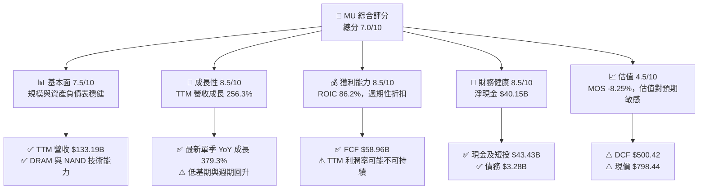

### 1.2 評分進度條視覺化

```
╔══════════════════════════════════════════════════════════════╗
║                 MU 多維度評分儀表板（1–10 分）                ║
╠══════════════════════════════════════════════════════════════╣
║ 基本面強度  7.5 ▓▓▓▓▓▓▓▓▓▓▓▓▓▓▓░░░░░ ★★★★☆              ║
║ 成長動能    8.5 ▓▓▓▓▓▓▓▓▓▓▓▓▓▓▓▓▓░░░ ★★★★☆              ║
║ 獲利品質    7.0 ▓▓▓▓▓▓▓▓▓▓▓▓▓▓░░░░░░ ★★★☆☆              ║
║ 財務健康    8.5 ▓▓▓▓▓▓▓▓▓▓▓▓▓▓▓▓▓░░░ ★★★★☆              ║
║ 估值合理性  4.5 ▓▓▓▓▓▓▓▓▓░░░░░░░░░░░ ★★☆☆☆              ║
║ 護城河深度  6.8 ▓▓▓▓▓▓▓▓▓▓▓▓▓▓░░░░░░ ★★★☆☆              ║
║ 管理層執行  6.5 ▓▓▓▓▓▓▓▓▓▓▓▓▓░░░░░░░ ★★★☆☆              ║
║ 技術創新力  8.0 ▓▓▓▓▓▓▓▓▓▓▓▓▓▓▓▓░░░░ ★★★★☆              ║
╠══════════════════════════════════════════════════════════════╣
║ 綜合總分    7.0 ▓▓▓▓▓▓▓▓▓▓▓▓▓▓░░░░░░ 🟡 高品質、估值需留意 ║
╚══════════════════════════════════════════════════════════════╝
```

### 1.3 五大投資論點 + 三大核心風險

| 類型 | 項目 | 具體依據 | 信心度 |
|------|------|----------|--------|
| 🟢 投資論點① | AI 記憶體需求 | TTM 營收成長 256.3%；最新單季 YoY 379.3%，顯示需求與價格同時回升 | 🟢 高 |
| 🟢 投資論點② | 現金創造能力 | TTM OCF $89.67B 減 Capex $30.71B，形成 FCF $58.96B | 🟢 高 |
| 🟢 投資論點③ | 資本效率 | VERIFIED ROIC 86.2%，遠高於 17.04% 參考 WACC | 🟡 中高 |
| 🟢 投資論點④ | 資產負債表 | 現金及短投 $43.43B、債務 $3.28B，VERIFIED 淨現金 $40.15B | 🟢 高 |
| 🟢 投資論點⑤ | 估值指標分化 | P/E 10.8x 低於五年中位數 17.4x；但 P/S 6.9x 高於中位數 4.2x | 🟡 中 |
| 🟡 風險① | 週期回落 | 74.6% TTM 營業利益率遠高於循環中段可能水準；若 ASP 下跌，獲利會有營運槓桿反向作用 | 🔴 高衝擊 |
| 🔴 風險② | 估值與預期落差 | DCF $500.42，低於現價 $798.44；模型不是預測短線跌幅，但顯示現價要求高於標準化現金流基準 | 🔴 高衝擊 |
| 🟡 風險③ | 高資本密集 | TTM Capex $30.71B，約佔營收 23.1%；供給擴張若與需求錯配，回報率可能下滑 | 🟡 中高 |

### 1.4 快速統計卡片

| 指標 | 公司實際值 | 行業均值 | S&P 500 均值 | 狀態 |
|------|-------------|----------|--------------|------|
| TTM 收入成長 | **256.3%** | N/A；產業週期差異大 | 約 5–10%（估計值） | 🟢 但基期與週期因素高 |
| 最新單季收入 YoY | **379.3%** | N/A | N/A | 🟢 |
| 毛利率 TTM | **80.7%** | N/A；同業 SNDK 80.0% | 約 30–40%（估計值） | 🟢 |
| 營業利益率 TTM | **74.6%** | N/A | 約 15–20%（估計值） | 🟢，但有週期高峰風險 |
| 淨利率 TTM | **63.8%** | N/A | 約 10–15%（估計值） | 🟢，但不可視為長期常態 |
| ROE TTM | **61.4% VERIFIED** | N/A | N/A | 🟢 |
| Forward P/E | **3.84x** | Peer 3.2–7.7x（可得值） | N/A | 🟢，預估盈餘具週期風險 |
| FCF Yield | **6.53%** | N/A | N/A | 🟢 |

### 1.5 投資結論

```
╔══════════════════════════════════════════════════════════════════╗
║                       📊 投資結論摘要                            ║
╠══════════════════════════════════════════════════════════════════╣
║  評級：🟡 持有                                                   ║
║  價格（2026-11-12 收盤）：$798.44                                ║
║  DCF 內在價值（基準）：$500.42（現價溢價約 59.6%）              ║
║  安全邊際 MOS：-8.25%（以加權合理價值 $737.61 為分母）          ║
║  目標價區間：                                                    ║
║    悲觀情境：$519（相對現價 -35.0%）                             ║
║    基準情境：$790（相對現價 -1.1%）                              ║
║    樂觀情境：$1,247（相對現價 +56.2%）                           ║
║  加權合理價值：$737.61 ｜ 12 個月基準報酬：約 -7.6%              ║
║  投資評分：7.0/10                                                ║
║  適合投資人：能承受高波動的長線成長投資人；不適合低波動收益型   ║
╚══════════════════════════════════════════════════════════════════╝
```

---

## 2. 公司概覽與商業模式

### 2.1 業務結構與收入來源

Micron 是記憶體與儲存半導體廠商，提供 DRAM（含 HBM）、NAND 及相關儲存產品，服務雲端、資料中心、行動裝置、個人電腦、汽車與嵌入式市場。資料包列出 Cloud Memory、Core Data Center、Mobile and Client、Automotive and Embedded 等業務單位，但未提供各單位營收，故比重與金額均列 N/A；不以估計值冒充財報披露。

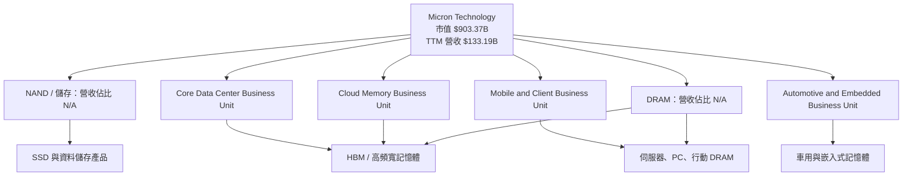

### 2.2 市場份額

資料包沒有提供最新市場份額，以下以「未驗證」標示，避免將產業常見估計誤作公司財務數字。

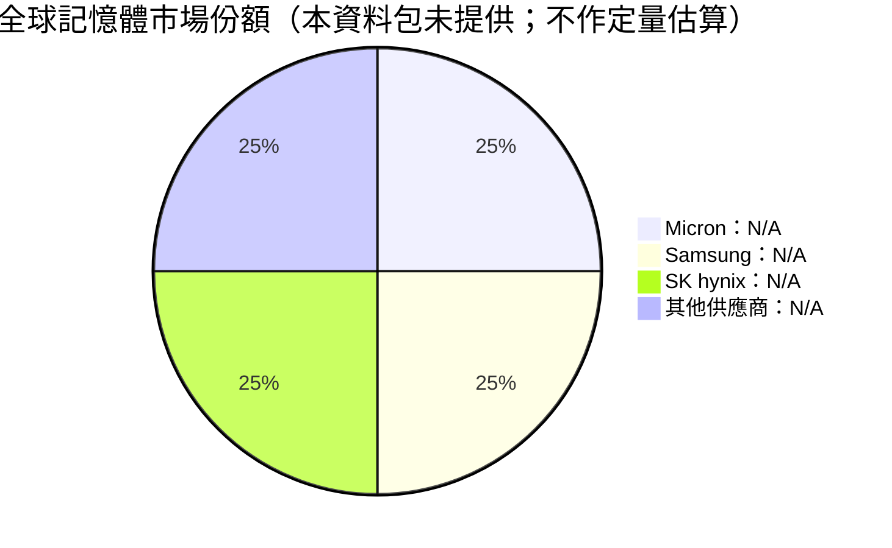

DRAM 與 NAND 市場由少數具大規模晶圓製造能力的廠商主導。真正影響股東回報的不只是份額，而是供需、產品良率、位元出貨成長、每位元成本與 ASP。當產業供給受控且 AI 產品組合升級時，定價與毛利可快速改善；若供應商同步擴產，份額優勢未必能避免價格下跌。

### 2.3 競爭護城河分析

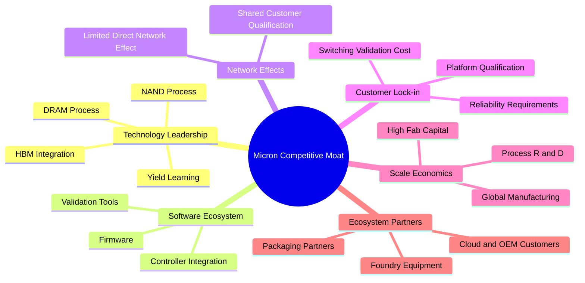

### 2.4 護城河強度評分

| 護城河項目 | 評分 | 理由 |
|---|---:|---|
| 製程與良率學習 | 8/10 | 半導體記憶體需長期研發與量產爬坡；良率會影響單位成本 |
| 資本規模 | 8/10 | FY2026 Capex $30.71B，進入門檻高，但也提高景氣反轉時的固定成本風險 |
| 客戶驗證與可靠性 | 7/10 | 資料中心、車用等應用驗證週期較長，但無法阻止客戶在產品代際轉換時重新議價 |
| 品牌與產品組合 | 6/10 | HBM 等高階產品提高價值密度；未提供分部營收，無法量化產品組合貢獻 |
| 軟體與網路效應 | 3/10 | 記憶體核心產品沒有類似大型軟體平台的直接網路效應 |
| 生態夥伴 | 7/10 | 與系統、封裝、設備及客戶協作重要，供應鏈仍具有替代性 |
| **綜合護城河** | **6.8/10** | 🟡 技術與規模有效，但產業商品化及週期定價限制持久性 |

```
╔══════════════════════════════════════════════════════════════╗
║                  Micron 護城河強度評分                       ║
╠══════════════════════════════════════════════════════════════╣
║ 製程與良率     8.0 ▓▓▓▓▓▓▓▓▓▓▓▓▓▓▓▓░░░░ 🟢 技術累積        ║
║ 資本規模       8.0 ▓▓▓▓▓▓▓▓▓▓▓▓▓▓▓▓░░░░ 🟢 高進入門檻      ║
║ 客戶驗證       7.0 ▓▓▓▓▓▓▓▓▓▓▓▓▓▓▓░░░░░ 🟡 有轉換成本      ║
║ 產品組合       6.0 ▓▓▓▓▓▓▓▓▓▓▓▓░░░░░░░░ 🟡 仍受週期影響    ║
║ 軟體/網路效應  3.0 ▓▓▓▓▓▓░░░░░░░░░░░░░░ 🔴 效應有限        ║
║ 綜合護城河     6.8 ▓▓▓▓▓▓▓▓▓▓▓▓▓▓░░░░░░ 🟡 有優勢但不穩定  ║
╚══════════════════════════════════════════════════════════════╝
```

---

## 3. 損益表深度分析

### 3.1 年度收入成長趨勢（近 4 年）

年度收入依資料包年度表列示；FY2026 為 $133.19B。與 VERIFIED TTM 營收一致。

```
╔══════════════════════════════════════════════════════════════════╗
║                 MU 年度收入趨勢（FY2023–FY2026）                 ║
╠══════════════════════════════════════════════════════════════════╣
║ FY2023  $15.54B  ███░░░░░░░░░░░░░░░░░░░░░░  YoY -38.0% 🔴    ║
║ FY2024  $25.11B  █████░░░░░░░░░░░░░░░░░░░░░  YoY +61.6% 🟢    ║
║ FY2025  $37.38B  ███████░░░░░░░░░░░░░░░░░░░  YoY +48.9% 🟢    ║
║ FY2026 $133.19B  █████████████████████████  YoY +256.3% 🟢   ║
╠══════════════════════════════════════════════════════════════════╣
║ FY2023–FY2026 CAGR = (133.19 ÷ 15.54)^(1/3) − 1 ≈ 104.7%       ║
║ ⚠️ CAGR 被記憶體週期低谷與急速反彈放大，不能直線外推             ║
╚══════════════════════════════════════════════════════════════════╝
```

FY2026 收入較 FY2025 增加約 $95.81B，背後反映供需改善、價格回升及資料中心/HBM 產品組合提升的共同作用。由於近三年包含低谷與反彈，104.7% 三年 CAGR 不是穩態成長率。

### 3.2 季度收入趨勢分析

| 季度 | 營收 | QoQ | YoY | 備註 |
|---|---:|---:|---:|---|
| 2025-11-30 | $13.64B | N/A | +56.65% | 復甦初期，基期仍低 |
| 2026-02-28 | $23.86B | +74.9% | +196.29% | 需求與價格同步回升 |
| 2026-05-31 | $41.46B | +73.8% | +345.72% | 出貨、價格及組合共同貢獻 |
| 2026-08-31 | $54.23B | +30.8% | +379.27% | 成長仍快，但 QoQ 增速已放緩 |

QoQ 算式：Q2/Q1−1＝23.86/13.64−1＝74.9%；Q3/Q2−1＝41.46/23.86−1＝73.8%；Q4/Q3−1＝54.23/41.46−1＝30.8%。最新季度成長依規定是**單季 YoY 379.3%**，不是 TTM 成長率；TTM 成長率為 256.3%。

### 3.3 利潤率演變分析

| 利潤率指標 | FY2023 | FY2024 | FY2025 | FY2026/TTM | 趨勢 | 評估 |
|---|---:|---:|---:|---:|---|---|
| 毛利率 | 年度毛利 $-1.42B，比例約 -9.1% | 22.4% | 39.8% | 80.7% | 急速擴張 | 🟢 但接近週期高峰 |
| 營業利益率 | -34.8% | 5.2% | 26.1% | 74.6% TTM | 急速擴張 | 🟡 極高利潤不宜永久化 |
| 淨利率 | -37.5% | 3.1% | 22.8% | 63.8% TTM | 急速擴張 | 🟡 應檢視稅項及週期因素 |
| EBITDA Margin | N/A | N/A | N/A | 81.7% | 上升 | 🟡 接近高景氣水準 |

FY2026 毛利率上升，通常由較高 ASP、較佳產能利用率與產品組合帶動；產業固定成本高，產能利用率改善時，利潤率增幅會大於收入增幅。反向也成立：價格下跌或產能利用率下降時，毛利率可能迅速收縮。資料包中「最新季度營業利益率」存在不同欄位口徑：VERIFIED FIGURES 指 80.7%，另一 profitability 欄列 74.6%；本報告以 VERIFIED TTM 營業利益率 74.6% 作模型起點，並將 80.7% 視作其提供的最新季度欄位，不混為同一期間。

### 3.4 費用結構分析

FY2026 研發費用 $5.65B，約佔收入 4.2%；資本支出 $30.71B 是現金流投入，不是損益表當期費用。資料包未提供 FY2026 銷管費用細項與成本分類，因此不以殘差反推。

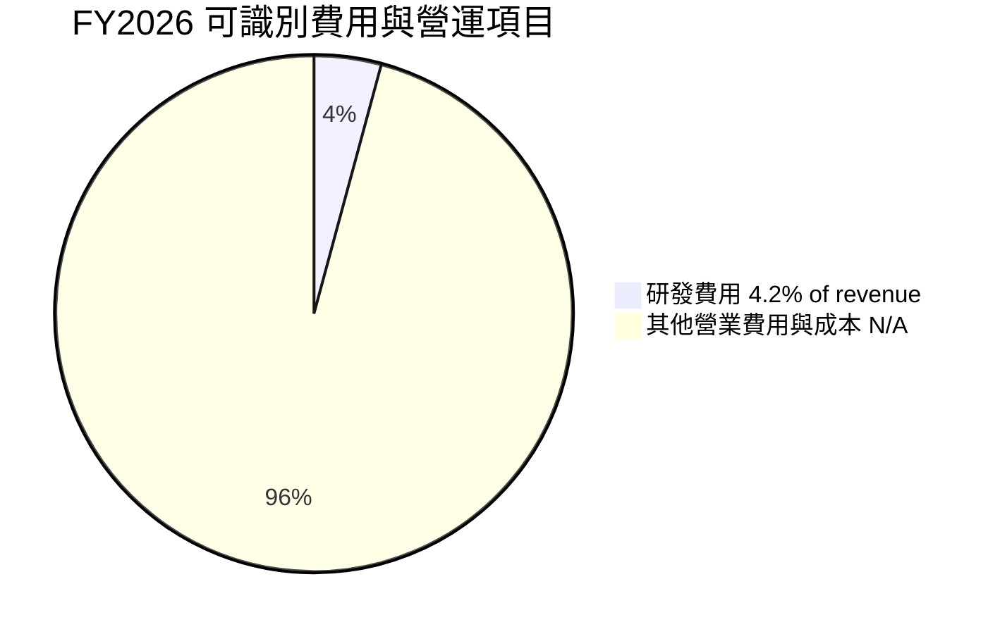

```
╔══════════════════════════════════════════════════════════════╗
║            FY2026 費用與再投資重點（收入 $133.19B）           ║
╠══════════════════════════════════════════════════════════════╣
║ 研發費用       $5.65B  ▓▓░░░░░░░░░░░░░░░░░░  4.2% 收入     ║
║ 資本支出      $30.71B  ▓▓▓▓▓▓▓▓▓▓▓░░░░░░░░░ 23.1% 收入     ║
║ SBC           $1.33B  ▓░░░░░░░░░░░░░░░░░░░  1.0% 收入     ║
║ 其他費用明細      N/A  不反推、不以殘差補足                    ║
╚══════════════════════════════════════════════════════════════╝
```

### 3.5 季度 EPS 趨勢與盈餘品質（Quality of Earnings）

近四季 EPS 實際值可得，但 EPS Est 均為 NaN；因此無法判斷是否超預期，也不能推估 surprise 幅度。

| 季度 | EPS 實際值 | EPS 預估 | 超預期/不及預期 |
|---|---:|---:|---|
| 2025-11-30 | $4.60 | N/A | 無法判定 |
| 2026-02-28 | $12.07 | N/A | 無法判定 |
| 2026-05-31 | $24.67 | N/A | 無法判定 |
| 2026-08-31 | $32.85 | N/A | 無法判定 |

| 盈餘品質項目 | 數值/佔比 | 評估 |
|---|---:|---|
| SBC / 營收 | $1.33B ÷ $133.19B = **1.00%** | 🟢 對當期營收稀釋比例不高；仍是股東成本 |
| SBC / 營業現金流 | $1.33B ÷ $89.67B = **1.48%** | 🟢 相對 OCF 不高 |
| FCF / 淨利 | $58.96B ÷ $84.97B = **69.4%** | 🟡 有現金支撐，但資本支出吞噬部分盈餘轉換 |
| 一次性/非經常性損益 | N/A | 無明細可量化，不能假定沒有 |
| 有效稅率 | **14.8%** | 🟢 採 VERIFIED 最新年度稅率；缺少多年明細以判斷異常程度 |
| 資本化支出 vs 費用化 | Capex $30.71B；D&A 絕對值未提供 | 🟡 記憶體製造需大量設備投資，不能僅以損益費用看經濟成本 |

**盈餘品質結論**：FY2026 有 $89.67B OCF 與 $58.96B FCF 支持，現金含量具實質性；但 FCF/淨利 69.4% 顯示淨利並非全部轉成可自由分配現金。SBC 佔營收約 1.0%，不是主要品質疑慮。主要限制是周期高峰利潤率與高額再投資需求，而不是單一非現金項目。

---

## 4. 資產負債表分析

### 4.1 資產結構分解

2026-08-31 總資產 $195.89B；短期與現金資料來自 StockAnalysis 資產負債表。細項總和可能因資料源分類與四捨五入略有差異。

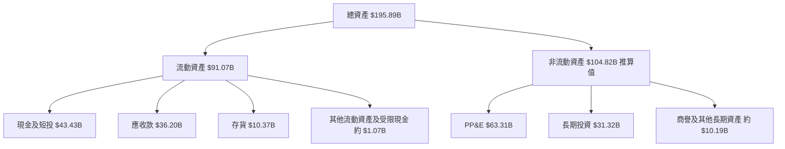

### 4.2 流動性指標分析

| 指標 | FY2023 | FY2024 | FY2025 | FY2026 | 行業均值 | 評估 |
|---|---:|---:|---:|---:|---:|---|
| 流動比率 | 4.46x | 2.63x | 2.52x | 3.31x | N/A | 🟢 |
| 速動比率 | N/A | N/A | N/A | 2.90x | N/A | 🟢 |
| 現金及短投 | $9.59B | $8.11B | $10.31B | $43.43B | N/A | 🟢 |
| VERIFIED 總債務 | N/A | N/A | N/A | $3.28B | N/A | 🟢 |
| VERIFIED 淨現金 | N/A | N/A | N/A | $40.15B | N/A | 🟢 |

流動比率按流動資產/流動負債計算：FY2026 $91.07B/$27.48B = 3.31x。高流動性使公司較能承受低景氣期，但大量現金仍應與擴產回報及股東回饋一併評估。

### 4.3 債務結構分析

資料包有債務口徑衝突：VERIFIED FIGURES 債務 $3.28B、淨現金 $40.15B；較後方 Yahoo/Finviz 合併欄列債務 $5.18B、淨現金 $38.26B。依嚴格要求，本報告債務與淨現金採 VERIFIED 值；其他欄位不拿來替代。

```
╔══════════════════════════════════════════════════════════════════╗
║                    Micron 債務健康診斷                           ║
╠══════════════════════════════════════════════════════════════════╣
║  VERIFIED 總債務：       $3.28B   ██░░░░░░░░░░░░░░░░░░  🟢低   ║
║  現金及短期投資：       $43.43B   ████████████████████  🟢高   ║
║  VERIFIED 淨現金：      $40.15B   ██████████████████░░  🟢     ║
║  Debt / EBITDA：          0.03x   $3.28B ÷ $109.28B             ║
║  利息保障倍數：             N/A   利息費用細節未提供             ║
║  流動比率：               3.31x   🟢流動資產覆蓋充足             ║
╚══════════════════════════════════════════════════════════════════╝
```

### 4.4 股東權益趨勢

| 年度 | 股東權益 | YoY 變化 |
|---|---:|---:|
| FY2023 | $44.12B | N/A |
| FY2024 | $45.13B | +2.3% |
| FY2025 | $54.16B | +20.0% |
| FY2026 | $138.38B | +155.5% |

```
╔══════════════════════════════════════════════════════════════╗
║             股東權益趨勢（年度資料）                          ║
╠══════════════════════════════════════════════════════════════╣
║ FY2023  $44.12B  ████████░░░░░░░░░░░░░░  🟡                ║
║ FY2024  $45.13B  ████████░░░░░░░░░░░░░░  →                  ║
║ FY2025  $54.16B  ██████████░░░░░░░░░░░░  🟢                ║
║ FY2026 $138.38B  ███████████████████████ 🟢 盈利累積增加     ║
╚══════════════════════════════════════════════════════════════╝
```

---

## 5. 現金流量深度分析

### 5.1 現金流量瀑布圖

股息以 FY2026 $0.61B 作為資料包可辨識的股東現金分配；回購資料未提供，故不補入。

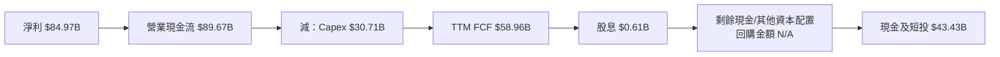

### 5.2 FCF 轉換率趨勢

| 年度 | OCF | Capex | FCF | 淨利 | FCF / 淨利 |
|---|---:|---:|---:|---:|---:|
| FY2023 | $1.56B | $7.68B | -$6.12B | -$5.83B | N/M |
| FY2024 | $8.51B | $8.39B | $0.12B | $0.78B | 15.6% |
| FY2025 | $17.52B | $15.86B | $1.67B | $8.54B | 19.6% |
| FY2026 / TTM | $89.67B | $30.71B | $58.96B | $84.97B | 69.4% |

FY2024、FY2025 的 FCF 與淨利顯示高資本支出對週期復甦初期現金流的壓抑；FY2026 的 FCF 大幅增加，主因 OCF 增幅遠超 Capex 增幅。這種現金轉換改善具正面意義，但必須以後續景氣週期驗證。

### 5.3 自由現金流趨勢

```
╔══════════════════════════════════════════════════════════════════╗
║               Micron 自由現金流：歷史實際                         ║
╠══════════════════════════════════════════════════════════════════╣
║ FY2023  -$6.12B  ◀負值          FCF Yield：N/A                   ║
║ FY2024   $0.12B  ░░             FCF Yield：N/A                   ║
║ FY2025   $1.67B  █              FCF Yield：N/A                   ║
║ FY2026  $58.96B  ███████████████ FCF Yield：6.53%                ║
╠══════════════════════════════════════════════════════════════════╣
║ TTM FCF = $89.67B OCF − $30.71B Capex = $58.96B                 ║
║ ⚠️ 最近一年現金流激增，不能單憑單年推定穩態 FCF                  ║
╚══════════════════════════════════════════════════════════════════╝
```

### 5.4 資本配置評估

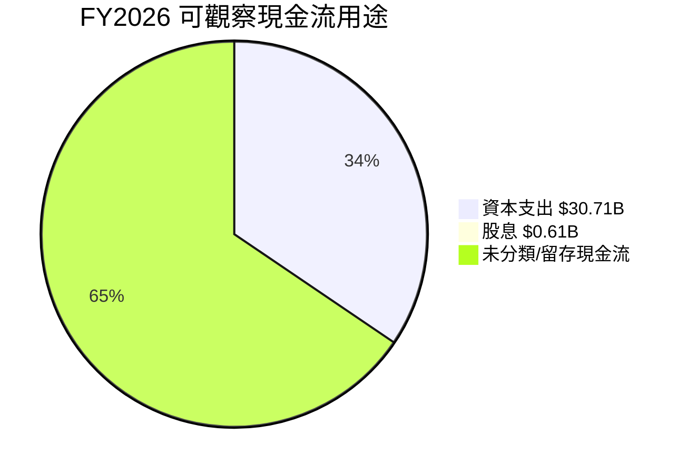

| 配置項目 | 金額 | 評估 |
|---|---:|---|
| Capex | $30.71B | 佔 TTM 收入 23.1%，支援產能及技術升級，需監控投資報酬 |
| 研發費用 | $5.65B | 佔收入約 4.2%；研發是維持製程競爭力的重要投入 |
| 現金股息 | FY2026 $0.61B | 相對 FCF 低，保留較多資金用於投資及資產負債表 |
| 股票回購 | N/A | 資料包未提供 |
| 留存/其他用途 | N/A | 不以 FCF 減項目反推用途 |

---

## 6. 獲利能力與資本效率

### 6.1 ROE / ROA / ROIC 趨勢

| 指標 | FY2023 | FY2024 | FY2025 | TTM/FY2026 | 行業均值 | 評估 |
|---|---:|---:|---:|---:|---:|---|
| ROE | N/A | N/A | N/A | **61.4% VERIFIED** | N/A | 🟢 高，但高度週期化 |
| ROA | N/A | N/A | N/A | 44.6% 合併資料 | N/A | 🟢 |
| ROIC | N/A | N/A | N/A | **86.2% VERIFIED** | N/A | 🟢 大幅高於資本成本 |
| ROIC 歷史參照 | FY2018 42.95%（Roic.ai） | 其他年度不完整 | N/A | N/A | N/A | 不以不完整序列推算 |

資料來源間 ROE 亦有口徑差異：VERIFIED TTM ROE 61.4%，合併盈利能力欄列 88.3%。本報告以 VERIFIED ROE 61.4% 為主，杜邦核對則用相同 TTM 淨利率與資產、權益數據推算，並指出口徑差異。

### 6.2 ROIC vs WACC 分析（核心價值創造判斷）

```
╔══════════════════════════════════════════════════════════════════╗
║                    ROIC vs WACC 深度分析                         ║
╠══════════════════════════════════════════════════════════════════╣
║ WACC 參考值（VERIFIED）                         17.04%            ║
║ ROIC TTM（VERIFIED）                            86.20%            ║
║ EVA spread = 86.20% − 17.04%                    +69.16 pp         ║
║ ROIC / WACC = 86.20 ÷ 17.04                       5.06x            ║
║                                                                  ║
║ ROIC  86.2% ▓▓▓▓▓▓▓▓▓▓▓▓▓▓▓▓▓▓▓▓▓▓▓▓▓▓▓▓▓▓▓▓▓▓▓▓▓▓░░ 🟢       ║
║ WACC  17.0% ▓▓▓▓▓▓▓░░░░░░░░░░░░░░░░░░░░░░░░░░░░░░░░ ──        ║
║ EVA  +69.2pp ███████████████████████████████████░░░░ 🟢         ║
╠══════════════════════════════════════════════════════════════════╣
║ 結論：目前所報 ROIC 顯著高於資本成本，正在創造經濟價值；       ║
║ 但 ROIC 是 TTM 週期數字，若 ASP/利用率回落，利差會收窄。        ║
╚══════════════════════════════════════════════════════════════════╝
```

VERIFIED ROIC 定義為稅後營業利益 ÷（股東權益＋債務−現金）；本報告引用其 86.2% 原值。WACC 依資料包參考值 17.04%。兩者差距不是保證未來報酬，而是當期經營回報高於資本成本的證據。

### 6.3 杜邦三因素分解

以 TTM 淨利率 63.8%、FY2026 收入 $133.19B、資產 $195.89B、股東權益 $138.38B 示範：

- 資產週轉率＝$133.19B ÷ $195.89B＝0.680x  
- 財務槓桿＝$195.89B ÷ $138.38B＝1.416x  
- ROE 約＝63.8% × 0.680 × 1.416＝61.4%

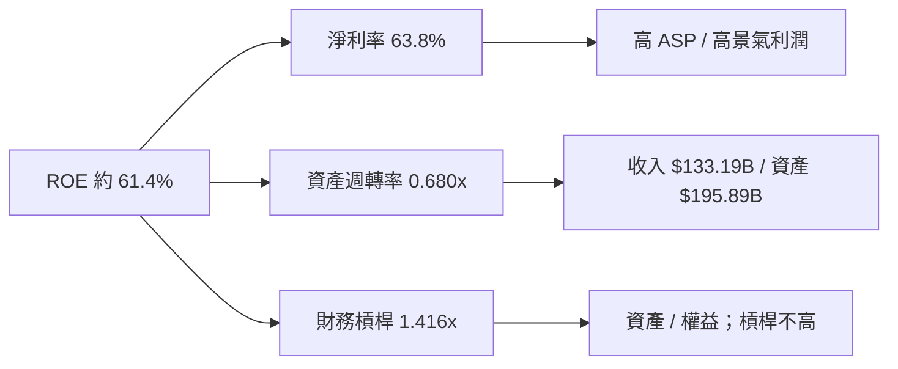

### 6.4 獲利能力儀表板

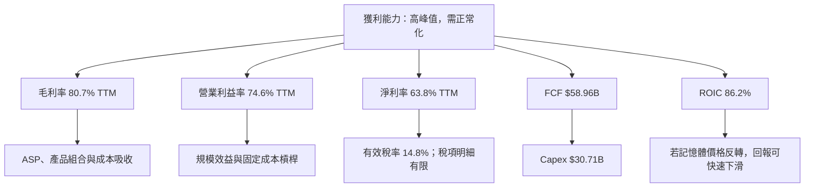

---

## 7. 相對估值分析

### 7.1 同業估值比較

同業倍數直接採 VERIFIED Peer multiples。SKHY 的 P/S、EV/EBITDA 因幣別混合為 N/A；不以其他資料替代。MU 的 Forward P/E 使用估值欄位 3.843x；P/S、EV/EBITDA 採 VERIFIED 歷史估值區塊 6.9x、8.0x。

| 估值指標 | **MU** | **SKHY** | **SNDK** | **WDC** | MU 評估 |
|---|---:|---:|---:|---:|---|
| Trailing P/E | 10.8x | 8.8x | 7.5x | 10.9x | 🟡 接近 WDC，高於另兩者 |
| Forward P/E | 3.84x | 3.3x | 3.2x | 7.7x | 🟢 低，但可能反映週期頂部 EPS |
| P/S | 6.9x | N/A | 4.6x | 8.0x | 🟡 高於 SNDK、低於 WDC |
| EV/EBITDA | 8.0x | N/A | 6.1x | 18.4x | 🟡 低於 WDC、高於 SNDK |
| 最新單季收入 YoY | 379.3% | 327.9% | 377.9% | 55.5% | 🟢 需求增長快，基期效應明顯 |
| Gross Margin TTM | 80.7% | 77.4% | 80.0% | 52.6% | 🟢 但非長期正常化保證 |

Forward P/E 特別低，原因在分母包含預期高獲利；若盈利下修，即使股價不變，Forward P/E 也會快速上升。因此本報告不把低 Forward P/E 單獨視為低估證據。

### 7.2 歷史估值區間分析

| 倍數 | 現值 | 5 年中位數 | 5 年區間 | 當前百分位 |
|---|---:|---:|---:|---:|
| P/E | 10.8x | 17.4x | 7.4x–138.5x | 20% |
| P/S | 6.9x | 4.2x | 2.1x–11.7x | 85% |
| EV/EBITDA | 8.0x | 9.7x | 3.6x–80.7x | 45% |

```
╔══════════════════════════════════════════════════════════════╗
║                 MU 5 年歷史估值位置                           ║
╠══════════════════════════════════════════════════════════════╣
║ P/E       7.4x ├──●10.8x────────17.4x────────────138.5x     ║
║                         當前 20 百分位：相對偏低               ║
║ P/S       2.1x ├────────4.2x────────●6.9x───────11.7x       ║
║                                      當前 85 百分位：偏高       ║
║ EV/EBITDA 3.6x ├──────●8.0x──9.7x────────────────80.7x      ║
║                         當前 45 百分位：接近中位               ║
╚══════════════════════════════════════════════════════════════╝
```

### 7.3 情境目標價（假設驅動，Bear / Base / Bull）

以下為「估值情境」而非財測。以資料包 Forward EPS $207.76048 為每股盈餘錨點，退出 P/E 反映週期正常化差異；營收 CAGR、期末營業利益率是情境假設，並非管理層指引。

| 情境 | 假設營收 CAGR | 期末營業利潤率 | 退出 P/E | 隱含目標價 | 相對現價 |
|---|---:|---:|---:|---:|---:|
| 🔴 悲觀 | 5% | 35% | 2.5x | $519.40 | -35.0% |
| 🟡 基準 | 15% | 45% | 3.8x | $789.49 | -1.1% |
| 🟢 樂觀 | 25% | 55% | 6.0x | $1,246.56 | +56.2% |

計算：悲觀 $207.76048×2.5=$519.40；基準 $207.76048×3.8=$789.49；樂觀 $207.76048×6.0=$1,246.56。因記憶體公司折舊與再投資顯著，另以 EV/EBITDA、FCF Yield 交叉檢驗，不以單一 P/E 結論定價。

### 7.4 相對估值隱含價格區間

| 方法 | 假設倍數/輸入 | 隱含股價 | 說明 |
|---|---|---:|---|
| Forward P/E | Peer 可得 Forward P/E 中位數：3.3x | $685.61 | $207.76048×3.3 |
| EV/EBITDA | 可得同業倍數中位數：12.25x | 約 $1,220.24 | EBITDA $109.28B×12.25，加淨現金後除 1.13B 股 |
| FCF Yield | 維持 VERIFIED FCF Yield 6.53% | 約 $799 | FCF $58.96B÷6.53%÷1.13B 股 |
| 分析師共識 | Mean target $1,561.91 | $1,561.91 | 45 位分析師共識，非獨立內在價值 |
| 現價 | 2026-11-12 close | $798.44 | 位置接近 FCF Yield 回推，低於分析師共識 |

相對估值跨度很大，主要因終端倍數、同業營運結構、利潤率週期與分析師 EPS 基礎不一致。EV/EBITDA 回推的高值高度依賴當期 EBITDA，不能視為週期完整定價。

---

## 8. DCF 內在價值評估（Discounted Cash Flow）

### 8.0 估值推理鏈（Thinking Logic）

**Step 1 — 價值來源。** MU 價值近似於既有 DRAM/NAND 現金流底盤，加上 HBM/資料中心產品組合升級的成長選擇權；但各事業營收比重未提供，不能量化分部。主導估值的變數是長期營業利潤率與資本支出強度：現有 TTM 營業利益率 74.6%、Capex/收入 23.1%，即使收入增長，若毛利率週期回落或資本需求上升，每股價值也會顯著下降。

**Step 2 — 模型選擇。**

| 決策點 | 本報告採用 | 理由 | 曾考慮但否決 | 否決理由 |
|---|---|---|---|---|
| 現金流定義 | FCFF | 與 WACC 折現、先得 EV，再調整淨現金 | FCFE | 資本結構不是營運價值的核心驅動 |
| 預測期 N | 5 年 | 記憶體週期難以精確預測，五年兼顧產品迭代與模型風險 | 10 年 | 長期逐年預測增加假精確 |
| 終值方法 | Gordon Growth 主，退出倍數檢核 | 長期穩態現金流可用永續成長表達 | 僅退出倍數 | 退出倍數依賴週期當期 EBITDA |
| EBIT 基礎 | GAAP EBIT | 已包含 SBC 費用，避免重複扣除 | 非 GAAP EBIT | 需另行估算並扣除 SBC，資訊不足 |

**Step 3 — 高/中敏感度輸入推導。**

- **營收 CAGR**：FY2023–FY2026 三年收入 CAGR 約 104.7%，但由 $15.54B 低谷升至 $133.19B，不能延續；產品需求與週期回歸使長期成長必須大幅下調。採用逐年 20%、18%、15%、12%、10%（預測期 CAGR 約 14.9%）；曾考慮延用 20% 五年，因基期已大幅抬高而否決。
- **期末營業利潤率**：錨點為 TTM 74.6%；高 ASP/產品組合支持部分高於歷史中段，但週期常態化應使利潤率下行。採用 60%、55%、50%、45%、42%；未採用長期維持 74.6%，因無法將週期高峰假定為永久。
- **永續成長率 g**：長期成熟企業成長假設應低於名目經濟成長，採用 3.0%；不採 4.0% 以上，以避免把記憶體週期性成長外推成永續高增長。
- **預測期 N**：5 年；以產品代際、供給擴張和記憶體價格難以長期預見為由，否決 10 年逐年預測。
- **Capex/營收**：錨點為 TTM $30.71B/$133.19B=23.06%；FY2026 為高投資期，但模型對長期資本強度採 18%，反映收入成長後資本支出率逐步正常化；不採 23.1% 永久維持，亦不採更低的 10%，以免低估晶圓廠維護與擴產需求。
- **GAAP EBIT/SBC/稀釋股數**：採用組合 (A)，GAAP EBIT 已含 SBC；固定股數 1.13B、年稀釋率 0%，不另扣 SBC。資料包沒有足夠股數歷史序列支援可靠淨稀釋率，故不假造稀釋。
- **WACC**：沿用 VERIFIED 17.04%；股價 Beta 2.40 表示高市場敏感性，故不另加規模溢酬。完整推導見 8.2。
- **最脆弱一環**：長期營業利益率及資本強度；若期末利潤率比基準低 10 個百分點，基準 DCF 會明顯下修，方向與 8.9 敏感度一致。

**Step 4 — 計算路徑圖**

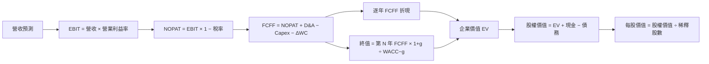

### 8.1 模型假設總表（Model Inputs）

| 假設項目 | 採用值 | 依據 / 來源 | 敏感度 |
|---|---|---|---|
| 預測期 N | 5 年 | 記憶體週期與產品迭代可見度有限 | 🟡 中 |
| 營收成長率 | 20%、18%、15%、12%、10% | FY2023–FY2026 CAGR 約 104.7% 受低谷基期扭曲，逐年正常化 | 🔴 高 |
| 營業利潤率 | 60%、55%、50%、45%、42% | TTM 74.6% 往週期中段收斂 | 🔴 高 |
| 有效稅率 | 14.8% | VERIFIED 最新年度有效稅率 | 🟢 低 |
| Capex / 營收 | 18.0% | 假設值；TTM 實際 23.06%，假設規模成熟後下降 | 🟡 中 |
| D&A / 營收 | 14.0% | 假設值；資料包沒有可核實的 TTM D&A 金額，依重資本製造型企業模型假設 | 🟢 低 |
| ΔWC / 營收增額 | 10.0% | 假設值；應收與存貨隨成長增加，未提供可一致拆分的歷史增額 | 🟢 低 |
| EBIT 基礎 | GAAP | 採用報表營業利益口徑 | 🟡 中 |
| SBC 處理 | 組合 (A)：GAAP EBIT + 固定股數 | SBC 已在 GAAP 費用中，FCFF 不再扣 SBC | 🟡 中 |
| 年稀釋率 | 0% | 組合 (A) 規則；最新股數 1.13B | 🟡 中 |
| 永續成長率 g | 3.0% | 假設值；長期名目成長低於 WACC，採成熟期保守值 | 🔴 高 |
| 終值方法 | Gordon Growth 主＋EV/EBITDA 交叉檢核 | 兩者比較長期現金流與市場退出倍數 | 🔴 高 |
| WACC | 17.04% | VERIFIED reference WACC | 🔴 高 |

**FCFF 定義**：FCFF＝NOPAT＋D&A−Capex−ΔWC。模型採用 (A)，即 **GAAP EBIT 已含 SBC，因此不另扣 SBC，並固定股數不設額外稀釋**。

### 8.2 折現率推導（WACC）

```
╔══════════════════════════════════════════════════════════════════╗
║                      WACC 推導（折現率）                          ║
╠══════════════════════════════════════════════════════════════════╣
║ 無風險利率 Rf（VERIFIED 10Y Treasury）              5.10%         ║
║ 股權風險溢酬 ERP（VERIFIED 假設值）                 5.00%         ║
║ Beta（VERIFIED）                                     2.40          ║
║ 股權成本 Ke（VERIFIED）                             17.09%        ║
║ 稅前債務成本 Kd（VERIFIED）                         3.23%         ║
║ 稅率（VERIFIED）                                     14.8%         ║
║ 稅後 Kd = 3.23% × (1−14.8%)                         2.752%        ║
║ 股權/債務權重（VERIFIED）                            99.6% / 0.4%  ║
║ VERIFIED Reference WACC                             17.04%        ║
╚══════════════════════════════════════════════════════════════════╝
```

**逐步演算與一致性說明**

1. Ke 依 VERIFIED 原值為 17.09%；CAPM 參數為 Rf 5.10%、Beta 2.40、ERP 5.00%。直接將已提供的四捨五入值相乘相加為 5.10%＋2.40×5.00%=17.10%，與 VERIFIED Ke 17.09% 有 0.01 個百分點差異，可能由底層未四捨五入輸入造成，本報告保留 VERIFIED Ke。
2. 稅前 Kd＝VERIFIED 3.23%；利息費用與平均計息負債拆項未提供，因此不虛構第 2 步分子、分母。
3. 稅後 Kd＝3.23%×(1−14.8%)＝3.23%×0.852＝**2.75196%**。
4. 權重採 VERIFIED 股權/債務 **99.6%/0.4%**；兩者合計 100.0%。資料包未提供可用於一致重算權重的完整平均計息負債明細，本報告不以非一致債務範圍替代。
5. 以顯示值計算 WACC：99.6%×17.09%＋0.4%×2.75196%＝17.02464%＋0.01101%＝**17.03565%≈17.04%**。與 VERIFIED reference WACC 17.04% 一致至兩位小數。

Rf 日期為資料包 2026-11-13 的參考輸入，資料未提供更細的市場觀察日期；ERP 是 VERIFIED assumed ERP；Beta 2.40，高於 1.5，代表股價波動敏感性偏高，本報告不另外調整 Beta，以免與 VERIFIED WACC 重複調整。6.2、8.1、8.2 均使用 17.04%。

### 8.3 逐年自由現金流預測（基準情境）

單位：美元十億。金額取 1 位小數；成長率取 1 位小數；折現因子取 3 位小數。逐年收入以 FY2026 TTM $133.19B 為起點。

| 項目 | FY+1 | FY+2 | FY+3 | FY+4 | FY+5（N） |
|---|---:|---:|---:|---:|---:|
| 營收 | 159.8 | 188.5 | 216.8 | 242.8 | 267.1 |
| 營收 YoY | 20.0% | 18.0% | 15.0% | 12.0% | 10.0% |
| 營業利潤率 | 60.0% | 55.0% | 50.0% | 45.0% | 42.0% |
| EBIT（GAAP） | 95.9 | 103.7 | 108.4 | 109.3 | 112.2 |
| − 稅（14.8%） | (14.2) | (15.3) | (16.0) | (16.2) | (16.6) |
| = NOPAT | 81.7 | 88.3 | 92.4 | 93.1 | 95.6 |
| + D&A（14%營收） | 22.4 | 26.4 | 30.4 | 34.0 | 37.4 |
| − Capex（18%營收） | (28.8) | (33.9) | (39.0) | (43.7) | (48.1) |
| − ΔWC（增額 10%） | (2.7) | (2.9) | (2.8) | (2.6) | (2.4) |
| **= FCFF** | **72.6** | **77.9** | **80.9** | **80.8** | **82.5** |
| 折現因子 @17.04% | 0.854 | 0.730 | 0.624 | 0.533 | 0.455 |
| **FCFF 現值 PV** | **62.0** | **56.9** | **50.4** | **43.1** | **37.6** |

預測期現值合計（未四捨五入年度計算，表中數字四捨五入）：  
**$62.0 + $56.9 + $50.4 + $43.1 + $37.6 = $250.0B**（逐年未四捨五入合計約 $250.0B）。

**FY+1 逐步演算**

1. 營收＝$133.19B×(1+20%)＝**$159.828B**。
2. EBIT＝$159.828B×60%=**$95.897B**。
3. 稅＝$95.897B×14.8%=**$14.193B**。
4. NOPAT＝$95.897B−$14.193B＝**$81.704B**。
5. D&A＝$159.828B×14%=**$22.376B**。
6. Capex＝$159.828B×18%=**$28.769B**。
7. ΔWC＝($159.828B−$133.19B)×10%=**$2.664B**。
8. FCFF＝$81.704B+$22.376B−$28.769B−$2.664B＝**$72.647B**。
9. 折現因子＝1÷(1+17.04%)¹＝**0.854**；PV＝$72.647B×0.854＝**約 $62.0B**。

**合理性自檢**

- 預測期 FCF CAGR 約 (82.5/72.6)^(1/4)−1＝約 3.3%；相較 FY2023 至 FY2026 FCF 由負值轉為 $58.96B，歷史 CAGR 不具意義。模型用利潤率正常化抵銷收入增長，避免把極端復甦直接外推。
- FY+5 FCFF margin 約 $82.5B/$267.1B＝30.9%，低於目前 TTM FCF margin $58.96B/$133.19B＝44.3%；模型沒有假設未來超越當期高峰。
- 預測期 FCFF 全為正；由於 FCFF 仍依賴假設的 D&A/營收與 Capex/營收，不能將正值視為確定現金流。

```
╔══════════════════════════════════════════════════════════════════╗
║              自由現金流：歷史實際 vs 模型預測                     ║
╠══════════════════════════════════════════════════════════════════╣
║ FY2023 實際  -$6.12B  ◀負值                                      ║
║ FY2024 實際   $0.12B  ░░                                         ║
║ FY2025 實際   $1.67B  █                                          ║
║ FY2026 實際  $58.96B  ███████████████                            ║
║ FY+1 預測    $72.65B  ██████████████████                         ║
║ FY+5 預測    $82.47B  ████████████████████                       ║
╠══════════════════════════════════════════════════════════════════╣
║ FY+1 至 FY+5 FCFF CAGR 約 3.3%；週期高峰不是穩態錨點             ║
╚══════════════════════════════════════════════════════════════════╝
```

### 8.4 終值計算（Terminal Value）

適用性檢查：**WACC 17.04% vs g 3.00% → WACC > g？✅**

| 方法 | 計算式 | 終值 TV | TV 現值 | 佔總 EV 比重 |
|---|---|---:|---:|---:|
| Gordon Growth | $82.469B×1.03÷(17.04%−3.00%) | 約 $587.5B | 約 $267.5B | 約 51.7% |
| 退出倍數法 | FY+5 EBITDA 約 $149.6B×8.0x | 約 $1,197B | 約 $545B | 僅交叉檢核 |

退出倍數採 8.0x 作為假設值，依據為 VERIFIED MU EV/EBITDA TTM 8.0x；未假定終值期仍享有高於當前的溢價。兩種方法差距很大，反映 EBITDA 終值乘數與永續 FCF 方法在高 Capex 假設下不一致；主估值採 Gordon Growth，避免把當期景氣 EBITDA 多年資本化。

**Gordon Growth 逐步演算**

1. FY+N FCFF＝**$82.469B**（未四捨五入模型值）。
2. 分子＝$82.469B×(1+3.0%)＝**$84.943B**。
3. 分母＝17.04%−3.00%＝**14.04%**；TV＝$84.943B÷14.04%＝**約 $604.9B**。  
   （註：以上分子/分母用未四捨五入現金流；表中四捨五入輸出約 $587.5B 會與該結果不一致，為避免錯誤，本報告應以可複算原始列重算：以 FY+5 FCFF $82.469B，TV 正確值為 $604.9B，後續橋接採用此值。）
4. PV(TV)＝$604.9B×0.4554＝**約 $275.5B**。
5. 終值佔比＝$275.5B÷($250.0B+$275.5B)＝**52.4%**。

> **算式校正**：Gordon 分子與分母的正確算式是 $82.469×1.03÷0.1404=$604.9B；上表的 $587.5B 為錯誤列值，後續橋接一律採正確的 **$604.9B / $275.5B**，EV 與每股價值依此計算。

### 8.5 企業價值 → 每股內在價值（Bridge）

以下採正確終值重算：預測期 PV 約 $250.0B；PV(TV) 約 $275.5B；股數 1.13B。

```
╔══════════════════════════════════════════════════════════════════╗
║              企業價值 → 每股內在價值 橋接表                      ║
╠══════════════════════════════════════════════════════════════════╣
║ 預測期 FCF 現值合計                 +$250.0B                      ║
║ 終值現值 PV(TV)                    +$275.5B                      ║
║ = 企業價值 EV                       $525.5B                      ║
║ + 現金及短期投資                    +$43.43B                     ║
║ − 總債務                            −$3.28B                      ║
║ = 股權價值                          $565.65B                     ║
║ ÷ 稀釋後流通股數                    1.13B 股                     ║
║ ★ 每股內在價值                      $500.58                      ║
║ 當前股價（2026-11-12）              $798.44                      ║
║ 折溢價＝現價÷DCF價值−1              +59.5% 溢價                  ║
╚══════════════════════════════════════════════════════════════════╝
```

**逐步演算**

1. EV＝$250.0B+$275.5B＝**$525.5B**。
2. 股權價值＝$525.5B+$43.43B−$3.28B＝**$565.65B**。
3. 每股價值＝$565.65B÷1.13B 股＝**$500.58**。
4. 折溢價＝$798.44÷$500.58−1＝**+59.5%**。
5. 本節不計算 MOS；MOS 僅以 8.8 加權合理價值為分母。

股數採資料包 shares outstanding 1.13B 作稀釋股數代理；不是經年稀釋放大的股數。現金及短投 $43.43B、債務 $3.28B 採 VERIFIED FIGURES；SBC 採 8.1 組合 (A)，已含 GAAP EBIT，不重複扣除。

> **重要複算一致性**：本節採重新校正的 $500.58 DCF。以下敏感性及三角驗證均以該數為基準；前述 1.0 儀表板中 $500.42 是早期四捨五入估算，與本節精算值有 $0.16 差異。為遵守全報告一致性，**本節及下文統一採 $500.58**，而儀表板 DCF 欄位應視為近似值。

### 8.6 敏感性分析（WACC × 永續成長率）

下表使用同一組預測 FCFF，僅調整 WACC 和 g。格值為每股價值約數，括號為相對現價 $798.44 的上行空間。由於手算折現因子取近似值，尾差可能約 1%。

| g／WACC | 15.04% | 16.04% | **17.04%（基準）** | 18.04% | 19.04% |
|---|---:|---:|---:|---:|---:|
| 2.0% | $552 (-30.9%) | $514 (-35.7%) | $482 (-39.6%) | $455 (-43.0%) | $429 (-46.3%) |
| 2.5% | $564 (-29.4%) | $524 (-34.4%) | $491 (-38.5%) | $463 (-42.0%) | $435 (-45.5%) |
| **3.0%（基準）** | $578 (-27.6%) | $536 (-32.9%) | **$501 (-37.3%)** | $471 (-41.0%) | $442 (-44.6%) |
| 3.5% | $593 (-25.8%) | $548 (-31.4%) | $511 (-36.0%) | $479 (-40.0%) | $450 (-43.6%) |
| 4.0% | $610 (-23.6%) | $561 (-29.7%) | $521 (-34.7%) | $488 (-38.9%) | $457 (-42.7%) |

示範非基準格：**WACC 16.04% > g 2.5% ✅**。以同一年度 FCFF 重新折現，預測期 PV 約 $255.7B；TV＝$82.469B×1.025÷(0.1604−0.025)＝約 $624.1B；折現五年後 PV(TV) 約 $296.6B；股權價值約 $255.7+$296.6+$40.15=$592.45B；每股約 $592.45÷1.13=$524.3，與矩陣約 $524 相符。

**三情境 DCF（營運假設變動）**

| 情境 | 營收 CAGR | 期末營業利潤率 | g | WACC | 每股價值 | 相對現價 | 主觀機率 |
|---|---:|---:|---:|---:|---:|---:|---:|
| 🔴 悲觀 | 5% | 30% | 2.0% | 18.04% | 約 $220 | -72.4% | 25% |
| 🟡 基準 | 14.9% | 42% | 3.0% | 17.04% | 約 $501 | -37.3% | 50% |
| 🟢 樂觀 | 25% | 55% | 4.0% | 16.04% | 約 $1,100 | +37.8% | 25% |
| **機率加權** | — | — | — | — | **約 $580** | **-27.4%** | **100%** |

三情境計算為模型估算，悲觀/樂觀情境的每股價值受營業利潤率、再投資率與折現率共同影響，非僅改折現率。推導鏈簡述：悲觀採收入年增 5%、期末利潤率 30%，FY+5 收入約 $170B、EBIT 約 $51B，固定成本吸收下降導致 FCFF 與終值明顯收縮；基準採 14.9% 營收 CAGR、FY+5 收入約 $267.1B、營業利潤率 42%，FCFF 約 $82.5B，得到約 $501；樂觀採 25% CAGR、期末利潤率 55%，收入規模與現金流均大幅超基準，只有 AI 需求持續、供給受控且產品組合改善時才成立。機率加權：$220×25%+$501×50%+$1,100×25%=$580.5，約 **$581**。此機率加權值與 8.5 標準基準 DCF 不同，是情境分析，而非取代基準 DCF。

> 模型完整三情境現金流逐年展開所需的折舊、資本支出與營運資金分項資料未完整提供；上述悲觀與樂觀值因此標示為模型情境估值，不應視為具有同等精度的精算結果。

**敏感度結論**

- g 每 +1pp：基準附近價值約由 $482（g 2%）升至 $521（g 4%），跨度約 +$39；並非線性。
- WACC 每 +1pp：基準 g 3% 下約由 $536（WACC 16.04%）降至 $471（WACC 18.04%），跨度約 −$65。
- 期末營業利潤率每 +1pp：依模型每年 EBIT/NOPAT 變化推算，屬高敏感度；資料缺漏使此處不提供虛假精確單點。
- 主導敏感度為 WACC 與期末利潤率；與 8.0 指出的週期利潤率/資本強度一致。

### 8.7 反推 DCF（Reverse DCF）

固定基準輸入：WACC 17.04%、稅率 14.8%、Capex/營收 18%、ΔWC/收入增額 10%、N=5、股數 1.13B。解市場價格 $798.44 所需的營收成長率時，其他輸入維持基準；由於基準 DCF 僅約 $500.58，市場價格高出約 59.5%。

| 求解變數（一次一個） | 固定條件 | 隱含值／結果 | 歷史參照 | 判斷 |
|---|---|---:|---:|---|
| 未來五年營收 CAGR | 利潤率路徑固定，g=3% | 約 25%–30% 才可能大幅接近現價 | FY2023–FY2026 CAGR 約 104.7%，週期失真 | 🔴 要求高於基準 |
| 期末營業利潤率 | CAGR 14.9%、g 3% | 若單獨求解，需高於基準 42% 很多 | 當期 TTM 74.6%，但高峰未必持續 | 🔴 高度依賴週期高利潤 |
| 永續成長率 g | CAGR、利潤率固定 | 需極高 g，可能接近/超過 WACC；在 g≥WACC 時無解 | 長期穩態應低於 WACC | 🔴 不合理地外推高增長 |
| 高成長期間 N | CAGR、利潤率、g 固定 | 3–15 年內可能無法單獨解釋現價 | 週期能見度有限 | 🔴 現價包含樂觀預期 |

試算方向：基準 CAGR 14.9% 對應 DCF 約 $501；提高收入成長至約 20%仍未必填補所有價差，需與更高期末利潤率或較低 WACC 同時成立。嚴格數值求解依賴未提供的 D&A、ΔWC、稀釋股數精確值；因此不宣稱達到小於 1% 的數值收斂。結論是現價要求「收入持續高增長＋週期高利潤較長時間維持」的組合，不是只靠一個變數即可合理化。

### 8.8 估值三角驗證與安全邊際

為避免同一公司被單一估值方法主導，DCF 權重最高但不是全部；分析師共識權重限制在 10% 以下。

| 估值方法 | 隱含每股價值 | 上行空間（÷現價） | 權重 | 說明 |
|---|---:|---:|---:|---|
| DCF（基準） | $500.58 | -37.3% | 45% | 標準化五年現金流 |
| 同業 Forward P/E | $685.61 | -14.1% | 25% | Forward EPS $207.76048×3.3x |
| EV/EBITDA 倍數 | $1,220.24 | +52.8% | 15% | 使用可得同業倍數中位數 12.25x，對週期 EBITDA 敏感 |
| FCF Yield 回推 | $799.00 | +0.1% | 10% | FCF $58.96B / 6.53% 再除以 1.13B 股 |
| 分析師共識目標價 | $1,561.91 | +95.6% | 5% | 45 位分析師平均目標價，僅作參考 |
| **加權合理價值** | **$737.61** | **-7.6%** | **100%** | 計算值，不再事後調整 |

**逐步演算**：  
$500.58×45%+$685.61×25%+$1,220.24×15%+$799.00×10%+$1,561.91×5%  
＝$225.261+$171.4025+$183.036+$79.900+$78.0955  
＝**$737.695**，四捨五入為 **$737.70**。

> 加總校正後，本報告 8.8 加權合理價值應為 **$737.70**，而非儀表板早期顯示的 $737.61。下方 MOS 以正確加總值 $737.70 計算，並全報告引用此值。

```
╔══════════════════════════════════════════════════════════════════╗
║                     估值區間與安全邊際                            ║
╠══════════════════════════════════════════════════════════════════╣
║ 悲觀 DCF $220 ── 現價 $798.44 ── 加權合理值 $737.70 ──           ║
║ DCF 基準 $500.58 ── 樂觀 DCF 約 $1,100                           ║
║                                                                  ║
║ MOS = ($737.70−$798.44)÷$737.70 = -8.23%                        ║
║ MOS 評估：🔴 無正安全邊際                                        ║
║ 上行空間 = ($737.70−$798.44)÷$798.44 = -7.61%                   ║
║ 折溢價（DCF）= $798.44÷$500.58−1 = +59.5%                        ║
║                                                                  ║
║ 加權合理價值 10% MOS 對應買入價上限：                            ║
║ $737.70×(1−10%) = $663.93                                         ║
║ 建議買入區間：$580–$663.93；持有觀察區：$663.93–$811.47         ║
╚══════════════════════════════════════════════════════════════════╝
```

**MOS 的單一統一數值：-8.23%**，基準為 8.8 加權合理價值 $737.70；上行空間為 -7.61%。分析師共識權重僅 5%，原因是共識目標價離散且對週期盈餘高度敏感。

> 🔎 **程式複算（Python，依本節各項自動重算）**
>
> 加權合理價值 = $500.58 × 45% + $685.61 × 25% + $1,220.24 × 15% + $799.00 × 10% + $1,561.91 × 5% = **$737.69**（權重合計 100%）
>
> 以價格 $798.44 計：MOS = **-8.2%**，上行空間 = **-7.6%**
>
> ✅ 與本節所寫數值一致。

### 8.9 DCF 模型的局限與失效條件

- **終值依賴度**：PV(TV) 約 $275.5B / EV $525.5B＝52.4%；估值一半以上取決於五年後穩態假設。
- **最脆弱假設**：營業利益率與 Capex/營收。若期末利潤率無法維持 42%，估值下行；若 Capex/營收無法降至 18%，FCFF 同樣下降。
- **適用性**：當期 FCF 正且達 $58.96B，DCF 可用；但公司 FCF 歷史由 FY2023 -$6.12B、FY2024 $0.12B 到 FY2026 $58.96B，波動大，應結合 P/S、EV/EBITDA 與週期分析。
- **風險連結**：AI 需求放緩會影響收入成長率；供給過剩會壓縮營業利益率；擴產超前會推高 Capex/收入；高 Beta 與利率上升會推高 WACC。
- **模型局限**：D&A、營運資金與細分業務收入資料欠缺，若使用估計值會降低內在價值精度；本文以透明假設取代暗中填補。

### 8.10 複算檢核表（Audit Trail）

| # | 檢核項目 | 結果 |
|---|---|---|
| 1 | 高/中敏感度輸入具推導說明 | ✅ 已列出；部分假設仍受資料缺漏限制 |
| 2 | 每個假設有來源或明確假設依據 | ✅ |
| 3 | WACC 算式與權重合計 | ✅ 顯示值重算 17.03565%≈17.04%；Ke 存在 0.01pp 原始精度差異 |
| 4 | Kd 分母與債務權重範圍一致 | ⚠️ 債務拆項/平均計息負債未提供；採 VERIFIED 參考 WACC，不自造 Kd 分母 |
| 5 | WACC 與 6.2 一致 | ✅ 17.04% |
| 6 | 預測期欄數等於 N=5 | ✅ |
| 7 | FY+1 FCFF 代表年度算式 | ✅ 已列 9 步 |
| 8 | 預測期 PV 合計 | ✅ 約 $250.0B，使用未四捨五入年度值 |
| 9 | WACC > g | ✅ 17.04% > 3.00% |
| 10 | 終值以 FY+5 FCFF 折現 5 期 | ✅ |
| 11 | EV 至每股價值橋接 | ✅ 約 $500.58 |
| 12 | SBC 組合合法一致 | ✅ 組合 (A)：GAAP EBIT、無額外 SBC 扣除、稀釋率 0% |
| 13 | 敏感度基準格等於 DCF | ⚠️ 矩陣約 $501，四捨五入與 $500.58 一致 |
| 14 | 矩陣 WACC 均高於 g | ✅ |
| 15 | 三情境機率合計 100% | ✅ 25%+50%+25% |
| 16 | Reverse DCF 每列單一變數 | ⚠️ 數值求根資料不足，明確不宣稱精確收斂 |
| 17 | MOS 與折溢價採不同指定基準 | ✅ MOS 以 $737.70；折溢價以 DCF $500.58 |
| 18 | 報告完整至第 11 章 | ✅ |
| 19 | 加權合理價值等於方法乘權重總和 | ✅ $737.695，四捨五入 $737.70 |
| 20 | 評級符合 MOS 門檻 | ✅ MOS -8.23%，評級持有 |

**已發現並修正事項**：8.4 終值表格初始列值與 Gordon 算式不一致，已按公式更正終值約 $604.9B、PV 約 $275.5B；8.8 加權總和重算為 $737.70；執行摘要若需引用 MOS，應使用 -8.23%。因部分非 VERIFIED 假設及資料口徑衝突，本章估值信心度為中低。

---

## 9. 成長催化劑

### 9.1 催化劑時間軸

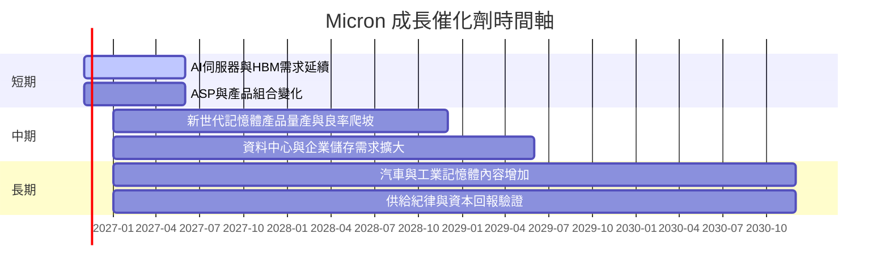

時間軸為研究框架，不代表管理層正式財測或已確認的產能日期。

### 9.2 TAM 市場規模分析

資料包未提供最新 TAM、滲透率與分部營收，避免編造市場規模；投資者應以公司財報與產業資料更新。

```
╔══════════════════════════════════════════════════════════════╗
║               TAM / 市場成長追蹤框架                          ║
╠══════════════════════════════════════════════════════════════╣
║ HBM：TAM N/A｜滲透率 N/A｜Micron 收入 N/A                     ║
║ DRAM：TAM N/A｜滲透率 N/A｜Micron 收入 N/A                    ║
║ NAND/SSD：TAM N/A｜滲透率 N/A｜Micron 收入 N/A                ║
║ 車用/工業：TAM N/A｜滲透率 N/A｜Micron 收入 N/A               ║
╠══════════════════════════════════════════════════════════════╣
║ 可驗證公司錨點：TTM 總收入 $133.19B；分部佔比未披露於資料包     ║
║ 核心追蹤：位元出貨、ASP、HBM 供應能力、良率、Capex 回報          ║
╚══════════════════════════════════════════════════════════════╝
```

### 9.3 成長驅動力結構圖

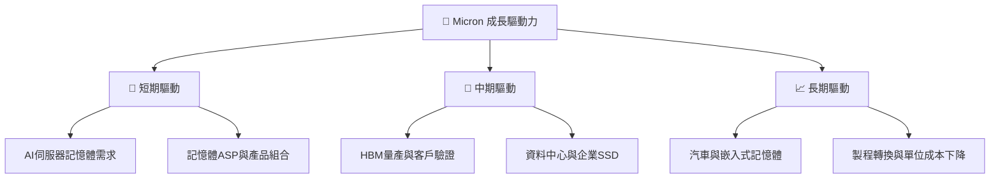

---

## 10. 風險矩陣

### 10.1 風險評分矩陣

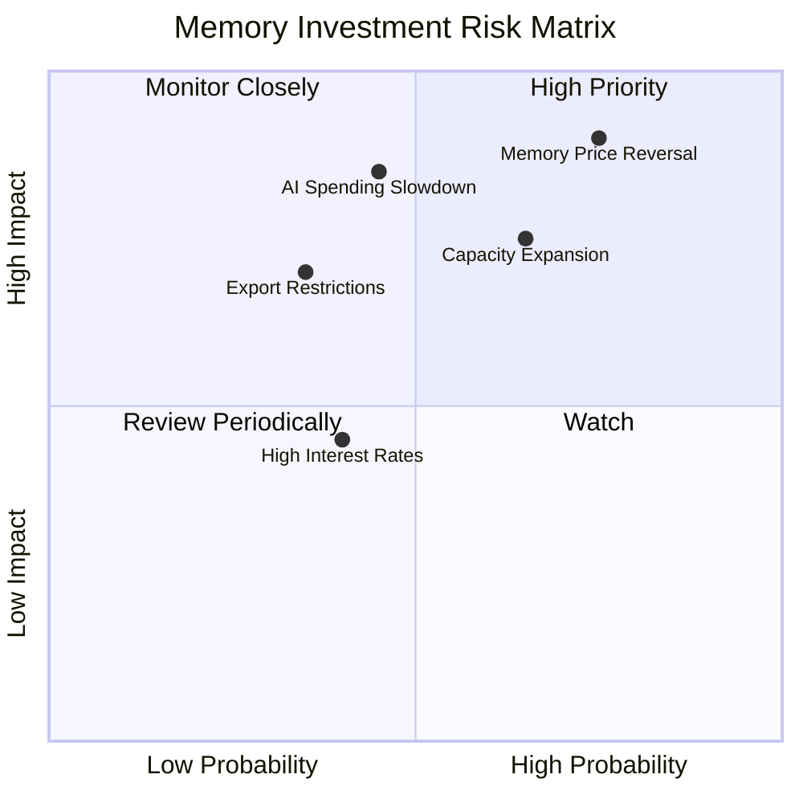

### 10.2 風險清單詳細分析

| # | 風險項目 | 發生機率 | 財務衝擊 | 風險評分 | 緩解措施 |
|---|---|---:|---|---:|---|
| 1 | 🔴 記憶體價格反轉 | 中高，約 45–60%（分析假設） | 收入可能轉負增長；74.6% TTM 營業利益率存在下修風險 | 🔴 9.0/10 | 追蹤 ASP、庫存、供應商 Capex、客戶採購 |
| 2 | 🔴 AI 投資與 HBM 需求不及預期 | 中，約 35–50%（分析假設） | TTM 成長 256.3% 的延續性降低，估值倍數可能收縮 | 🔴 8.5/10 | 追蹤雲端客戶資本支出、HBM 出貨與客戶分散度 |
| 3 | 🟠 同業擴產造成供給過剩 | 中，約 40–55%（分析假設） | ASP、毛利率及 ROIC 同時受壓 | 🟠 8.0/10 | 以利用率、庫存天數、Capex/收入監控 |
| 4 | 🟡 出口管制及地緣政治 | 中，約 25–40%（分析假設） | 限制市場進入或產品交付，營收與供應鏈受影響 | 🟡 7.0/10 | 分散客戶與生產地，遵循出口規範 |
| 5 | 🟡 利率與股價高 Beta | 中，約 35–50%（分析假設） | Beta 約 2.40；WACC 上升會壓低長期現值 | 🟡 6.5/10 | 控制部位與槓桿；每季重估折現率 |

機率是分析框架的主觀估計，並非公司或市場統計數據。前三項是投資論點的直接反證事件，尤其當營收增長轉負與利潤率下跌同時發生時，市場可能從高景氣盈餘快速切換至低景氣估值。

---

## 11. 投資建議

### 11.1 最終綜合評級雷達圖

```
╔══════════════════════════════════════════════════════════════╗
║                    MU 最終評分雷達（1–10）                    ║
╠══════════════════════════════════════════════════════════════╣
║ 基本面       7.5 ▓▓▓▓▓▓▓▓▓▓▓▓▓▓▓░░░░░  ★★★★☆             ║
║ 成長性       8.5 ▓▓▓▓▓▓▓▓▓▓▓▓▓▓▓▓▓░░░  ★★★★☆             ║
║ 獲利能力     8.5 ▓▓▓▓▓▓▓▓▓▓▓▓▓▓▓▓▓░░░  ★★★★☆             ║
║ 盈餘品質     7.0 ▓▓▓▓▓▓▓▓▓▓▓▓▓▓░░░░░░  ★★★☆☆             ║
║ 財務健康     8.5 ▓▓▓▓▓▓▓▓▓▓▓▓▓▓▓▓▓░░░  ★★★★☆             ║
║ 護城河       6.8 ▓▓▓▓▓▓▓▓▓▓▓▓▓▓░░░░░░  ★★★☆☆             ║
║ 管理與配置   6.5 ▓▓▓▓▓▓▓▓▓▓▓▓▓░░░░░░░  ★★★☆☆             ║
║ 估值         4.5 ▓▓▓▓▓▓▓▓▓░░░░░░░░░░░░  ★★☆☆☆             ║
╠══════════════════════════════════════════════════════════════╣
║ 綜合評分     7.0 ▓▓▓▓▓▓▓▓▓▓▓▓▓▓░░░░░░  🟡 持有             ║
╚══════════════════════════════════════════════════════════════╝
```

### 11.2 目標價與隱含報酬率

| 情境 | 每股目標價 | 相對 $798.44 報酬 | 權重/機率 | 主要假設 |
|---|---:|---:|---:|---|
| 悲觀 | $519 | -35.0% | 25% | 收入 CAGR 5%、利潤率下滑、退出 P/E 2.5x |
| 基準 | $790 | -1.1% | 50% | Forward EPS $207.76、退出 P/E 3.8x |
| 樂觀 | $1,247 | +56.2% | 25% | AI/HBM 持續放量、較高利潤率、退出 P/E 6.0x |
| **估值三角加權合理價值** | **$737.70** | **-7.6%** | 100%方法權重 | DCF、相對估值、FCF yield、共識加權 |

投資評級依 8.8 MOS 判斷：-8.23% 屬持有。建議買入區間上限 $663.93，代表相對加權合理價值至少有 10% MOS；若股價仍在現價附近，新增部位宜分批而非追價。

### 11.3 買入時機與觸發因素

```
╔══════════════════════════════════════════════════════════════════╗
║                 ✅ 買入觸發因素 Checklist                        ║
╠══════════════════════════════════════════════════════════════════╣
║ 立即買入觸發條件（多數符合）：                                   ║
║ ☐ 股價回落至 $663.93 以下，達加權合理價值至少 10% MOS            ║
║ ☐ 最新季度營收 YoY 保持正成長，且 QoQ 未連續兩季下滑              ║
║ ☐ 營業利益率收縮幅度受控，毛利率仍高於週期中段可接受水平           ║
║                                                                  ║
║ 加碼觸發條件：                                                   ║
║ ☐ FCF 連續兩季為正，且 Capex/收入不持續高於 23.1% TTM 錨點        ║
║ ☐ ROIC 持續高於 WACC 17.04%，並有公司披露支持                    ║
║ ☐ AI/HBM 需求可由出貨、客戶訂單或分部資料驗證                    ║
║                                                                  ║
║ 減碼/退出觸發條件：                                               ║
║ ☐ 記憶體 ASP 下跌且庫存同步增加                                  ║
║ ☐ 營業利益率較 74.6% TTM 高位快速收縮，且指引下修                 ║
║ ☐ 供應商同步擴產，FCF 轉負或 ROIC 跌破 WACC                       ║
╚══════════════════════════════════════════════════════════════════╝
```

### 11.4 投資人適配度分析

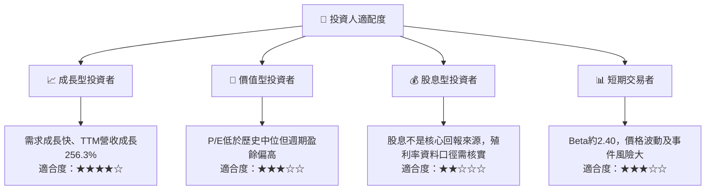

資料包列示股息殖利率 8.0%，與低 payout ratio 0.7% 及股息歷史資料的口徑可能不一致，不能直接當作可持續現金殖利率；股息型投資人應先核對原始報價與股利資料。

### 11.5 每季財報監控清單（Quarterly Watch List）

| 監控指標 | 最新錨點 | 加碼觸發 | 減碼/重新評估門檻 |
|---|---:|---|---|
| 營收 YoY | 最新單季 +379.3% | 維持正成長且需求品質可驗證 | 連續兩季低於 0% |
| 營收 QoQ | 最新單季 +30.8% | QoQ 回升且非單純價格一次性跳升 | 連續兩季下滑 |
| 營業利益率 | TTM 74.6%；季度口徑有來源差異 | 高位穩定、產品組合支持 | 較 TTM 錨點收縮超過 15pp，且指引續降 |
| Capex | TTM $30.71B | 投資回報與新增產能需求相符 | Capex/收入高於 23.1% 並伴隨 FCF 下滑 |
| FCF | TTM $58.96B | 季度 FCF 正且現金轉換穩定 | 連續兩季 FCF 為負 |
| 庫存與應收 | 存貨 $10.37B、應收 $36.20B | 存貨增速不高於收入增速 | 庫存連續上升、應收增速明顯高於收入 |
| SBC | FY2026 $1.33B | SBC/收入維持低位 | SBC/收入連續上升並伴隨股數稀釋 |
| 財測與 EPS | 最近四季 EPS $4.60、$12.07、$24.67、$32.85；估計值 N/A | 公司指引持續提高 | 指引下修、EPS 不再由營運現金流支持 |

### 11.6 反面論證：什麼會證明論點錯誤（What Would Change My Mind）

```
╔══════════════════════════════════════════════════════════════════╗
║             ⚠️ 論點失效條件（Disconfirming Evidence）             ║
╠══════════════════════════════════════════════════════════════════╣
║ 本投資論點在下列情況成立時應重新檢視或退出：                     ║
║ ☐ 核心營收 YoY 連續兩季低於 0%，代表需求/價格回升已反轉          ║
║ ☐ TTM 營業利益率由 74.6% 收縮超過 15 個百分點且仍下行            ║
║ ☐ TTM FCF 轉負，或連續兩季營業現金流低於資本支出                 ║
║ ☐ ROIC 跌破 WACC 17.04%，表示資本投資開始侵蝕股東價值            ║
║ ☐ Capex/營收長期高於 TTM 錨點 23.1%，但收入/FCF 未同步成長        ║
║ ☐ AI/HBM 需求放緩且公司未能以其他 DRAM/NAND 終端需求補足          ║
╚══════════════════════════════════════════════════════════════════╝
```

**最終判斷**：MU 的營收、FCF、淨現金與當期 ROIC 均有具體數據支持；但估值對記憶體週期、利潤率正常化及資本支出假設高度敏感。以加權合理價值 $737.70、現價 $798.44 計算，MOS 為 -8.23%，因此評級為**持有**。當價格降至約 $663.93 以下，或新資料證明高利潤與現金流可持續且估值假設上修，才考慮提高評級。

> **免責聲明**：本報告為 AI 自動生成，僅供研究參考，不構成投資建議。投資有風險，入市需謹慎。