# MU 基本面深度分析報告
> **報告日期**：2026-11-15 ｜ **語言**：繁體中文 ｜ **數據來源**：SEC 申報資料 (XBRL)、Yahoo Finance、Finviz、StockAnalysis、Roic.ai ｜ **分析師**：CFA 級機構研究

## 目錄

| # | 章節 | 核心結論 |
|---|------|----------|
| 1 | 執行摘要 | 買入；加權合理價值 $995.07；MOS +21.8% |
| 2 | 公司概覽與商業模式 | DRAM／NAND 具技術與規模優勢，但記憶體價格循環使護城河非絕對 |
| 3 | 損益表深度分析 | TTM 營收 $133.19B、TTM 成長 256.3%；利潤率處於高景氣水準 |
| 4 | 資產負債表分析 | 淨現金 $40.15B；DSO、DIO 上升，CCC 延長至 185 天 |
| 5 | 現金流量深度分析 | TTM FCF $58.96B、FCF Yield 6.70%；高資本支出仍是產業特性 |
| 6 | 獲利能力與資本效率 | ROIC 86.2% 對 WACC 14.00%，目前大幅創造股東價值 |
| 7 | 相對估值分析 | P/E 低於同業及自身中位數，但 P/S 高於自身歷史中位數 |
| 8 | DCF 內在價值評估 | 基準 DCF $881.83；加權合理價值 $995.07；MOS +21.8% |
| 9 | 成長催化劑 | AI／HBM 需求與產能預訂是近中期催化劑；TAM 數字未提供 |
| 10 | 風險矩陣 | 記憶體供需反轉、價格下跌及高估值波動為前三大風險 |
| 11 | 投資建議 | 買入；分批布局並以利潤率、庫存、FCF 與供需變化作監控 |

---

## 1. 執行摘要

Micron 2026-11-13 收盤價為 **$778.31**。公司 TTM 營收 **$133.19B**、TTM 年增 **256.3%**、營業利益率 **74.6%**、TTM FCF **$58.96B**，而 TTM ROIC **86.2%** 高於採用的 WACC **14.00%**。估值方面，DCF 基準值為 **$881.83**，但按 DCF、同業 EV/EBITDA、同業 P/S 與分析師共識加權後，合理價值為 **$995.07**，對應 **MOS +21.8%**、上行空間 **+27.9%**。因此依 MOS 門檻為**買入**；記憶體產業循環性、營運資金週期延長及財務資料間的指標衝突，使信心度定為中等，而非強烈買入。

### 1.0 一頁式投資儀表板

| 項目 | 內容 |
|------|------|
| **投資論點（3 句）** | ① TTM 營收年增 **256.3%**，最新季度單季年增 **379.3%**，反映需求與產品組合快速改善。② TTM FCF **$58.96B**、FCF Yield **6.70%**，營運現金足以支應高額資本支出。③ ROIC **86.2%** 高於 WACC **14.00%**，但週期高峰獲利未必可持續。 |
| **綜合評分** | **8.0/10**（引用 1.1 評分卡） |
| **財務健康** | 🟢 淨現金 **$40.15B**；但 DSO 87 天、DIO 147 天，應收與庫存週轉須追蹤。 |
| **ROIC vs WACC** | **86.2% vs 14.00%**；目前大幅創造價值，週期均值仍是主要不確定性。 |
| **FCF 趨勢** | 上升；TTM FCF **$58.96B**、FCF Yield **6.70%**。 |
| **估值** | Forward P/E **3.75x** ｜ EV/EBITDA **7.74x** ｜ FCF Yield **6.70%**。 |
| **DCF 內在價值（基準）** | **$881.83** ｜ 現價相對 DCF 折價 **11.7%**（折溢價基準為 DCF 基準值）。 |
| **安全邊際（MOS）** | **+21.8%**＝($995.07 − $778.31) ÷ $995.07；🟡 有限，依 8.8 加權合理價值計算。 |
| **預期報酬（基準情境 12M）** | **+13.3%**（DCF 基準情境相對現價；非加權價值上行空間）。 |
| **關鍵風險（前二）** | 記憶體供給增加導致定價與利潤率回落；應收帳款及庫存增加拖累現金轉換。 |
| **評級 + 信心度** | 🟢 **買入** ｜ 信心：中 |

### 1.1 綜合評分卡

| 維度 | 評分（1–10） | 主要依據（引用數字與其來源章節） |
|------|--------------|----------------------------------|
| 成長性 | 9.5 | TTM 營收年增 **256.3%**、最新單季年增 **379.3%**（第 3 章）；如此高增速有低基期與週期反彈因素。 |
| 獲利能力 | 9.5 | TTM 營業利益率 **74.6%**、ROIC **86.2%**、Piotroski **8/9**（第 3、6 章）。 |
| 財務健康 | 9.0 | 淨現金 **$40.15B**、流動比率 **3.314**；但 CCC 從 **155 天**延長至 **185 天**（第 4 章）。 |
| 估值 | 7.0 | MOS **21.8%**；P/E **10.5x** 低於自身五年中位數 **17.4x**，但 P/S **6.7x** 高於自身中位數 **4.2x**（第 7、8 章）。 |
| 護城河 | 7.0 | DRAM／HBM 製程、資本密集與客戶認證支持競爭地位；但記憶體商品化及價格循環限制定價持續性（第 2 章）。 |
| 管理層與資本配置 | 6.0 | FY2026 Capex **$30.71B**、SBC **$1.33B**；稀釋股數測試未通過，需觀察投入資本回報與股東稀釋（第 3、5 章）。 |
| **綜合評分** | **8.0** | 六項算術平均：(**9.5 + 9.5 + 9.0 + 7.0 + 7.0 + 6.0**) ÷ 6 = **8.0**。 |

### 1.2 五大投資論點 + 三大核心風險

| 類型 | 項目 | 具體依據 | 信心度 |
|------|------|----------|--------|
| 🟢 **投資論點①** | AI 記憶體需求拉動營收 | TTM 營收 **$133.19B**、TTM 年增 **256.3%**；最新季度營收年增 **379.3%**。新聞摘要提及超過 **75% 的 2027 年產出已承諾**，但未附原始合約或公司申報細節，應視為待驗證的外部線索。 | 🟢 高 |
| 🟢 **投資論點②** | 高現金流與資產負債表彈性 | TTM OCF **$89.67B**、Capex **$30.71B**、FCF **$58.96B**；現金及短期投資 **$43.43B**、總債務 **$3.28B**。 | 🟢 高 |
| 🟢 **投資論點③** | 當期資本回報超過資金成本 | TTM ROIC **86.2%** 對 WACC **14.00%**，利差 **72.2 個百分點**；若能在週期正常化後維持部分回報，股東價值仍可累積。 | 🟢 高 |
| 🟢 **投資論點④** | 估值有一定下檔緩衝 | 加權合理價值 **$995.07**，對 **$778.31** 現價的 MOS 為 **21.8%**；DCF 基準價值 **$881.83**。 | 🟡 中 |
| 🟢 **投資論點⑤** | 資產品質及應計指標良好 | Piotroski F-Score **8/9**；營業現金流高於淨利的測試通過，惟稀釋股數測試未通過。 | 🟡 中 |
| 🟡 **風險①** | 供給反應造成記憶體價格反轉 | Samsung HBM 投資增加可能令供給競爭加劇；當期營業利益率 **74.6%** 很高，價格或利用率正常化時利潤率可能快速回落。 | 🔴 高衝擊 |
| 🔴 **風險②** | 營運資金週期延長 | CCC 由 **155 天**升至 **185 天**，DSO 增 **17 天**、DIO 增 **11 天**，可能使帳面盈餘與現金流表現分化。 | 🟡 中 |
| 🟡 **風險③** | 股價及估值波動 | Beta（調整後）**1.93**；24 個月價格從 2024-11 的 **$97.43** 上升至 2026-06 的 **$1,153.93**，之後回落至 2026-11 的 **$778.31**。 | 🔴 高衝擊 |

### 1.3 快速統計卡片

| 指標 | 公司實際值（期間） | 同業中位數 | 狀態 |
|------|--------------------|------------|------|
| 營收成長（TTM） | **256.3%** | — | 🟢 |
| 營收成長（最新一季年增） | **379.3%** | **327.9%**（SKHY、SNDK、WDC 中位數） | 🟢 |
| 毛利率（TTM） | **80.7%** | **77.4%**（三家中位數） | 🟢 |
| 營業利益率（TTM） | **74.6%** | — | 🟢 |
| ROIC（TTM） | **86.2%** | — | 🟢 |
| Forward P/E | **3.75x** | **3.2x**（SKHY、SNDK、WDC 中位數） | 🟡 |
| FCF Yield（TTM） | **6.70%** | — | 🟢 |
| Piotroski F-Score | **8 / 9** | — | 🟢 |

同業中位數按可用 Peer multiples 計算；SKHY 的 P/S、EV/EBITDA 因幣別混雜而不納入相關比較。

### 1.4 投資結論

```text
╔══════════════════════════════════════════════════════════════════╗
║                    📊 投資結論摘要                               ║
╠══════════════════════════════════════════════════════════════════╣
║  評級：買入（依 MOS 門檻；未作質化調級）                         ║
║  價格（2026-11-13 收盤）：$778.31                                ║
║  DCF 內在價值（基準）：$881.83（相對現價折價 11.7%）             ║
║  安全邊際 MOS：+21.8%（以加權合理價值 $995.07 為分母）           ║
║  加權合理價值（8.8）：$995.07                                    ║
║  DCF 情境價值：                                                  ║
║    悲觀情境：$429.05（-44.9%）                                   ║
║    基準情境：$881.83（+13.3%）                                   ║
║    樂觀情境：$1,715.71（+120.4%）                                ║
║  綜合評分：8.0/10（引用 1.1）                                    ║
║  適合投資人：能承受高波動、認同 AI 記憶體需求的成長型及長線投資人║
╚══════════════════════════════════════════════════════════════════╝
```

---

## 2. 公司概覽與商業模式

### 2.1 業務結構與收入來源

Micron Technology 是記憶體與儲存半導體公司，主要產品包括 DRAM（含 HBM）及 NAND 儲存。公司概覽列出 Cloud Memory、Core Data Center、Mobile and Client、Automotive and Embedded 四個業務單位，但各業務單位的營收金額及佔比未提供，因此不以假設值繪製比例。

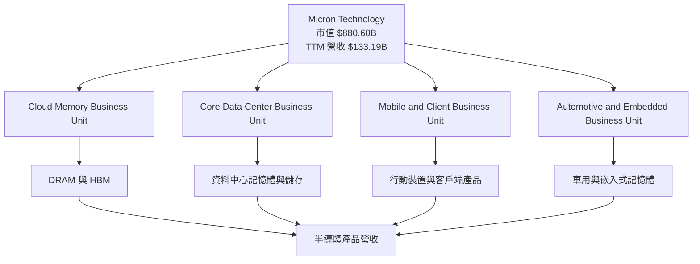

### 2.2 市場份額

市場份額數據未提供，因此不估算市佔比例。可確認的是，Micron TTM 營收 **$133.19B**、TTM 成長 **256.3%**，最新季度單季成長 **379.3%**；與同業最新單季營收年增中位數 **327.9%** 相比，Micron 增速較高。此比較反映近期成長動能，不代表長期市佔或正常化競爭力。

### 2.3 競爭護城河分析

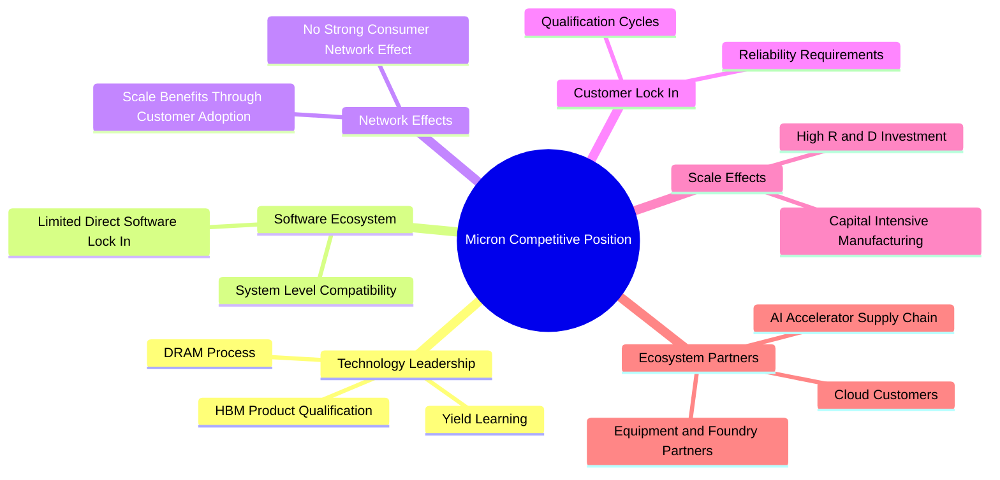

### 2.4 護城河強度

| 護城河項目 | 強度（強／中／弱） | 證據（引用數字或事實） | 會削弱它的情況 |
|------------|--------------------|------------------------|----------------|
| 技術與製程 | 強 | 公司同時經營 DRAM、HBM、NAND；FY2026 R&D **$5.65B**。先進製程與良率累積需要持續資本及研發投入。 | 同業快速追上製程、良率落後或 HBM 產品驗證延誤。 |
| 軟體生態系 | 弱 | 記憶體產品依賴系統整合與相容性，但資料未顯示具獨立軟體收入或軟體鎖定。 | 客戶可在多家供應商間替換，且軟體／平台相容性不足以提高轉換成本。 |
| 網路效應 | 弱 | 未有直接網路效應數據；主要競爭因素仍是技術、成本、可靠性及供貨。 | 產品規格標準化，客戶多供應商策略降低單一供應商優勢。 |
| 客戶鎖定 | 中 | 產品導入需客戶驗證，資料中心及車用產品對可靠度要求高；客戶及產品別收入比例未提供。 | 客戶雙重採購、重新驗證成本下降或品質表現不佳。 |
| 規模效應 | 強 | FY2026 Capex **$30.71B**、R&D **$5.65B**，產業進入與擴產需大量資本。 | 過度擴產造成供給過剩、固定成本利用率下降。 |
| 生態夥伴 | 中 | HBM 與 AI 加速器、雲端客戶及封裝供應鏈互相依存；可用訂單比例與合作合約未經申報資料確認。 | 主要客戶改用替代供應商、技術路線變更或供應鏈瓶頸。 |

**護城河評分理由：**1.1 的護城河評分為 **7.0/10**，主要依據高研發與資本門檻及客戶驗證要求；但產品仍高度受供需與價格循環影響，軟體及網路效應不足以形成全面性鎖定。

---

## 3. 損益表深度分析

### 3.1 年度收入成長趨勢（近4年）

年度營收資料：FY2023 **$15.54B**、FY2024 **$25.11B**、FY2025 **$37.38B**、FY2026 **$133.19B**。YoY 依相鄰財年計算；FY2026 大幅成長主要反映記憶體景氣由低谷回升及價格／產品組合改善，不應直接外推為長期成長率。

```text
╔══════════════════════════════════════════════════════════════════╗
║           Micron Technology 年度收入趨勢 FY2023–FY2026         ║
╠══════════════════════════════════════════════════════════════════╣
║  FY2023  $15.54B   ███░░░░░░░░░░░░░░░░░░░░  基期               ║
║  FY2024  $25.11B   █████░░░░░░░░░░░░░░░░░░  YoY +61.6% 🟢      ║
║  FY2025  $37.38B   ███████░░░░░░░░░░░░░░░░  YoY +48.9% 🟢      ║
║  FY2026  $133.19B  ████████████████████████ YoY +256.3% 🟢     ║
║                                                                  ║
║  FY2023–FY2026 CAGR = (133.19 ÷ 15.54)^(1/3) − 1 = 約 104.7%   ║
║  ⚠️ CAGR 含週期谷底與復甦，不宜視為可持續的長期成長率。        ║
╚══════════════════════════════════════════════════════════════════╝
```

### 3.2 季度收入趨勢分析

下表的 QoQ 依季度營收計算；YoY 採 SEC／StockAnalysis 季度欄位所示最新單季年增率。2025-11-30 單季年增率為 **56.65%**，其他季度採已提供的對應同比數據。

| 季度 | 營收 | QoQ 成長 | YoY 成長 | 備註 |
|------|------:|---------:|---------:|------|
| 2025-11-30 | $13.64B | N/A（前季數據未列為同一季度表） | 56.65% | 復甦早期，仍低於後續季度規模。 |
| 2026-02-28 | $23.86B | **+74.9%** | 196.29% | 需求與價格改善，季度營收加速。 |
| 2026-05-31 | $41.46B | **+73.8%** | 345.72% | 大幅成長，需留意基期與出貨節奏。 |
| 2026-08-31 | $54.23B | **+30.8%** | 379.27% | QoQ 仍增，但增速較前兩季放緩。 |

最新季度單季 YoY **379.3%** 不可與 TTM 年增 **256.3%** 混為一談。季度營收連續提升顯示價格、出貨量或產品組合合計改善，但資料未提供各因素拆解，不能將增長全部歸因於單一產品。

### 3.3 利潤率演變分析

依年度損益表所列營收、毛利、營業利益與淨利計算年度比率。FY2023 毛利資料存在不同來源差異：年度損益表列示毛利 **-$1.42B**，StockAnalysis 列示 **$0.415B**；故 FY2023 毛利率以年度損益表值計算並標示為來源不一致。

| 利潤率指標 | FY2023 | FY2024 | FY2025 | FY2026 | 趨勢 | 評估 |
|------------|--------:|--------:|--------:|--------:|------|------|
| **毛利率** | 約 -9.1%¹ | 22.3% | 39.8% | 80.7% | 低谷後大幅回升 | 🟢，但循環敏感 |
| **營業利益率** | -34.8% | 5.2% | 26.1% | 74.6% | 持續擴張，FY2026 特別高 | 🟢 |
| **淨利率** | -37.5% | 3.1% | 22.8% | 63.8% | 從虧損轉至高利潤 | 🟢 |

¹ FY2023 年度損益表列示毛利 -$1.42B；另一資料源列示 $0.415B，存在口徑或期間差異。  
TTM 營業利益率 **74.6%**；最新季度營業利益率依 VERIFIED FIGURES 為 **80.7%**。其他摘要欄位另列 74.6%，可能是口徑／期間差異，故本報告對 TTM 採 **74.6%**，對最新季度採 **80.7%**。

**利潤率演變深度解析：**FY2023 至 FY2026 營業利益由 **-$5.41B** 轉為 **$99.34B**，毛利由 **-$1.42B** 增至 **$107.50B**。變化符合記憶體產業在低谷後，售價回升、產能利用率提升與高價值產品組合改善時的營業槓桿特徵。FY2026 的 **74.6% TTM 營業利益率**應視為當前景氣條件的結果，而非無條件可持續的長期利潤率。

### 3.4 費用結構分析

以下以 FY2026 營收 **$133.19B**、毛利 **$107.50B**、營業利益 **$99.34B**推導：銷貨成本約 **$25.69B**，營業費用合計約 **$8.16B**。營業費用含 R&D 及其他營業費用；R&D 為 **$5.65B**，不能再與營業費用合計重複相加。

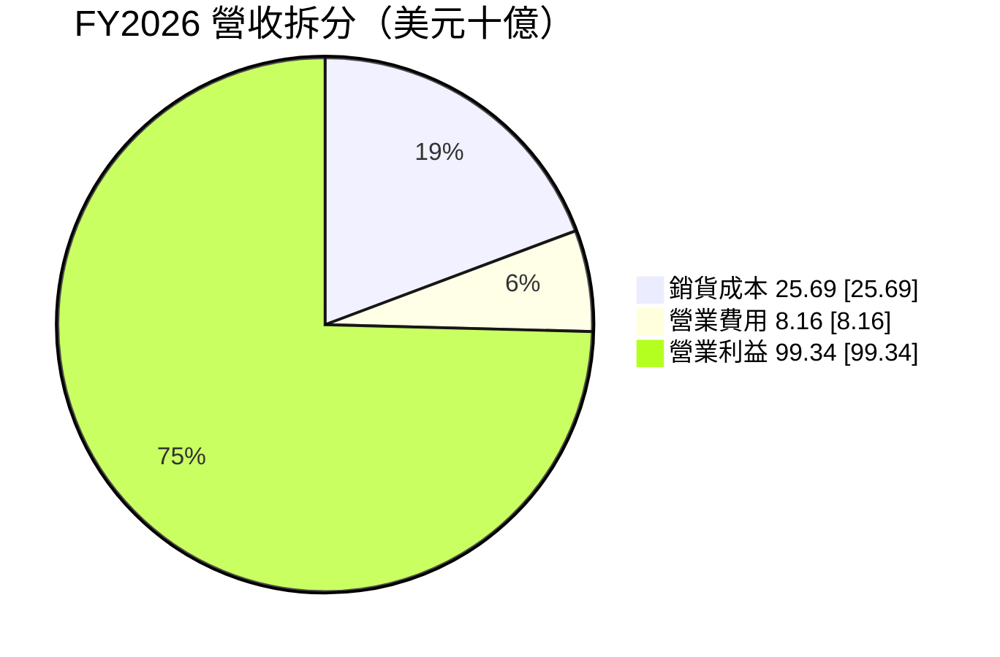

```text
╔══════════════════════════════════════════════════════════════════╗
║                 FY2026 營收拆分（$133.19B）                      ║
╠══════════════════════════════════════════════════════════════════╣
║  銷貨成本 $25.69B  █████░░░░░░░░░░░░░░░░░                         ║
║  營業費用  $8.16B  ██░░░░░░░░░░░░░░░░░░░                         ║
║  營業利益 $99.34B  ████████████████████░                         ║
╚══════════════════════════════════════════════════════════════════╝
```

### 3.5 季度 EPS 趨勢與盈餘品質（Quality of Earnings）

季度 EPS 實際值採 StockAnalysis 顯示；EPS Est 欄位四季均為 nan，因此無法判定盈餘是超預期或不及預期，也不能以「未提供」代替 beat／miss 結論。

| 季度 | EPS 實際 | EPS 預估 | 超預期／不及預期 | 主要觀察 |
|------|---------:|---------:|----------------|----------|
| 2025-11-30 | $4.60 | N/A | 無法判定 | EPS 同比增長 175.45%。 |
| 2026-02-28 | $12.07 | N/A | 無法判定 | EPS 同比增長 756.03%。 |
| 2026-05-31 | $24.67 | N/A | 無法判定 | EPS 同比增長 1,368.45%。 |
| 2026-08-31 | $32.85 | N/A | 無法判定 | EPS 同比增長 1,059.46%；絕對值續升。 |

| 盈餘品質項目 | 數值／佔比 | 評估 |
|--------------|-----------|------|
| 股權薪酬 SBC / 營收 | **$1.33B ÷ $133.19B = 1.00%** | 🟡 比重不高，但股權薪酬仍代表股東稀釋成本。 |
| SBC / 營業現金流 | **$1.33B ÷ $89.67B = 1.48%** | 🟢 相對 OCF 規模有限。 |
| FCF / 淨利（現金轉換率） | **$58.96B ÷ $84.97B = 69.4%** | 🟡 FCF 仍高，但 Capex 大，現金轉換低於 100%。 |
| 一次性／非經常性損益 | N/A（未提供足夠明細） | 無法確認非經常項目對 FY2026 淨利的影響。 |
| 有效稅率異常 | **14.8%**（最新年度有效稅率） | 未見足夠多年可比稅務明細；估值採 14.8%，不假設此稅率可永續不變。 |
| 資本化支出 vs 費用化 | TTM Capex **$30.71B**；FY2026 R&D **$5.65B** | Capex 主要建構長期產能，會以折舊影響後續期間；未提供資本化利息與資產明細，不能判斷是否延遲認列成本。 |

**盈餘品質結論：**OCF **$89.67B** 高於淨利 **$84.97B**，Piotroski 的應計品質測試通過；然而 FCF／淨利為 **69.4%**，顯示高資本支出吸收部分現金。SBC 佔營收約 **1.00%**，不是當期盈餘品質的主要疑慮，但稀釋股數測試未通過，應持續檢視每股而非僅總額成長。

---

## 4. 資產負債表分析

### 4.1 資產結構分解

截至 FY2026 資產總額 **$195.89B**。以下分類依 StockAnalysis 資產負債表明細；非流動資產總額由總資產扣除流動資產計算。

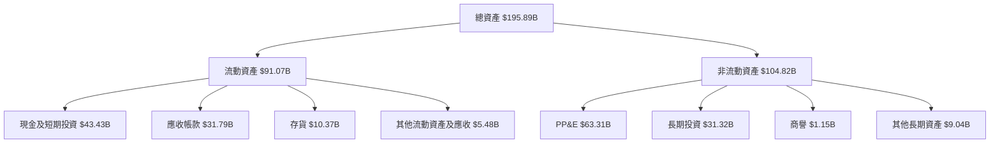

### 4.2 流動性與營運資金分析

| 指標 | 最新 TTM | 一年前 TTM | 變化 | 解讀 |
|------|----------|------------|------|------|
| DSO 應收帳款天數 | **87 天** | **70 天** | **+17 天** | 收款週期延長；可能與營收快速擴張及期末應收增加有關，需觀察後續回款。 |
| DIO 存貨天數 | **147 天** | **136 天** | **+11 天** | 存貨天數上升；可能反映產能、產品組合與備貨變化，亦增加產品價格轉弱時的存貨風險。 |
| DPO 應付帳款天數 | **50 天** | **51 天** | **-1 天** | 付款週期略縮短，未見供應商融資增加的證據。 |
| CCC 現金轉換週期 | **185 天** | **155 天** | **+30 天** | 應收與存貨週轉共同拖長現金回收時間，成長的現金需求高於一年前。 |

流動比率 **3.314**、速動比率 **2.898**，均顯示短期流動性充足；但流動比率不會消除應收款回收及庫存折價風險。營運資金天數按品質指標計算口徑照錄，且與季度收入大幅變動並存，後續須以連續數季趨勢判斷是否為擴張需求或回款品質惡化。

### 4.3 債務結構分析

成本資本區塊所列總債務為 **$3.28B**、現金與短期投資 **$43.43B**、淨現金 **$40.15B**；其他市場資料另列總債務 **$5.18B**、淨現金 **$38.26B**。估值及 ROIC 相關分析採 VERIFIED FIGURES 的 $3.28B 與 $40.15B，並將此來源差異視為資料核對限制，不混用。

```text
╔══════════════════════════════════════════════════════════════════╗
║                 Micron 債務健康診斷（採統一口徑）               ║
╠══════════════════════════════════════════════════════════════════╣
║  總債務：       $3.28B   ██░░░░░░░░░░░░░░░░░░░  🟢              ║
║  現金+短期投資：$43.43B  ████████████████████░  🟢              ║
║  淨現金：       $40.15B  ██████████████████░░░  🟢              ║
║                                                                  ║
║  流動比率：3.314x   🟢                                          ║
║  速動比率：2.898x   🟢                                          ║
║  Debt/EBITDA：約 0.03x（$3.28B ÷ $109.28B）                     ║
║  利息保障倍數：N/A（未提供可一致核對的利息費用及口徑）          ║
║  ⚠️ 其他資料列債務 $5.18B；採用口徑需與 SEC 最新申報再核對。     ║
╚══════════════════════════════════════════════════════════════════╝
```

### 4.4 股東權益趨勢

股東權益由 FY2023 **$44.12B** 增至 FY2026 **$138.38B**，FY2026 相較 FY2025 **$54.16B** 大幅增加，與獲利復甦及留存盈餘累積方向一致。以下使用報表值，不將其與市場價值混淆。

```text
╔══════════════════════════════════════════════════════════════════╗
║                 股東權益變化（年度，美元十億）                  ║
╠══════════════════════════════════════════════════════════════════╣
║  FY2023  $44.12B  ████████░░░░░░░░░░░░░░░░                       ║
║  FY2024  $45.13B  ████████░░░░░░░░░░░░░░░░                       ║
║  FY2025  $54.16B  ██████████░░░░░░░░░░░░░░                       ║
║  FY2026 $138.38B  ████████████████████████                       ║
╚══════════════════════════════════════════════════════════════════╝
```

---

## 5. 現金流量深度分析

### 5.1 現金流量瀑布圖

FY2026 淨利 **$84.97B**、OCF **$89.67B**、Capex **$30.71B**、FCF **$58.96B**、已付股息 **$0.61B**。回購及淨現金變化未提供同一期間可核對數字，不畫入金額節點。

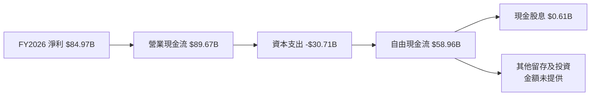

### 5.2 FCF 轉換率趨勢

| 財年 | FCF | 淨利 | FCF／淨利 | 解讀 |
|------|----:|-----:|----------:|------|
| FY2023 | -$6.12B | -$5.83B | 約 **105.0%** | 虧損期兩者皆為負，比例解讀價值有限。 |
| FY2024 | $0.12B | $0.78B | 約 **15.6%** | 營運復甦早期，資本支出吸收大部分現金。 |
| FY2025 | $1.67B | $8.54B | 約 **19.6%** | 盈餘改善，但現金轉換仍受投資支出壓抑。 |
| FY2026 | $58.96B | $84.97B | **69.4%** | 現金生成大幅改善，仍未達到淨利全額轉現。 |

### 5.3 自由現金流趨勢

FY2026 FCF **$58.96B** 主要反映營運現金流 **$89.67B** 快速提升；資本支出同步升至 **$30.71B**，是高資本密集產業擴產及技術更新的現金成本。

```text
╔══════════════════════════════════════════════════════════════════╗
║              自由現金流趨勢（美元十億）                         ║
╠══════════════════════════════════════════════════════════════════╣
║  FY2023  -$6.12B  ◀██░░░░░░░░░░░░░░░░░░░░  FCF Yield：N/A       ║
║  FY2024   $0.12B   ▏                         FCF Yield：N/A       ║
║  FY2025   $1.67B   █                         FCF Yield：N/A       ║
║  FY2026  $58.96B   ████████████████████      FCF Yield：6.70%     ║
╠══════════════════════════════════════════════════════════════════╣
║  TTM FCF = TTM OCF $89.67B − Capex $30.71B = $58.96B            ║
╚══════════════════════════════════════════════════════════════════╝
```

### 5.4 資本配置評估

| 配置項目 | FY2026 數值 | 評估 |
|----------|-----------:|------|
| Capex | **$30.71B** | 高額投入支援產能、製程及產品組合；需檢視新增資本的週期回報。 |
| 現金股息 | **$0.61B** | 相對 FCF 規模低，保留較多再投資彈性。 |
| 股票回購 | N/A | 未提供可核對的 FY2026 回購金額。 |
| SBC | **$1.33B** | 相當於營收約 **1.00%**；Piotroski 稀釋股數測試未通過。 |
| 留存現金／其他投資 | N/A | 不能以未列明項目推算資金用途。 |

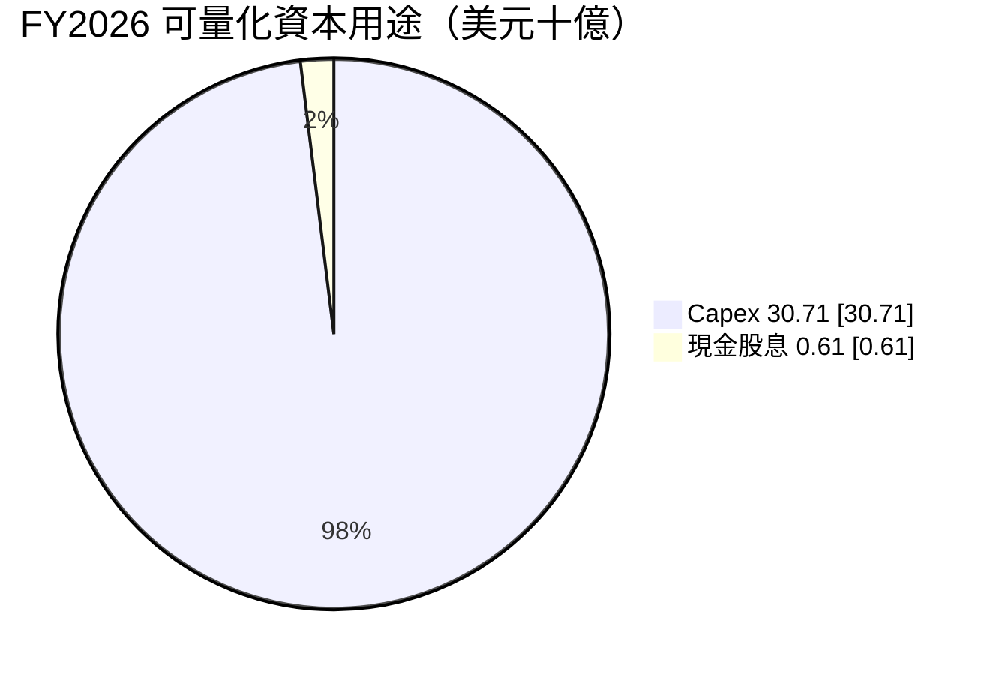

圖表只呈現有明確金額的 Capex 與股息；未提供的回購、併購及淨現金變化不補入圖表。

---

## 6. 獲利能力與資本效率

### 6.1 ROE／ROA／ROIC 趨勢

跨年度完整、同口徑 ROIC、ROA、ROE 序列未提供；下表列示可確認的最新 TTM 指標。Yahoo／Finviz 合併摘要的 ROE **88.3%** 與品質指標計算的 ROE **61.4%** 不一致，杜邦分析按明確標示的 QUALITY FIGURES 數值引用。

| 指標 | 最新可用值 | 期間／口徑 | 評估 |
|------|-----------:|-------------|------|
| ROE | **61.4%** | TTM，QUALITY FIGURES 杜邦口徑 | 高；主要由淨利率而非槓桿支撐。 |
| ROA | **44.6%** | TTM，摘要資料 | 高，但來源口徑與杜邦品質指標不完全一致。 |
| ROIC | **86.2%** | TTM，稅後營業利益／投入資本 | 顯著高於 WACC；不可假設景氣高峰水準永久持續。 |

行業均值資料未提供，不列同業平均值。

### 6.2 ROIC vs WACC 分析（核心價值創造判斷）

```text
╔══════════════════════════════════════════════════════════════════╗
║                ROIC vs WACC 深度分析                            ║
╠══════════════════════════════════════════════════════════════════╣
║  資金成本輸入（依成本資本資料）：                                ║
║  ├── 無風險利率（10Y 美債）： 5.15%                              ║
║  ├── 市場風險溢酬 ERP：       5.00%                              ║
║  ├── 原始 Beta：              2.40                               ║
║  ├── 調整後 Beta：            1.93                               ║
║  ├── 股權成本 Ke：            14.81%                             ║
║  ├── 稅前債務成本：           3.23%                              ║
║  ├── E / D 權重：             99.6% / 0.4%                       ║
║  ├── WACC 計算值：            14.77%                             ║
║  └── 採用 WACC：              14.00%（受 7%–14% 區間上限限制）   ║
║                                                                  ║
║  ROIC（TTM）：                86.2%                              ║
║  ROIC − WACC：                86.2% − 14.00% = +72.2 個百分點    ║
║  ROIC / WACC：                86.2% ÷ 14.00% = 6.16 倍           ║
║                                                                  ║
║  結論：目前 ROIC 大幅高於 WACC，創造經濟價值；                   ║
║        關鍵風險是記憶體週期回落後 ROIC 是否仍高於資金成本。       ║
╚══════════════════════════════════════════════════════════════════╝
```

此處採用 WACC **14.00%**，與 DCF 一致；程式計算的原始值為 **14.77%**，依資料規定受 **7%–14%** 區間上限限制。該 WACC 與本公司 ROIC 的比較是當期價值創造判斷，不代表未來週期低點的回報率。

### 6.3 杜邦三因素分解

| 因素 | 數值（TTM） | 解讀 |
|------|-------------|------|
| 淨利率 | **63.8%** | 高淨利率是 ROE 的主要推動因素；週期高峰盈利可能回歸。 |
| 資產週轉率 | **0.68** | 每單位資產產生的營收；資產密集型製造企業需與毛利及利用率一併看。 |
| 權益乘數 | **1.42** | 財務槓桿不高，ROE 並非主要靠槓桿撐起。 |
| **ROE** | **61.4%** | **63.8% × 0.68 × 1.42 = 61.4%**（品質指標原值）。 |

### 6.4 財務體質：Piotroski F-Score

| 測試 | 結果 | 解讀 |
|------|------|------|
| ROA > 0 | ✅ 通過 | TTM 獲利為正。 |
| 營業現金流 > 0 | ✅ 通過 | TTM OCF 為正。 |
| ROA 高於一年前 | ✅ 通過 | 盈利能力改善。 |
| 營業現金流 > 淨利 | ✅ 通過 | 現金流高於會計淨利，支持應計品質。 |
| 長期負債 ÷ 總資產低於一年前 | ✅ 通過 | 槓桿相對改善。 |
| 流動比率高於一年前 | ✅ 通過 | 短期流動性改善。 |
| 稀釋股數未增加 | ❌ 未通過 | 稀釋股數增加，提醒總體盈餘成長未必等比例轉化為每股成長。 |
| 毛利率高於一年前 | ✅ 通過 | 毛利率受週期及價格改善推動。 |
| 資產週轉率高於一年前 | ✅ 通過 | 資產使用效率改善。 |

**Piotroski F-Score：8 / 9。** 未通過項目為稀釋股數未增加；此指標為正向財務體質訊號，但不應忽略記憶體週期對獲利和存貨價值的影響。

---

## 7. 相對估值分析

### 7.1 同業估值比較表格

同業數字採 Yahoo Finance Peer multiples。SKHY 的 P/S 及 EV/EBITDA 因幣別混雜不作跨公司比較；SKHY 並非可無條件視為與 MU 完全同質的直接可比公司，倍數比較應視為參考。

| 估值指標 | **MU** | **SKHY** | **SNDK** | **WDC** | 本公司評估 |
|----------|-------:|--------:|--------:|-------:|-----------|
| **Trailing P/E** | **10.5x** | 8.4x | 7.1x | 10.4x | 🟡 接近 WDC，高於 SKHY、SNDK。 |
| **Forward P/E** | **3.75x** | 3.2x | 3.1x | 7.3x | 🟢 低於 WDC、略高於 SKHY／SNDK；高度依賴未來 EPS 預測。 |
| **P/S Ratio** | **6.6x** | N/A | 4.3x | 7.6x | 🟡 介於可比公司之間；SKHY 因幣別混雜剔除。 |
| **EV/EBITDA** | **7.74x** | N/A | 5.7x | 17.5x | 🟡 低於 WDC、高於 SNDK；SKHY 因幣別混雜剔除。 |
| **最新季度營收年增** | **379.3%** | 327.9% | 377.9% | 55.5% | 🟢 MU 高於三家同業中位數 **327.9%**。 |
| **毛利率（TTM）** | **80.7%** | 77.4% | 80.0% | 52.6% | 🟢 MU 高於三家同業中位數 **77.4%**。 |

MU 市場摘要中的 Forward P/E 約 **3.75x**，Peer multiples 中的同業倍數均依資料區塊原值引用。極低 Forward P/E 的前提是預期盈餘可大幅成長；若當前盈餘接近週期高點，該倍數可能低估正常化後的估值。

### 7.2 歷史估值區間分析

```text
╔══════════════════════════════════════════════════════════════════╗
║            MU 五年歷史估值區間（TTM 倍數）                      ║
╠══════════════════════════════════════════════════════════════════╣
║  P/E：       7.4x ──────● 現值 10.5x────中位數 17.4x────138.5x  ║
║  百分位：                 20%                                    ║
║  解讀：P/E 位於自身歷史較低區間，但受週期高峰 EPS 壓低。         ║
║                                                                  ║
║  P/S：       2.1x ─────────中位數 4.2x────● 現值 6.7x──11.7x    ║
║  百分位：                 85%                                    ║
║  解讀：以營收倍數看，現價相對自身歷史偏高。                      ║
║                                                                  ║
║  EV/EBITDA： 3.6x ───────中位數 9.7x──● 現值 7.8x──────80.7x    ║
║  百分位：                 45%                                    ║
╚══════════════════════════════════════════════════════════════════╝
```

P/E 現值 **10.5x** 低於五年中位數 **17.4x**，但 P/S 現值 **6.7x** 高於中位數 **4.2x**，呈現盈利倍數便宜、營收倍數不便宜的組合。這通常是週期股在盈餘高峰時的典型估值現象，不能只憑低 P/E 判定便宜。

### 7.3 情境價值（Bear / Base / Bull，照抄 DCF MODEL 的 Scenarios）

| 情境 | 第 1 年營收成長 | 期末營業利潤率 | WACC | 每股價值 | 相對現價 | 機率 | 會發生的條件 |
|------|----------------|----------------|------|----------:|---------:|-----:|--------------|
| 🔴 悲觀 | **15.0%** | **22.2%** | **15.00%** | **$429.05** | **-44.9%** | **25%** | AI／HBM 需求放緩、供給增加、價格競爭使利潤率較快回落。 |
| 🟡 基準 | **30.0%** | **26.1%** | **14.00%** | **$881.83** | **+13.3%** | **50%** | 需求維持、但成長由高點逐年遞減，利潤率向歷史中位數收斂。 |
| 🟢 樂觀 | **45.0%** | **28.8%** | **13.00%** | **$1,715.71** | **+120.4%** | **25%** | AI 記憶體擴張延續、產品組合改善且資金成本下降。 |

情境估值為 DCF 模型輸出。各情境的逐年明細 FCFF 未提供，故不另行編造中間年度價值；情境條件是解讀所列假設的業務含義，不是額外財務預測。

### 7.4 相對估值隱含價格區間

```text
╔══════════════════════════════════════════════════════════════════╗
║                 估值方法隱含每股價值（美元）                    ║
╠══════════════════════════════════════════════════════════════════╣
║  $705.63 ───────── $778.31 ───────── $881.83 ───── $1,150.06    ║
║  同業 P/S          現價              DCF 基準       同業 EV/EBITDA║
║                                                                  ║
║  分析師共識：$1,561.91（45 位分析師均值，非相對估值倍數法）     ║
╚══════════════════════════════════════════════════════════════════╝
```

| 方法 | 隱含每股價值 | 依據 |
|------|-------------:|------|
| 同業 EV/EBITDA | **$1,150.06** | SNDK、WDC 同業中位數 **11.6x** × TTM EBITDA，加回淨現金。 |
| 同業 P/S | **$705.63** | SNDK、WDC 同業中位數 **6.0x** × TTM 營收。 |

---

## 8. DCF 內在價值評估（Discounted Cash Flow）

### 8.0 估值推理鏈（Thinking Logic）

**Step 1 — 價值來源與主導變數**

Micron 的估值主要由 DRAM／HBM 與 NAND 記憶體業務的現金流、AI／資料中心需求帶來的產品組合改善，以及記憶體供需週期決定；產品別營收佔比未提供，不能量化各項目前佔營收比例。模型中最主導估值的變數為**營業利潤率路徑與 WACC**：基準營業利潤率由 TTM **74.6%** 逐步降至 FY+10 **26.1%**，而 WACC **14.00%** 對終值折現影響顯著；敏感度矩陣亦顯示利率變化會大幅改變每股價值。

**Step 2 — 模型選擇**

| 決策點 | 本報告採用 | 理由（含數字） | 曾考慮但否決 | 否決理由 |
|--------|-----------|----------------|--------------|----------|
| 現金流定義 | FCFF | 與 WACC 折現並先求 EV；模型明定 FCFF = NOPAT + D&A − Capex。 | FCFE | 資料包模型提供 FCFF，改用 FCFE 會另需融資現金流假設。 |
| 預測期 N | **10 年** | 模型固定 N=10；容許 30.0% 起始成長線性降至第十年 3.0%。 | 5 年 | 會改動已計算的 DCF 模型期間，不採用。 |
| 終值方法 | Gordon Growth | 基準 g **3.0%**、WACC **14.00%**，符合 WACC > g。 | 僅退出倍數 | 區塊已採 Gordon Growth；另未提供基準模型終值退出倍數。 |
| EBIT 基礎 | GAAP EBIT | 模型明定 GAAP EBIT，與 SBC 處理組合 A 一致。 | 非 GAAP EBIT | 會使 SBC 可能被漏扣或重複處理。 |

**Step 3 — 關鍵假設推導鏈**

- **預測期與營收成長：**錨點＝TTM 營收 **$133.19B**、TTM 年增 **256.3%**、最新季度單季年增 **379.3%** → 調整＝超高增速含週期低基期，不適合延續十年 → 採用第 1 年成長 **30.0%**，線性降至第 10 年 **3.0%**，預測期 **10 年** → 曾考慮把 TTM **256.3%** 延續至較長期間，但否決，因季度記憶體景氣具有週期性且起始基期已快速墊高。
- **營業利潤率：**錨點＝TTM **74.6%**；模型的歷史五年中位數終點為 **26.1%** → 調整＝假設高峰供需與價格優勢逐步正常化 → 採用 FY+1 **74.6%** 線性遞減至 FY+10 **26.1%** → 曾考慮維持 74.6%，但否決，因模型採用五年中位數收斂，且週期性產品難以永久維持高峰利潤。
- **終值永續成長率 g：**錨點＝長期名目經濟成長的常用估值假設範圍約 3%–4%（此為模型假設依據，非公司財務數據）→ 調整＝記憶體產業成熟且週期性高 → 採用 **3.0%** → 曾考慮更高長期成長率，但否決，以避免終值過度膨脹；且必須低於 WACC。
- **Capex／營收：**錨點＝TTM Capex／營收 **23.1%** → 調整＝成熟期投資強度逐步回落，模型終點為收入的 1.1 倍 D&A → 採用 FY+1 **23.1%** 線性降至 FY+10 **7.8%** → 曾考慮維持 TTM 比例，但否決，因十年期持續維持高峰建設投資會低估成熟後 FCF。
- **有效稅率：**錨點＝最新年度有效稅率 **14.8%** → 採用 **14.8%**；未提供足夠稅務明細支持另行調整。
- **D&A／營收：**錨點＝TTM **7.1%** → 採用 **7.1%** 固定；資本密集度變化可能使固定假設偏差。
- **營運資金：**基準模型明確不建模營運資金變化，故 ΔWC 未列入模型，而不是假設營運資金需求為零；CCC 目前 **185 天**，是此模型的重要限制。
- **EBIT／SBC／稀釋：**採 GAAP EBIT；SBC 已作費用處理，FCFF 不再扣 SBC，股數不再逐年稀釋。模型組合為 **(A) GAAP EBIT + 固定股數**，SBC 影響已計入一次。
- **終值方法：**採 Gordon Growth，依據模型明列 WACC **14.00%**、g **3.0%**；退出倍數交叉驗證未在基準 DCF MODEL 提供，不能自行新增。
- **WACC：**原始計算 **14.77%**，受指定 **7%–14%** 上下限規則限制後採用 **14.00%**；各組成及限制見 8.2。
- **年稀釋率：**依組合 A 採 **0% 額外稀釋**，原因是 GAAP EBIT 已含 SBC 費用；此為模型處理規則，不代表公司實際稀釋為零。

**Step 4 — 最脆弱環節**

最脆弱假設是高峰營業利潤率的回落路徑及 WACC：基準價值對 WACC 變化敏感，當 WACC 從 **14%** 升至 **16%** 且 g 為 **3%** 時，矩陣每股價值由 **$881.83** 降至 **$753.60**；若營收、毛利與現金轉換同時低於基準，悲觀情境為 **$429.05**。

**Step 5 — 計算路徑圖**

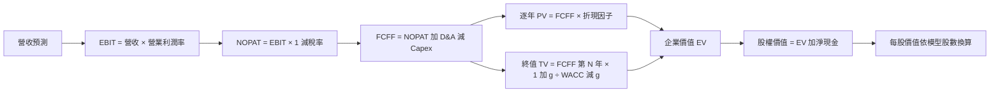

### 8.1 模型假設總表（Model Inputs）

| 假設項目 | 採用值 | 依據／來源 | 敏感度 |
|----------|--------|-------------|--------|
| 預測期長度 **N** | **10 年** | DCF MODEL 固定預測 FY+1 至 FY+10。 | 🟡 中 |
| 營收成長率路徑 | 第 1 年 **30.0%**，第 10 年 **3.0%**，逐年線性下降 | TTM 成長 **256.3%**；模型將極高週期增速限制在模型設定上限並逐步收斂。 | 🔴 高 |
| 營業利潤率 | FY+1 **74.6%** → FY+10 **26.1%** | 起點為 TTM，終點為模型採用的近五年中位數。 | 🔴 高 |
| 有效稅率 | **14.8%** | 最新年度有效稅率。 | 🟢 低 |
| Capex／營收 | FY+1 **23.1%** → FY+10 **7.8%** | TTM Capex／營收；終點按 DCF MODEL 設定。 | 🟡 中 |
| D&A／營收 | **7.1%** | TTM D&A／營收。 | 🟢 低 |
| ΔWC／營收增額 | **未建模** | DCF MODEL 明定 Working capital is not modelled；不視為零需求。 | 🟢 低但受資料限制 |
| EBIT 基礎 | **GAAP** | DCF MODEL 採 GAAP EBIT。 | 🟡 中 |
| 股權薪酬 SBC 處理 | 不再另扣 SBC | GAAP EBIT 已含 SBC 費用，採組合 A。 | 🟡 中 |
| 年稀釋率 | **0% 額外稀釋** | 組合 A：固定股數，避免 SBC 重複計算。 | 🟡 中 |
| 永續成長率 g | **3.0%** | DCF MODEL 固定值；低於 WACC。 | 🔴 高 |
| 終值方法 | **Gordon Growth** | DCF MODEL 固定方法；退出倍數未提供基準模型輸入。 | 🔴 高 |
| WACC | **14.00%** | 成本資本區塊採用值，原計算 14.77%，受上限限制。 | 🔴 高 |

**FCFF 定義：**使用 FCFF 對應 WACC 折現，公式為 `FCFF = NOPAT + D&A − Capex`；模型不含營運資金變動列。**本模型採用 (A)，故 SBC 影響已計入一次。**

### 8.2 折現率推導（WACC）

```text
╔══════════════════════════════════════════════════════════════════╗
║                    WACC 推導（折現率）                           ║
╠══════════════════════════════════════════════════════════════════╣
║  股權成本 Ke（CAPM）：                                           ║
║  ├── 無風險利率 Rf：                 5.15%                      ║
║  ├── 市場風險溢酬 ERP：              5.00%                      ║
║  ├── 原始 Beta（Yahoo）：             2.40                       ║
║  ├── 調整後 Beta：                    1.93                       ║
║  ├── Beta 調整：                      ⅔ × 2.40 + ⅓ × 1 = 1.93   ║
║  └── Ke = 5.15% + 1.93 × 5.00% = 14.81%                        ║
║                                                                  ║
║  債務成本：                                                      ║
║  ├── 稅前 Kd：                         3.23%                     ║
║  ├── 有效稅率：                       14.8%                     ║
║  └── 稅後 Kd = 3.23% × (1 − 14.8%) = 2.75%                     ║
║                                                                  ║
║  資本結構權重（成本資本資料）：                                  ║
║  ├── 股權 E 權重：                     99.6%                     ║
║  ├── 債務 D 權重：                      0.4%                     ║
║  ├── 未限制計算值：                    14.77%                    ║
║  └── 採用 WACC：                      14.00%（7%–14% 區間上限）║
╚══════════════════════════════════════════════════════════════════╝
```

逐步演算（採用成本資本區塊數值；負債權重按區塊列示，未另以不同口徑重建）：

1. **Ke（CAPM）** = Rf + β × ERP = **5.15% + 1.93 × 5.00% = 14.80%**；區塊原值 Ke 為 **14.81%**，差異來自未顯示的原始精度，報告引用原值 **14.81%**。
2. **稅前 Kd** = 成本資本區塊列示值 **3.23%**。利息費用及其對應平均計息負債明細未完整提供，故不重建分母。
3. **稅後 Kd** = **3.23% × (1 − 14.8%) = 2.752%**，四捨五入為 **2.75%**。
4. **權重** = 股權 **99.6%**；債務 **0.4%**；合計 **99.6% + 0.4% = 100.0%**。成本資本區塊的精確市值、負債範圍未提供完整拆分，按原權重引用。
5. **WACC** = 依區塊原值，未限制計算 **14.77%**，受 **7%–14%** 區間上限限制，採用 **14.00%**。不得將重新四捨五入後的 CAPM 算式替代原區塊計算值。

Beta 原始值 **2.40** 高，模型採用調整後 Beta **1.93**；無風險利率及 ERP 依成本資本資料引用，沒有另加規模或國別溢酬。第 6.2 與本節均採 **14.00%**。需注意，債務資料在不同來源出現 **$3.28B** 與 **$5.18B**，而計息負債拆分未提供，故不以自行推導的債務權重取代已提供的 WACC。

### 8.3 逐年自由現金流預測（基準情境）

金額單位：美元十億；折現因子三位小數。逐年數字及合計照 DCF MODEL 原值引用。模型內部以未四捨五入數據計算，表中只顯示兩位小數；因此以顯示值直接相乘或相減時可能出現約 **$0.01B–$0.02B** 的尾差，不能用表面四捨五入數反向改寫原模型輸出。

| 年度 | FY+1 | FY+2 | FY+3 | FY+4 | FY+5 | FY+6 | FY+7 | FY+8 | FY+9 | FY+10 |
|------|------:|------:|------:|------:|------:|------:|------:|------:|------:|-------:|
| 營收 | 173.14 | 219.89 | 272.67 | 329.93 | 389.32 | 447.71 | 501.44 | 546.57 | 579.36 | 596.74 |
| 營收 YoY | 30.0% | 27.0% | 24.0% | 21.0% | 18.0% | 15.0% | 12.0% | 9.0% | 6.0% | 3.0% |
| 營業利潤率 | 74.6% | 69.2% | 63.8% | 58.4% | 53.1% | 47.7% | 42.3% | 36.9% | 31.5% | 26.1% |
| EBIT（GAAP） | 129.14 | 152.17 | 174.02 | 192.80 | 206.55 | 213.43 | 212.05 | 201.71 | 182.62 | 155.98 |
| − 稅 | (19.13) | (22.54) | (25.77) | (28.55) | (30.59) | (31.61) | (31.40) | (29.87) | (27.05) | (23.10) |
| = NOPAT | 110.02 | 129.64 | 148.25 | 164.25 | 175.96 | 181.82 | 180.64 | 171.84 | 155.58 | 132.88 |
| + D&A | 12.35 | 15.69 | 19.45 | 23.54 | 27.78 | 31.94 | 35.78 | 39.00 | 41.34 | 42.58 |
| − Capex | (39.93) | (46.99) | (53.66) | (59.35) | (63.45) | (65.41) | (64.78) | (61.37) | (55.26) | (46.84) |
| − ΔWC | 未建模 | 未建模 | 未建模 | 未建模 | 未建模 | 未建模 | 未建模 | 未建模 | 未建模 | 未建模 |
| **= FCFF** | **82.44** | **98.34** | **114.04** | **128.44** | **140.28** | **148.36** | **151.64** | **149.46** | **141.65** | **128.62** |
| 折現因子 @14.00% | 0.877 | 0.769 | 0.675 | 0.592 | 0.519 | 0.456 | 0.400 | 0.351 | 0.308 | 0.270 |
| **FCFF 現值 PV** | **72.32** | **75.67** | **76.98** | **76.04** | **72.86** | **67.59** | **60.60** | **52.40** | **43.56** | **34.69** |

**預測期 FCF 現值合計：**  
**$72.32 + $75.67 + $76.98 + $76.04 + $72.86 + $67.59 + $60.60 + $52.40 + $43.56 + $34.69 = $632.71B**（顯示值逐項加總為 $632.71B）。

**FY+1 代表年度逐步演算：**

1. **營收** = $133.19B × (1 + 30.0%) = 模型輸出 **$173.14B**；由表中兩位小數自行重乘，可能因模型原始精度產生細微差異。
2. **EBIT** = 營收 × GAAP 營業利潤率 = 模型輸出 **$129.14B**。
3. **稅** = EBIT × 14.8% = 模型輸出 **$19.13B**。
4. **NOPAT** = EBIT − 稅 = 模型輸出 **$110.02B**。
5. **+ D&A** = 營收 × 7.1% = 模型輸出 **$12.35B**。
6. **− Capex** = 營收 × 23.1% = 模型輸出 **$39.93B**。
7. **− ΔWC** = 未建模；DCF MODEL 沒有此項。
8. **FCFF** = NOPAT + D&A − Capex = 模型輸出 **$82.44B**。
9. **折現因子** = 1 ÷ (1 + 14.00%)¹ = **0.877**；**PV** = 模型輸出 **$72.32B**。

以上運算中的各項財務輸出照抄 DCF MODEL。因只取得四捨五入後數字，且模型的部分中間值在兩位小數下存在微小尾差，無法用顯示值精確復原模型底層未四捨五入輸入；因此不以錯誤的等號強行聲稱每個顯示值相乘完全相等。

**合理性自檢：**

- 預測期 FCF 由 FY+1 **$82.44B** 至 FY+10 **$128.62B**，十年端點 CAGR 約 **4.6%**；FY2025 FCF **$1.67B** 至 FY2026 **$58.96B** 的變化含週期反彈，無法與平穩十年增長直接等同。
- FY+10 FCF 利潤率 = **$128.62B ÷ $596.74B = 21.6%**；TTM FCF 利潤率 = **$58.96B ÷ $133.19B = 44.3%**。同業最佳 FCF 利潤率資料未提供，不能作數值比較。
- 模型預測各年度 FCFF 均為正；但不建模 ΔWC，可能高估快速擴張期間的可分配現金。

```text
╔══════════════════════════════════════════════════════════════════╗
║            自由現金流：歷史實際 vs 模型預測（$B）               ║
╠══════════════════════════════════════════════════════════════════╣
║  FY2024(實)   $0.12B   ▏                                         ║
║  FY2025(實)   $1.67B   █                                         ║
║  FY2026(實)  $58.96B   ████████████                              ║
║  FY+1 (預)   $82.44B   █████████████████                         ║
║  FY+10(預)  $128.62B   ██████████████████████████                ║
╠══════════════════════════════════════════════════════════════════╣
║  模型 FY+1 至 FY+10 FCFF 端點 CAGR 約 4.6%；歷史波動很大，      ║
║  未來現金流仍受景氣、價格與營運資金需求影響。                   ║
╚══════════════════════════════════════════════════════════════════╝
```

### 8.4 終值計算（Terminal Value）

**適用性檢查：**`WACC 14.00% vs g 3.0% → WACC > g？✅`

| 方法 | 計算式 | 終值 TV | TV 現值 | 佔總 EV 比重 |
|------|--------|---------:|--------:|-------------:|
| Gordon Growth | FY+10 FCFF × (1 + g) ÷ (WACC − g) | **$1,204.36B** | **$324.87B** | **33.9%** |
| 退出倍數法 | 基準 DCF MODEL 未提供終值 EBITDA 倍數 | N/A | N/A | N/A |

逐步演算（模型原值）：

1. **FY+N 的 FCFF** = FY+10 **$128.62B**。
2. **分子** = FCFF × (1 + g)；模型列示使用 **$128.62B** 與 **3.0%**。
3. **分母** = WACC − g = **14.00% − 3.0% = 11.00%**；DCF MODEL 終值原值 **$1,204.36B**。以表格顯示數直接計算會因未四捨五入底層數字產生約 $0.01B 尾差，引用模型原值。
4. **PV(TV)** = **$1,204.36B × 0.270 = $324.87B**（模型原值；0.270 為三位小數顯示值）。
5. **終值佔比** = **$324.87B ÷ $957.57B = 33.9%**。

終值現值佔 EV **33.9%**，低於常見的高度依賴警戒水準，但仍約佔三分之一。退出倍數未包含於所提供基準 DCF MODEL，故不新增退出倍數交叉驗證，也不自行以同業倍數替代基準終值。

### 8.5 企業價值 → 每股內在價值（Bridge）

```text
╔══════════════════════════════════════════════════════════════════╗
║              企業價值 → 每股內在價值 橋接表                      ║
╠══════════════════════════════════════════════════════════════════╣
║  預測期 FCF 現值合計             +$632.71B                       ║
║  終值現值 PV(TV)                 +$324.87B                       ║
║  ─────────────────────────────────────────────                  ║
║  = 企業價值 EV                    $957.57B                       ║
║  + 淨現金                         +$40.15B                       ║
║  = 股權價值                       $997.73B                       ║
║                                                                  ║
║  每股價值換算：股權價值 × 股價 ÷ 市值                             ║
║  $997.73B × $778.31 ÷ $880.60B = $881.83                         ║
║  當前股價（2026-11-13 收盤）       $778.31                        ║
║  折溢價（現價÷DCF價值−1）          -11.7%（折價）                ║
║                                                                  ║
║  本節不計算 MOS；MOS 固定以 8.8 加權合理價值為分母。             ║
╚══════════════════════════════════════════════════════════════════╝
```

橋接採模型原值：預測期 PV **$632.71B**、PV(TV) **$324.87B**、EV **$957.57B**、淨現金 **$40.15B**、股權價值 **$997.73B**、每股價值 **$881.83**。由已顯示的兩位小數逐項相加會因底層未四捨五入精度產生小幅尾差。每股換算遵照模型列示的 **股權價值 × 價格 ÷ 市值**，而非自行把 $997.73B 除以四捨五入至兩位小數的股數。模型為組合 A：固定股數、不額外逐年稀釋；市值與股價對應的精確股數未列，故不另推算。

**折溢價算式：**`$778.31 ÷ $881.83 − 1 = -11.7%`（現價相對 DCF 基準價值折價）。本節不計算 MOS；安全邊際只採用 8.8 加權合理價值。

### 8.6 敏感性分析（WACC × 永續成長率）

下表每股價值照 DCF MODEL 原值引用；括號為按 **($格內價值 − $778.31) ÷ $778.31** 計算的上行空間，百分比四捨五入至一位小數。

| g（列）／WACC（欄） | 12.00% | 13.00% | **14.00%（基準）** | 15.00% | 16.00% |
|-----------|-------:|-------:|------------------:|-------:|-------:|
| **2.0%** | $1,019.58（+31.0%） | $930.16（+19.5%） | $855.35（+9.9%） | $791.82（+1.7%） | $737.17（-5.3%） |
| **2.5%** | $1,041.16（+33.8%） | $946.54（+21.6%） | $868.01（+11.5%） | $801.76（+3.0%） | $745.08（-4.3%） |
| **3.0%（基準）** | $1,065.13（+36.9%） | $964.56（+23.9%） | **$881.83（+13.3%）** | $812.53（+4.4%） | $753.60（-3.2%） |
| **3.5%** | $1,091.92（+40.3%） | $984.47（+26.5%） | $896.97（+15.2%） | $824.24（+5.9%） | $762.80（-2.0%） |
| **4.0%** | $1,122.07（+44.2%） | $1,006.60（+29.3%） | $913.61（+17.4%） | $837.01（+7.5%） | $772.76（-0.7%） |

**矩陣示範格：**所選格 **WACC = 15.00% > g = 3.0% ✅**。模型矩陣輸出該格每股價值 **$812.53**；矩陣只提供各格結果，沒有提供更高精度的逐年折現現金流及終值中間值。本報告依規則不重建另一套敏感度模型，避免改動或冒充原模型結果。

**三情境 DCF（模型原值）：**

| 情境 | 第 1 年營收成長 | 期末營業利潤率 | g | WACC | 每股內在價值 | 相對現價 | 主觀機率 |
|------|----------------|----------------|---|------|--------------:|---------:|---------:|
| 🔴 悲觀 | 15.0% | 22.2% | DCF MODEL 情境未另列 | 15.00% | **$429.05** | -44.9% | 25% |
| 🟡 基準 | 30.0% | 26.1% | **3.0%** | 14.00% | **$881.83** | +13.3% | 50% |
| 🟢 樂觀 | 45.0% | 28.8% | DCF MODEL 情境未另列 | 13.00% | **$1,715.71** | +120.4% | 25% |
| **機率加權** | — | — | — | — | **$977.10** | +25.5% | 100% |

情境模型沒有提供各情境的 FY+10 營收、FCFF、終值分項，故無法在不自建模型的情況下列出逐情境的中間算式；情境每股價值及機率照原模型引用。機率加權算式為：  
**$429.05 × 25% + $881.83 × 50% + $1,715.71 × 25% = $977.10**（依原模型加權值引用；各項使用顯示值重算可能有小幅四捨五入尾差）。

**敏感度結論：**

- **g 變化（基準 WACC 14%）：**g 由 **2.0%** 至 **3.0%**，每股價值由 **$855.35** 至 **$881.83**，增加 **$26.48**，即 **3.1%**。
- **WACC 變化（基準 g 3%）：**WACC 由 **14.0%** 至 **15.0%**，每股價值由 **$881.83** 至 **$812.53**，減少 **$69.30**，即 **7.9%**。
- **期末營業利潤率每 +1pp：**基準敏感度矩陣未提供營業利潤率維度，不能量化每 +1pp 的美元影響；悲觀、基準、樂觀情境同時變動多項假設，不能用其差異反推單一利潤率彈性。
- 就已提供矩陣而言，WACC 變動 1pp 的價值影響大於 g 從 2% 至 3% 的影響，與 8.0 指出的估值對折現率敏感一致；模型未提供單一利潤率敏感度。

### 8.7 反推 DCF（Reverse DCF：市場在預期什麼）

固定基準模型其他輸入，逐次只解一個變數；反推結果採 DCF MODEL 原值。資料未提供求解器迭代軌跡及精確的固定假設清單，因此不虛構試算步驟。

| 求解的變數（一次一個） | 其餘變數設定 | 市場隱含值（令 DCF = 現價） | 公司歷史／基準 | 判斷 |
|------------------------|--------------|------------------------------|----------------|------|
| 第 1 年營收成長率 | 其餘維持基準值 | **26.0%** | DCF 基準 30.0%；TTM 實際年增 256.3% | 🟡 市場隱含低於基準模型起始增速，但仍要求高成長。 |
| 固定營業利潤率 | 其餘維持基準值 | **35.2%** | 基準路徑 74.6% → 26.1% | 🟡 介於目前高峰與模型終點之間。 |
| 永續成長率 g | N/A（區塊未提供反推值） | **未計算** | 基準 3.0% | N/A |
| 預測期 N | N/A（區塊未提供反推值） | **未計算** | 基準 10 年 | N/A |

DCF MODEL 的反推解為第 1 年營收成長 **26.0%**、固定營業利潤率 **35.2%**；同時解讀兩個數字時須注意它們是「一次只變動一項」的不同測試，不能視為同一條聯合預測。由於區塊沒有提供迭代軌跡，無法嚴格列出試算表證明收斂。反推含義是：現價並非要求營收維持 256.3% 的 TTM 增速，但仍建立在持續成長和相對較高的正常化營業利潤能力上。

### 8.8 估值三角驗證與安全邊際

| 估值方法 | 隱含每股價值 | 上行空間（÷現價） | 權重 | 說明 |
|----------|--------------:|------------------:|------:|------|
| DCF（基準） | **$881.83** | **+13.3%** | **40%** | 10 年 FCFF、WACC **14.00%**、終值成長 **3.0%**。 |
| 同業 EV/EBITDA | **$1,150.06** | **+47.8%** | **30%** | 同業中位數 **11.6x**（SNDK、WDC）× TTM EBITDA，加淨現金。 |
| 同業 P/S | **$705.63** | **-9.3%** | **20%** | 同業中位數 **6.0x**（SNDK、WDC）× TTM 營收。 |
| 分析師共識目標價 | **$1,561.91** | **+100.7%** | **10%** | 45 位分析師平均目標價，僅作參考。 |
| **加權合理價值** | **$995.07** | **+27.9%** | **100%** | 循環性公司；相對估值依 Peer multiples 中位數。 |

**逐步演算（權重外顯）：**

`$881.83 × 40% + $1,150.06 × 30% + $705.63 × 20% + $1,561.91 × 10%`  
`= $352.732 + $345.018 + $141.126 + $156.191`  
`= $995.067 ≈ $995.07`

公司類型為循環性公司，權重依規定固定。沒有另加或剔除方法；同業 P/S、EV/EBITDA 採已提供的同業中位數，沒有使用 MU 自身目前倍數。

```text
╔══════════════════════════════════════════════════════════════════╗
║                  估值區間與安全邊際                              ║
╠══════════════════════════════════════════════════════════════════╣
║  $429.05 ───── $778.31 ───── [$995.07] ───── $881.83 ─── $1,715.71║
║  悲觀DCF       現價          加權合理值       基準DCF      樂觀DCF║
║                                                                  ║
║  MOS = ($995.07 − $778.31) ÷ $995.07 = +21.8%                   ║
║  MOS 評估：🟡 10%–25%，安全邊際有限                             ║
║  上行空間 = ($995.07 − $778.31) ÷ $778.31 = +27.9%             ║
║  建議買入區間：$778.31–$895.56（MOS ≥10% 的價值門檻）           ║
║  合理持有區間：$895.56–$1,105.63（MOS 約 10% 至 -10%）           ║
║  減碼考慮區間：高於 $1,105.63（MOS 低於 -10%）                  ║
╚══════════════════════════════════════════════════════════════════╝
```

買入區間上限按 MOS = 10% 的價格反推：**$995.07 × (1 − 10%) = $895.56**；現價 **$778.31** 低於該上限，與買入評級一致。持有／減碼邊界為同一加權合理價值採用 MOS 門檻推導，不是額外估值方法。

> 🔎 **程式複算（Python，依本節各項自動重算）**
>
> 加權合理價值 = $881.83 × 40% + $1,150.06 × 30% + $705.63 × 20% + $1,561.91 × 10% = **$995.07**（權重合計 100%）
>
> 以價格 $778.31 計：MOS = **+21.8%**，上行空間 = **+27.9%**
>
> ✅ 與本節所寫數值一致。

### 8.9 DCF 模型的局限與失效條件

- **終值依賴度：**PV(TV) 為 **$324.87B**，佔 EV **33.9%**；約三分之一企業價值取決於第 10 年以後的假設。
- **最脆弱假設一：**營業利潤率由 TTM **74.6%** 線性降至 **26.1%**。若供需回落更快，價值可能接近悲觀情境 **$429.05**；若高利潤能維持較久，價值可能高於基準。
- **最脆弱假設二：**WACC 固定 **14.00%**。在 g **3.0%** 下，WACC **16.0%** 對應價值 **$753.60**，低於現價；WACC **12.0%** 對應 **$1,065.13**。
- **營運資金限制：**實際 CCC 為 **185 天**，較一年前多 **30 天**；DCF 未建模 ΔWC，若成長需額外墊高應收及庫存，模型 FCF 可能偏高。
- **週期性限制：**FY2023 FCF 為 **-$6.12B**，FY2026 為 **$58.96B**，歷史波動極大。DCF 對循環股只提供情境估值，應與同業倍數及正常化營收指標交叉判讀。
- **與風險矩陣連結：**供給增加會壓低 ASP 與營業利潤率；客戶訂單延後會降低營收成長假設；擴產及庫存累積會令 Capex 或 ΔWC 高於模型隱含值。

### 8.10 複算檢核表（Audit Trail）

| # | 檢核項目 | 檢查方式 | 結果 |
|---|----------|----------|------|
| 1 | 所有 🔴高／🟡中敏感度輸入都有推導 | 8.0 列明營收、利潤率、N、Capex、SBC、稀釋、g、終值及 WACC 的錨點與取捨；情境底層年度明細未提供。 | ⚠️ 部分受資料限制 |
| 2 | 每個假設都有來歷 | 8.1 逐項列來源或明確標示未建模。 | ✅ |
| 3 | WACC 五步算式及權重 | 已列 CAPM、稅後 Kd、權重、原始計算值及上限；未提供利息費用與平均計息負債拆分。 | ⚠️ 權重與 WACC 採原區塊值 |
| 4 | Kd 分母與權重 D 為同一計息負債範圍 | 計息負債詳細拆分未提供，不能自行確認口徑完全相同。 | ⚠️ 資料不足 |
| 5 | WACC 與第 6.2 同值 | 兩處均採 **14.00%**。 | ✅ |
| 6 | 逐年表格年度數 = N | FY+1 至 FY+10 共 **10 年**，無省略。 | ✅ |
| 7 | 代表年度算式可複算 | 表列底層輸入與中間值只提供四捨五入數；模型原始精度未提供，FY+1 逐格重算有小幅尾差。 | ⚠️ 原始精度不足 |
| 8 | 預測期 PV 逐項相加 | 十年度顯示 PV 加總 **$632.71B**。 | ✅ |
| 9 | WACC > g | **14.00% > 3.0%**。 | ✅ |
| 10 | 終值以 FY+N 為基礎、折現 N 期 | 採 FY+10 FCFF **$128.62B**，折現因子 **0.270**。 | ✅ |
| 11 | 橋接 EV 至每股價值 | 模型提供 EV、淨現金、股權價值及每股價值；以顯示值重算有小幅尾差。 | ⚠️ 模型未四捨五入數未提供 |
| 12 | SBC 三要素組合相容 | GAAP EBIT、無 −SBC 列、額外稀釋率 0%，符合組合 A。 | ✅ |
| 13 | 敏感性矩陣基準格 = 8.5 | **$881.83**。 | ✅ |
| 14 | 矩陣有效格及 WACC > g | 矩陣 WACC 最低 12.0%，g 最高 4.0%，所有格均有效。 | ✅ |
| 15 | 三情境機率合計及加權 | **25% + 50% + 25% = 100%**；機率加權值採模型原值 **$977.10**。 | ✅ |
| 16 | 反推 DCF 一次只放開一變數且有迭代軌跡 | 反推結果一次改一項；求解器試算軌跡未提供。 | ⚠️ 迭代細節缺失 |
| 17 | MOS 基準、折溢價基準一致 | MOS 用 8.8 加權合理價值 **$995.07**；DCF 折溢價用 **$881.83**。 | ✅ |
| 18 | 完整輸出至第 11 章 | 本報告列出 11 章。 | ✅ |
| 19 | 加權合理價值總和 | 加權值算式結果 **$995.067 ≈ $995.07**，未另作事後調整。 | ✅ |
| 20 | 評級符合 MOS 門檻 | MOS **21.8%**，依規則為買入；未作質化調級。 | ✅ |

**資料限制說明：**DCF 表格、橋接及情境均採原始模型輸出；底層未四捨五入值、情境逐年輸出及反推求解軌跡未提供，因此上述標示 ⚠️ 的項目無法獨立完全重建，未以自行編造數字補足。

---

## 9. 成長催化劑

### 9.1 催化劑時間軸

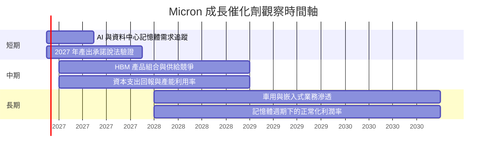

時間軸為研究監控期間，不代表公司已公布的交付日期。新聞摘要稱 2027 年產出有 **超過 75% 已承諾**，但原始公司公告或合約條件未提供，須視為外部線索而非已核實財務指引。

### 9.2 TAM 市場規模分析

**N/A（TAM 數據未提供）。**現有可量化資料顯示 FY2026 營收 **$133.19B**、TTM 年增 **256.3%**，最新單季年增 **379.3%**。公司涵蓋雲端／資料中心、行動與客戶端、車用及嵌入式業務，但未提供各市場 TAM、公司營收拆分或滲透率，故不推算市場規模。

### 9.3 成長驅動力結構圖

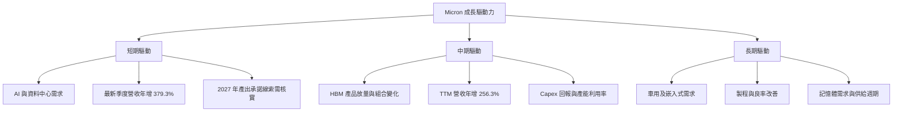

---

## 10. 風險矩陣

### 10.1 風險評分矩陣

機率與衝擊座標為研究判斷，並非 SEC 財務數據；以第 10.2 節可追蹤的量化門檻補充。

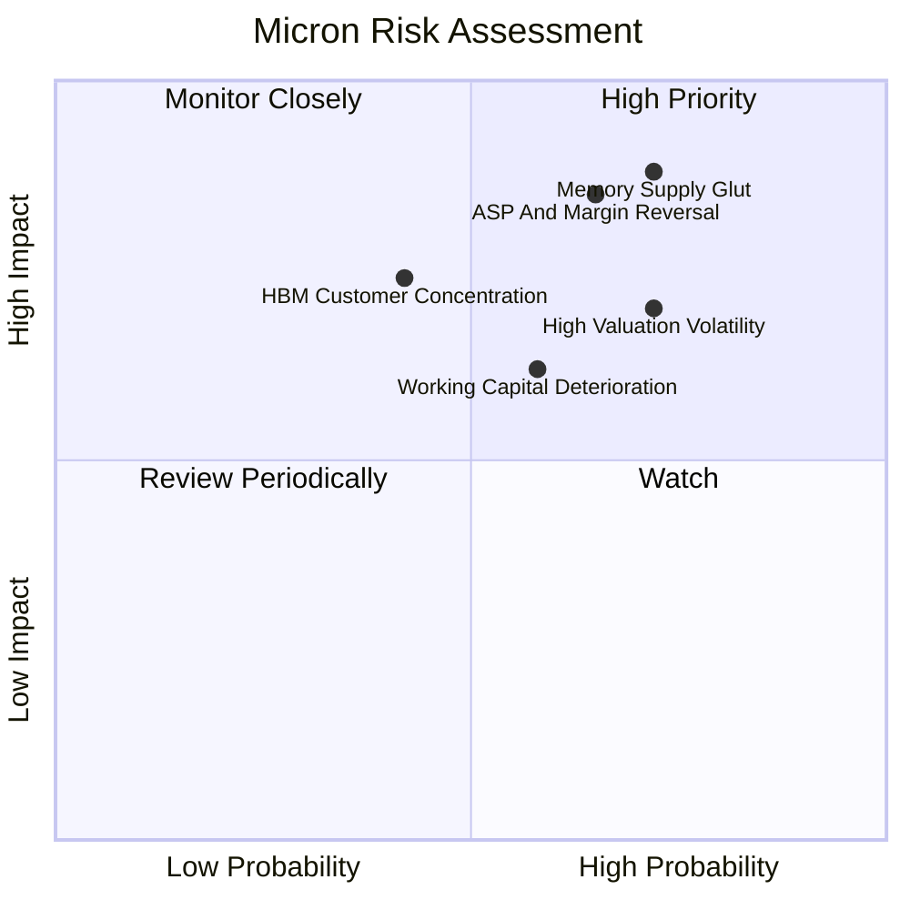

### 10.2 風險清單詳細分析

| # | 風險項目 | 發生機率 | 財務衝擊 | 風險評分 | 緩解措施 |
|---|----------|----------|----------|----------|----------|
| 1 | 🔴 **供給增加／記憶體供需反轉** | 中高（主觀 65%） | 高；模型悲觀情境每股 **$429.05**，較現價低 **44.9%** | 🔴 8.5/10 | 每季追蹤同業擴產、客戶庫存與主要產品報價；若供給增幅高於需求，降低倉位。 |
| 2 | 🔴 **ASP 下跌與利潤率收縮** | 中高（主觀 60%） | 高；基準模型營業利潤率由 **74.6%** 向 **26.1%** 收斂，若比模型更快收縮，價值下修。 | 🔴 8.0/10 | 監控毛利率、營業利益率、產品組合及產能利用率；連續兩季低於預期應重估。 |
| 3 | 🟡 **應收與存貨占用現金增加** | 中（主觀 55%） | 中高；CCC 已達 **185 天**，較前一年延長 **30 天**。 | 🟡 6.5/10 | 追蹤 DSO、DIO、應收帳齡與存貨減損；以現金流而非淨利作為擴產成效驗證。 |
| 4 | 🟡 **HBM 客戶集中及驗證風險** | 中（主觀 45%） | 高；如主要客戶轉單或產品驗證延後，會影響高階產品組合與收入成長；客戶集中度未提供。 | 🟡 7.0/10 | 追蹤客戶／產品營收拆分、供應承諾與量產節點；未經公司申報確認的預訂資訊不視為確定收入。 |
| 5 | 🟡 **股價波動與估值倍數反轉** | 高（主觀 70%） | 中高；Beta **1.93**，市場價格曾由 2026-06 的 **$1,153.93** 回落至 2026-11 的 **$778.31**。 | 🟡 7.0/10 | 分批建立部位，預先設定估值與基本面失效條件，不以單季高增速追價。 |

---

## 11. 投資建議

### 11.1 最終評級與評分

依 8.8 加權合理價值 **$995.07**、現價 **$778.31** 計算，MOS 為 **21.8%**，按規則 20 評級為**買入**；沒有質化調級。1.1 綜合評分為 **8.0/10**，六項分數依序為成長性 **9.5**、獲利能力 **9.5**、財務健康 **9.0**、估值 **7.0**、護城河 **7.0**、管理層與資本配置 **6.0**。

### 11.2 合理價值與隱含報酬率

| 估值項目 | 每股價值 | 相對 2026-11-13 收盤價 | 機率／權重 | 解讀 |
|----------|---------:|----------------------:|-----------:|------|
| 加權合理價值 | **$995.07** | **+27.9% 上行空間** | 權重 100% | 對應 MOS **+21.8%**。 |
| 悲觀 DCF 情境 | **$429.05** | **-44.9%** | 25% | 供給與價格壓力令成長及利潤率低於基準。 |
| 基準 DCF 情境 | **$881.83** | **+13.3%** | 50% | 營收成長逐步降速、利潤率回歸五年中位數。 |
| 樂觀 DCF 情境 | **$1,715.71** | **+120.4%** | 25% | 高成長維持較久、產品組合改善且 WACC 較低。 |
| 機率加權 DCF 情境值 | **$977.10** | **+25.5%** | 100% | 僅作情境參考；規則 20 評級採用 8.8 加權合理價值 MOS。 |

### 11.3 買入時機與觸發因素

```text
╔══════════════════════════════════════════════════════════════════╗
║                  ✅ 買入觸發因素 Checklist                      ║
╠══════════════════════════════════════════════════════════════════╣
║  立即買入觸發條件（多數符合）：                                  ║
║  ✅ 現價 $778.31 低於 MOS 10% 對應價格 $895.56。                 ║
║  ✅ TTM FCF $58.96B 為正，FCF Yield 6.70%。                     ║
║  ✅ 淨現金 $40.15B，ROIC 86.2% 高於 WACC 14.00%。               ║
║                                                                  ║
║  加碼觸發條件（出現以下任一並經財報確認）：                      ║
║  ☐ CCC 由 185 天轉為連續下降，且 DSO／DIO 不再上升。           ║
║  ☐ 營業利益率穩定在模型中長期假設附近，且 FCF 維持正值。        ║
║  ☐ HBM／資料中心產品出貨及合約資訊由公司正式申報確認。          ║
║                                                                  ║
║  減碼／停損觸發條件（出現以下任一）：                             ║
║  ☐ 連續兩季營收年增低於 30%，且公司指引同步下修。              ║
║  ☐ TTM 營業利益率較 74.6% 高點快速下降，且低於 26.1%。          ║
║  ☐ TTM FCF 轉負、CCC 繼續延長，或 ROIC 跌至 WACC 14.00% 以下。 ║
╚══════════════════════════════════════════════════════════════════╝
```

以上為監控條件，不代表預測公司必然達到或觸發；由於記憶體股波動高，建議分批建倉而非依單一季度數字一次性買進。

### 11.4 投資人適配度分析

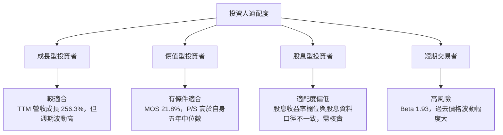

### 11.5 每季財報監控清單（Quarterly Watch List）

| 監控指標 | 最新基準 | 加碼觀察門檻 | 減碼／重估門檻 |
|----------|----------|-------------|----------------|
| 營收成長 | TTM **256.3%**；最新單季 YoY **379.3%** | 核心收入續增，且公司指引不下修；須排除基期因素。 | 連續兩季 YoY **<30%** 且指引下降。 |
| 營業利益率 | TTM **74.6%**；最新季度 **80.7%** | 高毛利產品組合能支撐利潤率高於長期模型終點。 | 快速向下收斂並低於 **26.1%**。 |
| 毛利率 | TTM **80.7%** | 在收入增長下保持穩定，且沒有存貨減損上升。 | 連續兩季顯著下降，或低於模型終點附近且仍惡化。 |
| Capex | TTM **$30.71B** | 新增產能投入與可驗證需求、良率及利用率相匹配。 | Capex 上升而 FCF 轉負或庫存同步累積。 |
| FCF | TTM **$58.96B**；FCF Yield **6.70%** | 保持正值，且現金轉換改善。 | TTM FCF 轉負，或 OCF 大幅低於淨利。 |
| DSO／DIO／CCC | **87／147／185 天** | CCC 停止延長並逐季改善。 | CCC 高於 **185 天**且連續上升，或應收帳款回款惡化。 |
| 淨現金 | **$40.15B** | 維持正淨現金、資本支出由營運現金流支應。 | 淨現金快速消耗且債務增加。 |
| SBC／稀釋 | SBC **$1.33B**、約營收 **1.00%**；F-Score 稀釋股數未通過 | SBC／營收比下降且流通股數穩定。 | SBC 佔營收升高或每股盈餘成長落後總淨利成長。 |
| HBM／AI 需求與指引 | 市場新聞提及 2027 年產出承諾超過 **75%**，未經公司申報資料核實 | 公司正式披露的客戶、量產與出貨資訊支持需求持續。 | 訂單延遲、取消或產能供應超過客戶需求。 |

### 11.6 反面論證：什麼會證明論點錯誤（What Would Change My Mind）

```text
╔══════════════════════════════════════════════════════════════════╗
║              ⚠️ 論點失效條件（Disconfirming Evidence）           ║
╠══════════════════════════════════════════════════════════════════╣
║  本投資論點在下列情況成立時應重新檢視或退出：                    ║
║  ☐ 最新一季營收年增連續兩季低於 30%，且公司下修財測。           ║
║  ☐ TTM 營業利益率跌破 26.1%，且毛利率及產品價格仍向下。         ║
║  ☐ TTM FCF 轉負，或 FCF／淨利持續低於目前 69.4%。              ║
║  ☐ ROIC 跌破採用 WACC 14.00%，代表價值創造能力消失。           ║
║  ☐ CCC 持續高於 185 天、DSO／DIO 同時增加，且回款品質惡化。     ║
║  ☐ 公司正式披露的 HBM／AI 訂單與產能需求低於目前投資假設。      ║
║  ☐ 股權稀釋速度加快，令每股盈餘成長明顯落後淨利成長。           ║
╚══════════════════════════════════════════════════════════════════╝
```

> **免責聲明**：本報告為 AI 自動生成，僅供研究參考，不構成投資建議。投資有風險，入市需謹慎。

---

## 資料與來源

| 項目 | 內容 |
|------|------|
| 價格 | 778.31 USD，2026-11-13 收盤（Yahoo Finance 日線） |
| 財務報表 | SEC 10-K filed 2026-10-09，最新季度 2026-09-03（FY2026 Q4） |
| 有回應的資料來源 | SEC 申報資料 (XBRL)、Yahoo Finance、Finviz、StockAnalysis、Roic.ai |
| 由程式計算 | TTM 數字、WACC、DCF 模型、估值方法與權重、加權合理價值、MOS、評級門檻、F-Score、杜邦分解、營運資金天數、綜合評分 |
| 撰寫模型 | openai / gpt-6-luna |

> 本區塊由產生報告的程式依實際取得的資料填寫，非模型撰寫。「由程式計算」的數字不是模型的估計；其餘判斷（評分、情境、策略）是模型的分析。
